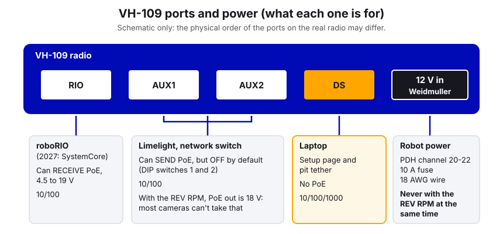
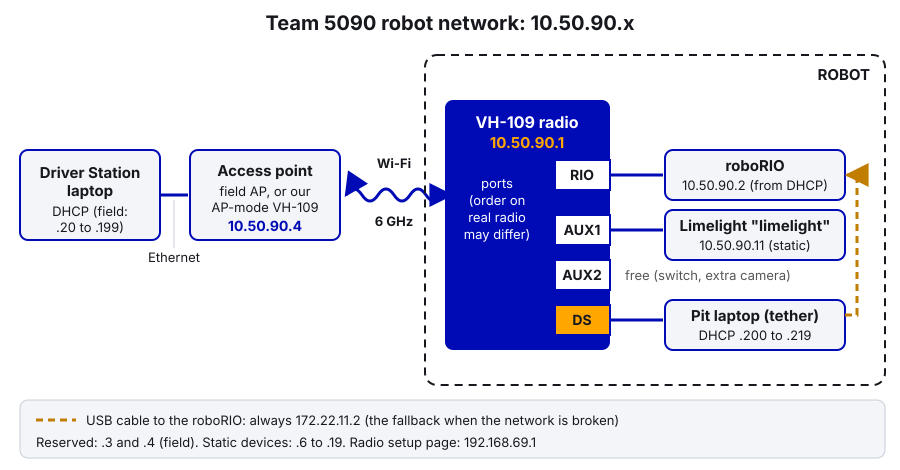

# 01. The Robot Radio and Robot Network

> **Who it's for:** anyone who sets up the robot, tethers in the pit, or gets "No Robot Communication" and wants to fix it. No Java needed.
> **What you need first:** the FRC Game Tools and WPILib installed (see the tools table in the [Robot-Template STUDENT-GUIDE, section 1](https://github.com/TorqueNados-FRC5090/Robot-Template/blob/b8dddd0e338841e867c0cc260162e6097adecd7b/STUDENT-GUIDE.md#L8-L19)). A Windows laptop with an Ethernet port (or a USB-Ethernet adapter).
> **Time:** about 45 minutes to read and try. Firmware update plus setup at the robot: 15 to 20 minutes.

**What you'll learn**
- What the radio does, and what each of its four Ethernet ports is for.
- How to update the radio firmware and set it up for team 5090 at home.
- The 10.50.90.x address plan: who lives at which number, and why.
- How to connect the Driver Station by Ethernet, Wi-Fi, or USB, and how to image the roboRIO.
- How to find the problem when there is no connection, the wrong team number, or no Limelight.

> **Sources.** Everything below is checked against the Vivid-Hosting radio docs (frc-radio.vivid-hosting.net) and the WPILib docs, as of October 2026. Where the two disagree, this guide follows the **newer** Vivid-Hosting docs and says so. Items marked **(not verified)** are things we could not confirm in the docs. Check them on the real radio before you trust them.

---

## 1. What the radio actually does

The robot has no wires to the driver station during a match. The **radio** is the robot's wireless link. It does three jobs:

1. **Wireless bridge.** It joins a Wi-Fi network (the field's, or our practice access point) and passes data between the Driver Station laptop and the robot.
2. **Network switch.** It has four Ethernet ports, so the roboRIO, the Limelight, and a laptop can all plug into it.
3. **DHCP server.** It hands out IP addresses to devices on the robot that ask for one (the roboRIO gets `.2`).

Since 2025 the official radio is the **Vivid-Hosting VH-109**. It uses **Wi-Fi 6E**, which runs on the **6 GHz** band. That band is much quieter than the 2.4 GHz and 5 GHz bands that every phone and school network uses, so the link is faster and steadier. It also has a 2.4 GHz radio for diagnostics and a limited driver connection.

> **Old radio note.** Before 2025, FRC used the **OpenMesh OM5P** radio, set up with the "FRC Radio Configuration Utility". That radio and that utility are obsolete for us. If you find an OM5P in a drawer, it is not legal on the field. Older guides and Chief Delphi posts about "the bridge configuration utility" do **not** apply to the VH-109.

### The ports

| Port | What plugs in | Power | Speed |
|---|---|---|---|
| **RIO** | The roboRIO (in 2027, SystemCore) | Can **receive** Power over Ethernet (PoE), 4.5–19 V | 10/100 |
| **AUX1**, **AUX2** | Limelight, a network switch, etc. | Can **send** PoE, but **off by default** (DIP switches 1 and 2) | 10/100 |
| **DS** | A laptop, or a switch for laptops | No PoE | 10/100/1000 |

Plus a **12 V input** (a green Weidmuller screw connector) for power from the robot.



Why the DS port matters: it's the port you plug the laptop into, both to set up the radio and to tether to the robot in the pit. Plugging the laptop into an AUX port works for normal robot traffic, but the docs tell you to use the DS port for setup.

### Powering the radio

The VH-109 can run straight off battery voltage. The docs list three ways to power it:

- **12 V from the robot** into the Weidmuller input. Our electrical binder (`5090 Electrical Reference 2027`) says: 18 AWG wire from a PDH low-current channel (20–22) with a 10 A fuse. This is what we do.
- **PoE into the RIO port**, for example from the REV **Radio Power Module (RPM)**, which puts out about 18 V.
- **Both at once**, but only if both come from the **same** source and voltage.

Two warnings straight from the docs:
- **Never use the REV RPM and the 12 V input at the same time.** It can damage the radio.
- If you turn on PoE output on AUX1/AUX2 and use the RPM, the AUX devices get 18 V. Most cameras can't take that.

The **game manual** decides what is legal for radio power. Re-read the radio rules every season.

### Mounting (a programmer should still know this)

The 6 GHz signal is easily blocked. If comms drop on the field, mounting is a top suspect. Vivid-Hosting says:
- Mount it high, against a metal tube or plate (the metal pulls heat away).
- Keep things more than 12 inches from the front of the radio.
- Status lights must face outward so field staff can read them.
- Do **not** fully enclose it in a case. A hot radio has more lag (about 5 ms normally, around 40 ms when hot).
- Never point the lights at the floor.

---

## 2. The 10.50.90.x address plan

Every device on the robot network has an IP address. FRC builds it from the team number: **10.TE.AM.x**. For team 5090, TE = 50 and AM = 90, so our network is **10.50.90.x**.



| Address | Device | How it gets it |
|---|---|---|
| `10.50.90.1` | VH-109 robot radio | Set when you configure the radio |
| `10.50.90.2` | roboRIO | Handed out by the radio (DHCP), because the roboRIO has team number 5090 |
| `10.50.90.3`, `.4` | Field network. At home, `.4` is our access-point radio | Reserved, never use them |
| `10.50.90.11` | Limelight (hostname `limelight`) | **Static**, set on the Limelight's own web page |
| `10.50.90.20`–`.199` | Driver Station on the field | Handed out by the field |
| `10.50.90.200`–`.219` | Laptops and DHCP devices on the robot side | Handed out by the robot radio |
| `172.22.11.2` | roboRIO over a **USB** cable | Fixed, always this address |
| `192.168.69.1` | The radio's setup page (management address) | Fixed, always this address |

Why the Limelight is static: the Limelight docs recommend `10.TE.AM.11` with netmask `255.255.255.0` and gateway `10.TE.AM.1`. A fixed address boots faster and avoids DHCP trouble on the field. WPILib says static devices should use `.6` to `.19`, so `.11` fits. The 2026 robot has one Limelight (`limelight`, `.11`). If you add more, give every extra Limelight its **own** hostname and its **own** address in that range (`.12`, `.13`, ...). (The 2026 code also polls a `limelight-left` that isn't on the robot; it's a leftover.)

You don't usually need to remember numbers. The roboRIO also answers to a name, `roboRIO-5090-FRC.local`, through **mDNS** (a way for devices to find each other by name). The Driver Station and Phoenix Tuner X use that name or the team number.

---

## 3. Step by step: set up the radio at home

### A. Get onto the radio's setup page

1. Plug an Ethernet cable from the laptop into the radio's **DS** port.
2. Power the radio. Use a 12 V/2 A supply on the Weidmuller input, a VH-117 PoE wall adapter on the RIO port, or the robot itself.
3. Turn **off** the laptop's Wi-Fi so Windows doesn't send traffic the wrong way.
4. Open a browser and go to `http://radio.local/`.
5. If that doesn't load, give the laptop a static address. Either:
   - run Vivid-Hosting's **Network Assistant Tool** ("Run as Administrator", pick the Ethernet adapter, click Configure), or
   - set it by hand: IP `192.168.69.2`, mask `255.255.255.0`, gateway blank. Then browse to `http://192.168.69.1/`.

### B. Update the firmware first

The firmware version is shown at the bottom of the setup page. (You can also see it at `http://192.168.69.1/status`.)

> **Docs disagree here.** The WPILib page says "skip this if you're at 1.3.0 or later". That line is from the 2025 season. Vivid-Hosting's current pages say **2.0.0 or newer** is required for 2026 events, and the firmware changelog says **2.0.1** is the minimum the event Radio Kiosk accepts. Follow Vivid-Hosting: always update to the newest release on their Firmware Releases page.

1. On [Firmware Releases](https://frc-radio.vivid-hosting.net/overview/firmware-releases), download the **Radio Variant** file. (There are two sections, for radios already on 1.2.x or newer and for radios older than 1.2.0. Pick the one that matches your radio.)
2. Copy the **SHA-256** checksum shown under that file.
3. On the setup page, find **Firmware Upload**. Paste the checksum into the **Checksum** box.
4. Click **Browse…**, pick the file, then click **Upload**.
5. Wait **2 to 3 minutes**. **Do not unplug the radio.** Losing power during an update can brick it.
6. It's done when **PWR is solid and SYS blinks slowly (about once a second)**.

### C. Configure it for 5090

These are the fields on the current (2.0.x) setup page:

| Field | What to put | Why |
|---|---|---|
| **Robot Radio Mode** | Select it | Makes it a robot radio (a Wi-Fi client) |
| **Team Number** | `5090` | Sets the 10.50.90.x network and the network name |
| **SSID Suffix** | Optional, e.g. `theseus` | Tells our network apart from others. The network name becomes `FRC-5090-theseus` |
| **WPA Key For 6GHz Connection** | Our team password | Must match our access-point radio |
| **WPA Key For 2.4GHz Access Point** | A password | What people type to join the 2.4 GHz network |
| **Enable 2.4 GHz Wi-Fi** | On only if you need it (see below) | Diagnostic / limited driver connection |
| **Enable QoS BW Limit** | On | Turns on the 7 Mbps bandwidth limit (the docs say it covers the 2.4 GHz side too). We suggest leaving it on so practice feels like the field (the changelog says radios programmed by the existing kiosks get it on by default). Toggling it makes the radio do a scheduled reboot |
| **Enable SystemCore Mode** | **Off for a roboRIO** | Changes the radio's DHCP reservation from `roboRIO-XXYY-FRC` to `robot.local`. Only for SystemCore (2027) |

Click **Configure** to save. Mentors keep the team WPA keys. Don't write them in the code repo.

### D. Home practice vs. competition

**At competitions** you don't use this page. Every event has a **Radio Kiosk**. You bring the radio, the kiosk programs it for the field, and updates the firmware if it's too old. The docs say the setup page "should not be used" at competition. After an event, set the radio back up for home with the steps above. That's the safe habit: the kiosk sets event settings, so our home access point may not match anymore.

**At home** the radio needs something to connect to. Our options, best first (from Vivid-Hosting's "Practicing At Home" page):

1. **A second VH-109 set to Access Point Mode (recommended).** Same team number, suffix, and WPA keys. Power it from a VH-117 PoE wall adapter or a 12 V/1 A wall supply. **Never from a battery**: an access-point radio on battery power isn't legal, and the radio turns off its Wi-Fi if it detects a battery. Use a heatsink, since an access-point radio gets hot and lag goes up. Plug the DS laptop into the access point's DS port. Its address is `10.50.90.4`.
2. **A VH-113** (the real field access point). Closest to the field, but costs more.
3. **A laptop with Wi-Fi 6E** can join the access point directly.
4. **The robot radio's own 2.4 GHz network (last resort).** Vivid-Hosting does **not** recommend this for driving. School 2.4 GHz is crowded, and lag and dropouts will be bad.

> **2.4 GHz changed in firmware 2.0.0.** Older docs (including the current WPILib page) say to flip **DIP switch 3** to turn on the 2.4 GHz network. The 2.0.0 changelog says the DIP switch feature was **removed** and replaced with the **Enable 2.4 GHz Wi-Fi** checkbox. On our updated radios, use the checkbox. Older notes also say the 2.4 GHz network shuts off once the radio joins a 6 GHz access point, until it's power cycled. **(not verified)** whether that's still true in 2.0.x.

---

## 4. Connecting the Driver Station

The Driver Station (DS) must be set to team **5090** (Setup tab). The laptop's network adapters should be set to **"Obtain an IP address automatically" (DHCP)**. See [03 Driver Station and Match Checklist](03-driver-station-and-match-checklist.md) for the DS itself.

| Method | How | When |
|---|---|---|
| **Ethernet tether** | Cable from the laptop to the robot radio's **DS** port | In the pit, on the bench. Most reliable |
| **Wi-Fi via our access point** | Laptop wired to the access-point radio, or joined to it with Wi-Fi 6E | Practice driving at home |
| **Wi-Fi 2.4 GHz** | Join `FRC-5090...` with the 2.4 GHz key | Quick checks only |
| **USB** | USB A-to-B cable to the roboRIO's USB device port | Imaging, or when the network is broken. The roboRIO is `172.22.11.2` |
| **On the field** | Ethernet to the team station. The field does the rest | Matches |

USB is the "always works" fallback. If you can reach the roboRIO over USB but not over the radio, the problem is the radio or the Ethernet cable, not the roboRIO.

---

## 5. Imaging the roboRIO

The **roboRIO image** is the operating system on the robot controller. It must be updated **every season** to match that year's WPILib. The **firmware** is a different thing and almost never needs updating.

**roboRIO 1** (imaged over USB):
1. Install the current FRC Game Tools.
2. Connect a USB A-to-B cable (printer cable) from the laptop to the roboRIO.
3. Open the **roboRIO Imaging Tool** (if it acts up, right-click and Run as Administrator).
4. Select the roboRIO, choose **Format Target**, enter team `5090`, pick the newest image, and click **Reformat**. It takes 3 to 10 minutes.
5. Press the roboRIO's Reset button when it's done.

**roboRIO 2** (boots from a microSD card; the Imaging Tool can't image it directly):
1. In the Imaging Tool, click the SD button to find `FRC_roboRIO2_YEAR_VERSION.img.zip`.
2. Write it to the microSD card with balenaEtcher or Raspberry Pi Imager. If Windows offers to format the card afterwards, say **no**.
3. Put the card in the roboRIO, connect over USB, open the Imaging Tool, choose **Edit Startup Settings**, enter `5090`, and click **Apply**.

**(not verified):** this guide doesn't know whether Theseus has a roboRIO 1 or 2. Look at the case before you start.

> **2027: SystemCore replaces the roboRIO.** The imaging steps, the USB address, the controller's name on the network, and possibly which radio port it uses will all change. The radio already has an **Enable SystemCore Mode** option for this. Don't follow the roboRIO steps above for SystemCore. Check the current WPILib "Zero to Robot" docs and our electrical binder when the 2027 hardware arrives.

---

## 6. Status lights

**Radio** (from Vivid-Hosting's LED page):

| PWR | SYS | Means |
|---|---|---|
| Off | – | No power |
| Solid | Off | Booting |
| Solid | Slow blink (1 Hz) | Powered, but can't reach `10.50.90.4` (the field side / access point) |
| Solid | Fast blink (20 Hz) | Firmware is being written. **Don't unplug** |
| Solid | Very fast (50 Hz) | Firmware done, first boot |
| Solid | Solid | Connected: can reach `10.50.90.4` |
| Solid + SYS/2.4G/6G all fast | | Set to Access Point Mode **and** running on a battery. Wi-Fi is off until fixed and power cycled |

Notice: a slow-blinking SYS is **normal** on the bench with no access point turned on. It's also what "firmware update finished" looks like. The other lights are **2.4G**, **6G** (the two Wi-Fi radios) and **RIO** (Ethernet link to the roboRIO). The LED page names them but doesn't describe their patterns. **(not verified):** what each blink of those three means. Firmware 2.0.1 added a new SYS pattern for "programmed by a WPA kiosk". The docs don't describe it yet.

**roboRIO:** the Power light turns **amber** during a brownout (more in [03](03-driver-station-and-match-checklist.md)).

---

## In our code

**The Limelight address is in the template's tool notes.** The [STUDENT-GUIDE tools table, lines 8–19](https://github.com/TorqueNados-FRC5090/Robot-Template/blob/b8dddd0e338841e867c0cc260162e6097adecd7b/STUDENT-GUIDE.md#L8-L19) ends with:

```
Limelight setup is done in a web browser at `http://limelight.local:5801` (or `http://10.50.90.11:5801`).
```

Notice the two ways in: the mDNS name (`limelight.local`) and the static IP. If the name fails but the IP works, mDNS is the problem (often Bonjour on the laptop), not the camera.

**The robot code finds Limelights by hostname, not IP.** In [Robot.java, lines 77–80](https://github.com/TorqueNados-FRC5090/Hephaestus/blob/c2f0cee6f61db3f26f911d3f5623ed7fa27a5b03/src/main/java/frc/robot/Robot.java#L77-L80):

```java
    if (kUseLimelight) {
      updateVision("limelight");
      updateVision("limelight-left");
```

Each name must match the hostname set on that camera's web page **exactly**. Rename a camera and forget the code, and the code quietly gets no data. Notice there's no error: Limelight data comes through NetworkTables, which happily returns zeros for a camera that doesn't exist. (The 2026 robot has only **one** Limelight, `limelight`; the `limelight-left` line is a leftover from an earlier setup, see guide 17.)

**The template turns "is the camera there?" into a dashboard light.** [Vision.java, lines 91–103](https://github.com/TorqueNados-FRC5090/Robot-Template/blob/b8dddd0e338841e867c0cc260162e6097adecd7b/src/main/java/frc/robot/subsystems/Vision.java#L91-L103):

```java
    /** A Limelight's "hb" (heartbeat) number goes up every frame. If it stops changing, the camera is gone. */
    private void checkConnected(String camera, double now) {
        double heartbeat = LimelightHelpers.getLimelightNTDouble(camera, "hb");
        ...
        boolean connected = heartbeat != 0 && now - m_lastHeartbeatChange.get(camera) < kHeartbeatTimeoutSeconds;
        SmartDashboard.putBoolean("Vision/" + camera + "/Connected", connected);
```

This is the right way to check a network device. Don't just look at one value. Check that it's **changing**. The 2026 robot code doesn't have this. It shows `Vision/Seconds since last tag` instead, which also goes up when the camera is fine but sees no tag. Moving the template's check into the robot code is a good first task. For everything else about the cameras, see [17 Limelight and Vision](17-limelight-and-vision.md).

---

## Troubleshooting

Work from the laptop outward. Each step rules out one link in the chain.

**"No Robot Communication" on the DS**
1. DS **Setup** tab: is the team number `5090`?
2. DS **Diagnostics** tab, connection lights:
   - **Enet Link** off: the cable isn't plugged in or is bad.
   - **Robot Radio** red: the laptop can't ping `10.50.90.1`. Check radio power (PWR light), the cable, and that the laptop is on DHCP.
   - **Robot Radio** green, **Robot** red: the radio is fine, but the roboRIO isn't answering. Check the RIO light on the radio, the cable between the radio's RIO port and the roboRIO, roboRIO power, and the roboRIO team number.
3. Turn off Windows Firewall and disable other network adapters (WPILib's "roboRIO Network Troubleshooting" page shows how).
4. Try USB. If USB works, the roboRIO is fine and the problem is network or radio.

**Wrong team number** (the roboRIO isn't at `10.50.90.2`, Tuner X can't find it, or the radio's network is called `FRC-1`)
- A brand-new radio comes set to team **1** (`10.0.1.1`). Configure it as in section 3C.
- The roboRIO's team number is set when imaging, or later with **Edit Startup Settings** / the WPILib **roboRIO Team Number Setter**. If the roboRIO's number is wrong, the radio won't give it `.2`.
- A wrong roboRIO team number also breaks Phoenix Pro **Season Pass** licensing (see [02](02-phoenix-tuner-x-and-can.md)).

**Can't reach the Limelight**
1. Browse to `http://10.50.90.11:5801`. If that works but `limelight.local:5801` doesn't, install or repair **Bonjour** on the laptop.
2. If neither works: is the camera powered (its lights on)? Is its cable in an **AUX** port or the network switch? Remember AUX PoE is **off** by default, so the Limelight needs its own power.
3. A Limelight takes up to about 30 seconds to boot. Wait.
4. Still nothing: it may have a wrong static address. Hold the Limelight's config button for 10 seconds after boot to reset its networking (Limelight docs), then set `10.50.90.11` again.
5. Web page works but the code sees nothing: check the **hostname** matches the code.

**Can't open the radio page** — Turn off Wi-Fi, use the DS port, run the Network Assistant Tool, or set `192.168.69.2` by hand and go to `192.168.69.1`. Make sure Game Tools (which includes an mDNS responder) is installed.

**Drops in and out while driving** — Usually mounting (metal nearby, enclosed, lights facing in or down), a loose Ethernet cable (look for "Radio lost / Radio seen" events in the DS log), or the radio rebooting from a power blip. A radio reboot shows as about 40 to 50 seconds with no radio ping. See the DS Log Viewer section in [03](03-driver-station-and-match-checklist.md).

---

## Common mistakes

- **Using the old OM5P instructions** (the Radio Configuration Utility, "bridge" mode) on a VH-109. They don't apply.
- **Unplugging during a firmware update.** Wait for PWR solid and SYS slow blink.
- **Following the DIP switch 3 instructions on 2.0.x firmware.** Use the "Enable 2.4 GHz Wi-Fi" checkbox.
- **Powering the access-point radio from a robot battery.** Not legal, and the radio turns off its Wi-Fi.
- **Using the RPM and the 12 V input together.** Can damage the radio.
- **Giving a device a static address that clashes** with `.1`–`.4` or `.20` and up. Keep static devices in `.6`–`.19`.
- **Renaming a Limelight without updating the code.** The code gets zeros and no error.
- **Thinking slow SYS blink on the bench is a fault.** It just means no access point is reachable.

---

## Checklist

- [ ] Radio firmware is the newest release (2.0.1 or later for the 2026 rules)
- [ ] Radio: Robot Radio Mode, team 5090, our 6 GHz key. SystemCore Mode **off** (roboRIO)
- [ ] Access-point radio: same team/suffix/keys, wall powered, heatsink on
- [ ] roboRIO imaged with this season's image, team number 5090
- [ ] Laptop on DHCP, DS team number 5090, firewall off
- [ ] DS Diagnostics: Enet Link, Robot Radio, Robot all green
- [ ] Limelight answers at `http://10.50.90.11:5801`, hostname matches the code
- [ ] Radio mounted high, lights facing out, not enclosed, not near motors

---

## Practice

1. **Map the network.** With the robot on and tethered, open `http://10.50.90.11:5801` and the radio page. Fill in a table of every device's address and hostname. Tape it inside the electronics cover.
2. **Break it on purpose.** With the robot on blocks and disabled, unplug the roboRIO's Ethernet cable from the radio. Watch which DS Diagnostics lights change, and what the DS log shows. Plug it back in and watch it recover.
3. **USB fallback.** Connect over USB only (Wi-Fi off, no Ethernet). Ping `172.22.11.2` from a command prompt. Connect Phoenix Tuner X using the "roboRIO USB" preset.
4. **Port the heartbeat check.** On a branch, add a `Vision/<name>/Connected` check (like the template's `checkConnected`) to the 2026 robot code. Test it by unplugging the camera.

---

## Go further

- Vivid-Hosting radio docs (the source of truth for the VH-109): https://frc-radio.vivid-hosting.net/
  - Programming your radio at home: https://frc-radio.vivid-hosting.net/overview/programming-your-radio-at-home
  - Upgrading firmware: https://frc-radio.vivid-hosting.net/overview/upgrading-firmware
  - Firmware releases: https://frc-radio.vivid-hosting.net/overview/firmware-releases
  - Firmware changelog: https://frc-radio.vivid-hosting.net/advanced-topics/firmware-changelog
  - Practicing at home: https://frc-radio.vivid-hosting.net/overview/practicing-at-home
  - Access Point mode: https://frc-radio.vivid-hosting.net/access-points/setting-vh-109-to-access-point-mode
  - Wiring: https://frc-radio.vivid-hosting.net/overview/wiring-your-radio
  - Mounting: https://frc-radio.vivid-hosting.net/overview/mounting-your-radio
  - LED status: https://frc-radio.vivid-hosting.net/overview/led-status-indications
  - Ports: https://frc-radio.vivid-hosting.net/tech-specs/ports
- WPILib, Programming your Radio: https://docs.wpilib.org/en/stable/docs/zero-to-robot/step-3/radio-programming.html
- WPILib, IP Configurations: https://docs.wpilib.org/en/stable/docs/networking/networking-introduction/ip-configurations.html
- WPILib, roboRIO Network Troubleshooting: https://docs.wpilib.org/en/stable/docs/networking/networking-introduction/roborio-network-troubleshooting.html
- WPILib, Imaging roboRIO 1: https://docs.wpilib.org/en/stable/docs/zero-to-robot/step-3/imaging-your-roborio.html
- WPILib, Imaging roboRIO 2: https://docs.wpilib.org/en/stable/docs/zero-to-robot/step-3/roborio2-imaging.html
- Limelight getting started: https://docs.limelightvision.io/docs/docs-limelight/getting-started/summary
