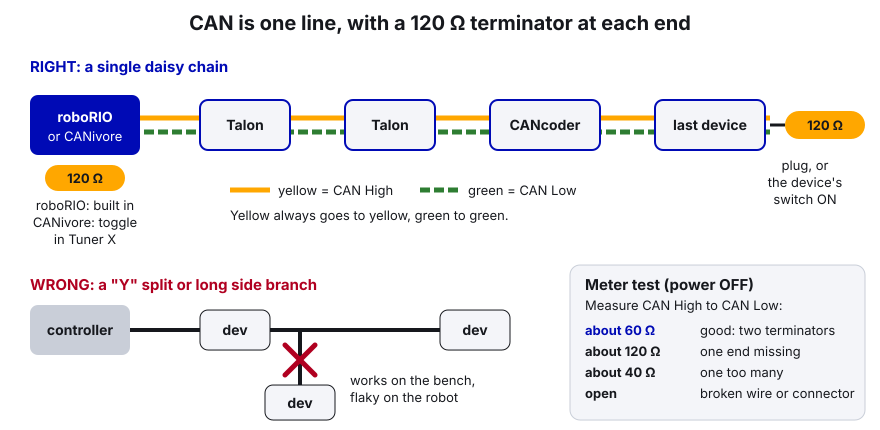
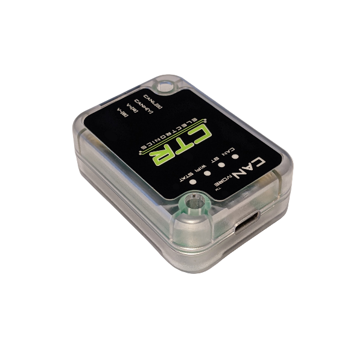
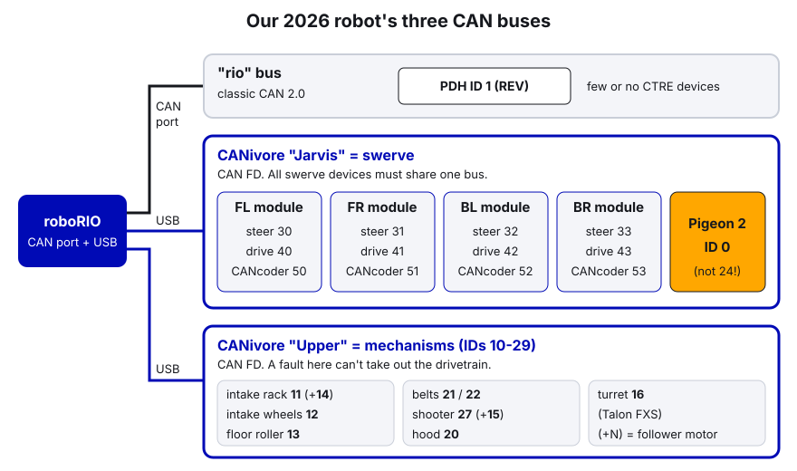

# 02. Phoenix Tuner X and the CAN Bus

> **Who it's for:** anyone who adds a motor, swaps a broken one, or gets "device not found" in the Driver Station. Light Java (reading IDs in code).
> **What you need first:** [01 The Robot Radio and the Robot Network](01-radio-and-robot-network.md) (so you can connect to the robot). Phoenix Tuner X installed.
> **Time:** about 1 hour to read and try on the robot.

**What you'll learn**
- What CAN is, how it's wired, and why our robot has three CAN buses.
- How to connect Tuner X to the robot, or straight to a CANivore over USB.
- How to update firmware on every device at once, and set IDs and names using our team ID scheme.
- How Phoenix Pro licensing works and why it has to be renewed each season.
- How to use Self Test, the plotter, and the Control tab safely, and how to fix "device not found".

---

## 1. What CAN is

**CAN** (Controller Area Network) is a two-wire network that lets the robot controller talk to motor controllers and sensors. One pair of wires runs from device to device:

- **Yellow = CAN High**, **Green = CAN Low**. Yellow always goes to yellow, green to green.
- Every device has an **ID** (0–62 for CTRE devices). Two devices of the **same model** on the **same bus** can't share an ID. A Talon FX 20 and a CANcoder 20 can live together. Two Talon FX 20s can't.
- A **CAN bus** is one chain of wires. Our robot has more than one.

### Daisy chain and termination

CAN must be a single line: controller → device → device → ... → last device. No "Y" splits and no long side branches.

Each **end** of the line needs a **120 Ω termination resistor**. These stop signals from bouncing back down the wire and garbling messages.

```
 roboRIO ==== Talon ==== Talon ==== CANcoder ==== PDH
 [120 Ω]                                         [120 Ω, switch ON]
 built in                                        or a 120 Ω plug on the last device

 CANivore "Jarvis" ==== FL ==== FR ==== BR ==== BL ==== Pigeon 2 ==== [120 Ω plug]
 [120 Ω, turned on in Tuner X]
```

- The roboRIO has a termination resistor built in.
- The CANivore has a 120 Ω resistor you turn on or off in Tuner X (the **CAN Bus Termination** toggle on its card).
- The far end needs a 120 Ω plug or a device with a termination switch.



**The meter test** (power OFF): measure between CAN High and CAN Low.

| Reading | Means |
|---|---|
| about 60 Ω | Good: two terminators |
| about 120 Ω | One end is missing its terminator |
| about 40 Ω | One terminator too many |
| open | Broken wire or connector |

The most common real cause of CAN trouble is a **bad crimp**. CTRE's advice: tug each crimped wire, one at a time. Then wiggle the harness while watching the device lights. If they blink red when you wiggle, you've found it.

### rio bus vs. CANivore



| | **"rio" bus** | **CANivore** |
|---|---|---|
| What | The CAN port built into the roboRIO | A USB-to-CAN-FD adapter from CTRE, plugged into the roboRIO's USB |
| Protocol | Classic CAN 2.0 | **CAN FD** (Flexible Data rate): bigger messages and a faster data phase, so much more room for data |
| Name in code | `"rio"` | Whatever name you give it in Tuner X |
| Our 2026 robot | Few or no CTRE devices (the PDH, ID 1, is a REV device) | **"Jarvis"** = swerve, **"Upper"** = mechanisms |

**Why swerve lives on Jarvis:**
1. **CTRE requires it.** The swerve code needs all 8 motors, 4 CANcoders, and the Pigeon on the **same** bus.
2. **Bandwidth.** Swerve odometry reads every module's position and the gyro many times a second. On classic CAN that would fill the bus. CAN FD has room to spare.
3. **Pro + CANivore = better odometry.** With Phoenix Pro on a CANivore, CTRE collects sensor data in sync across devices (CTRE calls this "synchronous" data). Our `TunerConstants` also uses `FusedCANcoder` for steering, which is a Pro feature.
4. **Isolation.** A wiring fault on the mechanisms bus ("Upper") can't take out the drivetrain.



Our electrical binder adds a buying rule for 2027: every new CAN sensor must support **CAN FD**. A CAN 2.0-only device can't sit on a CANivore bus. (CTRE's CANivore light codes say "ensure all connected devices support CAN FD".)

> **2027: SystemCore (our plan, check against the 2027 manual).** SystemCore has five CAN buses built in, `can_s0` to `can_s4`, running classic CAN at 1 Mbps for now. Our plan: `can_s0` drivetrain, `can_s1` intake, `can_s2` indexer, `can_s3` upper chassis (shooter, turret, hood), `can_s4` the REV PDH alone. Always name the bus in code. The CAN FD rule above still applies: the Canandcolor and the REV PDH are CAN 2.0 only and are flagged in the binder. Sensors get 12 V from the power hat on their mechanism's motor; the Pigeon 2 has its own fused slot. Guide 30 has the details.

---

## 2. Installing and connecting Tuner X

**Install:** Phoenix Tuner X comes from the **Microsoft Store** (also Android, macOS, and iOS). Or install it from the Phoenix offline installer. Tuner X's year must match the code's year: the 2026 Tuner X works with Phoenix 6 version 26.x (our vendordep is 26.3.0).

**How it talks to the robot:** Tuner X connects to the **Phoenix Diagnostic Server**, a small program on the roboRIO (port 1250). The server starts automatically whenever robot code creates **any** CTRE device. Our code always does, so if code is deployed, the server is running.

### Connect to the robot

1. Connect to the robot network (tether to the radio's DS port, or Wi-Fi). See [01](01-radio-and-robot-network.md).
2. Open Tuner X. In the top-left menu, open the address box and pick a preset:
   - **Driver Station**: gets the robot's address from the DS (easiest if the DS is open), or
   - type **`5090`** or **`10.50.90.2`**, or
   - **roboRIO USB** (`172.22.11.2`) if you're on a USB cable.
3. Check the **server version** at the bottom of the Devices page. It should be 2026 to match Tuner X.
4. **Freshly imaged roboRIO, no code yet?** Tuner X shows a **Run Temporary Diagnostic Server** card. Click it. It runs until the roboRIO reboots.

### Connect straight to a CANivore over USB (no robot)

Handy for setting up new motors on the bench before they go on the robot.

1. Plug the CANivore into the laptop with USB. Give the CAN devices 12 V power (the CANivore itself runs on USB power).
2. In Tuner X, turn on **CANivore USB** and set the address to **`localhost`**. Tuner X now runs its own diagnostic server, so no robot code is needed.
3. Your devices show up as normal.

On the **CANivores** page (left sidebar) you can see each CANivore, update its firmware, **rename** it, and turn its termination on or off.

---

## 3. Step by step: bring up a new device

Do this every time a motor or sensor is added or replaced.

1. **Wire it in** (power plus CAN in and out). Make sure it's on the right bus.
2. **Find it.** New devices come with **ID 0**. If another device of the same model is already at 0, its card turns **red** (duplicate ID). To tell which physical device is which, open the card and press **Blink**: the LEDs on the real device flash fast.
3. **Set the ID.** Open the device card. Type the new ID in the ID box (use our scheme below) and press **Set**.
4. **Set the name.** Type a clear name like `Shooter Leader` or `FL Steer Motor`, then **Set**. Names show up in Tuner X and in CTRE logs, so `TalonFX (Device ID 27)` becomes something a person can read.
5. **Update firmware** (next section).
6. **Label it** on the device: tape and a Sharpie with ID and bus, e.g. `27 Upper`.
7. **Put the ID in code**, in `Constants.java` with a comment. Never as a bare number inside a subsystem.
8. **Check it from code:** deploy, and confirm the device isn't reporting errors in the DS and acts as expected on blocks.

### Our team ID scheme

From the template's [Constants.java, lines 52–73](https://github.com/TorqueNados-FRC5090/Robot-Template/blob/b8dddd0e338841e867c0cc260162e6097adecd7b/src/main/java/frc/robot/Constants.java#L52-L73):

| ID | Device |
|---|---|
| 0 | Pigeon 2 gyro |
| 1 | PDH (power distribution hub) |
| 10–29 | Mechanisms (intake, shooter, arm, ...) |
| 30–33 | Swerve **steer** motors (FL, FR, BL, BR) |
| 40–43 | Swerve **drive** motors (FL, FR, BL, BR) |
| 50–53 | Swerve **CANcoders** (FL, FR, BL, BR) |

The 2026 robot followed it. On **Jarvis**: steer 30–33, drive 40–43, CANcoders 50–53, Pigeon 0. On **Upper**: intake rack 11 (follower 14), intake wheels 12, floor roller 13, belts 21/22, shooter 27 (follower 15), turret Talon FXS 16, hood 20.

Why a scheme? When the DS says "Talon FX 42 not found" at a competition, everyone instantly knows it's a swerve drive motor, back-left, on Jarvis. No hunting.

---

## 4. Firmware: update everything at once

Device firmware must match the Phoenix 6 year: **26.x firmware for our 2026 (26.3.0) code**. Old firmware can make a device act strangely or ignore Pro features.

**Card colors on the Devices page:**

| Color | Means |
|---|---|
| Green | Latest firmware |
| Yellow | Newer firmware available |
| Purple | Unexpected or beta firmware |
| Red | **Duplicate ID** |
| Blue | Tuner X couldn't get the firmware list (often no internet) |

**Batch update:**
1. Make sure the laptop has had internet at some point since opening Tuner X. It downloads the firmware files automatically.
2. On the Devices page, click the **checkmark** icon (top right) to select all devices. Or tick one device and click the checkmark to select all of that model.
3. Click the field-upgrade button. Choose the **2026** firmware year, then click **Update to latest**.
4. Wait. Don't power off the robot. Pressing **X** stops after the current device finishes, not in the middle of one.
5. Do the CANivores too, from the **CANivores** page.

Choose **Phoenix 6** firmware, not Phoenix 5. Our code is Phoenix 6 only.

---

## 5. Phoenix Pro licensing

**Phoenix 6** is free. **Phoenix Pro** is the paid add-on that unlocks extra features. The two we use most:
- **FOC** (Field Oriented Control): a smoother, stronger way of driving the motor. We always write `.withEnableFOC(true)` on control requests. Talon FX motors (Krakens) only; the Talon FXS doesn't do FOC.
- **Synchronized, fused sensor data** on a CANivore (`FusedCANcoder` for swerve steering).

**License types:**
- **Season Pass** (FRC only): one purchase, 100 device licenses, tied to a team number.
- **Single device**: one license per device.
- **CANivore bus license**: goes on the CANivore and makes every device on that bus Pro.

**Licenses are tied to a season.** A 2026 license unlocks Pro only with **26.x firmware and the 26.x API**. When we move to the 2027 software, we need a **2027** license. Budget for it every year.

**Season Pass rules worth knowing:**
- Attaching a team number to the pass is **permanent** (Tuner X **Profile** page → pick the license → enter `5090` → **Assign Team**).
- It only works when the robot controller is set to the **same team number**. A roboRIO imaged with the wrong team number makes every device look **unlicensed**.
- It works on the rio bus and on CANivores.

**To license devices:** click the **LIC** icon on a card, then **Activate a new license**. Or select many devices and batch-activate from the Devices page. **Activation is permanent.** Don't activate licenses on loaner or test devices by accident.

**Check it:** the icon at the bottom right of each card shows the state (Licensed / Not Licensed / Licensing Error). Self Test also shows it.

**(not verified):** which license type 5090 currently owns (Season Pass vs. CANivore license). Check the Tuner X Profile page. If Pro isn't active, FOC and fused sensors quietly fall back to the non-Pro version (fused sensors set a `UsingFusedCANcoderWhileUnlicensed` fault), and Pro-only requests like Dynamic Motion Magic stop the motor and set the `UnlicensedFeatureInUse` fault. Check the license icon and Self Test if FOC or FusedCANcoder seems off. Guide 31 has the full list.

---

## 6. Self Test, plotting, and the Control tab

### Self Test Snapshot
Open a device → **Self Test** → **Refresh**. You get a snapshot of everything: position, velocity, current, temperature, faults, license, and an animation of the status LEDs (great when the device is buried inside the robot). **Clear Faults** clears old faults. **Copy Self Test** puts it on the clipboard, to paste into a team chat or a support email.

Use it as the first look when something's off: "Is it there? Any faults? Is it actually moving?"

### Plotting
Open a device → **Plot**. Add signals from the right-side list (e.g. `Velocity`, `ClosedLoopReference`, `StatorCurrent`). Click and drag to pan, scroll to stretch time, and Shift+scroll to stretch a signal's height. **Export** saves the visible data to CSV.

Plotting is how you tune PID: plot the target and the actual value together while you change gains. See [07 What is PID](07-what-is-pid.md).

### Control tab (testing a motor without code)

The Control tab drives one motor directly. It's useful, and easy to break something with. **Rules:**

1. **Robot on blocks**, wheels off the ground. Nobody's hands near mechanisms.
2. The DS must be **enabled** for Tuner X control to work (CTRE calls this the device's **FRC Lock**). That means the space bar E-stop still works. Keep a hand on it.
3. **Watch for your robot code.** When the DS is enabled, our code is running too. If a command or default command is using that motor (for example, the Hood's default `stowCommand`), code and Tuner X fight and the motor jumps between the two. Test motors whose subsystem is idle, or deploy a build that doesn't command that motor.
4. Click **DISABLED** to switch it to **ENABLED**. Pick a simple control mode (duty cycle), and start **small**: 0.05 (5%), then increase.
5. **Know what limits apply.** Settings saved **on the device** (current limits, soft limits) still apply. Limits that exist **only in code** do not. Real examples from our robot:
   - The **hood** has soft limits in its device config, so they still apply in Tuner X. But they're measured from wherever the hood was at power-on.
   - The **turret's** ±0.30-rotation range is only a clamp in code. In Tuner X nothing stops it, and it can wrap its own wires. Go slow.
   - The **intake** has hard stops. Its 20 A stator limit is in the device config, so it won't hurt itself pushing on a stop.
6. Click back to **DISABLED** (or disable the DS) when done.

### Pigeon 2 mount calibration
Once the Pigeon's position on the robot is final, CTRE recommends running the **mount calibration** on the Pigeon's Calibration page in Tuner X.

---

## 7. The swerve project file

Tuner X's **Swerve Project Generator** walks you through the drivetrain (IDs, inversions, encoder offsets) and writes `generated/TunerConstants.java`. It can also save a project file, which in our repo is `tuner-project.json`. The full process is in [16 Swerve Drive (CTRE)](16-swerve-drive-ctre.md).

Two things to know here:
- The generator **requires** all swerve devices on one bus, the 2026 firmware, and the 2026 diagnostic server running.
- **Our `tuner-project.json` is out of date.** It's from the very first commit. It still says bus `"rio"` and a 6.75:1 "L2" drive ratio, but the real robot is MK5n R3 (5.273:1) on Jarvis. The code (`TunerConstants.java`) is what actually runs. When you regenerate, export the project again so the file matches.

---

## In our code

**Which bus each part is on.** Swerve's bus comes from [TunerConstants.java, lines 84–86](https://github.com/TorqueNados-FRC5090/Hephaestus/blob/c2f0cee6f61db3f26f911d3f5623ed7fa27a5b03/src/main/java/frc/robot/generated/TunerConstants.java#L84-L86):

```java
    // CAN bus that the devices are located on;
    // All swerve devices must share the same CAN bus
    public static final CANBus kCANBus = new CANBus("Jarvis", "./logs/example.hoot");
```

And the mechanisms bus from [RobotContainer.java, line 48](https://github.com/TorqueNados-FRC5090/Hephaestus/blob/c2f0cee6f61db3f26f911d3f5623ed7fa27a5b03/src/main/java/frc/robot/RobotContainer.java#L48):

```java
    public final CANBus upper = new CANBus("Upper");
```

Notice the name in code must match the name you gave the CANivore in Tuner X, **exactly** (capital letters count). Rename the CANivore and forget the code, and every device on it is "not found". (The second argument to `CANBus` is a log file path used when replaying logs. You can ignore it.)

**IDs in a subsystem.** [Hood.java, lines 46–48](https://github.com/TorqueNados-FRC5090/Hephaestus/blob/c2f0cee6f61db3f26f911d3f5623ed7fa27a5b03/src/main/java/frc/robot/subsystems/Hood.java#L46-L48):

```java
    public Hood(CANBus canbus, BooleanSupplier nearTrench){
        m_nearTrench = nearTrench;
        hood = new TalonFX(20, canbus);
```

It works, but `20` is a "magic number" buried in the subsystem. Our rule is a named constant in `Constants.CANIds`, e.g. `kHoodMotor = 20`, so there's one place to check against Tuner X.

**The Pigeon ID fix.** [TunerConstants.java, lines 107–110](https://github.com/TorqueNados-FRC5090/Hephaestus/blob/c2f0cee6f61db3f26f911d3f5623ed7fa27a5b03/src/main/java/frc/robot/generated/TunerConstants.java#L107-L110):

```java
    // The robot's Pigeon 2 is CAN ID 0 (Tuner X project + the team's March code). This was 24, which doesn't
    // exist, so the swerve never got a heading: the field map never rotated and turret aim ignored rotation.
    // If "Gyro/Connected" on the dashboard is false, check the Pigeon's ID and CAN bus in Phoenix Tuner X.
    private static final int kPigeonId = 0;
```

**The dashboard check that would have caught it.** [CommandSwerveDrivetrain.java, lines 245–248](https://github.com/TorqueNados-FRC5090/Hephaestus/blob/c2f0cee6f61db3f26f911d3f5623ed7fa27a5b03/src/main/java/frc/robot/subsystems/CommandSwerveDrivetrain.java#L245-L248):

```java
        SmartDashboard.putNumber("robot yaw", getgyroyaw().getDegrees());
        // If Connected is false or Yaw doesn't change when the robot turns, the swerve has no heading
        SmartDashboard.putBoolean("Gyro/Connected", getPigeon2().isConnected());
        SmartDashboard.putNumber("Gyro/Yaw (deg)", getPigeon2().getYaw().getValueAsDouble());
```

**A stale comment to fix.** In the same file, [lines 292–293](https://github.com/TorqueNados-FRC5090/Hephaestus/blob/c2f0cee6f61db3f26f911d3f5623ed7fa27a5b03/src/main/java/frc/robot/subsystems/CommandSwerveDrivetrain.java#L292-L293), the comment on `getgyroyaw()` still says "The real Pigeon is ID 24". That's backwards: the real Pigeon is **0**. Wrong comments are dangerous because people trust them. (The method name should also be `getGyroYaw` in normal Java style.)

---

## "Device not found" troubleshooting

The DS shows errors like *"CAN frames not received / device not found"* for an ID. Work through these in order:

1. **Is it in Tuner X at all?** Connect and look at the Devices page.
   - **It's there, but with a different ID** → the code's ID is wrong, or someone changed the device. Fix one to match the other. *This was the Pigeon 24 vs. 0 bug.*
   - **It's there, but on a different bus** → the code says `"rio"` and the device is on a CANivore, or the other way round. Check the `CANBus` passed into the device.
   - **Red card** → duplicate ID. Blink to find which is which, then re-ID one.
2. **Not in Tuner X.** Look at the device's LEDs:
   - **Off** → no power. Check its breaker/fuse and power wires.
   - **Red blinking** (Pigeon: "alternating red") → it has no valid CAN. Wiring problem: check crimps, yellow-to-yellow and green-to-green, and termination (meter test: about 60 Ω).
   - **Orange** → CAN is fine, but no robot code using Phoenix is running. Deploy code, or run the temporary diagnostic server.
3. **A whole bus is missing.**
   - CANivore: check its lights. Red double-blink = powered but no USB. Red fast-strobe = USB plugged in but not talking (make sure the roboRIO has fully booted; then try another USB cable). Orange = no robot program using Phoenix. Green = streaming.
   - Check the CANivore **name** matches the code.
4. **Devices drop in and out.** That's almost always a loose crimp or connector. Wiggle the harness section by section while watching the LEDs. The DS **CAN/Power tab** shows CAN bus utilization and fault counts.
5. **Still stuck:** use CTRE's method. Connect **one device at a time** to the controller, confirm it shows up, give it the right ID, label it, then add the next.

---

## Common mistakes

- **Pigeon ID 24 in code, real device 0.** The heading was frozen, the field map never rotated, and the turret only aimed right when it saw a tag. Always check IDs against Tuner X. (A factory-fresh device is ID 0, and the Pigeon was never changed.)
- **Trusting `tuner-project.json` or old comments over Tuner X.** Ours is from the first commit and is out of date. The live Devices page is the truth.
- **CANivore renamed in Tuner X but not in code**, or a capital letter different. Whole bus "not found".
- **Mixing firmware years** after swapping in a spare motor. Batch update after every swap.
- **Forgetting the Pro license is per season.** On new-year firmware with an old license, FOC and fused sensors stop working.
- **Testing in the Control tab while code is commanding the same motor**, or forgetting that code-only limits (like the turret clamp) don't protect you there.
- **Y-splitting CAN wires or missing a terminator.** Works on the bench, flaky on the robot.
- **Bare ID numbers in subsystems** (`new TalonFX(20, canbus)`) instead of named constants.

---

## Checklist

- [ ] Tuner X and the diagnostic server are both 2026 versions
- [ ] Every device shows **green** (latest 26.x firmware) and no red cards
- [ ] Every device has an ID from our scheme, a readable name, and a label on the device
- [ ] Every ID and bus in code matches Tuner X (`Constants.java`, `TunerConstants.java`)
- [ ] CANivore names in Tuner X match the code (`Jarvis`, `Upper`)
- [ ] Each bus measures about 60 Ω with power off
- [ ] Pro license icon shows **Licensed** on every device that uses FOC / fused sensors
- [ ] Dashboard `Gyro/Connected` is true and `Gyro/Yaw (deg)` changes when you turn the robot

---

## Practice

1. **ID audit.** Connect Tuner X to the robot. Write down every device: bus, ID, name, firmware. Compare against `Constants.java` and `TunerConstants.java`. Report any mismatch (there may be some).
2. **Find a device by blinking.** Pick a CANcoder in Tuner X, press Blink, and find it on the robot. Check that its label matches.
3. **Plot a motor.** With the robot on blocks and the DS enabled, open the floor roller (ID 13 on Upper). Plot `Velocity` and `StatorCurrent` while you run it at 5% duty cycle from the Control tab. Then note what happens to current when you lightly load the roller with a gloved hand. *(Make sure no command is using the rollers first.)*
4. **Clean-up PR.** On a branch, move the hood's `20` into `Constants.CANIds` with a comment, and fix the stale "ID 24" comment in `CommandSwerveDrivetrain`. Build, then deploy and check the hood still works.

> **AI can help:** after the ID audit, give an AI your written device list and the IDs from `Constants.java` and `TunerConstants.java`, and ask it to point out anything that doesn't match. Then go to the robot and confirm every mismatch yourself in Tuner X before you change anything.

---

## Go further

- Phoenix Tuner X overview: https://v6.docs.ctr-electronics.com/en/stable/docs/tuner/index.html
- Connecting Tuner: https://v6.docs.ctr-electronics.com/en/stable/docs/tuner/connecting.html
- Device List (card colors, batch firmware): https://v6.docs.ctr-electronics.com/en/stable/docs/tuner/device-list.html
- Device Details (IDs, names, firmware): https://v6.docs.ctr-electronics.com/en/stable/docs/tuner/device-details-page.html
- Self Test: https://v6.docs.ctr-electronics.com/en/stable/docs/tuner/self-test.html
- Plotting: https://v6.docs.ctr-electronics.com/en/stable/docs/tuner/plotting.html
- Controlling devices: https://v6.docs.ctr-electronics.com/en/stable/docs/tuner/controlling-devices.html
- CANivore intro (light codes): https://v6.docs.ctr-electronics.com/en/stable/docs/canivore/canivore-intro.html
- CANivore setup: https://v6.docs.ctr-electronics.com/en/stable/docs/canivore/canivore-setup.html
- CANivore termination: https://v6.docs.ctr-electronics.com/en/stable/docs/canivore/canivore-config.html
- Licensing: https://v6.docs.ctr-electronics.com/en/stable/docs/licensing/what-is-licensing.html and https://v6.docs.ctr-electronics.com/en/stable/docs/licensing/team-licensing.html
- CAN bus troubleshooting: https://v6.docs.ctr-electronics.com/en/stable/docs/troubleshooting/canbus-troubleshooting.html
- Swerve Project Generator: https://v6.docs.ctr-electronics.com/en/stable/docs/tuner/tuner-swerve/index.html
- Pigeon 2 (light codes, mount calibration): https://v6.docs.ctr-electronics.com/en/stable/docs/hardware-reference/pigeon2/index.html
- WPILib, CAN wiring basics: https://docs.wpilib.org/en/stable/docs/hardware/hardware-basics/can-wiring-basics.html
