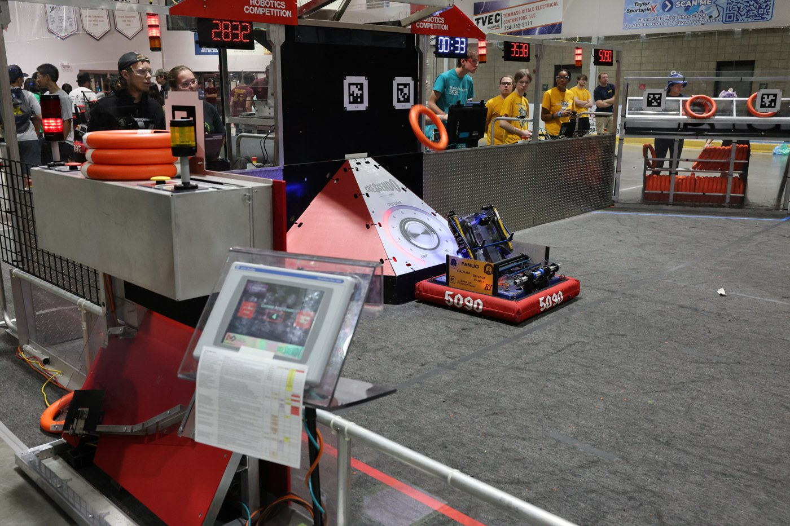
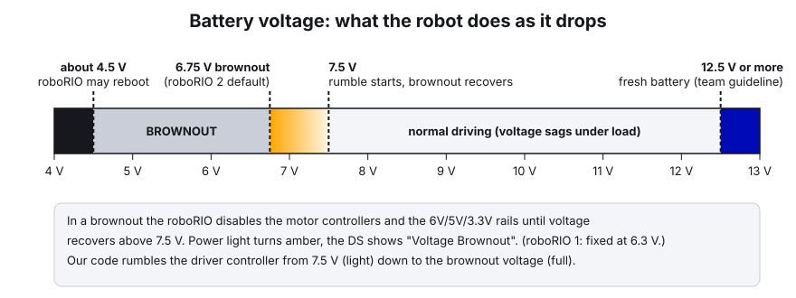
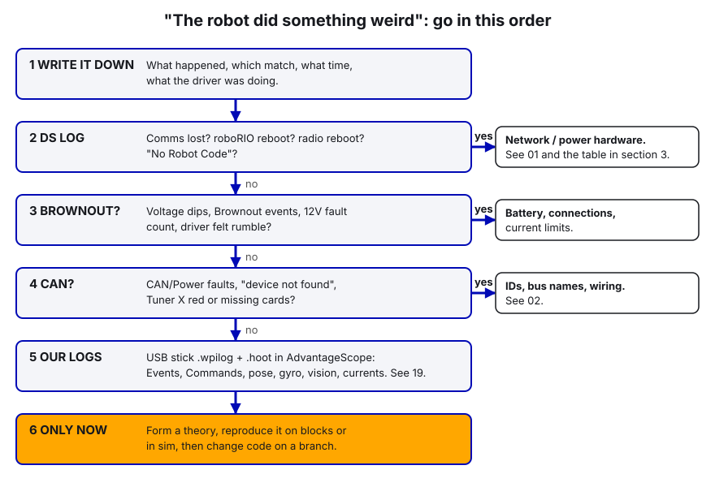

# 03. The Driver Station and Match Checklist

> **Who it's for:** every programmer who goes to competition, and anyone who drives in practice. No Java needed, but the "In our code" parts help.
> **What you need first:** [01 The Robot Radio and the Robot Network](01-radio-and-robot-network.md) (how the laptop reaches the robot). Helpful: [02 Phoenix Tuner X and the CAN Bus](02-phoenix-tuner-x-and-can.md).
> **Time:** 40 minutes to read. The checklist itself takes 3 minutes before each match once you know it.

**What you'll learn**
- What every part of the FRC Driver Station (DS) shows, and what its lights mean.
- How to set up controllers, pick an autonomous routine, and enable, disable, and E-stop safely.
- How to read the DS log after a match.
- A practical pit and pre-match checklist for programmers, built from things that went wrong for us.
- A step-by-step way to work out why "the robot did something weird".

---

## 1. What the Driver Station is

The **Driver Station** is the Windows program (part of the FRC Game Tools) that controls the robot. It:
- sends controller inputs to the robot 50 times a second,
- tells the robot which **mode** to be in (disabled, autonomous, teleop, test) and whether it's **enabled**,
- shows battery voltage, connection status, and errors,
- records a log of every session.

The robot will **not** move unless the DS is connected and enabled. On the field, the **FMS** (Field Management System) takes over enabling and disabling. You just connect and wait.



The **dashboard** is a separate program (we use **Elastic**, or Shuffleboard) that shows values the code publishes, like `Code Version` and `Gyro/Connected`, and holds the auto chooser.

---

## 2. A tour of the DS window

### The status pane (middle, always visible)

| Item | What it tells you |
|---|---|
| **Team #** | Must say **5090** |
| **Battery voltage** | Live battery voltage with a small graph. Turns **red during a brownout** |
| **Communications** | Green = the DS is talking to the roboRIO |
| **Robot Code** | Green = our code is running (it's updating the battery voltage). Red = no code, or it crashed |
| **Joysticks** | Green = at least one controller is plugged in and recognized |
| **Status string** | Plain words: "No Robot Communication", "No Robot Code", "Teleoperated Enabled", "Emergency Stopped", "Voltage Brownout" |

All three lights green before every match. Comms red = network problem (see [01](01-radio-and-robot-network.md)). Comms green but Code red = our code isn't running. Check the Messages tab for the crash, or redeploy.

### The tabs (left side)

| Tab | What it's for |
|---|---|
| **Operation** | Pick the mode (Teleoperated, Autonomous, Practice, Test). **Enable / Disable**. Elapsed time, laptop battery and CPU. Team Station (blue/red 1–3) when not on a field. On the field this all says "FMS Connected" |
| **Diagnostics** | Versions (DS, roboRIO image, WPILib, CAN devices). Connection lights: **Enet Link**, **Robot Radio** (ping to `10.50.90.1`), **Robot** (ping to the roboRIO), **FMS**. **Reboot roboRIO** and **Restart Robot Code** buttons |
| **Setup** | **Team Number** (5090). **Dashboard Type**. Game Data (for home testing). Practice-mode timing |
| **USB Devices** | The controllers and which **slot** each is in. Press a button and the name lights up green |
| **CAN/Power** | Counts since connecting: **Comms faults**, **12V faults (brownouts)**, 6V/5V/3.3V rail faults, **CAN bus utilization %**, CAN fault counts. The tab turns **red** when there's a fault |

On the right side: **Messages** (errors and prints from our code, with a gear menu to open the **Log Viewer**), **Charts** (trip time, lost packets, voltage, CPU), and **Both**.

### Controllers and slot order (USB Devices tab)

The code reads controllers by **slot number**. Our 2026 code has one driver Xbox controller on **slot 0** (`new CommandXboxController(0)` in `RobotContainer`). If a second controller lands in slot 0, the robot listens to the wrong one.

1. Plug in the controllers. Press a button on each and watch which name turns green.
2. **Drag** each controller to the right slot. Dragging **locks** it there (shown with an underline). A locked slot stays reserved even when unplugged.
3. Double-click a controller to lock or unlock it.
4. If a controller was unplugged during a match, press **F1** to rescan.

Use the **same USB ports** every time. If you swap two identical controllers between ports, the lock follows the port, not the controller.

### Enable, disable, E-stop

| Action | How | Notes |
|---|---|---|
| Enable | **Enable** button, or press `[` `]` `\` together | Only when everyone is clear and says ready |
| Disable | **Disable** button, or **Enter** | Fast and safe. Use this first |
| **E-stop** | **Space bar** | Works even when the DS window isn't selected. After an E-stop, the **roboRIO must be rebooted** before it will enable again |
| On the field | The **E-stop button on the team station** | The keyboard shortcuts are **ignored** when connected to FMS |

Habit: whoever enables the robot keeps a hand near Enter and the space bar the whole time. Say "enabling" out loud first.

### Choosing an autonomous routine

Our code puts a chooser on the dashboard called **`Auton Selector`**. Its default is **"Do Nothing"**, so if nobody picks an auto, the robot sits still for auto. That's safe, but it gives up points.

1. With the robot **disabled**, open Elastic (connected to team 5090).
2. In the `Auton Selector` widget, pick the auto that matches where the robot is placed, e.g. "Left Double" for the left trench.
3. Read it back: the widget shows the selected option. Tell the drive coach which auto is selected.
4. Picking the auto must happen **before** the match starts. The code reads the chooser in `autonomousInit()`, at the moment auto begins.

---

## 3. The DS Log Viewer

The DS records **every** session to `C:\Users\Public\Documents\FRC\Log Files`. Each session makes a `.dslog` (data) and a `.dsevents` (messages) file. Open them with the **Driver Station Log Viewer** (Start menu, or the gear on the Messages tab). **AdvantageScope** can open them too.

**What's on the graph:**
- **Yellow** line: battery voltage
- **Green** line: trip time (network lag, in ms). **Lost packets** are shown as bars
- **Red** line: roboRIO CPU %
- Mode bars at the top: what the DS **asked for** and what the robot **reported**
- **Dots and vertical lines**: events. Hover over one to read it. Red = error, yellow = warning

**Finding a match:** look for the **"FMS Connected"** event. It names the match type and number. Click **Match Length** to zoom to about 2:30, then scroll to the start of auto.

**Reading common failures** (from the WPILib docs):

| What you see | Likely cause |
|---|---|
| Voltage dips, "Brownout" event, 12V fault counted | Battery sag. Bad battery, too much current, or a short |
| Comms lost. On reconnect, "Time since robot boot" is only a few seconds | **roboRIO rebooted**. Power to the roboRIO, or voltage fell below about 4.5 V |
| No ping to the radio for about 40–50 s, roboRIO uptime still large | **Radio rebooted**. Radio power connection |
| Radio ping stays good, roboRIO ping drops, "Radio lost / Radio seen" events, roboRIO uptime still large | **Ethernet cable** between the radio and the roboRIO |
| Log splits in two, then a new FMS Connected with an instant jump to Teleop | DS lost the field. Usually the laptop's Ethernet cable (latch broken) or port |
| Trip time high, many lost packets | Wireless trouble. Radio mounting, interference, or a hot radio |

### Brownouts, briefly

When battery voltage falls too low, the roboRIO protects itself in stages. On a **roboRIO 2** the default brownout point is **6.75 V** (a roboRIO 1 is fixed at 6.3 V). During a brownout the roboRIO **disables the motor controllers** and the 6V/5V/3.3V rails until voltage recovers above 7.5 V. The roboRIO's Power light turns amber, and the DS shows "Voltage Brownout". The robot stutters or stops. Below about 4.5 V the roboRIO may reboot.



The usual causes: a tired or partly charged battery, a loose battery or main-breaker connection, or current limits set too high. *Our 2026 example:* the swerve `kSlipCurrent` was 120 A. CTRE uses it as the drive motors' stator limit, so it overrode our 60 A. The robot browned out and stuttered until we set it to 60. More in [06 Current Limits and Brownouts](06-current-limits-and-brownouts.md).

---

## 4. In our code

**`Code Version` on the dashboard.** At build time, Gradle writes the git branch and commit into a file that gets deployed with the code. [build.gradle, lines 107–122](https://github.com/TorqueNados-FRC5090/Hephaestus/blob/c2f0cee6f61db3f26f911d3f5623ed7fa27a5b03/build.gradle#L107-L122):

```groovy
// Writes the git branch + commit into the deploy folder at build time, so the dashboard's
// "Code Version" shows exactly which code is on the robot.
tasks.register('writeVersionFile') {
    ...
        def changes = run('git status --porcelain') ? ' +uncommitted changes' : ''
        new File(deployDir, 'version.txt').text =
            "${run('git rev-parse --abbrev-ref HEAD')} ${run('git rev-parse --short HEAD')}${changes} (built ${new Date().format('MM/dd HH:mm')})"
```

And the robot reads it at startup, in [Robot.java, lines 47–63](https://github.com/TorqueNados-FRC5090/Hephaestus/blob/c2f0cee6f61db3f26f911d3f5623ed7fa27a5b03/src/main/java/frc/robot/Robot.java#L47-L63):

```java
    public Robot() {
        RobotLog.start();   // DataLog + CTRE SignalLogger + command/event logs (USB stick in the RIO)
        m_robotContainer = new RobotContainer();
        // Dashboard switch: false = ignore the Limelight completely (pure odometry). Shooting never needs it.
        SmartDashboard.putBoolean("Vision/Use camera", true);
        SmartDashboard.putString("Code Version", readCodeVersion());
    }

    /** Branch + commit this code was built from (written by the writeVersionFile task in build.gradle) */
    private static String readCodeVersion() {
        try {
            return Files.readString(new File(Filesystem.getDeployDirectory(), "version.txt").toPath()).trim();
        } catch (IOException e) {
            DriverStation.reportWarning("Code Version unknown: " + e.getMessage(), false);
            return "unknown";
        }
    }
```

What to notice: `Code Version` reads something like `c3 c2f0cee (built 03/14 09:12)`. If it says **`+uncommitted changes`**, the code on the robot isn't saved in git, so if it misbehaves nobody can tell exactly what ran. At competition, commit before you deploy. Also notice the error isn't swallowed: if the file is missing, the DS gets a warning and the dashboard says `unknown`.

**Brownout rumble.** The driver feels low voltage through the controller before the robot dies. [RobotContainer.java, lines 293–309](https://github.com/TorqueNados-FRC5090/Hephaestus/blob/c2f0cee6f61db3f26f911d3f5623ed7fa27a5b03/src/main/java/frc/robot/RobotContainer.java#L293-L309):

```java
    /** Rumbles the driver controller harder the closer the battery gets to browning out. Call every loop. */
    public void updateBrownoutRumble() {
        double target = 0.0;
        if (DriverStation.isEnabled()) {
            if (RobotController.isBrownedOut()) {
                target = 1.0;
            } else {
                double volts = RobotController.getBatteryVoltage();
                double brownoutVolts = RobotController.getBrownoutVoltage();
                target = MathUtil.clamp((kRumbleStartVolts - volts) / (kRumbleStartVolts - brownoutVolts), 0.0, 1.0);
            }
        }
        m_brownoutRumble = Math.max(target, m_brownoutRumble - kRumbleDecayPerLoop);
```

Rumble starts at 7.5 V (`kRumbleStartVolts`) and is full at the brownout voltage. The slow fade (`kRumbleDecayPerLoop`) is there because voltage dips last only milliseconds, too short to feel without it. **Tell the driver what this means:** rumbling during a push = ease off. Rumbling all match = bad battery, swap it.

The same moment goes in the log as an event, in [Robot.java, line 72](https://github.com/TorqueNados-FRC5090/Hephaestus/blob/c2f0cee6f61db3f26f911d3f5623ed7fa27a5b03/src/main/java/frc/robot/Robot.java#L72):

```java
        RobotLog.eventOnRise("brownout", RobotController.isBrownedOut(), "BROWNOUT (battery " + RobotController.getBatteryVoltage() + " V)");
```

**Logs go to the USB stick.** [RobotLog.java, lines 41–54](https://github.com/TorqueNados-FRC5090/Hephaestus/blob/c2f0cee6f61db3f26f911d3f5623ed7fa27a5b03/src/main/java/frc/robot/RobotLog.java#L41-L54):

```java
    /** Call once, first thing in Robot() */
    public static void start() {
        DataLogManager.start();   // picks the USB stick (/u) automatically when one is plugged in
        ...
        // CTRE logs: USB stick if present, otherwise CTRE's default location on the RIO
        if (new File("/u").canWrite()) {
            SignalLogger.setPath("/u/ctre-logs/");
        }
        SignalLogger.start();
```

No stick means logs go to the roboRIO's small built-in storage, or (for CTRE logs) to CTRE's default location. That's why "USB stick in the RIO" is on the checklist. The stick is checked **once at startup**, so plug it in **before** powering the robot.

**Why the robot must be powered on with the mechanisms at rest.** Three mechanisms take their "zero" from wherever they are at power-on:
- **Intake.** In a real match it **skips homing** and trusts the power-on position. [EvilIntake.java, lines 294–300](https://github.com/TorqueNados-FRC5090/Hephaestus/blob/c2f0cee6f61db3f26f911d3f5623ed7fa27a5b03/src/main/java/frc/robot/subsystems/EvilIntake.java#L294-L300):
  ```java
                    if (DriverStation.isFMSAttached() && !m_homeRequested) {
                        // Real match: the robot started inside its frame, so the intake was at the 0" stop at
                        // power-on and that zero is correct. Don't spend auto time homing.
                        m_state = State.READY;
  ```
  If the intake was sticking out at power-on, every intake position is wrong for the whole match.
- **Hood.** [Hood.java, line 24](https://github.com/TorqueNados-FRC5090/Hephaestus/blob/c2f0cee6f61db3f26f911d3f5623ed7fa27a5b03/src/main/java/frc/robot/subsystems/Hood.java#L24): "The hood encoder zeroes wherever the hood is at power-on, so always boot with it at rest." A raised hood at boot also shifts its soft limits.
- **Turret.** It calls `setPosition(0)` when the code starts ([Turret.java, line 160](https://github.com/TorqueNados-FRC5090/Hephaestus/blob/c2f0cee6f61db3f26f911d3f5623ed7fa27a5b03/src/main/java/frc/robot/subsystems/Turret.java#L160)). It must be centered (facing the robot's back) when the robot is turned on.

**Health keys on the dashboard:**
- `Gyro/Connected` and `Gyro/Yaw (deg)`: from [CommandSwerveDrivetrain.java, lines 245–248](https://github.com/TorqueNados-FRC5090/Hephaestus/blob/c2f0cee6f61db3f26f911d3f5623ed7fa27a5b03/src/main/java/frc/robot/subsystems/CommandSwerveDrivetrain.java#L245-L248).
- `Vision/Seconds since last tag`, `Vision/Tags seen`, `Vision/Correction (m)`, `Vision/Use camera`: from `Robot.java`.
- `Vision/<camera>/Connected`: in the **template's** [Vision.java](https://github.com/TorqueNados-FRC5090/Robot-Template/blob/b8dddd0e338841e867c0cc260162e6097adecd7b/src/main/java/frc/robot/subsystems/Vision.java#L91-L103). The 2026 robot code doesn't have it yet, so on Theseus use "Seconds since last tag" plus the Limelight's web page.
- `Ready/0 ALL READY` and the other `Ready/...` keys: why the shooter will or won't fire.
- `Loop/Robot code ms`: how long our code takes each loop (the budget is 20 ms).

---

## 5. Checklists for programmers

Print these. Tape them to the cart.

### Pit checklist (when we arrive, and between matches)

- [ ] Pull and look at the **DS log** from the last match (brownouts, comms drops, errors). Note anything odd with the match number
- [ ] DS **CAN/Power** tab: any CAN faults or rising comms-fault counts?
- [ ] **Tuner X**: every device present, no red cards (see [02](02-phoenix-tuner-x-and-can.md))
- [ ] Code changes this break? **Commit, then deploy.** `Code Version` must not say `+uncommitted changes`
- [ ] Test the change on blocks before the robot leaves the pit
- [ ] Battery on the charger is labeled and rotating. Next battery picked

### Pre-match checklist (in the queue, then on the field)

**Before turning the robot on:**
- [ ] **Fresh battery**, strapped down, connector fully seated. A charged battery should read about 12.5 V or more on the DS while disabled. *(Team guideline, not an official number. Swap anything lower.)*
- [ ] **USB log stick in the roboRIO** (it's only detected at startup)
- [ ] **Intake fully in** (inside the frame, at its 0" stop)
- [ ] **Hood fully down**, at rest
- [ ] **Turret centered**, facing the robot's back

**Robot on, laptop connected:**
- [ ] DS: team 5090. **Communications, Robot Code, Joysticks all green**
- [ ] DS USB tab: driver controller in **slot 0**, and it lights up when you press a button
- [ ] Dashboard **`Code Version`**: the branch and commit we expect, no `+uncommitted changes`
- [ ] **`Auton Selector`**: the right auto for where the robot is placed, read back to the drive coach
- [ ] **`Gyro/Connected`** = true
- [ ] **Limelight**: `Vision/Use camera` is true, `Vision/Seconds since last tag` keeps resetting when tags are in view, and `Vision/Tags seen` is 2 or more if it can see two tags. (On template-based code: `Vision/<name>/Connected` = true.)
- [ ] Battery voltage on the DS looks right (see above)
- [ ] Radio lights on and facing out. Ethernet cables latched

**After the match:**
- [ ] Note the match number and anything weird **right away**, before you forget
- [ ] Take the USB stick or copy the logs if something went wrong

---

## 6. "The robot did something weird": triage flow

Don't start by changing code. Most "weird robot" problems turn out to be **power**, **CAN**, or **network**, not logic. Go in this order:



**Step by step:**

1. **Write it down.** "Match Q23, about 40 s into teleop, robot stopped turning for 2 s while pushing." Specific notes make the logs fast to search.
2. **DS log first.** Open the match in the Log Viewer. Use the table in section 3 to rule out reboots and comms loss. If the robot lost comms, no code change will fix it.
3. **Power.** Look at the yellow voltage line at the moment it happened. A dip to 7 V or lower while pushing, plus a Brownout event, means the motors were disabled. Look at current limits and the battery before anything else.
4. **CAN.** Error messages naming a device ID ("not found", "CAN frames not received") point at wiring or IDs. Plug into Tuner X in the pit. If it's intermittent, wiggle the harness while watching LEDs.
5. **Our logs.** Open the `.wpilog` from the USB stick in **AdvantageScope**. Look at the **Events** entry (our `BROWNOUT`, `Slow robot code loop`, intake homing messages), the **Commands** entry (which command was running), and the robot pose vs. vision pose. The CTRE `.hoot` files have every motor's current, temperature, and faults. The full method is in [19 Logging and Debugging](19-logging-and-debugging.md).
6. **Then code.** Only once the logs point at logic: reproduce it in simulation or on blocks, fix it on a branch, and check that `Code Version` shows the new commit.

Our own examples, by the step that would have found them:
- **Step 3:** stuttering under load was the 120 A `kSlipCurrent` (brownouts).
- **Step 4:** heading frozen, turret only aimed right when it saw a tag. That was the Pigeon ID (24 in code, 0 on the robot). `Gyro/Connected` = false would have shown it in seconds.
- **Step 5:** autos driving at half speed was `kSpeedAt12Volts` being twice too high. The log shows commanded vs. actual speed.
- **Step 5:** the robot stuck "Pathfinding" after pressing auto-align during PathPlanner's warmup showed up in the Commands log.

---

## Common mistakes

- **No auto picked.** The default is "Do Nothing". Always read the selector back.
- **Controller in the wrong slot.** Lock slot 0 by dragging, and use the same USB ports.
- **Powering on with the intake out, the hood up, or the turret off-center.** The zeros are wrong all match.
- **No USB stick, or plugged in after boot.** No logs exactly when you need them.
- **Deploying uncommitted code at an event.** `Code Version` says `+uncommitted changes` and nobody can recreate what ran.
- **E-stopping with the space bar on the field.** It's ignored when connected to FMS. Use the team station button. At home, remember an E-stop needs a roboRIO reboot.
- **Changing code before reading the DS log.** Comms, power, and CAN problems look like code bugs.
- **Ignoring the rumble.** It's the robot telling the driver the battery is sagging.

---

## Checklist

- [ ] DS: team 5090, three green lights, controller in slot 0
- [ ] Dashboard: `Code Version` correct, `Auton Selector` set, `Gyro/Connected` true, vision alive
- [ ] Robot powered on with intake in, hood down, turret centered, USB stick in
- [ ] Fresh battery (about 12.5 V or more while disabled)
- [ ] After every match: note anything weird, check the DS log

---

## Practice

1. **Lights drill.** With the robot on blocks: unplug the controller, stop the robot code (DS Diagnostics → **Restart Robot Code** and watch during restart), then unplug the radio-to-roboRIO cable. For each, write down which DS light changes and what the status string says.
2. **Read a real log.** Open a 2026 competition `.dslog` in the Log Viewer. Find the FMS Connected event, zoom to match length, and mark the lowest battery voltage. Were there brownouts?
3. **Auto drill.** In simulation, pick three different autos in `Auton Selector`, run each in Autonomous, and confirm the robot follows the matching path in AdvantageScope. Then leave it on "Do Nothing" and see what happens.
4. **Add a pre-match light.** On a branch, publish one boolean `PreMatch/OK` that is true only when the gyro is connected, the Limelight is alive, and an auto other than "Do Nothing" is selected. Test it in simulation (the gyro and camera parts may need a sim stand-in).

---

## Go further

- WPILib, FRC Driver Station: https://docs.wpilib.org/en/stable/docs/software/driverstation/driver-station.html
- WPILib, DS Log File Viewer: https://docs.wpilib.org/en/stable/docs/software/driverstation/driver-station-log-viewer.html
- WPILib, DS errors and warnings: https://docs.wpilib.org/en/stable/docs/software/driverstation/driver-station-errors-warnings.html
- WPILib, roboRIO brownouts: https://docs.wpilib.org/en/stable/docs/software/roborio-info/roborio-brownouts.html
- WPILib, robot battery basics: https://docs.wpilib.org/en/stable/docs/hardware/hardware-basics/robot-battery.html
- WPILib, AdvantageScope: https://docs.wpilib.org/en/stable/docs/software/dashboards/advantagescope.html
- WPILib, Test mode: https://docs.wpilib.org/en/stable/docs/software/basic-programming/using-test-mode.html
- CTRE signal logging (.hoot files): https://v6.docs.ctr-electronics.com/en/stable/docs/api-reference/api-usage/signal-logging.html
- Our logging notes: [Robot-Template LOGGING.md](https://github.com/TorqueNados-FRC5090/Robot-Template/blob/b8dddd0e338841e867c0cc260162e6097adecd7b/LOGGING.md)
