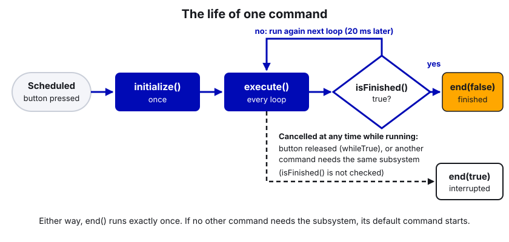
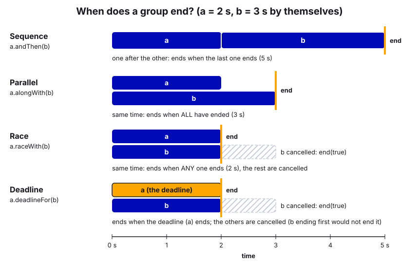
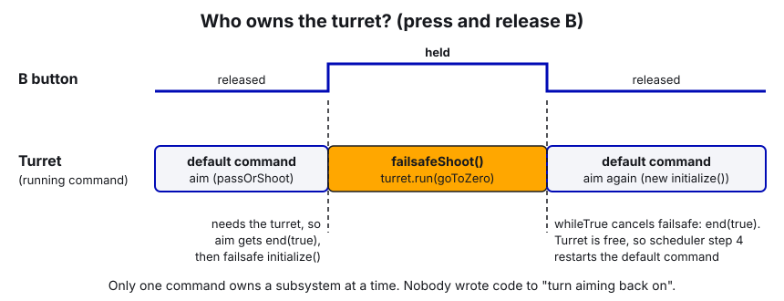

# 04. Command-Based Programming

> **Who it's for:** anyone writing robot code: new programmers after their first week, and returning programmers who
> want to stop guessing why a command "doesn't run".
> **Read first:** the Robot-Template
> [STUDENT-GUIDE section 3, "How robot code runs"](https://github.com/TorqueNados-FRC5090/Robot-Template/blob/b8dddd0e338841e867c0cc260162e6097adecd7b/STUDENT-GUIDE.md#3-how-robot-code-runs-command-based)
> (subsystems, commands, default commands, triggers, the 20 ms loop). This guide goes deeper. It helps to know basic
> Java (classes, methods, lambdas `() -> ...`). Motors are covered in [05 Motors in Phoenix 6](05-motors-in-phoenix-6.md).
> **Time:** about 1.5 hours to read and do the practice in simulation.

## What you'll learn

- What really happens inside the Command Scheduler every 20 ms, in the right order.
- How to build commands from small pieces (`run`, `runOnce`, `startEnd`, `runEnd`, `until`, `withTimeout`...) instead of writing a new class for everything.
- How to combine commands with sequences, parallel groups, deadlines and races.
- How triggers work, including combined triggers like our "agitate while shooting" binding.
- Why suppliers (`() -> value`) matter, and the "periodic() is the one place that talks to the motors" pattern.
- The mistakes that froze our autos and made subsystems fight, and how to avoid them.

---

## 1. The idea

### Subsystems

A **subsystem** is one piece of hardware you control as a unit: the shooter, the hood, the intake. It extends
`SubsystemBase`, owns its motors and sensors, and exposes small methods like `goShoot(rps)` or `isShooterReady()`.


Every subsystem has a `periodic()` method. The scheduler calls it **every loop (every 20 ms), no matter which command
is running, even when the robot is disabled.** Use it for things that must always happen:

- putting values on the dashboard,
- reading sensors and updating state (for example "am I near the trench?"),
- safety interlocks (the hood forcing itself down near a trench),
- and, in one pattern we use, actually sending the motor request (see section 6).

### Commands and requirements

A **command** is an action: "spin the shooter while held", "feed when ready", "follow this path". A command has four
parts:

| Method | When it runs |
|---|---|
| `initialize()` | Once, when the command starts. |
| `execute()` | Every loop while it's running. |
| `isFinished()` | Every loop, right after `execute()`. Return `true` to end the command. |
| `end(boolean interrupted)` | Once, when it ends. `interrupted` is `true` if something else cancelled it (button released, another command took the subsystem). |



A command **requires** the subsystems it uses. Requirements are how WPILib stops two commands from driving the same
motor. Only one command can hold a subsystem at a time. If a new command needs a subsystem that's busy, the old
command is **interrupted** (its `end(true)` runs) and the new one starts.

### The scheduler loop, in the real order

`Robot.robotPeriodic()` calls `CommandScheduler.getInstance().run()` every 20 ms. Each call does four things, in
this order:

```
 every 20 ms
 ┌──────────────────────────────────────────────────────────────┐
 │ 1. periodic() of every subsystem                              │
 │ 2. check every trigger/button -> schedule or cancel commands  │
 │      (new command: initialize(); interrupted one: end(true))  │
 │ 3. for every running command: execute(), then isFinished()    │
 │      (finished: end(false), it's removed)                     │
 │ 4. any subsystem nobody is using -> start its default command │
 └──────────────────────────────────────────────────────────────┘
```

Two things follow from this order:

- `periodic()` runs **before** commands. If a command sets a target, `periodic()` sees it on the **next** loop,
  20 ms later. That's fine for almost everything; just know it's there.
- The interrupted command's `end(true)` always runs **before** the new command's `initialize()`.

(The STUDENT-GUIDE lists the steps in a simpler order. The order above is what the WPILib docs and the code actually do.)

### Default commands

A **default command** runs on a subsystem whenever no other command requires it. When a button command ends, the
default command comes back automatically in step 4. A default command must require its subsystem, and it should never
end on its own (if it ends, the scheduler just starts it again next loop).

### Triggers

A **trigger** is anything that is true or false, wired to a command. Buttons are triggers. The binding decides what
happens on the edges:

| Binding | Behavior |
|---|---|
| `whileTrue(cmd)` | Start when it becomes true, cancel when it becomes false. Most of our buttons. |
| `onTrue(cmd)` | Start when it becomes true. Runs until the command finishes by itself. |
| `onFalse(cmd)` | Start when it becomes false (button released). |
| `toggleOnTrue(cmd)` | Press once to start, press again to cancel. |
| `whileFalse(cmd)` | Runs while the condition is false. |

Triggers combine with `.and(...)`, `.or(...)` and `.negate()`, and you can make one from any `BooleanSupplier`:
`new Trigger(() -> beamBreak.get())`. `RobotModeTriggers.disabled()`, `.teleop()`, `.autonomous()` and `.test()` are
triggers for the robot's mode.

---

## 2. Building commands without writing a class

You can write a full class that extends `Command` (we do for the feeder, see section 8). But most commands are short,
and WPILib has **factory methods** that build them for you. Inside a subsystem, call them on `this` so the command
automatically requires the subsystem:

| Factory | What it does | Ends by itself? |
|---|---|---|
| `runOnce(action)` | Runs `action` once. | Yes, right away. |
| `run(action)` | Runs `action` every loop. | No. |
| `startEnd(start, end)` | `start` once, `end` once when cancelled. | No. |
| `runEnd(run, end)` | `run` every loop, `end` once when cancelled. | No. |
| `startRun(start, run)` | `start` once, then `run` every loop. | No. |
| `Commands.waitSeconds(s)` | Does nothing for `s` seconds. | Yes. |
| `Commands.waitUntil(cond)` | Does nothing until `cond` is true. | Yes. |
| `Commands.none()` | Does nothing. | Yes, right away. |

Then you **decorate** a command to change how it behaves. Each decorator returns a new, wrapped command:

| Decorator | Effect |
|---|---|
| `.until(cond)` | Also ends when `cond` becomes true. |
| `.onlyWhile(cond)` | Ends as soon as `cond` is false. |
| `.withTimeout(seconds)` | Also ends after that many seconds. |
| `.finallyDo(() -> ...)` | Runs extra code when it ends (finished or interrupted). There's also `finallyDo(interrupted -> ...)`. |
| `.ignoringDisable(true)` | Keeps running while disabled (normally all commands are cancelled on disable). |
| `.withName("Shooter spin up")` | Name shown in logs and on the dashboard's scheduler view. |
| `.unless(cond)` / `.onlyIf(cond)` | Skip the command entirely if the condition is (or isn't) true when it's scheduled. |
| `.repeatedly()` | Start it again every time it finishes. |
| `.beforeStarting(() -> ...)` | Run something once right before it starts. |

Example in a new subsystem (professional names, current limits, FOC, reused requests):

```java
public class Conveyor extends SubsystemBase {
    private final TalonFX m_motor = new TalonFX(ConveyorConstants.kMotorId, new CANBus("Upper"));
    private final VelocityVoltage m_velocityRequest = new VelocityVoltage(0).withSlot(0).withEnableFOC(true);
    private final NeutralOut m_stopRequest = new NeutralOut();

    public Conveyor() {
        TalonFXConfiguration config = new TalonFXConfiguration();
        config.CurrentLimits.StatorCurrentLimit = 40;      // amps
        config.CurrentLimits.StatorCurrentLimitEnable = true;
        config.CurrentLimits.SupplyCurrentLimit = 30;      // amps
        config.CurrentLimits.SupplyCurrentLimitEnable = true;
        config.Slot0.kP = 0.3;
        config.Slot0.kV = 0.12;                            // volts per RPS
        m_motor.getConfigurator().apply(config);
    }

    public void setSpeed(double rotationsPerSecond) {
        m_motor.setControl(m_velocityRequest.withVelocity(rotationsPerSecond));
    }

    public void stop() {
        m_motor.setControl(m_stopRequest);
    }

    /** Runs the conveyor while scheduled, stops when cancelled (e.g. button released). */
    public Command runConveyorCommand(double rotationsPerSecond) {
        return startEnd(() -> setSpeed(rotationsPerSecond), this::stop).withName("Conveyor run");
    }

    /** Runs the conveyor until a game piece is seen, but never longer than 2 seconds. */
    public Command loadOnePieceCommand(BooleanSupplier hasGamePiece) {
        return runConveyorCommand(ConveyorConstants.kLoadSpeedRps)
            .until(hasGamePiece)
            .withTimeout(2.0)
            .withName("Conveyor load one piece");
    }
}
```

Notice `startEnd`, not `runOnce`: the motor keeps its velocity request until told otherwise, so we only need to
send it once, but we need the command to **stay running** so the release of the button stops the motor.

---

## 3. Combining commands (compositions)

A **composition** is a command made of other commands. It requires every subsystem its children require.

| Group | `Commands.` factory | Decorator | Ends when |
|---|---|---|---|
| Sequence | `Commands.sequence(a, b, c)` | `a.andThen(b)` | the last one ends |
| Parallel | `Commands.parallel(a, b)` | `a.alongWith(b)` | **all** have ended |
| Race | `Commands.race(a, b)` | `a.raceWith(b)` | **any one** ends (the rest are cancelled) |
| Deadline | `Commands.deadline(main, others...)` | `main.deadlineFor(others...)`<br>or `other.withDeadline(main)` | the **first** (deadline) command ends |



The class versions (`new SequentialCommandGroup(...)`, `new ParallelCommandGroup(...)`, `new ParallelRaceGroup(...)`,
`new ParallelDeadlineGroup(deadline, ...)`) do the same thing. We use `new ParallelCommandGroup(...)` in
`fullShootCommand`; `Commands.parallel(...)` is equivalent and a bit shorter.

Names in WPILib 2026, checked against the 2026.2.1 library:

- `deadlineFor(...)`: "run me as the deadline, with these alongside". `a.deadlineFor(b)` ends when `a` ends.
- `withDeadline(d)`: "run me alongside `d`, and stop when `d` ends". `a.withDeadline(d)` ends when `d` ends.
- `deadlineWith(...)` still exists but is **deprecated**. Don't use it in new code.
- `Command.schedule()` is deprecated too. Use `CommandScheduler.getInstance().schedule(cmd)`, like our `Robot.java` does.

Rules that will bite you:

1. **Two commands in the same parallel/race/deadline group can't require the same subsystem.** WPILib throws an error
   when you build the group (at robot startup). Two things can't drive the same motor at the same time.
2. **A command object can only be in one group.** If you need it twice, call the factory method twice so you get two
   separate objects.
3. **A command that never ends, placed in a sequence, freezes the sequence.** Everything after it never runs. Use
   `.withTimeout(...)`, `.until(...)`, or put it in a deadline group with something that does end.

A realistic auto-style sequence:

```java
public Command intakeThenShootCommand() {
    return Commands.sequence(
        intake.deployCommand(),                         // runOnce: sets the target, ends right away
        Commands.deadline(
            Commands.waitUntil(indexer::hasGamePiece).withTimeout(3.0),  // the deadline: ends this step
            intake.runRollersCommand()),                // never ends by itself; cancelled by the deadline
        intake.stowCommand(),
        shooterAndFeederCommand().withTimeout(2.0)      // never ends by itself, so give it a timeout
    ).withName("Intake then shoot");
}
```

---

## 4. Triggers in detail

```java
// Simple button
driver.y().whileTrue(fullShootCommand());

// Combined: only works when the shooter is ready AND the driver holds A
driver.a().and(shooter::isReady).onTrue(feeder.feedOneCommand());

// Not held = negate
driver.rightBumper().negate();

// Custom trigger from any boolean source (a beam break on a CTRE CANdi's S1 input; guide 21)
CANdi feederInputs = new CANdi(kFeederCandiId, upperBus);   // S1 configured CloseWhenLow: blocked = "closed"
StatusSignal<Boolean> beamBlocked = feederInputs.getS1Closed();
new Trigger(() -> beamBlocked.refresh().getValue())
    .onTrue(Commands.print("Game piece loaded"));

// Robot mode
RobotModeTriggers.disabled().whileTrue(drivetrain.applyRequest(() -> idle).ignoringDisable(true));
```

`.debounce(seconds)` makes a trigger wait until the condition has been true for that long. Use it for noisy sensors.

Note `.ignoringDisable(true)` on the disabled-mode command: without it, the scheduler would cancel the command right
away because the robot is disabled.

---

## 5. Suppliers: passing a live value instead of a frozen one

A **supplier** is a tiny function that returns a value when you call it. `DoubleSupplier` returns a `double`,
`BooleanSupplier` a `boolean`, `Supplier<T>` anything. You write them as lambdas: `() -> calculateOptimalShooterRPS()`.

Why it matters: bindings are made **once**, at startup. Compare:

```java
// WRONG: calculateOptimalShooterRPS() runs ONCE, at startup, when the robot is at (0,0).
// The shooter spins at that one speed forever.
joystick.y().whileTrue(shooter.shoot(calculateOptimalShooterRPS()));   // (if shoot took a double)

// RIGHT: the lambda is called every loop while the command runs, so the speed follows the robot.
joystick.y().whileTrue(shooter.shoot(() -> calculateOptimalShooterRPS()));
```

Our shooter's `shoot()` takes a `DoubleSupplier` exactly so shoot-on-the-move works: the target RPS is recalculated
every 20 ms from the robot's live position and speed. Same idea for `hood.hoodgo(() -> calculateOptimalHoodAngle())`,
for the feeder's `BooleanSupplier runCondition`, and for the drivetrain's default command, which reads the sticks
inside the lambda every loop.

Rule of thumb: **if the value can change while the command is running, pass a supplier.**

---

## 6. Pattern: commands set a target, periodic() drives the motor

In most subsystems, commands call `motor.setControl(...)` directly. That works, but it gets messy when a mechanism
needs a state machine (homing, fault handling, interlocks): every command would have to know about every state.

`EvilIntake` (better name: `IntakeRack` or `IntakeSubsystem`) uses a cleaner pattern for its rack motors:

- Commands only **set a target** (`setTargetInches(...)`).
- `periodic()` is **the one place** that sends requests to the rack motors. It decides, based on its state
  (`NOT_HOMED`, `HOMING`, `READY`, `SIDES_OUT_OF_SYNC`), whether to home, drive to the target, or hold still.

The payoff: no command can accidentally drive the rack while it's homing or out of sync, because no command touches
the rack motors at all. The cost: the target takes effect one loop later (periodic runs before commands), and since
periodic runs even when no command is scheduled, the subsystem keeps driving to its last target. That's usually what
you want for a position mechanism.

The hood uses a smaller version: commands send setpoints, but `periodic()` overrides them with "stow" whenever the
robot is near a trench, so no command can break the hood under the trench.

---

## 7. Step by step: add a mechanism command and bind it

1. **Write the small methods** in the subsystem (`setSpeed`, `stop`, `isAtSpeed`). Numbers go in `Constants.java`.
2. **Write a command factory** in the subsystem that returns a `Command`. Pick the factory from the table in
   section 2 by asking: "Should it end by itself? What happens on release?"
3. **Name it** for what it does (`runConveyorCommand`, `loadOnePieceCommand`) and add `.withName(...)`.
4. **Bind it** in `RobotContainer.configureBindings()`, e.g. `driver.leftBumper().whileTrue(conveyor.runConveyorCommand(30))`.
5. **If it needs a live value**, pass a supplier.
6. **If it's for auto**, make sure it ends (or plan to use it as the non-deadline part of a deadline group), then
   register it as a named command (see [18 PathPlanner autos](18-pathplanner-autos.md)).
7. **Simulate**: WPILib: Simulate Robot Code, drag a controller to Joystick 0, Teleoperated, press the button. Add
   `SmartDashboard.putData(CommandScheduler.getInstance())` in `RobotContainer` to see which commands are running.
8. **On blocks**, then on the floor.

---

## 8. In our code

### `Robot.java`: where the scheduler runs

[Robot.java, lines 66–69 (robotPeriodic)](https://github.com/TorqueNados-FRC5090/Hephaestus/blob/c2f0cee6f61db3f26f911d3f5623ed7fa27a5b03/src/main/java/frc/robot/Robot.java#L66-L69)

```java
public void robotPeriodic() {
    double loopStart = Timer.getFPGATimestamp();
    m_timeAndJoystickReplay.update();
    CommandScheduler.getInstance().run();
```

Notice: one line runs the whole command system. Also see
[lines 170–189 (autonomousInit / teleopInit)](https://github.com/TorqueNados-FRC5090/Hephaestus/blob/c2f0cee6f61db3f26f911d3f5623ed7fa27a5b03/src/main/java/frc/robot/Robot.java#L170-L189):
auto schedules the chooser's command, and teleop cancels it so it can't keep driving.

### `RobotContainer.configureBindings()`: default commands and buttons

[RobotContainer.java, lines 125–148 (default commands, disabled trigger, buttons)](https://github.com/TorqueNados-FRC5090/Hephaestus/blob/c2f0cee6f61db3f26f911d3f5623ed7fa27a5b03/src/main/java/frc/robot/RobotContainer.java#L125-L148)

```java
drivetrain.setDefaultCommand(
    drivetrain.applyRequest(() -> {
        double slowModeMultiplier = joystick.getRightTriggerAxis() > 0.5 ? 0.4 : 1.0;
        return drive.withVelocityX(-joystick.getLeftY() * MaxSpeed * slowModeMultiplier)
                    .withVelocityY(-joystick.getLeftX() * MaxSpeed * slowModeMultiplier)
                    .withRotationalRate(-joystick.getRightX() * MaxAngularRate * slowModeMultiplier);
    })
);
turret.setDefaultCommand(turret.run(turret::passOrShoot));
hood.setDefaultCommand(hood.stowCommand());
```

Notice:
- Three subsystems, three default commands. The turret is **always** aiming when nothing else needs it. The hood is
  **always** stowed when nothing is shooting.
- `failsafeShoot()` ([lines 222–229](https://github.com/TorqueNados-FRC5090/Hephaestus/blob/c2f0cee6f61db3f26f911d3f5623ed7fa27a5b03/src/main/java/frc/robot/RobotContainer.java#L222-L229))
  includes `turret.run(() -> turret.goToZero())`. That requires the turret, so pressing B **interrupts** the
  aiming default command. Release B and the default command comes back by itself. That's interruption working for you.



### The agitate trigger: `.or(...)`, `.and(...)`, `.negate()`

[RobotContainer.java, lines 172–178](https://github.com/TorqueNados-FRC5090/Hephaestus/blob/c2f0cee6f61db3f26f911d3f5623ed7fa27a5b03/src/main/java/frc/robot/RobotContainer.java#L172-L178)

```java
joystick.rightTrigger().whileTrue(fullShootCommand());
// While shooting (RT, Y or B) and NOT touching the intake buttons, agitate the intake like auto does.
joystick.rightTrigger().or(joystick.y()).or(joystick.b())
    .and(joystick.leftBumper().negate()).and(joystick.leftTrigger().negate())
    .whileTrue(evilIntake.agitate(EvilIntakePosition.in));
```

Read it as: "(RT or Y or B) and not LB and not LT". Notice how it avoids a fight: LB (intake) and LT (eject) also
require the intake. When the driver presses LB while shooting, the agitate trigger turns false (cancelling agitate),
and the LB command takes the intake. Release LB and the agitate trigger is true again, so agitate restarts. No
subsystem ever has two owners.

### `fullShootCommand()`: a parallel group with suppliers

[RobotContainer.java, lines 189–198](https://github.com/TorqueNados-FRC5090/Hephaestus/blob/c2f0cee6f61db3f26f911d3f5623ed7fa27a5b03/src/main/java/frc/robot/RobotContainer.java#L189-L198)

```java
public Command fullShootCommand() {
    return new ParallelCommandGroup(
        shooter.shoot(() -> calculateOptimalShooterRPS()),
        new theYappy(rollersystem, () -> readyToShoot(), () -> logShot("teleop")),
        hood.hoodgo(() -> calculateOptimalHoodAngle())
    );
}
```

Notice:
- Three commands, three **different** subsystems (shooter, rollers, hood). That's required in a parallel group.
- None of them ends by itself. That's on purpose: the group runs exactly as long as the button is held, and when it's
  released every child's `end()` runs (shooter stops, feeder stops, hood stows).
- Every live value is a supplier, so speed and angle follow the robot while it drives.
- The turret is **not** in the group. Its default command already aims, so adding it would interrupt the aiming.
- It's a method, not a field. Y and RT each call `fullShootCommand()` and get their own object (rule 2 in section 3).

### `Shooter.shoot()`: `runEnd` with a `DoubleSupplier`

[Shooter.java, lines 128–133](https://github.com/TorqueNados-FRC5090/Hephaestus/blob/c2f0cee6f61db3f26f911d3f5623ed7fa27a5b03/src/main/java/frc/robot/subsystems/Shooter.java#L128-L133)

```java
public Command shoot(DoubleSupplier RPS) {
    return this.runEnd(
        () -> goShoot(RPS.getAsDouble()),
        () -> stop()
    );
}
```

`runEnd` (not `startEnd`) because the target changes every loop. `this.runEnd` so it requires the shooter.

### `EvilIntake.agitate()`: `startRun` + `finallyDo`

[EvilIntake.java, lines 220–235](https://github.com/TorqueNados-FRC5090/Hephaestus/blob/c2f0cee6f61db3f26f911d3f5623ed7fa27a5b03/src/main/java/frc/robot/subsystems/EvilIntake.java#L220-L235)

```java
public Command agitate(EvilIntakePosition endPosition) {
    Timer timer = new Timer();
    double out = EvilIntakePosition.out.getInches();
    return startRun(
        timer::restart,
        () -> {
            double inAmount = (1 - Math.cos(2 * Math.PI * timer.get() / kAgitatePeriodSeconds)) / 2;
            setTargetInches(out + (kAgitateInInches - out) * inAmount, true);
            spinMotor.setControl(spinRequest.withOutput(kRollerIntakeSpeed));
        })
        .finallyDo(() -> {
            evilyummy(endPosition);
            spinMotor.setControl(spinRequest.withOutput(0));
        });
}
```

Notice: `startRun` restarts the timer once, then sets a moving target every loop. `finallyDo` puts the rack back
and stops the wheels whether the command finished or was interrupted. And it only calls `setTargetInches`; the rack
motors are driven in `periodic()`:

[EvilIntake.java, line 51 (the rule) and lines 282–315 (periodic)](https://github.com/TorqueNados-FRC5090/Hephaestus/blob/c2f0cee6f61db3f26f911d3f5623ed7fa27a5b03/src/main/java/frc/robot/subsystems/EvilIntake.java#L282-L315).
The intake **wheels** (`spinMotor`) are still set directly by commands; the "one place" rule covers the rack, the part
with the state machine.

### `theYappy`: a full Command class

[theYappy.java, lines 27–74](https://github.com/TorqueNados-FRC5090/Hephaestus/blob/c2f0cee6f61db3f26f911d3f5623ed7fa27a5b03/src/main/java/frc/robot/commands/theYappy.java#L27-L74)
(better name: `FeedWhenReady`)

```java
public theYappy(RollerSystem rollers, BooleanSupplier runCondition, Runnable onFeedStart){
    this.rollers = rollers;
    this.runCondition = runCondition;
    this.onFeedStart = onFeedStart;
    addRequirements(rollers);
}
@Override
public void initialize(){
    timer.restart();
    wasFeeding = false;
}
@Override
public void execute() {
    if (timer.get() < kPrimeReverseSeconds) {
        rollers.roll(RollerSystem.kUnjamSpeedRPS);          // 0.2 s backwards to prime
    } else if (runCondition.getAsBoolean()) {
        ...
        rollers.roll(RollerSystem.kFeedSpeedRPS);           // feed only while ready
    } else {
        rollers.rollerStop();
    }
}
```

When is a class worth it? When the command has **its own state** (here: a timer and a `wasFeeding` flag) and logic
across several phases. `addRequirements(rollers)` is the line that makes it safe. `isFinished()` returns `false`: it
runs until the button is released.

### `AutonContainer`: named commands that must end

[AutonContainer.java, lines 56–76 (registerNamedCommands)](https://github.com/TorqueNados-FRC5090/Hephaestus/blob/c2f0cee6f61db3f26f911d3f5623ed7fa27a5b03/src/main/java/frc/robot/commands/AutonContainer.java#L56-L76)

```java
// DropIntake/RaiseIntake finish instantly (they used to run forever and froze any auto that used them in a row).
NamedCommands.registerCommand("DropIntake", robotContainer.evilIntake.runOnce(() -> robotContainer.evilIntake.evilyummy(EvilIntakePosition.out)));
...
// Never ends on its own: only use it inside a deadline group with a path as the deadline
NamedCommands.registerCommand("DriveIntake", new EvilIntakePiece(robotContainer.evilIntake, EvilIntakePosition.out));
// Stand-still shoot. Hub only, never passes.
NamedCommands.registerCommand("Shoot", robotContainer.autoShootCommand().withTimeout(5));
```

Notice the comments: every named command says whether it ends. Ones that end can go anywhere in a PathPlanner
sequence. Ones that don't must be the non-deadline part of a deadline group, or get a `.withTimeout`.

---

## 9. Common mistakes

1. **A command that never ends, used in a sequence (the frozen autos).** `DropIntake` used to be
   `run(() -> ...)`, which never ends. In a PathPlanner sequence, everything after it waited forever and the robot sat
   still for the rest of auto. Fix: `runOnce` (the rack holds its target after the command ends). Before using a command
   in a sequence, ask "does this end?"
2. **Forgetting `addRequirements`.** Without it, the scheduler doesn't know the command uses the subsystem, so the
   default command and other commands keep running too and you get two commands sending different requests to the
   same motor every loop (jittering, or one silently winning). Our unused `commands/ok.java` has exactly this bug: it
   drives the intake but never calls `addRequirements`. Factory methods called on the subsystem (`this.run(...)`,
   `intake.runOnce(...)`) add the requirement for you. `Commands.run(action)` without subsystems at the end does not.
3. **Making a new command every loop.** Writing `new SomeCommand()` (or `.schedule()`) inside `periodic()` or
   `execute()` creates a new object 50 times a second and keeps restarting it, so `initialize()` runs every loop and
   the command never gets anywhere. Build commands once in `RobotContainer` and let triggers schedule them. A cousin:
   `new WaitCommand(.125);` inside `EvilIntakePiece.initialize()`
   ([line 21](https://github.com/TorqueNados-FRC5090/Hephaestus/blob/c2f0cee6f61db3f26f911d3f5623ed7fa27a5b03/src/main/java/frc/robot/commands/EvilIntakePiece.java#L21))
   creates a command that is never scheduled, so it does nothing; it does **not** pause. To wait, use
   `Commands.sequence(a, Commands.waitSeconds(0.125), b)`.
4. **Two commands fighting.** Two things drive one motor: a command plus code in `periodic()` that also sets the
   same motor, or two commands without proper requirements. Symptoms: the motor twitches, or the dashboard shows a target
   that never sticks. Pick one owner per motor (requirements or the periodic pattern) and stick to it.
5. **Reading a value once instead of passing a supplier.** The robot shoots at the same speed from everywhere. See
   section 5.
6. **Putting the same subsystem in two branches of a parallel group.** Robot code crashes at startup with a
   "multiple commands in a parallel composition cannot require the same subsystems" error. Move one into a sequence or
   split the subsystem's job.
7. **Expecting commands to run while disabled.** Disabling cancels everything. Add `.ignoringDisable(true)` for things
   that must run disabled (resetting pose, re-homing requests, the swerve `Idle` request).
8. **`=` instead of `==` in a condition.** `if (OutNow = false)` in `EvilIntakeToggle`
   ([line 21](https://github.com/TorqueNados-FRC5090/Hephaestus/blob/c2f0cee6f61db3f26f911d3f5623ed7fa27a5b03/src/main/java/frc/robot/commands/EvilIntakeToggle.java#L21))
   assigns `false` and is always false, so the toggle can never go out. For booleans, write `if (!isOut)`.
   (WPILib's `toggleOnTrue` does toggling for you, without a class.)

> **AI can help:** when robot code crashes at startup, paste the full error and stack trace (for example the
> "multiple commands in a parallel composition cannot require the same subsystems" error) into an AI chat and ask
> it to explain what the error means and which line of *your* code the trace points to. Then open that line
> yourself, decide on the fix, and check in simulation that the robot starts cleanly.

---

## 10. Checklist

- [ ] Every command that uses a subsystem requires it (factory on the subsystem, or `addRequirements`).
- [ ] Every command used in a sequence or auto ends by itself, or has a timeout, or is inside a deadline group.
- [ ] Parallel groups: no two children require the same subsystem.
- [ ] Values that change while running are passed as suppliers.
- [ ] Every subsystem that should do something when idle has a default command (and it never ends).
- [ ] Each motor has exactly one owner per loop.
- [ ] Commands are built once (in `RobotContainer`/factories), not in `periodic()`.
- [ ] Commands have readable names (`.withName(...)`), visible on the scheduler widget.
- [ ] Tested in simulation with the scheduler on the dashboard before going to the robot.

---

## 11. Practice

1. **Watch the scheduler.** Add `SmartDashboard.putData(CommandScheduler.getInstance());` to the `RobotContainer`
   constructor of Robot-Template. Simulate, open the scheduler widget in Elastic (or Glass), and hold X. Watch the
   brake command replace the drive default command, then the default come back when you let go.
2. **Factory practice.** In a copy of `ExampleRoller`, write `pulseCommand()` that runs the roller for 0.5 s, stops
   for 0.5 s, and repeats while a button is held. (Hint: `Commands.sequence(...).repeatedly()`, and remember a command
   object can only be used once in a group.)
3. **Freeze an auto on purpose.** Make a sequence: `roller.run(...)` then `Commands.print("done")`. Bind it with
   `onTrue`. Notice "done" never prints. Fix it three ways: `.withTimeout(1)`, `.until(...)`, and a deadline group.
4. **Combined trigger.** Bind A so it only runs the roller when the robot is in teleop **and** the right bumper is
   **not** held: `driver.a().and(RobotModeTriggers.teleop()).and(driver.rightBumper().negate())`.

---

## 12. Go further

- WPILib, command-based programming (start here): https://docs.wpilib.org/en/stable/docs/software/commandbased/index.html
- Commands and factory methods: https://docs.wpilib.org/en/stable/docs/software/commandbased/commands.html
- Command compositions (sequence, parallel, race, deadline): https://docs.wpilib.org/en/stable/docs/software/commandbased/command-compositions.html
- Binding commands to triggers: https://docs.wpilib.org/en/stable/docs/software/commandbased/binding-commands-to-triggers.html
- The Command Scheduler (exact loop order): https://docs.wpilib.org/en/stable/docs/software/commandbased/command-scheduler.html
- Subsystems: https://docs.wpilib.org/en/stable/docs/software/commandbased/subsystems.html
- Organizing a command-based project: https://docs.wpilib.org/en/stable/docs/software/commandbased/organizing-command-based.html
- Lambdas and suppliers ("functions as data"): https://docs.wpilib.org/en/stable/docs/software/basic-programming/functions-as-data.html
- In 2027 the robot moves to SystemCore, and WPILib may change parts of the command library. The ideas here carry
  over, but check the 2027 docs for renamed or deprecated methods.
