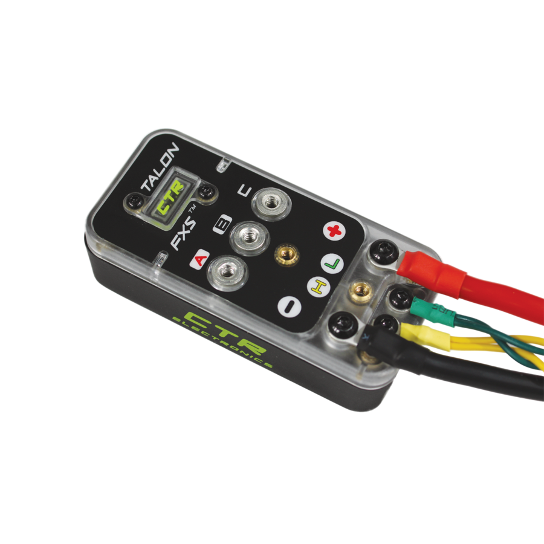
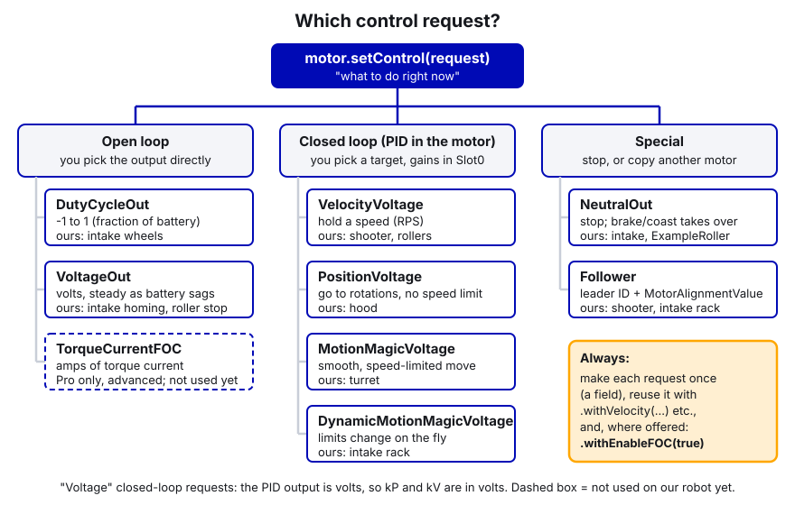
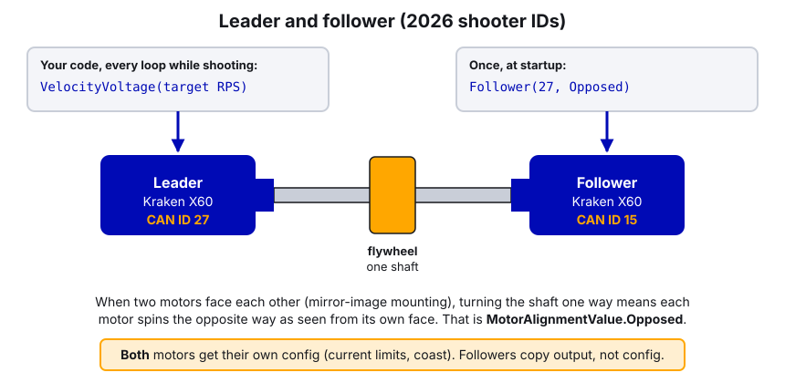

# 05. Motors in Phoenix 6

> **For:** anyone who will write or change code that spins a CTRE motor. Brand new programmers start here after the
> basics. **Read first:** [02 Tuner X and CAN](02-phoenix-tuner-x-and-can.md) (CAN IDs, buses, firmware) and
> [04 Command-based](04-command-based-basics.md) (subsystems and commands). **Time:** about 60 minutes to read,
> plus an afternoon at the robot for the practice.

## What you'll learn

- The difference between a **Talon FX** (Kraken, Falcon) and a **Talon FXS** (Minion, NEO Vortex), and how to tell
  the FXS which motor is plugged in.
- How to create a motor in code, build a **configuration** (current limits, brake/coast, direction, PID gains) and
  send it with `apply()`, and why a second `apply()` can silently erase the first one.
- Which **control request** to use for which job (`DutyCycleOut`, `VoltageOut`, `VelocityVoltage`,
  `PositionVoltage`, `MotionMagicVoltage`, `TorqueCurrentFOC`, `NeutralOut`, `Follower`), and why you make each one
  once and reuse it.
- What **FOC** is, why we turn it on everywhere, and what the "FOC Unlicensed" light on our dashboard means.
- How to read speed, position and current back from the motor (**status signals**) and what units they're in.
- How **followers** work, and why every follower still needs its own current limits.

---

## The idea

### Talon FX vs Talon FXS

CTRE sells two kinds of motor controller we use. Both are programmed with the same library (Phoenix 6) and almost
the same code.

| | **Talon FX** | **Talon FXS** |
|---|---|---|
| What it is | Controller **built into** the motor | A separate controller box you wire a motor to |
| Motors | Kraken X60, Kraken X44, Falcon 500 | CTRE Minion, NEO / NEO 550 / NEO Vortex (through an adapter), brushed motors |
| Java class | `TalonFX` | `TalonFXS` |
| Config class | `TalonFXConfiguration` | `TalonFXSConfiguration` |
| Must tell it the motor type? | No, it knows | **Yes**: `Commutation.MotorArrangement` |
| Our 2026 robot | Swerve, shooter, hood, rollers, intake wheels | Turret (Minion), intake rack (2x NEO Vortex) |

 

The Talon FXS needs to know which motor is attached, because a Minion, a NEO and a Vortex are wired and driven
differently. Until you set `MotorArrangement`, the FXS **won't drive the motor at all**. The choices
(`MotorArrangementValue`) are `Minion_JST`, `NEO_JST`, `NEO550_JST`, `VORTEX_JST`, `Brushed_DC`, `CustomBrushless`
and `Disabled` (the default).

A NEO Vortex plugs into a Talon FXS through REV's **Vortex Solo Adapter**. On our intake we also turn on
`AdvancedHallSupport`, a Phoenix Pro feature that gives smoother commutation and better speed readings on motors
that use hall sensors (like the Vortex).

### The three pieces of every motor in code

```
  1. The device         new TalonFX(27, upperBus)          "which motor, on which wire"
  2. The configuration  TalonFXConfiguration -> apply()    "how it should behave" (sent once, at startup)
  3. Control requests   motor.setControl(request)          "what to do right now" (sent every loop)
```

Then you read things back with **status signals** (`getVelocity()`, `getPosition()`, `getStatorCurrent()`...).

### 1. The device: CAN ID + CAN bus

Every CTRE device has a **CAN ID** (a number you set in Tuner X) and lives on a **CAN bus** (the wire it's plugged
into). On our 2026 robot there are two CANivores: **"Jarvis"** (swerve) and **"Upper"** (everything else).
A `CANBus` object names the bus:

```java
CANBus upperBus = new CANBus("Upper");          // a CANivore, by the name set in Tuner X
CANBus rioBus   = new CANBus("rio");            // the roboRIO's own CAN port
TalonFX shooterLeader = new TalonFX(27, upperBus);
```

If the ID or the bus is wrong, nothing crashes. The motor just never moves and Phoenix prints errors in the
Driver Station console. That's exactly how our 2026 gyro bug happened: the code said Pigeon ID 24, the real device
was ID 0. **Always check IDs against Tuner X.**

### 2. The configuration object

A `TalonFXConfiguration` is a big object full of settings, grouped by topic. The groups you'll use most:

| Group | What's in it | Example |
|---|---|---|
| `MotorOutput` | Direction (`Inverted`), brake or coast (`NeutralMode`) | `config.MotorOutput.NeutralMode = NeutralModeValue.Brake;` |
| `CurrentLimits` | Stator and supply current limits (see [06](06-current-limits-and-brownouts.md)) | `config.CurrentLimits.StatorCurrentLimit = 40;` |
| `Slot0` (also `Slot1`, `Slot2`) | PID + feedforward gains: `kP kI kD kS kV kA kG`, `GravityType`, `StaticFeedforwardSign` | `config.Slot0.kV = 0.12;` |
| `MotionMagic` | Cruise velocity, acceleration, jerk for Motion Magic moves (see [09](09-motion-magic-and-position-control.md)) | `config.MotionMagic.MotionMagicAcceleration = 400;` |
| `Feedback` | Gear ratio (`SensorToMechanismRatio`), which sensor to use | `config.Feedback.SensorToMechanismRatio = 12.5;` |
| `SoftwareLimitSwitch` | Positions the motor refuses to drive past | `config.SoftwareLimitSwitch.ForwardSoftLimitEnable = true;` |

You fill it in, then send it to the motor with `apply()`:

```java
StatusCode status = shooterLeader.getConfigurator().apply(config);
if (!status.isOK()) {
    DriverStation.reportError("Shooter leader config failed: " + status.getDescription(), false);
}
```

`apply()` returns a **StatusCode**. If the motor isn't on the bus (wrong ID, unplugged, wrong bus), it comes back
as an error. Check it. A config that silently failed is a motor running with no current limits.

`apply()` waits for the motor to confirm, so it's slow compared to a control request. Call it in the constructor,
not in `periodic()`.

#### The big lesson: apply() overwrites

There are two rules, and both have bitten us.

1. **Applying a whole `TalonFXConfiguration` sets EVERY setting on the motor.** Anything you didn't fill in goes
   back to its factory default. This is good: it wipes out whatever someone clicked in Tuner X last week, so the
   motor always matches the code.
2. **Applying just one group (`Slot0Configs`, `CurrentLimitsConfigs`...) replaces that whole group** and leaves the
   other groups alone. Every field in that group is replaced, including the ones you didn't set (they're 0 or the
   default).

So if you apply a group after the full config, **the second apply wins** for that group. Our 2026 Shooter does this
by accident: it applies slot 0 with `kP 0.4, kD 0.0005, kV 0.16`, then a few lines later applies a separate
`Slot0Configs` with `kP 0.8, kD 0, kV 0.145`. The motor runs on the second set. The first set does nothing, and
anyone who tunes it is changing numbers the motor never sees. (See **In our code** below.)

**Team rule:** build one complete `TalonFXConfiguration` per motor and apply it once. If you need to change gains
live (dashboard tuning), apply only `Slot0Configs`, on purpose, like `EvilIntake.applyTuning()` does.

### Direction: Inverted

`MotorOutput.Inverted` decides which way "positive" spins:

- `InvertedValue.CounterClockwise_Positive` (the default): positive output spins the shaft **counter-clockwise when
  you look at the face of the motor** (the end the shaft comes out of).
- `InvertedValue.Clockwise_Positive`: the opposite.

You don't work it out from the CAD. You **decide what positive should mean for the mechanism** (intake goes OUT,
arm goes UP, shooter shoots OUT, elevator goes UP), then test with a tiny output and flip the setting if it's wrong.
Step-by-step below.

### Brake vs coast: NeutralMode

When the motor is told to stop (or the robot is disabled), it goes **neutral**. `NeutralMode` decides what neutral
feels like:

| | **Brake** | **Coast** |
|---|---|---|
| What happens | Motor shorts its windings and resists turning | Motor spins freely |
| Use for | Arms, elevators, hoods, turrets, feed rollers: things that must stop **now** or hold still | Flywheels, things you want to be able to push by hand, things that should "give" when hit |
| Our 2026 robot | Hood, turret, rollers | Shooter, intake rack |

A heavy flywheel in brake mode stops in a fraction of a second, which yanks on belts and gears and dumps current.
That's why flywheels are always coast. The intake rack is coast so it can give when the robot gets hit while
disabled.

Brake mode does **not** hold an arm up against gravity forever; it just slows it down. To truly hold a position you
need a closed-loop request (`PositionVoltage` or `MotionMagicVoltage`) running.

### 3. Control requests

A control request is "what to do right now." You create one and send it with `setControl()`. The common ones:

| Request | You give it | Use for | Our code |
|---|---|---|---|
| `DutyCycleOut` | -1 to 1 (fraction of battery voltage) | Simple rollers where exact speed doesn't matter | Intake wheels |
| `VoltageOut` | Volts (-12 to 12) | Same as above, but steady as the battery sags; homing pushes; `VoltageOut(0)` to stop | Intake homing, roller stop |
| `VelocityVoltage` | Rotations per second (RPS) | Flywheels, feeders, anything that should hold a speed | Shooter, rollers |
| `PositionVoltage` | Rotations | Short moves to a position, no speed limit | Hood |
| `MotionMagicVoltage` | Rotations (plus cruise/accel/jerk in config) | Smooth, speed-limited moves: arms, elevators, turrets | Turret |
| `DynamicMotionMagicVoltage` | Rotations + cruise + accel + jerk in the request | Motion Magic where the speed limits change on the fly | Intake rack |
| `TorqueCurrentFOC` | Amps of torque current | Advanced: control force directly (Pro only) | Not used yet |
| `NeutralOut` | Nothing | Stop driving; NeutralMode (brake/coast) takes over | Intake, ExampleRoller |
| `Follower` | Leader's CAN ID + `MotorAlignmentValue` | Copy another motor | Shooter, intake rack |



The "Voltage" versions (`VelocityVoltage`, `PositionVoltage`...) mean the PID's output is in **volts**, so your gains
are in volts too (kV = volts per RPS, kP = volts per unit of error). That's what we use everywhere. There are also
`...TorqueCurrentFOC` versions where the output is amps; leave those until you've mastered the voltage ones.

**Make each request once and reuse it.** A request is a small object. Creating a new one every 20 ms loop makes
garbage for Java to clean up, which can cause loop overruns. Make it a field, then change its value with `with...`:

```java
// Field: made once
private final VelocityVoltage m_velocityRequest = new VelocityVoltage(0).withSlot(0).withEnableFOC(true);

// Every time you want a new speed: reuse it
m_motor.setControl(m_velocityRequest.withVelocity(targetRps));
```

The motor keeps doing the last request it got (Phoenix 6 resends it for you), so you don't have to call
`setControl()` every loop unless the target changes. Many of our subsystems do call it every loop from a `run()`
command, which is also fine.

### FOC

**FOC** (field oriented control) is a smarter way of switching current through the motor's coils. Compared to the
normal way (called trapezoidal commutation) it gives roughly 15% more peak power and runs smoother and quieter. It
needs a **Phoenix Pro** license. The team has Pro; [02](02-phoenix-tuner-x-and-can.md#5-phoenix-pro-licensing)
explains the license types and how to check which devices are licensed.

You turn it on per request with `.withEnableFOC(true)`. Phoenix 6 already defaults to FOC on, but the team writes it
out on every request so it's obvious when reading the code.

FOC is a **Talon FX** feature (Krakens, Falcons). CTRE's docs say "the Talon FXS does not support FOC at this time",
so on our Talon FXS motors (turret, intake rack) `.withEnableFOC(true)` does nothing. It's harmless, so the team
leaves it in, but don't expect FOC power from them ([31](31-phoenix-pro-features.md) has the details).

What happens without a license:

- Requests that have an `EnableFOC` option (`VelocityVoltage`, `DutyCycleOut`...) **quietly fall back** to normal
  commutation. The robot works, just a bit weaker. CTRE's docs don't promise a fault for this quiet fallback.
- Requests that **only** work with a Pro license (`TorqueCurrentFOC` and friends, Dynamic Motion Magic) **don't drive
  the motor at all**, set the sticky fault **UnlicensedFeatureInUse**, and blink red/green.

Our Shooter publishes that sticky fault as **"FOC Unlicensed"** on the dashboard. If it lights up, the license isn't
active on that bus (new CANivore, re-flashed device, wrong season). But because the shooter only uses plain FOC
requests, the light may stay false even when the license is missing, so treat false as "probably fine" and confirm
the license in Tuner X.

### Status signals: reading the motor

Every number the motor reports is a **status signal**:

```java
double rps   = m_motor.getVelocity().getValueAsDouble();       // rotations per second
double rot   = m_motor.getPosition().getValueAsDouble();       // rotations
double amps  = m_motor.getStatorCurrent().getValueAsDouble();  // amps in the motor
double volts = m_motor.getMotorVoltage().getValueAsDouble();   // volts the motor is applying
```

**Units.** CTRE always uses **rotations** and **rotations per second (RPS)**, of the motor shaft, unless you set a
gear ratio with `Feedback.SensorToMechanismRatio` (then they're rotations of the mechanism). Convert yourself:

| You have | You want | Do this |
|---|---|---|
| RPS | RPM | `rps * 60` |
| Rotations (of the mechanism) | Degrees | `rot * 360` |
| Motor rotations | Mechanism rotations | `motorRot / gearRatio` (e.g. turret 200/16 = 12.5:1) |
| Motor rotations | Inches of travel | `motorRot / rotationsPerInch` (our intake: 0.546 rot per inch) |
| Wheel rotations | Meters | `rot * Math.PI * wheelDiameterMeters` |

**Refresh.** `getVelocity()` returns the same cached signal object every time, and the getter refreshes it with the
latest value from the CAN bus by default. If you store the signal in a field (which is a little faster), you must
call `refresh()` yourself, or refresh several at once:

```java
private final StatusSignal<AngularVelocity> m_velocity = m_motor.getVelocity();
private final StatusSignal<Current> m_statorCurrent = m_motor.getStatorCurrent();

@Override
public void periodic() {
    BaseStatusSignal.refreshAll(m_velocity, m_statorCurrent);   // one call, both fresh
    SmartDashboard.putNumber("Shooter/Velocity (RPS)", m_velocity.getValueAsDouble());
}
```

**Update frequency.** Each signal is sent by the motor a certain number of times per second. The common ones
(position, velocity, current) come fast enough for our 20 ms loop by default. You can change a signal's rate with
`signal.setUpdateFrequency(hz)` or many at once with `BaseStatusSignal.setUpdateFrequencyForAll(hz, ...)`. Busy
CAN buses sometimes use `optimizeBusUtilization()` to slow down signals nobody reads. We haven't needed it on a
CANivore; know it exists.

### Followers

When two motors drive the same thing (two shooter motors on one shaft, two rack motors on one intake), one is the
**leader** and the other copies it with a `Follower` request:

```java
followerMotor.setControl(new Follower(leaderId, MotorAlignmentValue.Opposed));
```

- `MotorAlignmentValue.Aligned`: the follower spins the same way as the leader.
- `MotorAlignmentValue.Opposed`: the follower spins the opposite way. Use it when the two motors face each other
  (very common: mirror-image mounting).

The follower's own `Inverted` setting doesn't matter; the alignment decides. (Older Phoenix code used
`new Follower(id, true/false)`. In 2026 it's `MotorAlignmentValue`.)



**Followers need their own current limits.** A follower copies the leader's *output*, not its *configuration*.
The leader's current limits live inside the leader. If you don't apply a config to the follower, it runs on factory
defaults, which can let it pull far more current than you planned. Apply the same current limits (and NeutralMode)
to both. Our Shooter and EvilIntake both do this, with a comment saying why.

---

## Step by step: add a new motor

Let's add one Kraken X60 on a roller. Robot on blocks.

1. **Set the ID in Tuner X.** Pick an ID from the team scheme (10–29 for mechanisms) that nothing else uses. Write
   down the CAN bus it's on. Update the firmware while you're there.
2. **Add constants** in `Constants.java` with units in the names:
   ```java
   public static final class ConveyorConstants {
       public static final int kMotorId = 23;
       public static final double kStatorCurrentLimitAmps = 40;
       public static final double kSupplyCurrentLimitAmps = 30;
       public static final double kP = 0.1;      // volts per RPS of error
       public static final double kV = 0.12;     // volts per RPS (about 12 V / Kraken free speed)
       public static final double kFeedRps = 40; // motor rotations per second
   }
   ```
3. **Copy `ExampleRoller.java`** from the Robot-Template into `subsystems/`, rename it (`Conveyor`), and point it at
   your constants.
4. **Build the config**: current limits (always), NeutralMode, Inverted, Slot0 gains. One `TalonFXConfiguration`,
   one `apply()`, check the `StatusCode`.
5. **Make the requests as fields**, with `.withEnableFOC(true)`.
6. **Find the direction.** Temporarily bind a button to a tiny open-loop output:
   `driver.a().whileTrue(conveyor.startEnd(() -> motor.setControl(dutyCycle.withOutput(0.1)), conveyor::stop));`
   Deploy, enable, press A. Does the mechanism move the way you decided is positive? If not, switch
   `CounterClockwise_Positive` to `Clockwise_Positive`. Don't fix direction by putting minus signs in the commands;
   fix it once in the config.
7. **Check it's reading right.** Spin it by hand (disabled, coast) and watch `Conveyor/Actual RPS` on the
   dashboard. Positive when it moves the positive way? Good.
8. **Switch to the real request** (`VelocityVoltage`), tune kV then kP (see [08](08-tuning-pid-step-by-step.md)).
9. **Watch current** in Tuner X's plot while it runs loaded. Adjust limits (see [06](06-current-limits-and-brownouts.md)).

A complete, correct version of what you just built:

```java
package frc.robot.subsystems;

import static frc.robot.Constants.ConveyorConstants.*;

import com.ctre.phoenix6.CANBus;
import com.ctre.phoenix6.StatusCode;
import com.ctre.phoenix6.configs.TalonFXConfiguration;
import com.ctre.phoenix6.controls.NeutralOut;
import com.ctre.phoenix6.controls.VelocityVoltage;
import com.ctre.phoenix6.hardware.TalonFX;
import com.ctre.phoenix6.signals.InvertedValue;
import com.ctre.phoenix6.signals.NeutralModeValue;

import edu.wpi.first.wpilibj.DriverStation;
import edu.wpi.first.wpilibj.smartdashboard.SmartDashboard;
import edu.wpi.first.wpilibj2.command.Command;
import edu.wpi.first.wpilibj2.command.SubsystemBase;

/** One Kraken X60 moving game pieces from the intake to the shooter. Positive = toward the shooter. */
public class Conveyor extends SubsystemBase {
    private final TalonFX m_motor;
    private final VelocityVoltage m_velocityRequest = new VelocityVoltage(0).withSlot(0).withEnableFOC(true);
    private final NeutralOut m_stopRequest = new NeutralOut();

    public Conveyor(CANBus canBus) {
        m_motor = new TalonFX(kMotorId, canBus);

        TalonFXConfiguration config = new TalonFXConfiguration();
        config.CurrentLimits.StatorCurrentLimit = kStatorCurrentLimitAmps;
        config.CurrentLimits.StatorCurrentLimitEnable = true;
        config.CurrentLimits.SupplyCurrentLimit = kSupplyCurrentLimitAmps;
        config.CurrentLimits.SupplyCurrentLimitEnable = true;
        config.MotorOutput.NeutralMode = NeutralModeValue.Brake;              // stop pieces right away
        config.MotorOutput.Inverted = InvertedValue.CounterClockwise_Positive; // checked on the robot
        config.Slot0.kP = kP;
        config.Slot0.kV = kV;

        StatusCode status = m_motor.getConfigurator().apply(config);
        if (!status.isOK()) {
            DriverStation.reportError("Conveyor config failed: " + status.getDescription(), false);
        }
    }

    public void setSpeedRps(double rps) {
        m_motor.setControl(m_velocityRequest.withVelocity(rps));
    }

    public void stop() {
        m_motor.setControl(m_stopRequest);
    }

    public Command feedCommand() {
        return startEnd(() -> setSpeedRps(kFeedRps), this::stop).withName("Conveyor feed");
    }

    @Override
    public void periodic() {
        SmartDashboard.putNumber("Conveyor/Velocity (RPS)", m_motor.getVelocity().getValueAsDouble());
        SmartDashboard.putNumber("Conveyor/Stator current (A)", m_motor.getStatorCurrent().getValueAsDouble());
    }
}
```

### Talon FXS version (Vortex or Minion)

The only differences: `TalonFXS`, `TalonFXSConfiguration`, and the `Commutation` group.

```java
TalonFXS rackMotor = new TalonFXS(11, upperBus);
TalonFXSConfiguration config = new TalonFXSConfiguration();
config.Commutation.MotorArrangement = MotorArrangementValue.VORTEX_JST;   // or Minion_JST, NEO_JST...
config.Commutation.AdvancedHallSupport = AdvancedHallSupportValue.Enabled; // Pro; hall-sensor motors only
config.CurrentLimits.StatorCurrentLimit = 30;
config.CurrentLimits.StatorCurrentLimitEnable = true;
config.CurrentLimits.SupplyCurrentLimit = 25;
config.CurrentLimits.SupplyCurrentLimitEnable = true;
rackMotor.getConfigurator().apply(config);
```

---

## In our code

### ExampleRoller: the copy-me pattern

[ExampleRoller.java, lines 37–64 (requests made once + full config + StatusCode check)](https://github.com/TorqueNados-FRC5090/Robot-Template/blob/b8dddd0e338841e867c0cc260162e6097adecd7b/src/main/java/frc/robot/subsystems/ExampleRoller.java#L37-L64)

```java
private final VelocityVoltage m_velocityRequest = new VelocityVoltage(0).withSlot(0).withEnableFOC(true);
private final NeutralOut m_stopRequest = new NeutralOut();
...
TalonFXConfiguration config = new TalonFXConfiguration();
config.CurrentLimits.StatorCurrentLimit = kStatorCurrentLimit;
config.CurrentLimits.StatorCurrentLimitEnable = true;
config.CurrentLimits.SupplyCurrentLimit = kSupplyCurrentLimit;
config.CurrentLimits.SupplyCurrentLimitEnable = true;
config.MotorOutput.NeutralMode = NeutralModeValue.Coast;
config.MotorOutput.Inverted = InvertedValue.CounterClockwise_Positive;
config.Slot0.kP = kP;
config.Slot0.kV = kV;
var status = m_motor.getConfigurator().apply(config);
if (!status.isOK()) {
    System.err.println("ExampleRoller: motor config failed: " + status);
}
```

Notice: one config, one apply, the status is checked, requests are fields, every number comes from
`Constants.ExampleRollerConstants`. This is the shape every new subsystem should start from.

### Shooter: the double apply

[Shooter.java, lines 32–60 (full config, then a separate Slot0 that overwrites it)](https://github.com/TorqueNados-FRC5090/Hephaestus/blob/c2f0cee6f61db3f26f911d3f5623ed7fa27a5b03/src/main/java/frc/robot/subsystems/Shooter.java#L32-L60)

```java
shooterConfig.Slot0.kP = 0.4;
shooterConfig.Slot0.kI = 0.0;
shooterConfig.Slot0.kD = 0.0005;
shooterConfig.Slot0.kV = 0.16;
shooterConfig.Slot0.kS = 0.0;
leadShoot.getConfigurator().apply(shooterConfig);

// --- SHOOTER CONFIG ---
Slot0Configs shooterPID = new Slot0Configs();
shooterPID.kP = .8; // Changed to 2.0 for smoother recovery
shooterPID.kI = 0.0;
shooterPID.kD = 0; //.0005
shooterPID.kV = 0.145; // .16
shooterPID.kS = 0;
leadShoot.getConfigurator().apply(shooterPID);
```

What the motor actually runs: **kP 0.8, kD 0, kV 0.145**. The first block is dead code. Also notice the comment
"Changed to 2.0" next to a value of 0.8: comments go stale. Fix: delete one of the two blocks and keep the gains in
one place (ideally `Constants`).

Two more things to notice in the same file:

- [Shooter.java, lines 63–70 (follower gets its own current limits, then follows Opposed)](https://github.com/TorqueNados-FRC5090/Hephaestus/blob/c2f0cee6f61db3f26f911d3f5623ed7fa27a5b03/src/main/java/frc/robot/subsystems/Shooter.java#L63-L70).
  Good: the follower is configured with the same limits and coast mode before it's told to follow.
- [Shooter.java, lines 105–110 (makes a new VelocityVoltage on every call)](https://github.com/TorqueNados-FRC5090/Hephaestus/blob/c2f0cee6f61db3f26f911d3f5623ed7fa27a5b03/src/main/java/frc/robot/subsystems/Shooter.java#L105-L110).
  `goShoot()` runs every loop while shooting and does `new VelocityVoltage(setpoint)` each time. It works, but it
  should be a field reused with `.withVelocity()`, like the Hood and RollerSystem do.
- [Shooter.java, lines 140–142 (FOC Unlicensed fault on the dashboard)](https://github.com/TorqueNados-FRC5090/Hephaestus/blob/c2f0cee6f61db3f26f911d3f5623ed7fa27a5b03/src/main/java/frc/robot/subsystems/Shooter.java#L140-L142).

### EvilIntake: Talon FXS + Vortex + follower

[EvilIntake.java, lines 153–178 (Talon FXS rack config, follower, zero)](https://github.com/TorqueNados-FRC5090/Hephaestus/blob/c2f0cee6f61db3f26f911d3f5623ed7fa27a5b03/src/main/java/frc/robot/subsystems/EvilIntake.java#L153-L178)

```java
TalonFXSConfiguration rackConfig = new TalonFXSConfiguration();
// Tells the Talon FXS a Vortex is attached (through the REV Vortex Solo Adapter). Nothing runs without it.
rackConfig.Commutation.MotorArrangement = MotorArrangementValue.VORTEX_JST;
rackConfig.Commutation.AdvancedHallSupport = AdvancedHallSupportValue.Enabled;
// Leader: positive = OUT. If the intake goes IN when it should go out, flip this to Clockwise_Positive.
rackConfig.MotorOutput.Inverted = InvertedValue.CounterClockwise_Positive;
rackConfig.MotorOutput.NeutralMode = NeutralModeValue.Coast;
rackConfig.CurrentLimits.StatorCurrentLimit = kRackStatorLimitAmps;
...
intakeMotor.getConfigurator().apply(rackConfig);
intakeMotorTwo.getConfigurator().apply(rackConfig);   // same limits on the follower (followers don't copy them)
intakeMotorTwo.setControl(new Follower(intakeID, MotorAlignmentValue.Opposed));
```

Notice: the direction comment says what positive means *for the mechanism* and how to fix it. The follower gets
the same config. The requests are fields made once
([lines 125–128](https://github.com/TorqueNados-FRC5090/Hephaestus/blob/c2f0cee6f61db3f26f911d3f5623ed7fa27a5b03/src/main/java/frc/robot/subsystems/EvilIntake.java#L125-L128)),
all with `.withEnableFOC(true)` (which does nothing on a Talon FXS, see the FOC section above). And the follower's position reads negative because it spins the other way
([line 285](https://github.com/TorqueNados-FRC5090/Hephaestus/blob/c2f0cee6f61db3f26f911d3f5623ed7fa27a5b03/src/main/java/frc/robot/subsystems/EvilIntake.java#L285)).

(The class name `EvilIntake` and methods like `evilyummy()` are jokes. In new code that would be `Intake` with
`setRackPosition()`; see STUDENT-GUIDE section 8.)

### RollerSystem: applying groups separately

[RollerSystem.java, lines 37–63 (Slot0, then CurrentLimits, then setNeutralMode)](https://github.com/TorqueNados-FRC5090/Hephaestus/blob/c2f0cee6f61db3f26f911d3f5623ed7fa27a5b03/src/main/java/frc/robot/subsystems/RollerSystem.java#L37-L63)

```java
Slot0Configs rollerConfig = new Slot0Configs();
rollerConfig.kP = 0.3;
// Volts per RPS. With only kP the rollers never reached their target speed.
rollerConfig.kV = 0.5;
rollerFloor.getConfigurator().apply(rollerConfig);
...
CurrentLimitsConfigs rollerLimits = new CurrentLimitsConfigs()
    .withStatorCurrentLimit(60)
    .withStatorCurrentLimitEnable(true)
    .withSupplyCurrentLimit(50)
    .withSupplyCurrentLimitEnable(true);
rollerFloor.getConfigurator().apply(rollerLimits);
...
rollerFloor.setNeutralMode(NeutralModeValue.Brake);
```

This works because each apply touches a *different* group, so nothing overwrites anything. The catch: groups that
are never applied (like `MotorOutput.Inverted`) keep **whatever is already saved on the motor**, maybe from Tuner X.
Swap a motor and the behaviour can change. One full `TalonFXConfiguration` avoids that. Also notice
`rollerStop()` uses `VoltageOut(0)` instead of `VelocityVoltage(0)`
([lines 87–92](https://github.com/TorqueNados-FRC5090/Hephaestus/blob/c2f0cee6f61db3f26f911d3f5623ed7fa27a5b03/src/main/java/frc/robot/subsystems/RollerSystem.java#L87-L92)):
asking a PID to hold exactly 0 RPS makes it twitch back and forth; 0 volts just lets brake mode stop it.

---

## Common mistakes

- **Wrong CAN ID or bus.** Pigeon was 24 in code, 0 in real life: the heading froze and the robot only aimed right
  when it saw a tag. Nothing crashed. Always compare with Tuner X.
- **Applying slot 0 twice.** The Shooter's second `Slot0Configs` silently replaced the first. Anyone tuning the
  first block was tuning nothing.
- **Forgetting the follower's config.** A follower with no applied config runs factory current limits. Apply the
  same limits to both.
- **Talon FXS with no MotorArrangement.** The motor never moves. Set `Commutation.MotorArrangement`.
- **Fixing direction with minus signs everywhere.** Then one command forgets the minus and the mechanism drives
  into its stop. Fix direction once with `Inverted`.
- **Brake mode on a flywheel.** Shreds belts and spikes current every time it stops. Flywheels coast.
- **Creating requests every loop** (`new VelocityVoltage(...)` inside `periodic()` or `goShoot()`). Make them once.
- **Mixing up units.** `VelocityVoltage` wants RPS, not RPM. 3000 "RPS" is 180,000 RPM; the motor will just go
  flat out. Divide RPM by 60.
- **Ignoring the StatusCode.** A failed apply means no current limits and default gains.
- **Calling `apply()` in `periodic()`.** It's slow and floods the bus. Configure once in the constructor.

## Checklist

- [ ] CAN ID and bus match Tuner X, and the ID follows the team scheme.
- [ ] One full `TalonFXConfiguration` (or `TalonFXSConfiguration`) per motor, applied once, `StatusCode` checked.
- [ ] Stator **and** supply current limits set and enabled.
- [ ] Talon FXS: `MotorArrangement` set.
- [ ] NeutralMode chosen on purpose (brake for things that must stop, coast for flywheels).
- [ ] Positive direction decided, written in a comment, tested on blocks.
- [ ] Requests are fields, made once, with `.withEnableFOC(true)`.
- [ ] Followers have their own current limits and the right `MotorAlignmentValue`.
- [ ] Velocity/position/current on the dashboard with units in the key.
- [ ] Tuner X shows the devices Pro licensed ("FOC Unlicensed" false is a good sign, not proof).

## Practice

1. **Find the dead code.** Open `Shooter.java` at the commit given in **In our code**. Write down the slot 0 gains the motor
   actually runs. Then rewrite the constructor so slot 0 is set in exactly one place.
2. **Direction drill (robot on blocks).** Take any roller, set it to `Clockwise_Positive`, deploy, give it 0.1
   duty cycle. Which way does it go? Flip it back. Write the rule you just learned in your own words.
3. **Units drill.** Our intake rack moves 0.546 motor rotations per inch. The leader reads 7.64 rotations. How many
   inches out is the intake? What position (in rotations) would you send to put it at 12"?
4. **Status signals.** Change `ExampleRoller.periodic()` to store the velocity and stator current signals as fields
   and refresh them together with `BaseStatusSignal.refreshAll()`. Run it in simulation and check the dashboard still
   updates.

## Go further

- Phoenix 6, configuration: https://v6.docs.ctr-electronics.com/en/stable/docs/api-reference/api-usage/configuration.html
- Phoenix 6, control requests: https://v6.docs.ctr-electronics.com/en/stable/docs/api-reference/api-usage/control-requests.html
- Phoenix 6, status signals: https://v6.docs.ctr-electronics.com/en/stable/docs/api-reference/api-usage/status-signals.html
- Talon FX control types intro: https://v6.docs.ctr-electronics.com/en/stable/docs/api-reference/device-specific/talonfx/talonfx-control-intro.html
- Talon FXS hardware reference: https://v6.docs.ctr-electronics.com/en/stable/docs/hardware-reference/talonfxs/index.html
- Licensing (Phoenix Pro): https://v6.docs.ctr-electronics.com/en/stable/docs/licensing/licensing.html
- Robot-Template STUDENT-GUIDE, section 6 "CTRE basics": https://github.com/TorqueNados-FRC5090/Robot-Template/blob/b8dddd0e338841e867c0cc260162e6097adecd7b/STUDENT-GUIDE.md

> **2027 note:** the SystemCore controller replaces the roboRIO. The Phoenix 6 motor API (configs, requests,
> signals) should look the same, but how CAN buses are named and connected may change. Check the current CTRE docs
> before setting up the new robot.
