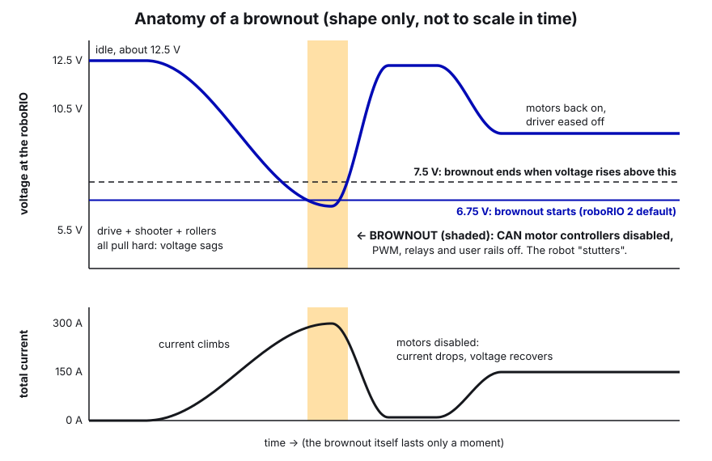

# 06. Current Limits and Brownouts

> **For:** everyone who configures a motor. If you set up a motor without reading this, you will eventually brown
> the robot out in a match. **Read first:** [05 Motors in Phoenix 6](05-motors-in-phoenix-6.md) (configs and
> `apply()`). **Time:** about 45 minutes, plus 30 minutes at the robot with Tuner X.

## What you'll learn

- What **stator current** and **supply current** are, in plain words, and why every motor gets a limit on both.
- How the two are connected (supply ≈ stator × duty cycle), so you can predict what a limit will do.
- What a **brownout** is, what turns off when it happens, and how the PDH and breakers fit in.
- How to choose limits for a mechanism, using the numbers from our 2026 robot as a starting table.
- The **kSlipCurrent** trap in CTRE's swerve code that cost us brownouts in 2026.
- How to see current in Tuner X and in our logs, how our brownout rumble works, and how a low current limit can
  protect a mechanism on purpose.

---

## The idea

### Current = amps = how hard the electricity is working

Voltage is the "push" (the battery gives about 12–13 V). **Current** (amps, A) is how much electricity actually
flows. More current means more torque from a motor, more heat, and more drain on the battery.

A brushless motor controller (Talon FX, Talon FXS) sits between the battery and the motor, so there are **two
different currents**:

```
  BATTERY ===[ supply current ]===> TALON ===[ stator current ]===> MOTOR COILS
  (what the battery and                     (what flows in the motor:
   breakers feel)                            torque and heat)
```


| | **Stator current** | **Supply current** |
|---|---|---|
| Where | Inside the motor's coils | From the battery into the controller |
| Means | **Torque** (force) and **heat** in the motor | **Load on the battery**, wires and breakers |
| Limiting it protects | The motor, gears, belts, chain, the mechanism, the wheels (traction) | The battery voltage (brownouts), breakers, the battery itself |
| CTRE config | `CurrentLimits.StatorCurrentLimit` (+ `...Enable`) | `CurrentLimits.SupplyCurrentLimit` (+ `...Enable`) |

### How they relate: supply ≈ stator × duty cycle

The controller is like a gearbox for electricity. **Duty cycle** is the fraction of battery voltage the controller
is applying to the motor right now (0 to 1). Power in ≈ power out, so:

```
  supply current ≈ stator current × duty cycle
```

That one line explains most of what you'll see:

- **Motor stalled or just starting** (low speed): the controller only needs a small duty cycle to push a huge
  current through the coils. Stator current is high, supply current is low. Example: a drive motor pushing against
  a wall at 0.2 duty with 60 A stator only pulls about 12 A from the battery.
- **Motor at high speed**: duty cycle is near 1, so supply ≈ stator.

So the **stator limit** mostly matters at low speed (starting, stalling, pushing, getting hit), and the **supply
limit** mostly matters at high speed under load (a flywheel recovering, the drivetrain at full speed). A stator limit
also caps supply current, because supply can never be more than stator. You set both because they protect different
things.

### What happens with no limits?

A stalled Kraken X60 can pull **hundreds of amps** in its coils. A roller jammed on a game piece will try to do
exactly that: it melts insulation, skips belts, strips gears, and drags the battery down. CTRE devices ship with
default limits (stator 120 A, supply 70 A, both enabled), which are safer than nothing but far too high for most
mechanisms. **The team rule is: every motor gets a stator limit and a supply limit you chose on purpose.**

### The supply "lower limit" (2026 API)

Phoenix 6 has two more supply settings, `SupplyCurrentLowerLimit` and `SupplyCurrentLowerTime`. How they work:
if the motor has been held at `SupplyCurrentLimit` for `SupplyCurrentLowerTime` seconds, the limit drops to
`SupplyCurrentLowerLimit` until the current falls back below it. It's built to stop a breaker tripping during a long
push. Defaults: **lower limit 40 A after 1.0 s** (set the time to 0 to turn it off).

We never set these, so the defaults are active on every motor. For most of our motors (supply limit 40 A or less)
it changes nothing. For the 2026 feed rollers (supply 50 A) it means: after a full second at 50 A, they drop to 40 A.
That's fine, but know it's there if a mechanism seems to "get weaker" after a second of hard pushing.

```java
config.CurrentLimits.SupplyCurrentLimit = 50;       // short bursts
config.CurrentLimits.SupplyCurrentLowerLimit = 40;  // after holding 50 A for...
config.CurrentLimits.SupplyCurrentLowerTime = 1.0;  // ...this many seconds
config.CurrentLimits.SupplyCurrentLimitEnable = true;
```

### Brownouts

The battery isn't perfect. It has a little internal resistance, and so do the wires. The more current the robot
pulls, the more the voltage **sags**:

```
  voltage at the roboRIO ≈ battery resting voltage − (total current × resistance)

  Rough numbers: 12.5 V − (300 A × 0.02 Ω) = 6.5 V   <- brownout
```

(0.02 Ω for battery + wiring is a ballpark; a worn-out battery is worse.)

When the voltage at the roboRIO gets too low it protects itself. The WPILib docs describe the stages:

| Voltage | What happens |
|---|---|
| Below 6.8 V | The 6 V PWM output starts to drop |
| **Below 6.75 V** (roboRIO 2 default; 6.3 V on roboRIO 1) | **Brownout.** PWM outputs off, the 6 V/5 V/3.3 V user rails off, relays off, and **CAN motor controllers are sent a disable command.** The power LED goes amber and the Driver Station shows it in red. It stays like this until voltage rises above 7.5 V. |
| Below 4.5 V | The roboRIO may black out and reboot |

So a brownout means **every motor stops for a moment**, even in the middle of a shot or a drive. It looks like the
robot "stutters". The Driver Station log marks it, and our code logs a `BROWNOUT` event (see below).



What causes it: too many motors pulling high current **at the same time**. Add up our 2026 supply limits and you get
over 600 A if everything maxed out together. It never all happens at once, but driving hard + shooter recovering +
feed rollers running is a lot. Current limits are how you decide, ahead of time, who gets how much.

### The PDH and breakers

Every motor gets power from the **PDH** (REV Power Distribution Hub, CAN ID 1 on our robot) through its own
**breaker** (40 A for big motors). The whole robot is behind the **120 A main breaker**. Breakers are thermal: they
let more than their rating through for a short time and trip if it goes on too long. A tripped 40 A breaker
kills that one motor until it cools and resets; a tripped main breaker kills the robot. Supply current limits keep
each motor comfortably under its breaker.

You can read the PDH from code with WPILib's `PowerDistribution` class (total current, current per channel, battery
voltage). The 2026 robot's code doesn't, but our template's `RobotLog` logs every channel all match (guide 19). That's
how you find **which motor** caused a brownout: graph the PDH channels at the `BROWNOUT` event and look for the tallest
line. It only works if someone wrote down which device is on which channel, so keep a channel map with the robot. PDH
firmware is updated with the REV Hardware Client, not Tuner X.

### Choosing limits

Start from what the mechanism needs, not from the motor:

1. **What does it need to do?** Hold a game piece, spin a heavy wheel up fast, push a robot? The stator limit is
   "how much force am I allowed to make". Pick the smallest that does the job.
2. **What breaks first?** Belts skip, chain jumps, 3D-printed parts crack, wheels slip on carpet. Stay below that.
3. **How many run at once?** Supply limits are your battery budget. Things that run together during the busiest
   moment (shooting while driving) get tighter supply limits.
4. **Test, watch, adjust.** Plot current in Tuner X while the mechanism does its hardest job. If it's flat at the
   limit and too slow, raise it a bit. If it barely touches it, you can lower it.

Our 2026 robot, as a starting table:

| Mechanism | Motor(s) | Stator (A) | Supply (A) | Why |
|---|---|---|---|---|
| Swerve drive | 4x Kraken X60 | **60** (set by `kSlipCurrent`) | 40 | About where the wheels start to slip; more just spins tires and drains the battery |
| Swerve steer | 4x Kraken X60 | 40 | 30 | Turning a module takes little torque |
| Shooter flywheel | 2x Kraken X60 | 60 | 40 | Fast spin-up and recovery, but capped: spin-up is one of the biggest draws |
| Feed rollers (floor + 2 belts) | 3x Kraken X60 | 60 | 50 | Keep a full hopper moving and clear light jams (raised from 40) |
| Intake wheels | Kraken X60 | 40 | 30 | Enough grip to pull fuel in; limits heat when stalled on a jam |
| Intake rack | 2x NEO Vortex (Talon FXS) | **20** | 20 | Deliberately low: acts like a spring so a hit pushes it in instead of skipping chain |
| Turret | Minion (Talon FXS) | 30 | 20 | Swing and hold; protects the ring gear and belt at the stop |
| Hood | Kraken X60 | 30 | 20 | Light, few rotations; limits damage if driven into a stop |

Rough starting points for things we haven't built yet: arms and elevators 40–60 stator / 30–40 supply (and a low
limit while homing); small Minion/NEO 550 mechanisms 20–30 stator.

### The kSlipCurrent lesson

Swerve code from the Tuner X Swerve Project Generator has a constant called `kSlipCurrent` in `TunerConstants.java`.
It's described as "the stator current at which the wheels start to slip". What's easy to miss: **CTRE's swerve code
uses it as the drive motors' stator current limit and overwrites whatever stator limit you put in the drive motor
config.**

In 2026 ours was **120 A**. The drive config underneath said 60 A, so everyone thought the drive was limited to 60.
It wasn't: four drive motors could each pull 120 A in the coils, and the robot browned out and stuttered when it
accelerated or pushed. We set `kSlipCurrent` to 60 and left a comment so nobody else gets caught.

**Rule:** to change the swerve drive stator limit, change `kSlipCurrent`. Then check it really took effect (Tuner X →
the drive motor → Configs → Current Limits).

---

## Step by step

### Set limits on a new motor

1. In `Constants.java`, add `kStatorCurrentLimitAmps` and `kSupplyCurrentLimitAmps` for the mechanism, with a
   comment saying **why** that number (what it protects).
2. In the subsystem's `TalonFXConfiguration`, set all four fields:
   ```java
   config.CurrentLimits.StatorCurrentLimit = kStatorCurrentLimitAmps;
   config.CurrentLimits.StatorCurrentLimitEnable = true;
   config.CurrentLimits.SupplyCurrentLimit = kSupplyCurrentLimitAmps;
   config.CurrentLimits.SupplyCurrentLimitEnable = true;
   ```
3. If it has a follower, apply the **same** limits to the follower (followers don't copy them).
4. Deploy. In Tuner X, open the motor → **Configs** → confirm the numbers arrived.

### Watch current in Tuner X

1. Connect to the robot, open Tuner X, pick the motor in the device list.
2. Open the **Plot** tab. Add **StatorCurrent**, **SupplyCurrent**, **SupplyVoltage** and **Velocity**.
3. Enable and run the mechanism through its hardest job (spin-up, a jam, a push).
4. Look for: stator flat-topping at your limit (the limit is working, and is maybe too low if the mechanism is
   slow), supply spikes, and SupplyVoltage dipping toward 7 V (brownout danger).

### Find it after a match (logs)

1. Our `RobotLog` starts CTRE's **SignalLogger**, which records every CTRE device's currents, voltages and faults to
   `.hoot` files on the USB stick (`/u/ctre-logs/`). See [19 Logging and debugging](19-logging-and-debugging.md).
2. Open the `.hoot` (and the WPILib `.wpilog`) in **AdvantageScope**. Plot battery voltage and the stator/supply
   current of the suspects on the same time axis.
3. Search the event log for `BROWNOUT`. Look at what was running at that moment.
4. The Driver Station **Log Viewer** also shows battery voltage and brownouts per match.

### Fix a brownout

1. Find out **when** it happens (accelerating? shooting while driving? pushing?) from the logs.
2. Find out **who** was pulling current then. Usually: drivetrain + flywheel + rollers together.
3. Check `kSlipCurrent` first. Then lower supply limits on the motors that run together, starting with the ones
   that matter least at that moment.
4. Check the battery (age, charge, internal resistance on a battery beak) and the main wiring (loose lugs and Anderson
   connectors add resistance).
5. Retest and compare the logs.

---

## In our code

### kSlipCurrent and the drive/steer limits

[TunerConstants.java, lines 52–79 (kSlipCurrent, drive and steer current limits)](https://github.com/TorqueNados-FRC5090/Hephaestus/blob/c2f0cee6f61db3f26f911d3f5623ed7fa27a5b03/src/main/java/frc/robot/generated/TunerConstants.java#L52-L79)

```java
// CTRE's swerve code uses this as the drive motors' STATOR current limit, overwriting the 60A set below.
// It was 120A, so the drive could pull twice the intended current and brown the robot out.
private static final Current kSlipCurrent = Amps.of(60);

private static final TalonFXConfiguration driveInitialConfigs = new TalonFXConfiguration()
    .withCurrentLimits( // driving motors
        new CurrentLimitsConfigs()
            // NOTE: CTRE overwrites this with kSlipCurrent above, so change that one.
            .withStatorCurrentLimit(Amps.of(60))
            .withStatorCurrentLimitEnable(true)
            .withSupplyCurrentLimit(Amps.of(40)) // battery draw per drive motor (x4). Raise toward 50 if drive feels weak
            .withSupplyCurrentLimitEnable(true)
    );
```

Notice the `Amps.of(60)` style: this file uses WPILib units objects; the subsystems use plain doubles in amps.
Both work. Also notice the comments now say *why* and *where the real number lives*.

### Shooter: why 60/40

[Shooter.java, lines 34–41 (shooter current limits with reasons)](https://github.com/TorqueNados-FRC5090/Hephaestus/blob/c2f0cee6f61db3f26f911d3f5623ed7fa27a5b03/src/main/java/frc/robot/subsystems/Shooter.java#L34-L41)

```java
// Flywheel spin-up is one of the biggest current draws on the robot.
// Stator 60 A: still spins up quickly (and recovers between balls) but caps the torque spike.
// Supply 40 A: limits battery draw per motor (x2) so spin-up during driving doesn't cause a brownout.
shooterConfig.CurrentLimits.StatorCurrentLimit = 60;
shooterConfig.CurrentLimits.StatorCurrentLimitEnable = true;
shooterConfig.CurrentLimits.SupplyCurrentLimit = 40;
shooterConfig.CurrentLimits.SupplyCurrentLimitEnable = true;
```

This is the model for every current-limit comment: what each limit protects and what to watch for.

### EvilIntake: limits as named constants

[EvilIntake.java, lines 89–99 (rack "spring" and intake wheel limits)](https://github.com/TorqueNados-FRC5090/Hephaestus/blob/c2f0cee6f61db3f26f911d3f5623ed7fa27a5b03/src/main/java/frc/robot/subsystems/EvilIntake.java#L89-L99)

```java
/** Rack motors, stator: the "spring". 20 A ~= 10 lb of push per side (20 lb total), plenty to move the rack
 *  through fuel, but low enough that a hit shoves the intake in instead of skipping the chain. Raise toward
 *  25-30 A if the intake gets pushed back during normal pickup; lower if the chain still skips. */
private static final double kRackStatorLimitAmps = 20.0;
/** Rack motors, supply: caps battery draw per side so the intake can't add to a brownout */
private static final double kRackSupplyLimitAmps = 20.0;
```

Here the current limit is a **design tool**, not just protection. The chain used to skip when another robot hit the
intake. With a 20 A stator limit, the motors simply can't push back harder than about 10 lb per side, so the rack
slides in instead of the chain jumping a tooth, and Motion Magic drives it back out afterward. That trick has its own
guide: [12 Spring-back and auto-retract](12-spring-back-and-auto-retract.md). Notice the comment also tells you
which way to adjust it and what symptom means which.

### Rollers: per-motor limits

[RollerSystem.java, lines 46–58 (one CurrentLimitsConfigs applied to all three motors)](https://github.com/TorqueNados-FRC5090/Hephaestus/blob/c2f0cee6f61db3f26f911d3f5623ed7fa27a5b03/src/main/java/frc/robot/subsystems/RollerSystem.java#L46-L58).
Each motor gets its own limit (limits are never shared between motors), and the comment says "lower toward 40 if
brownouts return". These run at full power together with the shooter, so they're the first thing to trim.

### Brownout rumble

[RobotContainer.java, lines 93–98 (rumble constants)](https://github.com/TorqueNados-FRC5090/Hephaestus/blob/c2f0cee6f61db3f26f911d3f5623ed7fa27a5b03/src/main/java/frc/robot/RobotContainer.java#L93-L98)
and [lines 293–308 (updateBrownoutRumble)](https://github.com/TorqueNados-FRC5090/Hephaestus/blob/c2f0cee6f61db3f26f911d3f5623ed7fa27a5b03/src/main/java/frc/robot/RobotContainer.java#L293-L308)

```java
public void updateBrownoutRumble() {
    double target = 0.0;
    if (DriverStation.isEnabled()) {
        if (RobotController.isBrownedOut()) {
            target = 1.0;
        } else {
            double volts = RobotController.getBatteryVoltage();
            double brownoutVolts = RobotController.getBrownoutVoltage();
            target = MathUtil.clamp((kRumbleStartVolts - volts) / (kRumbleStartVolts - brownoutVolts), 0.0, 1.0);
        }
    }
    m_brownoutRumble = Math.max(target, m_brownoutRumble - kRumbleDecayPerLoop);
    joystick.getHID().setRumble(RumbleType.kBothRumble, m_brownoutRumble);
}
```

What it does: below 7.5 V the driver's controller starts to rumble, getting stronger toward the brownout voltage
(6.75 V), full rumble during a brownout. Voltage dips last only milliseconds, so the rumble fades out slowly
(`kRumbleDecayPerLoop`) so the driver can actually feel it. It's called every loop from `Robot.robotPeriodic()`, and
[Robot.java line 72](https://github.com/TorqueNados-FRC5090/Hephaestus/blob/c2f0cee6f61db3f26f911d3f5623ed7fa27a5b03/src/main/java/frc/robot/Robot.java#L72)
logs a `BROWNOUT` event with the battery voltage when one starts. The driver learns to ease off (stop pushing,
let go of the shoot button) before the robot stutters.

---

## Common mistakes

- **kSlipCurrent left at 120 A.** CTRE used it as the drive stator limit, overriding our 60 A. Brownouts and
  stutter when accelerating. Set it to 60.
- **Believing the config without checking.** The drive config said 60 A, the motors ran 120 A. After deploying,
  look at the real values in Tuner X.
- **No limits on a follower.** Followers don't copy the leader's limits.
- **Only setting stator, or only supply.** Each protects different things. Set both.
- **Setting the number but not the `...Enable = true`.** The limit does nothing.
- **Limits so low the mechanism can't do its job.** Our feed rollers started at 40 A stator; the team raised them to
  60 so a full hopper keeps moving and light jams clear. Watch the plot: a mechanism stuck flat at its limit and not moving needs more (or has a mechanical problem).
- **Blaming code for a bad battery.** Old or half-charged batteries sag much more. Check the battery before you
  start cutting limits.
- **Forgetting the supply lower limit exists.** A 60 A supply limit quietly drops to 40 A after 1 s by default.

## Checklist

- [ ] Every motor (followers too) has stator and supply limits set and enabled.
- [ ] Each limit has a comment saying what it protects.
- [ ] `kSlipCurrent` in TunerConstants is the drive stator limit you want (we use 60 A).
- [ ] Values confirmed in Tuner X after deploying.
- [ ] Hardest job for each mechanism plotted once in Tuner X (stator, supply, voltage).
- [ ] Brownout rumble works (pull battery voltage down by pushing against a wall on a tired battery, carefully).
- [ ] SignalLogger is recording to the USB stick, so you can investigate after a match.

## Practice

1. **Predict, then measure.** A roller runs at 40% duty cycle and its stator current reads 30 A. Predict the supply
   current. Then put a roller on blocks, run it at 0.4 duty with a hand pressing (gently, with a rag) on the roller,
   and compare Tuner X's StatorCurrent and SupplyCurrent to your prediction.
2. **Budget sheet.** Make a table of every 2026 motor that runs while **shooting on the move** (4 drive, 4 steer,
   2 shooter, 3 rollers, intake wheels, turret, hood). Add up the supply limits. Using the rough sag formula above,
   what voltage would you expect if everything hit its limit? Which two limits would you lower first, and why?
3. **Find the overwrite.** In `TunerConstants.java`, find every place `kSlipCurrent` is used. Then find the CTRE
   doc sentence (or API doc for `withSlipCurrent`) that says it becomes the stator limit.
4. **Add PDH logging.** The template already does this (guide 19). In a branch of the 2026 code, which doesn't, create
   `new PowerDistribution(1, PowerDistribution.ModuleType.kRev)` for our REV PDH (CAN ID 1) and put total current
   and battery voltage on the dashboard as `Power/Total current (A)` and `Power/Battery (V)`. Test in simulation that
   it builds and runs.

## Go further

- CTRE, improving performance with current limits: https://v6.docs.ctr-electronics.com/en/stable/docs/hardware-reference/talonfx/improving-performance-with-current-limits.html
- CTRE, actuator limits: https://v6.docs.ctr-electronics.com/en/stable/docs/api-reference/api-usage/actuator-limits.html
- CTRE, plotting in Tuner X: https://v6.docs.ctr-electronics.com/en/stable/docs/tuner/plotting.html
- CTRE, signal logging: https://v6.docs.ctr-electronics.com/en/stable/docs/api-reference/api-usage/signal-logging.html
- WPILib, roboRIO brownouts: https://docs.wpilib.org/en/stable/docs/software/roborio-info/roborio-brownouts.html
- WPILib, robot battery basics: https://docs.wpilib.org/en/stable/docs/hardware/hardware-basics/robot-battery.html
- WPILib, preemptive troubleshooting (wiring checks): https://docs.wpilib.org/en/stable/docs/hardware/hardware-basics/preemptive-troubleshooting.html

> **2027 note:** the SystemCore replaces the roboRIO, so the brownout voltage and what gets switched off may be
> different. The physics (stator vs supply, voltage sag) and the CTRE current limit settings don't change. Check the
> current WPILib docs for SystemCore's brownout behaviour.
