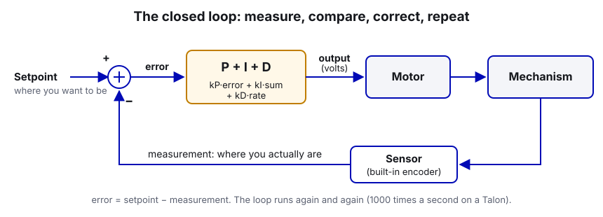
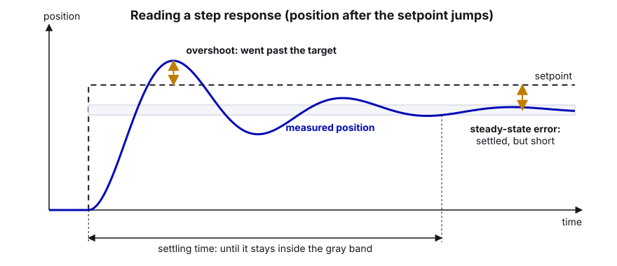
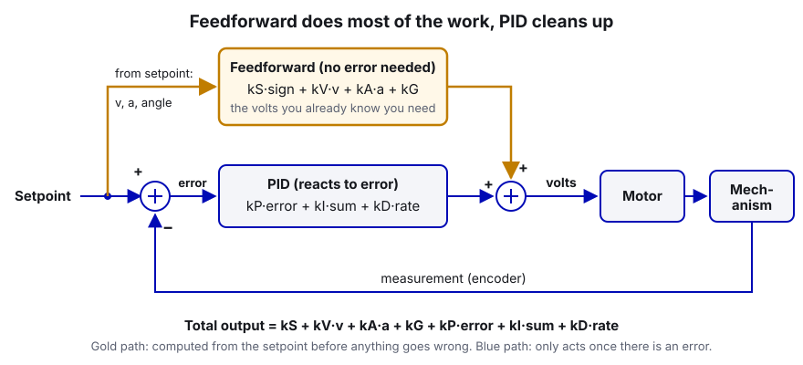
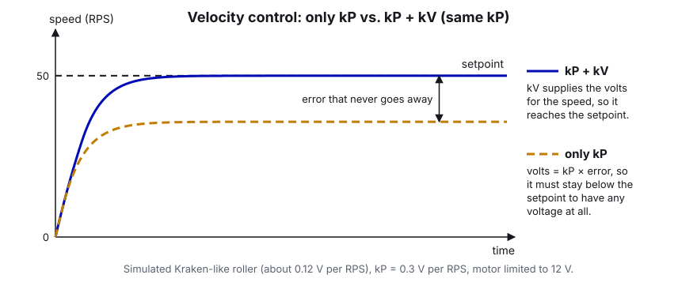

# 07. What Is PID (and Feedforward)?

> **Who it's for:** anyone who has heard "just tune the PID" and nodded without knowing what it means. No math beyond
> multiplying is needed. **You need first:** you should know what a subsystem and a Talon FX are (see the Robot-Template
> `STUDENT-GUIDE.md`, sections 3 and 6). **Time:** about 45 minutes to read, longer if you do the practice.

**What you'll learn**

- The words: setpoint, error, open loop, closed loop, gains.
- What P, I and D each do, and what "too much" of each looks like.
- What feedforward (kS, kV, kA, kG) is, and why on our robot it does most of the work while PID only cleans up.
- What units our gains are in with Phoenix 6 (volts per rotation, volts per RPS), and why the controller runs on the
  motor controller at 1000 times a second instead of on the roboRIO.
- What gain slots (Slot0/1/2) are for.
- How to read the real gains in our 2026 code (Shooter, rollers, turret, intake, hood, swerve).

---

## 1. The big idea, with no robots

### Driving up to a stop sign

You're driving toward a stop sign. Nobody tells you "press the brake at 43% for 2.1 seconds". Instead you keep
looking at **how far away the sign is**, and you adjust:

- Far away: you keep your foot on the gas.
- Getting close: you ease off and start braking.
- Closing in fast: you brake harder, because you can *see* you're approaching quickly.
- Stopped one foot short: you creep forward a little.

You are a controller. You look at the gap between where you are and where you want to be, and you decide how hard to
push. That loop (look, decide, push, look again) is called **closed-loop control**.

### The shower

You turn the shower knob, step in, it's cold. You turn it more toward hot. It overshoots and scalds you, so you turn
it back. After a few back-and-forths it's right. That back-and-forth is **oscillation**, and it happens because
the water takes a second to respond (there's a delay) and you overreacted. A good controller reacts strongly enough
to get there fast, but not so strongly that it overshoots.

Now imagine you already know that "knob at 3 o'clock is about right for 40 °C". You'd turn straight to 3 o'clock and
only make small fixes after. That's **feedforward**: using what you already know about the system to get close
immediately, so the feedback only has to fix small leftovers. Hold on to this idea. It is the most important one in
this guide.

### Words you need

| Word | Meaning | Example on our robot |
|---|---|---|
| **Setpoint** (or target, reference) | Where you want to be. | Shooter: 60 rotations per second. Hood: -1.5 rotations. |
| **Measurement** | Where you actually are, from a sensor. | The Kraken's built-in encoder says 57 RPS. |
| **Error** | Setpoint minus measurement. | 60 - 57 = 3 RPS of error. |
| **Output** | What the controller sends to the motor. | 9.1 volts. |
| **Open loop** | Send a fixed output and hope. No sensor feedback. | `DutyCycleOut(0.5)`: "half power", whatever speed that turns out to be. |
| **Closed loop** | Measure, compare to setpoint, correct, repeat. | `VelocityVoltage(60)`: "hold 60 RPS", the motor fixes itself. |
| **Gain** | A number that sets how strongly the controller reacts. | `kP = 0.8` |

Open loop is fine when you don't care about the exact result (intake wheels pulling fuel in: `DutyCycleOut` at full
power is perfect). Closed loop is what you want when the exact speed or position matters (shooter speed decides
whether the ball goes in; the hood angle decides the arc).

---

## 2. P, I and D

PID is three simple rules added together. Each one looks at the error in a different way.



### P = Proportional: "push in proportion to how far off you are"

`P output = kP * error`

Big error, big push. Small error, small push. This is the main corrective term.

- **Too little kP:** the mechanism is sluggish and may stop short of the target. Near the target the error is small,
  so the push is small, and if friction or gravity is bigger than that push, it just sits there. This leftover is
  called **steady-state error**.
- **Too much kP:** it gets to the target fast, overshoots, comes back, overshoots the other way... it **oscillates**
  (buzzes or wobbles). Way too much and it shakes violently.



### I = Integral: "if you've been off for a while, push harder"

`I output = kI * (error added up over time)`

The I term remembers. If the hood has been 0.1 rotations short for a whole second, the sum keeps growing until it
pushes hard enough to close the gap. It's meant to kill steady-state error.

- **Too much kI:** the sum builds up while the mechanism is moving (or stuck against something), then it blows way
  past the target and takes a long time to unwind. This is called **integral windup**. It's a classic cause of a
  mechanism slamming into its hard stop.

**On FRC robots we almost never use kI.** Steady-state error is nearly always caused by something feedforward
handles better and more predictably: friction (kS) or gravity (kG). Every kI in our 2026 code is 0. Leave it at 0
unless a mentor agrees there's a reason.

### D = Derivative: "if the error is shrinking fast, ease off"

`D output = kD * (how fast the error is changing)`

D looks at the speed of approach. If you're closing in quickly, D pushes back, like braking as you near the stop sign.
It **damps** overshoot.

- **Too much kD:** the mechanism feels "stiff" or "grainy", buzzes or makes a high-pitched whine, because D amplifies
  sensor noise (tiny jitter in the measurement becomes jerky output).

### Summary table

| Term | Looks at | Fixes | Too much looks like |
|---|---|---|---|
| P | error now | most of the error | overshoot, oscillation |
| I | error over time | small leftover error | windup, slow big overshoot, slams |
| D | how fast error changes | overshoot | buzzing, noisy, whining motor |

---

## 3. Feedforward: the part that does most of the work

PID only reacts **after** there is an error. The mechanism has to be *wrong* before PID does anything. Feedforward
(FF) is different: it calculates the output you **already know** you'll need, from the setpoint, before any error
exists. In the shower example, it's "turn the knob to 3 o'clock".

Phoenix 6 has four feedforward gains. All of them are added to the PID output.

| Gain | Name | What it covers | Formula (volts) |
|---|---|---|---|
| **kS** | static | Friction. The voltage it takes just to start moving. | `kS * sign(direction)` |
| **kV** | velocity | Back-EMF and drag. A spinning motor needs voltage roughly proportional to its speed. | `kV * target velocity` |
| **kA** | acceleration | Inertia. Extra voltage to speed up. | `kA * target acceleration` |
| **kG** | gravity | Weight. Voltage that holds an arm or elevator still. | `kG` (elevator) or `kG * cos(angle)` (arm) |

Total output = `kS + kV*v + kA*a + kG + kP*error + kI*sum + kD*rate`.



### Why kV is the big one for anything that spins

A brushless motor running freely at 12 V spins at its free speed. A Kraken X60 is about 100 rotations per second
(RPS) at 12 V. Because speed is roughly proportional to voltage, `12 V / 100 RPS = 0.12 V per RPS`. So if you want
50 RPS, you need about 6 V, *before any PID at all*. That's `kV ≈ 0.12`.

Now think about a flywheel with only kP. To hold 50 RPS the motor needs about 6 V. If the controller only has P, then
`6 V = kP * error`, which means **there must be error** for there to be any voltage. With kP = 0.3 it settles where `0.3 * error`
is exactly the voltage needed for the speed it actually reached: about 36 RPS when you asked for 50
(0.3 × 14 RPS of error ≈ 4.3 V ≈ 36 RPS × 0.12). That's exactly what happened to our
rollers (see "In our code" below). Add kV and the 6 V comes from feedforward. The error drops to almost nothing, and kP
only has to fix disturbances, like a ball slowing the wheel down.



**The rule for FRC mechanisms:** get the feedforward close, then use the smallest kP that fixes the leftover. FF
makes the mechanism predictable; PID makes it accurate.

### kG: elevators vs arms

- **Elevator:** gravity pulls down with the same force no matter the height, so kG is a constant. Phoenix 6 calls this
  `GravityTypeValue.Elevator_Static`.
- **Arm:** gravity's pull on an arm is largest when the arm is horizontal and zero when it's straight up or down. So
  the needed voltage is `kG * cos(angle)`. Phoenix 6 calls this `GravityTypeValue.Arm_Cosine`. For this to work the
  motor's position must read 0 when the arm is horizontal and be in **arm** rotations (that's what
  `SensorToMechanismRatio` is for, see [09 Motion Magic and position control](09-motion-magic-and-position-control.md)).
  New in Phoenix 6 for 2026, `Slot0.GravityArmPositionOffset` lets you shift that zero by up to ±0.25 rotations if
  your arm's zero isn't horizontal.

### kS and its sign

kS is "always push a little in the direction we're going". Which direction is that? Phoenix 6 decides it with
`StaticFeedforwardSign`:

- `UseVelocitySign` (default): push in the direction of the *target velocity*. Good for velocity control and Motion
  Magic, where there is a target velocity.
- `UseClosedLoopSign`: push in the direction of the *error*. Needed for plain position control (like `PositionVoltage`)
  where the target velocity is 0, otherwise kS does nothing. The turret and intake use this. The catch: right at the
  target the error flips sign back and forth, so a kS that's too large can make the mechanism chatter. Keep it just
  under what's needed to start moving.

---

## 4. Units: what does "kP = 8" actually mean?

This confuses everyone, so slow down here. In Phoenix 6 with a **Voltage** request (`VelocityVoltage`,
`PositionVoltage`, `MotionMagicVoltage`...), the controller's output is **volts**. So every gain is "volts per
something":

| Request | Error is in | kP unit | kI unit | kD unit |
|---|---|---|---|---|
| `PositionVoltage`, `MotionMagicVoltage` | rotations | **V per rotation of error** | V per (rotation x second) | V per RPS of error change |
| `VelocityVoltage` | RPS | **V per RPS of error** | V per rotation | V per (RPS/s) |

Feedforward units: kS volts, kV **V per RPS**, kA **V per (RPS/s)**, kG volts.

"Rotations" means *motor* rotations unless you've set `SensorToMechanismRatio` (or `RotorToSensorRatio` with a
CANcoder). If you have, they're mechanism rotations, and **your gains change meaning**. CTRE's docs say gains are in
mechanism units once a ratio is configured. So if you add a gear ratio later, you must retune.

Worked example: Turret kP = 8 V per motor rotation. The turret gear ratio is 200/16 = 12.5 motor rotations per turret
rotation, so one motor rotation is 360 / 12.5 = 28.8 degrees of turret. If the turret is 5 degrees off, that's
5 / 28.8 = 0.17 motor rotations of error, and P outputs `8 * 0.17 = 1.4 V`. That's a gentle push. At 20 degrees off
it's 5.6 V.

Other output types exist: `...DutyCycle` requests (gains are "fraction of full power per rotation") and
`...TorqueCurrentFOC` (gains are amps, Pro only). We use Voltage requests: volts are predictable because they don't
change when the battery sags. A duty cycle of 0.5 gives 6.25 V on a fresh battery and 5.5 V on a tired one; a
`VoltageOut` of 6 V gives 6 V on both (as long as the battery can supply it).

---

## 5. Where does the loop run? On the motor controller, 1000 times a second

There are two ways to run PID on our robot:

| | WPILib `PIDController` | Phoenix 6 closed loop (`PositionVoltage` etc.) |
|---|---|---|
| Runs on | the roboRIO, inside your `periodic()` | the Talon FX / FXS itself |
| How often | every robot loop: **50 Hz** (every 20 ms) | **1 kHz** (every 1 ms) |
| Sensor delay | the encoder value travels over CAN to the RIO, then volts travel back | none: the encoder is inside the motor |
| If the robot code hiccups (loop overrun) | the loop stalls too | the motor keeps controlling, it only needs the setpoint |
| Gains units | whatever units you feed it (we usually return volts) | volts per rotation / RPS, as above |

The Talon runs the loop 20 times more often and with no communication delay, so it can use higher gains without
oscillating and it reacts to a ball hitting the flywheel in about a millisecond. Your code only has to send the
**setpoint** (by calling `setControl(...)`), and the motor does the rest. That's why all our 2026 mechanisms use
Phoenix 6 closed loop.

WPILib's controllers are still useful when the thing you're controlling isn't one motor. Example: in the auto-align
repo, `DriveToPose.java` uses a P controller on the RIO to turn "distance to target pose" into a drive speed, because
that loop involves the whole drivetrain plus odometry, not one encoder. In 2025, Stingray's elevator used a WPILib
`ProfiledPIDController` on the RIO; [15 Elevators](15-elevators.md) shows why we'd now do that on the motor instead.

---

## 6. Slots: several sets of gains on one motor

Each Talon has three gain **slots**: `Slot0Configs`, `Slot1Configs`, `Slot2Configs`. Each slot holds a full set (kP,
kI, kD, kS, kV, kA, kG, gravity type, kS sign). Every closed-loop request picks one with `.withSlot(n)`.

When would you want more than one?

- An elevator that's carrying a game piece vs. empty (more kG when loaded).
- Gentle gains for a slow "hold position" and aggressive gains for fast moves.
- Velocity control in slot 0 and position control in slot 1 on the same motor.

Our 2026 code only uses slot 0. That's normal. Just know that `.withSlot(0)` in
`new VelocityVoltage(0).withSlot(0)` is what links the request to `Slot0` gains.

---

## 7. Step by step: read any mechanism's control setup

Use this every time you open someone else's subsystem.

1. **Find the request.** Search the file for `Voltage(`. `VelocityVoltage` means speed control; `PositionVoltage` or
   `MotionMagic...` means position control; `DutyCycleOut` or `VoltageOut` means open loop.
2. **Find the slot.** Look for `.withSlot(n)` (no `withSlot` means slot 0).
3. **Find the gains.** Search for `Slot0` / `Slot0Configs`. Write down kP, kI, kD, kS, kV, kA, kG.
4. **Check the units.** Is there a `SensorToMechanismRatio`? If not, positions and velocities are motor rotations.
5. **Check that the config is applied only once per slot.** Two `apply()` calls for the same slot means the second
   one wins (this bit us on the Shooter).
6. **Sanity-check kV.** For a velocity mechanism, kV should be near `12 / free speed in RPS` of whatever the
   setpoint is measured in. Kraken X60 ≈ 0.12, NEO Vortex ≈ 0.11, Minion ≈ 0.1.
7. **Find the "at target" check.** Is there a tolerance? Is it in the same units as the setpoint?

---

## 8. In our code

### Shooter: velocity control with kP + kV (and a slot that's applied twice)

The Shooter uses `VelocityVoltage` on the lead Kraken (CAN 27), with the follower (CAN 15) set to
`Follower(27, MotorAlignmentValue.Opposed)`. Look at the gains in
[Shooter.java, lines 43–60 (two slot 0 configs)](https://github.com/TorqueNados-FRC5090/Hephaestus/blob/c2f0cee6f61db3f26f911d3f5623ed7fa27a5b03/src/main/java/frc/robot/subsystems/Shooter.java#L43-L60):

```java
        // PID Configuration
        shooterConfig.Slot0.kP = 0.4; 
        shooterConfig.Slot0.kI = 0.0;
        shooterConfig.Slot0.kD = 0.0005;
        shooterConfig.Slot0.kV = 0.16;
        shooterConfig.Slot0.kS = 0.0;
        leadShoot.getConfigurator().apply(shooterConfig);

        // --- SHOOTER CONFIG ---
        Slot0Configs shooterPID = new Slot0Configs();
        shooterPID.kP = .8; // Changed to 2.0 for smoother recovery
        shooterPID.kI = 0.0;
        shooterPID.kD = 0; //.0005
        shooterPID.kV = 0.145; // .16
        shooterPID.kS = 0;
        //shooterPID.kA = 1.0;
        
        leadShoot.getConfigurator().apply(shooterPID);
```

What to notice:

- The **real** gains are the second set: kP 0.8 V per RPS of error, kV 0.145 V per RPS. The first apply sets slot 0,
  then the second apply **overwrites** slot 0. The 0.4 / 0.16 numbers are dead code that looks alive. Fix: keep one
  place where slot 0 is set.
- The comment "Changed to 2.0" disagrees with the value 0.8. Comments that lie are worse than no comments.
- kV 0.145 means 60 RPS needs `0.145 * 60 = 8.7 V` of feedforward. That's close to the Kraken's theoretical 0.12,
  a bit higher because of friction and air drag on a real flywheel. kP then fixes the dip when a ball goes through:
  a 3 RPS dip gives `0.8 * 3 = 2.4 V` extra.
- `isShooterReady()` compares the measured velocity to the setpoint with a tolerance: that's the "at target" check.

### RollerSystem: the "only kP never got there" lesson

[RollerSystem.java, lines 37–44 (roller gains)](https://github.com/TorqueNados-FRC5090/Hephaestus/blob/c2f0cee6f61db3f26f911d3f5623ed7fa27a5b03/src/main/java/frc/robot/subsystems/RollerSystem.java#L37-L44):

```java
        Slot0Configs rollerConfig = new Slot0Configs();
        rollerConfig.kP = 0.3;
        // Volts per RPS. With only kP the rollers never reached their target speed.
        rollerConfig.kV = 0.5;
      //   rollerConfig.
        rollerFloor.getConfigurator().apply(rollerConfig);
        lowerBelt.getConfigurator().apply(rollerConfig);
        upperBelt.getConfigurator().apply(rollerConfig);
```

What to notice:

- The comment is the whole lesson of section 3: pure P needs error to make voltage, so it never reaches the setpoint.
- Be honest about the number, though: kV 0.5 is about 4 times the theoretical 0.12 for a Kraken. At the feed speed of
  90 RPS it asks for `0.5 * 90 = 45 V`, and the motor can only give about 12. So in practice the rollers simply run at
  full voltage. That "works" for feeding (we want them flat out anyway), but it isn't really closed-loop control any
  more. If we ever need a precise roller speed, start from kV ≈ 0.12 and tune it properly
  ([08 Tuning PID step by step](08-tuning-pid-step-by-step.md)).

### Turret: position control with kS + kV + kP

[Turret.java, lines 141–149 (turret gains)](https://github.com/TorqueNados-FRC5090/Hephaestus/blob/c2f0cee6f61db3f26f911d3f5623ed7fa27a5b03/src/main/java/frc/robot/subsystems/Turret.java#L141-L149):

```java
        config.Slot0.kP = 8;
        config.Slot0.kD = 0;
        // Small push in the direction of the error so friction can't stop the turret just short of the target
        // (with no camera nudging the pose it would sit a few degrees off forever and never read "on target")
        config.Slot0.kS = 0.15;
        config.Slot0.StaticFeedforwardSign = StaticFeedforwardSignValue.UseClosedLoopSign;
        // Volts per motor rot/s. Without this the turret only moves once it's already behind
        // (pure kP), which is most of the lag. ~12V / Minion free speed.
        config.Slot0.kV = 0.1;
```

What to notice:

- The turret uses `MotionMagicVoltage` (a motion profile, see guide 09), which produces a target velocity at every
  instant. kV turns that target velocity into voltage immediately, so the turret moves *with* the profile instead of
  lagging behind it. The comment says it exactly: without kV, "the turret only moves once it's already behind".
- kS 0.15 V with `UseClosedLoopSign` beats friction so it doesn't park a few degrees short. That's the job people
  wrongly give to kI.
- kV = 0.1 matches `12 V / ~120 RPS` (Minion free speed). It's in **motor** rotations, because the turret config has
  no `SensorToMechanismRatio`.

### Intake (EvilIntake): starting gains with units written down

[EvilIntake.java, lines 101–108 (default gains)](https://github.com/TorqueNados-FRC5090/Hephaestus/blob/c2f0cee6f61db3f26f911d3f5623ed7fa27a5b03/src/main/java/frc/robot/subsystems/EvilIntake.java#L101-L108):

```java
     // ================= GAINS (starting values, tune on the dashboard) =================
     // Units: volts per motor rotation of error (kP), volts per rot/s (kV), volts (kS).
     private static final double kDefaultP = 3.0;   // pushes harder the further it is from target
     private static final double kDefaultI = 0.0;   // normally not needed
     private static final double kDefaultD = 0.0;   // add a little if it overshoots or bounces
     private static final double kDefaultS = 0.25;  // volts to get past friction
     private static final double kDefaultV = 0.11;  // ~12 V / Vortex free speed (113 rot/s)
     private static final double kDefaultA = 0.0;
```

This is the model to copy: every gain has its unit and its purpose next to it, kV is derived from the motor's free
speed, and kI is 0 with a reason. (The class name `EvilIntake` is a joke name; in new code call it `Intake` or
`IntakeExtension`.)

### Hood: P only

[Hood.java, lines 65–67 (hood gains)](https://github.com/TorqueNados-FRC5090/Hephaestus/blob/c2f0cee6f61db3f26f911d3f5623ed7fa27a5b03/src/main/java/frc/robot/subsystems/Hood.java#L65-L67):

```java
        Slot0Configs hoodPID = new Slot0Configs();
        hoodPID.kP = 2;
        hood.getConfigurator().apply(hoodPID);
```

kP 2 V per motor rotation with `PositionVoltage`. The hood is light and only travels about 2.8 motor rotations, so P
alone gets it close. Its `atSetpoint()` tolerance is a generous 0.5 rotations, which hides any small steady-state
error. If you ever need it tighter, add kS (with `UseClosedLoopSign`) before you think about kI, and add kG
(`Arm_Cosine`) if gravity pulls it down.

### Swerve (TunerConstants): generated gains

[TunerConstants.java, lines 26–34 (steer and drive gains)](https://github.com/TorqueNados-FRC5090/Hephaestus/blob/c2f0cee6f61db3f26f911d3f5623ed7fa27a5b03/src/main/java/frc/robot/generated/TunerConstants.java#L26-L34):

```java
    private static final Slot0Configs steerGains = new Slot0Configs()
        .withKP(100).withKI(0).withKD(0.5)
        .withKS(0.1).withKV(2.49).withKA(0)
        .withStaticFeedforwardSign(StaticFeedforwardSignValue.UseClosedLoopSign);
    // When using closed-loop control, the drive motor uses the control
    // output type specified by SwerveModuleConstants.DriveMotorClosedLoopOutput
    private static final Slot0Configs driveGains = new Slot0Configs()
        .withKP(0.1).withKI(0).withKD(0)
        .withKS(0).withKV(0.124);
```

What to notice:

- **Steer** kP is 100! That's not crazy, because the steer motor uses a `FusedCANcoder` with the steer gear ratio, so
  the units are **module** rotations. 100 V per module rotation is `100 / 360 ≈ 0.28 V per degree`. A module that's
  10 degrees off gets 2.8 V. Same gain, very different meaning depending on units.
- **Drive** kV 0.124 V per motor RPS is basically `12 / 96.7` (Kraken free speed with FOC). kP is tiny (0.1) because
  feedforward is doing the work. This is the "FF does most of the work" rule in the code CTRE itself generates.

---

## Common mistakes

- **Only kP on a velocity mechanism.** It never reaches the setpoint (our rollers). Add kV first.
- **Applying the same slot twice.** The Shooter applies slot 0 in a `TalonFXConfiguration` and again as a
  `Slot0Configs`. The second wins, silently. Search your file for every `apply(` before you tune.
- **Reaching for kI to fix "stops a bit short".** That's friction (kS) or gravity (kG). kI causes windup and slams.
- **Forgetting units change with ratios.** Adding `SensorToMechanismRatio` later makes every gain mean something
  different. Retune after you change it.
- **kS with `UseVelocitySign` on `PositionVoltage`.** The target velocity is 0, so kS does nothing. Use
  `UseClosedLoopSign` for plain position control.
- **Huge kV "to make it work".** If kV times your setpoint is more than 12 V, you've built open-loop full power with
  extra steps (see the rollers).
- **Comments that disagree with the code** ("Changed to 2.0" next to `0.8`). Update the comment when you change the
  number, and say why.

## Checklist

- [ ] I know which request this mechanism uses and which slot.
- [ ] Every gain has its unit written in a comment (V per rotation, V per RPS, V).
- [ ] kV is close to `12 / free speed` for velocity mechanisms, or I know why not.
- [ ] kI is 0, or a mentor agreed why it isn't.
- [ ] Each slot is applied in exactly one place.
- [ ] The "at target" tolerance is in the same units as the setpoint.

## Practice

1. **Units drill.** The intake's kP is 3 V per motor rotation, and 1 inch of rack travel is 0.546 motor rotations. How
   many volts does P output when the rack is 2 inches from its target? (Answer: 2 * 0.546 * 3 ≈ 3.3 V.)
2. **Predict the roller speed.** With only `kP = 0.3` and no kV, how fast would a roller settle if it needs about
   `0.12 V per RPS` to spin and you ask for 90 RPS? (Hint: at the settling point, `0.3 * error = 0.12 * speed` and
   `error = 90 - speed`.) Compare with what the team saw.
3. **Read a file.** Open Stingray 2025's `Pivot.java` and do the 7 steps in section 7. Which gains does it use, in what
   units, and what's missing compared to the turret?
4. **Sim experiment.** In the Robot-Template, copy `ExampleRoller`, run simulation, set `kV = 0` and `kP = 0.3`, and
   plot velocity vs. setpoint in AdvantageScope. Then set `kV = 0.12`. Describe the difference in one sentence.

## Go further

- CTRE, closed-loop requests and gravity/kS options:
  https://v6.docs.ctr-electronics.com/en/stable/docs/api-reference/device-specific/talonfx/closed-loop-requests.html
- CTRE, basic PID control with a Talon FX:
  https://v6.docs.ctr-electronics.com/en/stable/docs/api-reference/device-specific/talonfx/basic-pid-control.html
- CTRE, manual PID tuning (what each gain means, per mechanism):
  https://v6.docs.ctr-electronics.com/en/stable/docs/api-reference/device-specific/talonfx/manual-pid-tuning.html
- WPILib, introduction to PID: https://docs.wpilib.org/en/stable/docs/software/advanced-controls/introduction/introduction-to-pid.html
- WPILib, introduction to feedforward: https://docs.wpilib.org/en/stable/docs/software/advanced-controls/introduction/introduction-to-feedforward.html
- WPILib, interactive tuning simulators (flywheel, turret, arm, elevator):
  https://docs.wpilib.org/en/stable/docs/software/advanced-controls/introduction/index.html
- Next: [08 Tuning PID step by step](08-tuning-pid-step-by-step.md).
- Related team guides: [05 Motors in Phoenix 6](05-motors-in-phoenix-6.md), [10 Flywheels and shooters](10-flywheels-and-shooters.md), [13 Turrets](13-turrets.md).
