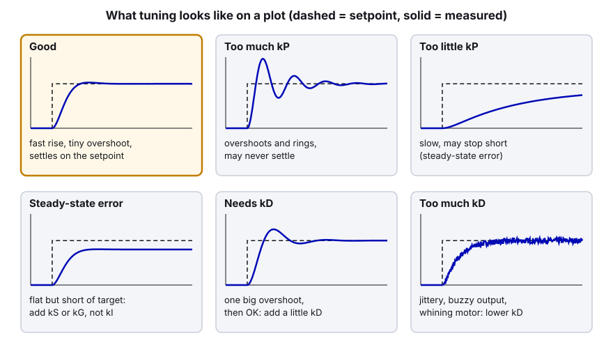
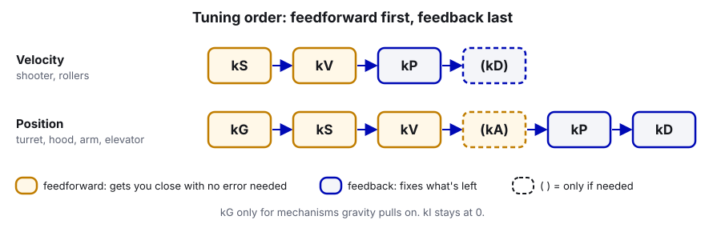

# 08. Tuning PID Step by Step

> **Who it's for:** students who are about to tune a real mechanism (or the drivetrain) and want a procedure instead of
> guessing. **You need first:** [07 What is PID](07-what-is-pid.md). For position mechanisms, also skim
> [09 Motion Magic and position control](09-motion-magic-and-position-control.md). **Time:** 1 hour to read and set up
> the dashboard pattern; tuning one mechanism usually takes 20–60 minutes at the robot.

**What you'll learn**

- How to set up so tuning is safe (blocks, limits, low gains, a hand on the disable key).
- The feedforward-first order: kS → kV → kP → maybe kD for velocity; kG → kS → kV → kP → kD for position.
- How to *see* what the controller is doing in Phoenix Tuner X and AdvantageScope, and what good and bad tuning
  look like on a plot.
- Our live dashboard tuning pattern (from the 2026 intake), plus a reusable class you can drop into any mechanism.
- How to measure kS, kV and kA with SysId and CTRE's SignalLogger instead of guessing.

---

## 1. Safety first

A mechanism being tuned is a mechanism that's about to do something unexpected. Before you touch a gain:

1. **Robot on blocks** (wheels off the ground) for anything on the drivetrain. For mechanisms, clear the area around
   them and keep hands out of the travel.
2. **One person on the Driver Station whose only job is to disable.** On the Driver Station, **Enter disables** and
   **Space is the emergency stop** (needs a reboot to recover). They watch the mechanism, not the laptop.
3. **Current limits on.** Every motor config in our code has stator and supply limits; check that the one you're
   tuning does. For tuning, it's fine to temporarily lower the stator limit (say 20–30 A on a small mechanism) so a
   mistake can't break anything. Our intake runs a 20 A stator limit all the time, though there the main reason is the spring-back design (guide 12).
4. **Soft limits on** for anything with a hard stop (hood, elevator, intake rack). See guide 09. If your soft limits
   are still placeholders (the hood's are), set them conservatively before tuning.
5. **Start with low gains.** Begin at zero (or the generator's defaults) and go up. Doubling a gain is fine;
   multiplying by 10 is how mechanisms get bent.
6. **Small moves first.** Tune with a small setpoint change (10–20% of the travel or of max speed) before full moves.
7. **Know where the gains live.** If you change gains in Tuner X, they're stored on the motor only until the robot code
   restarts and re-applies its config. Write good values into the Java constants or you'll lose them.

---

## 2. What tuning looks like on a plot

You can't tune by watching the mechanism alone; it moves too fast. Always plot **setpoint vs. measurement** over time.
Here's what to look for (time goes left to right):



| What you see | Most likely cause | First fix |
|---|---|---|
| Velocity settles below target, never catches up | missing or low kV | raise kV |
| Mechanism doesn't move on small setpoint changes | friction | raise kS |
| Stops a little short of a position target | friction (or gravity) | kS (or kG), not kI |
| Sags on an elevator/arm, drifts down when holding | gravity | kG |
| Overshoots and rings | kP too high | lower kP ~20%, or add a little kD |
| One overshoot then settles | needs damping | small kD |
| Buzzing/whining, grainy motion | kD too high, or kP far too high | lower kD |
| Lags behind a moving target (turret behind the robot's spin) | no kV, or profile too slow | add kV; raise Motion Magic accel/jerk |

---

## 3. Velocity mechanisms (shooter, rollers): kS → kV → kP → maybe kD

This follows CTRE's own flywheel procedure. Use `VelocityVoltage` with `.withEnableFOC(true)`.



1. **Zero everything.** kP, kI, kD, kS, kV, kA = 0.
2. **Set a tiny kP** so the mechanism at least responds (0.05–0.1 V per RPS).
3. **kS:** command a low speed (about 10% of max, e.g. 10 RPS). Raise kS until the measured speed reaches it. On a
   free-spinning flywheel kS is often tiny or 0 (our Shooter uses 0).
4. **kV:** command a high speed (about 80% of max, e.g. 80 RPS). Raise kV until measured speed matches the setpoint.
   Start from `12 / free speed` (≈ 0.12 for a Kraken X60). Expect a bit higher on a real mechanism (Shooter landed
   on 0.145).
5. **Repeat 3–4** a couple of times (kS mostly matters at low speed, kV at high), until both speeds are close
   *without* help from kP.
6. **kP:** raise until the speed recovers quickly when you load it (feed a ball, or touch a wheel with a scrap of wood
   on a safe roller). Stop when you see oscillation around the setpoint, then back off 20–30%.
7. **kD:** usually 0 for flywheels. Only add a tiny amount if recovery overshoots.
8. **Check across the whole range** of speeds you'll actually use (our shooter goes from short shots to full-court
   passes).

**Success looks like:** with kP set to 0 for a moment, measured speed is within a few percent of the setpoint at every
speed. That proves feedforward is doing the work.

---

## 4. Position mechanisms (turret, hood, intake rack, elevator, arm)

Use `MotionMagicVoltage` (or `PositionVoltage` for tiny, light mechanisms). Guide 09 explains Motion Magic; for
tuning, all you need is that it makes a smooth **target position and target velocity** that the gains try to follow.

### With gravity (elevator, arm): kG first

1. Zero all gains. Mechanism somewhere in the middle of its travel.
2. Set kG (`GravityTypeValue.Elevator_Static` for elevators, `Arm_Cosine` for arms) and command "hold where you are".
3. Raise kG until the mechanism **stops drifting down**. Write it down (call it `kG_low`).
4. Keep raising until it **starts drifting up**. Write that down (`kG_high`).
5. Set `kG = (kG_low + kG_high) / 2` and `kS = (kG_high - kG_low) / 2`. The gap between them is friction. (This is
   CTRE's arm procedure; it works for elevators too.)

### Then (with or without gravity)

6. **kS** (if you didn't get it from step 5): command a small move (about 0.1 mechanism rotations or an inch). Raise kS
   until it *just* starts to creep, then back off a little. Use `StaticFeedforwardSign = UseClosedLoopSign` for
   `PositionVoltage`; for Motion Magic the default `UseVelocitySign` also works.
7. **kV** (Motion Magic only): during a long move, compare measured velocity to the profile's target velocity (Tuner X
   signal "Closed Loop Reference Slope", or your own dashboard number) in the middle (cruise) part. Raise kV until they
   match. Start from `12 / free speed` in your units.
8. **kA** (optional): raise until velocity follows the profile during the speed-up and slow-down parts too.
9. **kP:** raise until it lands on target quickly. When it starts to overshoot noticeably, stop.
10. **kD:** add small amounts to remove the overshoot. Then try a little more kP, then a little more kD, until more of
    either makes it worse. Back off both slightly.
11. **Check several setpoints**, including both ends of travel and both directions.

**Why not kI?** Because steps 5 and 6 already removed the two real causes of "stops short": gravity and friction. kI
would also wind up while the mechanism is held against a hard stop or blocked by a game piece, then slam it when it
breaks free. Every 2026 mechanism has kI = 0. If you still have a small steady-state error after kG and kS, first
check the mechanics (binding, loose belt), then talk to a mentor.

---

## 5. How to watch it

### Phoenix Tuner X (best for one motor)

1. Connect to the robot (USB or Wi-Fi; set the team number so it finds `10.50.90.2`).
2. Open the device (e.g. the hood, CAN 20 on the "Upper" CANivore).
3. Open **Plot** and add these signals:
   - **Position** (or **Velocity** for a flywheel)
   - **Closed Loop Reference** (the setpoint the motor is following right now; for Motion Magic this moves along the
     profile)
   - **Closed Loop Reference Slope** (the profile's target velocity, for position mechanisms)
   - **Closed Loop Error**
   - **Motor Voltage** and **Stator Current** (are we hitting 12 V or the current limit?)
4. Command moves from robot code (a test button or the dashboard pattern below). Tuner X's **Configs** page can also
   edit Slot0 live, and its **Control** page can command the motor directly; if you use Control, make sure no command
   in robot code is also driving that motor.
5. Look at the shapes in section 2. If **Motor Voltage** is pinned at ±12 V, the controller is saturated: gains can't
   help, the mechanism is asking for more than the motor has. Slow the profile down instead.

New for 2026, Tuner X can plot several devices together (Multi-device Control & Plot) and open `.hoot` logs directly
(Log Analysis, beta).

### AdvantageScope (best for after the fact, and for multiple mechanisms)

Our `RobotLog.java` starts CTRE's SignalLogger at boot, so every CTRE device's position, velocity, voltage and current
is recorded to `.hoot` files on the USB stick (`/u/ctre-logs/`), and our own dashboard numbers go into the WPILib
`.wpilog`. Open them in AdvantageScope, drag `Target` and `Position` onto one line graph, and you get the same plots as
above for a whole practice session. See the template's `LOGGING.md`.


---

## 6. Live tuning from the dashboard: our intake pattern

Redeploying code for every gain change is slow (about 30 s each time, and you lose the plot). In 2026 the intake
(`EvilIntake.java`) put its gains on the dashboard with an **Apply** button. You change numbers in Elastic, press
Apply, try a move, repeat.

It has three parts. First it publishes the starting values as editable numbers, plus the buttons:
[EvilIntake.java, lines 400–417 (publish tuning controls)](https://github.com/TorqueNados-FRC5090/Hephaestus/blob/c2f0cee6f61db3f26f911d3f5623ed7fa27a5b03/src/main/java/frc/robot/subsystems/EvilIntake.java#L400-L417).

Then Apply reads them back and sends a fresh `Slot0Configs` to both motors:
[EvilIntake.java, lines 425–443 (applyTuning)](https://github.com/TorqueNados-FRC5090/Hephaestus/blob/c2f0cee6f61db3f26f911d3f5623ed7fa27a5b03/src/main/java/frc/robot/subsystems/EvilIntake.java#L425-L443):

```java
    private void applyTuning() {
        Slot0Configs gains = new Slot0Configs()
            .withKP(SmartDashboard.getNumber("Intake/Tune/kP", kDefaultP))
            .withKI(SmartDashboard.getNumber("Intake/Tune/kI", kDefaultI))
            .withKD(SmartDashboard.getNumber("Intake/Tune/kD", kDefaultD))
            .withKS(SmartDashboard.getNumber("Intake/Tune/kS", kDefaultS))
            .withKV(SmartDashboard.getNumber("Intake/Tune/kV", kDefaultV))
            .withKA(SmartDashboard.getNumber("Intake/Tune/kA", kDefaultA))
            .withStaticFeedforwardSign(StaticFeedforwardSignValue.UseClosedLoopSign);
        intakeMotor.getConfigurator().apply(gains, 0.05);
        intakeMotorTwo.getConfigurator().apply(gains, 0.05);
```

And the procedure is written right in the file, which is the best place for it:
[EvilIntake.java, lines 390–398 (how to tune)](https://github.com/TorqueNados-FRC5090/Hephaestus/blob/c2f0cee6f61db3f26f911d3f5623ed7fa27a5b03/src/main/java/frc/robot/subsystems/EvilIntake.java#L390-L398).

What to notice:

- **Apply is a button, not every loop.** `apply()` waits for the motor to confirm (up to the timeout). Doing that 50
  times a second would stall the robot loop. The `0.05` is a 50 ms timeout so even one press can't freeze the loop for
  long.
- **`ignoringDisable(true)`** on the Apply command means you can apply gains while disabled, then enable to test.
- **It builds a complete `Slot0Configs`**, including `StaticFeedforwardSign`. Applying a `Slot0Configs` replaces the
  *whole slot*, so any field you leave out goes back to its default (for example kG = 0, or the kS sign back to
  `UseVelocitySign`).
- **A "Go to test target" command** lets you try moves without touching driver buttons.
- **Copy back.** The last step of the procedure is "copy the numbers into the kDefault... constants above so they
  stick". Dashboard values are gone after a reboot.
- **Speeds are tunable too** (cruise and acceleration), because with `DynamicMotionMagicVoltage` they're sent with
  every request.

### A reusable version for any mechanism

Copy this class into `frc/robot/util/TunableGains.java`. It works for Talon FX and Talon FXS (you pass in how to apply
the gains), handles kG and the kS sign, logs every change, and reports a failed apply instead of ignoring it.

```java
package frc.robot.util;

import java.util.function.Function;

import com.ctre.phoenix6.StatusCode;
import com.ctre.phoenix6.configs.Slot0Configs;

import edu.wpi.first.wpilibj.DriverStation;
import edu.wpi.first.wpilibj.smartdashboard.SmartDashboard;
import edu.wpi.first.wpilibj2.command.Commands;
import frc.robot.RobotLog;

/**
 * Puts a mechanism's Slot 0 gains on the dashboard under "<Name>/Tune/..." with an Apply button.
 * Change the numbers, press Apply, test, repeat. When you're happy, COPY THE NUMBERS INTO CONSTANTS.
 * Fields not shown on the dashboard (gravity type, kS sign) are kept from the defaults you pass in.
 */
public class TunableGains {
    /** Max time Apply may wait for the motor to confirm, so one press can't stall the robot loop */
    private static final double kApplyTimeoutSeconds = 0.05;

    private final String m_name;
    private final String m_prefix;
    private final Slot0Configs m_defaults;
    private final Function<Slot0Configs, StatusCode> m_applyToMotors;

    /**
     * @param mechanismName  dashboard folder, e.g. "Elevator"
     * @param defaults       the gains from Constants (also used as the starting dashboard values)
     * @param applyToMotors  sends the gains to every motor that runs this closed loop, returns the worst status,
     *                       e.g. {@code gains -> m_leaderMotor.getConfigurator().apply(gains, timeout)}
     */
    public TunableGains(String mechanismName, Slot0Configs defaults,
                        Function<Slot0Configs, StatusCode> applyToMotors) {
        m_name = mechanismName;
        m_prefix = mechanismName + "/Tune/";
        m_defaults = defaults.clone();
        m_applyToMotors = applyToMotors;

        SmartDashboard.putNumber(m_prefix + "kP", defaults.kP);
        SmartDashboard.putNumber(m_prefix + "kI", defaults.kI);
        SmartDashboard.putNumber(m_prefix + "kD", defaults.kD);
        SmartDashboard.putNumber(m_prefix + "kS", defaults.kS);
        SmartDashboard.putNumber(m_prefix + "kV", defaults.kV);
        SmartDashboard.putNumber(m_prefix + "kA", defaults.kA);
        SmartDashboard.putNumber(m_prefix + "kG", defaults.kG);
        SmartDashboard.putData(m_prefix + "Apply",
            Commands.runOnce(this::applyFromDashboard).ignoringDisable(true).withName(mechanismName + " apply gains"));
    }

    /** @return the timeout to pass to apply(), so callers use the same value */
    public static double applyTimeoutSeconds() {
        return kApplyTimeoutSeconds;
    }

    /** Reads the dashboard numbers and applies them. Bound to the Apply button; never call this every loop. */
    public void applyFromDashboard() {
        Slot0Configs gains = m_defaults.clone()
            .withKP(read("kP", m_defaults.kP))
            .withKI(read("kI", m_defaults.kI))
            .withKD(read("kD", m_defaults.kD))
            .withKS(read("kS", m_defaults.kS))
            .withKV(read("kV", m_defaults.kV))
            .withKA(read("kA", m_defaults.kA))
            .withKG(read("kG", m_defaults.kG));

        StatusCode status = m_applyToMotors.apply(gains);
        if (status.isOK()) {
            RobotLog.event(String.format("%s gains applied: kP %.3f kI %.3f kD %.3f kS %.3f kV %.3f kA %.3f kG %.3f",
                m_name, gains.kP, gains.kI, gains.kD, gains.kS, gains.kV, gains.kA, gains.kG));
        } else {
            DriverStation.reportWarning(m_name + " gains NOT applied: " + status, false);
        }
    }

    private double read(String gainName, double fallback) {
        return SmartDashboard.getNumber(m_prefix + gainName, fallback);
    }
}
```

Using it in a subsystem (here an elevator with a leader motor; see [15 Elevators](15-elevators.md) for the full class):

```java
    // In the constructor, after the motor config is applied:
    m_tunableGains = new TunableGains("Elevator", ElevatorConstants.kGains,
        gains -> m_leaderMotor.getConfigurator().apply(gains, TunableGains.applyTimeoutSeconds()));
```

Notes:

- Only the **leader** needs the gains if the other motor is a `Follower` (it copies the leader's output). The intake
  applies to both so the follower's config matches if it's ever commanded on its own. To apply to two motors, apply
  to the first, and if that's OK apply to the second and return its status.
- Put a `kTuningEnabled` flag in Constants and only create `TunableGains` when it's true, so nobody changes gains by
  accident at competition.
- Add a "test target" number and a command that drives to it (like the intake does) so you can test without driver
  buttons.

---

## 7. SysId: measuring kS, kV and kA instead of guessing

**SysId** (System Identification) is a WPILib tool. Your robot code runs the mechanism through a few standard
voltage tests while logging voltage, position and velocity. The SysId app then fits the data and gives you kS, kV,
kA (and kG for elevators/arms), plus suggested kP/kD. It's the most reliable way to get feedforward, especially for
the drivetrain.

The four tests:

| Test | What it does | Why |
|---|---|---|
| Quasistatic forward | slowly ramps voltage up (default 1 V per second) | acceleration ≈ 0, so it measures kS and kV |
| Quasistatic reverse | same, backwards | friction differs by direction |
| Dynamic forward | jumps straight to a fixed voltage (we use 4 V) | big acceleration, so it measures kA |
| Dynamic reverse | same, backwards | |

### Our drivetrain already has it

The CTRE generator put SysId routines into
[CommandSwerveDrivetrain.java, lines 58–72 (translation routine)](https://github.com/TorqueNados-FRC5090/Hephaestus/blob/c2f0cee6f61db3f26f911d3f5623ed7fa27a5b03/src/main/java/frc/robot/subsystems/CommandSwerveDrivetrain.java#L58-L72):

```java
    private final SysIdRoutine m_sysIdRoutineTranslation = new SysIdRoutine(
        new SysIdRoutine.Config(
            null,        // Use default ramp rate (1 V/s)
            Volts.of(4), // Reduce dynamic step voltage to 4 V to prevent brownout
            null,        // Use default timeout (10 s)
            // Log state with SignalLogger class
            state -> SignalLogger.writeString("SysIdTranslation_State", state.toString())
        ),
        new SysIdRoutine.Mechanism(
            output -> setControl(m_translationCharacterization.withVolts(output)),
            null,
            this
        )
    );
```

There are also steer and rotation routines (lines 76–117), and `m_sysIdRoutineToApply` (line 120) picks which one
the commands run. The commands themselves are `sysIdQuasistatic(direction)` and `sysIdDynamic(direction)`
([lines 228–241](https://github.com/TorqueNados-FRC5090/Hephaestus/blob/c2f0cee6f61db3f26f911d3f5623ed7fa27a5b03/src/main/java/frc/robot/subsystems/CommandSwerveDrivetrain.java#L228-L241)).
They are **not bound to any button** in our 2026 `RobotContainer`, so to run them you add temporary bindings.

### Step by step: run SysId on the drivetrain

1. On a branch (e.g. `drive-sysid`), add bindings in `RobotContainer.configureBindings()`. Use a spare controller or
   button combos nobody presses by accident:

   ```java
   import edu.wpi.first.wpilibj2.command.sysid.SysIdRoutine.Direction;
   import com.ctre.phoenix6.SignalLogger;

   // Hold the combo to run each test; let go to stop.
   testController.back().and(testController.y()).whileTrue(drivetrain.sysIdDynamic(Direction.kForward));
   testController.back().and(testController.x()).whileTrue(drivetrain.sysIdDynamic(Direction.kReverse));
   testController.start().and(testController.y()).whileTrue(drivetrain.sysIdQuasistatic(Direction.kForward));
   testController.start().and(testController.x()).whileTrue(drivetrain.sysIdQuasistatic(Direction.kReverse));
   testController.leftBumper().onTrue(Commands.runOnce(SignalLogger::start));
   testController.rightBumper().onTrue(Commands.runOnce(SignalLogger::stop));
   ```

2. **Find space.** Translation tests drive the robot in a straight line for up to 10 s; you need a long clear lane
   (or put it on blocks for steer). One person on disable.
3. Press the **start-logging** button (our `RobotLog` already starts SignalLogger at boot, but CTRE recommends one
   clean start/stop around the tests).
4. Run all four tests **in one logging session**: quasistatic forward, quasistatic reverse, dynamic forward, dynamic
   reverse. Hold each until the robot nears the end of the space, then release. Don't stop the logger between tests.
5. Press **stop logging**.
6. **Get the hoot file** off the robot (USB stick at `/u/ctre-logs/`, or Tuner X's file explorer).
7. **Convert hoot → wpilog with Tuner X's Log Extractor** (or CTRE's `owlet` command-line tool). CTRE specifically
   warns not to use third-party converters for SysId because they can lose data. Exporting all signals requires the
   devices to be Pro licensed, which ours are.
8. Open **WPILib SysId** (from the WPILib tools), load the wpilog, pick the state entry (`SysIdTranslation_State`),
   and for one drive motor pick **Position**, **Velocity** and **MotorVoltage**. Choose the mechanism type "Simple"
   for drive (Elevator / Arm for those), and units of rotations.
9. Read **kS, kV, kA**. Check the fit quality (SysId shows how well the line matches). For the drive, put kS/kV/kA into
   `driveGains` in `TunerConstants`. Then tune kP lightly from SysId's suggestion.
10. Remove or comment out the test bindings before competition.

### SysId on any other mechanism

Give the subsystem its own routine using `VoltageOut`. For an elevator or arm, set the timeout and step voltage
small, and **keep soft limits on** so it can't run into the hard stops:

```java
    private final VoltageOut m_sysIdVoltageRequest = new VoltageOut(0).withEnableFOC(true);

    private final SysIdRoutine m_sysIdRoutine = new SysIdRoutine(
        new SysIdRoutine.Config(
            Volts.of(0.5).per(Second), // slower ramp than default: short travel
            Volts.of(3),               // small dynamic step
            Seconds.of(4),             // stop before running out of travel
            state -> SignalLogger.writeString("Elevator_SysIdState", state.toString())),
        new SysIdRoutine.Mechanism(
            volts -> m_leaderMotor.setControl(m_sysIdVoltageRequest.withOutput(volts.in(Volts))),
            null,  // null = SignalLogger already records the motor's position/velocity/voltage
            this));

    public Command sysIdQuasistatic(SysIdRoutine.Direction direction) {
        return m_sysIdRoutine.quasistatic(direction);
    }

    public Command sysIdDynamic(SysIdRoutine.Direction direction) {
        return m_sysIdRoutine.dynamic(direction);
    }
```

(Imports: `static edu.wpi.first.units.Units.*`, `com.ctre.phoenix6.SignalLogger`, `com.ctre.phoenix6.controls.VoltageOut`,
`edu.wpi.first.wpilibj2.command.sysid.SysIdRoutine`.) The units of the gains SysId gives you are whatever units the
logged Position/Velocity were in: motor rotations, or mechanism rotations if you set `SensorToMechanismRatio`.

---

## 8. Printable tuning log

Print this and fill in a row for every change. It stops "wait, what was it before?" and gives you something to copy
into Constants at the end.

**Mechanism:** ____________ **Motor(s)/CAN IDs:** ____________ **Request:** ____________ **Date:** ________

**Units:** position in ____________ velocity in ____________ **Ratio set in config?** yes / no

| # | kP | kI | kD | kS | kV | kA | kG | Cruise / Accel / Jerk | Setpoint tried | What happened (overshoot? short? time to settle?) | Keep? |
|---|---|---|---|---|---|---|---|---|---|---|---|
| 1 | | | | | | | | | | | |
| 2 | | | | | | | | | | | |
| 3 | | | | | | | | | | | |
| 4 | | | | | | | | | | | |
| 5 | | | | | | | | | | | |
| 6 | | | | | | | | | | | |
| 7 | | | | | | | | | | | |
| 8 | | | | | | | | | | | |
| 9 | | | | | | | | | | | |
| 10 | | | | | | | | | | | |

**Final values copied into Constants?** yes / no **Commit/branch:** ____________ **Tuned by:** ____________

---

## Common mistakes

- **Tuning kP before feedforward.** You end up with a huge kP that oscillates and still never reaches the target. Our
  rollers had kP only and never reached speed; the fix was kV.
- **Gains set in two places.** The Shooter applies slot 0 twice (in `TalonFXConfiguration`, then a `Slot0Configs`). You
  can tune the first set all day and nothing changes, because the second set wins. Search for every `apply(` first.
- **Forgetting to copy back.** Dashboard and Tuner X changes vanish when the robot code restarts and re-applies its
  config.
- **Applying configs every loop.** `apply()` blocks until the motor confirms. Call it from a button (like the intake's
  Apply), never from `periodic()`.
- **Applying a partial `Slot0Configs`.** Leaving out kG or the kS sign resets them to defaults. Start from a full set
  (the `TunableGains` class above clones the defaults for this reason).
- **Tuning against the current limit.** If Stator Current sits flat at the limit, the motor can't give more; gains
  won't fix it. The intake's 20 A limit is deliberate (a "spring" for hits), so tune its speed with that limit in place.
- **Blaming gains for a slow profile.** The turret "never got on target" with Motion Magic accel 60 / jerk 200. The
  gains were fine; the profile itself took about 2 s to reach speed. Look at Closed Loop Reference: if the *reference*
  is slow, change the profile, not kP.
- **Using kI.** See section 4.

## Checklist

- [ ] On blocks / area clear, one person on Enter (disable).
- [ ] Current limits and soft limits on and sensible.
- [ ] Gains start at zero (or known defaults), only one place sets each slot.
- [ ] Plotting setpoint, measurement, error, voltage and current.
- [ ] Feedforward first: (kG) → kS → kV (→ kA) → kP → kD.
- [ ] Tested several setpoints and both directions.
- [ ] Final numbers copied into Constants, tuning log filled in, committed on a branch.

## Practice

1. **Flywheel in sim.** Copy the template's `ExampleRoller`, add a velocity setpoint of 50 RPS, and tune it in
   simulation using the section 3 procedure. Write the tuning log as you go.
2. **Add TunableGains** to that roller. Change kV from the dashboard while it's running and watch the AdvantageScope plot
   change without redeploying.
3. **Read the plot.** On the real robot on blocks, plot the hood's Position and Closed Loop Reference in Tuner X and
   command a few hood angles. Does it overshoot? Does it stop short? Which gain would you change first, and why?
4. **SysId dry run.** Add the drivetrain SysId bindings on a branch, run the four tests with the robot on blocks
   (wheels spinning freely), convert the hoot in Tuner X, and load it in SysId. The kA will be wrong (no robot mass),
   but you'll have practiced every step.

## Go further

- CTRE, manual PID tuning procedures (flywheel, turret, arm, profiled):
  https://v6.docs.ctr-electronics.com/en/stable/docs/api-reference/device-specific/talonfx/manual-pid-tuning.html
- CTRE, plotting in Tuner X: https://v6.docs.ctr-electronics.com/en/stable/docs/tuner/plotting.html
- CTRE, SysId with Phoenix 6 (logging and running):
  https://v6.docs.ctr-electronics.com/en/stable/docs/api-reference/wpilib-integration/sysid-integration/plumbing-and-running-sysid.html
- CTRE, Tuner X log extractor (hoot → wpilog): https://v6.docs.ctr-electronics.com/en/stable/docs/tuner/tools/log-extractor.html
- CTRE, Signal Logger: https://v6.docs.ctr-electronics.com/en/stable/docs/api-reference/api-usage/signal-logging.html
- WPILib, System Identification: https://docs.wpilib.org/en/stable/docs/software/advanced-controls/system-identification/index.html
- WPILib, common control loop problems: https://docs.wpilib.org/en/stable/docs/software/advanced-controls/introduction/common-control-issues.html
- AdvantageScope docs: https://docs.advantagescope.org/
- Related team guides: [06 Current limits and brownouts](06-current-limits-and-brownouts.md), [16 Swerve drive (CTRE)](16-swerve-drive-ctre.md), [19 Logging and debugging](19-logging-and-debugging.md).
