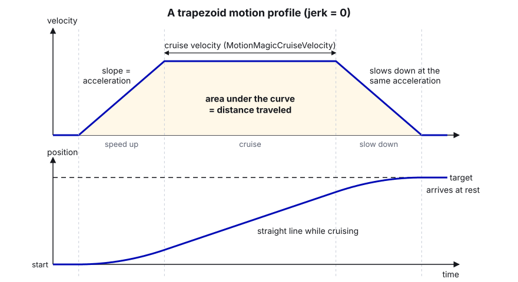
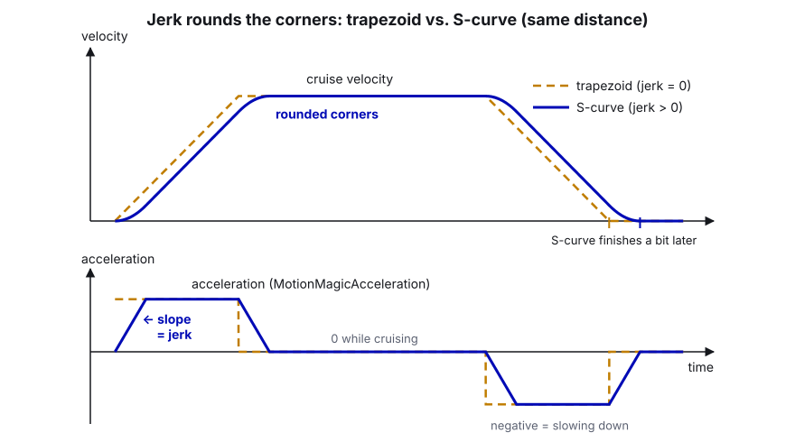
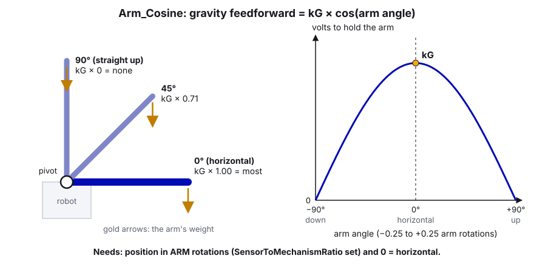

# 09. Motion Magic and Position Control

> **Who it's for:** students writing or tuning anything that moves to a position: turret, hood, intake rack, arm,
> pivot, elevator. **You need first:** [07 What is PID](07-what-is-pid.md) and ideally
> [08 Tuning PID step by step](08-tuning-pid-step-by-step.md). Zeroing is covered in more depth in
> [21 Sensors and homing](21-sensors-and-homing.md). **Time:** about 1 hour.

**What you'll learn**

- The four main Phoenix 6 position requests (`PositionVoltage`, `MotionMagicVoltage`, `DynamicMotionMagicVoltage`,
  `MotionMagicExpoVoltage`) and when to use each.
- What a motion profile is (cruise velocity, acceleration, jerk) and why it's kinder to the robot.
- How `SensorToMechanismRatio` and `RotorToSensorRatio` let you think in mechanism rotations, degrees or inches, and
  how a CANcoder fits in.
- Soft limits, zeroing, gravity feedforward (`Elevator_Static` vs `Arm_Cosine`), and good "at target" checks.
- What our turret, intake, hood and the 2025 pivot did, including the turret's "too slow profile" lesson.

---

## 1. Four ways to go to a position

All four run on the motor controller at 1 kHz, use your Slot gains, and take a position in rotations. They differ
in *how the target moves* on the way there.

| Request | What the motor is told | Good for | Notes |
|---|---|---|---|
| `PositionVoltage` | "Be at X. Now." The target jumps instantly. | Small, light mechanisms with short moves (hood) | Big moves = huge error at the start = maximum voltage = slam. kV/kA do nothing (target velocity is 0). |
| `MotionMagicVoltage` | "Go to X following a smooth profile" using cruise velocity, acceleration and jerk from the **config**. | Most position mechanisms (turret, arm, elevator) | The standard choice. Profile limits are set once in `MotionMagicConfigs`. |
| `DynamicMotionMagicVoltage` | Same, but velocity/acceleration/jerk are sent **with each request**. | When you need different speeds for different moves (intake normal vs agitate) | **Phoenix Pro + CANivore required.** Unlicensed, the motor disables output and sets the UnlicensedFeatureInUse fault. |
| `MotionMagicExpoVoltage` | Follows an exponential profile shaped by `MotionMagicExpo_kV` / `MotionMagicExpo_kA`: as fast as the motor physically can, smoothly. | Mechanisms where you want "max speed, but smooth", e.g. elevators | You describe the motor's ability (V per RPS, V per RPS/s) instead of picking speeds. A 2026 `DynamicMotionMagicExpoVoltage` also exists. |

There are also DutyCycle and TorqueCurrentFOC versions of each. We use the **Voltage** versions (gains in volts, not
affected by battery sag) and always add `.withEnableFOC(true)`.

---

## 2. What a motion profile is

Without a profile, a position controller sees a giant error the instant you change the setpoint and goes full power.
The mechanism jerks, overshoots, and the gearbox takes a beating. A **motion profile** plans the move instead: a
target position *and* target velocity at every millisecond, starting and ending at rest. The PID only has to follow
that moving target, so the error stays small the whole way.

### Trapezoid (jerk = 0)



### S-curve (jerk > 0)



| Setting (config name) | Unit (mechanism units) | Meaning | Raise it if... | Lower it if... |
|---|---|---|---|---|
| `MotionMagicCruiseVelocity` | rotations per second | top speed during the move | moves are too slow on long travel | the motor can't actually reach it (voltage pinned at 12 V) |
| `MotionMagicAcceleration` | rotations per second² | how fast it speeds up / slows down | it takes forever to get going | it slams, skips belt/chain teeth, browns out |
| `MotionMagicJerk` | rotations per second³ | how fast the *acceleration* ramps up | starts are sluggish | starts/stops are harsh |

**Jerk = 0 means "no jerk limit"** (a pure trapezoid, the fastest option). Any positive jerk gives an S-curve, which is
smoother but *slower*, because the acceleration has to build up first. Two quick formulas tell you if your profile is
fast enough:

- Time to reach full acceleration ≈ `acceleration / jerk`
- Time to reach cruise speed ≈ `cruise / acceleration` (plus a little for the jerk ramp)

> **AI can help:** once you've worked out `acceleration / jerk` and `cruise / acceleration` for your mechanism, ask
> an AI to check your arithmetic, or to convert the numbers between motor rotations, mechanism rotations, degrees and
> inches. Write down your own answer first, then confirm the real behavior on the robot by plotting Closed Loop
> Reference.

A profile is kinder to the mechanism (less shock on gears, chain and belts), easier on the battery (no current
spikes), and easier to tune (small, consistent error the whole way, so kV and kP do predictable jobs).

---

## 3. Units: motor rotations, mechanism rotations, degrees, inches

By default a Talon FX measures **motor rotor** rotations. That's awkward: the turret's 0.30 turret rotations of travel
is 3.75 motor rotations; the hood's angle is "-1.5 rotations" of who-knows-what. Phoenix 6 can do the conversion on
the motor for you.

### `SensorToMechanismRatio`

"How many feedback-sensor rotations per one mechanism rotation." With the built-in rotor sensor that's just the gear
ratio. Set it and every position, velocity, setpoint, soft limit and Motion Magic value is in **mechanism rotations**.

```java
config.Feedback.SensorToMechanismRatio = 200.0 / 16.0;   // turret: 12.5 motor rotations per turret rotation
```

Remember: **gains change meaning too** (they're now volts per *mechanism* rotation). Retune after adding a ratio.

### Converting to degrees and inches

- **Degrees:** `degrees = mechanism rotations * 360`. WPILib has `Units.rotationsToDegrees(...)` and
  `Units.degreesToRotations(...)`. Phoenix requests also accept WPILib units directly:
  `m_request.withPosition(Degrees.of(30))` converts degrees to rotations for you (only meaningful once
  `SensorToMechanismRatio` makes 1 rotation = 1 mechanism rotation).
- **Inches (rack, elevator, linear slide):** `inches = drum rotations * (pi * drum diameter)`. You can either convert
  in code (the intake does this), or set `SensorToMechanismRatio = motor rotations per inch`, so that one "rotation"
  in Phoenix *is* one inch. That's a common trick; [15 Elevators](15-elevators.md) uses it. Just comment it loudly,
  because Tuner X will still label the values "rotations".

### Using a CANcoder as the feedback


A CANcoder is an absolute magnetic encoder. Mounted on the mechanism shaft, it knows the mechanism's angle even right
after power-on (no zeroing needed within one rotation). You can make the Talon use it directly:

| `FeedbackSensorSource` | What it does | License |
|---|---|---|
| `RemoteCANcoder` | Talon uses the CANcoder's position over CAN. Slight delay; the rotor sensor isn't used. | Free |
| `FusedCANcoder` | Talon fuses the CANcoder (absolute, on the mechanism) with its fast rotor sensor (high resolution, no delay). Best of both. | **Phoenix Pro** (we have it) |
| `SyncCANcoder` | Like fused, but syncs the rotor to the CANcoder rather than continuously fusing. | Pro |

With a CANcoder you set **two** ratios:

- `RotorToSensorRatio` = motor rotations per CANcoder rotation (the gearing between motor and CANcoder).
- `SensorToMechanismRatio` = CANcoder rotations per mechanism rotation (1.0 if the CANcoder is on the mechanism shaft).

Our swerve steer motors do exactly this (`SteerFeedbackType.FusedCANcoder` in `TunerConstants`), which is why the
steer kP of 100 is "per module rotation".

Example: a pivot with a CANcoder on the pivot shaft and 60:1 between motor and pivot.

```java
// CANcoder: absolute angle of the pivot. MagnetOffset makes "horizontal" read 0.
CANcoderConfiguration encoderConfig = new CANcoderConfiguration();
encoderConfig.MagnetSensor.MagnetOffset = PivotConstants.kEncoderOffsetRotations;    // measured, see section 5
encoderConfig.MagnetSensor.SensorDirection = SensorDirectionValue.CounterClockwise_Positive;
encoderConfig.MagnetSensor.AbsoluteSensorDiscontinuityPoint = 0.5;                   // reads -0.5 .. +0.5 rotations
m_pivotEncoder.getConfigurator().apply(encoderConfig);

TalonFXConfiguration motorConfig = new TalonFXConfiguration();
motorConfig.Feedback.FeedbackRemoteSensorID = m_pivotEncoder.getDeviceID();
motorConfig.Feedback.FeedbackSensorSource = FeedbackSensorSourceValue.FusedCANcoder;
motorConfig.Feedback.RotorToSensorRatio = 60.0;      // 60 motor rotations per CANcoder (= pivot) rotation
motorConfig.Feedback.SensorToMechanismRatio = 1.0;   // CANcoder is on the pivot shaft
```

---

## 4. Soft limits

A **software limit switch** (soft limit) tells the Talon: "never drive forward past X / backward past Y". The motor
enforces it at 1 kHz, regardless of what your code asks for, so a bad setpoint or a stray joystick can't drive into
the hard stop.

```java
config.SoftwareLimitSwitch.ForwardSoftLimitThreshold = kForwardSoftLimitRotations;
config.SoftwareLimitSwitch.ForwardSoftLimitEnable = true;
config.SoftwareLimitSwitch.ReverseSoftLimitThreshold = kReverseSoftLimitRotations;
config.SoftwareLimitSwitch.ReverseSoftLimitEnable = true;
```

Soft limits only mean something if the zero is right (section 5). If the encoder zeroed in the wrong place, the soft
limits are in the wrong place too.

### How to find real soft limits

The hood's are placeholders right now (see "In our code"). Here's how to replace them:

1. Zero the mechanism the normal way (boot at rest for the hood).
2. Robot **disabled**. If the motor is in brake mode, temporarily switch to coast in Tuner X (or push gently; it's a
   light mechanism) so you can move it by hand.
3. Move it slowly to one hard stop. Read the position on the dashboard or in Tuner X. Write it down.
4. Do the same at the other hard stop.
5. Set each soft limit a little **inside** the hard stop (about 3–5% of the travel), so Motion Magic decelerates
   before metal meets metal.
6. Make your command clamps (the max/min setpoints your code will ever ask for) sit just inside the soft limits.
7. Test with a slow profile: command a setpoint beyond the limit and check that the motor stops at the soft limit.

---

## 5. Zeroing: making position 0 mean something

The Talon's built-in encoder is **relative**: at power-on it reads 0 wherever the mechanism happens to be. Options:

| Method | How | Our example |
|---|---|---|
| **Boot at a known spot** | Assume the mechanism is at a hard stop at power-on; `setPosition(0)` in the constructor. | Turret (boots facing back), intake (boots fully in; inside the frame at match start). The hood also boots fully down but never calls `setPosition(0)`, so it may start a fraction of a rotation off (guide 27). |
| **Hard-stop homing** | Drive slowly into a hard stop, detect the stall (current up, velocity ~0), then `setPosition(stop value)`. | Intake: pushes out against the 16" stop, then sets 16". |
| **Limit switch / sensor** | A switch at one end resets the position (can be done by the Talon automatically). | See [15 Elevators](15-elevators.md). |
| **Absolute encoder** | A CANcoder on the mechanism knows its angle at power-on. Set `MagnetOffset` once. | Swerve modules (CANcoders 50–53). |

To set a CANcoder's `MagnetOffset`: put the mechanism at the angle you want to be 0 (e.g. arm horizontal), read the
CANcoder's absolute position in Tuner X, and use the **negative** of that as the offset (Tuner X's CANcoder config
page can also do this for you). Full details on homing and sensors are in
[21 Sensors and homing](21-sensors-and-homing.md).

`setPosition(value)` just tells the Talon "you are at `value` right now". It doesn't move anything. Call it only when
you *know* where the mechanism is.

---

## 6. Gravity: kG with `Elevator_Static` vs `Arm_Cosine`

| Mechanism | Gravity type | Output | Needs |
|---|---|---|---|
| Elevator, linear slide going up | `GravityTypeValue.Elevator_Static` | constant `kG` volts | nothing special |
| Arm, pivot, hood that swings | `GravityTypeValue.Arm_Cosine` | `kG * cos(arm angle)` | position must be in **arm rotations** with **0 = horizontal** |



```java
config.Slot0.GravityType = GravityTypeValue.Arm_Cosine;
config.Slot0.kG = 0.35;   // volts to hold the arm horizontal (tune: see guide 08, section 4)
// 2026: if your zero isn't horizontal, offset the cosine (range -0.25 .. +0.25 rotations)
config.Slot0.GravityArmPositionOffset = 0.0;
```

For `Arm_Cosine` to be right, `SensorToMechanismRatio` (and `RotorToSensorRatio` if using a CANcoder) **must** be set
so that 0.25 rotations really is 90 degrees of arm. If the arm is in motor rotations, the cosine is nonsense. The
`GravityArmPositionOffset` config is new for 2026; check the CTRE closed-loop docs (link at the end) for its exact sign
convention before relying on it, or simply make your zero horizontal.

---

## 7. "At target" checks

Commands like "shoot when the hood is ready" or "move the pivot after the elevator arrives" need a good answer to
"is it there?"

```java
/** @return true when the arm is within tolerance of its setpoint and nearly stopped */
public boolean isAtSetpoint() {
    double positionError = Math.abs(m_motor.getPosition().getValueAsDouble() - m_setpointRotations);
    double speed = Math.abs(m_motor.getVelocity().getValueAsDouble());
    return positionError <= kPositionToleranceRotations && speed <= kSettledVelocityRps;
}
```

Tips:

- **Use the same units** as the setpoint (mechanism rotations, inches...). Stingray's pivot compared "angle" to a
  tolerance of 5, but both were motor rotations.
- **Compare against the final setpoint**, not the Motion Magic reference. The reference is where the profile is right
  now; it reaches the end before the mechanism does.
- **`getMotionMagicAtTarget()`** (new in 2026) is true when the *profile* has finished (reference = target, reference
  velocity 0). It does **not** mean the mechanism is there. Use it together with a position check, not instead of it.
- Add a **velocity check** or a WPILib `Debouncer` so a mechanism swinging *through* the target doesn't count.
- Always give sequences a **timeout** (`.withTimeout(2.0)`) so a mechanism that never gets within tolerance doesn't
  freeze the robot.

---

## 8. Step by step: set up a new position mechanism

1. **Measure the gearing.** Write `kMotorRotationsPerMechanismRotation` (or per inch) in Constants, with the tooth
   counts in a comment.
2. **Config**: brake mode, current limits, `SensorToMechanismRatio`, inversion so positive = the direction you
   expect. Apply once and check the returned `StatusCode`.
3. **Zero**: decide boot-at-stop, homing, switch, or CANcoder. Implement it.
4. **Check direction and units on blocks:** push the mechanism by hand (disabled) and watch the position. Does 90
   degrees of arm read 0.25? Does an inch of elevator read an inch?
5. **Soft limits**: find them (section 4), enable them.
6. **Profile**: start slow (cruise ≈ 25% of what the motor can do, acceleration ≈ 2x cruise, jerk 0 or ≈ 10x acceleration).
7. **Tune** with guide 08: kG → kS → kV → kP → kD.
8. **Speed up the profile** until it's as fast as you need without slamming, skipping or browning out.
9. **At-target check** with a sensible tolerance, and timeouts on any sequence that waits for it.

---

## 9. In our code

### Turret: Motion Magic, and the "profile too slow" lesson

The turret is a Talon FXS driving a Minion, 16-tooth gear on a 200-tooth ring (12.5:1), ±0.30 turret rotations of
travel. [Turret.java, lines 131–160 (turret config)](https://github.com/TorqueNados-FRC5090/Hephaestus/blob/c2f0cee6f61db3f26f911d3f5623ed7fa27a5b03/src/main/java/frc/robot/subsystems/Turret.java#L131-L160),
the Motion Magic part:

```java
        // Old values: cruise 600 (faster than the motor can spin), accel 60 (took ~2s to reach speed).
        // Acceleration was the real limit. Turn accel down if the turret slams or skips teeth.
        config.MotionMagic.MotionMagicCruiseVelocity = 90.0;
        config.MotionMagic.MotionMagicAcceleration = 400.0;
        // Jerk = how fast the turret may START accelerating. At 200 it took ~2s to reach full accel, so it could not
        // keep up with the robot rotating (stayed "not on target" and never fed). 0 = no jerk limit (fastest).
        config.MotionMagic.MotionMagicJerk = 1500.0;

        m_turretMotor.getConfigurator().apply(config);
        m_turretMotor.setPosition(0);
```

What to notice:

- **Units are motor rotations.** There's no `SensorToMechanismRatio`; the code divides by `kTurretGearRatio` itself.
  90 motor RPS = 7.2 turret rotations per second.
- **The lesson in numbers.** With the old accel 60, reaching even 90 RPS takes `90 / 60 = 1.5 s`. Then, with accel
  raised to 400 but jerk still 200, just *building up* to full acceleration took `400 / 200 = 2 s`. Either way the
  turret couldn't follow a robot that's spinning, so it never read "on target" and never fed. Now: `400 / 1500 ≈ 0.27 s`
  to build up to full acceleration (in practice the turret reaches cruise first) and about half a second to cruise. Cruise 600 was also meaningless, since a Minion tops out
  around 120 RPS.
- **The gains were never the problem.** This is why you plot Closed Loop Reference: if the reference itself is slow,
  no kP will fix it.
- **Zeroing is "boot at a known spot"**: `setPosition(0)` with the turret facing the back of the robot. If it's
  bumped before power-on, aim is off until it's re-zeroed (`zeroTurret()`).
- The aiming code clamps the target to ±`kMaxTurretRotations` in software
  ([lines 304–310](https://github.com/TorqueNados-FRC5090/Hephaestus/blob/c2f0cee6f61db3f26f911d3f5623ed7fa27a5b03/src/main/java/frc/robot/subsystems/Turret.java#L304-L310)).
  Adding motor soft limits at the same values (in motor rotations, `0.30 * 12.5 = 3.75`) would be a good backup.

### Intake: Dynamic Motion Magic in inches

The intake rack converts inches to motor rotations in code and sends speeds with every request.
[EvilIntake.java, lines 55–57 (gearing)](https://github.com/TorqueNados-FRC5090/Hephaestus/blob/c2f0cee6f61db3f26f911d3f5623ed7fa27a5b03/src/main/java/frc/robot/subsystems/EvilIntake.java#L55-L57)
and [lines 332–340 (driveToTarget)](https://github.com/TorqueNados-FRC5090/Hephaestus/blob/c2f0cee6f61db3f26f911d3f5623ed7fa27a5b03/src/main/java/frc/robot/subsystems/EvilIntake.java#L332-L340):

```java
     public static final double kMotorRotationsPerInch = (24.0 / 14.0) / (Math.PI * 1.0);
```

```java
    private void driveToTarget() {
        double cruise = m_slowProfile ? m_agitateCruiseInPerSec : m_moveCruiseInPerSec;
        double accel = m_slowProfile ? m_agitateAccelInPerSec2 : m_moveAccelInPerSec2;
        intakeMotor.setControl(m_moveRequest
            .withPosition(m_targetInches * kMotorRotationsPerInch)
            .withVelocity(cruise * kMotorRotationsPerInch)
            .withAcceleration(accel * kMotorRotationsPerInch)
            .withJerk(accel * kMotorRotationsPerInch * 10));   // soft start/stop, ~0.1 s to full accel
    }
```

What to notice:

- **Why Dynamic:** two different profiles on one mechanism: fast in/out moves (40 in/s, 150 in/s²) and a slow, smooth
  "agitate" (15 in/s, 60 in/s²). `DynamicMotionMagicVoltage` sends the limits with each request, so switching is free.
  This needs Pro + CANivore; the intake is on the "Upper" CANivore with Pro licenses.
- **Gearing math:** 14T → 24T chain, then a 1.0" pitch-diameter pinion on the rack. One pinion rotation moves the rack
  `pi * 1.0 = 3.14"`, and one pinion rotation is `24/14 = 1.71` motor rotations, so 1" = 0.546 motor rotations.
- **Jerk = 10 x accel** means `accel / jerk = 0.1 s` to reach full acceleration: smooth, but barely slower.
- **Command clamps** keep targets between 0.2" and 15.5", inside the 0"–16" hard stops (lines 60–63). The intake uses
  hard-stop homing instead of soft limits (lines 349–374).
- An alternative would be `SensorToMechanismRatio = kMotorRotationsPerInch` so all values are natively in inches.

### Hood: `PositionVoltage` with placeholder soft limits

[Hood.java, lines 20–26 (soft limits)](https://github.com/TorqueNados-FRC5090/Hephaestus/blob/c2f0cee6f61db3f26f911d3f5623ed7fa27a5b03/src/main/java/frc/robot/subsystems/Hood.java#L20-L26):

```java
    // --- SOFT LIMITS (PLACEHOLDERS, in motor rotations) ---
    // TODO: replace with the real numbers. Move the hood by hand to each hard stop with the robot
    // disabled, read "Hood Angle" on the dashboard, and put those values here minus a little margin.
    // The hood encoder zeroes wherever the hood is at power-on, so always boot with it at rest.
    // The aiming code already clamps to -2.77 .. -0.13, so these sit just outside that.
    private static final double kHoodForwardSoftLimit = 0.10;   // rest end (hood fully down)
    private static final double kHoodReverseSoftLimit = -2.90;  // most extended
```

What to notice:

- Honest TODO with the exact procedure (section 4). Until someone measures the hard stops, these limits only guard
  against wild setpoints, not against the real stops.
- `PositionVoltage` (no profile) is OK here: the hood is light and the whole travel is under 3 motor rotations, so
  with kP 2 the biggest possible step is about 5.6 V. A heavier hood would want Motion Magic.
- The trench interlock forces the hood to stow near a trench, from `periodic()`, so no command can leave it up
  (lines 133–138).

### Stingray 2025 Pivot: the bare minimum

[Pivot.java, lines 17–39 (2025 pivot)](https://github.com/TorqueNados-FRC5090/Stingray-2025/blob/97c843705075c729538ad0b3925f67a35e3bf791/src/main/java/frc/robot/subsystems/Pivot.java#L17-L39):

```java
    public Pivot() {
        // Pivot init and config
        pivotMotor = new TalonFX(PIVOT_MOTOR_ID);
        Slot0Configs pivotPIDConfig = new Slot0Configs();
        pivotPIDConfig.kP = 0.4;
        pivotPIDConfig.kD = .007;
        pivotMotor.getConfigurator().apply(pivotPIDConfig);
    }

    public double getAngle() { return pivotMotor.getPosition().getValueAsDouble(); }
    public boolean atSetpoint() {
        return Math.abs(getAngle() - target.getAngle()) <= 5;
    }
```

It worked well enough to score in 2025, but compare it with the 2026 code and the checklist:

- **No current limits, no brake mode set in code.** It only applies a `Slot0Configs`, so everything else is whatever
  happened to be stored on the motor (factory default neutral mode is coast). A 2026 config always sets both
  explicitly.
- **"Angle" is really motor rotations.** The presets say `L4(55.4, 75)`: 75 motor rotations, not 75 degrees. A
  `SensorToMechanismRatio` would make these real degrees (via rotations * 360).
- **Tolerance of 5 motor rotations** is large; how large in degrees depends on a gear ratio nobody wrote down.
- **No profile, no kG.** `PositionVoltage` with only kP/kD on a gravity-loaded pivot means it sags below target by
  however much error kP needs to hold it up.
- It creates a `new PositionVoltage(...)` on every call; better to create one request and reuse it with
  `.withPosition(...)` (our template does this).

---

## Common mistakes

- **Profile too slow, blamed on gains.** Turret accel 60 / jerk 200: the reference itself took ~2 s to reach speed.
  Check `acceleration / jerk` and `cruise / acceleration`.
- **Cruise velocity faster than the motor can spin** (turret's old 600 RPS). The profile asks for the impossible, the
  voltage pins at 12 V, and the mechanism falls behind the reference.
- **Units mix-ups.** Degrees vs rotations, motor vs mechanism rotations (Stingray's "angle" presets). Write units in
  every constant name: `kStowedRotations`, `kL4HeightInches`.
- **Arm_Cosine without a ratio or with the wrong zero.** The cosine needs arm rotations with 0 = horizontal.
- **Soft limits from a bad zero.** If the hood boots partly raised, every limit is shifted. Boot at rest, or home.
- **Placeholder soft limits left forever.** The hood's are still TODO. Measure them.
- **`DynamicMotionMagicVoltage` on a non-Pro / non-CANivore device**: the motor disables output. Use plain Motion Magic
  there.
- **Waiting forever** on an at-target check that never becomes true. Add timeouts.

## Checklist

- [ ] Gear ratio measured and written in Constants (with tooth counts).
- [ ] `SensorToMechanismRatio` (and `RotorToSensorRatio` with a CANcoder) set, units verified by moving it by hand.
- [ ] Brake mode, stator + supply current limits.
- [ ] Zeroing method chosen and tested (power-on, homing, switch, or CANcoder offset).
- [ ] Soft limits measured from the real hard stops, a little inside them.
- [ ] Motion Magic cruise/accel/jerk checked with the formulas, then raised carefully.
- [ ] kG type correct (`Elevator_Static` / `Arm_Cosine`), then tuned per guide 08.
- [ ] At-target check uses the final setpoint, correct units, and there's a timeout on anything that waits.

## Practice

1. **Profile math.** The intake moves 14" with cruise 40 in/s and accel 150 in/s². Ignoring jerk, how long does it
   take to reach cruise speed, and how far does it travel while speeding up? (Hint: `t = v/a`, `d = v²/(2a)`.)
2. **Convert the turret.** Rewrite the turret config so positions are in turret rotations
   (`SensorToMechanismRatio = 12.5`). What do cruise 90 and accel 400 become? What happens to kP 8 and kV 0.1?
3. **Soft limits for the hood.** With a mentor, do the section 4 procedure on the real hood and replace the
   placeholders. Record the before/after values in the commit message.
4. **Sim a pivot.** In the template, make a `Pivot` subsystem with `MotionMagicVoltage`, `SensorToMechanismRatio`,
   and `Arm_Cosine`. Use WPILib's `SingleJointedArmSim` with the Talon's sim state to test it, and plot reference vs
   position in AdvantageScope.

## Go further

- CTRE, Motion Magic (all variants, Expo, Dynamic):
  https://v6.docs.ctr-electronics.com/en/stable/docs/api-reference/device-specific/talonfx/motion-magic.html
- CTRE, closed-loop requests, gravity types and `GravityArmPositionOffset`:
  https://v6.docs.ctr-electronics.com/en/stable/docs/api-reference/device-specific/talonfx/closed-loop-requests.html
- CTRE, remote and fused sensors (CANcoder feedback, ratios):
  https://v6.docs.ctr-electronics.com/en/stable/docs/api-reference/device-specific/talonfx/remote-sensors.html
- CTRE, CANcoder hardware reference: https://v6.docs.ctr-electronics.com/en/stable/docs/hardware-reference/cancoder/index.html
- CTRE, 2026 changes (MotionMagicAtTarget, arm offset, Dynamic Expo):
  https://v6.docs.ctr-electronics.com/en/stable/docs/yearly-changes/yearly-changelog.html
- WPILib, trapezoidal motion profiles: https://docs.wpilib.org/en/stable/docs/software/advanced-controls/controllers/trapezoidal-profiles.html
- WPILib, tuning a vertical arm (interactive): https://docs.wpilib.org/en/stable/docs/software/advanced-controls/introduction/tuning-vertical-arm.html
- Related team guides: [13 Turrets](13-turrets.md), [14 Arms](14-arms-single-and-double-jointed.md), [15 Elevators](15-elevators.md), [21 Sensors and homing](21-sensors-and-homing.md).
