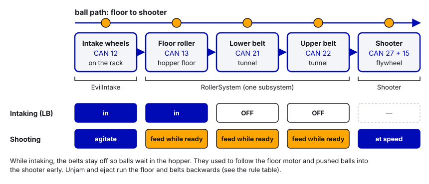
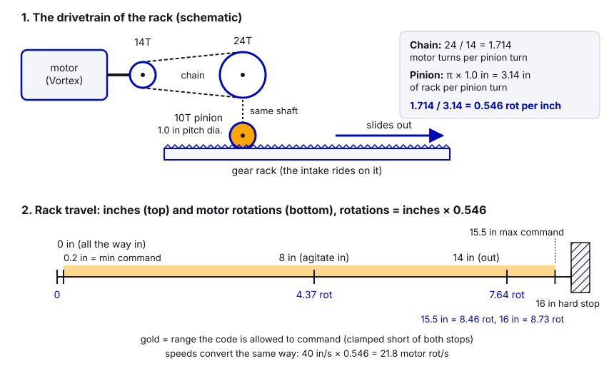
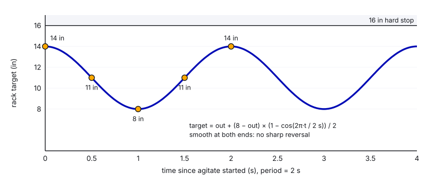

# 11. Intakes and Rollers

> **For:** whoever owns the intake, the feed path (hopper, belts, indexer) or any "spin a roller" mechanism.
> **Read first:** [05 Motors in Phoenix 6](05-motors-in-phoenix-6.md), [06 Current limits](06-current-limits-and-brownouts.md),
> and for deploying intakes [09 Motion Magic](09-motion-magic-and-position-control.md). **Time:** about 60 minutes to
> read; an afternoon at the robot for the practice.

## What you'll learn

- When a roller can just use **percent output** (`DutyCycleOut`) and when it needs **velocity control**
  (`VelocityVoltage`), and how to stop rollers cleanly.
- How to run a **multi-motor feed path** (floor roller + belts) with direction constants and clear rules about
  which motor runs when.
- Two ways to **deploy** an intake: a pivot "slap-down" (Motion Magic + gravity feedforward) and our 2026
  rack-and-pinion (inches ↔ rotations math, Dynamic Motion Magic, agitate).
- How to know you've **got a game piece** (CANrange, beam break on a CANdi, current spike).
- How to build intake commands (hold-to-intake, parallel groups, unjam/eject) and **named commands for autos**
  without the traps we fell into.
- A clean example `DeployableIntake` subsystem.

---

## The idea

### Rollers: percent output vs velocity

A roller is a motor spinning wheels or belts that grab a game piece. There are two ways to tell it how fast:

| | `DutyCycleOut` (percent) / `VoltageOut` | `VelocityVoltage` (RPS) |
|---|---|---|
| You say | "Apply 80% of the battery" / "apply 8 V" | "Spin at 40 RPS" |
| Speed under load | Slows down when it grabs a piece | Pushes harder to hold speed |
| Speed as battery drains | `DutyCycleOut` gets slower; `VoltageOut` stays steady | Steady |
| Needs tuning | No | kV (and a bit of kP) |
| Good for | Intake wheels, simple "suck it in" rollers, eject | Feeders into a shooter, indexers that must move pieces at a known rate, anything timed |

**Percent is fine when the exact speed doesn't matter**: the roller only has to grab the piece, and full power (or
close to it) works. Our 2026 intake wheels use `DutyCycleOut` at −1.0 (full power, pulling in).

**Use velocity when consistency matters**: the feed into the shooter should push each ball at the same rate, so
our feed rollers use `VelocityVoltage`. If you tune velocity rollers, remember the lesson from 2026: **"with only kP
the rollers never reached their target speed"**. Velocity needs kV first ([10 Flywheels](10-flywheels-and-shooters.md)
explains why).

`VoltageOut` is a nice middle ground: no tuning, but 8 V is 8 V whether the battery is at 12.8 V or 11.5 V.

### Stopping rollers

Three ways, and one to avoid:

| Request | What happens |
|---|---|
| `NeutralOut` | Stop driving. NeutralMode (brake or coast) takes over |
| `VoltageOut(0)` / `DutyCycleOut(0)` | Zero output, which is inside the neutral deadband, so NeutralMode takes over too |
| `stopMotor()` | Same idea: neutral |
| ~~`VelocityVoltage(0)`~~ | The PID tries to hold *exactly* zero speed, fighting every tiny movement. It twitches and buzzes. Avoid |

Feed rollers are usually **brake** mode so pieces stop where they are. Intake wheels can be either.

### Multi-motor feed paths

Most robots have several rollers between the intake and the shooter. Our 2026 robot:

```
  INTAKE WHEELS (12)  ->  FLOOR ROLLER (13)  ->  LOWER BELT (21)  ->  UPPER BELT (22)  ->  SHOOTER
     on the rack           hopper floor          tunnel                tunnel
```

Things that make this work:

- **One subsystem for the feed path** (`RollerSystem`) so one command can't fight another over the same motors.
- **Direction constants.** The belts spin the opposite way to the floor. Instead of minus signs scattered around,
  one constant `kBeltDirection = -1.0` and a comment "if a belt spins the wrong way, flip this". (Even better: set
  `Inverted` in each motor's config so positive always means "toward the shooter".)
- **Speed constants with names**: `kFeedSpeedRPS`, `kUnjamSpeedRPS`, `kIntakeFloorSpeedRPS`.
- **Rules about who runs when**, written down and enforced in code. Ours:

| Situation | Intake wheels | Floor | Belts |
|---|---|---|---|
| Intaking (LB) | In | In | **Off** (balls wait in the hopper) |
| Shooting (RT/Y/B) | Agitate (unless intake buttons held) | Feed (only while ready) | Feed (only while ready) |
| Unjam (RB) | Off | Backwards | Backwards |
| Eject (LT) | Out, reversed | Backwards | Backwards |
| Auto, intaking | In (rack + wheels only) | Off | Off |
| Auto, shooting | Agitate | Feed while ready | Feed while ready |

The belts used to be followers of the floor motor, so they ran whenever the floor ran, including while intaking,
and pushed balls into the shooter early. Splitting them into separately commanded motors fixed that.



### Deploying the intake

Most intakes have to get outside the frame to reach the floor. Two common ways:

#### 1. Pivot "slap-down" intake

The intake swings down on a pivot, like an arm.

```
  stowed (up)          deployed (down)
      |
      |                ___________O   <- rollers
     _|____           |____
```

- It's an **arm**, so gravity pulls on it more when it's horizontal and not at all when it's straight up. Phoenix 6
  handles that with **kG** and `GravityType = GravityTypeValue.Arm_Cosine`: the Talon adds `kG × cos(angle)` volts.
  For that to work, **position 0 must mean horizontal** and positive must mean **up**, measured in **pivot
  rotations** (set `Feedback.SensorToMechanismRatio` to the gear ratio).
- Move it with `MotionMagicVoltage` so it doesn't slam into the floor or the frame
  ([09 Motion Magic](09-motion-magic-and-position-control.md)).
- **Brake** mode, soft limits just inside the hard stops, and a moderate stator limit so it doesn't wreck itself on
  a bumper.

**Honest note:** we haven't built a CTRE pivot intake. The closest things we have are the 2024 robot's pivot
intake on REV controllers with a limit switch for game-piece detection
([Thunderstrike-2024 Intake.java](https://github.com/TorqueNados-FRC5090/Thunderstrike-2024/blob/876b8c14682ccf57ec0ab2767ee2da54c34cee6e/src/main/java/frc/robot/subsystems/Intake.java#L73-L91))
and the 2025 robot's Talon FX pivot with `PositionVoltage`
([Stingray-2025 Pivot.java](https://github.com/TorqueNados-FRC5090/Stingray-2025/blob/97c843705075c729538ad0b3925f67a35e3bf791/src/main/java/frc/robot/subsystems/Pivot.java#L17-L39)).
The example at the end of this guide is the version you should build.

#### 2. Rack-and-pinion intake (our 2026 robot)

The whole intake slides straight out the front on gear racks, driven by a pinion gear. It goes from 0" (in) to a
16" hard stop (out).

```
  motor (Vortex) --chain 14T->24T--> shaft --> 10T pinion --> rack ====> intake slides out
```

The math, from motor rotations to inches:

```
  1. Chain: 14-tooth sprocket on the motor, 24-tooth on the pinion shaft.
     The motor turns 24/14 = 1.714 times for each pinion turn.
  2. Pinion: 10 teeth, 10 DP (diametral pitch). Pitch diameter = teeth / DP = 10/10 = 1.0 inch.
     One pinion turn moves the rack one circumference: π × 1.0" = 3.14 inches.
  3. Motor rotations per inch = 1.714 / 3.14 = 0.546

  inches = motorRotations / 0.546          motorRotations = inches × 0.546
  14" out = 7.64 motor rotations           cruise 40 in/s = 21.8 motor RPS
```




The Talon only knows motor rotations, so the code converts every target from inches before sending it. (You could
instead set `SensorToMechanismRatio` so the Talon reports pinion rotations, but you'd still need the π for inches.)

Why **Dynamic** Motion Magic? Normal Motion Magic takes its speed limits from the config. `DynamicMotionMagicVoltage`
takes cruise, acceleration and jerk **in the request**, so the same motor can do fast normal moves and a slow,
smooth "agitate" without re-applying configs. Without any speed limit, this gearing would slam the rack at around
200 in/s. Dynamic Motion Magic needs Phoenix Pro **and** a CANivore: on an unlicensed device the motor disables its
output and won't move at all (see [31](31-phoenix-pro-features.md)). Our rack is on the licensed "Upper" CANivore.

**Agitate.** While shooting, the intake slides between 14" (out) and 8" and back, squeezing the hopper so balls keep
flowing to the feeder. It uses a cosine wave so the motion is smooth, with no sharp reversal:

```
  inAmount(t) = (1 − cos(2π·t / period)) / 2        goes 0 -> 1 -> 0 once per period (2 s)
  target      = out + (8" − out) × inAmount

  t:       0     0.5 s   1.0 s   1.5 s   2.0 s
  target: 14"    11"     8"      11"     14"
```



The rack also uses a deliberately **low stator current limit (20 A)** so a hit from another robot pushes it in
instead of skipping the chain; Motion Magic then brings it back. That trick has its own guide:
[12 Spring-back and auto-retract](12-spring-back-and-auto-retract.md). Homing against the hard stop is in
[21 Sensors and homing](21-sensors-and-homing.md).

### Game-piece detection

Knowing "we've got one" lets you stop the rollers, retract, flash LEDs, or end an auto step. Options (details and
wiring in [21 Sensors and homing](21-sensors-and-homing.md)):

| Sensor | How | Good | Watch out |
|---|---|---|---|
| **CANrange** | CTRE time-of-flight distance sensor on CAN. `getIsDetected()` with a proximity threshold | One box, no emitter/receiver pair, configurable distance, logs with everything else. Our pick for "have a piece" | Costs more; tune threshold for the piece color/material |
| **Beam break** | IR beam across the path; piece blocks it. Wired to a CTRE **CANdi**, read with `getS1Closed()` | Cheap, simple, fast; the CANdi can stop the roller in hardware | Alignment, sunlight, needs a spot the piece always crosses |
| **Limit switch** | Piece presses a lever (our 2024 intake, on DIO then). Today: wired to a CANdi | Dead simple | Wears, needs force |
| **Current spike** | Roller stator current jumps when it grabs a piece | No extra hardware | Noisy; need a threshold **and** a debounce time; jams look the same as pieces |

Our 2026 robot has no piece sensor: it holds many balls in a hopper, so "got one" didn't matter much. For a robot
that holds one piece at a time, add a sensor.

---

## Step by step

### Set up a feed path

1. List every roller from intake to shooter, with CAN IDs and which way "toward the shooter" is.
2. Put them in **one** subsystem. Give each its own config: current limits (always), brake mode, `Inverted` so
   positive = toward the shooter.
3. Write the rule table (who runs when) as a comment at the top of the class.
4. Write small methods: `feed()`, `intakeFloorOnly()`, `reverse()`, `stop()` (with `NeutralOut` or `VoltageOut(0)`).
5. Write command factories that **stop on end**: `runEnd(this::feed, this::stop)`.
6. On blocks: run each command, check every roller goes the right way. Then with game pieces.

### Set up a deploying intake

1. Decide what positive means (OUT for a rack, UP for a pivot) and set `Inverted` to match.
2. Work out the conversion (inches per rotation, or `SensorToMechanismRatio` for a pivot). Write it as a constant
   with the gear tooth counts in the comment, so the next person can check it.
3. Decide where zero is, and how you know: power-on position, hard-stop homing, or a sensor.
4. Named positions in an enum with units (`IntakePosition.STOWED`, `DEPLOYED`), not magic numbers.
5. Soft limits just inside the hard stops. Clamp every target in code too.
6. Current limits low enough to survive hitting a stop or a bumper.
7. Tune: kG (pivot only) so it floats, then kS, kV, kP, then Motion Magic cruise/accel
   ([08](08-tuning-pid-step-by-step.md), [09](09-motion-magic-and-position-control.md)). Our EvilIntake has a written
   tuning procedure at the bottom; follow it.

### Bind it

1. **Hold to intake**: `whileTrue` on a bumper. When released, the command ends and `end()` retracts and stops.
2. If the intake and feed path are separate subsystems, run them together with `Commands.parallel(...)`.
3. Add **unjam** (feed path backwards) and **eject** (everything backwards, intake out) on their own buttons.
4. Register **named commands** for autos (below), and think about how each one ends.

---

## Example: a clean DeployableIntake subsystem

A pivot slap-down intake: one Kraken X60 on the pivot (36:1), one Kraken X60 on the rollers, a CANrange to detect
the piece. New code, with professional names.

Constants:

```java
public static final class IntakeConstants {
    public static final int kPivotMotorId = 17;
    public static final int kRollerMotorId = 18;
    public static final int kPieceSensorId = 19;

    /** Motor rotations per pivot rotation (gearbox + sprockets) */
    public static final double kPivotGearRatio = 36.0;
    /** Pivot positions in PIVOT rotations, 0 = horizontal, positive = up. 0.25 rot = 90 degrees. */
    public static final double kPivotStowedRotations = 0.25;   // straight up, against the hard stop at power-on
    public static final double kPivotDeployedRotations = -0.01; // just below horizontal, resting on the bumper
    public static final double kPivotSoftLimitUpRotations = 0.26;
    public static final double kPivotSoftLimitDownRotations = -0.03;
    public static final double kPivotToleranceRotations = 0.01; // about 3.6 degrees

    /** Pivot gains (MotionMagicVoltage, units are PIVOT rotations because of SensorToMechanismRatio) */
    public static final double kPivotG = 0.3;   // volts to hold it level
    public static final double kPivotS = 0.1;   // volts
    public static final double kPivotV = 4.3;   // volts per pivot rot/s (about 0.12 x 36)
    public static final double kPivotP = 20.0;  // volts per pivot rotation of error
    public static final double kPivotCruiseRps = 1.5;  // pivot rot/s
    public static final double kPivotAccelRps2 = 4.0;  // pivot rot/s^2

    public static final double kPivotStatorLimitAmps = 40;
    public static final double kPivotSupplyLimitAmps = 30;
    public static final double kRollerStatorLimitAmps = 40;
    public static final double kRollerSupplyLimitAmps = 30;

    public static final double kRollerIntakeVolts = 8.0;
    public static final double kRollerEjectVolts = -6.0;
    /** CANrange: a piece closer than this (meters) counts as "have one" */
    public static final double kPieceDetectMeters = 0.10;
}
```

Subsystem:

```java
package frc.robot.subsystems;

import static frc.robot.Constants.IntakeConstants.*;

import com.ctre.phoenix6.BaseStatusSignal;
import com.ctre.phoenix6.CANBus;
import com.ctre.phoenix6.StatusCode;
import com.ctre.phoenix6.StatusSignal;
import com.ctre.phoenix6.configs.CANrangeConfiguration;
import com.ctre.phoenix6.configs.TalonFXConfiguration;
import com.ctre.phoenix6.controls.MotionMagicVoltage;
import com.ctre.phoenix6.controls.NeutralOut;
import com.ctre.phoenix6.controls.VoltageOut;
import com.ctre.phoenix6.hardware.CANrange;
import com.ctre.phoenix6.hardware.TalonFX;
import com.ctre.phoenix6.signals.GravityTypeValue;
import com.ctre.phoenix6.signals.InvertedValue;
import com.ctre.phoenix6.signals.NeutralModeValue;
import com.ctre.phoenix6.signals.StaticFeedforwardSignValue;

import edu.wpi.first.math.MathUtil;
import edu.wpi.first.units.measure.Angle;
import edu.wpi.first.wpilibj.DriverStation;
import edu.wpi.first.wpilibj.smartdashboard.SmartDashboard;
import edu.wpi.first.wpilibj2.command.Command;
import edu.wpi.first.wpilibj2.command.SubsystemBase;

/**
 * Slap-down intake: a pivot (positive = up, 0 = horizontal) and a set of rollers, plus a CANrange that sees the
 * game piece. Must be powered on with the intake stowed (up against its hard stop).
 */
public class DeployableIntake extends SubsystemBase {
    private final TalonFX m_pivotMotor;
    private final TalonFX m_rollerMotor;
    private final CANrange m_pieceSensor;

    private final MotionMagicVoltage m_pivotRequest = new MotionMagicVoltage(0).withSlot(0).withEnableFOC(true);
    private final VoltageOut m_rollerRequest = new VoltageOut(0).withEnableFOC(true);
    private final NeutralOut m_rollerStopRequest = new NeutralOut();

    private final StatusSignal<Angle> m_pivotPosition;
    private final StatusSignal<Boolean> m_pieceDetected;

    private double m_pivotTargetRotations = kPivotStowedRotations;

    public DeployableIntake(CANBus canBus) {
        m_pivotMotor = new TalonFX(kPivotMotorId, canBus);
        m_rollerMotor = new TalonFX(kRollerMotorId, canBus);
        m_pieceSensor = new CANrange(kPieceSensorId, canBus);

        // --- PIVOT ---
        TalonFXConfiguration pivotConfig = new TalonFXConfiguration();
        pivotConfig.MotorOutput.NeutralMode = NeutralModeValue.Brake;
        pivotConfig.MotorOutput.Inverted = InvertedValue.CounterClockwise_Positive; // positive = UP (checked on blocks)
        pivotConfig.CurrentLimits.StatorCurrentLimit = kPivotStatorLimitAmps;
        pivotConfig.CurrentLimits.StatorCurrentLimitEnable = true;
        pivotConfig.CurrentLimits.SupplyCurrentLimit = kPivotSupplyLimitAmps;
        pivotConfig.CurrentLimits.SupplyCurrentLimitEnable = true;
        // Report position/velocity in PIVOT rotations, so gains, limits and targets are all in pivot units
        pivotConfig.Feedback.SensorToMechanismRatio = kPivotGearRatio;
        // Gravity: adds kG * cos(position). Needs 0 = horizontal and positive = up.
        pivotConfig.Slot0.GravityType = GravityTypeValue.Arm_Cosine;
        pivotConfig.Slot0.kG = kPivotG;
        pivotConfig.Slot0.kS = kPivotS;
        pivotConfig.Slot0.StaticFeedforwardSign = StaticFeedforwardSignValue.UseClosedLoopSign;
        pivotConfig.Slot0.kV = kPivotV;
        pivotConfig.Slot0.kP = kPivotP;
        pivotConfig.MotionMagic.MotionMagicCruiseVelocity = kPivotCruiseRps;
        pivotConfig.MotionMagic.MotionMagicAcceleration = kPivotAccelRps2;
        pivotConfig.SoftwareLimitSwitch.ForwardSoftLimitThreshold = kPivotSoftLimitUpRotations;
        pivotConfig.SoftwareLimitSwitch.ForwardSoftLimitEnable = true;
        pivotConfig.SoftwareLimitSwitch.ReverseSoftLimitThreshold = kPivotSoftLimitDownRotations;
        pivotConfig.SoftwareLimitSwitch.ReverseSoftLimitEnable = true;
        reportIfFailed(m_pivotMotor.getConfigurator().apply(pivotConfig), "pivot");
        // Powered on stowed, so that's where we are. (A homing routine would be better: see guide 21.)
        m_pivotMotor.setPosition(kPivotStowedRotations);

        // --- ROLLERS ---
        TalonFXConfiguration rollerConfig = new TalonFXConfiguration();
        rollerConfig.MotorOutput.NeutralMode = NeutralModeValue.Brake;              // hold the piece when stopped
        rollerConfig.MotorOutput.Inverted = InvertedValue.CounterClockwise_Positive; // positive = pulls IN
        rollerConfig.CurrentLimits.StatorCurrentLimit = kRollerStatorLimitAmps;
        rollerConfig.CurrentLimits.StatorCurrentLimitEnable = true;
        rollerConfig.CurrentLimits.SupplyCurrentLimit = kRollerSupplyLimitAmps;
        rollerConfig.CurrentLimits.SupplyCurrentLimitEnable = true;
        reportIfFailed(m_rollerMotor.getConfigurator().apply(rollerConfig), "roller");

        // --- PIECE SENSOR ---
        CANrangeConfiguration sensorConfig = new CANrangeConfiguration();
        sensorConfig.ProximityParams.ProximityThreshold = kPieceDetectMeters;
        reportIfFailed(m_pieceSensor.getConfigurator().apply(sensorConfig), "piece sensor");

        m_pivotPosition = m_pivotMotor.getPosition();
        m_pieceDetected = m_pieceSensor.getIsDetected();
    }

    // ---------- small methods ----------

    private void setPivotTarget(double pivotRotations) {
        m_pivotTargetRotations = MathUtil.clamp(pivotRotations, kPivotSoftLimitDownRotations, kPivotSoftLimitUpRotations);
        m_pivotMotor.setControl(m_pivotRequest.withPosition(m_pivotTargetRotations));
    }

    private void setRollerVolts(double volts) {
        if (volts == 0) {
            m_rollerMotor.setControl(m_rollerStopRequest);
        } else {
            m_rollerMotor.setControl(m_rollerRequest.withOutput(volts));
        }
    }

    public boolean hasGamePiece() {
        return m_pieceDetected.getValue();
    }

    public boolean isPivotAtTarget() {
        return Math.abs(m_pivotPosition.getValueAsDouble() - m_pivotTargetRotations) <= kPivotToleranceRotations;
    }

    // ---------- commands ----------

    /** Hold to intake: deploys and runs the rollers (stops them once a piece is in). Stows when it ends. */
    public Command intakeCommand() {
        return runEnd(
            () -> {
                setPivotTarget(kPivotDeployedRotations);
                setRollerVolts(hasGamePiece() ? 0 : kRollerIntakeVolts);
            },
            () -> {
                setPivotTarget(kPivotStowedRotations);
                setRollerVolts(0);
            }).withName("Intake");
    }

    /** Same as intakeCommand, but finishes by itself once a piece is detected (good for autos) */
    public Command intakeUntilPieceCommand() {
        return intakeCommand().until(this::hasGamePiece).withName("Intake until piece");
    }

    /** Deploy and spit the piece back out. Stows when it ends. */
    public Command ejectCommand() {
        return runEnd(
            () -> {
                setPivotTarget(kPivotDeployedRotations);
                setRollerVolts(kRollerEjectVolts);
            },
            () -> {
                setPivotTarget(kPivotStowedRotations);
                setRollerVolts(0);
            }).withName("Eject");
    }

    /** Finishes instantly; Motion Magic keeps moving and holding after it ends */
    public Command deployCommand() {
        return runOnce(() -> setPivotTarget(kPivotDeployedRotations)).withName("Deploy intake");
    }

    /** Finishes instantly; also stops the rollers */
    public Command stowCommand() {
        return runOnce(() -> {
            setPivotTarget(kPivotStowedRotations);
            setRollerVolts(0);
        }).withName("Stow intake");
    }

    @Override
    public void periodic() {
        BaseStatusSignal.refreshAll(m_pivotPosition, m_pieceDetected);
        SmartDashboard.putNumber("Intake/Pivot position (deg)", m_pivotPosition.getValueAsDouble() * 360.0);
        SmartDashboard.putNumber("Intake/Pivot target (deg)", m_pivotTargetRotations * 360.0);
        SmartDashboard.putBoolean("Intake/Pivot at target", isPivotAtTarget());
        SmartDashboard.putBoolean("Intake/Has game piece", hasGamePiece());
        SmartDashboard.putNumber("Intake/Roller current (A)", m_rollerMotor.getStatorCurrent().getValueAsDouble());
    }

    private static void reportIfFailed(StatusCode status, String deviceName) {
        if (!status.isOK()) {
            DriverStation.reportError("Intake " + deviceName + " config failed: " + status.getDescription(), false);
        }
    }
}
```

Binding and autos:

```java
// RobotContainer
driver.leftBumper().whileTrue(intake.intakeCommand());
driver.leftTrigger().whileTrue(intake.ejectCommand());

// Register BEFORE AutoBuilder builds any auto, or PathPlanner can't find them
NamedCommands.registerCommand("DeployIntake", intake.deployCommand());           // instant
NamedCommands.registerCommand("StowIntake", intake.stowCommand());               // instant
NamedCommands.registerCommand("IntakeUntilPiece", intake.intakeUntilPieceCommand().withTimeout(3.0));
```

Notice every named command either **finishes instantly** or has a way to end (`until` + a timeout), so an auto can't
get stuck waiting on it.

---

## In our code

### RollerSystem: feed path, constants, clean stop

[RollerSystem.java, lines 16–25 (named speeds, requests made once)](https://github.com/TorqueNados-FRC5090/Hephaestus/blob/c2f0cee6f61db3f26f911d3f5623ed7fa27a5b03/src/main/java/frc/robot/subsystems/RollerSystem.java#L16-L25)
and [lines 65–111 (direction constant, roll, floor only, stop, commands)](https://github.com/TorqueNados-FRC5090/Hephaestus/blob/c2f0cee6f61db3f26f911d3f5623ed7fa27a5b03/src/main/java/frc/robot/subsystems/RollerSystem.java#L65-L111)

```java
/** -1 = belts spin opposite the floor motor (what the old Opposed followers did) */
private static final double kBeltDirection = -1.0;

/** Floor + lower + upper tunnel at this speed (shooting, unjam, eject) */
public void roll(double rollerSpeed){
    rollerFloor.setControl(m_floorRequest.withVelocity(rollerSpeed));
    lowerBelt.setControl(m_beltRequest.withVelocity(rollerSpeed * kBeltDirection));
    upperBelt.setControl(m_beltRequest.withVelocity(rollerSpeed * kBeltDirection));
}

/** Floor only, tunnels off (intaking) */
public void rollFloorOnly(double rollerSpeed){
    rollerFloor.setControl(m_floorRequest.withVelocity(rollerSpeed));
    lowerBelt.setControl(m_stopRequest);
    upperBelt.setControl(m_stopRequest);
}
```

Notice: one constant for direction, a separate "floor only" mode so the belts don't push balls into the shooter
while intaking, and `VoltageOut(0)` to stop instead of fighting a PID at 0 RPS.

Something worth checking: slot 0 has **kV 0.5**, about four times the 0.12 you'd expect for a Kraken. At 90 RPS
that asks for 45 V, so the Talon just applies full battery voltage; `kIntakeFloorSpeedRPS = 100` is also at or past
a Kraken's free speed. In practice these rollers run flat out. That works, but it isn't really speed control. If
you ever need a real, repeatable feed rate, measure kV (3/6/9 V test in [10](10-flywheels-and-shooters.md)) and pick
targets the motor can actually reach.

### EvilIntake: rack-and-pinion math and Dynamic Motion Magic

[EvilIntake.java, lines 54–70 (gearing, travel limits, move vs agitate speeds)](https://github.com/TorqueNados-FRC5090/Hephaestus/blob/c2f0cee6f61db3f26f911d3f5623ed7fa27a5b03/src/main/java/frc/robot/subsystems/EvilIntake.java#L54-L70)

```java
/** Vortex 14T sprocket -> 24T sprocket (chain, 1.71:1), then a 10T 10DP pinion (1.0" pitch diameter) on the rack.
 *  1 inch of rack travel = (24/14) / (pi * 1.0") = 0.546 motor rotations. */
public static final double kMotorRotationsPerInch = (24.0 / 14.0) / (Math.PI * 1.0);
/** Extension hard stop (inches). Auto-zero pushes against this and sets it as the reference. */
private static final double kExtendStopInches = 16.0;
/** Never command closer than this to the extension stop (Motion Magic would push into it) */
private static final double kMaxCommandInches = 15.5;
/** Never command into the retract stop (fuel gets squeezed / jams) */
private static final double kMinCommandInches = 0.2;
```

The constant is built from the tooth counts, so anyone can check it, and the comment shows the arithmetic. (The
last commit on this branch fixed the sprocket from 32T to 24T: a wrong tooth count makes every position wrong.)

[EvilIntake.java, lines 332–340 (driveToTarget: inches converted to rotations in the request)](https://github.com/TorqueNados-FRC5090/Hephaestus/blob/c2f0cee6f61db3f26f911d3f5623ed7fa27a5b03/src/main/java/frc/robot/subsystems/EvilIntake.java#L332-L340)

```java
intakeMotor.setControl(m_moveRequest
    .withPosition(m_targetInches * kMotorRotationsPerInch)
    .withVelocity(cruise * kMotorRotationsPerInch)
    .withAcceleration(accel * kMotorRotationsPerInch)
    .withJerk(accel * kMotorRotationsPerInch * 10));   // soft start/stop, ~0.1 s to full accel
```

Everything the rest of the code sees is in inches; the conversion happens in one place. Notice too that commands
only set a target and `periodic()` is "the one place that talks to the rack motors", which makes the homing and
sync-guard states easy to enforce.

[EvilIntake.java, lines 213–247 (agitate with a cosine wave, and eject)](https://github.com/TorqueNados-FRC5090/Hephaestus/blob/c2f0cee6f61db3f26f911d3f5623ed7fa27a5b03/src/main/java/frc/robot/subsystems/EvilIntake.java#L213-L247)

```java
return startRun(
    timer::restart,
    () -> {
        // 0 -> 1 -> 0 over one period, starting from out
        double inAmount = (1 - Math.cos(2 * Math.PI * timer.get() / kAgitatePeriodSeconds)) / 2;
        setTargetInches(out + (kAgitateInInches - out) * inAmount, true);
        spinMotor.setControl(spinRequest.withOutput(kRollerIntakeSpeed));
    })
    .finallyDo(() -> {
        evilyummy(endPosition);
        spinMotor.setControl(spinRequest.withOutput(0));
    });
```

`startRun` restarts the timer when the command starts, and `finallyDo` puts things back however the command ends.
The `true` selects the slow agitate speed limits. (In new code, `evilyummy` would be `setRackPosition`.)

The tuning procedure for the rack is written right in the file:
[EvilIntake.java, lines 390–398](https://github.com/TorqueNados-FRC5090/Hephaestus/blob/c2f0cee6f61db3f26f911d3f5623ed7fa27a5b03/src/main/java/frc/robot/subsystems/EvilIntake.java#L390-L398).

### Bindings: hold to intake, unjam, eject, agitate

[RobotContainer.java, lines 153–178 (LB intake, RB unjam, LT eject, agitate while shooting)](https://github.com/TorqueNados-FRC5090/Hephaestus/blob/c2f0cee6f61db3f26f911d3f5623ed7fa27a5b03/src/main/java/frc/robot/RobotContainer.java#L153-L178)

```java
joystick.leftBumper().whileTrue(
    Commands.parallel(
        new EvilIntakePiece(evilIntake, EvilIntakePosition.out),
        rollersystem.intakeFloor()   // floor only; the tunnels only run when shooting
    )
    );
// Unjam: floor + lower + upper tunnel all spin backwards while held
joystick.rightBumper().whileTrue(rollersystem.otherUnjam());
// Eject: everything backwards like unjam, plus the intake goes out with its wheels reversed to spit fuel out
joystick.leftTrigger().whileTrue(Commands.parallel(rollersystem.otherUnjam(), evilIntake.eject()));
...
joystick.rightTrigger().or(joystick.y()).or(joystick.b())
    .and(joystick.leftBumper().negate()).and(joystick.leftTrigger().negate())
    .whileTrue(evilIntake.agitate(EvilIntakePosition.in));
```

Notice the last binding: trigger logic (`or`, `and`, `negate`) turns the rule "agitate while shooting, unless the
driver is using the intake buttons" straight into code. When LB or LT is pressed, that trigger goes false, agitate
ends, and the intake command takes over.

### EvilIntakePiece: a bug to learn from

[EvilIntakePiece.java, lines 18–35 (initialize and end)](https://github.com/TorqueNados-FRC5090/Hephaestus/blob/c2f0cee6f61db3f26f911d3f5623ed7fa27a5b03/src/main/java/frc/robot/commands/EvilIntakePiece.java#L18-L35)

```java
@Override
public void initialize() {
    evilIntake.evilyummy(evilTarget);
    new WaitCommand(.125);
    evilIntake.evileryummy(-1);
}
...
public void end(boolean interrupted) {
    evilIntake.evilyummy(EvilIntakePosition.in);
    evilIntake.evileryummy(0);
}
```

`new WaitCommand(.125)` **does nothing**: it creates a command object and throws it away. Nothing schedules it, and
even if something did, it wouldn't pause `initialize()`. The wheels start immediately. If you want "move out, wait,
then spin", build it as a sequence:
`Commands.sequence(intake.deployCommand(), Commands.waitSeconds(0.125), intake.runRollersCommand())`.
The same pattern (plus `if (OutNow = false)`, an assignment instead of a comparison, so it's always false) is in the
unused `EvilIntakeToggle.java`.

The `end()` is good: whatever ends the command, the intake goes back in and the wheels stop.

### Named commands for autos

[AutonContainer.java, lines 56–76 (intake and shoot named commands)](https://github.com/TorqueNados-FRC5090/Hephaestus/blob/c2f0cee6f61db3f26f911d3f5623ed7fa27a5b03/src/main/java/frc/robot/commands/AutonContainer.java#L56-L76)

```java
// DropIntake/RaiseIntake finish instantly (they used to run forever and froze any auto that used them in a row).
NamedCommands.registerCommand("DropIntake", robotContainer.evilIntake.runOnce(() -> robotContainer.evilIntake.evilyummy(EvilIntakePosition.out)));
...
// Never ends on its own: only use it inside a deadline group with a path as the deadline
NamedCommands.registerCommand("DriveIntake", new EvilIntakePiece(robotContainer.evilIntake, EvilIntakePosition.out));
...
// Never ends on its own: use in a deadline group. Intake wheels spin the whole time.
NamedCommands.registerCommand("IntakeAgitate", robotContainer.evilIntake.agitate());
```

Two real lessons are in these comments:

1. **A named command that never ends freezes a sequential auto.** `DropIntake` used to be a `run()` command, so the
   auto waited on it forever. Now it's `runOnce()`, and the never-ending ones say "deadline group only".
2. **Know what `end()` does.** Intake commands used to be **event markers** on the depot paths. When the path ended,
   the marker command ended, its `end()` retracted the intake fully, and it squeezed in a full load of fuel. Most were
   moved out of the paths, and auto shots now run `IntakeAgitate` (or `DriveIntake`) alongside them. One marker is
   still there: `Center back` runs `DriveIntake` (see guide 18).

---

## Common mistakes

- **`new WaitCommand(...)` inside `initialize()`** (EvilIntakePiece). Creating a command doesn't run it. Use
  `Commands.sequence(...)`.
- **`if (x = false)`** instead of `if (!x)` (EvilIntakeToggle). Always false, always takes the `else`.
- **Named commands that never finish** in a sequential auto. Make them instant, or give them `until`/`withTimeout`,
  or only use them in a deadline group, and say so in a comment.
- **Forgetting what `end()` does** when a command is used as a path marker (retracting a full intake).
- **Followers for rollers that need to run separately.** Our belts followed the floor and ran while intaking.
- **Only kP on velocity rollers.** They never reach speed. Add kV.
- **Stopping with `VelocityVoltage(0)`.** Twitchy. Use `NeutralOut` or `VoltageOut(0)`.
- **Wrong tooth count** in a conversion (the 32T vs 24T fix). Count the teeth, write them in the comment.
- **Commanding into a hard stop.** Clamp targets just short of the stops (`kMaxCommandInches = 15.5` vs a 16" stop).
- **High current limit on a deploy mechanism.** It wins fights it should lose, and something breaks (our chain
  skipped). See [12](12-spring-back-and-auto-retract.md).

## Checklist

- [ ] Every roller: current limits, brake/coast chosen, positive = toward the shooter / pulls in.
- [ ] Direction and speed constants named, with units.
- [ ] Rule table (who runs when) written in the code and true on the robot.
- [ ] Stops use `NeutralOut` / `VoltageOut(0)`.
- [ ] Deploy conversion built from tooth counts / ratio, checked by measuring real travel with a tape measure.
- [ ] Targets clamped inside the hard stops; soft limits set.
- [ ] Zero is known at startup (power-on position or homing).
- [ ] Hold-to-intake retracts and stops on release.
- [ ] Unjam and eject on buttons, tested with a real jam.
- [ ] Every named command ends (or is documented as deadline-only).
- [ ] Piece detection (if any) shown on the dashboard and tested with real pieces.

## Practice

1. **Rack math.** Our intake changes to a 12T pinion (12 DP, 1.0" pitch diameter) and an 18T driven sprocket. What
   is the new `kMotorRotationsPerInch`? How many motor rotations is 14"?
2. **Agitate on paper.** With out = 14", kAgitateInInches = 6" and a 3 s period, what's the target at t = 0.75 s,
   1.5 s and 3 s?
3. **Fix EvilIntakePiece (branch only).** Rewrite the left-bumper intake so the rack goes out, waits 0.125 s, then
   starts the wheels, using `Commands.sequence` and `Commands.waitSeconds`. Keep the "retract and stop on release"
   behaviour. Test in simulation by watching `Intake/Target (in)` and the roller voltage on the dashboard.
4. **Current-spike detector.** Add `hasGamePieceByCurrent()` to a roller subsystem: true when stator current has been
   above a threshold for 0.1 s while the roller is running (use a `Debouncer` with `kRising`). Plot current in Tuner X
   while feeding real pieces to pick the threshold.

## Go further

- CTRE, Motion Magic (including Dynamic Motion Magic): https://v6.docs.ctr-electronics.com/en/stable/docs/api-reference/device-specific/talonfx/motion-magic.html
- CTRE, closed-loop requests and gravity feedforward (kG, Arm_Cosine): https://v6.docs.ctr-electronics.com/en/stable/docs/api-reference/device-specific/talonfx/closed-loop-requests.html
- CTRE, CANrange: https://v6.docs.ctr-electronics.com/en/stable/docs/hardware-reference/canrange/index.html
- WPILib, tuning a vertical arm (applies to pivot intakes): https://docs.wpilib.org/en/stable/docs/software/advanced-controls/introduction/tuning-vertical-arm.html
- WPILib, command compositions (parallel, sequence, deadline): https://docs.wpilib.org/en/stable/docs/software/commandbased/command-compositions.html
- WPILib, binding commands to triggers: https://docs.wpilib.org/en/stable/docs/software/commandbased/binding-commands-to-triggers.html
- CTRE, CANdi (beam breaks, limit switches): https://v6.docs.ctr-electronics.com/en/stable/docs/hardware-reference/candi/index.html
- PathPlanner, named commands: https://pathplanner.dev/pplib-named-commands.html
- ReCalc linear mechanism calculator: https://www.reca.lc/linear
