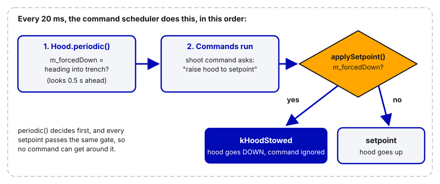

# 12. Spring-Back and Auto-Retract

> **Who it's for:** anyone who writes or changes a mechanism (intake, hood, flap, arm) and wants it to "come back in" by itself.
> **You need first:** basic command-based Java (subsystems, commands, button bindings) and [07 What is PID](07-what-is-pid.md). It helps to have seen Motion Magic (a CTRE control mode that moves to a position along a smooth speed-limited path).
> **Time:** about 60–90 minutes to read and try the practice in simulation; another session at the robot on blocks.

"Make it spring back in" can mean two different things, and good robots do both:

1. **Software spring-back.** The mechanism goes back to its stowed (safe, tucked-in) spot automatically when the driver lets go of the button, when an action ends, or when the robot gets somewhere dangerous. Nothing physical is springy; the code just always sends it home.
2. **Mechanical (compliant) spring-back.** When something *hits* the mechanism, it gives way like a spring instead of breaking, then comes back. You can do this with a real spring (gas spring, surgical tubing) or make the motor itself behave like a spring.

## What you'll learn

- How `runEnd`, `startEnd`, `finallyDo` and default commands make a mechanism return home every time.
- The difference between `whileTrue`, `toggleOnTrue` and `onTrue`, and which one gives you spring-back.
- How an interlock in `periodic()` (like our hood near the trench) overrides every command.
- How a low stator current limit plus Motion Magic makes a motor act like a force-limited spring (our intake).
- How to build a true "virtual spring" with `PositionTorqueCurrentFOC` (Phoenix Pro), and how code must account for real springs.
- How to re-home (re-find zero) after a hit knocks a mechanism out of position.

---

## Part A: Software spring-back

### The idea

A command is something the robot is doing. Every command has three moments:

```
initialize()  ->  execute() every 20 ms  ->  end(interrupted)
   (start)          (while running)          (stop, ALWAYS called)
```

`end()` runs no matter *why* the command stopped: the button was released, another command took over the subsystem, the match was disabled, or the command finished on its own. That makes `end()` the perfect place to say "go back in". If you put "go back in" anywhere else, there will be some way to stop the command that skips it.

The second tool is the **default command**. Each subsystem can have one command that runs whenever no other command is using that subsystem. If the default command is "hold the stowed position", the mechanism always drifts back to stowed the moment nothing else wants it.

Use both: `end()` sends it home right away, and the default command keeps it there.

### The command helpers

WPILib gives you short ways to build commands without writing a whole class. All of these are methods on `Subsystem`, so they automatically *require* the subsystem (claim it so two commands can't drive it at once).

| Helper | What it does | Spring-back? |
|---|---|---|
| `run(action)` | Runs `action` every loop, forever | No, nothing happens when it ends |
| `runOnce(action)` | Runs `action` once and finishes | No |
| `startEnd(start, end)` | Runs `start` once, waits, runs `end` when stopped | Yes |
| `runEnd(run, end)` | Runs `run` every loop, runs `end` when stopped | Yes |
| `startRun(start, run)` | Runs `start` once, then `run` every loop | No (add `finallyDo`) |
| `anyCommand.finallyDo(end)` | Adds an "always do this at the end" step to any command | Yes |

### The button bindings

How you bind the button decides *when* the command ends, which decides when the mechanism comes back.

| Binding | Starts when | Ends when | Use it for |
|---|---|---|---|
| `whileTrue(cmd)` | Button pressed | Button released (or cmd finishes) | Hold-to-intake. This is the classic spring-back. |
| `toggleOnTrue(cmd)` | First press | Second press (or cmd finishes) | "Click on, click off" intake |
| `onTrue(cmd)` | Button pressed | Only when cmd finishes on its own or is interrupted | One-shot actions (re-home, reset gyro) |
| `onFalse(cmd)` | Button released | Same as `onTrue` | Rare; prefer `end()` |

A common trap: `onTrue(run(...))`. A `run` command never finishes, so with `onTrue` it runs until some other command steals the subsystem. The mechanism never comes back.

### Step by step: make a mechanism spring back in

1. In the subsystem, write a method that sets the "out" target and one that sets the "stowed" target. Keep the numbers in named constants with units.
2. Write a command factory using `runEnd` (or `startEnd`): run = go out, end = go stowed.
3. In `RobotContainer`, set the subsystem's default command to "hold stowed".
4. Bind the command with `whileTrue` (hold to use) or `toggleOnTrue` (click on/off).
5. Test in simulation: watch the target on the dashboard flip back when you release the button.
6. On the robot, on blocks: press and release fast, press and hold, press another button that uses the same subsystem in the middle. It must come back in every time.

### Clean example

This is a new example with professional names. It is not copied from our robot but follows the same pattern.

```java
package frc.robot.subsystems;

import com.ctre.phoenix6.CANBus;
import com.ctre.phoenix6.configs.TalonFXConfiguration;
import com.ctre.phoenix6.controls.MotionMagicVoltage;
import com.ctre.phoenix6.hardware.TalonFX;
import com.ctre.phoenix6.signals.NeutralModeValue;
import edu.wpi.first.wpilibj2.command.Command;
import edu.wpi.first.wpilibj2.command.SubsystemBase;

/** A flap that swings out to grab game pieces and tucks back in when not in use. */
public class IntakeFlap extends SubsystemBase {
    // Positions in mechanism rotations (1 rotation = 360 degrees of flap swing)
    private static final double kStowedRotations = 0.0;
    private static final double kDeployedRotations = 0.30;   // about 108 degrees out

    private final TalonFX m_motor;
    private final MotionMagicVoltage m_request = new MotionMagicVoltage(0).withEnableFOC(true);

    public IntakeFlap(int canId, CANBus canBus) {
        m_motor = new TalonFX(canId, canBus);
        TalonFXConfiguration config = new TalonFXConfiguration();
        config.MotorOutput.NeutralMode = NeutralModeValue.Brake;
        config.Feedback.SensorToMechanismRatio = 20.0;        // 20 motor turns per flap turn
        config.CurrentLimits.StatorCurrentLimit = 30;
        config.CurrentLimits.StatorCurrentLimitEnable = true;
        config.CurrentLimits.SupplyCurrentLimit = 20;
        config.CurrentLimits.SupplyCurrentLimitEnable = true;
        config.Slot0.kP = 20;
        config.Slot0.kV = 2.4;
        config.MotionMagic.MotionMagicCruiseVelocity = 2.0;    // flap rotations per second
        config.MotionMagic.MotionMagicAcceleration = 8.0;
        m_motor.getConfigurator().apply(config);
        m_motor.setPosition(kStowedRotations);                 // must boot tucked in
    }

    private void moveTo(double rotations) {
        m_motor.setControl(m_request.withPosition(rotations));
    }

    /** Out while running, back in the moment it stops for ANY reason. */
    public Command deployWhileRunningCommand() {
        return runEnd(() -> moveTo(kDeployedRotations), () -> moveTo(kStowedRotations))
            .withName("IntakeFlap deploy");
    }

    /** Default command: keep the flap tucked in whenever nothing else uses it. */
    public Command holdStowedCommand() {
        return run(() -> moveTo(kStowedRotations)).withName("IntakeFlap hold stowed");
    }
}
```

And in `RobotContainer`:

```java
intakeFlap.setDefaultCommand(intakeFlap.holdStowedCommand());

// Hold to intake: flap comes back in on release
driverController.leftBumper().whileTrue(intakeFlap.deployWhileRunningCommand());

// OR click on / click off: same command, different binding
// driverController.leftBumper().toggleOnTrue(intakeFlap.deployWhileRunningCommand());
```


Notice that `toggleOnTrue` gives you a toggle with no extra state variable. You never need to write your own `boolean isOut` flag (see Common mistakes for what happens when we did).

### In our code: the intake comes back in on release

[EvilIntake.java, lines 237–247 (eject)](https://github.com/TorqueNados-FRC5090/Hephaestus/blob/c2f0cee6f61db3f26f911d3f5623ed7fa27a5b03/src/main/java/frc/robot/subsystems/EvilIntake.java#L237-L247)

```java
public Command eject() {
    return run(() -> {
        evilyummy(EvilIntakePosition.out);
        spinMotor.setControl(spinRequest.withOutput(kRollerEjectSpeed));
    }).finallyDo(() -> {
        evilyummy(EvilIntakePosition.in);
        spinMotor.setControl(spinRequest.withOutput(0));
    });
}
```

What to notice: `run(...)` alone would leave the intake out forever. `.finallyDo(...)` is what pulls it back in and stops the wheels. It is bound with `whileTrue` on the left trigger ([RobotContainer.java, line 164](https://github.com/TorqueNados-FRC5090/Hephaestus/blob/c2f0cee6f61db3f26f911d3f5623ed7fa27a5b03/src/main/java/frc/robot/RobotContainer.java#L164)), so releasing the trigger ends it. (`evilyummy` would be better named `moveToPosition`; the joke names are from the 2026 season.)

[EvilIntake.java, lines 219–235 (agitate with an end position)](https://github.com/TorqueNados-FRC5090/Hephaestus/blob/c2f0cee6f61db3f26f911d3f5623ed7fa27a5b03/src/main/java/frc/robot/subsystems/EvilIntake.java#L219-L235)

```java
public Command agitate(EvilIntakePosition endPosition) {
    Timer timer = new Timer();
    double out = EvilIntakePosition.out.getInches();
    return startRun(
        timer::restart,
        () -> {
            // 0 -> 1 -> 0 over one period, starting from out
            double inAmount = (1 - Math.cos(2 * Math.PI * timer.get() / kAgitatePeriodSeconds)) / 2;
            setTargetInches(out + (kAgitateInInches - out) * inAmount, true);
            spinMotor.setControl(spinRequest.withOutput(kRollerIntakeSpeed));
        })
        .finallyDo(() -> {
            evilyummy(endPosition);
            spinMotor.setControl(spinRequest.withOutput(0));
        });
}
```

What to notice: the end position is a *parameter*. Teleop binds `agitate(EvilIntakePosition.in)` so the intake tucks in when shooting stops ([RobotContainer.java, lines 173–178](https://github.com/TorqueNados-FRC5090/Hephaestus/blob/c2f0cee6f61db3f26f911d3f5623ed7fa27a5b03/src/main/java/frc/robot/RobotContainer.java#L173-L178)). Autos use plain `agitate()`, which ends with the intake *out*, because in auto we want to keep picking up. Same command, different spring-back target.

Also notice the agitate stroke only slides in to 8 inches, not all the way. That's the rule below.

### The rule: never fully retract with fuel inside

Squeezing the intake all the way into its stop with game pieces inside jams them, crushes them, or stalls the motor. Our "in" position is deliberately *not* zero:

[Constants.java, lines 120–122 (EvilIntakePosition)](https://github.com/TorqueNados-FRC5090/Hephaestus/blob/c2f0cee6f61db3f26f911d3f5623ed7fa27a5b03/src/main/java/frc/robot/Constants.java#L120-L122)

```java
public enum EvilIntakePosition {
    in(0.3),    // just off the retract stop: never squeeze into the stop with fuel inside
    out(14.0);  // pickup: 2" short of the 16" extension stop
```

And the subsystem clamps every target so nothing can command into a stop ([EvilIntake.java, lines 58–63](https://github.com/TorqueNados-FRC5090/Hephaestus/blob/c2f0cee6f61db3f26f911d3f5623ed7fa27a5b03/src/main/java/frc/robot/subsystems/EvilIntake.java#L58-L63) and [lines 273–276](https://github.com/TorqueNados-FRC5090/Hephaestus/blob/c2f0cee6f61db3f26f911d3f5623ed7fa27a5b03/src/main/java/frc/robot/subsystems/EvilIntake.java#L273-L276)). Spring-back should go to a *safe* spot, which isn't always the hard stop.

### In our code: default commands as spring-back

[RobotContainer.java, lines 136–140](https://github.com/TorqueNados-FRC5090/Hephaestus/blob/c2f0cee6f61db3f26f911d3f5623ed7fa27a5b03/src/main/java/frc/robot/RobotContainer.java#L136-L140)

```java
// This makes the turret run passOrShoot() continuously whenever no other command is using it.
turret.setDefaultCommand(turret.run(turret::passOrShoot));
// Hood sits down (safe for the trench) whenever nothing is shooting
hood.setDefaultCommand(hood.stowCommand());
```

What to notice:

- The hood's default is "stow". The shoot command uses `hood.hoodgo(...)`, which is a `runEnd` whose end also stows ([Hood.java, lines 120–130](https://github.com/TorqueNados-FRC5090/Hephaestus/blob/c2f0cee6f61db3f26f911d3f5623ed7fa27a5b03/src/main/java/frc/robot/subsystems/Hood.java#L120-L130)). Belt and braces: `end()` stows immediately, the default command keeps it stowed.
- The turret's default isn't "go to zero", it's "keep tracking the target". Spring-back doesn't always mean "go home"; it means "go back to the normal behavior". The B button's failsafe shot runs `turret.run(() -> turret.goToZero())`, which *interrupts* tracking. Release B and the default command takes over again, so the turret springs back to tracking ([RobotContainer.java, lines 222–229](https://github.com/TorqueNados-FRC5090/Hephaestus/blob/c2f0cee6f61db3f26f911d3f5623ed7fa27a5b03/src/main/java/frc/robot/RobotContainer.java#L222-L229)).

### In our code: an interlock that beats every command

Sometimes "go back in" must win even if a command is actively asking for "out". Our hood breaks if it's up when the robot drives under the trench (22 inches of clearance). So the hood checks for the trench in `periodic()`:

[Hood.java, lines 132–143](https://github.com/TorqueNados-FRC5090/Hephaestus/blob/c2f0cee6f61db3f26f911d3f5623ed7fa27a5b03/src/main/java/frc/robot/subsystems/Hood.java#L132-L143)

```java
@Override
public void periodic(){
    // Runs every loop before commands, so even a hood left up gets pulled down before a trench
    m_forcedDown = m_nearTrench.getAsBoolean();
    if (m_forcedDown) {
        hood.setControl(m_request.withPosition(kHoodStowed));
    }
    SmartDashboard.putBoolean("Hood/Forced Down (trench)", m_forcedDown);
    ...
}
```

and every setpoint goes through one gate ([Hood.java, lines 105–108](https://github.com/TorqueNados-FRC5090/Hephaestus/blob/c2f0cee6f61db3f26f911d3f5623ed7fa27a5b03/src/main/java/frc/robot/subsystems/Hood.java#L105-L108)):

```java
private void applySetpoint(){
    hood.setControl(m_request.withPosition(m_forcedDown ? kHoodStowed : setpoint));
}
```

What to notice:

- The command scheduler runs every subsystem's `periodic()` *before* it runs commands. So `periodic()` decides `m_forcedDown` first, and then any command that tries to raise the hood gets routed through `applySetpoint()`, which still says "stowed". There's no way around it.
- `m_nearTrench` comes from `FieldZones.robotHeadingIntoTrench(...)`, which looks 0.5 s ahead at the robot's current speed, so the hood starts dropping *before* the robot arrives ([RobotContainer.java, lines 67–72](https://github.com/TorqueNados-FRC5090/Hephaestus/blob/c2f0cee6f61db3f26f911d3f5623ed7fa27a5b03/src/main/java/frc/robot/RobotContainer.java#L67-L72)).
- `atSetpoint()` returns false while forced down, so the feeder never shoots with the hood in the wrong place.



**Pattern to copy:** if a mechanism *must* be stowed in some situation, put that check in the subsystem itself, not in each command. Commands come and go; the subsystem is always there.

---

## Part B: Mechanical (compliant) spring-back

### Why a stiff mechanism breaks

A position loop (PID with Motion Magic) tries hard to hold its target. If another robot or the field pushes on it, the controller pushes back harder and harder, up to whatever current the motor is allowed. With a Kraken that's a *lot* of force. Something has to give: a chain skips, a belt jumps teeth, a bolt shears, a gearbox strips.

**Compliance** means "allowed to give way". A compliant mechanism lets the hit push it, then returns. Think of a door with a spring closer.

### Tool 1: a low stator current limit (our intake)

Two kinds of current limit on a Talon:

- **Supply current**: what the controller pulls from the battery. Protects the battery and prevents brownouts.
- **Stator current**: what flows through the motor windings. Stator current is proportional to **torque** (twisting force). Limit stator current and you limit force.

So a low stator limit caps how hard the motor can ever push, in either direction. When something shoves the mechanism harder than that cap, the motor simply can't resist; the mechanism slides back. When the shove stops, Motion Magic sees the error and drives it back to target. That's a force-capped spring.

Rough rule for picking the number: start at the lowest current that still does the job (moves through game pieces, holds against gravity) and add a little margin. Watch the stator current on the dashboard during normal use and set the limit just above the normal peak.

[EvilIntake.java, lines 89–95 (the "spring" current limit)](https://github.com/TorqueNados-FRC5090/Hephaestus/blob/c2f0cee6f61db3f26f911d3f5623ed7fa27a5b03/src/main/java/frc/robot/subsystems/EvilIntake.java#L89-L95)

```java
/** Rack motors, stator: the "spring". 20 A ~= 10 lb of push per side (20 lb total), plenty to move the rack
 *  through fuel, but low enough that a hit shoves the intake in instead of skipping the chain. Raise toward
 *  25-30 A if the intake gets pushed back during normal pickup; lower if the chain still skips. */
private static final double kRackStatorLimitAmps = 20.0;
/** Rack motors, supply: caps battery draw per side so the intake can't add to a brownout */
private static final double kRackSupplyLimitAmps = 20.0;
```

What to notice: this is a real lesson. The intake chain used to **skip** when the intake got hit, because the motors fought the hit at full force and the chain was the weakest link. Lowering the stator limit made the motor the weakest link instead, and a motor that "loses" a fight isn't damaged. The comment also tells the next person which way to tune it.

Also notice the limits are applied to the follower too ([EvilIntake.java, lines 171–174](https://github.com/TorqueNados-FRC5090/Hephaestus/blob/c2f0cee6f61db3f26f911d3f5623ed7fa27a5b03/src/main/java/frc/robot/subsystems/EvilIntake.java#L171-L174)). A `Follower` copies the leader's *output*, not its *configs*.

### Tool 2: coast vs. brake when disabled

**Neutral mode** is what the motor does when it's told to output nothing (including when the robot is disabled).

- **Brake**: the motor shorts its windings, which resists turning. Good for arms that would fall, and turrets you don't want to drift.
- **Coast**: the motor spins freely. Good when you'd rather the mechanism give than resist, for example during setup or if something leans on it while disabled.

Our rack uses coast on purpose ([EvilIntake.java, lines 161–162](https://github.com/TorqueNados-FRC5090/Hephaestus/blob/c2f0cee6f61db3f26f911d3f5623ed7fa27a5b03/src/main/java/frc/robot/subsystems/EvilIntake.java#L161-L162)): "Coast: the rack can give when hit while the robot is disabled". The hood and turret use brake so they hold position. Rule of thumb: if gravity would move it when disabled, use brake; otherwise coast is friendlier to hits and to people moving it by hand.

### Tool 3: a true virtual spring with torque control (Phoenix Pro)

The current-limit trick is a spring with a *cap*, but the force it pushes back with still comes from a voltage-based PID, which also depends on how fast the motor is moving. If you want the motor to behave *exactly* like a spring, control **torque** directly.

A spring follows Hooke's law:

```
force = k * (target - position)  -  b * velocity
          ^ stiffness                ^ damping (stops bouncing)
```

Phoenix Pro's `TorqueCurrentFOC` family lets you ask for a current (amps), and current is proportional to torque. Here's the neat part: a `PositionTorqueCurrentFOC` closed loop **is** this spring. With torque-current output, `kP` is in amps per rotation of error (that's the stiffness `k`) and `kD` is amps per rotation-per-second (that's the damping `b`). Cap the current and you have a spring with a maximum force.


```java
TalonFXConfiguration config = new TalonFXConfiguration();
config.MotorOutput.NeutralMode = NeutralModeValue.Coast;
config.Feedback.SensorToMechanismRatio = 15.0;         // motor turns per mechanism turn
// Spring: 40 A per rotation of error = stiffness. kD = damping so it doesn't bounce.
config.Slot0.kP = 40.0;
config.Slot0.kD = 2.0;
// Maximum spring force: never more than 25 A of torque current in either direction
config.TorqueCurrent.PeakForwardTorqueCurrent = 25.0;
config.TorqueCurrent.PeakReverseTorqueCurrent = -25.0;
// Keep the normal limits too, as a backstop
config.CurrentLimits.StatorCurrentLimit = 40;
config.CurrentLimits.StatorCurrentLimitEnable = true;
config.CurrentLimits.SupplyCurrentLimit = 30;
config.CurrentLimits.SupplyCurrentLimitEnable = true;
motor.getConfigurator().apply(config);

// Every loop: be a spring centered on the stowed position
private final PositionTorqueCurrentFOC m_springRequest = new PositionTorqueCurrentFOC(0);
motor.setControl(m_springRequest.withPosition(kStowedRotations));
```

Things to know:

- Torque-current requests have no `withEnableFOC(...)`. They are *always* FOC (field oriented control, a smarter way of driving the motor that Pro unlocks); it's in the name.
- **Talon FX only.** The Talon FXS has no FOC and no torque-current requests, so this doesn't work on our intake rack (two Vortexes on Talon FXS). It needs a Kraken or Falcon. See [31](31-phoenix-pro-features.md).
- Gains for torque-current output are in **amps**, not volts. Don't copy voltage gains across; they will be wildly wrong.
- `MotionMagicTorqueCurrentFOC` also exists if you want a smooth profile on the way back plus spring-like behavior.
- Torque control doesn't automatically slow down. With nothing pushing back, a big error gives full current and the mechanism accelerates hard. Start with a low `kP` and a low peak current, on blocks.

If you want to see the math yourself (great for learning, and for the practice exercise), you can write the spring by hand:

```java
private final TorqueCurrentFOC m_torqueRequest = new TorqueCurrentFOC(0);
private static final double kStiffnessAmpsPerRotation = 40.0;
private static final double kDampingAmpsPerRps = 2.0;
private static final double kMaxSpringAmps = 25.0;

/** Call every loop (from periodic or a run() command) */
private void actLikeASpring(double centerRotations) {
    double position = m_motor.getPosition().getValueAsDouble();
    double velocity = m_motor.getVelocity().getValueAsDouble();
    double amps = kStiffnessAmpsPerRotation * (centerRotations - position) - kDampingAmpsPerRps * velocity;
    amps = MathUtil.clamp(amps, -kMaxSpringAmps, kMaxSpringAmps);
    m_motor.setControl(m_torqueRequest.withOutput(amps));
}
```

The hand version runs at 50 Hz on the roboRIO; the built-in `PositionTorqueCurrentFOC` runs at 1 kHz on the Talon and is smoother. Use the hand version to understand, the built-in one on the robot.

### Tool 4: real springs (gas springs, surgical tubing, constant-force springs)

Sometimes a real spring is the right answer: it works with the robot off, it costs no battery, and it can't have a bug.

| Spring | Force behavior | Typical use |
|---|---|---|
| Surgical tubing / bungee | Grows the more you stretch it | Pulling an intake down/in, cheap and forgiving |
| Gas spring (gas shock) | Nearly constant over its stroke, a bit higher when compressed | Holding up a heavy arm, deploying an intake |
| Constant-force spring (coiled steel strip) | Nearly the same force everywhere | Counterbalancing an elevator stage |
| Torsion spring | Grows with twist angle | Flaps, hinged deflectors |

**How code must account for a real spring.** The spring adds a force the controller doesn't know about. Your feedforward has to include it.

- `kG` is the **gravity feedforward**: the output that holds the mechanism still against gravity (see [14 Arms](14-arms-single-and-double-jointed.md)). If a spring helps hold the mechanism up, the voltage you need is *gravity minus spring*. With a strong spring that can flip **sign**: at some angles the spring wins and the motor has to pull *down*. A plain `kG` (always pushing up) can't express that.
- `kS` (static friction feedforward) is still just friction; don't use it to cancel a spring.
- **Measure it.** With the mechanism on the robot, put it in open-loop voltage mode and find the voltage that just holds it still at 3–5 positions across its travel. Write those down. That's your real "holding voltage" curve.
- Then either fit a simple formula (for example `kG * cos(angle) - springVolts`) and pass it to the request with `.withFeedForward(volts)`, or use an `InterpolatingDoubleTreeMap` lookup table (we already use those for pass maps in `RobotContainer`).

```java
// Arm helped by a gas spring: measured holding voltage at several angles
// Positive = motor must push up, negative = spring wins, motor must pull down
private final InterpolatingDoubleTreeMap m_holdingVolts = new InterpolatingDoubleTreeMap();
{
    m_holdingVolts.put(0.00, 0.45);    // horizontal: gravity wins
    m_holdingVolts.put(0.10, 0.20);
    m_holdingVolts.put(0.20, -0.05);   // spring and gravity about equal
    m_holdingVolts.put(0.25, -0.15);   // straight up: spring wins
}

private void moveTo(double targetRotations) {
    double angle = m_motor.getPosition().getValueAsDouble();
    m_motor.setControl(m_request
        .withPosition(targetRotations)
        .withFeedForward(m_holdingVolts.get(angle)));   // kG = 0 in the config when using this
}
```

- Watch **holding current**. If a spring fights the motor at the stowed position, the motor sits there at a few amps all match, heating up. Better to design the spring so the stowed position is where it's relaxed (or resting on a hard stop).
- A spring that pulls a mechanism into a hard stop when disabled is great: the robot always boots in a known position (good for zeroing).

---

## Part C: Homing after a hit

Compliance protects the hardware, but a hard hit can still change where the code *thinks* the mechanism is. If a chain skips one tooth, the encoder's zero is now wrong by that much forever. **Homing** means finding a known physical reference again (a hard stop, or a limit switch on a CTRE CANdi; guide 21) and resetting the encoder to match.

Our intake homes by pushing gently against its 16-inch extension stop and watching for it to stop moving ("stall detect"):

[EvilIntake.java, lines 349–364 (homing)](https://github.com/TorqueNados-FRC5090/Hephaestus/blob/c2f0cee6f61db3f26f911d3f5623ed7fa27a5b03/src/main/java/frc/robot/subsystems/EvilIntake.java#L349-L364)

```java
private void runHoming(double velocityRps) {
    intakeMotor.setControl(m_homingRequest.withOutput(kHomingVolts));
    boolean moving = Math.abs(velocityRps) > kHomingStallRps;
    if (moving || m_homingTimer.get() < kHomingIgnoreSeconds) {
        m_stallTimer.restart();
    }
    if (m_stallTimer.get() >= kHomingStallSeconds) {
        // Stopped against the extension stop: that is 16"
        double stopRotations = kExtendStopInches * kMotorRotationsPerInch;
        intakeMotor.setPosition(stopRotations);
        intakeMotorTwo.setPosition(-stopRotations);
        ...
```

What to notice:

- Low voltage (0.8 V) so it arrives gently, plus a stall timer (must be stopped 0.2 s) and an "ignore the first 0.3 s" window so it doesn't think "not moving yet" means "hit the stop".
- A timeout: if it never stalls in 4 s, it keeps the old zero and logs a loud message instead of locking the intake for the whole match ([lines 365–373](https://github.com/TorqueNados-FRC5090/Hephaestus/blob/c2f0cee6f61db3f26f911d3f5623ed7fa27a5b03/src/main/java/frc/robot/subsystems/EvilIntake.java#L365-L373)).
- On the field (FMS attached) it does **not** home by itself, because the robot always starts with the intake in ([lines 294–303](https://github.com/TorqueNados-FRC5090/Hephaestus/blob/c2f0cee6f61db3f26f911d3f5623ed7fa27a5b03/src/main/java/frc/robot/subsystems/EvilIntake.java#L294-L303)). The driver can re-home any time with D-pad up ([RobotContainer.java, line 167](https://github.com/TorqueNados-FRC5090/Hephaestus/blob/c2f0cee6f61db3f26f911d3f5623ed7fa27a5b03/src/main/java/frc/robot/RobotContainer.java#L167)).

**Sync guard.** The intake has two motors, one per side. If one side gets blocked and the other keeps going, the rack twists. So the code compares both sides every loop and stops everything if they differ by more than 1 inch for 0.25 s ([EvilIntake.java, lines 376–385](https://github.com/TorqueNados-FRC5090/Hephaestus/blob/c2f0cee6f61db3f26f911d3f5623ed7fa27a5b03/src/main/java/frc/robot/subsystems/EvilIntake.java#L376-L385)). It stays stopped (`SIDES_OUT_OF_SYNC`) until someone re-homes. A compliant mechanism that gets pushed unevenly is exactly when this matters.

---

## Common mistakes

- **Putting "go back in" outside `end()`.** If it's in `isFinished()` or after a button check, some way of stopping the command will skip it. `end()`, `runEnd`, `startEnd` or `finallyDo` always run.
- **`onTrue` with a command that never ends.** `onTrue(run(...))` keeps running after release. Use `whileTrue`.
- **Hand-rolled toggles.** Our unused `EvilIntakeToggle` has `if (OutNow = false)` ([EvilIntakeToggle.java, lines 19–32](https://github.com/TorqueNados-FRC5090/Hephaestus/blob/c2f0cee6f61db3f26f911d3f5623ed7fa27a5b03/src/main/java/frc/robot/commands/EvilIntakeToggle.java#L19-L32)). One `=` assigns instead of compares, so the condition is always false and it never goes out. It also never finishes and has an empty `end()`, so nothing brings it back if it's interrupted. Use `toggleOnTrue` with a `runEnd` command instead: no flag to get wrong.
- **`new WaitCommand(...)` inside a method.** [EvilIntakePiece.java, lines 19–23](https://github.com/TorqueNados-FRC5090/Hephaestus/blob/c2f0cee6f61db3f26f911d3f5623ed7fa27a5b03/src/main/java/frc/robot/commands/EvilIntakePiece.java#L19-L23) creates a `WaitCommand` and throws it away; it never waits. Creating a command doesn't run it. To wait, put it in a sequence: `Commands.sequence(Commands.waitSeconds(0.125), ...)`.
- **Retracting fully with game pieces inside.** Jams and crushes them. Stow to just off the stop (our `in` is 0.3").
- **Chain skipping on hits.** Stator limit too high, so the chain loses the fight. Lower the stator limit until the motor gives first (our 20 A rack).
- **Safety checks only in commands.** The hood-under-trench problem needs an interlock in `periodic()`. A check in one command doesn't protect you from the other commands.
- **Forgetting the follower's limits.** Followers don't copy configs. Apply current limits to both motors.
- **Copying voltage gains into a torque-current loop.** Units are amps, not volts.

## Checklist

- [ ] Every "out" command has its return in `end()` / `runEnd` / `startEnd` / `finallyDo`.
- [ ] The subsystem has a default command that holds the safe position (or the normal behavior).
- [ ] Bound with `whileTrue` or `toggleOnTrue`, not `onTrue`, for hold/toggle actions.
- [ ] The stowed position is safe with game pieces inside (not crushing into the stop).
- [ ] Must-stow situations are enforced in the subsystem's `periodic()`.
- [ ] Stator limit set from measured normal current, low enough that a hit pushes it back.
- [ ] Neutral mode chosen on purpose (brake if gravity moves it, coast otherwise).
- [ ] Real springs measured: holding voltage written down at several positions, used as feedforward.
- [ ] There's a way to re-home after a hit, and it has a timeout.

## Practice

1. **Spring-back in sim.** Add `IntakeFlap` from this guide to a copy of the Robot-Template, bind it with `whileTrue`, and watch `getClosedLoopReference()` on the dashboard flip back when you release. Then change it to `toggleOnTrue` and confirm it still stows when another command interrupts it.
2. **Find the bug.** Without running it, explain exactly what `EvilIntakeToggle` does on the first, second and third press. Then rewrite it as one line using `toggleOnTrue`.
3. **Measure a spring.** On blocks, with the intake rack, slowly raise the stator limit from 10 A in 2 A steps. At each step, push the extended intake in by hand (gently, robot enabled in a safe test mode). Record the limit at which it stops giving way. Compare to the 20 A in the code.
4. **Virtual spring.** On a free-spinning test motor (nothing attached), write the hand-coded `actLikeASpring()` and turn the shaft by hand. Double `kStiffnessAmpsPerRotation`, then double `kDampingAmpsPerRps`, and describe how the feel changes.

## Go further

- WPILib, Commands (including `runEnd`, `startEnd`, `finallyDo`): https://docs.wpilib.org/en/stable/docs/software/commandbased/commands.html
- WPILib, Binding commands to triggers (`whileTrue`, `toggleOnTrue`, `onTrue`): https://docs.wpilib.org/en/stable/docs/software/commandbased/binding-commands-to-triggers.html
- WPILib, Subsystems and default commands: https://docs.wpilib.org/en/stable/docs/software/commandbased/subsystems.html
- WPILib, The command scheduler (why `periodic()` runs before commands): https://docs.wpilib.org/en/stable/docs/software/commandbased/command-scheduler.html
- CTRE, Improving performance with current limits (stator vs supply): https://v6.docs.ctr-electronics.com/en/stable/docs/hardware-reference/talonfx/improving-performance-with-current-limits.html
- CTRE, Control requests intro (including torque-current FOC): https://v6.docs.ctr-electronics.com/en/stable/docs/api-reference/device-specific/talonfx/talonfx-control-intro.html
- CTRE, Closed-loop overview (gain units by output type, kG, kS sign): https://v6.docs.ctr-electronics.com/en/stable/docs/api-reference/device-specific/talonfx/closed-loop-requests.html
- CTRE, Motion Magic: https://v6.docs.ctr-electronics.com/en/stable/docs/api-reference/device-specific/talonfx/motion-magic.html
