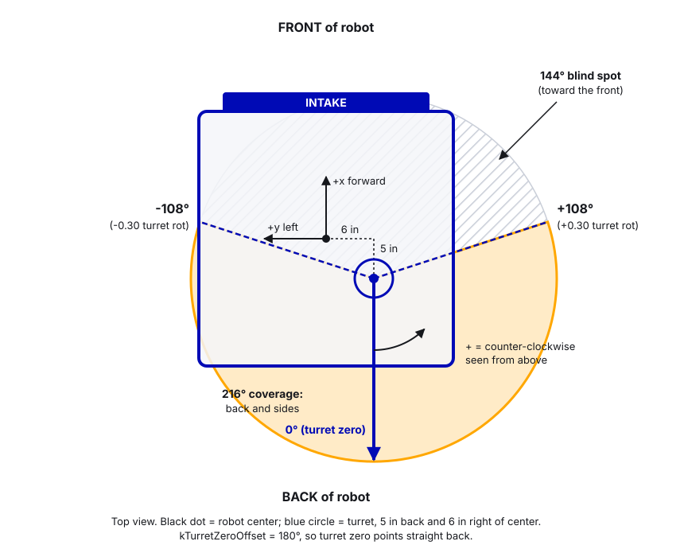
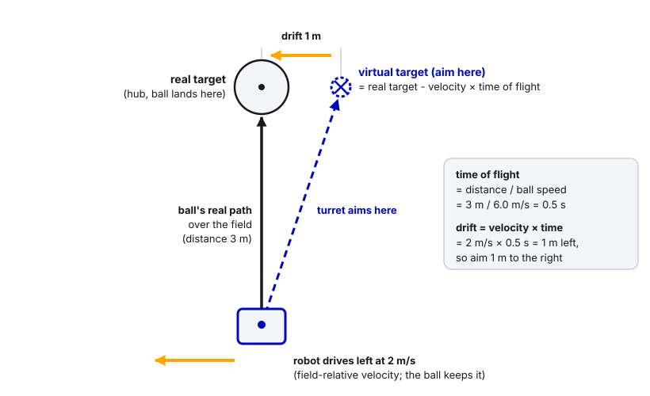
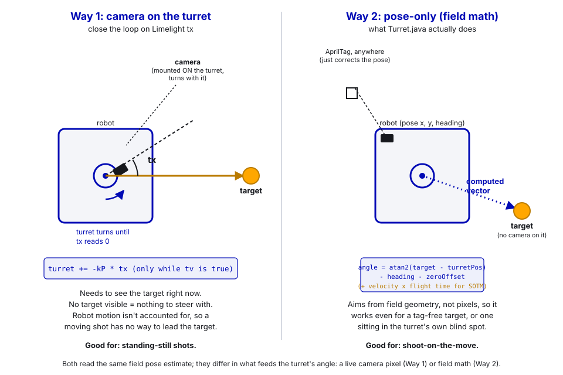

# 13. Turrets

> **Who it's for:** programmers working on an aiming mechanism, and anyone who wants to understand how our 2026 turret knows where to point.
> **You need first:** [07 What is PID](07-what-is-pid.md), basic command-based Java, and comfort with field coordinates (x/y in meters, angles counter-clockwise, blue origin; see the Robot-Template STUDENT-GUIDE section 4). [12 Spring-Back and Auto-Retract](12-spring-back-and-auto-retract.md) explains default commands, which the turret uses.
> **Time:** about 90 minutes to read carefully. The math section is worth doing with a pencil.

A **turret** is a mechanism that spins a shooter (or camera, or intake) around a vertical axis, so the robot can aim without turning its whole body. It lets the driver drive one way and shoot another. Our 2026 robot, Theseus, has one: a Minion motor on a Talon FXS turns a big ring gear under the shooter.

## What you'll learn

- How turret gearing, wire wrap and travel limits work, and why ours only turns ±108° and faces the back.
- Why "zero at power-on" is risky, and better ways to know where the turret is.
- How to configure Motion Magic for a turret that has to keep up with a spinning robot.
- The field-relative aiming math, step by step, exactly as `Turret.java` does it.
- Shoot-on-the-move lead, heading lead, picking pass targets, and logging the turret pose for AdvantageScope.
- Two ways to aim with vision: a camera-on-turret `tx` servo vs. our pose-only field math, and why shoot-on-the-move needs the second one.

---

## 1. The mechanism

### Gearing

A small gear (the **pinion**) on the motor drives a large **ring gear** that the turret sits on. On our robot:

```
ring gear 200 teeth / pinion 16 teeth = 12.5
=> the motor turns 12.5 times for one full turret turn
```

So 1 motor rotation = 1/12.5 = 0.08 turret rotations = 28.8°. Big reductions are good for turrets: more precision per motor rotation and more torque to start and stop the heavy shooter.


The code keeps this as `kTurretGearRatio` and does the conversion itself (the Talon reports motor rotations). If a gearbox is ever added in front of the pinion, multiply its ratio in, or the turret will aim off by that factor.

### Wire wrap and travel limits

The shooter on top of the turret has motors and sensors. Their wires have to cross from the spinning part to the robot. Unless you buy a slip ring (an expensive rotating electrical connector), the wires twist as the turret turns. Turn too far and you pull a connector out or rip a CAN wire, and now half the robot is dead.

So most FRC turrets have a **travel limit**: they can only turn so far each way from center. Ours:

```
kMaxTurretRotations = 0.30 turret rotations
0.30 * 360 = 108 degrees each way  ->  216 degrees total
0.30 * 12.5 = 3.75 motor rotations each way
```

The code comment shows it used to be 0.48 (almost a full half turn each way). It was reduced to 0.30; if you change it, check the cable slack and any hard stops by hand with the robot disabled first.

### Why it faces the back

Our intake is on the front. The turret's center (zero) points straight **back**, so the shooter's 216° of coverage is the back and sides, away from the intake:

```
               FRONT (intake)
                    ^
       can't reach  |  can't reach
           \        |        /
            \  144 deg blind /
             \      |      /
              +-----+-----+
              |   robot   |
              +-----------+
             /      |      \
     -108 deg      0 deg     +108 deg
                   (turret zero, robot BACK)
```

In code that's `kTurretZeroOffset = Rotation2d.fromDegrees(180)`. When a target is in the blind spot the dashboard says "Target out of range: point the robot's BACK at it".



---

## 2. Knowing where the turret is (zeroing)

The Talon's built-in encoder counts rotations from wherever it was when the robot turned on. Our turret simply declares that spot to be zero:

[Turret.java, lines 159–160](https://github.com/TorqueNados-FRC5090/Hephaestus/blob/c2f0cee6f61db3f26f911d3f5623ed7fa27a5b03/src/main/java/frc/robot/subsystems/Turret.java#L159-L160)

```java
m_turretMotor.getConfigurator().apply(config);
m_turretMotor.setPosition(0);
```

**Why that's risky:** if someone powers the robot on with the turret turned 40° to the side, the code thinks 40° is "straight back". Every aim is now 40° off, and worse, the travel limits are shifted 40° too, so the turret can drive 148° one way and wrap the wires. There's a `zeroTurret()` method, but nothing calls it.

Ways to do better, from simplest to best:

| Option | How it works | Notes |
|---|---|---|
| Pre-match checklist | A person lines the turret up with a mark before power-on | Free. Do this no matter what. |
| Homing to a switch | At enable, turn slowly until a limit switch or hall-effect sensor (wired to a CANdi) at a known angle triggers, then `setPosition` | Like our intake's hard-stop homing (guide 12). Don't home by driving into a hard stop on a turret: you're pulling on the wires. |
| Absolute encoder (CANcoder) | A sensor that knows its angle the instant it powers on | Best. See below. |

**The CANcoder trick for a limited turret.** A CANcoder only knows its angle within one rotation of *itself*. If it's geared 1:1 with the turret ring (or slower), our whole 216° travel is less than one CANcoder rotation, so every turret angle has a unique reading. Set its magnet offset so "straight back" reads 0, and the turret knows where it is at power-on with no homing. If you put the CANcoder on the 16-tooth pinion instead, one turret turn is 12.5 CANcoder turns and the reading is ambiguous. Talon FX can fuse a CANcoder with its rotor sensor (`FusedCANcoder`, a Pro feature; see [28 Fusing Sensors to a Motor](28-fusing-sensors-to-a-motor.md) for the config). The Talon FXS has its own external-feedback options for sensors; guide 28 covers those too.


---

## 3. Motion Magic config

**Motion Magic** is CTRE's profiled position control: you give a target, and the Talon plans a smooth path there limited by a cruise velocity, acceleration and jerk (how fast acceleration itself may change), then follows it with PID plus feedforward.

[Turret.java, lines 132–157 (motor config)](https://github.com/TorqueNados-FRC5090/Hephaestus/blob/c2f0cee6f61db3f26f911d3f5623ed7fa27a5b03/src/main/java/frc/robot/subsystems/Turret.java#L132-L157)

```java
// ... brake mode, Minion motor arrangement, 30 A stator / 20 A supply limits ...
config.Slot0.kP = 8;
config.Slot0.kD = 0;
// Small push in the direction of the error so friction can't stop the turret just short of the target
config.Slot0.kS = 0.15;
config.Slot0.StaticFeedforwardSign = StaticFeedforwardSignValue.UseClosedLoopSign;
// Volts per motor rot/s. Without this the turret only moves once it's already behind
// (pure kP), which is most of the lag. ~12V / Minion free speed.
config.Slot0.kV = 0.1;

// Old values: cruise 600 (faster than the motor can spin), accel 60 (took ~2s to reach speed).
// Acceleration was the real limit. Turn accel down if the turret slams or skips teeth.
config.MotionMagic.MotionMagicCruiseVelocity = 90.0;
config.MotionMagic.MotionMagicAcceleration = 400.0;
// Jerk = how fast the turret may START accelerating. At 200 it took ~2s to reach full accel, so it could not
// keep up with the robot rotating (stayed "not on target" and never fed). 0 = no jerk limit (fastest).
config.MotionMagic.MotionMagicJerk = 1500.0;
```

What to notice:

- **kV** (volts per rotation-per-second) is the main driver. Motion Magic gives the Talon a planned velocity every millisecond, and kV turns it straight into volts *before* any error builds up. With only kP, the turret has to fall behind before it pushes. 12 V / ~120 motor RPS free speed ≈ 0.1.
- **kS with `UseClosedLoopSign`.** kS is the voltage that just overcomes friction. By default CTRE picks kS's sign from the *planned velocity*, which CTRE recommends for Motion Magic. But when the turret is a hair off target and the plan says "velocity zero, you're there", that default adds no kS, and friction leaves it stuck a few degrees off forever. `UseClosedLoopSign` pushes toward the *error* instead, so it always nudges in. CTRE warns that a kS too large with this setting makes it dither (buzz back and forth); 0.15 V is small.
- **The cruise/accel/jerk lesson.** A tracking turret's target changes every 20 ms, so Motion Magic is always re-planning and the turret lives in the *start* of a profile, where acceleration and jerk limits matter most:

| Setting | Time to reach full accel (accel / jerk) | Time to reach cruise (cruise / accel) | Result |
|---|---|---|---|
| Old: cruise 600, accel 60 | n/a | 600 / 60 = 10 s (cruise was faster than the motor can even spin) | Took ~2 s to get going |
| Then: accel 400, jerk 200 | 400 / 200 = 2 s | 0.225 s | Still couldn't keep up with a spinning robot; never read "on target" |
| Now: cruise 90, accel 400, jerk 1500 | 400 / 1500 ≈ 0.27 s | 90 / 400 ≈ 0.23 s (about 0.5 s counting the jerk ramp) | Keeps up |

Rule: for something that **tracks** a moving target, set limits near what the hardware can actually do. Turn acceleration down only if the turret slams or skips teeth.

- **Current limits.** 30 A stator, 20 A supply. Enough to swing the turret, and it limits damage if it hits a stop or gets bumped.
- **Improvement to consider:** the travel limit is enforced only by the aiming code's clamp. Adding Talon **soft limits** (`SoftwareLimitSwitch`, like the hood uses) at ±3.75 motor rotations plus a little margin means no future command can ever wrap the wires, even a buggy one.

---

## 4. Field-relative aiming, step by step

**Field-relative** aiming means: we know where the robot is on the field (the **pose**: x, y, heading, from swerve odometry corrected by Limelight AprilTags), and we know where the target is on the field, so we can calculate the turret angle with geometry. No camera has to see the target right now.

### The math with a worked example

Say we're blue, the hub center is at (4.625, 4.035), and the robot is at (2.0, 4.035) facing 180° (its back toward the hub). That's exactly the shop test pose.

**Step 1: where is the turret on the field?** The turret isn't at the robot's center. It's 5" back and 6" right (`kTurretOffsetXInches = -5`, `kTurretOffsetYInches = -6`), which is (-0.127, -0.152) m in robot coordinates. Rotate that offset by the robot's heading and add the robot's position:

```
offset rotated by 180 deg = (0.127, 0.152)
turret = (2.0 + 0.127, 4.035 + 0.152) = (2.127, 4.187)
```

**Step 2: angle from the turret to the target, on the field.**

```
dx = 4.625 - 2.127 = 2.498,   dy = 4.035 - 4.187 = -0.152
field angle = atan2(-0.152, 2.498) = -3.5 deg
```

**Step 3: subtract the robot's heading** (turn it into a robot-relative angle):

```
-3.5 - 180 = -183.5 deg
```

**Step 4: subtract the turret's zero offset** (zero means "robot back", which is 180°):

```
-183.5 - 180 = -363.5 deg   (WPILib's Rotation2d already wraps this; it's the same as -3.5 deg)
```

**Step 5: degrees to turret rotations, then wrap** into the range -0.5 to +0.5 with `Math.IEEEremainder(x, 1.0)`. Wrapping matters: "+0.9 rotations" and "-0.1 rotations" point the same way, but only one is inside our travel.

```
-3.5 / 360 = -0.0097 turret rotations
```

**Step 6: check reachable and clamp** to ±0.30. -0.0097 is fine.

**Step 7: turret rotations to motor rotations:**

```
-0.0097 * 12.5 = -0.12 motor rotations  ->  send to Motion Magic
```

The turret turns about 3.5° to the right to make up for being mounted off-center. That's why the offset matters at close range.


### Direction sign

All of this assumes positive turret rotation is **counter-clockwise seen from above**, the same as WPILib angles. If your turret turns the wrong way (target on the right, turret turns left), flip it. Our code has `kTurretDirectionMultiplier` for this; the cleaner fix is setting `MotorOutput.Inverted` in the config so positive really is CCW everywhere.

### Reachable with tolerance

If the target is at 112° and the limit is 108°, the turret parks at 108°, 4° off. From far away, 4° might still land in the hub. So the code allows a tolerance based on distance: the ball can miss sideways by up to `kAllowedMissMeters = 0.40` m and still go in.

[Turret.java, lines 203–209](https://github.com/TorqueNados-FRC5090/Hephaestus/blob/c2f0cee6f61db3f26f911d3f5623ed7fa27a5b03/src/main/java/frc/robot/subsystems/Turret.java#L203-L209)

```java
public double getAimToleranceMotorRotations() {
    double distance = Math.max(0.5, m_isPassing ? m_distanceToPassTargetMeters : m_distanceToHubMeters);
    double allowedAngleRotations = Math.atan(kAllowedMissMeters / distance) / (2 * Math.PI);
    return MathUtil.clamp(allowedAngleRotations * kTurretGearRatio, 0.15, 0.45);
}
```

At 3 m: atan(0.40 / 3) = 7.6°, plenty. At 8 m the angle would be 2.9°, but the clamp's 0.15 motor-rotation minimum (0.15 / 12.5 turret rotations = 4.3°) wins, so the tolerance never drops below 4.3°.

---

## 5. Leading: heading lead and shoot-on-the-move

### Heading lead (spinning robot)

The turret takes time to move. If the robot is spinning at 3 rad/s, by the time the turret arrives at "where the target was", the robot has turned further. So the code aims for where the robot **will be facing** 0.10 s from now:

```
aimHeading = heading + omega * kHeadingLeadSeconds
```

Raise `kHeadingLeadSeconds` if the turret still trails a spin, lower it if it overshoots.

### Shoot-on-the-move (SOTM)

A ball fired from a moving robot keeps the robot's velocity. If the robot drives left at 2 m/s and the ball is in the air for 0.5 s, the ball drifts 1 m left. So aim at a **virtual target** shifted the opposite way:

```
time of flight = distance / ball speed           (kEstimatedShotSpeedMPS = 6.0)
virtual target = real target - robot field velocity * time of flight
```



[Turret.java, lines 317–323](https://github.com/TorqueNados-FRC5090/Hephaestus/blob/c2f0cee6f61db3f26f911d3f5623ed7fa27a5b03/src/main/java/frc/robot/subsystems/Turret.java#L317-L323)

```java
private Translation2d leadTarget(Translation2d target, Translation2d turretPos, ChassisSpeeds fieldSpeeds) {
    double timeOfFlight = target.minus(turretPos).getNorm() / kEstimatedShotSpeedMPS;
    return target.minus(new Translation2d(
        fieldSpeeds.vxMetersPerSecond * timeOfFlight,
        fieldSpeeds.vyMetersPerSecond * timeOfFlight));
}
```

Two details: the robot velocity from CTRE swerve is **robot-relative**, so `periodic()` converts it to field-relative first with `ChassisSpeeds.fromRobotRelativeSpeeds`. And the shooter speed and hood angle use the distance to the *virtual* target, so a shot while driving away from the hub is fired harder. This is a first-order estimate (time of flight computed once from the real distance). If you need more accuracy, recompute it from the virtual distance and repeat two or three times; it converges fast.

---

## 6. Pass targets

Outside our alliance zone we can't shoot at the hub (rule G407), so the turret aims a **pass** back into our zone. A pass must not clip either hub on the way. `choosePassTarget` tries landing spots along a line 2 m from our wall, every 5 cm across the field, throws out any lane that passes within 1.0 m of either hub center, and picks the one closest to straight ahead of the robot's own lane, with a tiny penalty for switching sides so it doesn't flip back and forth ([Turret.java, lines 325–356](https://github.com/TorqueNados-FRC5090/Hephaestus/blob/c2f0cee6f61db3f26f911d3f5623ed7fa27a5b03/src/main/java/frc/robot/subsystems/Turret.java#L325-L356)). If no lane is clear (parked right behind a hub), it holds fire.

Switching between SHOOTING and PASSING uses two different margins around the zone line (enter at 0.25 m, exit at 0.40 m). That gap is **hysteresis**: without it, a robot sitting on the line would flicker between modes every loop.

---

## 7. Walkthrough: `Turret.periodic()`

Everything above happens every 20 ms in [Turret.java, lines 233–315](https://github.com/TorqueNados-FRC5090/Hephaestus/blob/c2f0cee6f61db3f26f911d3f5623ed7fa27a5b03/src/main/java/frc/robot/subsystems/Turret.java#L233-L315). `periodic()` only *calculates* the target; a command sends it (see section 8).

**1. Live motor data** ([lines 235–238](https://github.com/TorqueNados-FRC5090/Hephaestus/blob/c2f0cee6f61db3f26f911d3f5623ed7fa27a5b03/src/main/java/frc/robot/subsystems/Turret.java#L235-L238)): reads the motor position and publishes it in motor and turret rotations.

**2. Field variables** ([lines 240–256](https://github.com/TorqueNados-FRC5090/Hephaestus/blob/c2f0cee6f61db3f26f911d3f5623ed7fa27a5b03/src/main/java/frc/robot/subsystems/Turret.java#L240-L256)): pose, alliance, field-relative speeds, the lead heading, the turret's field position, and the trench check.

```java
Rotation2d aimHeading = robotPose.getRotation()
    .plus(Rotation2d.fromRadians(robotRelativeSpeeds.omegaRadiansPerSecond * kHeadingLeadSeconds));

Translation2d globalTurretPos = robotPose.getTranslation()
    .plus(m_robotRelativeTurretOffset.rotateBy(robotPose.getRotation()));

m_underTrench = FieldZones.isNearTrench(globalTurretPos, kTrenchFireMargin);
```

Notice `rotateBy(robotPose.getRotation())`: that's step 1 of the math. Under the trench roof a shot would hit the roof, so it holds fire there.

**3. Mode** ([lines 258–263](https://github.com/TorqueNados-FRC5090/Hephaestus/blob/c2f0cee6f61db3f26f911d3f5623ed7fa27a5b03/src/main/java/frc/robot/subsystems/Turret.java#L258-L263)): depth from our own wall (mirrored for red), then the hysteresis switch between SHOOTING and PASSING.

**4. Hub target** ([lines 265–278](https://github.com/TorqueNados-FRC5090/Hephaestus/blob/c2f0cee6f61db3f26f911d3f5623ed7fa27a5b03/src/main/java/frc/robot/subsystems/Turret.java#L265-L278)): picks our hub, leads it for SOTM, stores real and virtual distance. It's always computed, even when passing, so autos can spin the shooter up before entering the zone. (The hub center used to be the alliance wall, which made the shooter spin *faster* as the robot got *closer* to the hub; see the comment at lines 38–43.)

**5. Pass target** ([lines 280–287](https://github.com/TorqueNados-FRC5090/Hephaestus/blob/c2f0cee6f61db3f26f911d3f5623ed7fa27a5b03/src/main/java/frc/robot/subsystems/Turret.java#L280-L287)): chooses and leads the pass landing spot.

**6. Turret setpoint** ([lines 289–314](https://github.com/TorqueNados-FRC5090/Hephaestus/blob/c2f0cee6f61db3f26f911d3f5623ed7fa27a5b03/src/main/java/frc/robot/subsystems/Turret.java#L289-L314)): the core math.

```java
Rotation2d turretSetpoint = aimPoint.minus(globalTurretPos).getAngle()
    .minus(aimHeading)
    .minus(kTurretZeroOffset);
double desiredTurretRotations = turretSetpoint.getRadians() / (2 * Math.PI);

// APPLY DIRECTION FIX
desiredTurretRotations *= kTurretDirectionMultiplier;

desiredTurretRotations = Math.IEEEremainder(desiredTurretRotations, 1.0);
// Reachable if the turret can get there, OR if parked at its limit the ball still lands in the hub
double toleranceTurretRotations = getAimToleranceMotorRotations() / kTurretGearRatio;
m_targetReachable = Math.abs(desiredTurretRotations) <= kMaxTurretRotations + toleranceTurretRotations;
desiredTurretRotations = MathUtil.clamp(desiredTurretRotations, -kMaxTurretRotations, kMaxTurretRotations);

m_targetMotorRotations = desiredTurretRotations * kTurretGearRatio;
```

Map it to the steps: angle to target (step 2), minus heading (3), minus zero offset (4), to rotations and wrap (5), reachable and clamp (6), to motor rotations (7). Notice "reachable" is decided *before* the clamp, from the true desired angle.

Also in this block, two `RobotLog.pose(...)` calls (section 9).

---

## 8. How the target reaches the motor

The turret's default command calls `passOrShoot()` every loop ([RobotContainer.java, line 138](https://github.com/TorqueNados-FRC5090/Hephaestus/blob/c2f0cee6f61db3f26f911d3f5623ed7fa27a5b03/src/main/java/frc/robot/RobotContainer.java#L138)), which sends `m_targetMotorRotations` to Motion Magic. So the turret is **always** tracking, even when we aren't shooting. That's why the shooter doesn't wait for the turret: `readyToShoot()` only checks shooter speed and hood ([RobotContainer.java, lines 310–317](https://github.com/TorqueNados-FRC5090/Hephaestus/blob/c2f0cee6f61db3f26f911d3f5623ed7fa27a5b03/src/main/java/frc/robot/RobotContainer.java#L310-L317)); the turret's "can shoot from here" is shown on the dashboard as information. The B button's failsafe shot interrupts tracking and parks the turret at zero.

---

## 9. Logging the turret for AdvantageScope

Numbers on a dashboard are hard to picture. A pose on the field is easy. `RobotLog.pose(name, pose)` publishes a `Pose2d` to NetworkTables under `Poses/<name>`, which also goes into the log file ([RobotLog.java, lines 84–87](https://github.com/TorqueNados-FRC5090/Hephaestus/blob/c2f0cee6f61db3f26f911d3f5623ed7fa27a5b03/src/main/java/frc/robot/RobotLog.java#L84-L87)). The turret logs two:

- `Turret aim point`: where it's trying to aim (the virtual target).
- `Turret`: the turret's field position, facing the way the **motor says** it points (heading + zero offset + measured turret angle).

Drag both onto AdvantageScope's 2D or 3D field. If the `Turret` arrow doesn't point at the aim point, you can see instantly whether it's lagging (tuning), consistently off by an angle (zero or offset wrong), or mirrored (direction sign). This is how you debug a turret from a match log.

---

## 10. The "shop with no tags" problem

In the shop there are no AprilTags, so the pose never gets corrected. The robot thinks it's at (0, 0) facing 0°. From there the hub is in front, in the turret's blind spot, so the turret never reads reachable and you can't test shooting.

The fix is the View (back) button, which tells the robot "you're 2.6 m in front of our hub with your back toward it", and only works when not connected to a real match:

[RobotContainer.java, lines 371–381](https://github.com/TorqueNados-FRC5090/Hephaestus/blob/c2f0cee6f61db3f26f911d3f5623ed7fa27a5b03/src/main/java/frc/robot/RobotContainer.java#L371-L381)

```java
public Command shopTestPose() {
    return drivetrain.runOnce(() -> {
        boolean red = onRedAlliance();
        drivetrain.resetPose(new Pose2d(
            red ? 16.54 - 2.0 : 2.0, 4.035,
            Rotation2d.fromDegrees(red ? 0 : 180)));
    }).ignoringDisable(true);
}
```

Bound at [line 169](https://github.com/TorqueNados-FRC5090/Hephaestus/blob/c2f0cee6f61db3f26f911d3f5623ed7fa27a5b03/src/main/java/frc/robot/RobotContainer.java#L169) with `.and(() -> !DriverStation.isFMSAttached())`, so it can never fire during a real match. Point the robot's back at a wall target, press View, and test.

---

## 11. Two ways to aim a turret with vision

There are two genuinely different ways to answer "which way should the turret point?" Our 2026 robot uses the second one, on purpose.



### Way 1: mount the camera on the turret, close the loop on `tx`

`tx` is the horizontal angle (degrees) from the camera's center to the target it sees. If the camera is **on the turret** (it turns with the shooter), aiming is just "turn until tx is zero":

```java
private final double kMaxMotorRotations = kMaxTurretRotations * kTurretGearRatio;   // 3.75

/** Simple camera aiming: nudges the turret so the target is centered. Camera must be mounted on the turret. */
public void aimWithCamera() {
    if (!LimelightHelpers.getTV("limelight")) {
        return;                                    // no target: hold where we are
    }
    double txDegrees = LimelightHelpers.getTX("limelight");
    double currentMotorRotations = m_turretMotor.getPosition().getValueAsDouble();
    // Limelight tx is positive when the target is to the RIGHT; CCW-positive turret must turn negative
    double correctionMotorRotations = -txDegrees / 360.0 * kTurretGearRatio;
    double target = MathUtil.clamp(currentMotorRotations + correctionMotorRotations,
        -kMaxMotorRotations, kMaxMotorRotations);
    m_turretMotor.setControl(m_motionMagic.withPosition(target));
}
```

(Our 2026 file is named `Limelighthelpers` with a lowercase h; the official file is `LimelightHelpers`.) If the camera is fixed to the chassis instead of the turret, `tx` is relative to the robot, not the turret, and you'd use it as the robot-relative angle in step 3 of the math (section 4) instead — still needing the zero offset and the wrap.

This is a plain **vision servo**: the error signal is "how far off-center is the target in THIS frame", and the controller just chases it to zero. It's simple, self-correcting, and honest about when it's blind (`tv` goes false). That's exactly why it falls apart for a moving shot:

- **It only knows the error right now.** By the time the turret has turned to correct it, the robot (and the target, in camera space) has moved again, so a translating robot is always a frame or two behind. There's no way to add a lead term, because `tx` alone carries no information about *where the target will be* — only where it was in the last image.
- **Losing the target loses the error signal.** Motion blur during a fast slew, glare off the hub's reflective trim, or the tag drifting out of frame all drop `tv` to false, and the loop has nothing left to steer with until it reacquires.
- **It can't aim at something it can't see.** A pass landing spot has no AprilTag sitting on it, and our blind spot (section 1) can't be resolved by turning toward where the camera thinks the target is, because the camera's view is pointed wherever the turret currently is.

**Good for:** a standing shot, with the robot (and the turret, if it can) holding still while the loop settles. Many teams ship exactly this and it works fine for that case.

### Way 2: pose-only, field math (what we do)

The camera does **not** need to be anywhere near the turret. Ours is bolted to the fixed chassis, pointed at AprilTags, doing one job: keeping the pose estimator's `x, y, heading` honest (guide 17). The turret itself never reads a camera value. Every loop, `periodic()` (section 4) computes a vector in field space — from "where the turret physically is right now" to "where the target physically is" — using only the pose estimate and known field geometry:

```
targetAngle = atan2(target - turretFieldPosition) - robotHeading - turretZeroOffset
```

Because that's vector math and not pixels, it can do three things Way 1 structurally cannot:

- **Aim at something it can't currently see.** The hub while it's in the turret's blind spot, or a pass landing spot with no tag anywhere near it (section 6) — the math doesn't care whether a camera is pointed at it.
- **Lead a moving shot.** Section 5's `leadTarget()` just subtracts `robotVelocity * timeOfFlight` from the target point before the angle math runs. That's the whole trick behind shoot-on-the-move, and there's no equivalent for a raw `tx` loop, because `tx` has no velocity term to subtract from.
- **Keep tracking through a brief vision dropout.** Odometry (wheel encoders + gyro) carries the pose between tag sightings; the camera is there to correct *drift*, not to run the aim loop directly.

The trade is that Way 2 is only as good as the pose estimate, and unlike Way 1 it **fails silently**. A vision-servo loop tells you the instant it can't see the target (`tv = false`); pose-only aiming will confidently point at the wrong spot if the heading is wrong or the pose has drifted, with nothing on the dashboard screaming about it. That's exactly why section 9 has the turret log its own field pose to AdvantageScope — comparing the `Turret` arrow against `Turret aim point` is how you catch a silent miss that a pure vision-servo loop would have announced on its own.

### Which one for your robot

| | Way 1: camera on turret, `tx` servo | Way 2: pose-only (field math) |
|---|---|---|
| Needs to see the target right now | Yes | No (odometry carries it between tag sightings) |
| Works for passes / blind-spot targets (no tag there) | No | Yes |
| Shoot-on-the-move lead | Structurally can't (no velocity term in `tx`) | Natural — one subtraction (section 5) |
| Tells you when it's wrong | Yes — `tv` goes false | No — a bad pose just aims wrong, silently |
| What it needs | A camera + a simple P loop | A trustworthy pose estimator (gyro + odometry + vision corrections) |
| Camera placement | Must ride the turret, pointed where it points | Anywhere that can see tags — ours is fixed to the chassis |
| Code | A few lines | A full field model (this guide) |
| What we use | — | ✅ this one |

A reasonable middle ground some teams run: use Way 2 for the coarse aim all the time, and if a camera (turret-mounted or not) *also* happens to see the target right as the shot goes off, nudge the last degree or two with `tx` as a trim correction. We don't do this — one less camera to mount, one less failure mode — but it's worth knowing if your pose-based aim is consistently off by a small, repeatable amount and you'd rather patch it in software than re-measure the offset.

The simplest alternative of all is **no turret**: the driver holds a button and the code rotates the whole drivetrain to
face the hub, using the same pose math as Way 2. Guide 16, section 5 ("drivers aligning to the hub") shows how, with CTRE's
`FieldCentricFacingAngle` request. Whichever way you aim, the pose is only as good as the gyro and vision: when the Pigeon ID was wrong in code (24 instead of 0), the heading froze and the robot only aimed correctly when it could see a tag.

## Common mistakes

- **Booting with the turret off-center.** Zero is wherever it was at power-on. Every aim is off and the travel limits shift. Line it up before power-on, or add an absolute encoder.
- **Motion Magic limits too low for tracking.** Accel 60 and then jerk 200 couldn't keep up with a spinning robot; it never read "on target". Set accel and jerk near what the hardware can do.
- **Only kP.** Without kV the turret must fall behind before it moves. Add kV first, then kP.
- **No wrap.** Forgetting `IEEEremainder` makes the turret try to go the long way (or decide a reachable target is unreachable).
- **Forgetting the robot heading or the zero offset.** Turret aims correctly only when the robot faces one direction.
- **Ignoring the turret's offset from robot center.** Small at long range, several degrees up close.
- **Robot-relative speeds used as field-relative.** SOTM leads the wrong way whenever the robot isn't facing 0°.
- **Wrong gyro ID.** Pigeon ID 24 in code vs 0 on the robot: heading frozen, turret only right when a tag corrected the pose. Always check IDs in Tuner X.
- **Testing in the shop with no tags.** Pose is (0, 0), target unreachable. Use the View-button shop pose.
- **Target at exactly 0.0.** `canShootFromHere()` treats `m_targetMotorRotations == 0.0` as "no target yet". Harmless in practice but surprising; a separate `hasTarget` flag would be clearer.
- **Expecting a `tx` servo (Way 1) to lead a moving shot.** It structurally can't — `tx` carries no velocity information to subtract. If you need shoot-on-the-move, you need pose-only aiming (Way 2), not a faster PID loop on Way 1.

## Checklist

- [ ] Gear ratio in code matches the real ring/pinion (and any gearbox).
- [ ] Travel limit checked by hand for cable slack, with soft limits set on the Talon.
- [ ] Turret boots at zero (checklist mark or absolute encoder).
- [ ] Positive turret rotation is CCW from above (or the inversion is set).
- [ ] kS, kV, kP tuned in that order; Motion Magic accel/jerk high enough to track a spin.
- [ ] Turret offset from robot center measured and entered.
- [ ] `Turret` and `Turret aim point` poses checked in AdvantageScope while spinning and driving.
- [ ] Shop test pose works and is disabled when FMS is attached.

## Practice

1. **Pencil math.** The robot is blue, at (3.0, 6.0), heading 90°. Using our offsets and zero offset, compute the turret motor rotations to aim at the blue hub (4.625, 4.035). Is it reachable? Then check your answer by putting the pose into a simulation and reading `Turret/Target_Turret_Rots`.
2. **Find the blind spot.** In simulation, reset the pose to the shop pose, then rotate the robot in 30° steps. Write down the headings where `Turret/Target_Reachable` goes false. Compare with ±108° plus the tolerance.
3. **Lead tuning.** In sim or on the robot, spin in place and watch the `Turret` vs `Turret aim point` poses in AdvantageScope. Try `kHeadingLeadSeconds` at 0, 0.10 and 0.20 and describe the difference.
4. **Way 1 version.** Write `aimWithCamera()` into a copy of the turret as a second command bound to a test button, and compare how it behaves when the tag leaves the camera's view, versus Way 2's behavior in the same situation.
5. **Way 1 vs Way 2 while moving.** In simulation, drive the robot in a straight line at a few different speeds with Way 1's `aimWithCamera()` bound, and watch how far off a shot would land. Repeat with Way 2 and `kEstimatedShotSpeedMPS` lead on. Describe the difference in your own words.

## Go further

- CTRE, Motion Magic: https://v6.docs.ctr-electronics.com/en/stable/docs/api-reference/device-specific/talonfx/motion-magic.html
- CTRE, Closed-loop overview (kS sign options, continuous wrap): https://v6.docs.ctr-electronics.com/en/stable/docs/api-reference/device-specific/talonfx/closed-loop-requests.html
- CTRE, Remote and fused sensors: https://v6.docs.ctr-electronics.com/en/stable/docs/api-reference/device-specific/talonfx/remote-sensors.html
- CTRE, CANcoder: https://v6.docs.ctr-electronics.com/en/stable/docs/hardware-reference/cancoder/index.html
- WPILib, Tuning a turret position controller: https://docs.wpilib.org/en/stable/docs/software/advanced-controls/introduction/tuning-turret.html
- WPILib, Coordinate system: https://docs.wpilib.org/en/stable/docs/software/basic-programming/coordinate-system.html
- WPILib, Pose estimators: https://docs.wpilib.org/en/stable/docs/software/advanced-controls/state-space/state-space-pose-estimators.html
- Limelight, Aiming and ranging tutorial: https://docs.limelightvision.io/docs/docs-limelight/tutorials/tutorial-aiming-and-ranging
- Limelight, MegaTag2 localization: https://docs.limelightvision.io/docs/docs-limelight/pipeline-apriltag/apriltag-robot-localization-megatag2
- AdvantageScope, 3D field tab: https://docs.advantagescope.org/tab-reference/3d-field
