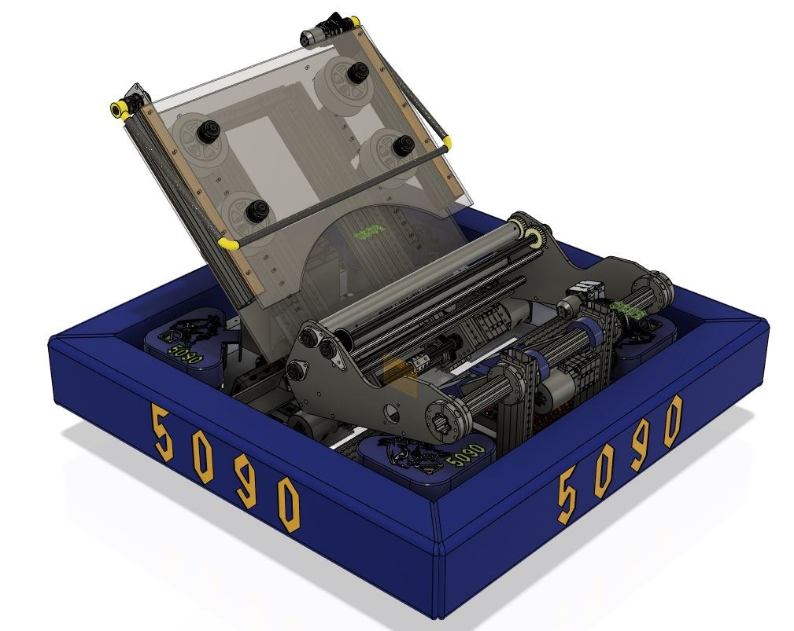
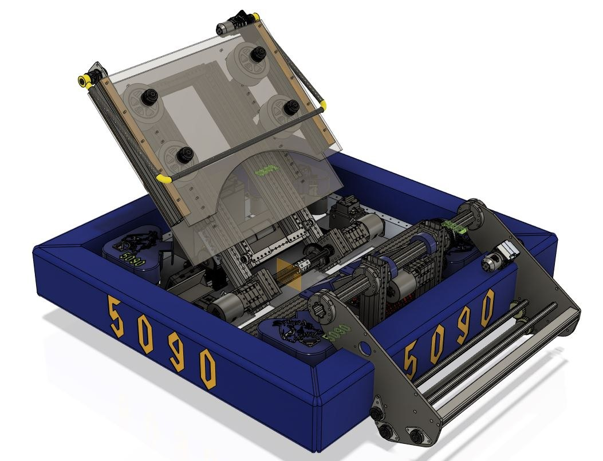
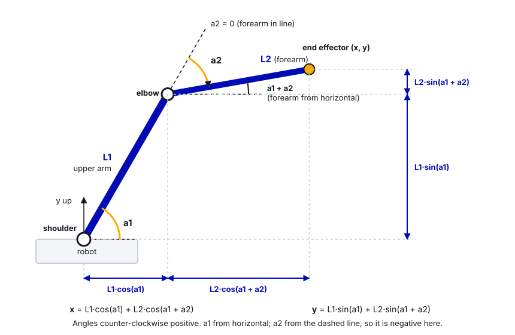

# 14. Arms: Single and Double-Jointed

> **Who it's for:** programmers who will build or tune a pivoting arm, wrist, or shooter pivot, and anyone curious how two-joint arms work.
> **You need first:** [07 What is PID](07-what-is-pid.md) and basic command-based Java. [12 Spring-Back and Auto-Retract](12-spring-back-and-auto-retract.md) (default commands, real springs) and [13 Turrets](13-turrets.md) (Motion Magic, absolute encoders) help a lot.
> **Time:** single-jointed part about 60 minutes plus a tuning session at the robot; double-jointed part about 60 minutes of reading and sim.

An **arm** is anything that swings around a pivot: a shooter pivot, an intake that flips down, a wrist, a scoring arm. Arms are harder than elevators or turrets for one reason: **gravity's pull changes with the angle**. This guide shows how to handle that cleanly with Phoenix 6, then explains double-jointed arms (two pivots in a row), which 5090 has never built.

 

## What you'll learn

- Why gravity torque on an arm goes with cos(angle), and how CTRE's `kG` with `GravityTypeValue.Arm_Cosine` cancels it.
- How to set up a CANcoder so the arm knows its angle at power-on (`FusedCANcoder`, `SensorToMechanismRatio`, `RotorToSensorRatio`), and why 0 must mean horizontal.
- A full single-joint arm subsystem: Motion Magic, brake mode, soft limits, current limits, presets, tuning kG first.
- The physics and math of a two-joint arm: joint space vs. x/y, forward and inverse kinematics.
- How to move a multi-joint mechanism safely: intermediate states, sequencing, preset state machines, and what we did on Stingray (2025) and Petrichor (2023).

---

## Part 1: The single-jointed arm

### Gravity and cos(angle)

Hold a broom straight out sideways: hard. Hold it straight up: easy. The arm's weight always pulls straight down, but how much of that pull **twists** the pivot depends on how far the center of mass is sideways from the pivot:

```
          straight up: cos(90) = 0, no twist
                 |
                 |
   pivot o-------*  horizontal: cos(0) = 1, maximum twist
                 |
                 v  weight
```

```
gravity torque = m * g * r * cos(angle)
   m = arm mass, g = 9.81 m/s^2, r = pivot to center of mass, angle from horizontal
```

So the voltage needed to just hold the arm still is also proportional to `cos(angle)`:

```
holding volts = kG * cos(angle)
```

`kG` is the voltage that holds the arm **horizontal**. Point it up and less is needed; past vertical, cos goes negative and the motor has to hold it back the other way. That's why one constant voltage (like you'd use for an elevator) can't work for an arm.


### CTRE does this for you: `Arm_Cosine`

Phoenix 6 has a `GravityType` setting in each gain slot:

| `GravityTypeValue` | Adds | Use for |
|---|---|---|
| `Elevator_Static` | `kG` always | Elevators, anything gravity pulls with constant force |
| `Arm_Cosine` | `kG * cos(position)` | Arms |

With `Arm_Cosine`, the Talon computes `cos` of its **own position reading**, 1000 times a second. That only works if the position reads in **mechanism rotations** and **0 means horizontal, pointing forward**. CTRE's docs say exactly that: "the sensor offset must be configured such that a position of 0 represents the arm being held horizontally forward."

Two configs make that true:

1. **Ratio**: `SensorToMechanismRatio` (and `RotorToSensorRatio` when using a CANcoder) so 1.0 = one full turn of the arm.
2. **Offset**: the CANcoder's `MagnetOffset` so horizontal reads 0.

There's one more knob: `Slot0.GravityArmPositionOffset` (range -0.25 to +0.25 rotations). Use it when the arm's **center of mass** isn't along the line the sensor calls 0, for example an L-shaped arm-plus-intake whose weight sits off to one side. Keep 0 = horizontal via the magnet offset and use this only for the center-of-mass shift.

### Knowing the angle at power-on: CANcoder

The Talon's built-in encoder starts at 0 wherever the arm is at power-on. If the arm boots resting at -70°, the code thinks it's horizontal, and `kG * cos(...)` is completely wrong. An arm should almost always have an **absolute encoder**, a sensor that knows its true angle the instant it powers on. Ours is the CTRE **CANcoder**.

Mount the CANcoder on the arm's pivot shaft (1:1 with the arm). Then wire it into the Talon:

| Setting | Meaning | Typical value |
|---|---|---|
| `FeedbackSensorSource = FusedCANcoder` | Talon uses the CANcoder for absolute position and its own fast rotor sensor for smooth, high-resolution motion (Phoenix Pro) | `FusedCANcoder` |
| `FeedbackRemoteSensorID` | The CANcoder's CAN ID | e.g. 24 (a free mechanism ID; the 50s are the swerve CANcoders) |
| `RotorToSensorRatio` | Motor turns per CANcoder turn | your gearbox ratio, e.g. 60.0 |
| `SensorToMechanismRatio` | CANcoder turns per arm turn | 1.0 if CANcoder is on the pivot |

Without Pro you'd use `RemoteCANcoder` (works, a bit less smooth). Without any CANcoder you'd use `SensorToMechanismRatio = gear ratio` and have to boot the arm against a known hard stop and `setPosition` to that angle.

**CANcoder range.** `AbsoluteSensorDiscontinuityPoint` sets where the reading jumps. The default 0.5 means it reads -0.5 to +0.5 rotations (-180° to +180°). Make sure the jump is somewhere the arm **never goes** (e.g. pointing straight down into the robot), or the arm will think it teleported.

### Step by step: set up and tune a single-joint arm

1. **Mechanical check.** Arm moves freely by hand (robot disabled, brake mode off if needed). Note the gear ratio and where the hard stops are.
2. **CANcoder direction.** In Phoenix Tuner X, watch the CANcoder's position while you raise the arm. Raising (counter-clockwise when you look at the arm from the side where "forward" is to your right) should **increase** the reading. If not, flip `SensorDirection`.
3. **Magnet offset.** Hold the arm exactly horizontal-forward (use a level). Read the CANcoder's absolute position, say `0.137`. The offset is the negative of that: `-0.137`. Put it in `Constants.java`, not only in Tuner X: code that applies a config **overwrites** what Tuner X set.
4. **Ratios and source.** Set `FusedCANcoder`, the remote ID, `RotorToSensorRatio`, `SensorToMechanismRatio`. Deploy. Now `getPosition()` should read 0 horizontal, +0.25 straight up, -0.25 straight down. Check all three with a level. This is the most important step; don't move on until it's right.
5. **Motor direction.** Give a small positive `VoltageOut` (e.g. 1 V). The arm must move **up** (position increasing). If not, flip `MotorOutput.Inverted`.
6. **Soft limits.** Move the arm by hand to each hard stop, read the positions, and set `SoftwareLimitSwitch` thresholds a few degrees inside them.
7. **Tune kG and kS first** (all other gains 0). Hold the arm horizontal with a `VoltageOut`, and raise the voltage slowly until the arm *just starts moving up*: call that `Vup`. Then lower it until it *just starts drifting down*: `Vdown`.
   ```
   kG = (Vup + Vdown) / 2      the part that fights gravity
   kS = (Vup - Vdown) / 2      the part that fights friction
   ```
   Example: Vup = 0.55 V, Vdown = 0.15 V gives kG = 0.35, kS = 0.20. Now with only kG set, the arm should float roughly where you leave it at **any** angle. If it floats at horizontal but falls near vertical, your zero or ratio is wrong (step 4).
8. **kV.** About `12 / (motor free speed in RPS / gear ratio)`. For a Kraken (about 100 RPS) on 60:1: `12 / 1.67 ≈ 7.2` volts per arm rotation per second.
9. **Motion Magic.** Start slow: cruise 0.5 arm rotations per second, acceleration 1.0. Raise later.
10. **kP**, then a little **kD** if it bounces. Raise kP until it settles quickly; back off 20% from where it overshoots.
11. **Current limits.** Stator 40–60 A depending on the arm, supply 30–40 A. Watch stator current while holding at horizontal; it should be small once kG is right.
12. **Test**: sim → on blocks → on the floor, with someone's hand near the disable button.

### Example: single-joint arm subsystem (Phoenix 6, 2026)

```java
package frc.robot.subsystems;

import com.ctre.phoenix6.CANBus;
import com.ctre.phoenix6.configs.CANcoderConfiguration;
import com.ctre.phoenix6.configs.TalonFXConfiguration;
import com.ctre.phoenix6.controls.MotionMagicVoltage;
import com.ctre.phoenix6.hardware.CANcoder;
import com.ctre.phoenix6.hardware.TalonFX;
import com.ctre.phoenix6.signals.FeedbackSensorSourceValue;
import com.ctre.phoenix6.signals.GravityTypeValue;
import com.ctre.phoenix6.signals.InvertedValue;
import com.ctre.phoenix6.signals.NeutralModeValue;
import com.ctre.phoenix6.signals.SensorDirectionValue;
import edu.wpi.first.math.util.Units;
import edu.wpi.first.wpilibj.smartdashboard.SmartDashboard;
import edu.wpi.first.wpilibj2.command.Command;
import edu.wpi.first.wpilibj2.command.SubsystemBase;

/** A single pivoting arm. All positions are ARM rotations: 0 = horizontal forward, +0.25 = straight up. */
public class ArmPivot extends SubsystemBase {
    // --- Hardware IDs (team scheme: mechanisms 10-29; the 50s are only for swerve CANcoders) ---
    private static final int kMotorId = 17;
    private static final int kCancoderId = 24;

    // --- Geometry ---
    /** Motor turns per arm turn (CANcoder is on the pivot shaft, 1:1 with the arm) */
    private static final double kMotorToArmRatio = 60.0;
    /** Negative of the CANcoder reading with the arm held level. Measure with a level! */
    private static final double kMagnetOffsetRotations = -0.137;

    // --- Limits (arm rotations) ---
    private static final double kMinRotations = Units.degreesToRotations(-60);   // resting on the bumper stop
    private static final double kMaxRotations = Units.degreesToRotations(100);   // just past vertical
    private static final double kAtTargetToleranceRotations = Units.degreesToRotations(2);

    /** Named arm positions, stored in degrees because people think in degrees */
    public enum Preset {
        STOWED(-55), INTAKE(-30), SCORE_LOW(15), SCORE_HIGH(80);

        public final double rotations;
        Preset(double degrees) { this.rotations = Units.degreesToRotations(degrees); }
    }

    private final TalonFX m_motor;
    private final CANcoder m_cancoder;
    private final MotionMagicVoltage m_request = new MotionMagicVoltage(0).withEnableFOC(true);
    private double m_targetRotations = Preset.STOWED.rotations;

    public ArmPivot(CANBus canBus) {
        m_motor = new TalonFX(kMotorId, canBus);
        m_cancoder = new CANcoder(kCancoderId, canBus);

        CANcoderConfiguration encoderConfig = new CANcoderConfiguration();
        encoderConfig.MagnetSensor.MagnetOffset = kMagnetOffsetRotations;
        encoderConfig.MagnetSensor.SensorDirection = SensorDirectionValue.CounterClockwise_Positive;
        // Reads -0.5..+0.5; the jump is at straight down, where this arm can never go
        encoderConfig.MagnetSensor.AbsoluteSensorDiscontinuityPoint = 0.5;
        m_cancoder.getConfigurator().apply(encoderConfig);

        TalonFXConfiguration config = new TalonFXConfiguration();
        config.MotorOutput.NeutralMode = NeutralModeValue.Brake;              // don't drop when disabled
        config.MotorOutput.Inverted = InvertedValue.CounterClockwise_Positive; // positive volts = arm up

        config.Feedback.FeedbackRemoteSensorID = kCancoderId;
        config.Feedback.FeedbackSensorSource = FeedbackSensorSourceValue.FusedCANcoder;
        config.Feedback.RotorToSensorRatio = kMotorToArmRatio;
        config.Feedback.SensorToMechanismRatio = 1.0;

        config.CurrentLimits.StatorCurrentLimit = 50;
        config.CurrentLimits.StatorCurrentLimitEnable = true;
        config.CurrentLimits.SupplyCurrentLimit = 35;
        config.CurrentLimits.SupplyCurrentLimitEnable = true;

        // Gains are per ARM rotation because of the ratios above. Tune kG and kS FIRST.
        config.Slot0.GravityType = GravityTypeValue.Arm_Cosine;
        config.Slot0.kG = 0.35;   // volts to hold the arm level
        config.Slot0.kS = 0.20;   // volts to beat friction
        config.Slot0.kV = 7.2;    // volts per arm rot/s (12 V / (100 RPS / 60))
        config.Slot0.kA = 0.0;
        config.Slot0.kP = 40.0;   // volts per arm rotation of error (= 0.11 V per degree)
        config.Slot0.kD = 0.5;

        config.MotionMagic.MotionMagicCruiseVelocity = 0.5;   // arm rotations per second
        config.MotionMagic.MotionMagicAcceleration = 1.0;     // arm rot/s^2

        config.SoftwareLimitSwitch.ForwardSoftLimitThreshold = kMaxRotations;
        config.SoftwareLimitSwitch.ForwardSoftLimitEnable = true;
        config.SoftwareLimitSwitch.ReverseSoftLimitThreshold = kMinRotations;
        config.SoftwareLimitSwitch.ReverseSoftLimitEnable = true;

        m_motor.getConfigurator().apply(config);
    }

    public double getRotations() {
        return m_motor.getPosition().getValueAsDouble();
    }

    public boolean isAtTarget() {
        return Math.abs(getRotations() - m_targetRotations) <= kAtTargetToleranceRotations;
    }

    private void setTarget(double rotations) {
        m_targetRotations = Math.max(kMinRotations, Math.min(kMaxRotations, rotations));
    }

    /** Moves to a preset and finishes when it gets there. The default command keeps holding it after. */
    public Command moveToPresetCommand(Preset preset) {
        return runOnce(() -> setTarget(preset.rotations))
            .andThen(run(() -> {}).until(this::isAtTarget))
            .withName("Arm to " + preset);
    }

    /** Default command: hold whatever the last target was */
    public Command holdTargetCommand() {
        return run(() -> {}).withName("Arm hold");
    }

    @Override
    public void periodic() {
        // The one place that talks to the motor
        m_motor.setControl(m_request.withPosition(m_targetRotations));

        SmartDashboard.putNumber("Arm/Angle (deg)", Units.rotationsToDegrees(getRotations()));
        SmartDashboard.putNumber("Arm/Target (deg)", Units.rotationsToDegrees(m_targetRotations));
        SmartDashboard.putBoolean("Arm/At target", isAtTarget());
        SmartDashboard.putNumber("Arm/Gravity FF (V)", m_motor.getClosedLoopFeedForward().getValueAsDouble());
        SmartDashboard.putNumber("Arm/Stator current (A)", m_motor.getStatorCurrent().getValueAsDouble());
    }
}
```

What to notice:

- `periodic()` is the only place that sends a control request, the same pattern as our 2026 `EvilIntake` ("Commands only set a target; periodic() is the one place that talks to the rack motors"). Commands just change `m_targetRotations`. That makes it hard for two pieces of code to fight over the motor.
- Every gain is per **arm** rotation, because the ratios are set. If you change the ratio, retune.
- The `Arm/Gravity FF (V)` signal lets you see kG working: it should be largest at horizontal and near 0 straight up. If it's largest straight up, your zero is a quarter turn off.
- With `Arm_Cosine` and Motion Magic, this example keeps the default kS sign (velocity sign), which CTRE recommends for Motion Magic. `UseClosedLoopSign` (used by our turret and the pivot example in guide 11) also works and helps when friction leaves the mechanism stuck just short of the target; keep kS small with it so it doesn't buzz. See guide 08, section 4.

### In our code: Stingray's pivot (2025)

[Pivot.java, lines 17–39](https://github.com/TorqueNados-FRC5090/Stingray-2025/blob/97c843705075c729538ad0b3925f67a35e3bf791/src/main/java/frc/robot/subsystems/Pivot.java#L17-L39)

```java
public Pivot() {
    // Pivot init and config
    pivotMotor = new TalonFX(PIVOT_MOTOR_ID);
    Slot0Configs pivotPIDConfig = new Slot0Configs();
    pivotPIDConfig.kP = 0.4;
    pivotPIDConfig.kD = .007;
    pivotMotor.getConfigurator().apply(pivotPIDConfig);
}
...
public void setTarget(UpperChassisPose pose) {
    PositionVoltage pivotRequest = new PositionVoltage(pose.getAngle()).withSlot(0);
    pivotMotor.setControl(pivotRequest);
}
```

What to notice (and what we'd do differently now): it worked, but compare it to the example. No kG, so kP alone has to fight gravity, which means it always sags a little below target and the sag changes with angle. No current limits, no neutral mode set, no soft limits, no ratio, so positions are motor rotations from wherever it was at power-on, and `atSetpoint()` allows 5 motor rotations of error. Each of those is a checklist item below.

---

## Part 2: The double-jointed arm

**Honesty first:** 5090 has never built a double-jointed arm. The closest things we've built are Stingray's pivot-plus-elevator (2025) and Petrichor's pivot-plus-telescope-plus-slider (2023), both covered below. For a real double-jointed arm, the best public example is team **6328 Mechanical Advantage's 2023 robot**, whose code and Chief Delphi build thread explain everything in detail (links in Go further).

### What it is

A **double-jointed arm** has a **shoulder** joint on the robot and an **elbow** joint partway along, like your own arm. The part from shoulder to elbow is the upper arm (length `L1`), the part past the elbow is the forearm (length `L2`).

```
                     elbow
                       o
           L1        /   \   L2
                   /       \
       shoulder  o           * end effector (x, y)
     ============+============
          robot
```

Why teams build them: they can reach a huge range of positions, including over the top of the robot to the other side. Why they're hard: two joints interact.

### The physics: the joints affect each other

Angles: `a1` = shoulder angle from horizontal. `a2` = elbow angle measured **relative to the upper arm** (0 = forearm straight in line with the upper arm). The forearm's angle from horizontal is then `a1 + a2`.

- The **elbow** motor holds up only the forearm. Its gravity load depends on the forearm's angle from horizontal: `cos(a1 + a2)`. So moving the *shoulder* changes what the *elbow* has to do.
- The **shoulder** motor holds up *everything*: the upper arm, the elbow motor/gearbox, and the forearm. Its gravity load depends on **both** angles:

```
shoulder gravity torque = g * [ (m1*r1 + m2*L1) * cos(a1)  +  m2*r2 * cos(a1 + a2) ]
elbow    gravity torque = g * [ m2*r2 * cos(a1 + a2) ]

   m1, r1 = upper arm mass and pivot-to-center-of-mass distance
   m2, r2 = forearm mass (plus whatever it holds) and elbow-to-center-of-mass distance
```

So a single CTRE `Arm_Cosine` kG isn't enough: the Talon on the shoulder only knows `a1`, not `a2`. You compute the gravity feedforward yourself in code and pass it with `.withFeedForward(volts)`.

**Watch the elbow angle convention.** If the elbow motor sits on the robot and drives the forearm with a chain running past the shoulder, the elbow sensor might measure the forearm's **absolute** angle instead of the relative one. Write down which one your sensor measures and convert once, in one place.

### Feedforward options, simple to advanced

| Level | What | When |
|---|---|---|
| 1. Per-joint kG cos terms | `shoulderFF = kGA*cos(a1) + kGB*cos(a1+a2)`, `elbowFF = kGE*cos(a1+a2)` | Start here. Tune the three constants by holding poses, like single-joint kG. |
| 2. Add kS and kV per joint | Plus friction and speed terms | Normal competition arm |
| 3. Full dynamics model | Gravity *and* the forces from each joint's motion on the other (inertia, Coriolis) | Fast, aggressive arms. 6328's `ArmDynamics.java` is an example. |

Tuning level 1: hold the forearm level with the upper arm vertical (`a1 = 90°`, `a1 + a2 = 0`): the elbow voltage is `kGE`, and the shoulder voltage is `kGB` (its `cos(a1)` term is 0). Then hold the whole arm straight out level (`a1 = 0`, `a2 = 0`): the shoulder voltage is `kGA + kGB`.

### Coordinates: joint space vs. x/y

- **Joint space**: the pair `(a1, a2)`. This is what the motors control.
- **Task space**: the end effector's `(x, y)` relative to the shoulder (x forward, y up). This is what the driver and the field care about ("put the game piece 1.1 m up and 0.4 m out").

**Forward kinematics** (angles to x/y) is just adding up the two links:

```
elbow x = L1 * cos(a1)                       elbow y = L1 * sin(a1)
end   x = L1 * cos(a1) + L2 * cos(a1 + a2)   end   y = L1 * sin(a1) + L2 * sin(a1 + a2)
```



**Inverse kinematics** (x/y to angles) uses the law of cosines. For a target `(x, y)`:

```
cos(a2) = (x^2 + y^2 - L1^2 - L2^2) / (2 * L1 * L2)
   if this is above 1 or below -1, the point is out of reach
a2 = +acos(...)  or  -acos(...)      <- two answers!
a1 = atan2(y, x) - atan2(L2 * sin(a2), L1 + L2 * cos(a2))
```

The two answers are **elbow-up** and **elbow-down**, like reaching for a shelf with your elbow pointing up or down. Both put the hand in the same place. Pick one rule (for example "elbow always up so it never hits the floor") and stick to it, or the arm will flip between them mid-move.

> **AI can help:** after you work the kinematics by hand (Practice 3 below), paste your steps into an AI and ask it to check the arithmetic and explain any step where it disagrees, or to explain in plain words why inverse kinematics has two answers. You still have to understand every step, and the final check is yours: run `anglesFor` and `endEffectorPosition` in simulation and see that they give back your numbers.

### Moving safely: never through the robot, bumper, or floor

The straight path in joint space (both joints moving at once) can sweep the end effector through the bumper or the floor even when the start and end poses are both fine. Three tools, simplest first:

1. **Sequence the joints.** Tuck first, move the big joint, then extend. For example: elbow folds in, shoulder swings, elbow unfolds.
2. **Intermediate (waypoint) states.** A named safe pose the arm passes through, like "straight up, elbow folded". Any move between two "dangerous side" presets goes via the safe pose.
3. **Path planning.** Compute a whole collision-free path through joint space (6328 used an optimizer for this in 2023). Powerful, a lot of work.

Most good FRC arms do 1 and 2 with a **state machine of presets**: a list of named poses plus rules about which can go directly to which.

### In our code: Stingray's "pivot, then elevator, then pivot" (2025)

Stingray had a pivot riding on an elevator. Raising the elevator with the pivot tilted could hit the robot, so every move was sequenced:

[SetUpperChassisPose.java, lines 9–22](https://github.com/TorqueNados-FRC5090/Stingray-2025/blob/97c843705075c729538ad0b3925f67a35e3bf791/src/main/java/frc/robot/commands/SetUpperChassisPose.java#L9-L22)

```java
public class SetUpperChassisPose extends SequentialCommandGroup {

    /** Creates a command that does the following:
     * <p> 1. Move the pivot to zero </p>
     * <p> 2. Move the elevator to the height associated with the given pose </p>
     * <p> 3. Move the pivot to the angle associated with the given pose </p>
     */
    public SetUpperChassisPose(Elevator elevator, Pivot pivot, UpperChassisPose pose) {
        addCommands(
            new SetPivotPose(pivot, UpperChassisPose.ZERO),
            new SetElevatorPose(elevator, pose),
            new SetPivotPose(pivot, pose)
        );
    }
```

What to notice: tuck (pivot to zero), move the big joint (elevator), extend (pivot to target). Each step waits for `atSetpoint()` before the next starts. That's exactly the sequencing pattern a double-jointed arm needs. It's always safe but a little slow, because it tucks even when it doesn't need to. The poses are an enum with both joint targets together ([Constants.java, lines 125–130](https://github.com/TorqueNados-FRC5090/Stingray-2025/blob/97c843705075c729538ad0b3925f67a35e3bf791/src/main/java/frc/robot/Constants.java#L125-L130)): `L4(55.4, 75)` means height 55.4, angle 75.

### In our code: Petrichor's arm presets and INTERMEDIATE (2023)

Petrichor's arm had a pivot, a telescope and a slider. It had a named safe pose:

[Arm.java, lines 129–136](https://github.com/TorqueNados-FRC5090/Petrichor-2023/blob/f8931338bb4aa79e3dd94a0dab2027ead4281bdb/src/main/java/frc/robot/subsystems/Arm.java#L129-L136)

```java
/** Move the arm to an intermediate position that 
 *  ensures the arm will not collide with the robot bumper */
public void intermediatePosition() {
    setRotationSetpoint(20);
    setTelescopeSetpoint(2);
    setSliderSetpoint(4);

}
```

and the autos stepped through it ([AutonContainer.java, lines 42–58](https://github.com/TorqueNados-FRC5090/Petrichor-2023/blob/f8931338bb4aa79e3dd94a0dab2027ead4281bdb/src/main/java/frc/robot/commands/AutonContainer.java#L42-L58)):

```java
new GoToArmPreset(arm, ArmState.ZERO),
new InstantCommand(() -> claw.close()),
new GoToArmPreset(arm, ArmState.INTERMEDIATE),
new GoToArmPreset(arm, ArmState.PICKUP_HUMAN),
new GoToArmPreset(arm, ArmState.DROPOFF_HIGH),
```

What to notice:

- The `ArmState` enum ([Constants.java, lines 71–79](https://github.com/TorqueNados-FRC5090/Petrichor-2023/blob/f8931338bb4aa79e3dd94a0dab2027ead4281bdb/src/main/java/frc/robot/Constants.java#L71-L79)) is a preset state machine, and `INTERMEDIATE` is a waypoint.
- The weakness: the *caller* had to remember to go through `INTERMEDIATE`. Forget it once in a new auto and the arm hits the bumper. Better: the arm's own command decides when a waypoint is needed (see the skeleton below).
- `GoToArmPreset` finishes when `rotationAtTarget()` is true ([GoToArmPreset.java, lines 25–36](https://github.com/TorqueNados-FRC5090/Petrichor-2023/blob/f8931338bb4aa79e3dd94a0dab2027ead4281bdb/src/main/java/frc/robot/commands/GoToArmPreset.java#L25-L36)): it ignores the telescope and slider. A multi-joint "at target" must check **every** joint.
- Its rotation PID output is multiplied by battery voltage with no gravity term ([Arm.java, lines 175–181](https://github.com/TorqueNados-FRC5090/Petrichor-2023/blob/f8931338bb4aa79e3dd94a0dab2027ead4281bdb/src/main/java/frc/robot/subsystems/Arm.java#L175-L181)). Same lesson as Stingray: add kG.

### Example: two-joint arm skeleton

This is a starting skeleton, not a tuned subsystem. Motor configs follow the single-joint example (each joint has a CANcoder, `FusedCANcoder`, brake, soft limits, current limits), except **kG is 0 and gravity is added in code**, because each joint's gravity depends on both angles.

```java
package frc.robot.subsystems;

import java.util.Optional;
import java.util.Set;

import com.ctre.phoenix6.controls.MotionMagicVoltage;
import com.ctre.phoenix6.hardware.TalonFX;
import edu.wpi.first.math.geometry.Translation2d;
import edu.wpi.first.math.util.Units;
import edu.wpi.first.wpilibj.DriverStation;
import edu.wpi.first.wpilibj2.command.Command;
import edu.wpi.first.wpilibj2.command.Commands;
import edu.wpi.first.wpilibj2.command.SubsystemBase;

/**
 * Two-joint arm. Angles in radians in this class (math), converted to rotations for the Talons.
 * shoulder: from horizontal forward, CCW positive.  elbow: RELATIVE to the upper arm, 0 = straight.
 */
public class TwoJointArm extends SubsystemBase {
    // --- Geometry (meters) ---
    private static final double kUpperArmLength = 0.70;
    private static final double kForearmLength = 0.60;
    /** Shoulder pivot height above the floor */
    private static final double kShoulderHeight = 0.45;
    /** Nothing on the arm may go below this height (floor + margin) */
    private static final double kMinHeightAboveFloor = 0.08;

    // --- Gravity feedforward (volts), tuned by holding poses ---
    private static final double kShoulderGravityOwnVolts = 0.40;      // * cos(shoulder)
    private static final double kShoulderGravityForearmVolts = 0.25;  // * cos(shoulder + elbow)
    private static final double kElbowGravityVolts = 0.30;            // * cos(shoulder + elbow)

    private static final double kToleranceRadians = Units.degreesToRadians(3);

    /** Joint angles in radians */
    public record JointAngles(double shoulder, double elbow) {}

    /** Named poses. TRANSIT is the safe waypoint: arm up, elbow folded, clear of bumper and floor. */
    public enum Preset {
        STOWED(-20, 150),
        TRANSIT(90, 160),
        FLOOR_PICKUP(-5, -20),
        SCORE_HIGH(60, -20);

        public final JointAngles angles;
        Preset(double shoulderDegrees, double elbowDegrees) {
            this.angles = new JointAngles(Math.toRadians(shoulderDegrees), Math.toRadians(elbowDegrees));
        }
        /** Poses on the "front low" side, where moving straight between them could sweep the bumper */
        boolean isLowFront() { return this == STOWED || this == FLOOR_PICKUP; }
    }

    private final TalonFX m_shoulderMotor;
    private final TalonFX m_elbowMotor;
    private final MotionMagicVoltage m_shoulderRequest = new MotionMagicVoltage(0).withEnableFOC(true);
    private final MotionMagicVoltage m_elbowRequest = new MotionMagicVoltage(0).withEnableFOC(true);
    private JointAngles m_target = Preset.STOWED.angles;
    private Preset m_lastPreset = Preset.STOWED;

    public TwoJointArm(TalonFX shoulderMotor, TalonFX elbowMotor) {
        // Configure both motors like ArmPivot (FusedCANcoder, ratios, brake, soft limits,
        // current limits, kS/kV/kP/kD), but with kG = 0: gravity is handled in periodic().
        m_shoulderMotor = shoulderMotor;
        m_elbowMotor = elbowMotor;
    }

    // ================= Kinematics helpers =================

    /** Elbow joint position relative to the shoulder pivot (x forward, y up), meters */
    public static Translation2d elbowPosition(JointAngles a) {
        return new Translation2d(kUpperArmLength * Math.cos(a.shoulder()), kUpperArmLength * Math.sin(a.shoulder()));
    }

    /** Forward kinematics: joint angles -> end effector position relative to the shoulder pivot */
    public static Translation2d endEffectorPosition(JointAngles a) {
        double forearmAngle = a.shoulder() + a.elbow();
        return elbowPosition(a).plus(new Translation2d(
            kForearmLength * Math.cos(forearmAngle), kForearmLength * Math.sin(forearmAngle)));
    }

    /** Inverse kinematics: end effector position -> joint angles. Empty if out of reach. */
    public static Optional<JointAngles> anglesFor(Translation2d target, boolean elbowUp) {
        double x = target.getX();
        double y = target.getY();
        double cosElbow = (x * x + y * y - kUpperArmLength * kUpperArmLength - kForearmLength * kForearmLength)
            / (2 * kUpperArmLength * kForearmLength);
        if (cosElbow < -1.0 || cosElbow > 1.0) {
            return Optional.empty();
        }
        // With the elbow measured relative to the upper arm, a NEGATIVE elbow angle bends it "up" when reaching forward
        double elbow = elbowUp ? -Math.acos(cosElbow) : Math.acos(cosElbow);
        double shoulder = Math.atan2(y, x)
            - Math.atan2(kForearmLength * Math.sin(elbow), kUpperArmLength + kForearmLength * Math.cos(elbow));
        return Optional.of(new JointAngles(shoulder, elbow));
    }

    /** True if both the elbow and the end effector stay above the floor (add bumper-box checks for your robot) */
    public static boolean isClearOfFloor(JointAngles a) {
        double floorY = -kShoulderHeight + kMinHeightAboveFloor;
        return elbowPosition(a).getY() > floorY && endEffectorPosition(a).getY() > floorY;
    }

    // ================= State =================

    public JointAngles getAngles() {
        return new JointAngles(
            Units.rotationsToRadians(m_shoulderMotor.getPosition().getValueAsDouble()),
            Units.rotationsToRadians(m_elbowMotor.getPosition().getValueAsDouble()));
    }

    /** Checks BOTH joints */
    public boolean isAtTarget() {
        JointAngles now = getAngles();
        return Math.abs(now.shoulder() - m_target.shoulder()) <= kToleranceRadians
            && Math.abs(now.elbow() - m_target.elbow()) <= kToleranceRadians;
    }

    private void setTarget(JointAngles target) {
        if (!isClearOfFloor(target)) {
            // Never crash robot code over a bad target: refuse it, keep the old one, and say so loudly
            DriverStation.reportError("Arm target would hit the floor, ignored: " + target, false);
            return;
        }
        m_target = target;
    }

    // ================= Commands =================

    /** Go to one pose and finish when BOTH joints are there */
    private Command moveToCommand(JointAngles target) {
        return runOnce(() -> setTarget(target)).andThen(Commands.waitUntil(this::isAtTarget));
    }

    /** Sequenced preset move: the arm decides when it needs the TRANSIT waypoint, not the caller */
    public Command moveToPresetCommand(Preset goal) {
        return Commands.defer(() -> {
            JointAngles now = getAngles();
            Command fold = moveToCommand(new JointAngles(now.shoulder(), Preset.TRANSIT.angles.elbow()));
            Command swing = moveToCommand(new JointAngles(goal.angles.shoulder(), Preset.TRANSIT.angles.elbow()));
            Command extend = moveToCommand(goal.angles);
            boolean needsTransit = m_lastPreset.isLowFront() != goal.isLowFront();
            Command path = needsTransit
                ? Commands.sequence(fold, moveToCommand(Preset.TRANSIT.angles), swing, extend)
                : Commands.sequence(fold, swing, extend);
            return path.finallyDo(interrupted -> { if (!interrupted) m_lastPreset = goal; });
        }, Set.of(this)).withName("Arm to " + goal);
    }

    // ================= The one place that drives the motors =================

    @Override
    public void periodic() {
        JointAngles now = getAngles();
        double forearmFromHorizontal = now.shoulder() + now.elbow();
        double shoulderGravityVolts = kShoulderGravityOwnVolts * Math.cos(now.shoulder())
            + kShoulderGravityForearmVolts * Math.cos(forearmFromHorizontal);
        double elbowGravityVolts = kElbowGravityVolts * Math.cos(forearmFromHorizontal);

        m_shoulderMotor.setControl(m_shoulderRequest
            .withPosition(Units.radiansToRotations(m_target.shoulder()))
            .withFeedForward(shoulderGravityVolts));
        m_elbowMotor.setControl(m_elbowRequest
            .withPosition(Units.radiansToRotations(m_target.elbow()))
            .withFeedForward(elbowGravityVolts));
    }
}
```

What to notice:

- **Fold, swing, extend** is Stingray's "pivot, elevator, pivot" pattern, with a TRANSIT waypoint added when crossing between sides, like Petrichor's INTERMEDIATE, but decided **inside the arm**, so no caller can forget.
- `Commands.defer(...)` builds the sequence when the command *starts*, using the arm's real angles at that moment. (`defer` takes the set of required subsystems.)
- `isAtTarget()` checks both joints, unlike Petrichor's `GoToArmPreset`.
- `setTarget` refuses poses that would hit the floor (and reports an error instead of throwing, because an uncaught exception stops the whole robot program). Add a bumper-box check for your robot's real shape (forward kinematics makes it a simple x/y box test on the elbow and the end effector).
- Gravity uses the **measured** angles every loop, so it's right even mid-move.
- `m_lastPreset` is a simple way to know which "side" we're on. A real arm would decide from the measured angles instead.
- Visualize it in simulation with WPILib's `Mechanism2d` (two `MechanismLigament2d`s, one per link) before it ever moves on the robot.

---

## Common mistakes

- **Zero isn't horizontal.** `Arm_Cosine` uses the Talon's position as the angle. If 0 is "resting on the bumper", kG pushes hardest in the wrong place. Use the magnet offset so level reads 0, and check with a level.
- **Ratio missing.** Without `SensorToMechanismRatio`/`RotorToSensorRatio`, the Talon takes the cosine of *motor* rotations: kG goes up and down many times across one arm swing.
- **No kG, kP doing all the work.** The arm sags below target, more at some angles than others (Stingray's pivot and Petrichor's arm both did this).
- **Magnet offset only in Tuner X.** Code that applies a `CANcoderConfiguration` overwrites it on the next deploy. Put it in Constants.
- **Discontinuity inside the travel.** The CANcoder jumps from +0.5 to -0.5 and the arm thinks it teleported. Move `AbsoluteSensorDiscontinuityPoint`.
- **Coast mode on an arm.** It falls when disabled. Use brake.
- **Multi-joint "done" checks only one joint** (Petrichor's `GoToArmPreset`).
- **Relying on callers to go through the safe pose.** Put the waypoint logic in the arm's command.
- **Wrong ID or sensor source.** Like our Pigeon ID 24 vs 0 lesson: if the remote sensor ID is wrong, the Talon faults or reads garbage. Check IDs in Tuner X.
- **Gas spring or counterweight ignored.** kG measured without it is wrong with it. Measure on the finished mechanism (see guide 12).

## Checklist

- [ ] CANcoder on the pivot, direction correct (up = increasing).
- [ ] Magnet offset in code: level arm reads 0, straight up reads 0.25 (checked with a level).
- [ ] `FusedCANcoder` (or `RemoteCANcoder`), remote ID, `RotorToSensorRatio`, `SensorToMechanismRatio` set.
- [ ] Positive voltage moves the arm up.
- [ ] Soft limits a few degrees inside the hard stops.
- [ ] Brake mode; stator and supply limits set.
- [ ] kG and kS measured (Vup/Vdown method) before any kP.
- [ ] `Gravity FF (V)` peaks at horizontal on the dashboard.
- [ ] Every multi-joint move checks all joints and goes through a safe sequence.
- [ ] Tested sim, then blocks, then floor.

## Practice

1. **Cosine table.** With kG = 0.35 V, fill in the holding voltage at -60°, 0°, 30°, 60°, 90°, 120°. Which angles need negative voltage, and why?
2. **WPILib arm sim.** Open WPILib's `ArmSimulation` example (VS Code: WPILib > Create a new project > Example), run it in sim, and find where it computes its feedforward. Change the arm mass and watch how the needed gravity term changes.
3. **Kinematics by hand.** With L1 = 0.70 m, L2 = 0.60 m, shoulder 45°, elbow -30°: compute the end effector (x, y). Then run `anglesFor` on your answer with `elbowUp` true and false and check that one of them gives back 45° / -30°.
4. **Find the collision.** Write a small loop that moves from `STOWED` to `FLOOR_PICKUP` by changing both joints at once in 20 steps, and print the elbow and end effector (x, y) at each step using the kinematics helpers. Add a simple bumper box (say x from -0.40 to 0.40 m and y below -0.20 m, relative to the shoulder) and print which steps enter it. Then try the fold, swing, extend path and compare.

## Go further

- CTRE, Closed-loop overview (gravity feedforward, `Arm_Cosine`, `GravityArmPositionOffset`): https://v6.docs.ctr-electronics.com/en/stable/docs/api-reference/device-specific/talonfx/closed-loop-requests.html
- CTRE, Remote and fused sensors (`FusedCANcoder`, ratios): https://v6.docs.ctr-electronics.com/en/stable/docs/api-reference/device-specific/talonfx/remote-sensors.html
- CTRE, CANcoder (magnet offset, direction): https://v6.docs.ctr-electronics.com/en/stable/docs/hardware-reference/cancoder/index.html
- CTRE, Motion Magic: https://v6.docs.ctr-electronics.com/en/stable/docs/api-reference/device-specific/talonfx/motion-magic.html
- WPILib, Feedforward control (including `ArmFeedforward`): https://docs.wpilib.org/en/stable/docs/software/advanced-controls/controllers/feedforward.html
- WPILib, Tuning a vertical arm (interactive): https://docs.wpilib.org/en/stable/docs/software/advanced-controls/introduction/tuning-vertical-arm.html
- WPILib, Mechanism2d: https://docs.wpilib.org/en/stable/docs/software/dashboards/glass/mech2d-widget.html
- WPILib arm simulation example (2026 release): https://github.com/wpilibsuite/allwpilib/tree/v2026.2.1/wpilibjExamples/src/main/java/edu/wpi/first/wpilibj/examples/armsimulation
- 6328 Mechanical Advantage 2023 build thread (double-jointed arm design, kinematics, feedforward, trajectories): https://www.chiefdelphi.com/t/frc-6328-mechanical-advantage-2023-build-thread/420691
- 6328's 2023 robot code: https://github.com/Mechanical-Advantage/RobotCode2023 — see [ArmKinematics.java](https://github.com/Mechanical-Advantage/RobotCode2023/blob/1759ecc7ab5d76fcca157d8b76ead233ecb1454f/src/main/java/org/littletonrobotics/frc2023/subsystems/arm/ArmKinematics.java) and [ArmDynamics.java](https://github.com/Mechanical-Advantage/RobotCode2023/blob/1759ecc7ab5d76fcca157d8b76ead233ecb1454f/src/main/java/org/littletonrobotics/frc2023/subsystems/arm/ArmDynamics.java). (Their code uses AdvantageKit; read it for the arm math, not the logging structure.)
