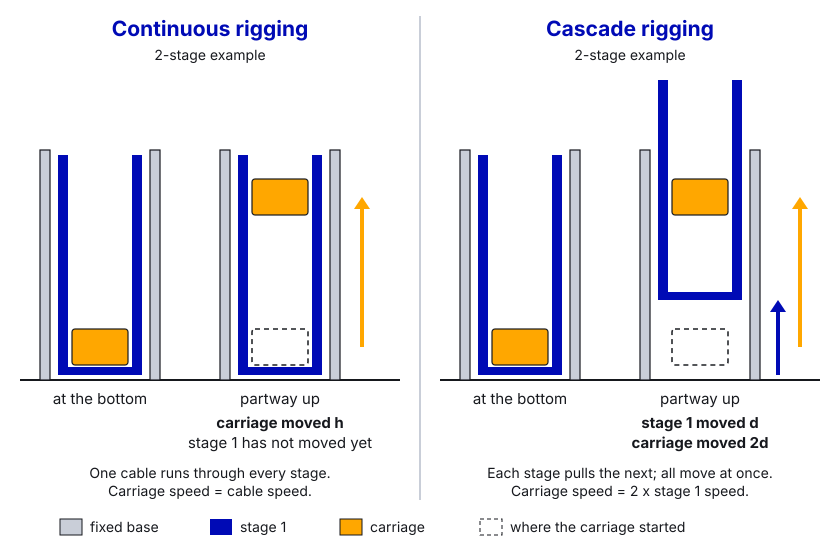
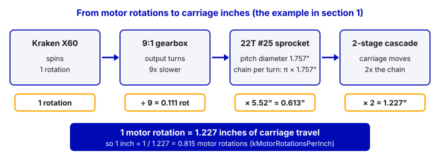

# 15. Elevators

> **Who it's for:** students programming or tuning a linear lift (elevator, telescope, climber lift). **You need first:**
> [07 What is PID](07-what-is-pid.md), [08 Tuning PID step by step](08-tuning-pid-step-by-step.md) and
> [09 Motion Magic and position control](09-motion-magic-and-position-control.md). Homing ideas are covered more in
> [21 Sensors and homing](21-sensors-and-homing.md). **Time:** about 1 hour to read; a day at the robot to bring a new
> elevator up properly.

**What you'll learn**

- How elevators are built (cascade vs continuous rigging, spool vs sprocket) and how to turn motor rotations into
  inches.
- Why gravity changes everything, and how kG with `Elevator_Static` handles it.
- A complete Phoenix 6 elevator subsystem: two Krakens, Motion Magic in inches, brake mode, current limits, soft
  limits, bottom limit switch + hard-stop homing.
- How to sequence an elevator with other mechanisms so they don't crash into each other.
- What our 2025 robot Stingray did (REV SPARK MAX + WPILib `ProfiledPIDController` on the RIO), and why we'd do it on
  the motor controller today.

---

## 1. How elevators are built

An elevator is a set of nested sliding **stages** with a **carriage** (the part that carries the mechanism) on the
last one. A motor pulls the stages up with chain, belt or rope; gravity (or rope rigged the other way) brings them
down.

```
   continuous rigging                cascade rigging
   (carriage moves first)            (all stages move together)

   |  ||  |                          |  ||  |
   |  |[C]|  <- carriage             |  |[C]|  <- carriage: N x stage-1 speed
   |  ||  |                          | [2]  |  <- stage 2: 2 x stage-1 speed
   | [2]  |                          |[1]   |  <- stage 1: 1 x
   |[1]   |                          |      |
   +------+  fixed base              +------+
```

| | Continuous rigging | Cascade rigging |
|---|---|---|
| How | One cable runs through every stage | Each stage pulls the next one |
| Carriage speed | Same as the cable / spool speed | Stage count x the first stage's speed |
| Force on the motor | Lower | Higher (the first stage carries the load of all stages above it) |
| Stage order | Stages move one after another (often carriage first) | All stages move at once, smoothly |
| Programming | Inches per motor rotation = cable travel | Multiply by the number of stages |



### Spool vs sprocket/pulley

- **Sprocket or belt pulley:** the effective diameter is fixed (the **pitch diameter**), so inches per rotation is a
  constant. Easy to program.
- **Rope spool (drum):** as rope winds on top of itself, the diameter grows, so inches per rotation *changes* with
  height. Keep the rope in one layer if you can, or measure at several heights and accept a small error.

### The math: motor rotations → inches

```
inches per motor rotation = (pi * pitch diameter) / gearbox ratio * stage multiplier
```

- Pitch diameter of a sprocket = `chain pitch / sin(180° / teeth)`. For #25 chain (0.25" pitch) and 22 teeth:
  `0.25 / sin(8.18°) = 1.757"`.
- Example: Kraken X60 → 9:1 gearbox → 22T #25 sprocket → 2-stage cascade (carriage moves 2x):
  `pi * 1.757 / 9 * 2 = 1.227"` per motor rotation, or **0.815 motor rotations per inch**.
- **Always check with a tape measure.** Raise the carriage by hand (robot disabled, brake off), compare the encoder to
  the real height at a few points. If they disagree, trust the tape and fix the constant.



Top speed check: a Kraken X60 is about 96.7 RPS (with FOC) unloaded. `96.7 * 1.227 ≈ 119 in/s` is the theoretical
free speed of that example carriage. Under load you'll get much less; plan Motion Magic cruise around 50–70% of free
speed.

---

## 2. Gravity: the thing that makes elevators different

A flywheel doesn't care if you stop pushing. An elevator falls. Gravity pulls down on the carriage with the same force
at every height, so holding still takes a constant voltage. That's **kG** with `GravityTypeValue.Elevator_Static`:

```java
config.Slot0.GravityType = GravityTypeValue.Elevator_Static;
config.Slot0.kG = 0.3;   // volts that hold the carriage still (tune: guide 08, section 4)
```

Without kG, only kP holds the carriage up, and kP only makes voltage when there's error. So the elevator settles
**below** every target (sag), by however much error it takes to make the holding voltage. The bigger the load, the
bigger the sag. With kG, the holding voltage is already there, and kP only fixes the leftover.


kG is also why tuning starts with gravity: find `kG_low` (stops drifting down) and `kG_high` (starts drifting up), set
`kG` to the middle and `kS` to half the gap (guide 08). If the load changes a lot (empty vs carrying a game piece), you
can keep a second set of gains in Slot1 with a bigger kG and pick it with `.withSlot(1)`.

---

## 3. Two motors: leader and follower

Most elevators use two motors on one gearbox or one on each side. One is the **leader** (you command it); the other
is a **follower** that copies the leader's output.

```java
m_followerMotor.setControl(new Follower(m_leaderMotor.getDeviceID(), MotorAlignmentValue.Opposed));
```

- **`MotorAlignmentValue.Aligned`**: follower spins the same direction as the leader. Use when both motors face the
  same way.
- **`MotorAlignmentValue.Opposed`**: follower spins the opposite way. Use when they face each other on a shared
  gearbox (our shooter and intake both use Opposed).
- **Getting this wrong is serious**: the motors fight each other, current spikes, the mechanism barely moves and
  the motors heat up. Check each motor's direction on its own first (chain off, or one motor at a time in Tuner X at
  a low voltage).
- **The follower needs its own config.** Followers don't copy the leader's current limits or settings. Apply the same
  config to both (our intake does this and says why).
- Only the leader's closed loop runs. The follower copies the leader's output (for voltage requests, the leader's
  motor voltage). Set brake mode on both.

---

## 4. Safety features every elevator needs

| Feature | Why | How |
|---|---|---|
| **Brake mode** | When disabled, a coast-mode elevator drops (and can trap fingers or break the mechanism below it). | `MotorOutput.NeutralMode = Brake` |
| **Current limits** | Protect the motors, gearbox and battery, and limit damage if it jams. | Stator ~40–80 A depending on load; supply ~40 A. Always set both. |
| **Soft limits** | The motor itself refuses to drive past the top or bottom. | `SoftwareLimitSwitch` in inches (with the ratio trick below) |
| **Bottom limit switch or hard-stop homing** | Makes 0 mean "carriage at the bottom", even if it was bumped or the code restarted mid-match. | Switch: re-zero when pressed. Homing: drive gently down, detect the stall. |
| **Safe sequencing** | An arm or pivot on the carriage can hit the frame, bumpers or other mechanisms on the way up. | Command sequences + interlocks (section 6) |
| **Slow profile first** | The first runs after any change are when things go wrong. | Low cruise/accel until tuned |

### Bottom switch options

Our rule: the switch is wired to a **CTRE CANdi** (COM to ground, NO to S1), never to a roboRIO DIO port. Guide 21
shows the wiring and the CANdi settings (`S1FloatState = PullHigh`, `S1CloseState = CloseWhenLow`). Then you have two
ways to use it, and you can use both:

- **Read it in code** (what the example below does, so the homing logic stays visible): `getS1Closed()` tells you
  the switch is pressed. The code re-zeros the encoder whenever it's pressed, and passes
  `.withLimitReverseMotion(switchPressed)` to the motor so it won't drive further down.
- **Make it the Talon's hardware limit:** set `HardwareLimitSwitch.ReverseLimitSource = RemoteCANdiS1`,
  `ReverseLimitRemoteSensorID` = the CANdi's ID, `ReverseLimitEnable = true`, and
  `ReverseLimitAutosetPositionEnable = true` with `ReverseLimitAutosetPositionValue = 0`. Then the motor stops *and*
  zeros itself at 1 kHz with no robot code involved. The CANdi must be on the same CAN bus as the Talon.

(Stingray 2025 used a roboRIO `DigitalInput` in its `LimitSwitch` wrapper. That's the legacy way; don't copy it.)

---

## 5. A complete Phoenix 6 elevator

This is how we'd write an elevator today. It uses a trick from guide 09: set `SensorToMechanismRatio` to "motor
rotations per inch", so **every Phoenix value is in inches**: position, velocity, gains, soft limits, Motion Magic.
Commands only set a target height; `periodic()` is the one place that drives the motors (the same structure as our
2026 intake).

### Constants

```java
    /** Elevator: 2 Kraken X60 (leader + opposed follower), 9:1 gearbox, 22T #25 sprocket, 2-stage cascade. */
    public static final class ElevatorConstants {
        // ---- Gearing ----
        public static final double kGearboxRatio = 9.0;
        /** Pitch diameter of a 22-tooth #25 sprocket: 0.25" / sin(180°/22) = 1.757" */
        public static final double kSprocketPitchDiameterInches = 0.25 / Math.sin(Math.PI / 22.0);
        /** Cascade: the carriage moves 2x as far as the chain on the first stage */
        public static final double kCascadeMultiplier = 2.0;
        public static final double kInchesPerMotorRotation =
            Math.PI * kSprocketPitchDiameterInches / kGearboxRatio * kCascadeMultiplier;   // ~1.227"
        public static final double kMotorRotationsPerInch = 1.0 / kInchesPerMotorRotation;   // ~0.815

        // ---- Travel (inches of carriage height above the bottom hard stop) ----
        public static final double kMinHeightInches = 0.0;
        /** Soft limit, a little under the 53" top hard stop. MEASURE THIS on the real elevator. */
        public static final double kMaxHeightInches = 51.5;
        /** Below this, if the target is the bottom, stop driving and let the carriage rest on the hard stop */
        public static final double kRestOnHardStopBelowInches = 0.5;
        public static final double kPositionToleranceInches = 0.5;

        // ---- Gains (starting values; tune per guide 08). Units: inches, because of the ratio trick ----
        public static final Slot0Configs kGains = new Slot0Configs()
            .withGravityType(GravityTypeValue.Elevator_Static)
            .withKG(0.30)   // volts to hold the carriage still
            .withKS(0.10)   // volts to get past friction
            .withKV(0.10)   // volts per (inch/s): ~12 V / 119 in/s free speed
            .withKA(0.0)    // volts per (inch/s²)
            .withKP(2.0)    // volts per inch of error
            .withKI(0.0)    // not needed: kG and kS cover the steady-state error
            .withKD(0.0);   // add a little if it overshoots

        // ---- Motion Magic (inches/s, inches/s², inches/s³) ----
        public static final double kCruiseVelocityInchesPerSecond = 60.0;   // ~50% of free speed; go lower for the very first runs
        public static final double kAccelerationInchesPerSecondSquared = 150.0;
        public static final double kJerkInchesPerSecondCubed = 1500.0;      // 0.1 s to full accel

        // ---- Current limits ----
        public static final double kStatorCurrentLimitAmps = 60.0;  // enough to lift fast, caps jam damage
        public static final double kSupplyCurrentLimitAmps = 40.0;  // per motor, battery protection

        // ---- Homing ----
        /** CANdi with the bottom limit switch on S1 (COM to ground, NO to S1). Placeholder: use a free ID */
        public static final int kBottomSwitchCandiId = 23;
        /** Volts while homing. Negative = down; gravity helps, so keep it small */
        public static final double kHomingVolts = -1.0;
        public static final double kHomingStallInchesPerSecond = 0.5;
        public static final double kHomingStallSeconds = 0.2;
        public static final double kHomingIgnoreSeconds = 0.3;
        public static final double kHomingTimeoutSeconds = 3.0;
        /** If the switch is pressed but the encoder reads more than this, re-zero */
        public static final double kRezeroThresholdInches = 0.25;
    }

    /** Named elevator heights, in inches above the bottom hard stop */
    public enum ElevatorPosition {
        STOWED(0.0),
        LOW(12.0),
        MID(28.0),
        HIGH(50.0);

        private final double m_heightInches;

        ElevatorPosition(double heightInches) {
            m_heightInches = heightInches;
        }

        public double getHeightInches() {
            return m_heightInches;
        }
    }
```

(Imports for Constants: `com.ctre.phoenix6.configs.Slot0Configs`, `com.ctre.phoenix6.signals.GravityTypeValue`. Put
the CAN IDs `kElevatorLeaderMotor` / `kElevatorFollowerMotor` in the template's `CANIds` class, in the 10–29 range.)

### The subsystem

```java
package frc.robot.subsystems;

import static frc.robot.Constants.ElevatorConstants.*;

import com.ctre.phoenix6.CANBus;
import com.ctre.phoenix6.StatusCode;
import com.ctre.phoenix6.StatusSignal;
import com.ctre.phoenix6.configs.CANdiConfiguration;
import com.ctre.phoenix6.configs.TalonFXConfiguration;
import com.ctre.phoenix6.controls.Follower;
import com.ctre.phoenix6.controls.MotionMagicVoltage;
import com.ctre.phoenix6.controls.NeutralOut;
import com.ctre.phoenix6.controls.VoltageOut;
import com.ctre.phoenix6.hardware.CANdi;
import com.ctre.phoenix6.hardware.TalonFX;
import com.ctre.phoenix6.signals.InvertedValue;
import com.ctre.phoenix6.signals.MotorAlignmentValue;
import com.ctre.phoenix6.signals.NeutralModeValue;
import com.ctre.phoenix6.signals.S1CloseStateValue;
import com.ctre.phoenix6.signals.S1FloatStateValue;

import edu.wpi.first.math.MathUtil;
import edu.wpi.first.wpilibj.DriverStation;
import edu.wpi.first.wpilibj.Timer;
import edu.wpi.first.wpilibj.smartdashboard.SmartDashboard;
import edu.wpi.first.wpilibj2.command.Command;
import edu.wpi.first.wpilibj2.command.SubsystemBase;
import frc.robot.Constants.CANIds;
import frc.robot.Constants.ElevatorPosition;
import frc.robot.RobotLog;

/**
 * Two-motor elevator on Talon FX. Motion Magic runs ON the leader motor at 1 kHz with kG holding the carriage up.
 * Units: because SensorToMechanismRatio = motor rotations per inch, every Phoenix position/velocity here is INCHES.
 * Commands only set a target; periodic() is the one place that drives the motors.
 */
public class Elevator extends SubsystemBase {
    private enum State { NOT_HOMED, HOMING, READY }

    private final TalonFX m_leaderMotor;
    private final TalonFX m_followerMotor;
    /** Bottom limit switch on S1 of a CANdi (normally open, to ground: pressed = Low = "closed") */
    private final CANdi m_bottomSwitchCandi;
    private final StatusSignal<Boolean> m_bottomSwitchClosed;

    private final MotionMagicVoltage m_positionRequest = new MotionMagicVoltage(0).withSlot(0).withEnableFOC(true);
    /** Homing ignores soft limits: before homing, the encoder's zero may be wrong */
    private final VoltageOut m_homingRequest = new VoltageOut(0).withEnableFOC(true).withIgnoreSoftwareLimits(true);
    private final NeutralOut m_restRequest = new NeutralOut();

    private final Timer m_homingTimer = new Timer();
    private final Timer m_stallTimer = new Timer();
    private State m_state = State.NOT_HOMED;
    private double m_targetHeightInches = kMinHeightInches;

    public Elevator(CANBus canBus) {
        m_leaderMotor = new TalonFX(CANIds.kElevatorLeaderMotor, canBus);
        m_followerMotor = new TalonFX(CANIds.kElevatorFollowerMotor, canBus);

        // Bottom switch: unplugged floats High = "not pressed"; pressed shorts S1 to ground = Low = "closed"
        m_bottomSwitchCandi = new CANdi(kBottomSwitchCandiId, canBus);
        CANdiConfiguration candiConfig = new CANdiConfiguration();
        candiConfig.DigitalInputs.S1FloatState = S1FloatStateValue.PullHigh;
        candiConfig.DigitalInputs.S1CloseState = S1CloseStateValue.CloseWhenLow;
        reportIfFailed("CANdi config", m_bottomSwitchCandi.getConfigurator().apply(candiConfig));
        m_bottomSwitchClosed = m_bottomSwitchCandi.getS1Closed();

        TalonFXConfiguration config = new TalonFXConfiguration();
        // Brake: hold still when disabled instead of dropping
        config.MotorOutput.NeutralMode = NeutralModeValue.Brake;
        // Positive = UP. If a positive command drives the leader down, change to Clockwise_Positive.
        config.MotorOutput.Inverted = InvertedValue.CounterClockwise_Positive;
        config.CurrentLimits.StatorCurrentLimit = kStatorCurrentLimitAmps;
        config.CurrentLimits.StatorCurrentLimitEnable = true;
        config.CurrentLimits.SupplyCurrentLimit = kSupplyCurrentLimitAmps;
        config.CurrentLimits.SupplyCurrentLimitEnable = true;
        // ONE "ROTATION" = ONE INCH OF CARRIAGE TRAVEL from here on (Tuner X still says "rotations")
        config.Feedback.SensorToMechanismRatio = kMotorRotationsPerInch;
        config.Slot0 = kGains.clone();
        config.MotionMagic.MotionMagicCruiseVelocity = kCruiseVelocityInchesPerSecond;
        config.MotionMagic.MotionMagicAcceleration = kAccelerationInchesPerSecondSquared;
        config.MotionMagic.MotionMagicJerk = kJerkInchesPerSecondCubed;
        config.SoftwareLimitSwitch.ForwardSoftLimitThreshold = kMaxHeightInches;
        config.SoftwareLimitSwitch.ForwardSoftLimitEnable = true;
        config.SoftwareLimitSwitch.ReverseSoftLimitThreshold = kMinHeightInches;
        config.SoftwareLimitSwitch.ReverseSoftLimitEnable = true;

        reportIfFailed("leader config", m_leaderMotor.getConfigurator().apply(config));
        // Followers don't copy the leader's config: same limits and brake mode on the follower.
        // Soft limits stay on the leader only: the opposed follower's position counts the other way.
        config.SoftwareLimitSwitch.ForwardSoftLimitEnable = false;
        config.SoftwareLimitSwitch.ReverseSoftLimitEnable = false;
        reportIfFailed("follower config", m_followerMotor.getConfigurator().apply(config));
        // The motors face each other on the gearbox, so the follower turns the opposite way
        m_followerMotor.setControl(new Follower(m_leaderMotor.getDeviceID(), MotorAlignmentValue.Opposed));

        // Every match starts with the carriage on the bottom hard stop
        m_leaderMotor.setPosition(0.0);
    }

    // ---------------- Public API ----------------

    /** @return carriage height in inches above the bottom hard stop */
    public double getHeightInches() {
        return m_leaderMotor.getPosition().getValueAsDouble();
    }

    public boolean isBottomSwitchPressed() {
        return m_bottomSwitchClosed.refresh().getValue();
    }

    public boolean isHomed() {
        return m_state == State.READY;
    }

    /** @return true when homed and within tolerance of the target height */
    public boolean isAtSetpoint() {
        return isHomed() && Math.abs(getHeightInches() - m_targetHeightInches) <= kPositionToleranceInches;
    }

    public void setTargetHeight(double heightInches) {
        m_targetHeightInches = MathUtil.clamp(heightInches, kMinHeightInches, kMaxHeightInches);
    }

    /** Moves to a preset and finishes when it gets there (the motor keeps holding afterwards) */
    public Command goToPositionCommand(ElevatorPosition position) {
        return run(() -> setTargetHeight(position.getHeightInches()))
            .until(this::isAtSetpoint)
            .withName("Elevator to " + position);
    }

    /** Re-home on request (e.g. after a hard hit). Runs on the next enable. */
    public void requestHome() {
        m_state = State.NOT_HOMED;
    }

    // ---------------- The one place that drives the motors ----------------

    @Override
    public void periodic() {
        double heightInches = getHeightInches();
        double velocityInchesPerSecond = m_leaderMotor.getVelocity().getValueAsDouble();
        boolean atBottom = isBottomSwitchPressed();

        // The switch is the truth: sitting on it means height 0
        if (atBottom && Math.abs(heightInches) > kRezeroThresholdInches) {
            m_leaderMotor.setPosition(0.0);
            heightInches = 0.0;
        }

        if (DriverStation.isDisabled() && m_state == State.HOMING) {
            m_state = State.NOT_HOMED;   // disabled mid-homing: start over on the next enable
        }

        if (DriverStation.isEnabled()) {
            switch (m_state) {
                case NOT_HOMED -> {
                    if (DriverStation.isFMSAttached()) {
                        // Real match: we started on the bottom stop, so the power-on zero is right
                        m_state = State.READY;
                        RobotLog.event("Elevator: match start, using the power-on zero");
                    } else {
                        startHoming();
                    }
                }
                case HOMING -> runHoming(atBottom, velocityInchesPerSecond);
                case READY -> driveToTarget(heightInches, atBottom);
            }
        }

        SmartDashboard.putString("Elevator/State", m_state.toString());
        SmartDashboard.putNumber("Elevator/Height (in)", heightInches);
        SmartDashboard.putNumber("Elevator/Target (in)", m_targetHeightInches);
        SmartDashboard.putNumber("Elevator/Velocity (in per s)", velocityInchesPerSecond);
        SmartDashboard.putBoolean("Elevator/At bottom switch", atBottom);
        SmartDashboard.putBoolean("Elevator/At setpoint", isAtSetpoint());
        SmartDashboard.putNumber("Elevator/Leader current (A)", m_leaderMotor.getStatorCurrent().getValueAsDouble());
    }

    private void driveToTarget(double heightInches, boolean atBottom) {
        boolean wantsBottom = m_targetHeightInches <= kRestOnHardStopBelowInches;
        if (wantsBottom && heightInches <= kRestOnHardStopBelowInches) {
            // Resting on the hard stop: no need to spend current holding the carriage up (brake mode holds it)
            m_leaderMotor.setControl(m_restRequest);
        } else {
            m_leaderMotor.setControl(m_positionRequest
                .withPosition(m_targetHeightInches)
                .withLimitReverseMotion(atBottom));   // never drive down into a pressed bottom switch
        }
    }

    private void startHoming() {
        m_state = State.HOMING;
        m_homingTimer.restart();
        m_stallTimer.restart();
        RobotLog.event("Elevator homing: lowering to the bottom stop");
    }

    private void runHoming(boolean atBottom, double velocityInchesPerSecond) {
        m_leaderMotor.setControl(m_homingRequest.withOutput(kHomingVolts));
        boolean moving = Math.abs(velocityInchesPerSecond) > kHomingStallInchesPerSecond;
        if (moving || m_homingTimer.get() < kHomingIgnoreSeconds) {
            m_stallTimer.restart();
        }
        if (atBottom || m_stallTimer.get() >= kHomingStallSeconds) {
            m_leaderMotor.setPosition(0.0);
            m_targetHeightInches = kMinHeightInches;
            m_state = State.READY;
            RobotLog.event(String.format("Elevator homed (%s) in %.2f s",
                atBottom ? "switch" : "hard stop", m_homingTimer.get()));
        } else if (m_homingTimer.get() > kHomingTimeoutSeconds) {
            // Don't lock the elevator for the whole session: keep the old zero and say so loudly
            m_state = State.READY;
            RobotLog.event("Elevator homing FAILED (no switch, no stall): kept the old zero; check for a jam");
        }
    }

    private static void reportIfFailed(String what, StatusCode status) {
        if (!status.isOK()) {
            DriverStation.reportError("Elevator " + what + " failed: " + status, false);
        }
    }
}
```

What to notice:

- **No PID math in Java.** The Java code only sends a target height. The Talon runs the profile, the feedforward
  (kG, kS, kV, kA) and the PID at 1 kHz.
- **Brake mode, current limits, soft limits** are all in one config, applied to both motors (soft limits only
  enforced on the leader), with failures reported.
- **Homing never fights the soft limits** (`withIgnoreSoftwareLimits(true)`), because before homing the zero may be
  wrong. After homing, everything is limited again.
- **The bottom switch is used twice:** to re-zero and to block reverse motion (`withLimitReverseMotion`).
- **Resting on the hard stop** with `NeutralOut` saves current and heat when stowed.
- To add live tuning, create a `TunableGains` from [08 Tuning PID step by step](08-tuning-pid-step-by-step.md) with
  `ElevatorConstants.kGains`. For SysId on this elevator, see the "SysId on any other mechanism" part of guide 08.
- If you'd rather not use the "inches as rotations" trick, set `SensorToMechanismRatio = kGearboxRatio` (drum
  rotations) and convert inches in code like the intake does. Both are fine; be consistent and comment it.
- CTRE's Tuner X has an **Elevator Generator** (under Mechanisms) that walks you through calibration,
  limits and tuning and generates a subsystem. It's worth trying on a new elevator and comparing with this.

---

## 6. Safe positions and sequencing

An elevator rarely works alone. On Stingray (2025) a **pivot** sat on the elevator carriage with the shooter on it. If
the pivot was tilted while the elevator moved, it could hit the robot's structure. The fix was a sequence: tuck the
pivot, move the elevator, then tilt the pivot.

### Stingray's presets

[Constants.java, lines 125–145 (UpperChassisPose)](https://github.com/TorqueNados-FRC5090/Stingray-2025/blob/97c843705075c729538ad0b3925f67a35e3bf791/src/main/java/frc/robot/Constants.java#L125-L145):

```java
    public enum UpperChassisPose {
        ZERO(0, 0),
        TROUGH(3, 0),
        L2(9.4, 20),
        L3(25.1, 20),
        L4( 55.4, 75);
        
        private double height;
        private double angle;
        UpperChassisPose(double height, double angle) {
            this.height = height;
            this.angle = angle;
        };
```

One enum holds **both** mechanisms' targets for each scoring position. That's a good idea: a "pose" of the upper
robot, named after what it's for (Reef levels L2–L4 in 2025). Heights are inches; "angle" is actually pivot motor
rotations (see guide 09). In new code, put the units in the field and getter names (`heightInches`,
`getPivotRotations()`), so nobody mistakes 75 rotations for 75 degrees.

### Stingray's sequence

[SetUpperChassisPose.java, lines 16–22 (pivot → elevator → pivot)](https://github.com/TorqueNados-FRC5090/Stingray-2025/blob/97c843705075c729538ad0b3925f67a35e3bf791/src/main/java/frc/robot/commands/SetUpperChassisPose.java#L16-L22):

```java
    public SetUpperChassisPose(Elevator elevator, Pivot pivot, UpperChassisPose pose) {
        addCommands(
            new SetPivotPose(pivot, UpperChassisPose.ZERO),
            new SetElevatorPose(elevator, pose),
            new SetPivotPose(pivot, pose)
        );
    }
```

Each inner command sets its target in `initialize()` and finishes when `atSetpoint()` is true. It's bound with
`onTrue(... L4)` / `onFalse(... ZERO)` in
[RobotContainer.java, lines 116–123](https://github.com/TorqueNados-FRC5090/Stingray-2025/blob/97c843705075c729538ad0b3925f67a35e3bf791/src/main/java/frc/robot/RobotContainer.java#L116-L123),
so holding a button goes up and releasing comes back down.

What worked, and what we'd improve:

- **Good:** the order is safe by construction, and the same command is reused in autos (`NamedCommands` in
  `AutonContainer`).
- **No timeouts.** If the pivot never gets within its tolerance (bumped, blocked by a game piece), the sequence waits
  forever and the elevator never moves. Add `.withTimeout(...)` to each step.
- **Always tucks, even when it doesn't need to.** Going from L2 to L3 (both pivot 20) still tucks to 0 and back.
  You can skip the tuck when the pivot target doesn't change, or when both heights are in a "safe zone".
- **Safety lives only in the command.** If some other command moves the pivot while the elevator is mid-travel, nothing
  stops it. A stronger design adds an interlock in the subsystem, like our 2026 hood: in `periodic()`, if the
  elevator is moving or between safe heights, the pivot is forced to its safe angle no matter what was requested.

A modern version with command factories (assuming a `Pivot` subsystem with `goToAngleCommand(degrees)` and
`isAtSetpoint()` written the same way as the elevator):

```java
    /** Tuck the pivot, move the elevator, then tilt the pivot. Each step gives up after its timeout. */
    public static Command moveToScoringPose(Elevator elevator, Pivot pivot, ScoringPose pose) {
        return Commands.sequence(
            pivot.goToAngleCommand(PivotConstants.kSafeAngleDegrees).withTimeout(1.0),
            elevator.goToPositionCommand(pose.getElevatorPosition()).withTimeout(2.0),
            pivot.goToAngleCommand(pose.getPivotAngleDegrees()).withTimeout(1.0)
        ).withName("Move to " + pose);
    }
```

Make sure neither subsystem has a default command that would grab it between steps and change its target.

---

## 7. In our code: Stingray 2025 elevator (REV + WPILib on the RIO)

Our last elevator was on Stingray in 2025: two NEOs on REV SPARK MAX controllers, controlled by a WPILib
`ProfiledPIDController` running on the roboRIO.

[Elevator.java, lines 30–53 (constructor)](https://github.com/TorqueNados-FRC5090/Stingray-2025/blob/97c843705075c729538ad0b3925f67a35e3bf791/src/main/java/frc/robot/subsystems/Elevator.java#L30-L53)
and [lines 67–71 (driveElevator)](https://github.com/TorqueNados-FRC5090/Stingray-2025/blob/97c843705075c729538ad0b3925f67a35e3bf791/src/main/java/frc/robot/subsystems/Elevator.java#L67-L71):

```java
        elevatorPID = new ProfiledPIDController(P_GAIN, 0, D_GAIN, 
            new Constraints(VEL_LIMIT, ACCEL_LIMIT));
        elevatorPID.setTolerance(1);
        
        // Elevator config 
        SparkMaxConfig leaderConfig = new SparkMaxConfig();
        leaderConfig
            .idleMode(IdleMode.kCoast)
            .smartCurrentLimit(40);
        leaderConfig.encoder.positionConversionFactor(ELEVATOR_RATIO);
```

```java
    private void driveElevator() {
        double pidout = elevatorPID.calculate(this.getHeight(), target.getHeight());
        elevatorLeader.setVoltage(pidout * RobotController.getBatteryVoltage());
    }
```

And the constants, [Constants.java, lines 110–118](https://github.com/TorqueNados-FRC5090/Stingray-2025/blob/97c843705075c729538ad0b3925f67a35e3bf791/src/main/java/frc/robot/Constants.java#L110-L118):
kP 0.225, kD 0.005, velocity limit 100 in/s, acceleration limit 59 in/s², and
`ELEVATOR_RATIO = 1 / (25.4 * (1 / 19.189168))`, which works out to 19.19 mm = **0.756 inches of carriage per motor
rotation**. L4 at 55.4" is about 73 motor rotations.

What it did well: the conversion factor put height in inches, the profile (100 in/s, 59 in/s²) kept moves smooth, a
current limit was set, and the follower was configured with `follow(elevatorLeader, true)` (inverted, like
`Opposed`). It scored at every level. But look closer:

### "Multiply by battery voltage": what that line really does

`setVoltage(volts)` is supposed to receive *volts*. The code gives it `pidout * batteryVoltage`. Since `pidout` is just
the PID output (kP times inches of error), multiplying by battery voltage turns it into a **fraction of the battery**.
`pidout = 0.5` asks for half the battery: 6.25 V on a fresh 12.5 V battery, 5.5 V on a tired 11 V battery. In other
words this line is the same as `elevatorLeader.set(pidout)`, plain duty cycle. So:

- **The push changes with battery charge.** Same error, different force. The elevator behaves differently in your
  first match on a fresh battery than at the end of a long practice. That's exactly the problem *voltage* control
  exists to avoid; `setVoltage(pidout)` with gains tuned in volts would have been battery-independent.
- **The units of kP are hidden.** kP 0.225 means "22.5% of the battery per inch of error", not "0.225 V per inch".
- **There's no kG.** Only kP holds the carriage up, so the carriage always sits a bit below target. `atSetpoint()` has a
  1-inch tolerance, which hides the sag. A heavier game piece = more sag.
- **It runs at 50 Hz on the RIO.** The encoder value goes over CAN to the RIO, the RIO computes, the voltage goes back.
  Any loop overrun (and we've had plenty) delays the elevator's control too.
- **Coast idle mode** means a disabled elevator falls, which is a safety issue with a 55" lift.
- **Nothing clamps the output**, and the `ProfiledPIDController` isn't reset to the current height when the target
  changes, so after a disable or a bump the profile can start from the wrong place.

### Why on-motor Motion Magic with kG is better

| Stingray 2025 | Phoenix 6 version (section 5) |
|---|---|
| ProfiledPIDController on the RIO, 50 Hz | Motion Magic on the Talon, 1 kHz, no CAN round trip |
| Output scales with battery (duty cycle in disguise) | `MotionMagicVoltage`: volts are volts on any battery charge |
| No gravity term, sag hidden by 1" tolerance | kG (`Elevator_Static`) holds the carriage, kP only fixes leftovers |
| kP in "fraction of battery per inch" | kP in volts per inch, kV in volts per in/s, written next to the gains |
| Coast mode | Brake mode on both motors |
| Profile state on the RIO can get out of sync after a disable or bump | The profile lives on the motor and starts from its measured position when control starts |
| No soft limits, no homing | Soft limits on the motor, bottom switch + hard-stop homing |

The 2025 code worked because the team tuned around its quirks. The new version doesn't have those quirks to tune
around.

---

## Step by step: bring up a new elevator

1. **Measure** the gearing (gearbox, sprocket teeth and chain size, stage count) and write the constants.
2. **Check directions** with the chain off or one motor at a time: positive = up for the leader; figure out Aligned
   vs Opposed for the follower.
3. **Apply the config** (brake, limits, ratio) with very low Motion Magic speeds and low current limits. Soft limits
   on, with a conservative top value.
4. **Verify units:** robot disabled, lift the carriage by hand to 10", 20", 30" with a tape measure. The dashboard
   height should match within about 1/4".
5. **Zeroing:** test the bottom switch (dashboard boolean) and homing (power on with the carriage slightly raised
   on a practice field, no FMS, enable, watch it home).
6. **Find the real top:** raise slowly, read the height near the top hard stop, set the forward soft limit about an
   inch below it.
7. **Tune** with guide 08: kG (and kS from the kG_low/kG_high gap) → kV → kA → kP → kD. Use SysId if you can.
8. **Speed up** Motion Magic until it's fast without slamming at the ends or browning out (watch battery voltage in the
   log).
9. **Sequencing:** add the presets and the safe sequence with other mechanisms, with timeouts.
10. **Test with a game piece** loaded; check sag and consider a Slot1 with more kG if needed.

---

## Common mistakes

- **Coast mode on an elevator** (Stingray). It drops when disabled.
- **No kG.** The carriage sags below every target, worse with a game piece. Tolerances get widened to hide it.
- **Duty-cycle in disguise** (`setVoltage(pidout * batteryVoltage)`): behavior changes with battery charge.
- **Follower config forgotten.** A follower without current limits can pull far more than intended. Apply the config
  to both motors (our intake comments this explicitly).
- **Wrong follower alignment.** The motors fight; the current limit is the only thing saving them.
- **Homing into soft limits.** If homing doesn't ignore soft limits, it can stop at a "0" that's actually mid-height.
- **Unit mismatches between mechanisms** (Stingray's pivot "angle" was motor rotations next to elevator inches).
- **Sequences without timeouts** freeze the robot when one mechanism doesn't reach tolerance.
- **Unmeasured soft limits** (like the 2026 hood's placeholders). Measure them on the real robot.

## Checklist

- [ ] Gearing measured; inches per motor rotation verified with a tape measure.
- [ ] Leader direction: positive = up. Follower alignment checked one motor at a time.
- [ ] Config on **both** motors: brake mode, stator + supply limits.
- [ ] Soft limits from the real hard stops; homing ignores them, normal moves don't.
- [ ] Bottom switch or hard-stop homing tested; re-zero works.
- [ ] kG tuned first, then kS/kV/kA/kP/kD; checked with and without a game piece.
- [ ] Presets in an enum with units in the names; sequences with other mechanisms have timeouts and an interlock.

## Practice

1. **Gear math.** Your elevator uses a 12:1 gearbox, a 1.5" diameter belt pulley, and continuous rigging. How many
   motor rotations per inch? What's the theoretical top speed with a Kraken X60 at 96.7 RPS?
2. **Spot the bugs.** Re-read Stingray's `Elevator.java` without looking at section 7 and list every issue you can
   find. Then compare.
3. **Sim it.** Put the section 5 elevator in the Robot-Template, drive it with WPILib's `ElevatorSim` through the
   Talon's sim state, and plot Target vs Height in AdvantageScope. Set kG to 0 and watch it sag; restore kG.
4. **Smarter sequence.** Change `moveToScoringPose` so it skips the pivot tuck when the pivot's current and target
   angles are both already safe. Test it in sim.

## Go further

- CTRE, Motion Magic: https://v6.docs.ctr-electronics.com/en/stable/docs/api-reference/device-specific/talonfx/motion-magic.html
- CTRE, closed-loop requests and gravity types:
  https://v6.docs.ctr-electronics.com/en/stable/docs/api-reference/device-specific/talonfx/closed-loop-requests.html
- CTRE, Tuner X Elevator Generator: https://v6.docs.ctr-electronics.com/en/stable/docs/tuner/tuner-elev/index.html
- CTRE, current limits: https://v6.docs.ctr-electronics.com/en/stable/docs/hardware-reference/talonfx/improving-performance-with-current-limits.html
- CTRE, CANdi (limit switch inputs over CAN): https://v6.docs.ctr-electronics.com/en/stable/docs/hardware-reference/candi/index.html
- WPILib, tuning an elevator (interactive): https://docs.wpilib.org/en/stable/docs/software/advanced-controls/introduction/tuning-elevator.html
- ReCalc linear mechanism calculator (speeds, loads, ratios): https://www.reca.lc/linear
- Related team guides: [06 Current limits and brownouts](06-current-limits-and-brownouts.md), [14 Arms](14-arms-single-and-double-jointed.md), [20 Simulation and testing](20-simulation-and-testing.md).
