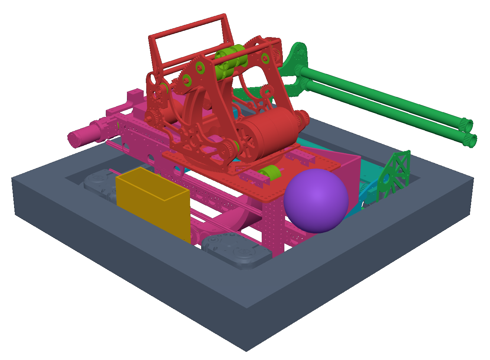
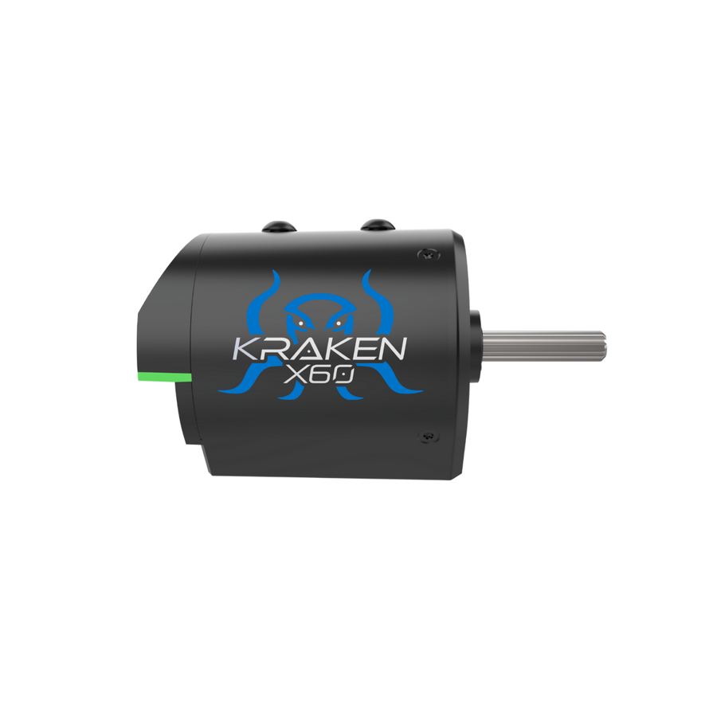
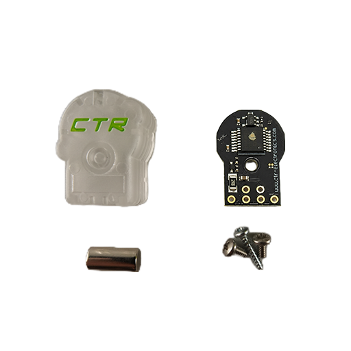
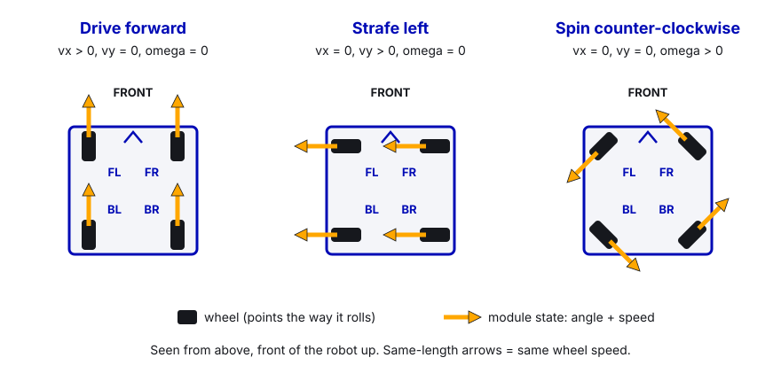
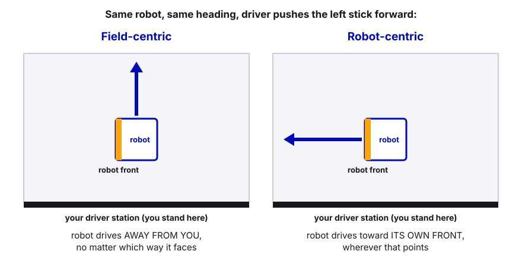
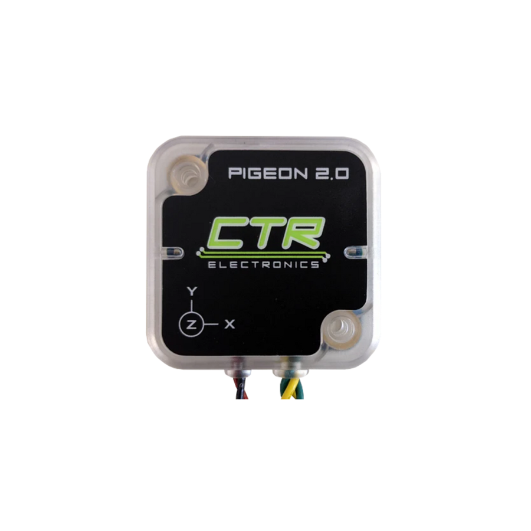
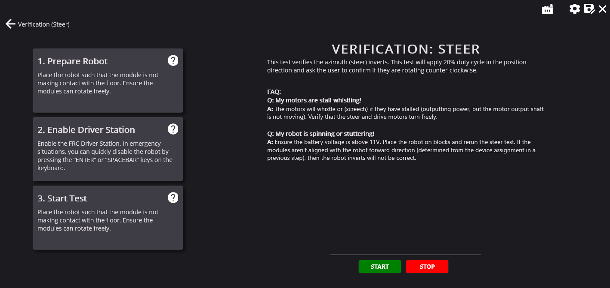
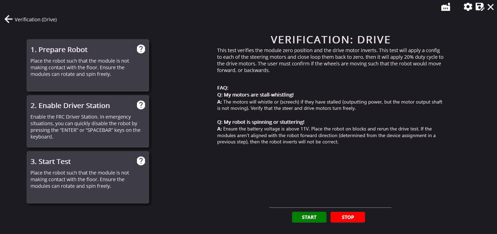
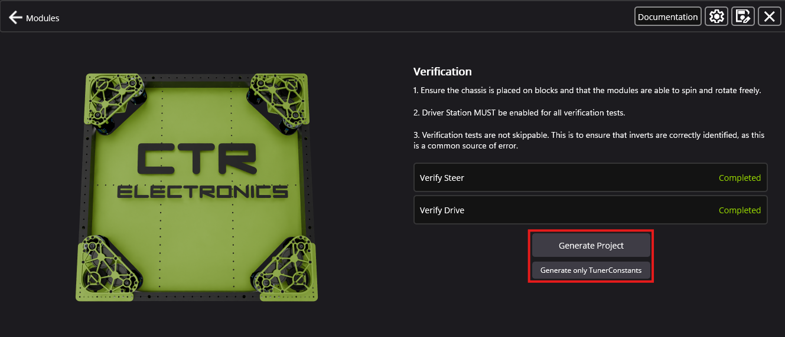
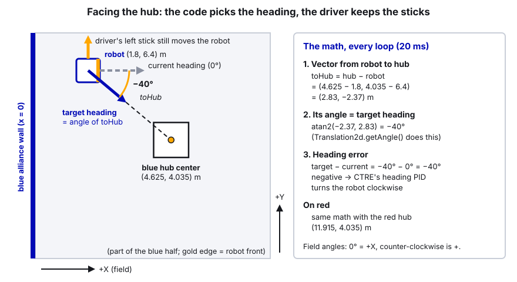

# 16. Swerve Drive with CTRE

> **Who it's for:** programmers setting up or fixing the drivetrain. You don't need to have written swerve code
> before, because CTRE's Tuner X generates most of it, but you do need to understand what it generated.
> **Read first:** [02 Tuner X and CAN](02-phoenix-tuner-x-and-can.md), [04 Command-based](04-command-based-basics.md),
> [06 Current limits](06-current-limits-and-brownouts.md). Helpful: [07 What is PID](07-what-is-pid.md).
> **Time:** about 1.5 hours to read; 2–3 hours at the robot to run the generator and test a new drivetrain.

## What you'll learn

- What swerve is, what a module state is, and field-centric vs robot-centric driving.
- How to build our drivetrain with the Tuner X **Swerve Project Generator**, screen by screen, and what to change by hand afterwards.
- What every important number in `TunerConstants.java` means, and how to compute `kSpeedAt12Volts` yourself.
- How to drive with `SwerveRequest`s, including a "hold a button to face the hub" example.
- How odometry, the pose estimator and vision fit together, and how to characterize the drive (SysId, wheel radius).
- The swerve bugs that cost us real time in 2026.

---

## 1. The idea

### What swerve is

A swerve drive has four **modules**, one at each corner. Each module has two motors:

- a **drive** motor that spins the wheel (how fast), and
- a **steer** (azimuth) motor that turns the whole wheel to point in any direction (which way),

plus an absolute **CANcoder** that always knows which way the wheel points, even right after power-on.

Because every wheel can point anywhere, the robot can drive in any direction while facing any direction, and spin
while it drives. That's called **holonomic** driving.



 

```
        front
   FL ┌───────┐ FR        Each corner: drive motor (40s), steer motor (30s), CANcoder (50s)
      │   ↑   │           Our robot: FL 40/30/50, FR 41/31/51, BL 42/32/52, BR 43/33/53
      │ robot │           Modules are 11" from the center in X and Y (22" square)
   BL └───────┘ BR
        back
```

### Module states

A **module state** is one wheel's command: a speed (meters per second) and an angle. The code works out the
robot's motion as **chassis speeds**: `vx` (forward, m/s), `vy` (left, m/s) and `omega` (counter-clockwise, rad/s).
**Kinematics** is the math that turns chassis speeds into four module states (and back). You never write it yourself:
CTRE's `SwerveDrivetrain` does it, and also **optimizes** each module: if the wheel would have to turn more than 90°, it
turns the other way and spins the wheel backwards instead.



### Field-centric vs robot-centric

| Mode | Pushing the stick forward means... | Used for |
|---|---|---|
| **Robot-centric** | drive toward the robot's front, wherever it's facing | lining up using a camera, some autos (PathPlanner sends robot-relative speeds) |
| **Field-centric** | drive away from the driver, no matter which way the robot faces | normal teleop driving |



Field-centric needs to know the robot's heading, which comes from the **Pigeon 2** gyro. No gyro = field-centric is
broken (see lesson 1 in Common mistakes).



### Operator perspective (alliance flip)

Field coordinates always have +X pointing away from the **blue** alliance wall (see STUDENT-GUIDE section 4). When
we're on red, the drivers stand on the other end, so "away from me" is −X. CTRE handles this with an **operator
perspective**: our `CommandSwerveDrivetrain.periodic()` calls `setOperatorPerspectiveForward(...)` with 0° for blue and
180° for red. `SwerveRequest.FieldCentric` uses the operator perspective by default, so stick-forward always means
"away from our driver station".

### Pose, odometry and the pose estimator

- **Pose** = where the robot is: X, Y (meters) and heading.
- **Odometry** = working the pose out from how far each wheel rolled and which way it pointed, plus the gyro. CTRE runs
  it in its own fast thread (250 Hz on a CANivore with CAN FD, 100 Hz on the roboRIO bus). Accurate short-term,
  drifts over a match.
- The **pose estimator** blends odometry with **vision** measurements (AprilTags). It's built into CTRE's drivetrain;
  you feed it with `addVisionMeasurement(...)`. See [17 Limelight and vision](17-limelight-and-vision.md).
- `drivetrain.getState().Pose` is the best guess. `getState().Speeds` is the robot-relative velocity.

---

## 2. Build the drivetrain with the Tuner X Swerve Project Generator

This is how we build every swerve drivetrain. We don't write swerve code by hand. The **Swerve Project Generator**
in Phoenix Tuner X walks you through the robot one screen at a time: it checks your devices, records where each
wheel's "straight ahead" is, spins every module to find the right motor directions, and then writes
`TunerConstants.java` for you. Do it once when a new drivetrain is built, and again whenever a module, CANcoder or gear
ratio changes.

The screenshots below are CTRE's own examples from their documentation. Their robot has different IDs and a different
module (a WCP Swerve X with a Pigeon at ID 1); the boxes and buttons are the same as you'll see. Our values are in the
text.

### 2.1 Before you open Tuner X

Go through this list first. Most generator problems are really one of these.

1. **Every swerve device shows up in Tuner X**: 8 Talon FX (4 drive, 4 steer), 4 CANcoders, 1 Pigeon 2. That's 13
   devices, all on **the same CAN bus**. Ours is the CANivore named **"Jarvis"**. See
   [02 Tuner X and CAN](02-phoenix-tuner-x-and-can.md) for finding devices.
2. **Every device has its team ID** (the order is always FL, FR, BL, BR):

   | Module | Drive motor | Steer motor | CANcoder |
   |---|---|---|---|
   | Front Left (FL) | 40 | 30 | 50 |
   | Front Right (FR) | 41 | 31 | 51 |
   | Back Left (BL) | 42 | 32 | 52 |
   | Back Right (BR) | 43 | 33 | 53 |
   | Pigeon 2 | ID **0** | | |

   Use **Blink** in Tuner X to make sure the device you call "FL drive" really is on the front-left module. A swapped ID
   here gives a robot that drives in circles later.
3. **Rename the devices** in Tuner X ("FL Drive", "FL Steer", "FL CANcoder", ...). CTRE recommends it, and the
   generator's drop-down lists become much easier to read.
4. **Firmware matches the year.** For the 2026 season every device runs 26.x firmware and Tuner X is the 2026
   version. Tuner X shows its **server version** at the bottom of the window; it must match Tuner X's year.
5. **Robot on blocks.** All four wheels off the ground and free to spin. Battery above 11 V (a fresh 12.5 V+ battery
   is better; a weak one makes the tests stutter).
6. **Driver Station open and connected.** The verification tests only move motors while the robot is **enabled**.
   Someone keeps a hand near the keyboard: **Enter** or the **space bar** disables the robot instantly.
7. **Something to align wheels with**: a long straightedge (a piece of aluminum tube or a level), or the module's
   alignment pin/jig if it has one.

> **Watch out:** the generator **factory-resets** the swerve motors and CANcoders so its tests start from a known
> state. Anything only stored on those devices (not in code) is wiped. That's fine for us: all drivetrain settings
> come from `TunerConstants.java` when the code starts. But never point the generator at mechanism motors.

> **Tip:** our own robot code also drives these motors when the robot is enabled (the drive default command). Two
> programs commanding the same motor fight each other. The cleanest setup for the generator is a roboRIO without our
> drive code running, using Tuner X's **Run Temporary Diagnostic Server** (guide 02). If our code is on the robot,
> don't touch the controller during the tests.

### 2.2 Open Tuner X and connect to the robot

1. Plug in (USB to the roboRIO, or join the robot's Wi-Fi) and start **Phoenix Tuner X**.
2. In the connection box at the top, type **`5090`** (or `10.50.90.2`; on USB use `172.22.11.2`).
3. Wait for the device list to fill. You should see all 13 swerve devices under "Jarvis" (plus the mechanism
   devices on "Upper", which you will ignore). If a device is missing, stop and fix the wiring first.
4. If Tuner X shows a **Run Temporary Diagnostic Server** card (a roboRIO with no robot program), click it.
5. In the left menu, open **Mechanisms**, then **Swerve Project Generator**.

### 2.3 Screen 1: Pre-Check and the drivetrain settings


1. **Pre-Check** (top right box). It checks that Tuner X sees at least 8 Talon FX, 4 CANcoders, 1 Pigeon 2, and a
   new-enough server. Every dot must be **green**. If not, fix it (missing device, old firmware, no diagnostic server),
   then press the **refresh** arrows in the corner of the box.
2. **Wheel Radius (inches).** Half the wheel's diameter. Our 4" wheels are **2.0** to start. Treads wear, so the real
   number is a little less; section 7 shows how to measure it properly later.
3. **FL to FR distance (inches).** Center of the front-left module to center of the front-right module. Ours: **22**.
4. **FL to BL distance (inches).** Center of the front-left module to center of the back-left module. Ours: **22**.
   (So each module is 11" from the robot's center in X and Y. Measure the real robot; don't copy last year's number.)
5. **Module Type.** Pick the maker and model of your module. Ours is **Swerve Drive Specialties (SDS) MK5n**.
6. **Drive Ratio.** Pick the gearing. Ours is **R3 = 5.273:1** ((54/16) × (25/16)). Pick the exact model and ratio, not
   "something close": every distance and speed the robot ever calculates depends on it.

   **If MK5n (or our ratio) isn't in the list**, choose **Custom** and type the numbers yourself:

   | Custom box | What it means | MK5n R3 value |
   |---|---|---|
   | Drive Ratio | motor turns per wheel turn | 5.273 (54/16 × 25/16) |
   | Steer Ratio | steer motor turns per full module turn | 26.09 (287/11) |

   After generating, check that `kCoupleRatio` in `TunerConstants.java` is **3.375** (54/16) for the MK5n. If the
   Custom screen didn't ask for it, set it by hand (see 2.8). Always confirm ratios on the module maker's website,
   because they differ between R1/R2/R3 and between module versions.
7. Click **New Project**. (Or **Import Project** to load a saved `tuner-project.json`; see 2.9.)

Hover over any box or **?** icon in the generator for CTRE's built-in explanation of it.

### 2.4 Screen 2: configure each module


1. **Selected Gyro** (left side): pick our Pigeon 2, **ID 0**. Double-check the ID here: in 2026 our code once said
   24, and the robot had no heading at all (Common mistakes, number 1).

   **CAN bus:** there's no separate CAN bus box. The bus comes from the devices you pick, so pick only devices
   listed under **"Jarvis"** (the gyro too). The generated `kCANBus` then says `"Jarvis"`.
2. **Selected Module**: start with **Front Left**.
3. **Select Encoder**: pick the FL CANcoder (**50**).
4. **Turning Motor**: pick the FL steer Talon FX (**30**).
5. **Drive Motor**: pick the FL drive Talon FX (**40**).

   Use the **lightbulb** button next to each box: it blinks the real device so you can see it's on the front-left
   corner. A warning icon in that spot means the device is already used by another module.
6. **Encoder Calibration** (the yellow button on the right). It opens a pop-up that walks you through it:
   - Turn the wheel by hand until it points **straight forward**, with the **bevel gear (the angled gear on the side of
     the wheel) facing the robot's center line**. CTRE: "the bevel gear faces the vertical center of the robot".
     For the left modules the bevel faces right; for the right modules it faces left.
   - Hold it straight with the straightedge laid across the front and back wheels on that side (or the alignment pin).
   - Confirm in the pop-up. Tuner X records the CANcoder's **offset**: how far its zero is from "straight forward".
   - When it's done, the module disappears from **Incomplete Modules**.
7. Repeat steps 2–6 for **Front Right** (41/31/51), **Back Left** (42/32/52) and **Back Right** (43/33/53).
8. When all four are done, click **Configuration Completed!**

> **Watch out:** the bevel gear direction is the most common mistake. If one module is calibrated with the bevel
> facing outward, it's 180° off: that wheel spins backwards and the verification on the next screen fails, or the
> robot drives crooked. If you swap a CANcoder to a different module, calibrate that module again.

### 2.5 Screen 3: verification (finding the inverts)

The verification page has two tests: **Verify Steer** and **Verify Drive**. They can't be skipped. That's on purpose:
motor directions ("inverts") are the most common swerve bug, and these tests set them for you from what you see.

 

**Verify Steer**

1. Robot on blocks, **enable** in the Driver Station, press **START**.
2. Every module turns slowly. Look **down at the top of each module**. The generator asks whether they turned
   **counter-clockwise** (they should). Answer honestly: if a module turned clockwise, say so, and the generator flips
   that module's steer invert.
3. Press **STOP** or disable if anything looks wrong (grinding, one module not turning, stall whistle).

**Verify Drive**

1. Still on blocks and enabled, press **START**. The generator points every wheel at its calibrated "straight" (this
   is where a bad offset shows up) and then spins the drive motors gently.
2. Decide whether the robot **would have moved forward**. With the wheels in the air, use CTRE's trick:
   - stand on the robot's **right side** and look at the right wheels: **clockwise** = forward;
   - stand on the **left side** and look at the left wheels: **counter-clockwise** = forward.
3. Answer the prompt. If both sides went backwards, just answer **No** and the generator flips them. If **only one
   side** is wrong, that's not an invert problem: go back to the module screen and redo the encoder calibration with
   the bevel gears facing the center.

What the tests decide (you'll see these in `TunerConstants.java` afterwards): each module's
`k...SteerMotorInverted` and `k...EncoderInverted`, plus `kInvertLeftSide` and `kInvertRightSide` for the drive motors.
On our 2026 robot (MK5n), the steer motors ended up **not** inverted and the right side drive **is** inverted.

If something fails, CTRE's troubleshooting list:

| What you see | Fix |
|---|---|
| Wheels didn't move at all | The Driver Station isn't enabled. |
| One side drives the wrong way / "average velocity too small" | Redo encoder calibration for that side, bevel gears facing the center. |
| Motors whistle or screech | Stalled: check by hand that each wheel and module turns freely. |
| Robot spins or stutters | Battery under 11 V, or not on blocks. Charge, re-block, rerun the steer test. |

### 2.6 Try it before you trust it

The generator's tests only move one thing at a time. Before writing anything, check the drivetrain with your eyes:

1. After verification, with the robot **disabled**, look along each side: all four wheels should sit straight
   (if one is visibly off, its offset is wrong).
2. Tuner X's **Control** tab on a single device (guide 02) is useful for checking one motor, but **don't** use it to
   drive the drivetrain: four modules have to work together, and only the generated code does that.
3. The real first drive is with the generated code, on blocks first (section 2.8, last step).

### 2.7 Screen 4: Generate



1. **Save the project file first.** In the top-right toolbar, click the **save** icon (the disk with a pencil) and
   save it as **`tuner-project.json`** in the **root of our robot repo** (next to `build.gradle`). This file holds
   everything you just typed and measured: IDs, bus, ratios, offsets, inverts. Next time you can **Import Project**
   instead of starting over. Commit it with the code.

   

2. **Pick the right generate button:**

   | Button | What it makes | When |
   |---|---|---|
   | **Generate Project** | A complete new robot program: `TunerConstants.java`, `CommandSwerveDrivetrain.java`, `RobotContainer.java`, `Telemetry.java`. It asks for the team number (5090) and the language (Java). | Only when starting from nothing, e.g. a practice chassis. |
   | **Generate only TunerConstants** | Just `TunerConstants.java`. | **What we do.** Our robot project (from Robot-Template) already has the drivetrain, PathPlanner, vision and logging. |

3. Put the file at **`src/main/java/frc/robot/generated/TunerConstants.java`** in the repo, replacing the old one, on a
   **new branch** (guide 22). Check the first line is `package frc.robot.generated;`. The generated file creates our
   `CommandSwerveDrivetrain` in `createDrivetrain()`, so that class must exist (it does in the template).

### 2.8 After generating: what you change by hand

The generator gives you correct IDs, offsets, inverts and ratios. A few numbers it can't know, and two of them cost us
real time in 2026. Make these edits, each with a comment saying what it was, what it is, and why:

1. **`kSlipCurrent` → 60 A.** The generator writes 120 A (it's the default for the Kraken motor type you select).
   CTRE's swerve code uses `kSlipCurrent` as the **drive motors' stator current limit**, and it **overwrites** any
   stator limit you put in `driveInitialConfigs`. At 120 A per wheel the robot browned out and stuttered. See
   [06 Current limits](06-current-limits-and-brownouts.md).
2. **`kSpeedAt12Volts` → compute it** (section 3 shows how: 5.85 m/s for MK5n R3 with Kraken X60). Ours was 10.24,
   about twice too high, and PathPlanner autos drove at half speed.
3. **Current limits** in `driveInitialConfigs` (supply 40 A) and `steerInitialConfigs` (stator 40 A, supply 30 A).
4. **Gains.** The generated `steerGains` and `driveGains` are starting points. `driveGains.kV` should be about
   12 / 96.7 = 0.124. Tune with SysId later (section 7) and write down when and how.
5. **`kCoupleRatio`** = 54/16 = 3.375 for the MK5n, if it isn't already.
6. **Check against the robot**: `kCANBus` is `"Jarvis"`, `kPigeonId` is 0, every module ID matches the table in 2.1.

Then test in order: **deploy, on blocks** → push the left stick forward: all four wheels point forward and spin the
same way; push it left: all four point left; turn the right stick: they form a circle → **on the floor, slow mode**
→ **full speed** with lots of room.

### 2.9 Regenerating safely

You'll regenerate after replacing a module or CANcoder, changing gear ratio, or moving devices to another bus.

1. Make a branch. Robot on blocks, connected, as in 2.1.
2. Open the generator and **Import Project** with the repo's `tuner-project.json`. Check every value on every
   screen; don't assume the file is current (see the warning in section 8 about our 2026 file).
3. Redo **Encoder Calibration** for any module whose CANcoder or module changed, then both verification tests.
4. **Save** over `tuner-project.json`, then **Generate only TunerConstants** over the old file.
5. Open VS Code's **Source Control** panel and look at the diff. Everything from 2.8 will show as "removed": put each
   hand edit back (that's why they have comments). Changes you expect (a new offset) should be the only real
   differences.
6. Test in order (blocks, slow floor, full speed), then commit both files together.

> **AI can help:** paste the old and new `TunerConstants.java` into an AI assistant and ask it to list every value
> that changed. Then you decide which changes are expected (new offset) and which are lost hand edits
> (`kSlipCurrent` back to 120). You check each one against this guide; don't let it "merge" the files for you.

> In 2027 we move to the SystemCore controller. Check CTRE's current docs for how Tuner X connects and how the
> generator handles SystemCore's CAN buses before following these steps exactly.

---

## 3. What's in `TunerConstants.java`

| Constant | What it is | Ours |
|---|---|---|
| `steerGains` | Slot 0 PID + feedforward for the steer motors (position control). | kP 100, kD 0.5, kS 0.1, kV 2.49 |
| `driveGains` | Slot 0 for the drive motors (velocity control). | kP 0.1, kV 0.124 |
| `kSteerFeedbackType` | How the steer motor knows its angle. `FusedCANcoder` blends the CANcoder with the motor's own encoder (needs Pro, which we have; otherwise it falls back to `RemoteCANcoder`). | FusedCANcoder |
| `kSlipCurrent` | The stator current where the wheels start to slip. **CTRE uses it as the drive motors' stator current limit**, overriding whatever you set in the drive config. | 60 A |
| `driveInitialConfigs` / `steerInitialConfigs` | Extra motor configs, mostly current limits. | drive supply 40 A, steer stator 40 / supply 30 A |
| `kCANBus` | The bus all swerve devices are on. | `"Jarvis"` (CANivore) |
| `kSpeedAt12Volts` | Theoretical top speed at 12 V. Used to turn a requested m/s into volts in open-loop driving. | 5.85 m/s |
| `kCoupleRatio` | How many drive-motor turns happen when the module steers one turn (the gears are linked through the bevel). CTRE subtracts it so steering doesn't move the wheel. | 54/16 = 3.375 |
| `kDriveGearRatio`, `kSteerGearRatio` | Motor turns per wheel turn / per module turn. | 5.273, 26.09 |
| `kWheelRadius` | Wheel radius. Wrong = odometry distances wrong. | 2 in |
| `kPigeonId` | The gyro's CAN ID. | 0 |
| Module `k...Id`, `k...EncoderOffset`, `k...XPos/YPos` | Per-module IDs, CANcoder offsets (rotations), positions from the robot center. | see file |

### Computing `kSpeedAt12Volts`

Top speed = how fast the wheel's edge moves when the motor spins at its free speed:

```
kSpeedAt12Volts = (motor free speed in RPS / drive gear ratio) × (π × wheel diameter)

Kraken X60 (FOC) free speed: 5800 RPM = 96.7 RPS
MK5n R3 drive ratio:         (54/16) × (25/16) = 5.273
Wheel:                       4 in diameter = 0.1016 m → circumference π × 0.1016 = 0.319 m

96.7 / 5.273 = 18.34 wheel rotations per second
18.34 × 0.319 = 5.85 m/s
```

Check the free speed for the motor you actually have on the vendor's site, and the gear ratio on the module maker's
site. The real top speed is a bit lower (friction, battery sag); that's fine, this number is the scale factor, not a
promise.

`driveGains.kV` is the same idea from the motor side: 12 V / 96.7 RPS = **0.124 V per RPS**. If those two numbers
disagree with each other, one of them is wrong.

---

## 4. Driving with `SwerveRequest`s

You never set swerve motors directly. You build a **SwerveRequest** (like a motor control request, but for the whole
drivetrain) and apply it with `drivetrain.setControl(request)`, or as a command with `drivetrain.applyRequest(() -> request)`.

| Request | What it does | When we use it |
|---|---|---|
| `SwerveRequest.FieldCentric` | vx/vy relative to the field (operator perspective), plus a rotation rate. | Teleop default command. |
| `SwerveRequest.RobotCentric` | vx/vy relative to the robot's front. | Lining up with a camera; driving "forward" off a wall. |
| `SwerveRequest.FieldCentricFacingAngle` | You give vx/vy and a **target heading**; a built-in heading PID turns the robot to face it. | Driving while facing the hub (section 5). |
| `SwerveRequest.SwerveDriveBrake` | Points the wheels in an X so the robot is hard to push. | X button (defense). |
| `SwerveRequest.Idle` | Does nothing (motors in neutral). | While disabled. |
| `SwerveRequest.ApplyRobotSpeeds` | Applies a robot-relative `ChassisSpeeds` (optionally with wheel force feedforwards). | PathPlanner's output. |
| `SwerveRequest.PointWheelsAt` | Points every wheel at an angle without driving. | Testing offsets. |

Make each request **once** (a field) and update it with `.with...()` every loop; don't `new` one every loop.

FOC: swerve requests don't have `.withEnableFOC(...)`. The swerve library builds the motor requests itself and turns
FOC on by default (it runs as FOC because our devices are Pro-licensed). So unlike mechanism code, there is nothing to
add here.

---

## 5. Example: drivers aligning to the hub (rotate the drivetrain)

In 2026 you score by shooting into your alliance's **hub**. Our robot aimed with a **turret** (guide 13), so the
drivers could point the robot anywhere. Many robots without a turret did it the other way: the driver holds a button,
and the code **turns the whole drivetrain** to face the hub while the driver keeps driving with the left stick. This
section builds that, cleanly.

> Honest note: our 2026 code does **not** contain this, and this code has **not run on our robot**. It's written
> against the real Phoenix 6 26.3 API and our `RobotContainer`, but test it in simulation, then on blocks, then on the
> floor, like anything new.

### The idea



1. Take the robot's position from the pose estimator: `drivetrain.getState().Pose`.
2. Pick **our** hub center. From `Turret.java` (official 2026 field layout): **blue (4.625, 4.035) m**,
   **red (11.915, 4.035) m**.
3. `toHub = hubCenter − robotPosition`. Its angle (`toHub.getAngle()`) is the heading that points the robot's
   **front** at the hub, in **field** angles (0° = +X, away from the blue wall; counter-clockwise positive).
4. Hand that angle to `SwerveRequest.FieldCentricFacingAngle`. Its built-in heading PID compares it with the robot's
   current heading and makes up the rotation rate. The driver's stick gives the X/Y speed, exactly like normal
   field-centric driving.
5. When the driver lets go of the button, the command ends and the normal drive command comes back.

Because it uses the pose, it keeps working when the Limelight briefly loses the tags (odometry carries it), and it
only works as well as the pose: a wrong gyro or bad vision means it faces the wrong spot.

### Two details that are easy to get wrong

**1. The target angle must not be flipped for red.** `FieldCentricFacingAngle` has two perspective settings, and we
checked how Phoenix 6 v26 uses them (in the library itself, not just the docs):

| Setting | Default | What it does |
|---|---|---|
| `ForwardPerspective` (for the **sticks**) | `OperatorPerspective` | VelocityX/Y are driver-relative, flipped on red. Same feel as our normal drive. Keep it. |
| `TargetDirectionPerspective` (for the **target angle**) | `UseForwardPerspective` | The target angle is **also** treated as driver-relative and rotated by the operator perspective (180° on red). |

Our angle to the hub is already a **field** angle. With the default, on red the robot would face exactly **away**
from the hub. So set `.withTargetDirectionPerspective(TargetDirectionPerspectiveValue.BlueAlliance)`: "this angle is
in field coordinates, don't touch it". The sticks still use the operator perspective.

**2. Wrapping (179° vs −179°).** Those two headings are 2° apart, not 358°. CTRE's `HeadingController` (a
`PhoenixPIDController`) already has continuous input turned on from −π to π when the request is created, so you
don't call `enableContinuousInput` yourself. It always turns the short way.

The heading PID works in **radians**: error in radians in, rotation rate in rad/s out. `kP = 5` means 40° of error
(0.70 rad) asks for 3.5 rad/s of turning. Set it with `.withHeadingPID(kP, kI, kD)`, which is the same as
`HeadingController.setPID(kP, kI, kD)`.

### The code

In `RobotContainer.java` (it already has `drivetrain`, `joystick`, `MaxSpeed` and `onRedAlliance()`). In our team's
style, the hub positions and gains would go in `Constants.java`; they're here so the example fits on one page.

```java
import com.ctre.phoenix6.swerve.SwerveRequest.TargetDirectionPerspectiveValue;
import edu.wpi.first.math.geometry.Translation2d;

// Hub centers in meters, blue-origin field coordinates (same numbers as Turret.java)
private static final Translation2d kBlueHubCenter = new Translation2d(4.625, 4.035);
private static final Translation2d kRedHubCenter = new Translation2d(11.915, 4.035);
private static final double kHubHeadingP = 5.0;               // rad/s per radian of error; tune on the robot
private static final double kHubHeadingD = 0.0;
private static final double kHubAimToleranceDegrees = 3.0;    // "ready" when facing the hub this closely

// Put this below the existing `drive` request: it uses MaxSpeed, which must be set first.
private final SwerveRequest.FieldCentricFacingAngle driveFacingHub = new SwerveRequest.FieldCentricFacingAngle()
    .withDeadband(MaxSpeed * 0.1)
    .withDriveRequestType(DriveRequestType.OpenLoopVoltage)
    .withHeadingPID(kHubHeadingP, 0.0, kHubHeadingD)
    .withMaxAbsRotationalRate(RotationsPerSecond.of(1.0))      // cap the turn speed (rad/s internally)
    .withTargetDirectionPerspective(TargetDirectionPerspectiveValue.BlueAlliance);  // field angle: never flip it

/** The field-relative heading that points the robot's front at our hub. */
private Rotation2d headingToHub() {
    Translation2d hubCenter = onRedAlliance() ? kRedHubCenter : kBlueHubCenter;
    Translation2d robotToHub = hubCenter.minus(drivetrain.getState().Pose.getTranslation());
    return robotToHub.getAngle();
}

/** True when the robot's heading is within the tolerance of facing the hub. */
private boolean isFacingHub() {
    Rotation2d headingError = headingToHub().minus(drivetrain.getState().Pose.getRotation());
    return Math.abs(headingError.getDegrees()) < kHubAimToleranceDegrees;   // Rotation2d wraps to ±180°
}

/** Driver keeps translation on the left stick; the code turns the robot to face the hub. */
private Command driveFacingHubCommand() {
    return drivetrain.applyRequest(() -> driveFacingHub
            .withVelocityX(-joystick.getLeftY() * MaxSpeed)
            .withVelocityY(-joystick.getLeftX() * MaxSpeed)
            .withTargetDirection(headingToHub()))
        .withName("Drive facing hub");
}
```

And in `configureBindings()`:

```java
// Hold A: face the hub. Let go: normal driving comes back (the default command resumes).
joystick.a().whileTrue(driveFacingHubCommand());

// Rumble while A is held AND we're facing the hub, so the driver knows it's OK to shoot.
joystick.a().and(this::isFacingHub).whileTrue(Commands.startEnd(
    () -> joystick.getHID().setRumble(RumbleType.kBothRumble, 0.5),
    () -> joystick.getHID().setRumble(RumbleType.kBothRumble, 0.0)));
```

For the dashboard, add `SmartDashboard.putBoolean("Drive/Facing hub", isFacingHub());` to a periodic method.

What to notice:

- **`whileTrue`** is what makes "hold the button" work. `applyRequest` requires the drivetrain, so while A is held it
  replaces the default drive command; on release it's cancelled and the default command runs again.
- The right stick does nothing while A is held: rotation belongs to the heading PID. That's the point.
- The request is built **once** and only its `.with...()` values change each loop.
- `isFacingHub()` uses the same pose as the aiming, so "ready" means "the robot thinks it's facing the hub". In a real
  shooter you'd also need the flywheel at speed (guide 10) and a short `Debouncer` so it doesn't flicker (our
  readiness code in `RobotContainer` does that for the turret).
- **Which side faces the hub?** `toHub.getAngle()` points the robot's **front** at the hub. If your shooter is on the
  back, add 180°: `.withTargetDirection(headingToHub().plus(Rotation2d.k180deg))`.
- The hub center isn't always where the ball should go: for shoot-on-the-move you aim at a point that's led for the
  robot's speed, like our turret does (guide 13, section 5). Start with the plain center.

### Tuning the heading PID

1. In simulation first: hold A while driving in a circle around the hub in AdvantageScope's field view. The robot
   should keep facing the hub.
2. On the floor, slow mode. Too low kP: the robot lags behind and never quite points at the hub. Too high: it
   overshoots and wobbles side to side. Raise kP until it's snappy, then add a little kD (try 0.1–0.3) if it wobbles.
3. CTRE's `CommandSwerveDrivetrain` already has a **rotation SysId routine** made for exactly this heading
   controller (section 7). Use it if hand tuning gets stuck.
4. Log the heading error (`Drive/Hub heading error (deg)`) and look at it in AdvantageScope while you tune.

> **Watch out:** this turns the robot on its own as soon as A is pressed, up to 1 rotation per second. Test with
> people clear of the robot, and make sure everyone knows which button does it.

---

## 6. Odometry, vision and resetting the heading

- **`seedFieldCentric()`** (our Start button) **resets the pose's heading** so that the way the robot faces right
  now becomes "forward" for the driver. It's a quick fix when field-centric feels crooked. But it changes the
  heading the **whole robot** uses, including turret aiming and Limelight MegaTag2 (which takes its heading from us).
  Only press it with the robot squarely facing away from the driver station.
- **`resetPose(pose)`** sets the whole pose. Our View/Back button uses it for the shop test pose. PathPlanner calls it at
  the start of an auto.
- **Vision:** `Robot.updateVision()` sends Limelight poses to `addVisionMeasurement(pose, timestamp, stdDevs)`. Our
  `CommandSwerveDrivetrain` overrides `addVisionMeasurement` to convert the Limelight's FPGA timestamp into CTRE's time
  base with `Utils.fpgaToCurrentTime(...)`. Without that conversion, vision measurements land at the wrong moment in
  the history and the pose jumps. Details in [17 Limelight and vision](17-limelight-and-vision.md).

---

## 7. Characterizing the drive

### SysId (feedforward and PID gains)

**SysId** drives a mechanism with slowly rising voltage (quasistatic) and sudden steps (dynamic), logs what happens,
and fits kS, kV, kA and suggested PID gains. Our `CommandSwerveDrivetrain` already has three routines from CTRE:
translation (drive motors), steer, and rotation (for the FacingAngle heading PID). Only translation is selected
(`m_sysIdRoutineToApply`).

1. Our buttons are full, so bind SysId to a **second controller** on port 1, temporarily:

   ```java
   private final CommandXboxController sysIdController = new CommandXboxController(1);
   // in configureBindings():
   sysIdController.a().whileTrue(drivetrain.sysIdQuasistatic(SysIdRoutine.Direction.kForward));
   sysIdController.b().whileTrue(drivetrain.sysIdQuasistatic(SysIdRoutine.Direction.kReverse));
   sysIdController.x().whileTrue(drivetrain.sysIdDynamic(SysIdRoutine.Direction.kForward));
   sysIdController.y().whileTrue(drivetrain.sysIdDynamic(SysIdRoutine.Direction.kReverse));
   ```

2. The **translation** routine really drives the robot in a straight line. You need a long clear runway and
   someone on the disable button. Let go before the robot hits anything; the test still works with partial data.
3. Run all four tests once each. Our `RobotLog` already records CTRE's SignalLogger to the USB stick (a `.hoot` file).
4. Convert the `.hoot` to `.wpilog` with Tuner X's log extractor and open it in the WPILib **SysId** tool (see the CTRE
   SysId page in Go further).
5. To characterize steer instead, change `m_sysIdRoutineToApply` to `m_sysIdRoutineSteer` (on blocks is fine for
   steer).
6. Put the results in `driveGains`/`steerGains` with a comment saying when and how they were measured. Remove the
   SysId bindings afterwards.

### Wheel radius (making odometry distances right)

Treads wear, and a real wheel is never exactly 2.000". A wheel that's 3% smaller makes odometry think the robot went
3% further than it did. The idea: spin the robot in place slowly. The gyro says how far it really turned. Each wheel
travels along a circle with radius = distance from module to robot center. Compare that with what odometry thinks the
wheels traveled:

```
real radius = current radius × (gyro angle turned × module distance from center) / wheel distance odometry measured
```

A sketch you could add to `CommandSwerveDrivetrain` (we have not built this yet; test on carpet, never on blocks):

```java
/** Spins slowly in place; when cancelled, puts the measured wheel radius on the dashboard. */
public Command wheelRadiusCharacterizationCommand() {
    SwerveRequest.RobotCentric spinInPlace = new SwerveRequest.RobotCentric()
        .withRotationalRate(RotationsPerSecond.of(0.25).in(RadiansPerSecond));   // slow, so the wheels don't slip
    double moduleRadiusMeters = getModuleLocations()[0].getNorm();                 // 0.395 m for our 22" square
    double currentWheelRadiusMeters = TunerConstants.FrontLeft.WheelRadius;
    double[] startWheelDistancesMeters = new double[4];
    double[] startYawRadians = new double[1];

    return startRun(
        () -> {
            for (int i = 0; i < 4; i++) {
                startWheelDistancesMeters[i] = getState().ModulePositions[i].distanceMeters;
            }
            startYawRadians[0] = Units.degreesToRadians(getPigeon2().getYaw().getValueAsDouble());
        },
        () -> setControl(spinInPlace))
    .finallyDo(() -> {
        double averageWheelTravelMeters = 0;
        for (int i = 0; i < 4; i++) {
            averageWheelTravelMeters += Math.abs(getState().ModulePositions[i].distanceMeters - startWheelDistancesMeters[i]) / 4.0;
        }
        double gyroTurnRadians = Math.abs(Units.degreesToRadians(getPigeon2().getYaw().getValueAsDouble()) - startYawRadians[0]);
        double measuredRadiusMeters = currentWheelRadiusMeters * gyroTurnRadians * moduleRadiusMeters / averageWheelTravelMeters;
        SmartDashboard.putNumber("Drive/Measured wheel radius (in)", Units.metersToInches(measuredRadiusMeters));
    })
    .withName("Wheel radius characterization");
}
```

Hold the button for at least 3–4 full turns, then release. (The Pigeon's yaw keeps counting past 360°, so multiple
turns work.) Run it 3 times, average, and put the result in `kWheelRadius` with a comment and the date.

---

## 8. In our code

### `TunerConstants.java`: our hand edits, with the reasons

[TunerConstants.java, lines 52–56 (kSlipCurrent)](https://github.com/TorqueNados-FRC5090/Hephaestus/blob/c2f0cee6f61db3f26f911d3f5623ed7fa27a5b03/src/main/java/frc/robot/generated/TunerConstants.java#L52-L56)

```java
// The stator current at which the wheels start to slip;
// This needs to be tuned to your individual robot
// CTRE's swerve code uses this as the drive motors' STATOR current limit, overwriting the 60A set below.
// It was 120A, so the drive could pull twice the intended current and brown the robot out.
private static final Current kSlipCurrent = Amps.of(60);
```

[TunerConstants.java, lines 86–110 (CAN bus, kSpeedAt12Volts, ratios, Pigeon ID)](https://github.com/TorqueNados-FRC5090/Hephaestus/blob/c2f0cee6f61db3f26f911d3f5623ed7fa27a5b03/src/main/java/frc/robot/generated/TunerConstants.java#L86-L110)

```java
public static final CANBus kCANBus = new CANBus("Jarvis", "./logs/example.hoot");
// MK5n R3: 96.7 rps (Kraken X60) / 5.273 * (pi * 4in wheel) = 5.85 m/s.
// Was 10.24 (about 2x too high). ...
public static final LinearVelocity kSpeedAt12Volts = MetersPerSecond.of(5.85);
// MK5n R3 (16T drive pinion): first stage 54/16, second 25/16. Was R2 (54/14 * 25/16).
private static final double kCoupleRatio = 54.0 / 16.0;
private static final double kDriveGearRatio = (54.0 / 16.0) * (25.0 / 16.0);
...
private static final int kPigeonId = 0;
```

Notice: every hand edit has a comment saying what it was, what it is now, and why. That's what makes it survive the
next regenerate: whoever regenerates can see what to put back.

### `RobotContainer`: the drive default command

[RobotContainer.java, lines 49–58 (max speeds and the FieldCentric request)](https://github.com/TorqueNados-FRC5090/Hephaestus/blob/c2f0cee6f61db3f26f911d3f5623ed7fa27a5b03/src/main/java/frc/robot/RobotContainer.java#L49-L58)
and [lines 125–134 (default command with slow mode)](https://github.com/TorqueNados-FRC5090/Hephaestus/blob/c2f0cee6f61db3f26f911d3f5623ed7fa27a5b03/src/main/java/frc/robot/RobotContainer.java#L125-L134)

```java
private double MaxSpeed = 1.0 * TunerConstants.kSpeedAt12Volts.in(MetersPerSecond);
private double MaxAngularRate = RotationsPerSecond.of(0.43).in(RadiansPerSecond);
private final SwerveRequest.FieldCentric drive = new SwerveRequest.FieldCentric()
 .withDeadband(MaxSpeed * 0.1).withRotationalDeadband(MaxAngularRate * 0.1)
 .withDriveRequestType(DriveRequestType.OpenLoopVoltage);
...
double slowModeMultiplier = joystick.getRightTriggerAxis() > 0.5 ? 0.4 : 1.0;
return drive.withVelocityX(-joystick.getLeftY() * MaxSpeed * slowModeMultiplier)
            .withVelocityY(-joystick.getLeftX() * MaxSpeed * slowModeMultiplier)
            .withRotationalRate(-joystick.getRightX() * MaxAngularRate * slowModeMultiplier);
```

Notice:
- **Deadband** is 10% of max speed: stick inputs that small are ignored so a resting stick doesn't creep.
- **Minus signs:** Xbox sticks read negative when pushed forward/left, and WPILib +X is forward, +Y is left, CCW is positive.
- **Slow mode:** right trigger past 50% → everything ×0.4. (In Robot-Template these numbers live in
  `OperatorConstants`, which is the better place.)
- The request is built once and reused; only the `.with...()` values change each loop.
- `MaxAngularRate` comment: when `kSpeedAt12Volts` was fixed, the turning rate was lowered from 0.75 to 0.43 rot/s so
  the drivers' turning feel stayed the same.

Other drivetrain bindings: [lines 142–148 (Idle while disabled, X brake)](https://github.com/TorqueNados-FRC5090/Hephaestus/blob/c2f0cee6f61db3f26f911d3f5623ed7fa27a5b03/src/main/java/frc/robot/RobotContainer.java#L142-L148)
and [line 165 (Start = seedFieldCentric)](https://github.com/TorqueNados-FRC5090/Hephaestus/blob/c2f0cee6f61db3f26f911d3f5623ed7fa27a5b03/src/main/java/frc/robot/RobotContainer.java#L165).
The X button builds `new SwerveRequest.SwerveDriveBrake()` inside the lambda every loop; Robot-Template keeps one in a
field (`brake`), which is the pattern to copy.

### `CommandSwerveDrivetrain`: operator perspective and gyro check

[CommandSwerveDrivetrain.java, lines 244–265 (periodic)](https://github.com/TorqueNados-FRC5090/Hephaestus/blob/c2f0cee6f61db3f26f911d3f5623ed7fa27a5b03/src/main/java/frc/robot/subsystems/CommandSwerveDrivetrain.java#L244-L265)

```java
public void periodic() {
    SmartDashboard.putNumber("robot yaw", getgyroyaw().getDegrees());
    // If Connected is false or Yaw doesn't change when the robot turns, the swerve has no heading
    SmartDashboard.putBoolean("Gyro/Connected", getPigeon2().isConnected());
    SmartDashboard.putNumber("Gyro/Yaw (deg)", getPigeon2().getYaw().getValueAsDouble());
    if (!m_hasAppliedOperatorPerspective || DriverStation.isDisabled()) {
        DriverStation.getAlliance().ifPresent(allianceColor -> {
            setOperatorPerspectiveForward(
                allianceColor == Alliance.Red
                    ? kRedAlliancePerspectiveRotation
                    : kBlueAlliancePerspectiveRotation);
            m_hasAppliedOperatorPerspective = true;
        });
    }
```

Notice: `Gyro/Connected` was added after the Pigeon ID bug. It's the first thing to look at if field-centric is
weird. The perspective only updates while disabled (so it can't flip mid-drive), except once at startup in case the
code restarts during a match.

Also in this file: the SysId routines ([lines 53–120](https://github.com/TorqueNados-FRC5090/Hephaestus/blob/c2f0cee6f61db3f26f911d3f5623ed7fa27a5b03/src/main/java/frc/robot/subsystems/CommandSwerveDrivetrain.java#L53-L120)),
`applyRequest` ([lines 217–219](https://github.com/TorqueNados-FRC5090/Hephaestus/blob/c2f0cee6f61db3f26f911d3f5623ed7fa27a5b03/src/main/java/frc/robot/subsystems/CommandSwerveDrivetrain.java#L217-L219)),
and the vision timestamp conversion ([lines 308–311](https://github.com/TorqueNados-FRC5090/Hephaestus/blob/c2f0cee6f61db3f26f911d3f5623ed7fa27a5b03/src/main/java/frc/robot/subsystems/CommandSwerveDrivetrain.java#L308-L311)).
There's a **stale comment** at [lines 292–296](https://github.com/TorqueNados-FRC5090/Hephaestus/blob/c2f0cee6f61db3f26f911d3f5623ed7fa27a5b03/src/main/java/frc/robot/subsystems/CommandSwerveDrivetrain.java#L292-L296)
saying "The real Pigeon is ID 24". That's wrong (it's 0); trust `TunerConstants` and Tuner X, not that comment.

### Robot-Template's version (the one to copy)

The template's drivetrain is the same generated code, cleaned up:

- [TunerConstants.java, lines 19–22](https://github.com/TorqueNados-FRC5090/Robot-Template/blob/b8dddd0e338841e867c0cc260162e6097adecd7b/src/main/java/frc/robot/generated/TunerConstants.java#L19-L22):
  a header telling you to regenerate rather than hand-edit, and to comment any hand edit.
- [CommandSwerveDrivetrain.java, lines 223–230](https://github.com/TorqueNados-FRC5090/Robot-Template/blob/b8dddd0e338841e867c0cc260162e6097adecd7b/src/main/java/frc/robot/subsystems/CommandSwerveDrivetrain.java#L223-L230):
  `driveRobotRelative` reuses one `ApplyRobotSpeeds`, discretizes the speeds, and passes PathPlanner's wheel force
  feedforwards. Hephaestus's version
  ([lines 205–209](https://github.com/TorqueNados-FRC5090/Hephaestus/blob/c2f0cee6f61db3f26f911d3f5623ed7fa27a5b03/src/main/java/frc/robot/subsystems/CommandSwerveDrivetrain.java#L205-L209))
  makes a new request every loop and ignores the feedforwards. It works, but the template's tracks paths better.
- [RobotContainer.java, lines 80–95](https://github.com/TorqueNados-FRC5090/Robot-Template/blob/b8dddd0e338841e867c0cc260162e6097adecd7b/src/main/java/frc/robot/RobotContainer.java#L80-L95):
  same default command, with the deadband and slow-mode numbers in `Constants.OperatorConstants`.
- It also logs a CAN-disconnect event for every swerve device, so a dead CANcoder shows up in the log by name.


### `tuner-project.json`: the saved generator project

[tuner-project.json](https://github.com/TorqueNados-FRC5090/Hephaestus/blob/c2f0cee6f61db3f26f911d3f5623ed7fa27a5b03/tuner-project.json)
is the file from step 2.7 (the same file is in Robot-Template). Be careful: the copy in the repo is **older than our
TunerConstants**. It still says SDS MK4i L2 (drive ratio 6.75), bus `"rio"`, a 24" track, steer motors inverted, and
different encoder offsets. The Pigeon ID (0) and the motor/CANcoder IDs do match. Use it to check IDs, but the next
time someone runs the generator, **save over this file** and commit it so it matches the robot again. It also shows
where the 120 A came from: the Kraken motor type in it has `"SlipCurrentLimit": 120`.

---

## 9. Common mistakes

1. **Wrong Pigeon ID (24 in code, 0 on the robot).** The code said the Pigeon was ID 24. There's no device 24,
   so the swerve never got a heading: field-centric didn't rotate with the robot, the field map never turned, and the
   turret only aimed right when the Limelight could see a tag. Fix: `kPigeonId = 0`. Lesson: **check every ID against
   Tuner X** (and the generator's gyro box) before blaming code, and watch `Gyro/Connected` on the dashboard.
2. **`kSlipCurrent` at 120 A.** We set the drive stator limit to 60 A in the drive config, but CTRE overwrites it with
   `kSlipCurrent`, which was the generator's default 120 A. Four drive motors at up to 120 A each caused brownouts and
   stuttering. Fix: 60 A. Lesson: change `kSlipCurrent`, not the drive config's stator limit.
3. **`kSpeedAt12Volts` 2× too high (10.24 vs 5.85).** PathPlanner sends speeds through `ApplyRobotSpeeds`, which (in
   open-loop voltage mode) turns m/s into volts using `kSpeedAt12Volts`. With 10.24, asking for 3 m/s gave about
   3.5 V, which really drives about 1.7 m/s, so **autos ran at roughly half speed** and the path controller was always
   behind. Teleop felt normal because full stick is 12 V either way. Fix: compute it (section 3).
4. **Regenerating and losing hand edits.** "Generate only TunerConstants" writes a fresh file with the default
   `kSlipCurrent` (120 A) and whatever speed it calculated. Always diff before committing (section 2.9).
5. **Encoder calibration with a bevel gear the wrong way.** Then one module drives backwards, or the robot drives
   diagonally, and Verify Drive says one side is wrong. Recalibrate with every bevel facing the center.
6. **Swapping a module or CANcoder without recalibrating.** Every CANcoder has its own offset. A replaced module needs
   new offsets (rerun calibration in the generator, or carefully update that one value in `TunerConstants`).
7. **Wrong module type or ratio in the generator** ("close enough" R2 instead of R3, or last year's module). Every
   distance, speed and auto is off by the ratio error. Check on the maker's site.
8. **Devices on the wrong bus.** All swerve devices must be on the same bus as `kCANBus`. A device on `"rio"` when the
   code says `"Jarvis"` is just "not found".
9. **Pressing Start (seedFieldCentric) while the robot is crooked.** It sets the heading for everything, including
   aiming, hub-facing and MegaTag2. Only press it with the robot facing straight away from the driver station.
10. **Facing-angle target flipped on red.** Leaving `TargetDirectionPerspective` at its default makes the robot face
    away from the hub on the red alliance (section 5). Use `BlueAlliance` for field angles.

---

## 10. Checklist

- [ ] All 13 swerve devices visible in Tuner X on "Jarvis", with current firmware, renamed, IDs match the table in 2.1.
- [ ] Generator: Pre-Check all green; wheel radius, 22" × 22", SDS MK5n R3 (or Custom 5.273 / 26.09) entered.
- [ ] Every module calibrated with the bevel gear facing the robot's center; Verify Steer and Verify Drive completed.
- [ ] `tuner-project.json` saved to the repo root and committed with the new `TunerConstants.java`.
- [ ] Hand edits back in: `kSlipCurrent` 60 A, `kSpeedAt12Volts` computed, current limits, `kCoupleRatio` 3.375.
- [ ] `Gyro/Connected` is true and `Gyro/Yaw (deg)` changes when you rotate the robot by hand.
- [ ] On blocks, stick forward → all wheels point forward and spin forward; stick left → all point left.
- [ ] Operator perspective correct: on red, stick forward drives away from the red wall.
- [ ] Odometry check: drive 3 m along a tape measure; the pose X changes by about 3 m.
- [ ] In auto, the robot reaches the path's speeds (compare "Auto path" vs actual pose in AdvantageScope).

---

## 11. Practice

1. **Do the math.** If we switched to MK5n **R2** (54/14 × 25/16 = 6.03:1), what would `kSpeedAt12Volts` be? What
   happens to autos if you forget to change it? (Answer: about 5.12 m/s. If you kept 5.85, the code would think the robot is faster than it is, so open-loop autos would drive about 12% slower than the path asks.)
2. **Generator dry run.** With a mentor, open the generator on the practice chassis (or the robot, on blocks) and go
   as far as the module screen. For each module, say out loud which IDs you'll pick and which way the bevel gear must
   face. Then **Import** our `tuner-project.json` and list every value that doesn't match the real robot.
3. **Drive in simulation.** Simulate Robot-Template, drag a controller to Joystick 0, and open AdvantageScope's 3D/2D
   field connected to `localhost`. Drive in a circle while spinning. Then set the Driver Station alliance to red and
   check that "stick forward" flips direction (disable and re-enable first; the perspective only updates while disabled).
4. **Face the hub.** Add the section 5 example to Robot-Template in sim. Hold A while circling the hub: does it keep
   facing it? Switch to red: does it still face the (red) hub? Now remove the `withTargetDirectionPerspective` line and
   try red again, and explain what happened. Finally raise kP from 5 to 20 and describe the difference.

---

## 12. Go further

- CTRE Swerve Project Generator (all steps): https://v6.docs.ctr-electronics.com/en/stable/docs/tuner/tuner-swerve/index.html
- Generator requirements and checklist: https://v6.docs.ctr-electronics.com/en/stable/docs/tuner/tuner-swerve/swerve-system-requirements.html
- Creating the project (first screen): https://v6.docs.ctr-electronics.com/en/stable/docs/tuner/tuner-swerve/creating-your-project.html
- Configuring modules / encoder calibration: https://v6.docs.ctr-electronics.com/en/stable/docs/tuner/tuner-swerve/configuring-your-modules.html
- Validating the drivetrain: https://v6.docs.ctr-electronics.com/en/stable/docs/tuner/tuner-swerve/validating-drivetrain.html
- Generating the project: https://v6.docs.ctr-electronics.com/en/stable/docs/tuner/tuner-swerve/generating-running-project.html
- Swerve API overview: https://v6.docs.ctr-electronics.com/en/stable/docs/api-reference/mechanisms/swerve/swerve-overview.html
- Swerve requests: https://v6.docs.ctr-electronics.com/en/stable/docs/api-reference/mechanisms/swerve/swerve-requests.html
- SwerveRequest Java API: https://api.ctr-electronics.com/phoenix6/stable/java/com/ctre/phoenix6/swerve/SwerveRequest.html
- CTRE SysId integration: https://v6.docs.ctr-electronics.com/en/stable/docs/api-reference/wpilib-integration/sysid-integration/index.html
- Current limits (why slip current matters): https://v6.docs.ctr-electronics.com/en/stable/docs/hardware-reference/talonfx/improving-performance-with-current-limits.html
- SDS MK5n module (ratios): https://www.swervedrivespecialties.com/products/mk5n-swerve-module
- WPILib swerve kinematics: https://docs.wpilib.org/en/stable/docs/software/kinematics-and-odometry/swerve-drive-kinematics.html
- WPILib pose estimators: https://docs.wpilib.org/en/stable/docs/software/advanced-controls/state-space/state-space-pose-estimators.html
- WPILib System Identification: https://docs.wpilib.org/en/stable/docs/software/advanced-controls/system-identification/index.html
