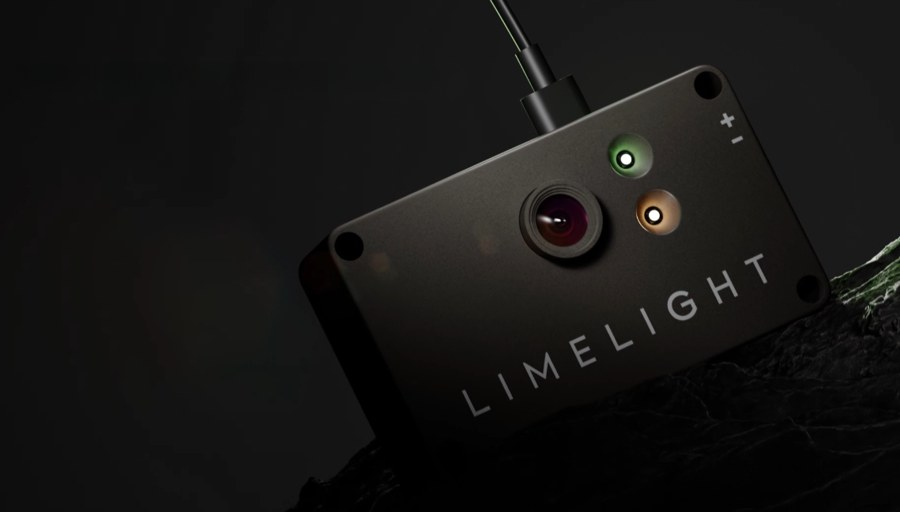

# 17. Limelight and Vision

> **Who it's for:** anyone setting up a Limelight, aiming at a target, or making the robot know where it is on the
> field. **Read first:** [01 Radio and network](01-radio-and-robot-network.md), [04 Command-based](04-command-based-basics.md),
> [07 What is PID](07-what-is-pid.md), [16 Swerve](16-swerve-drive-ctre.md). **Time:** about 2 hours to read and
> set up one camera; an afternoon to get vision trustworthy on a real robot.

**What you'll learn**
- How to power, wire, flash and network a Limelight so the robot code can find it
- How to set up an AprilTag pipeline and back it up in git
- What `tx`, `ty`, `ta` and `tv` mean, and how to aim with `tx`
- How MegaTag1 and MegaTag2 work, and how we feed them into the swerve pose estimator
- How to reject bad vision data, run several cameras, and debug a pose that looks wrong

---

## 1. The idea

A **Limelight** is a camera with its own small computer inside. It looks at the field, finds things (AprilTags, game
pieces), does the math itself, and publishes the answers over the network on **NetworkTables** (the shared
key/value table the robot, the dashboard and the cameras all read and write). Our robot code never sees the image. It
just reads numbers.

An **AprilTag** is the black-and-white square barcode on the field walls. Each tag has an ID number, and the game
manual says exactly where every tag sits on the field. If the camera can see a tag and knows how big it is, it can
work out where the camera is, and from that where the robot is.

There are two ways we use a Limelight:

| Use | What the camera gives you | Example |
|---|---|---|
| **2D targeting** | "The target is 5 degrees to the right" (`tx`) | Turn until the target is centered |
| **3D localization** | "The robot is at x = 3.2 m, y = 5.1 m on the field" (`botpose`) | Fix the swerve's position so the turret and autos aim at the right place |

Why bother with 3D? The swerve already tracks its position with **odometry** (counting wheel rotations plus the
Pigeon gyro). Odometry is smooth but it **drifts**: wheels slip, robots shove us, the bump throws us around. Vision is
jumpier but it doesn't drift. The **pose estimator** in CTRE's swerve code blends the two: odometry every loop, plus a
vision correction whenever a camera sees tags.

```
  wheel odometry (smooth, drifts) ──┐
                                    ├──> pose estimator ──> drivetrain.getState().Pose
  Limelight botpose (noisy, true) ──┘        (Kalman filter)        used by turret, autos, auto-align
```

---

## 2. Hardware: power, ethernet, mounting

The team has used several Limelight models. Check which one you have; the details below come from Limelight's
quick-start pages for the Limelight 3G and 4.

| | Limelight 3G | Limelight 4 |
|---|---|---|
| Power input | 4.1–16 V (24 V on the red-button version) | 5–26 V |
| Wire to | PDH slot with a **5 A** breaker, 18–20 AWG | PDH slot with a 5 A or 10 A breaker |
| PoE (power over ethernet) | No | No |
| Notes | Limelight strongly recommends a VRM for pre-2025 white-button units | Survives battery-disconnect and brake events; has a built-in IMU |

 

- **Ethernet** goes from the Limelight to the robot radio (see guide 01). Use a real twisted Cat6 cable with stranded
  wire, strain-relieved so it can't be pulled out by a hit.
- **Mount it rigidly.** If the camera wobbles, every pose it reports wobbles. Use the through-holes with #10 screws
  and nylock nuts, or the M3 threaded holes on the back.
- **Point it at tags.** For localization, a camera tilted slightly up (about 10–30 degrees) toward the tag height sees
  tags from further away. A camera that only sees the carpet is useless.

LLOS 2026 supports the Limelight 3, 3G and 4. Older Limelight 2/2+ units won't run the 2026 software.

---

## 3. Step by step: set up a new Limelight

### 3a. Flash (image) the camera

The Limelight's operating system is called **LLOS**. Update it at the start of every season, because the
`LimelightHelpers` library in our code expects a matching version (our template's copy is v1.14, which says
"REQUIRES LLOS 2026.0 OR LATER" at the top).

1. Download and install the **Limelight Hardware Manager** from the
   [Limelight downloads page](https://docs.limelightvision.io/docs/resources/downloads). Grab the newest LLOS image
   for your model there too.
2. Hold the camera's **config button** while plugging in a USB-C cable to your laptop.
3. In Hardware Manager, open the **Flash OS** tab, pick the image, click **Flash Device**, and wait.
4. Unplug, power it from the robot, and plug ethernet back in.

Hardware Manager can also **find** Limelights on the network, which is handy when you don't know a camera's IP.

### 3b. Open the web page

With your laptop on the robot's network, open **http://limelight.local:5801** in a browser. If that doesn't load,
try **http://10.50.90.11:5801** (our usual static IP). Over USB the address is `http://172.28.0.1:5801` on Windows.
Every setting below lives on this page.

### 3c. Team number, hostname, static IP

On the **Settings** tab:

1. **Team number:** type `5090` and press **Update Team Number**.
2. **Hostname:** this is the name the code uses to find the camera. One camera can stay `limelight`. With more than
   one, give each a unique name starting with `limelight-`, e.g. `limelight-front`, `limelight-left`. Two cameras with
   the same hostname will fight, so set them up **one at a time**.
3. **IP address:** set it to **Static**. Limelight recommends `10.TE.AM.11` to `.19`, so ours are `10.50.90.11`,
   `.12`, `.13`... Netmask `255.255.255.0`, gateway `10.50.90.1`.

Why static? With a static IP the camera is at a known address the moment it boots, so you can always reach the web page
at the field, even when name lookup (`limelight.local`) is flaky. The yellow LED is solid when a static IP is set.

> **2027 note:** the SystemCore controller and its networking may change some of these addresses. Check the current
> Limelight and WPILib docs before setting up a new season.

### 3d. Build an AprilTag pipeline

A **pipeline** is one saved set of camera settings. A Limelight holds 10 (numbered 0–9) and the code can switch
between them. On the web page, select pipeline 0 and set:

| Setting | What to choose | Why |
|---|---|---|
| Pipeline type | **Fiducial Markers** (AprilTags) | |
| Tag family | **AprilTag Classic 36h11** | The FRC tag family |
| Tag size | **165.1 mm** | Wrong size = every distance is wrong |
| Resolution | Highest available for 3D | More pixels = better 3D accuracy, but lower framerate |
| Exposure | As low as you can while tags are still detected | Short exposure = less motion blur when the robot moves |
| Black level / gain | Limelight suggests black level 0, gain about 15 | Brightens the image; too much gain makes 3D noisier |
| Detector downscale | Raise it if framerate is low | Faster, slightly less range, doesn't hurt 3D accuracy |
| ID filter | Optional: list only the tags you care about | Stops false detections |
| Crop | Optional | Smaller image = faster |
| Full 3D (Advanced tab) | On if you use 3D target data | |

**Upload the field map.** For `botpose` to mean anything, the camera needs to know where every tag is. Download the
`.fmap` for this year's game from the Limelight downloads page and upload it on the AprilTag/3D settings. For 2026
there were **two** maps, "Welded" and "AndyMark", because the two field suppliers placed tags slightly differently.
The event tells you which field it uses. Our auto-align repo uses WPILib's `k2026RebuiltWelded` layout, and its comment
says it MUST match the map on the Limelight.

**Back it up.** Click export to save the pipeline as a `.vpr` file and put it in the repo's `limelight/` folder, named
`<hostname>-pipeline<N>.vpr` (the template's
[limelight/README.md](https://github.com/TorqueNados-FRC5090/Robot-Template/blob/b8dddd0e338841e867c0cc260162e6097adecd7b/limelight/README.md)
explains this). If a camera dies or gets reflashed at an event, you upload that file and you're back in two minutes.
Honest note: the 2026 robot repo has no `limelight/` folder, so its pipelines were never backed up. Do this first
thing on the 2027 robot.

### 3e. Tell it where it's mounted (Robot Space Pose)

The camera can work out where *it* is. To turn that into where the *robot* is, it needs to know where it sits on
the robot. This is the **camera pose in robot space**, measured from the **center of the robot, on the floor**:

```
        FRONT of robot (+forward)
              ^
              |      [LL]  <- camera 0.25 m forward, 0.20 m to one side, 0.30 m up
              |
   +side? <---+---> -side?        up = height off the carpet
              |
            (0,0) = robot center, on the floor
```


| Number | Unit | Meaning |
|---|---|---|
| forward | meters | + forward of center, − behind |
| side | meters | sideways offset (see the sign warning below) |
| up | meters | height of the lens above the carpet |
| roll | degrees | tilted sideways, usually 0 |
| pitch | degrees | tilted up (+) or down (−) |
| yaw | degrees | which way it faces: 0 = front, 180 = back, +90 = left, −90 = right |

You can type these on the web page ("Robot Space Pose", shown as LL Forward / LL Right / LL Up, Roll, Pitch, Yaw), but
**our team standard is to set them in code** with `LimelightHelpers.setCameraPose_RobotSpace(...)`, through
`Camera.configuredInCode(...)` in `Constants.VisionConstants.kCameras`. Code overrides the web page. That way the
numbers live in git, they come back automatically if a camera is swapped or reflashed, and changes show up in
reviews.

> **Sign warning (side).** Limelight's own docs disagree with themselves: the coordinate-systems page says robot-space
> Y+ points to the robot's **right** (the web page label is "LL Right"), while the LimelightLib example comment says
> "x forward, y left, z up". Our template's `CameraPose` comment says + = left. Don't trust anyone, including this
> guide: **test it** (practice exercise 2). If the robot shows up shifted sideways by about twice the camera's side
> offset, flip the sign.

Measure carefully with a tape measure, in **meters** (inches × 0.0254, cm ÷ 100). Measure the pitch with a phone
angle app on the camera's face.

---

## 4. 2D targeting: tx, ty, ta, tv

Every pipeline publishes these basic numbers:

| Key | LimelightHelpers call | Meaning |
|---|---|---|
| `tv` | `getTV(name)` | `true` if the camera has a valid target right now |
| `tx` | `getTX(name)` | Degrees left/right from the crosshair to the target. **+ = target is to the right** |
| `ty` | `getTY(name)` | Degrees up/down from the crosshair. + = target is above |
| `ta` | `getTA(name)` | Target area, 0–100 % of the image. Bigger = closer |

The `name` is the hostname, e.g. `"limelight"`. Passing `""` means the default `"limelight"`.

**Always check `tv` first.** When there's no target, `tx` is 0, which looks exactly like "perfectly centered".

### Aiming with tx (P-control)

To face a target, turn until `tx` is 0. The simplest controller is **P-control** (see guide 07): turn rate =
kP × error. Here the error is `tx`. A target to the right (+tx) needs a clockwise turn, which is a **negative**
rotational rate in WPILib (counter-clockwise is +), hence the minus sign.

```java
// In Constants: which camera aims, and how hard to turn.
/** Turn rate per degree of tx, (rad/s) per degree. 0.05 = 10 degrees off turns at 0.5 rad/s. */
public static final double kAimP = 0.05;
/** Fastest the aim is allowed to spin the robot, rad/s */
public static final double kMaxAimRateRadPerSec = 3.0;
public static final String kAimCamera = "limelight";

// In RobotContainer.configureBindings(): hold left bumper to aim. Driver still drives X/Y.
driver.leftBumper().whileTrue(drivetrain.applyRequest(() -> {
    // Fallback: no target, so the driver keeps turning control
    double turnRateRadPerSec = -driver.getRightX() * kMaxAngularRate;
    if (LimelightHelpers.getTV(kAimCamera)) {
        double txDegrees = LimelightHelpers.getTX(kAimCamera);
        // Target to the right (+tx) needs a clockwise (negative) turn
        turnRateRadPerSec = MathUtil.clamp(-kAimP * txDegrees, -kMaxAimRateRadPerSec, kMaxAimRateRadPerSec);
    }
    return drive.withVelocityX(-driver.getLeftY() * kMaxSpeed)
                .withVelocityY(-driver.getLeftX() * kMaxSpeed)
                .withRotationalRate(turnRateRadPerSec);
}));
```

`drive` is the template's existing `SwerveRequest.FieldCentric`. Tuning: start kP small, raise it until the robot
snaps onto the target, back off if it wobbles. If it stops a degree or two short (friction), Limelight's
[visual servoing tutorial](https://docs.limelightvision.io/docs/docs-limelight/tutorials/tutorial-aiming-with-visual-servoing)
adds a small minimum command, the same trick our `DriveToPose` uses. A camera mounted facing **backward** flips the sign.

---

## 5. 3D localization: botpose, MegaTag1, MegaTag2

When the field map is loaded, the camera publishes **botpose**: the robot's position on the field. We always use the
**wpiBlue** version, which puts (0, 0) at the blue alliance corner, the same coordinates WPILib, PathPlanner and our
swerve use (see the template STUDENT-GUIDE section 4, "Field and robot directions"). `LimelightHelpers` wraps it in a `PoseEstimate`:

| Field | Meaning |
|---|---|
| `pose` | The robot's `Pose2d` on the field |
| `timestampSeconds` | When the picture was taken (already corrected for camera lag) |
| `tagCount` | How many tags it used |
| `avgTagDist` | Average distance to those tags, meters |
| `rawFiducials` | Per tag: `id`, `distToCamera`, `ambiguity`, ... |

There are two ways the Limelight computes this.

**MegaTag1 (MT1)** uses only the image. With **two or more** tags it's solid. With **one** tag it can suffer
**ambiguity**: a flat square can look the same from two different angles, so the pose (especially the heading) can
flip between two answers. Each tag's `ambiguity` (0 to 1) tells you how unsure it is; near 1 is bad.

**MegaTag2 (MT2)** is told the robot's heading by us, from the Pigeon, every loop. Because it doesn't have to guess
the heading, there's no ambiguity, and even one tag gives a steady X/Y. That's why it's what we use while driving.

```java
// MUST be called every loop, for every camera, BEFORE reading MegaTag2
LimelightHelpers.SetRobotOrientation(cameraName, driveState.Pose.getRotation().getDegrees(), 0, 0, 0, 0, 0);
PoseEstimate mt2 = LimelightHelpers.getBotPoseEstimate_wpiBlue_MegaTag2(cameraName);
```

There's a catch: MT2 is only as good as the heading we give it. If the heading is wrong, MT2 is wrong.


### Our approach (2026 robot and template)

| Robot state | What we use | Why |
|---|---|---|
| **Disabled** | MT1, **only with 2+ tags**, allowed to correct X, Y **and heading** (std dev 0.5) | Fixes the heading before the match, so MT2 starts right even if the robot was placed crooked |
| **Enabled** | MT2, any tag count, X/Y std dev 0.7, heading std dev **9999999** | Steady pose for shoot-on-the-move; the huge heading number means "ignore the camera's heading, trust the Pigeon" |

### Standard deviations: how much to trust vision

`addVisionMeasurement(pose, timestamp, stdDevs)` takes three **standard deviations**: X (m), Y (m), heading (rad).
Think of each as "how wrong could this be?" Smaller = trust the camera more and pull the pose harder toward it.
Larger = nudge gently. `9999999` = ignore that part completely.

Use the **camera's timestamp**, not "now". The picture is a few tens of milliseconds old; the estimator rewinds to
that moment, applies the correction, and replays odometry forward. (Our `CommandSwerveDrivetrain` converts the FPGA
timestamp into CTRE's time base with `Utils.fpgaToCurrentTime`, so pass `timestampSeconds` straight in.)

Our code uses **fixed** std devs. A better version (our code doesn't do this yet) trusts close, multi-tag views
more than far, single-tag ones, because tag pixel error grows with distance:

```java
// Starting point, not tuned on our robot. Far away or one tag = less trust.
double distanceMeters = mt2.avgTagDist;
double xyStdDevMeters = kMegaTag2XYStdDev * (1.0 + distanceMeters * distanceMeters * 0.1) / mt2.tagCount;
drivetrain.addVisionMeasurement(mt2.pose, mt2.timestampSeconds,
    VecBuilder.fill(xyStdDevMeters, xyStdDevMeters, 9999999));
```

### Rejecting bad data

Throw a measurement away (just `return`) when:

| Situation | Check | Why |
|---|---|---|
| No tags | `estimate == null` or `tagCount == 0` | Pose is (0, 0) junk |
| Spinning fast | `abs(omega) >= 2 rotations/s` (our `kMaxSpinRps`) | Blurry images and lag. Limelight's own example uses 360 deg/s (1 rps), stricter than ours |
| Single tag, ambiguous (MT1) | `tagCount == 1 && rawFiducials[0].ambiguity > 0.7` | Limelight's suggested cutoff. Our MT1 path avoids this by requiring 2+ tags |
| Way off the field | x < 0, x > 16.54, y < 0, y > 8.07 | Clearly wrong (an idea, not in our code yet) |

---

## 6. In our code

### The 2026 robot: `Robot.updateVision`

[Robot.java, lines 101–130 (updateVision)](https://github.com/TorqueNados-FRC5090/Hephaestus/blob/c2f0cee6f61db3f26f911d3f5623ed7fa27a5b03/src/main/java/frc/robot/Robot.java#L101-L130)
runs every loop. The code calls it for `"limelight"` and `"limelight-left"`
([lines 77–80](https://github.com/TorqueNados-FRC5090/Hephaestus/blob/c2f0cee6f61db3f26f911d3f5623ed7fa27a5b03/src/main/java/frc/robot/Robot.java#L77-L80)),
but the robot only has **one** Limelight, named `limelight`. The `limelight-left` line is left over from an
earlier setup. It's harmless because a camera that isn't there never reports tags, but it's confusing. In the
template every camera is listed once in `VisionConstants.kCameras` instead.

```java
      // Vision is unreliable while spinning fast
      double omegaRps = Units.radiansToRotations(driveState.Speeds.omegaRadiansPerSecond);
      if (Math.abs(omegaRps) >= 2.0) {
        return;
      }

      Limelighthelpers.SetRobotOrientation(limelightName, driveState.Pose.getRotation().getDegrees(), 0, 0, 0, 0, 0);

      if (DriverStation.isDisabled()) {
        var mt1 = Limelighthelpers.getBotPoseEstimate_wpiBlue(limelightName);
        if (mt1 != null && mt1.tagCount >= 2) {
          recordVisionCorrection(driveState.Pose, mt1.pose, mt1.tagCount, mt1.rawFiducials);
          drivetrain.addVisionMeasurement(mt1.pose, mt1.timestampSeconds, VecBuilder.fill(0.5, 0.5, 0.5));
        }
      } else {
        var mt2 = Limelighthelpers.getBotPoseEstimate_wpiBlue_MegaTag2(limelightName);
        if (mt2 != null && mt2.tagCount > 0) {
          recordVisionCorrection(driveState.Pose, mt2.pose, mt2.tagCount, mt2.rawFiducials);
          // Huge heading std dev = ignore vision heading, trust the Pigeon
          drivetrain.addVisionMeasurement(mt2.pose, mt2.timestampSeconds, VecBuilder.fill(0.7, 0.7, 9999999));
        }
      }
```

What to notice:
- MT1 while disabled with 2+ tags (heading seed), MT2 while enabled (heading ignored). Exactly the table above.
- The spin check `return`s **before** `SetRobotOrientation`, so while spinning fast the camera's heading goes stale.
  The template fixed this by sending the orientation first. Copy the template's order.
- The helper is an old copy called `Limelighthelpers` (lowercase h, v1.10). The template uses the official
  `LimelightHelpers` v1.14. Always replace the whole file with the newest version; don't edit it.
- There's a dashboard switch `Vision/Use camera` to turn vision off completely (pure odometry).
- **Nothing calls `setCameraPose_RobotSpace`.** The 2026 robot's mount poses were never measured into code; it uses
  whatever is typed on the Limelight's web page. **Good first task:** measure the camera and move them to
  `configuredInCode` (template style).

[recordVisionCorrection, lines 136–157](https://github.com/TorqueNados-FRC5090/Hephaestus/blob/c2f0cee6f61db3f26f911d3f5623ed7fa27a5b03/src/main/java/frc/robot/Robot.java#L136-L157)
publishes the debugging keys: `Vision/Tag IDs`, `Vision/Tag distances (m)`, `Vision/Worst tag ambiguity`,
`Vision/Tags seen`, `Vision/Correction (m)`, `Vision/Heading disagreement (deg)`, and logs the vision pose as
`Poses/Vision` next to `Poses/Robot`.

### The template: `Vision.java` + `VisionConstants.kCameras`

The template turned that into a proper subsystem that handles any number of cameras.
[Constants.java, lines 193–200 (kCameras)](https://github.com/TorqueNados-FRC5090/Robot-Template/blob/b8dddd0e338841e867c0cc260162e6097adecd7b/src/main/java/frc/robot/Constants.java#L193-L200):

```java
        public static final Camera[] kCameras = {
            // Hephaestus's camera. Its mount position hasn't been measured into code yet, so it uses the one saved on
            // the Limelight. Once measured, switch to configuredInCode like the example below.
            Camera.configuredOnLimelight("limelight"),

            // EXAMPLE second camera on the back of the robot, 30 cm behind center, 25 cm up, tilted up 20 deg, facing backward:
            // Camera.configuredInCode("limelight-back", 0, new CameraPose(-0.30, 0.0, 0.25, 0, 20, 180)),
        };
```

The `CameraPose` record and the std dev / spin constants are just above and below it
([lines 153–219](https://github.com/TorqueNados-FRC5090/Robot-Template/blob/b8dddd0e338841e867c0cc260162e6097adecd7b/src/main/java/frc/robot/Constants.java#L153-L219)).

[Vision.java, lines 76–89 (sendCameraConfigs)](https://github.com/TorqueNados-FRC5090/Robot-Template/blob/b8dddd0e338841e867c0cc260162e6097adecd7b/src/main/java/frc/robot/subsystems/Vision.java#L76-L89)
sends each `configuredInCode` camera's pipeline and mount pose, and re-sends them every second while disabled in case
a camera rebooted.

[Vision.java, lines 91–103 (heartbeat check)](https://github.com/TorqueNados-FRC5090/Robot-Template/blob/b8dddd0e338841e867c0cc260162e6097adecd7b/src/main/java/frc/robot/subsystems/Vision.java#L91-L103):

```java
    /** A Limelight's "hb" (heartbeat) number goes up every frame. If it stops changing, the camera is gone. */
    private void checkConnected(String camera, double now) {
        double heartbeat = LimelightHelpers.getLimelightNTDouble(camera, "hb");
        if (!m_lastHeartbeat.containsKey(camera) || heartbeat != m_lastHeartbeat.get(camera)) {
            m_lastHeartbeat.put(camera, heartbeat);
            m_lastHeartbeatChange.put(camera, now);
        }
        boolean connected = heartbeat != 0 && now - m_lastHeartbeatChange.get(camera) < kHeartbeatTimeoutSeconds;
        SmartDashboard.putBoolean("Vision/" + camera + "/Connected", connected);
```

Notice: NetworkTables keeps the last value forever, so "there is a value" doesn't mean "the camera is alive". A
number that keeps changing does. It waits `kBootGraceSeconds` (30 s, Limelights boot slowly) before logging a
`LIMELIGHT DISCONNECTED` event.

[Vision.java, lines 110–138 (updateCamera)](https://github.com/TorqueNados-FRC5090/Robot-Template/blob/b8dddd0e338841e867c0cc260162e6097adecd7b/src/main/java/frc/robot/subsystems/Vision.java#L110-L138)
is the same MT1/MT2 logic as the 2026 robot, per camera, with the orientation sent before the spin check. Dashboard
keys are per camera: `Vision/<name>/Connected`, `Tags seen`, `Correction (m)`, `Heading disagreement (deg)`, and the
pose is logged as `Poses/Vision/<name>`.

To add a camera, follow the template
[STUDENT-GUIDE "Add another Limelight"](https://github.com/TorqueNados-FRC5090/Robot-Template/blob/b8dddd0e338841e867c0cc260162e6097adecd7b/STUDENT-GUIDE.md#L121-L157):
web page first (hostname, IP, pipeline, export `.vpr`), then one `configuredInCode` line, deploy, check
`Connected` and `Correction (m)`.

### Using "did we see a tag?" before trusting the pose

Auto-align drives to a spot by pose, so a stale pose would drive confidently to the wrong place.
[AutoAlign.java, lines 133–135](https://github.com/HALFxAxHEART/frc-auto-align/blob/c95ddf4a2ee25c406ea6e2ed04e232b17b39b8f7/src/main/java/frc/robot/commands/AutoAlign.java#L133-L135)
refuses to start unless `vision.seenTagRecently(2.0)` is true (skipped in simulation, which has no camera):

```java
        if (!RobotBase.isSimulation() && !m_vision.seenTagRecently(kMaxSecondsSinceTag)) {
            return giveUp(group.name(), "no AprilTag seen in the last " + kMaxSecondsSinceTag + " s, position not trusted");
        }
```

### 2D aiming in 2024

Thunderstrike (2024) aimed with `tx` and a WPILib `PIDController`:
[DriveWithLimelightTarget.java, lines 54–64](https://github.com/TorqueNados-FRC5090/Thunderstrike-2024/blob/876b8c14682ccf57ec0ab2767ee2da54c34cee6e/src/main/java/frc/robot/commands/drive_commands/DriveWithLimelightTarget.java#L54-L64).
It falls back to the driver's stick when `hasValidTarget()` is false, the same pattern as the example in section 4.
That robot had two cameras, `limelight-shooter` and `limelight-intake`.

---

## 7. Checking vision in AdvantageScope and on the dashboard

1. Open AdvantageScope, connect live to the robot (or open the `.wpilog` from the USB stick, see guide 19).
2. Add a **2D Field** tab. Drag in the robot pose (`Poses/Robot` on the 2026 robot, `DriveState/Pose` in the template)
   and the vision pose (`Poses/Vision` or `Poses/Vision/<camera>`) as a second robot or ghost.
3. Drive past tags. The two should sit on top of each other.


| Dashboard key | Good | Bad means |
|---|---|---|
| `Vision/.../Correction (m)` | Under ~0.3 m | Odometry drifts between tag sightings (wheel radius, gearing, Pigeon) or the camera pose is wrong |
| `Vision/.../Heading disagreement (deg)` | A few degrees | Pigeon heading is wrong, or the camera yaw is wrong |
| `Vision/Seconds since last tag` | Small while facing tags | Camera can't see tags, wrong pipeline, or disconnected |
| `Vision/Worst tag ambiguity` | Low | Far away, one tag, or glare |
| `Vision/<camera>/Connected` | true | Power, ethernet, IP, hostname |

---

## 8. Neural detector pipelines (game pieces)

A Limelight can also find **game pieces** with a neural network: the "Neural Detector" pipeline type. It gives the
usual `tv`/`tx`/`ty`/`ta` for the best detection, plus the class name (`getDetectorClass`) and every detection
(`getRawDetections`). It needs the right hardware (a Limelight 4 with a Hailo card for the 2026 model; a Google Coral
only works on the original Limelight 3) and the season's model and labels file from the downloads page. Our team
hasn't shipped one yet.

**Guide 32, Limelight Object Detection**, covers all of it: hardware, pipeline setup, reading detections, turning
toward and driving to a piece using `ty` for distance, stopping when a CANrange sees the piece, and training a custom model.

---

## 9. Troubleshooting

| Symptom | Likely cause | Fix |
|---|---|---|
| Can't open the web page | Not on the robot network; wrong IP; name lookup flaky | Try `http://10.50.90.11:5801`; use Hardware Manager to find it; USB-C (`172.28.0.1:5801`) |
| Robot appears **mirrored** or rotated on the field | Camera **yaw** sign wrong (0 front, 180 back, +90 left) | Fix yaw; re-check side sign too |
| Pose off sideways by about twice the side offset | Side sign flipped | Flip the side sign (see section 3e) |
| Pose off by a huge amount, or tags "far away" | Centimeters typed instead of meters, or wrong tag size | All lengths in meters; tag size 165.1 mm |
| Pose off by a few cm near some tags | Wrong field map (Welded vs AndyMark) | Upload the map that matches the event's field, and match `AprilTagFields` in code |
| Pose jumps between two places with one tag | MT1 ambiguity | Use MT2 when enabled; require 2+ tags for MT1 |
| MT2 pose is wrong everywhere | Heading wrong (e.g. our Pigeon ID 24 vs 0 bug) or `SetRobotOrientation` not called each loop | Check `Gyro/Connected` and that orientation is sent every loop |
| Vision only works sometimes when turning | Spin rejection doing its job | Normal; slow down to re-localize |
| `Correction (m)` always large | Camera pose wrong, or odometry broken | Test camera alone at a measured spot; then check wheel radius/gearing |
| Code finds no camera | Hostname in code doesn't match web page | Names must match exactly, e.g. `limelight-left` |
| Perfect in the shop, off at the event | Arena lighting, real field tags, wrong field map | Use field calibration time with the plan and sheet in guide 33 |

---

## 10. Common mistakes

- **Pigeon ID wrong in code.** On the 2026 robot the Pigeon was ID 24 in code but 0 on the robot. The heading froze,
  so the robot only aimed right when it was looking at a tag. MT2 depends completely on the heading. Always check IDs
  against Tuner X.
- **No tags in the shop.** With no AprilTags around, the pose is (0, 0) and the turret couldn't reach the "hub". We
  added the View-button `shopTestPose()` in `RobotContainer`. Don't confuse "vision is broken" with "there's nothing
  to see".
- **Mount pose never put in code.** The 2026 robot still relies on numbers typed into each camera. Reflash one and the
  pose is silently wrong.
- **Pipelines not backed up.** No `.vpr` files in the 2026 repo. A dead camera at an event means retuning from memory.
- **Reading `tx` without checking `tv`.** No target reads as `tx = 0`, "perfectly aimed".
- **Two cameras with the same hostname.** Both answer to `limelight`, and the code reads a mix of both.
- **Auto start resets the heading.** All our autos have "reset odometry" on, which sets the pose (heading too) to
  the path's start. That replaces the disabled-time MT1 heading fix, and MT2 can't correct heading. If the robot is
  placed accurately this doesn't matter; if not, see guide 18.

---

## 11. Checklist

- [ ] LLOS updated to this season's version (Hardware Manager)
- [ ] Powered from the PDH with the right breaker; ethernet strain-relieved
- [ ] Team number 5090, unique hostname, static IP 10.50.90.11–.19
- [ ] AprilTag pipeline: 36h11, 165.1 mm, correct field map for this event
- [ ] Pipeline exported to `limelight/<hostname>-pipeline<N>.vpr` and committed
- [ ] Mount pose measured in meters/degrees and set with `configuredInCode`
- [ ] `Vision/<camera>/Connected` is true
- [ ] Robot at a measured spot: vision pose matches within a few cm, not mirrored
- [ ] `Correction (m)` stays small while driving around
- [ ] At every event: cameras checked during field calibration time (guide 33) and the pre-match vision check done

---

## 12. Practice

1. **Read the numbers.** Open the web page, point the camera at a tag, and watch `tv`, `tx`, `ty`, `ta` on the
   dashboard (or in AdvantageScope under the camera's NetworkTables table). Move the tag left: does `tx` go negative?
2. **Prove the side sign.** Put a tag on a wall, place the robot at a spot you measured with a tape measure, and
   compare `Poses/Vision` to the real spot. Then mount the camera off-center (or change the side value by +0.2 m) and
   see which way the pose moves. Write down which sign is left for our LLOS version and fix the template comment if
   it's wrong.
3. **Aim on blocks.** Put the robot on blocks, add the `tx` aiming binding from section 4, and move a tag around in
   front of the camera. Tune `kAimP` until the wheels respond fast without oscillating.
4. **Measure the 2026 camera.** Measure the 2026 robot's Limelight (`limelight`), convert to meters/degrees, and write
   its `Camera.configuredInCode(...)` line (or the `setCameraPose_RobotSpace` call for the 2026 `Robot.java`). Check
   it against the numbers on the camera's web page.

---

## Go further

- [Limelight docs home / getting started](https://docs.limelightvision.io/docs/docs-limelight/getting-started/summary)
- [Limelight 4 quick start](https://docs.limelightvision.io/docs/docs-limelight/getting-started/limelight-4) and
  [Limelight 3G quick start](https://docs.limelightvision.io/docs/docs-limelight/getting-started/limelight-3g)
- [Tracking AprilTags (pipeline settings)](https://docs.limelightvision.io/docs/docs-limelight/pipeline-apriltag/apriltags)
- [MegaTag1 robot localization](https://docs.limelightvision.io/docs/docs-limelight/pipeline-apriltag/apriltag-robot-localization)
- [MegaTag2](https://docs.limelightvision.io/docs/docs-limelight/pipeline-apriltag/apriltag-robot-localization-megatag2)
- [Coordinate systems](https://docs.limelightvision.io/docs/docs-limelight/pipeline-apriltag/apriltag-coordinate-systems)
- [LimelightLib for WPILib Java](https://docs.limelightvision.io/docs/docs-limelight/apis/limelight-lib) and the
  [complete NetworkTables API](https://docs.limelightvision.io/docs/docs-limelight/apis/complete-networktables-api)
- [Aiming with visual servoing](https://docs.limelightvision.io/docs/docs-limelight/tutorials/tutorial-aiming-with-visual-servoing)
  and [swerve aiming and ranging](https://docs.limelightvision.io/docs/docs-limelight/tutorials/tutorial-swerve-aiming-and-ranging)
- [Downloads: Hardware Manager, LLOS, field maps, neural models](https://docs.limelightvision.io/docs/resources/downloads)
- [WPILib pose estimators](https://docs.wpilib.org/en/stable/docs/software/advanced-controls/state-space/state-space-pose-estimators.html)
