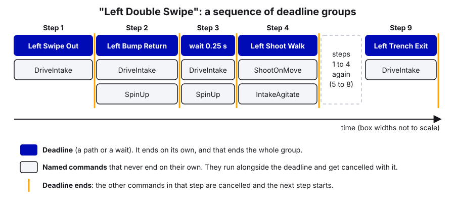
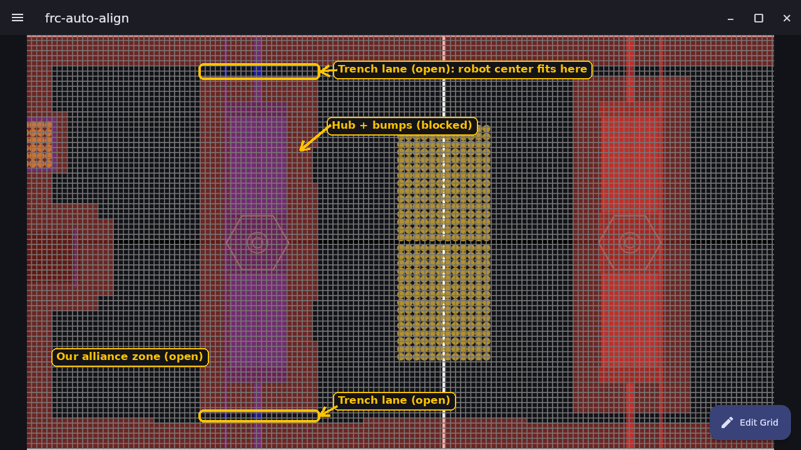
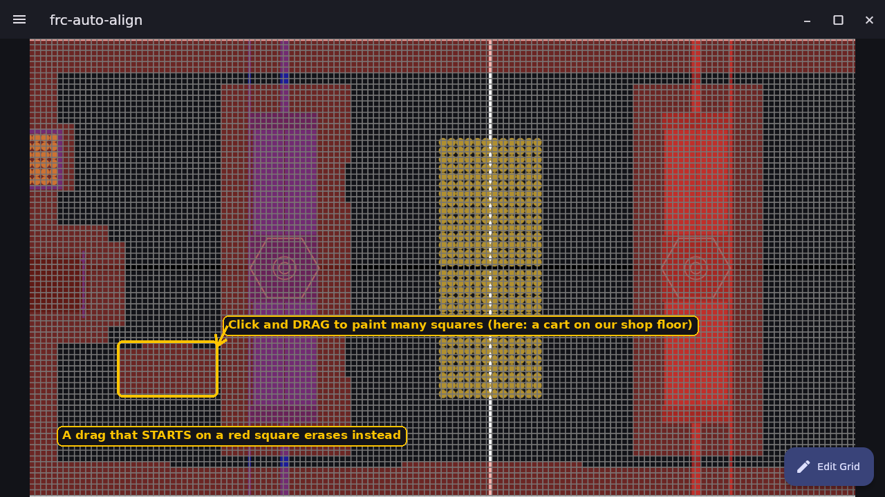

# 18. PathPlanner Autos

> **Who it's for:** anyone drawing autos, adding a robot action to an auto, or wiring PathPlanner into a new robot.
> **Read first:** [04 Command-based](04-command-based-basics.md), [07 What is PID](07-what-is-pid.md),
> [16 Swerve](16-swerve-drive-ctre.md), [17 Limelight](17-limelight-and-vision.md). **Time:** about 2 hours to read and
> draw your first auto; a practice session or two to trust it on the floor.

**What you'll learn**
- How to install PathPlanner, open our project, and fill in the Robot Config so it matches the real robot
- How to draw paths (waypoints, rotation targets, constraint zones, event markers) and build autos from them
- How `AutoBuilder.configure`, named commands and the auto chooser connect the app to our code
- How on-the-fly pathfinding works (navgrid, warmup) and how auto-align uses it
- How to test in simulation, tune the path-following PID, and fix the usual problems

---

## 1. The idea

**PathPlanner** is two things:

| Part | What it is | Where it lives |
|---|---|---|
| **The app** (GUI) | You draw paths on a picture of the field and chain them into autos | Your laptop |
| **PathPlannerLib** | A vendor library in our code that reads those files and drives the robot along them | `vendordeps/PathplannerLib.json`, version 2026.1.2 |

The app saves plain JSON files into the robot project, under `src/main/deploy/pathplanner/`. Everything in
`src/main/deploy` is copied onto the robot when you deploy, so the robot reads exactly the files you drew.

```
src/main/deploy/pathplanner/
├── settings.json      Robot Config + default speed limits (the app writes this)
├── navgrid.json       Obstacle map for on-the-fly pathfinding
├── paths/*.path       One drawn path each ("Left Swipe Out.path")
└── autos/*.auto       A sequence of paths + robot actions ("Left Double Swipe.auto")
```

A **path** is one smooth drive from A to B. An **auto** is a list of steps: follow this path, run this robot action,
wait, do two things at once. A **named command** is a robot action (intake, shoot) that the code registers under a
name so autos can call it.

While a path runs, PathPlannerLib works out every 20 ms where the robot *should* be, compares it to where the pose
estimator says it *is*, and corrects with a PID controller. So **autos are only as good as the robot's pose**: wheel
odometry plus Limelight corrections (guide 17).

```
  .path file ──> where we should be now (target pose + speed)
                          │
  drivetrain pose ──────> PPHolonomicDriveController (speed + PID on the error)
                          │
                          v
              drivetrain.driveRobotRelative(speeds)
```

---

## 2. Step by step: install and open the project

1. Install PathPlanner from the [PathPlanner releases page](https://github.com/mjansen4857/pathplanner/releases)
   (or the Microsoft Store on Windows). Use the version that matches PathPlannerLib in `vendordeps` (2026.x).
2. Open PathPlanner, click **Open Robot Project**, and pick the repo's folder (the one with `build.gradle`). It finds
   `src/main/deploy/pathplanner/` by itself.
3. You'll see the **Project Browser**: paths on one side, autos on the other, sorted into folders. Our 2026 robot uses
   folders `Left`, `Middle`, `Right`.
4. Before drawing anything, open **Settings** (gear icon) and check the **Robot Config** (next section). A path drawn
   with wrong robot numbers will be wrong on the real robot.

The ☰ menu (top left) also has **Navigation Grid** (section 7) and **Telemetry** (shows the robot live while
connected; set the roboRIO address `10.50.90.2` in Settings).

---

## 3. Robot Config: tell PathPlanner what the robot is

PathPlanner uses these to plan speeds the robot can really reach, and PathPlannerLib uses them while following.
Here are our 2026 robot's numbers from
[settings.json](https://github.com/TorqueNados-FRC5090/Hephaestus/blob/c2f0cee6f61db3f26f911d3f5623ed7fa27a5b03/src/main/deploy/pathplanner/settings.json):

| Setting | Ours | What it means / how to get it |
|---|---|---|
| Robot mass | 74.088 kg | Weight **with bumpers and battery**, in kg (lb × 0.4536). 74 kg = 163 lb. |
| Robot MOI | 6.883 kg·m² | Moment of inertia: how hard the robot is to spin. PathPlanner recommends getting it from SysId; a formula estimate is rough. |
| Wheel radius | 0.048 m | Measure the real wheel. 0.048 m = 1.89 in. Note our `TunerConstants` uses 2 in (0.0508 m). Worn tread is smaller; keep the two in agreement. |
| Drive gearing | 5.273 | Motor turns per wheel turn. SDS MK5n R3 = (54/16)·(25/16) = 5.273. |
| True max drive speed | 5.45 m/s | Top speed **under load, measured**, not the theoretical free speed. Our theoretical `kSpeedAt12Volts` is 5.85 m/s. PathPlanner says measure it, or use about 85 % of free speed. |
| Wheel COF | 1.2 | Coefficient of friction, tread on carpet. 1.2 is typical for new tread. |
| Drive motor | Kraken X60 | |
| Drive current limit | 60 A | Matches `kSlipCurrent` (60 A) in `TunerConstants`, which CTRE applies as the drive motors' stator limit. PathPlanner uses it to work out how much push the wheels have. |
| Module offsets | ±0.273 m | Where each module is from the robot center (x forward, y left). Ours are 0.273 m = 10.75 in; `TunerConstants` says 11 in (0.279 m). Small, but should agree. |
| Bumper width/length | 0.9 m × 0.9 m | Only for drawing the robot in the app. |
| Holonomic mode | on | Swerve can drive in one direction while facing another. |


**Default constraints** (Settings → App Settings) are the speed limits new paths start with. Ours: max velocity
3.0 m/s, max acceleration 3.0 m/s², max angular velocity 540 deg/s, max angular acceleration 720 deg/s².

> **The kSpeedAt12Volts lesson.** PathPlanner's numbers can be perfect and the robot still drives half speed. On our
> 2026 robot, `TunerConstants.kSpeedAt12Volts` was 10.24 m/s, about twice the real 5.85. Our
> `driveRobotRelative` uses CTRE's `ApplyRobotSpeeds` request in open-loop voltage mode, which turns "drive 3 m/s"
> into volts as `3 / kSpeedAt12Volts × 12 V`. With 10.24, a 3 m/s request got 3.5 V, which really moves the robot about
> 1.7 m/s. Autos ran at about half the speed the path asked for. Fix the drivetrain constant; don't "fix" it by
> drawing faster paths. See guide 16.

---

## 4. Step by step: draw a path

1. In the Project Browser, pick a folder and click **+** to add a path. Name it so the drive team can tell where it
   goes ("Left Swipe Out", not "New New Path"; yes, we have a `New New Path.path`).
2. **Waypoints.** The big dots are **anchors**: the robot's center passes exactly through them. Each has small
   **control points** that set the direction and how sharply the path curves. Double-click the field to add a
   waypoint; drag to move. Expand a waypoint in the side panel to type exact X/Y (meters, blue origin).
3. **Lock** a waypoint so you can't drag it by accident (control points can still change).
4. **Linked waypoints.** Give a waypoint a link name and use the same link in another path. Move one and every linked
   copy moves. Use this where one path ends and the next begins (e.g. a shooting spot), so they always meet.
5. **Rotation targets** (swerve only): "at 52 % of the way, face 90 degrees". The robot turns while it drives. Our
   `Left Shoot Walk` has one at 0.52 → 90° and one at 0.97 → 0°.
6. **Point towards zones:** for part of the path, keep facing a spot on the field (e.g. the hub).
7. **Constraint zones:** slow down for part of the path. Our `Depot Corner Out` has a zone named "slow" between
   waypoints 5 and 6 limited to 1.5 m/s, for the tight corner by the depot.
8. **Global constraints:** speed limits for this whole path. Untick "use default constraints" to set them. Our
   `Left Swipe Out` is allowed 4.0 m/s; `Left Shoot Walk` only 0.75 m/s because we shoot while driving it.
9. **Ideal starting state:** the speed and rotation the robot should start with. For the first path of an auto, this
   is where the robot is placed, and the auto resets the pose to it.
10. **Goal end state:** the speed and rotation at the end. End speed 0 = stop. A non-zero end speed lets the next
    path continue without stopping, but only if the next path starts with that speed.
11. **Event markers:** "at this point along the path, run this command". A marker can be a single point or a
    **zone** (start and end), which starts the command on entry and cancels it on exit.
12. Press **play** in the preview to watch the robot drive it. Check corners don't hit field elements.

There's no save button. Every change is written to the file immediately, and git shows it in VS Code's Source Control
panel, so nothing is lost by experimenting.

---

## 5. Step by step: build an auto

1. Click **+** on the autos side and name it ("Left Double Swipe").
2. Drag in commands. The top level is a **sequential** group: steps run one after another.
3. Command types you can add:

| Type | Runs | Ends when | Use it for |
|---|---|---|---|
| **Path** | Follows one path | Path finishes | Driving |
| **Named** | A command registered in code | That command ends | Intake, shoot, spin up |
| **Wait** | Nothing | Time is up | Let something settle |
| **Sequential group** | Children one after another | Last child ends | Steps in order |
| **Parallel group** | All children at once | **All** children end | Two things that both finish |
| **Deadline group** | All children at once | The **first** child (the deadline) ends; the rest are cancelled | "Intake **while** driving this path" |
| **Race group** | All children at once | **Any** child ends | "Whichever finishes first" |

4. **Reset odometry** (an option on the auto) sets the robot's pose to the first path's starting pose when the auto
   starts. All our 2026 autos have it on.
5. Save is automatic. Add the auto to the chooser in code (section 6).

Here's how our real `Left Double Swipe` auto is built (the `.auto` file, shown as a tree):

```
sequential
  deadline   path Left Swipe Out      + DriveIntake              drive out, intake the whole way
  deadline   path Left Bump Return    + DriveIntake + SpinUp     come back over the bump, spin up shooter
  deadline   wait 0.25                + DriveIntake + SpinUp     settle after the bump
  deadline   path Left Shoot Walk     + ShootOnMove + IntakeAgitate   shoot while walking slowly
  (the same four steps again)
  deadline   path Left Trench Exit    + DriveIntake
```

Notice that **every** never-ending command (`DriveIntake`, `SpinUp`, `ShootOnMove`, `IntakeAgitate`) sits in a
**deadline** group with a path or a wait as the deadline. That's what stops them.



---

## 6. Connecting it to the code

### AutoBuilder.configure

`AutoBuilder` is PathPlannerLib's factory: once configured, it can build any path or auto into a WPILib `Command`.
Configure it **once**, at startup. It needs:

| Argument | Ours | Why |
|---|---|---|
| Pose supplier | `drivetrain::getPose` | Where we are |
| Reset pose | `drivetrain::resetPose` | Used by "reset odometry" |
| Speeds supplier | `drivetrain::getChassisSpeeds` | Current robot-relative speed |
| Drive output | `driveRobotRelative` | How PathPlanner tells the swerve to move |
| Controller | `PPHolonomicDriveController(translation PID, rotation PID)` | Corrects errors; ours are kP = 5.0 for both |
| Robot config | `RobotConfig.fromGUISettings()` | Reads `settings.json`; fall back if it fails |
| Should flip | `onRedAlliance()` | Paths are drawn on blue; flip them for red |
| Requirements | `drivetrain` | So nothing else drives during a path |

**Alliance flipping.** We draw every path once on the **blue** side. When the Driver Station says we're red,
PathPlannerLib mirrors the path to the red side automatically. Never draw separate red paths.

### NamedCommands: the rules

1. **Register before any auto is built.** `AutoBuilder.buildAuto("...")` looks names up right then. A command
   registered afterwards is silently missing from that auto. Both our `AutonContainer`s call
   `registerNamedCommands()` first thing in the constructor.
2. **Names must match exactly**, including capitals and spaces: `"DriveIntake"` in code = `DriveIntake` in the app.
3. **A command that never ends must go in a deadline (or race) group.** In a sequential group it blocks every step
   after it, forever. Our old `DropIntake` ran forever and froze any auto that used it in a row; now it finishes
   instantly (`runOnce`) and the mechanism holds its position on its own.
4. **Don't require the drivetrain** in a named command that runs alongside a path. Two commands can't require the
   same subsystem at once, so the path (or the whole auto) would get cancelled.

A new named command in professional style (template pattern):

```java
private void registerNamedCommands() {
    // Finishes on its own: spins up and ends once the flywheel is at speed (or after 2 s)
    register("Spin Up Shooter", shooter.spinUpToSpeed().withTimeout(2.0));
    // Never ends on its own: ONLY use inside a deadline group with a path or wait as the deadline
    register("Run Intake", intake.runIntake());
}
```

(`shooter.spinUpToSpeed()` and `intake.runIntake()` stand in for whatever command factories your subsystems have.)

### The auto chooser

The drive team picks the auto from a dropdown on the dashboard. Two ways to make it:

| | `AutoBuilder.buildAutoChooser()` | Our hand-built `SendableChooser` |
|---|---|---|
| Lists | Every `.auto` file automatically | Only the ones we add |
| Names shown | File names | Whatever we type ("Left Double Swipe (SOTM)") |
| Risk | Test autos and `New Path` show up at a match | Forget to add a new auto |

We hand-build it, so the drive team only sees tested autos. Either way, autos are built **at startup**, not when
Auto begins, because loading a big auto can take a moment.

```java
// The automatic version, if you want it:
SendableChooser<Command> autoChooser = AutoBuilder.buildAutoChooser();   // default = none
SmartDashboard.putData("Auton Selector", autoChooser);
```

---

## 7. On-the-fly pathfinding

Sometimes you don't know the start in advance, e.g. "drive to the hub from wherever I am right now". That's
**pathfinding**: PathPlanner plans a route at that moment, around obstacles.

```java
PathConstraints constraints = new PathConstraints(
    3.0, 3.0,                                  // max speed m/s, max acceleration m/s²
    Units.degreesToRadians(540), Units.degreesToRadians(720));   // max turn rad/s, rad/s²
Command driveToHub = AutoBuilder.pathfindToPose(hubShootingPose, constraints, 0.0);   // 0.0 = arrive stopped
```

**The navgrid.** How does it know what to avoid? `deploy/pathplanner/navgrid.json` splits the field into squares,
each open or blocked, for the robot's **center**. Edit it in the app: ☰ → **Navigation Grid**, click a square to toggle
it, click and drag to paint. Blocked areas should be bigger than the real object by half the robot plus a margin. The
2026 robot still has PathPlanner's default 0.3 m grid; frc-auto-align uses 10 cm squares with the trench lanes open
and the bumps blocked.

 

**Warmup.** The first pathfind after boot is slow (Java is loading and optimizing the code). PathPlanner gives you
`PathfindingCommand.warmupCommand()`, a practice run to schedule once at startup:

```java
CommandScheduler.getInstance().schedule(PathfindingCommand.warmupCommand());
```

> **Our lesson:** the warmup shares the pathfinder with real requests. Pressing auto-align while the warmup was still
> running left the robot stuck in "Pathfinding" forever. frc-auto-align now refuses (with a "try again" buzz) while
> the warmup is scheduled.

### Auto-align

frc-auto-align combines this with vision: hold a paddle, and the robot turns to the final heading, pathfinds to an
approach spot in front of the target, then drives the last bit with its own P-controller (`DriveToPose`) for
accuracy. Read the
[AUTO-ALIGN-GUIDE](https://github.com/HALFxAxHEART/frc-auto-align/blob/c95ddf4a2ee25c406ea6e2ed04e232b17b39b8f7/AUTO-ALIGN-GUIDE.md)
(section 8 is a PathPlanner and navgrid walkthrough with screenshots), then
[AutoAlign.java](https://github.com/HALFxAxHEART/frc-auto-align/blob/c95ddf4a2ee25c406ea6e2ed04e232b17b39b8f7/src/main/java/frc/robot/commands/AutoAlign.java)
and
[DriveToPose.java](https://github.com/HALFxAxHEART/frc-auto-align/blob/c95ddf4a2ee25c406ea6e2ed04e232b17b39b8f7/src/main/java/frc/robot/commands/DriveToPose.java).


---

## 8. In our code

### 2026 robot: AutonContainer

[AutonContainer.java, lines 31–53 (config + AutoBuilder.configure)](https://github.com/TorqueNados-FRC5090/Hephaestus/blob/c2f0cee6f61db3f26f911d3f5623ed7fa27a5b03/src/main/java/frc/robot/commands/AutonContainer.java#L31-L53):

```java
        RobotConfig config = PP_CONFIG;
        try { config = RobotConfig.fromGUISettings(); }
        catch (Exception e) { e.printStackTrace(); }

        // Logged so AdvantageScope can overlay the planned path / target pose on the actual pose
        PathPlannerLogging.setLogTargetPoseCallback(pose -> RobotLog.pose("Auto target", pose));
        PathPlannerLogging.setLogActivePathCallback(poses -> RobotLog.poses("Auto path", poses));

        AutoBuilder.configure(
            drivetrain::getPose, 
            drivetrain::resetPose,
            drivetrain::getChassisSpeeds,
            (speeds, feedforwards) -> drivetrain.driveRobotRelative(speeds),
            new PPHolonomicDriveController(
                    new PIDConstants(5.0, 0.0, 0.0), // Translation PID constants
                    new PIDConstants(5.0, 0.0, 0.0) // Rotation PID constants
            ),
            config,
            () -> robotContainer.onRedAlliance(),
            drivetrain
        );
```

What to notice:
- `registerNamedCommands()` runs on line 29, **before** any auto is built. Correct order.
- The fallback `PP_CONFIG` is used if `settings.json` fails. But look at it in
  [Constants.java, lines 41–58](https://github.com/TorqueNados-FRC5090/Hephaestus/blob/c2f0cee6f61db3f26f911d3f5623ed7fa27a5b03/src/main/java/frc/robot/Constants.java#L41-L58):
  40 kg, MOI 4, made-up motor numbers, and module positions from an old 23-inch chassis
  ([lines 70–75](https://github.com/TorqueNados-FRC5090/Hephaestus/blob/c2f0cee6f61db3f26f911d3f5623ed7fa27a5b03/src/main/java/frc/robot/Constants.java#L70-L75))
  where the front-left module has a **negative** X. If the fallback ever kicked in, autos would be badly off. The
  template builds its fallback from `TunerConstants` instead.
- The exception is only printed to the console. The template reports it to the Driver Station, where someone sees it.
- `(speeds, feedforwards) -> drivetrain.driveRobotRelative(speeds)` throws away PathPlanner's per-wheel force
  feedforwards. The template passes them on (see below).
- `PathPlannerLogging` logs `Poses/Auto target` and `Poses/Auto path`, so AdvantageScope can show where the robot
  should be next to where it is.

[Lines 56–76 (named commands)](https://github.com/TorqueNados-FRC5090/Hephaestus/blob/c2f0cee6f61db3f26f911d3f5623ed7fa27a5b03/src/main/java/frc/robot/commands/AutonContainer.java#L56-L76):

```java
        // DropIntake/RaiseIntake finish instantly (they used to run forever and froze any auto that used them in a row).
        // The pivot holds its position after they end.
        NamedCommands.registerCommand("DropIntake", robotContainer.evilIntake.runOnce(() -> robotContainer.evilIntake.evilyummy(EvilIntakePosition.out)));
        ...
        // Never ends on its own: only use it inside a deadline group with a path as the deadline
        NamedCommands.registerCommand("DriveIntake", new EvilIntakePiece(robotContainer.evilIntake, EvilIntakePosition.out));
        // Stand-still shoot. Hub only, never passes.
        NamedCommands.registerCommand("Shoot", robotContainer.autoShootCommand().withTimeout(5));
        ...
        // Never ends on its own: put it in a deadline group with a path to shoot while driving
        NamedCommands.registerCommand("ShootOnMove", robotContainer.autoShootCommand());
```

The comments say which commands end and which don't. Do that for every named command you add. (`evilIntake` /
`evilyummy` are joke names; in new code call them something like `IntakeRack` / `setRackPosition()`.) Notice `Shoot` and
`ShootOnMove` are the same command, one with a 5 s timeout so it can stand alone in a sequence.

[Lines 78–94 (chooser)](https://github.com/TorqueNados-FRC5090/Hephaestus/blob/c2f0cee6f61db3f26f911d3f5623ed7fa27a5b03/src/main/java/frc/robot/commands/AutonContainer.java#L78-L94)
hand-builds the chooser: "Do Nothing" by default, then e.g. `"Left Double Swipe (SOTM)"` →
`AutoBuilder.buildAuto("Left Double Swipe")`, `"Center Depot"` → `"Center with Depot"`. Two autos in the folder
(`Left Fuel, Shoot, Ladder (No Shove+Move)` and `Left Shoot, Fuel, Shoot (No Shoot+Move)`) aren't in the chooser, so
the drive team can't pick them. That's the hand-built chooser doing its job, or someone forgetting; check before an event.

The paths and autos themselves:
[deploy/pathplanner/autos](https://github.com/TorqueNados-FRC5090/Hephaestus/tree/c2f0cee6f61db3f26f911d3f5623ed7fa27a5b03/src/main/deploy/pathplanner/autos)
and [paths](https://github.com/TorqueNados-FRC5090/Hephaestus/tree/c2f0cee6f61db3f26f911d3f5623ed7fa27a5b03/src/main/deploy/pathplanner/paths).
Good ones to open in the app: `Left Double Swipe` (deadline groups, shoot on the move), `Center Depot Trench`
(timed `wait` deadlines while shooting), and the path `Center back`, which has an event marker running `DriveIntake`.

### Template: AutonContainer + AutoConstants

[Robot-Template AutonContainer.java, lines 37–64](https://github.com/TorqueNados-FRC5090/Robot-Template/blob/b8dddd0e338841e867c0cc260162e6097adecd7b/src/main/java/frc/robot/commands/AutonContainer.java#L37-L64)
is the cleaned-up version:

```java
        // Named commands must be registered BEFORE any auto is built, or PathPlanner can't find them
        registerNamedCommands();

        RobotConfig config;
        try {
            config = RobotConfig.fromGUISettings();
        } catch (Exception e) {
            DriverStation.reportError("PathPlanner settings.json failed to load, using fallback config: " + e.getMessage(), e.getStackTrace());
            config = AutoConstants.kFallbackConfig;
        }
        ...
        AutoBuilder.configure(
            drivetrain::getPose,
            drivetrain::resetPose,
            drivetrain::getChassisSpeeds,
            drivetrain::driveRobotRelative,
            new PPHolonomicDriveController(AutoConstants.kTranslationPID, AutoConstants.kRotationPID),
```

- PID gains live in `Constants.AutoConstants`, and `kFallbackConfig` is built from `TunerConstants` so it can't drift
  from the real drivetrain
  ([Constants.java, lines 115–149](https://github.com/TorqueNados-FRC5090/Robot-Template/blob/b8dddd0e338841e867c0cc260162e6097adecd7b/src/main/java/frc/robot/Constants.java#L115-L149)).
- `drivetrain::driveRobotRelative` takes `(ChassisSpeeds, DriveFeedforwards)` and passes the wheel force
  feedforwards to CTRE's `ApplyRobotSpeeds`, so paths track better while accelerating
  ([CommandSwerveDrivetrain.java, lines 223–230](https://github.com/TorqueNados-FRC5090/Robot-Template/blob/b8dddd0e338841e867c0cc260162e6097adecd7b/src/main/java/frc/robot/subsystems/CommandSwerveDrivetrain.java#L223-L230)).
- `register(name, command)`
  ([lines 77–80](https://github.com/TorqueNados-FRC5090/Robot-Template/blob/b8dddd0e338841e867c0cc260162e6097adecd7b/src/main/java/frc/robot/commands/AutonContainer.java#L77-L80))
  logs an `AUTO named command: <name>` event every time an auto runs one, so the log shows what really ran.

### frc-auto-align: warmup and pathfinding

[AutoAlign.java, lines 72–77](https://github.com/HALFxAxHEART/frc-auto-align/blob/c95ddf4a2ee25c406ea6e2ed04e232b17b39b8f7/src/main/java/frc/robot/commands/AutoAlign.java#L72-L77)
creates the warmup command, and
[lines 128–130](https://github.com/HALFxAxHEART/frc-auto-align/blob/c95ddf4a2ee25c406ea6e2ed04e232b17b39b8f7/src/main/java/frc/robot/commands/AutoAlign.java#L128-L130)
refuse to align while it's still running:

```java
        if (m_warmup.isScheduled()) {
            return giveUp(group.name(), "pathfinder still warming up after boot, try again in a few seconds");
        }
```

[Lines 170–171](https://github.com/HALFxAxHEART/frc-auto-align/blob/c95ddf4a2ee25c406ea6e2ed04e232b17b39b8f7/src/main/java/frc/robot/commands/AutoAlign.java#L170-L171)
skip pathfinding entirely when the robot is already close and lined up, and otherwise call
`AutoBuilder.pathfindToPose(approach, m_constraints, 0.0)`.

---

## 9. Tuning the path-following PID

`PPHolonomicDriveController` adds a correction on top of the planned speed:

- **Translation kP** (ours 5.0): meters of position error → m/s of extra speed. 0.1 m behind → +0.5 m/s.
- **Rotation kP** (ours 5.0): radians of heading error → rad/s of extra turn.

Steps (guide 08 has the general method):

1. Fix the drivetrain first: `kSpeedAt12Volts`, wheel radius, gearing, drive gains (guide 16). PID can't fix a robot
   that doesn't drive the speed it's told.
2. Run a simple straight path, then an S-curve. In AdvantageScope compare `Poses/Auto target` to the robot pose.
3. Robot lags behind the target the whole way → raise translation kP (or the drivetrain is slow, see step 1).
4. Robot wobbles side to side around the path → lower translation kP.
5. Heading lags rotation targets → raise rotation kP; heading oscillates → lower it.
6. Change one number at a time, write down what happened.

---

## 10. Testing in simulation, then on the floor

1. Run **Simulate Robot Code** in VS Code (template STUDENT-GUIDE "Try code without a robot"). CTRE's swerve has a
   built-in simulation, so autos really drive the simulated robot.
2. In the sim GUI or Elastic, pick the auto in `Auton Selector`, set the alliance, and enable **Autonomous**.
3. Open AdvantageScope connected to the sim. On a **2D Field** tab add the robot pose, `Poses/Auto target`, and
   `Poses/Auto path`. The robot should sit on the target pose; the path shows what PathPlanner planned.
4. Try both alliances. On red the path should be mirrored to the red side.
5. Check the log for `AUTO named command:` events (template) to confirm each named command really ran.
6. On the real robot: first runs at reduced global constraints, on half a field, with someone on the disable button.
   Place the robot exactly on the starting pose (tape marks help).

---

## 11. Troubleshooting

| Symptom | Likely cause | Fix |
|---|---|---|
| Auto drives about **half speed** | `kSpeedAt12Volts` too high (our 10.24 vs 5.85) | Fix it in `TunerConstants` (guide 16) |
| Robot starts in the wrong spot / drives to the wrong place | Reset odometry off, robot placed differently from the path's start, or vision pulled it | Place it on the start pose; check "reset odometry"; check `Poses/Auto target` vs robot pose at t = 0 |
| Heading wrong for the whole auto | Reset odometry also sets the **heading** to the path's start rotation, replacing the Limelight's disabled-time heading fix (guide 17) | Square the robot up carefully, or turn off reset odometry and trust vision for the start pose |
| Mirrored wrong / drives into the wall on red | Should-flip supplier wrong, or a path drawn on the red side | Draw everything on blue; check `onRedAlliance()` and the DS alliance |
| Named command doesn't run | Name typo, or registered after the auto was built | Match names exactly; register first in the constructor |
| Auto stops partway and never continues | A never-ending command in a sequential group | Put it in a deadline group (our `DropIntake` lesson) |
| Whole auto cancelled when an action starts | Named command requires the drivetrain | Remove the drivetrain requirement |
| Robot stuck in "Pathfinding" right after boot | Pathfind requested during the warmup | Wait for the warmup, or refuse while it's scheduled (frc-auto-align) |
| Pathfinding clips a field element | Navgrid doesn't block enough | Paint more squares around it in Navigation Grid |
| `settings.json failed to load` | File missing/corrupt, or app/library version mismatch | Re-save the Robot Config in the app; match versions |

---

## 12. Common mistakes

- **kSpeedAt12Volts 2× too high** → autos at half speed. The most expensive mistake of 2026.
- **DropIntake ran forever** → every auto that used it in a row froze. Commands in sequences must end.
- **Warmup + auto-align** → stuck "Pathfinding". Found in simulation before the robot moved.
- **Stale fallback config** → the 2026 `PP_CONFIG` doesn't describe the robot at all. Build it from `TunerConstants`.
- **Robot Config and TunerConstants disagree** (wheel radius 0.048 vs 0.0508 m, module offsets 10.75 vs 11 in).
  Measure once, put the same number in both.
- **Junk paths in the project** (`New Path`, `New New Path`). Delete or rename them; they confuse everyone and would
  show up in an automatic chooser.
- **Pigeon ID wrong** (24 vs 0) → frozen heading → every rotation in an auto wrong. Check IDs in Tuner X.

---

## 13. Checklist

- [ ] PathPlanner app version matches PathPlannerLib in `vendordeps`
- [ ] Robot Config matches the real robot and `TunerConstants` (mass, wheel radius, gearing, offsets, current limit)
- [ ] `kSpeedAt12Volts` is right (straight-line speed test)
- [ ] Every path drawn on the **blue** side; works on both alliances in sim
- [ ] Every named command registered before autos are built; names match exactly
- [ ] Every never-ending named command is inside a deadline group, with a comment saying so
- [ ] New auto added to the chooser and tested in simulation
- [ ] `Poses/Auto target` tracks the robot pose in AdvantageScope
- [ ] First floor run at reduced speed, robot placed on the start pose

---

## 14. Practice

1. **Drive Forward.** In the template, open PathPlanner, look at the `Drive Forward` auto, then make a copy that
   drives 2 m forward, turns 90° with a rotation target, and stops. Add it to the chooser and run it in simulation.
2. **Deadline group.** Register a named command `"Wait Forever"` that is `Commands.idle()` (never ends). Put it
   first in a sequential auto before a path and watch the auto freeze in sim. Then move it into a deadline group with
   the path and watch it work.
3. **Red side.** Run any auto in sim on blue, then on red. Screenshot both in AdvantageScope and check they mirror.
4. **Fix the 2026 fallback.** Rewrite the 2026 robot's `PathPlannerConfigs.PP_CONFIG` to use the real mass, MOI and
   `TunerConstants` module positions, like the template's `kFallbackConfig`. Temporarily rename `settings.json` in sim
   to prove the fallback drives the same.

---

## Go further

- [PathPlanner docs home](https://pathplanner.dev/home.html)
- [Robot Config](https://pathplanner.dev/robot-config.html) and [GUI settings](https://pathplanner.dev/gui-settings.html)
- [Editing paths and autos](https://pathplanner.dev/gui-editing-paths-and-autos.html)
- [PathPlannerLib getting started](https://pathplanner.dev/pplib-getting-started.html) and
  [Build an auto (AutoBuilder)](https://pathplanner.dev/pplib-build-an-auto.html)
- [Named commands](https://pathplanner.dev/pplib-named-commands.html) and [Triggers / event markers](https://pathplanner.dev/pplib-triggers.html)
- [Pathfinding](https://pathplanner.dev/pplib-pathfinding.html)
- [Custom logging](https://pathplanner.dev/pplib-custom-logging.html) and [GUI telemetry](https://pathplanner.dev/gui-telemetry.html)
- [CTRE swerve requests](https://v6.docs.ctr-electronics.com/en/stable/docs/api-reference/mechanisms/swerve/swerve-requests.html)
- [WPILib command compositions (deadline, race, parallel)](https://docs.wpilib.org/en/stable/docs/software/commandbased/command-compositions.html)
