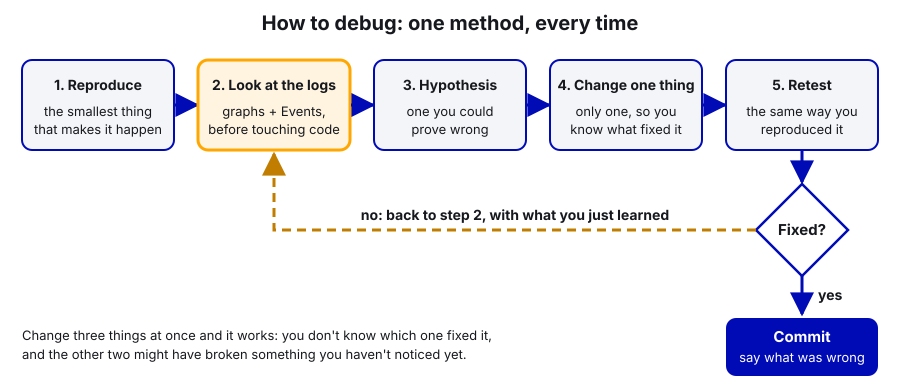

# 19. Logging and Debugging

> **Who it's for:** every programmer, and anyone who has to answer "why did the robot do that?" at an event.
> **Read first:** [03 Driver Station](03-driver-station-and-match-checklist.md), [04 Command-based](04-command-based-basics.md).
> Helpful: [06 Current limits](06-current-limits-and-brownouts.md) (most weird behaviour turns out to be power).
> **Time:** about 1 hour to read, plus one session with a real log open in AdvantageScope.

## What you'll learn

- What our robot records, where those files end up, and which tool opens each one
- How `RobotLog.java` works: `start()`, `periodic()`, `event()`, `eventOnRise()`, `pose()` and `poses()`
- How the REV PDH's per-channel currents tell you which motor caused a brownout
- How to read a `.wpilog` and a CTRE `.hoot` file in AdvantageScope (graphs, 2D field, swerve, joysticks)
- How to make the robot explain itself on the dashboard, the way our shooter's `Ready/` lights do
- A repeatable way to debug, and how to read a stack trace

---

## The idea: the robot is a black box unless you record it

A match lasts 2 minutes 30 seconds. You can't stand next to the robot, you can't add a print statement, and you
can't ask it to "do that again". If something goes wrong, the only evidence is what the robot wrote down while it
happened. A **log** is that record: the robot writes values (numbers, true/false, text, poses) with a timestamp,
many times per second, to a file.

Our rule (from the Robot-Template [LOGGING.md](https://github.com/TorqueNados-FRC5090/Robot-Template/blob/b8dddd0e338841e867c0cc260162e6097adecd7b/LOGGING.md)):
**the first time something weird happens, check the log before changing code.** Guessing wastes practice time, and
a wrong guess can hide the real problem until it shows up again in a playoff match.

There are four places a record ends up:

| Record | Who makes it | File | Where it lives | Open with |
|---|---|---|---|---|
| WPILib data log | `RobotLog.start()` (uses WPILib's `DataLogManager`) | `.wpilog` | USB stick in the roboRIO: `/u/logs/` | AdvantageScope |
| CTRE signal log | CTRE's `SignalLogger` (also started by `RobotLog.start()`) | `.hoot` (one per CAN bus) | USB stick: `/u/ctre-logs/` | AdvantageScope, or Tuner X **Log Extractor** |
| Driver Station log | The Driver Station laptop, automatically | `.dslog` + `.dsevents` | DS laptop: `C:\Users\Public\Documents\FRC\Log Files` | DS Log Viewer (AdvantageScope opens them too) |
| Console | `System.out`, `DriverStation.reportWarning`, crashes | text | Live in the DS console and VS Code RioLog; also saved inside the `.wpilog` | Same as the `.wpilog` |


**Words used here:**
- **NetworkTables (NT):** the live data channel between the robot and laptops. Anything you `SmartDashboard.put...`
  goes into NT. Dashboards like Elastic read from it.
- **AdvantageScope:** a free viewer for robot logs, installed with WPILib. We use it *only as a viewer*. (The team
  does not use AdvantageKit, a different logging framework from the same authors. You don't need it.)
- **Pose:** where the robot is on the field: x and y in meters, plus a heading. See [16 Swerve](16-swerve-drive-ctre.md).

Because `RobotLog.start()` turns on NetworkTables logging, **everything you put on the dashboard is also in the
`.wpilog`.** That's the key trick: if you'd want to see a value live, put it on the dashboard, and you get it in the
log for free.

---

## What gets logged

The full list, and why each item matters, is in
[Robot-Template LOGGING.md](https://github.com/TorqueNados-FRC5090/Robot-Template/blob/b8dddd0e338841e867c0cc260162e6097adecd7b/LOGGING.md).
Read it once. In short, there are six groups. Groups 1 to 5 stay the same every year; group 6 is rewritten for each game.

| Group | Examples | Answers the question... |
|---|---|---|
| 1. Match context | Code version, alliance, match number, selected auto | "Which code and which match is this log from?" |
| 2. Power and health | Battery voltage, brownouts, PDH channels, motor current and temperature, CAN faults, loop time | "Was it power, CAN, or a slow loop?" |
| 3. Drivetrain and position | Fused pose, vision pose, gyro yaw and connected, module states | "Did the robot know where it was?" |
| 4. Driver and commands | Every joystick axis and button, every command start/end/interrupt | "Did the driver press it, and did something cancel it?" |
| 5. Autonomous | Selected auto, active path, target pose vs actual pose | "Where did the auto fall behind?" |
| 6. Game-specific | Each shot, mechanism setpoint vs actual, game-piece sensors, safety interlocks | "Why did that shot miss?" |

Most "the robot acted weird" problems we've had were group 2 or 3: the 120 A drive current limit that caused
brownouts, and the Pigeon gyro with the wrong CAN ID.

---

## RobotLog.java, one method at a time

`RobotLog` is a small static class. You never create one; you call its methods from anywhere. The Robot-Template
version is the one to copy into a new project.

| Method | Call it... | What it does |
|---|---|---|
| `start(String... canivoreNames)` | Once, as the **first line** of `Robot()` | Starts the `.wpilog` (USB stick if present), logs all NetworkTables values and the joysticks, points CTRE's SignalLogger at the stick and starts it, hooks into the command scheduler so every command's START / END / INTERRUPTED goes into a `Commands` entry, and publishes the PDH so every breaker's current is logged. Warns on the DS if there's no USB stick. |
| `periodic()` | Every loop, in `robotPeriodic()` | Loop time, battery voltage, brownout events, CAN bus use and errors for the roboRIO bus and each CANivore. |
| `event(String)` | When something happens once | Adds one line of text to the `Events` entry (and the console). |
| `eventOnRise(key, condition, message)` | Every loop, with a condition | Logs `message` only on the loop the condition turns **true**, not every loop it stays true. `key` is any unique name. |
| `pose(name, Pose2d)` | Whenever you have a pose to show | Publishes it at `Poses/<name>` so AdvantageScope can draw it on the field. |
| `poses(name, List<Pose2d>)` | For a list of poses | Same, for a list (for example the path PathPlanner is following). |

### In our code: `start()` and `periodic()` in the template

[Robot-Template Robot.java, lines 42–66](https://github.com/TorqueNados-FRC5090/Robot-Template/blob/b8dddd0e338841e867c0cc260162e6097adecd7b/src/main/java/frc/robot/Robot.java#L42-L66)
calls `RobotLog.start(Constants.CANBuses.kCanivore)` first in the constructor, and `RobotLog.periodic()` at the end
of `robotPeriodic()`. Here is the start of
[RobotLog.java, lines 62–75 (start: the log files)](https://github.com/TorqueNados-FRC5090/Robot-Template/blob/b8dddd0e338841e867c0cc260162e6097adecd7b/src/main/java/frc/robot/RobotLog.java#L62-L75):

```java
public static void start(String... canivoreNames) {
    DataLogManager.start();   // picks the USB stick (/u) automatically when one is plugged in
    DataLogManager.logNetworkTables(true);
    DriverStation.startDataLog(DataLogManager.getLog());

    // CTRE logs: USB stick if present, otherwise CTRE's default location on the RIO
    boolean usbStick = new File("/u").canWrite();
    if (usbStick) {
        SignalLogger.setPath("/u/ctre-logs/");
    } else if (RobotBase.isReal()) {
        DriverStation.reportWarning("No USB stick in the roboRIO: logs are going to the RIO's small internal storage", false);
    }
    SmartDashboard.putBoolean("Logging/USB stick", usbStick);
    SignalLogger.start();
```

**Notice:** `DriverStation.startDataLog` is what records the joysticks. `Logging/USB stick` is on the dashboard so
you can check it before a match.

**Why it must be first:** anything a subsystem does in its constructor (like the intake setting its zero) happens
before the log starts if `start()` comes second, and you lose it.

**The 2026 robot's copy is older.** Hephaestus has `RobotLog.start()` with no `periodic()`; its
[Robot.java, lines 65–94](https://github.com/TorqueNados-FRC5090/Hephaestus/blob/c2f0cee6f61db3f26f911d3f5623ed7fa27a5b03/src/main/java/frc/robot/Robot.java#L65-L94)
does the brownout event and loop timing by hand. The template moved all of that into `RobotLog.periodic()`.
Copy the template version.

### Power logging with the REV PDH: which motor browned us out?

Every motor gets its power through the **REV PDH** (Power Distribution Hub, CAN ID 1; see guide 30). The PDH
measures the current on **every channel**, the total current and the battery voltage, and sends it over CAN. WPILib
reads it with the `PowerDistribution` class, and the template logs all of it.
[RobotLog.java, lines 86–92 (power)](https://github.com/TorqueNados-FRC5090/Robot-Template/blob/b8dddd0e338841e867c0cc260162e6097adecd7b/src/main/java/frc/robot/RobotLog.java#L86-L92):

```java
// Power: putData publishes voltage, total current and every channel, so they all end up in the log
try {
    s_pdh = new PowerDistribution();
    SmartDashboard.putData("Power/PDH", s_pdh);
} catch (RuntimeException e) {
    DriverStation.reportError("No PDH/PDP found, breaker currents won't be logged: " + e.getMessage(), false);
}
```

**Notice:**
- This runs once, in `start()`. `putData` hands the PDH to the dashboard, and WPILib refreshes it **every loop** by
  itself, so the log gets `Power/PDH/Voltage`, `Power/PDH/TotalCurrent` and `Power/PDH/Chan0` to `Chan23` (one per
  channel, in amps) all match long. `RobotLog.periodic()` adds `Power/Battery (V)` and a `BROWNOUT` event
  ([lines 109–111](https://github.com/TorqueNados-FRC5090/Robot-Template/blob/b8dddd0e338841e867c0cc260162e6097adecd7b/src/main/java/frc/robot/RobotLog.java#L109-L111)).
- `new PowerDistribution()` finds the PDH by itself. If you want to be explicit (and get a clear error when the ID is
  wrong), write `new PowerDistribution(1, PowerDistribution.ModuleType.kRev)`: CAN ID 1, a REV PDH.
- No PDH found is a red DS error, not a crash, so the robot still runs. Treat that error as a real problem.

You can also read single values in your own code: `pdh.getVoltage()`, `pdh.getTotalCurrent()`,
`pdh.getCurrent(channel)`.

**Why it helps:** when the robot browns out, the `BROWNOUT` event tells you *when*. Graph the PDH channels around that
moment and the tallest line tells you *which motor* was pulling the current. That's how you'd find, for example, a
drive motor sitting at its stator limit, or a jammed roller drawing 60 A.

**It only works with a channel map.** "Chan7 hit 95 A" is useless until you know channel 7 is the left shooter motor.
Write down which device is on which channel when the robot is wired (our electrical binder has a fill-in table), keep
it with the robot, and put the channels in `Constants` as named numbers (for example `kShooterLeaderPdhChannel = 7`).

**Firmware and status:** the PDH is a REV device, so Tuner X can't see it. Use the **REV Hardware Client** on a laptop:
plug a USB-C cable into the PDH, select it, and the client shows its status and updates its firmware. Do that at the
start of the season with the other firmware updates.

> **2027 note (our plan):** on SystemCore the PDH gets bus `can_s4` to itself. It's CAN 2.0 only, which our electrical
> binder flags to check against the 2027 manual.

### In our code: events and poses

[RobotLog.java, lines 127–142 (event, eventOnRise)](https://github.com/TorqueNados-FRC5090/Robot-Template/blob/b8dddd0e338841e867c0cc260162e6097adecd7b/src/main/java/frc/robot/RobotLog.java#L127-L142):

```java
/** A one-off text event, e.g. "Brownout" or "Intake homed" */
public static void event(String message) {
    if (s_events != null) {
        s_events.append(message);
    }
    DataLogManager.log(message);
}

/** Logs an event only when the condition turns true (not every loop it stays true) */
public static void eventOnRise(String key, boolean condition, String message) {
    boolean last = s_lastState.getOrDefault(key, false);
    if (condition && !last) {
        event(message);
    }
    s_lastState.put(key, condition);
}
```

**Notice:** `eventOnRise` remembers the last value of each `key`. If you called plain `event()` every loop while
the hood is held down, you'd get 50 identical lines per second and the useful lines would be buried.

Real uses on the 2026 robot:
- [EvilIntake.java, lines 342–374](https://github.com/TorqueNados-FRC5090/Hephaestus/blob/c2f0cee6f61db3f26f911d3f5623ed7fa27a5b03/src/main/java/frc/robot/subsystems/EvilIntake.java#L342-L374)
  logs "Intake homing: pushing out...", "Intake homed in 0.84 s" or "Intake homing FAILED ...". (`EvilIntake` is a
  joke name; in new code call it something like `IntakeRack`.)
- [AutonContainer.java, lines 38–39](https://github.com/TorqueNados-FRC5090/Hephaestus/blob/c2f0cee6f61db3f26f911d3f5623ed7fa27a5b03/src/main/java/frc/robot/commands/AutonContainer.java#L38-L39)
  sends PathPlanner's target pose and active path to `Poses/Auto target` and `Poses/Auto path`.
- [Robot.java, line 82](https://github.com/TorqueNados-FRC5090/Hephaestus/blob/c2f0cee6f61db3f26f911d3f5623ed7fa27a5b03/src/main/java/frc/robot/Robot.java#L82)
  publishes `Poses/Robot`, and
  [line 153](https://github.com/TorqueNados-FRC5090/Hephaestus/blob/c2f0cee6f61db3f26f911d3f5623ed7fa27a5b03/src/main/java/frc/robot/Robot.java#L153)
  publishes `Poses/Vision` each time the Limelight sees tags.

---

## Step by step: get a log and open it

### At the robot

1. Plug a USB stick into the roboRIO (FAT32 formatted). Leave it there all season.
2. Deploy and connect. On the dashboard, check `Logging/USB stick` is **true**. If it's false, the logs are filling
   the roboRIO's small internal storage instead.
3. Run the match or test.
4. Get the files, either:
   - **Pull the stick** and copy `logs/*.wpilog` and `ctre-logs/` to a laptop, or
   - **AdvantageScope → File → Download Logs...** while connected (set the robot address to `10.50.90.2` in
     AdvantageScope's preferences first).
5. Rename or file them as `Season/Event/Match#` (for example `2027/Week3/Q14`). Logs are named by date and time,
   and after an event you'll have dozens.

### In AdvantageScope


1. **File → Open Log(s)...** and pick the `.wpilog`. You can open the `.hoot` files at the same time; AdvantageScope
   lines up their timestamps. (The first time you open a `.hoot` it asks you to accept CTRE's license.)
2. The **sidebar** on the left lists every logged value as a folder tree (`Power`, `Ready`, `Intake`, `Poses`...).
   The timeline along the top shows enabled/auto/teleop. Click or drag on it to move through the match.
3. **Line graph** (the default tab): drag fields from the sidebar onto the graph. Good first graphs:
   - `Power/Battery (V)` alone (template-based code; the 2026 robot doesn't publish it, so use a motor's supply
     voltage from the `.hoot` or the DS log). Dips under 7 V mean something drew a huge current.
   - `Ready/1 Shooter target RPS` and `Ready/1 Shooter actual RPS` on the same axis: you can see how long spin-up
     takes and how far each ball pulls the flywheel down.
   - `Intake/Position (in)` and `Intake/Target (in)`.
4. **2D Field** tab (click **+** to add a tab): pick the 2026 field, then drag in poses:
   - `Poses/Robot` as the robot (where the robot *thinks* it is).
   - `Poses/Vision` as a ghost (where the Limelight said it was). If the ghost and the robot disagree a lot, odometry
     is drifting or the camera numbers are wrong. Compare with `Vision/Correction (m)`.
   - `Poses/Auto target` as a ghost and `Poses/Auto path` as a trajectory: during auto, the robot should sit right on
     the target. If the target runs ahead, the robot is too slow (that was our `kSpeedAt12Volts` bug).
   - `Poses/Shot` shows where every shot was taken from.
5. **Swerve** tab: drag `DriveState/ModuleStates` (what the wheels did) and `DriveState/ModuleTargets` (what we asked
   for). Arrows that don't match = a module that's slipping, current-limited, or wired wrong.
6. **Joysticks** tab: shows the driver's controller, button by button, at any moment of the match. This settles
   "I pressed it and nothing happened".
7. **Console** tab: drag in `Events`, `Commands`, and `console`. This is the story of the match in text: which commands
   started and who interrupted them, every `SHOT` line, brownouts, CAN disconnects.

### CTRE `.hoot` files

The `.hoot` files have every CTRE device's own signals (stator and supply current, voltage, temperature, velocity,
faults) recorded at the CAN bus rate, which is faster and more precise than anything we put on the dashboard.

- **AdvantageScope** opens them directly.
- **Tuner X → Log Extractor** converts a `.hoot` to `.wpilog` (or other formats) if you need it somewhere else.
- A `.hoot` log that contains at least one **Phoenix Pro** licensed device exports *every* signal. Otherwise only a
  free subset (voltage, current, position, velocity, faults) is exported. Our devices are Pro, so you should see
  everything.
- CTRE's SignalLogger starts automatically on a real robot even if you forget (on a roboRIO 1, only when a USB stick
  is plugged in). Without `setPath` it writes to a `logs` folder on the first USB stick it finds, or to the roboRIO's
  own storage if there isn't one. `RobotLog.start()` sets the path itself so the CTRE logs always land in a known
  folder on the stick.

---

## The Driver Station log viewer

The Driver Station laptop records its own log every time it connects. Open the **FRC Driver Station Log File
Viewer** (installed with the FRC Game Tools) and pick the match by its time.

It shows battery voltage, roboRIO CPU, CAN utilization, **trip time and lost packets** (radio link quality),
brownouts, and mode changes. Use it first when the robot "died" or "stuttered", because it's the fastest way to
tell **comms** (lost packets climb, then the robot disables) from **power** (voltage dips, brownout marker). Match
logs from the field are on the DS laptop, so pull them before you leave the event.

---

## Live dashboards (Elastic)

Logs are for after. Dashboards are for now. We use **Elastic** (Shuffleboard also works). Both read NetworkTables,
so every `SmartDashboard.putNumber(...)` shows up.

Name keys like `Subsystem/Thing (units)`:
- The **slash** makes a folder. `Intake/Position (in)` goes in an `Intake` folder in Elastic and AdvantageScope.
- The **units** go in the name, because a bare `Hood angle` of `-2.2` could mean anything. Is it degrees? Motor
  rotations? (It's motor rotations.)
- Number items you want in order: `Ready/0 ALL READY`, `Ready/1 Shooter...`, `Ready/2 Turret...`, `Ready/3 Hood...`
  sort in the order you check them.
- Use the **same name** on the dashboard as in your head and in the code. Then live debugging and log review match.

Our 2026 code still has some older keys like `111 drive pose X` and `Optimal Hood Angle`. They work, but they don't
sort or group well. Use the new style for anything you add.

---

## Make the robot explain itself

The best logging doesn't just show numbers. It says **in words** what the robot is waiting for. On the 2026 robot,
the feeder only runs when the shooter is at speed and the hood is in place. When a driver says "it won't shoot",
the dashboard already says why.

[RobotContainer.java, lines 339–350 (updateShotDiagnostics)](https://github.com/TorqueNados-FRC5090/Hephaestus/blob/c2f0cee6f61db3f26f911d3f5623ed7fa27a5b03/src/main/java/frc/robot/RobotContainer.java#L339-L350):

```java
public void updateShotDiagnostics() {
    boolean shooterReady = shooter.isShooterReady(1.5);
    boolean turretReady = turret.canShootFromHere();   // info only, NOT required to shoot
    boolean hoodReady = hood.atSetpoint();
    SmartDashboard.putBoolean("Ready/0 ALL READY", shooterReady && hoodReady);

    // One line that says exactly what a shot is waiting on
    StringBuilder waiting = new StringBuilder();
    if (!shooterReady) waiting.append(String.format("SHOOTER %.0f of %.0f RPS. ", shooter.getVelocityRPS(), shooter.getTargetRPS()));
    if (!hoodReady) waiting.append(hood.isForcedDown() ? "HOOD held down near a trench. "
        : String.format("HOOD at %.2f, wants %.2f. ", hood.getAngle(), hood.getSetpoint()));
    SmartDashboard.putString("Feeder/Waiting on", waiting.length() == 0 ? "Nothing - ready to feed" : waiting.toString());
```

**Notice:**
- `Feeder/Waiting on` reads like a sentence: `SHOOTER 31 of 38 RPS.` or `HOOD held down near a trench.` A driver
  can read it; nobody has to remember which number means what.
- The `Ready/` lights below it (lines 356–368) give the **target, actual, error, and allowed error** for each part,
  so you can see *how far* from ready it is, not just yes/no.
- Safety interlocks use `eventOnRise` (lines 353–354), so the log says *when* the hood was forced down.
- The feeder command itself publishes `Feeder/State` ("Priming (backwards)", "FEEDING", "Waiting for Ready (see
  Ready/ lights)") in
  [theYappy.java, lines 43–61](https://github.com/TorqueNados-FRC5090/Hephaestus/blob/c2f0cee6f61db3f26f911d3f5623ed7fa27a5b03/src/main/java/frc/robot/commands/theYappy.java#L43-L61).

Other examples of the same pattern: `Intake/Status` and `Intake/Zero from` (which tells you whether the intake's
zero came from power-on or from homing, and says `HOMING FAILED - check for a jam` if it failed), and in the
auto-align repo, `Align/State` always says why it stopped ("Gave up: stuck", "Can't align: no tag seen").

**Do this for every mechanism with a "ready" condition.** It costs ten lines and saves an hour at an event.

---

## The shot log line

For tuning a shooter you need every shot's inputs in one place. The 2026 robot writes one line per shot.

[RobotContainer.java, lines 323–333 (logShot)](https://github.com/TorqueNados-FRC5090/Hephaestus/blob/c2f0cee6f61db3f26f911d3f5623ed7fa27a5b03/src/main/java/frc/robot/RobotContainer.java#L323-L333):

```java
private void logShot(String kind) {
    m_shotCount++;
    var state = drivetrain.getState();
    double speed = Math.hypot(state.Speeds.vxMetersPerSecond, state.Speeds.vyMetersPerSecond);
    RobotLog.event(String.format(
        "SHOT #%d %s %s | dist %.2fm | shooter %.1f/%.1f RPS | hood %.2f/%.2f | turret err %.2f rot | speed %.2f m/s | pose (%.2f, %.2f, %.0f deg)",
        m_shotCount, kind, turret.isPassing() ? "PASS" : "HUB", turret.getShootingDistance(),
        shooter.getVelocityRPS(), shooter.getTargetRPS(), hood.getAngle(), hood.getSetpoint(),
        turret.getAimErrorMotorRotations(), speed,
        state.Pose.getX(), state.Pose.getY(), state.Pose.getRotation().getDegrees()));
    RobotLog.pose("Shot", state.Pose);
```

**Notice:**
- It's called **once when feeding starts** (`theYappy` only calls `onFeedStart` when it goes from not-feeding to
  feeding), not every loop.
- Every setpoint is logged next to its actual value (`shooter 36.2/38.0 RPS`). A miss with `36/38` is a spin-up
  problem; a miss with `38/38` is a table or aim problem.
- It includes robot speed, because shoot-on-the-move misses look different from standing shots.
- The pose goes to `Poses/Shot`, so you can see every shot location on the 2D field.

**How to use it:** have someone write down hit/miss by shot number during practice. Afterwards, filter the `Events`
console for `SHOT`, line them up with the notes, and look for the pattern (all the misses beyond 4 m? all while
moving?). That's what you tune from. See [10 Flywheels](10-flywheels-and-shooters.md).

---

## How to debug: one method, every time



1. **Reproduce.** Find the smallest thing that makes it happen. "Turret aims wrong" is vague. "Turret aims wrong
   only when no AprilTag is visible" is something you can test.
2. **Look at the logs.** Before touching code. Graph the values around the moment it went wrong. Read the `Events`
   and `Commands` console.
3. **Form a hypothesis** you could prove wrong: "the gyro isn't updating, so the heading is frozen".
4. **Change one thing.** Only one. If you change three things and it works, you don't know which one fixed it, and
   the other two might have broken something you haven't noticed yet.
5. **Retest** the same way you reproduced it. If it's fixed, commit with a message that says what was wrong.

**A real example (the Pigeon ID).** Symptom: the turret only aimed correctly when the Limelight saw a tag.
Reproduce: cover the camera, rotate the robot by hand. Logs: the heading stayed flat while the robot turned.
Hypothesis: the code talks to a Pigeon that doesn't exist. Check: Tuner X showed the Pigeon at ID **0**; the code
said **24**. Change one thing: the ID. Retest: yaw follows the robot. The `Gyro/Connected` and `Gyro/Yaw (deg)`
keys were added after this bug so it shows up in seconds next time, and the template logs `CAN DISCONNECTED: Pigeon` the moment that happens
([CommandSwerveDrivetrain.java, lines 298–313](https://github.com/TorqueNados-FRC5090/Robot-Template/blob/b8dddd0e338841e867c0cc260162e6097adecd7b/src/main/java/frc/robot/subsystems/CommandSwerveDrivetrain.java#L298-L313)).

**Another (half-speed autos).** On the 2D field, `Poses/Auto target` ran further and further ahead of
`Poses/Robot`. The drive motors weren't at their current limit and the battery was fine, so the robot wasn't being
asked for enough speed. Cause: `kSpeedAt12Volts` was 10.24 m/s instead of 5.85, so PathPlanner's feedforward asked
for about half the voltage it needed.

---

## Printing messages: which one to use

| Use | When | Where it shows |
|---|---|---|
| `System.out.println("...")` | Quick checks while developing. Remove before merging. | VS Code RioLog, DS console, and the `console` entry in the `.wpilog` |
| `DriverStation.reportWarning("...", false)` | Something is wrong but the robot can keep going (no USB stick, version file missing) | Yellow message on the DS, plus the console |
| `DriverStation.reportError("...", false)` | Something is broken (no PDH found) | Red message on the DS, plus the console |
| `RobotLog.event("...")` | Anything you'll want to find after the match | `Events` entry in the `.wpilog`, plus the console |

**Never print every loop.** Printing 50 times a second floods the console, makes the loop slow, and the one line
that matters scrolls away. Use `eventOnRise`, or put the value on the dashboard.

The second argument of `reportWarning` / `reportError` is "print the stack trace". Leave it `false` unless you need
to know *where* the call came from.

---

## Reading a stack trace

When Java code throws an exception nobody catches, the robot program **crashes and restarts**. The robot stops for
a few seconds, the DS shows "No Robot Code", and the console shows a **stack trace**. You'll see it in the DS console
(the gear icon → View Console, or the messages pane) or in VS Code (**WPILib: Start RioLog**). It's also in the
`.wpilog`'s `console` entry.

An example (made up, but this is what they look like):

```
Error at frc.robot.subsystems.Hood.getAngle(Hood.java:88): Unhandled exception: java.lang.NullPointerException:
    Cannot invoke "com.ctre.phoenix6.hardware.TalonFX.getPosition()" because "this.hood" is null
	at frc.robot.subsystems.Hood.getAngle(Hood.java:88)
	at frc.robot.RobotContainer.updateShotDiagnostics(RobotContainer.java:349)
	at frc.robot.Robot.robotPeriodic(Robot.java:71)
	at edu.wpi.first.wpilibj.IterativeRobotBase.loopFunc(IterativeRobotBase.java:...)
	...
Warning at edu.wpi.first.wpilibj.RobotBase.runRobot: The robot program quit unexpectedly.
```

How to read it:
1. **First line: what went wrong.** `NullPointerException` = you used an object that was never created.
   `ArrayIndexOutOfBoundsException`, `IllegalArgumentException`, etc. Java often says exactly which variable was null.
2. **The `at` lines: where, newest first.** The top `at` line is where it blew up. Each line below is "who called that".
3. **Find the first line that's in `frc.robot`.** That's your code. Lines in `edu.wpi.first` or `com.ctre` are
   libraries; the bug is almost always in how *we* called them.
4. Ctrl+click the file name in VS Code to jump to the line.

> **AI can help:** paste the whole stack trace (not just the last line) into an AI chat and ask what the exception
> means and which `frc.robot` line to look at first. That's a good way to learn unfamiliar exception names. Then you
> open that line yourself, work out *why* the value was null or out of range, fix the cause, and run it again in sim
> or on the robot to prove it's gone. AI can't see your robot or your full code, so treat its guess as a hint to check.

**Loop overrun messages** are different: `Loop time of 0.02s overrun` followed by a list of how long each part
took. They don't crash the robot, but the robot gets jerky. The list tells you which part was slow. `RobotLog.periodic()`
also logs a `LOOP OVERRUN` event so you can find them in the log.

---

## Common mistakes

- **No USB stick.** Logs went to the roboRIO's internal storage, which fills up. Check `Logging/USB stick` before
  every event.
- **Changing code before looking at the log.** The Pigeon ID bug looked like a vision problem (aim was only right
  when a tag was visible). A graph of the heading would have pointed at the gyro right away.
- **Logging an event every loop.** `event()` in `periodic()` with no rising-edge check produces thousands of lines.
  Use `eventOnRise`.
- **Dashboard keys with no units or folders.** `Optimal Hood Angle` vs `Hood/Setpoint (motor rot)`. Six months
  later nobody knows what the first one means.
- **Calling `RobotLog.start()` after creating subsystems.** Their constructor events are lost.
- **No PDH channel map.** The log shows which channel spiked, but nobody wrote down which motor is on it.
- **Only logging the setpoint, not the actual (or the other way round).** You need both to tell "asked for the
  wrong thing" from "couldn't reach it".
- **Not saving logs after an event.** The DS laptop and the stick both get reused. Copy them the same day.
- **Trusting stale comments.** `CommandSwerveDrivetrain.getgyroyaw` in the 2026 code still says the Pigeon is
  ID 24 ([lines 292–293](https://github.com/TorqueNados-FRC5090/Hephaestus/blob/c2f0cee6f61db3f26f911d3f5623ed7fa27a5b03/src/main/java/frc/robot/subsystems/CommandSwerveDrivetrain.java#L292-L293)).
  It's 0. The log and Tuner X are the truth.

## Checklist

- [ ] USB stick in the roboRIO; `Logging/USB stick` = true
- [ ] `RobotLog.start()` is the first line of `Robot()`; `RobotLog.periodic()` is in `robotPeriodic()`
- [ ] `Code Version` on the dashboard matches the branch you meant to deploy
- [ ] No "No PDH/PDP found" error on the DS; `Power/PDH/TotalCurrent` changes when motors run; PDH channel map up to date
- [ ] Every mechanism publishes setpoint, actual, and a status/"waiting on" string
- [ ] Interlocks and failures use `eventOnRise` / `event`
- [ ] Poses you care about go through `RobotLog.pose(...)`
- [ ] After each event: logs (`.wpilog`, `.hoot`, DS logs) copied to `Season/Event/Match#`

## Practice

1. **Find a brownout.** Open any 2026 match log (`.wpilog` plus `.hoot`) in AdvantageScope. Graph a drive motor's
   supply voltage from the `.hoot` and find the lowest point. Use the Console tab to see which commands were running at that moment.
2. **Add a "waiting on" string** to `ExampleRoller` in the template (simulation is fine): publish
   `Roller/Waiting on` that says `ROLLER 12 of 40 RPS.` until it's within tolerance. Watch it in the Sim GUI's
   NetworkTables view.
3. **Read a trace.** In simulation, add a subsystem field you never assign and call a method on it in `periodic()`.
   Run it, read the stack trace, and find the line in `frc.robot` that it points to. Then remove the bug.
4. **Field check.** In a log (or in sim with a PathPlanner auto), put `Poses/Robot`, `Poses/Auto target`, and
   `Poses/Auto path` on the 2D field and scrub through auto. How far does the robot lag the target?

## Go further

- WPILib, on-robot data logs: https://docs.wpilib.org/en/stable/docs/software/telemetry/datalog.html
- WPILib, Driver Station log viewer: https://docs.wpilib.org/en/stable/docs/software/driverstation/driver-station-log-viewer.html
- WPILib, reading stack traces: https://docs.wpilib.org/en/stable/docs/software/basic-programming/reading-stacktraces.html
- WPILib, viewing console output (RioLog): https://docs.wpilib.org/en/stable/docs/software/vscode-overview/viewing-console-output.html
- AdvantageScope docs: https://docs.advantagescope.org/ (log files: https://docs.advantagescope.org/overview/log-files)
- WPILib, PowerDistribution (PDH/PDP): https://docs.wpilib.org/en/stable/docs/software/can-devices/power-distribution-module.html
- REV PDH: https://docs.revrobotics.com/ion-control/pdh
- REV Hardware Client: https://docs.revrobotics.com/rev-hardware-client
- CTRE signal logging (hoot): https://v6.docs.ctr-electronics.com/en/stable/docs/api-reference/api-usage/signal-logging.html
- CTRE Tuner X log extractor: https://v6.docs.ctr-electronics.com/en/stable/docs/tuner/tools/log-extractor.html
- Elastic dashboard: https://frc-elastic.gitbook.io/docs
