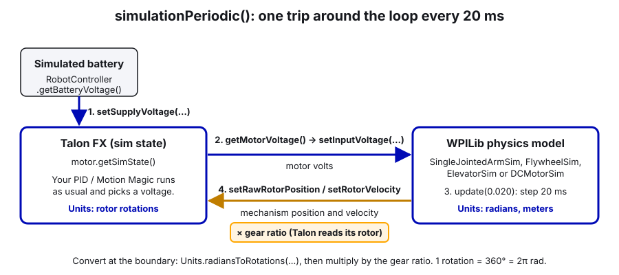
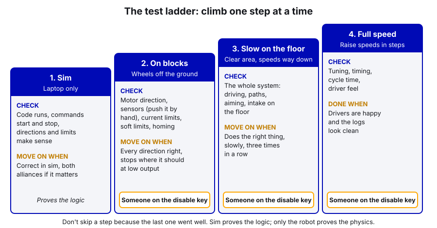

# 20. Simulation and Testing

> **Who it's for:** anyone who writes code that moves the robot. You can do most of this guide with no robot at all.
> **Read first:** [04 Command-based](04-command-based-basics.md), [05 Motors in Phoenix 6](05-motors-in-phoenix-6.md),
> [19 Logging and debugging](19-logging-and-debugging.md) (AdvantageScope). For the mechanism part:
> [07 What is PID](07-what-is-pid.md).
> **Time:** about 1.5 hours, most of it hands-on in simulation.

## What you'll learn

- How to run the real robot code on your laptop with **WPILib Simulate Robot Code** and drive it in the Sim GUI
- How our CTRE swerve simulates itself, and how to watch PathPlanner autos in AdvantageScope
- How to simulate a mechanism: a Talon FX's sim state plus a WPILib physics model, drawn with **Mechanism2d**
- The "headless sim" trick we used to test auto-align dozens of times without touching the robot
- The real-robot test ladder (sim → on blocks → slow on the floor → full speed), a test-plan template, and the
  shop-testing aids built into the 2026 code

---

## The idea: run the real code before the robot moves

**Simulation** runs your actual robot program on your laptop instead of the roboRIO. WPILib swaps the hardware
layer for a fake one: joysticks come from your laptop, motors don't spin anything real, and a "physics model" (a few
equations) can pretend to be a flywheel, arm, or drivetrain so the sensor readings change like the real thing would.

Why bother? Because the robot is shared, the battery is limited, and a bug at full speed breaks parts. The
auto-align code found three real bugs in simulation **before the robot ever moved** (one of them would have left
the robot sitting forever in "Pathfinding").

What simulation can and can't tell you:

| Sim is good for | Sim can't tell you |
|---|---|
| Does the code crash? Does it start? | Real friction, backlash, chain stretch, wheel slip |
| Do buttons trigger the right commands? Does a command end when it should? | Whether the robot browns out (no real battery) |
| State machines, interlocks, "ready" logic | Whether the CAN IDs and wiring match the code |
| Autos: does the path run, in the right order, on both alliances? | What the Limelight sees (there's no camera in sim) |
| Rough mechanism behaviour (it moves the right way, stops at the target) | Real PID gains. Sim gains are a starting point at best |

**Rule of thumb:** sim proves the *logic* is right. Only the robot proves the *physics* is right.

---

## Step by step: run the simulator

1. Open the robot project in WPILib VS Code.
2. `Ctrl+Shift+P` → **WPILib: Simulate Robot Code**. When it asks, tick **Sim GUI** and click OK. (The first build
   takes a minute.)
3. The **Sim GUI** window opens. The parts you'll use:
   - **Robot State**: Disconnected / Disabled / Autonomous / Teleoperated / Test. This is your enable button.
   - **System Joysticks** and **Joysticks**: drag your Xbox controller (or *Keyboard 0*, which uses WASD for the
     left stick) from System Joysticks into **Joystick[0]**. Our driver controller is port 0.
   - **FMS**: set the **Alliance Station** (Blue 1, Red 1...). Our code reads the alliance color, so test both.
   - **NetworkTables**: every dashboard value, live. Open `SmartDashboard` to see `Auton Selector`, `Field`,
     `Ready/...`, `Intake/...`.
   - **Other Devices**: the simulated CTRE devices and their values.
4. Click **Teleoperated** and drive. Open the `Field` view (NetworkTables → SmartDashboard → Field) to see the
   robot move.
5. For a better view, connect other tools to the simulator the same way you'd connect to the robot:
   - **AdvantageScope** → File → **Connect to Simulator**. Then use the 2D Field, Line Graph, and Swerve tabs from
     [guide 19](19-logging-and-debugging.md).
   - **Elastic**: set the connection to localhost / simulation in its settings.
   - **PathPlanner** → ☰ → **Telemetry** → **Simulator**.
6. Stop the simulator with the red square in VS Code's debug bar (or close the Sim GUI).

Simulation also writes a `.wpilog` (into a `logs` folder where the simulator runs; search the project folder for
`*.wpilog` if you can't find it), so you can open a sim run afterwards exactly like a match log.

---

## CTRE swerve in simulation

You don't have to do anything to simulate the drivetrain: the Tuner X Swerve Project Generator wrote it for us. When
the code runs in simulation, the drivetrain starts a background thread that updates the motor, encoder, and gyro
simulation every 4 ms.

### In our code

[Robot-Template CommandSwerveDrivetrain.java, lines 315–328 (startSimThread)](https://github.com/TorqueNados-FRC5090/Robot-Template/blob/b8dddd0e338841e867c0cc260162e6097adecd7b/src/main/java/frc/robot/subsystems/CommandSwerveDrivetrain.java#L315-L328):

```java
private void startSimThread() {
    m_lastSimTime = Utils.getCurrentTimeSeconds();

    /* Run simulation at a faster rate so PID gains behave more reasonably */
    m_simNotifier = new Notifier(() -> {
        final double currentTime = Utils.getCurrentTimeSeconds();
        double deltaTime = currentTime - m_lastSimTime;
        m_lastSimTime = currentTime;

        /* use the measured time delta, get battery voltage from WPILib */
        updateSimState(deltaTime, RobotController.getBatteryVoltage());
    });
    m_simNotifier.startPeriodic(kSimLoopPeriod);
}
```

**Notice:**
- Each constructor calls `startSimThread()` only `if (Utils.isSimulation())`
  ([lines 150–158](https://github.com/TorqueNados-FRC5090/Robot-Template/blob/b8dddd0e338841e867c0cc260162e6097adecd7b/src/main/java/frc/robot/subsystems/CommandSwerveDrivetrain.java#L150-L158)),
  so on the real robot none of this runs.
- `updateSimState` is CTRE's. It uses the gear ratios, inertia, and friction voltage from `TunerConstants` to fake
  each module. It does **not** model wheel slip or bumping into things, so a sim robot drives perfectly.
- The robot starts at (0, 0) unless an auto resets the pose. There's no camera, so vision never corrects anything.
  Our vision code just gets no data and does nothing. Auto-align skips its "seen a tag recently" check in sim for the
  same reason.

You may notice `HootAutoReplay` in `Robot.java` and a `.hoot` file name in `TunerConstants.kCANBus`. Those are
generated by Tuner X for CTRE's log-replay feature. You can leave them alone; they don't affect normal simulation.

---

## Testing PathPlanner autos in sim

1. Start the simulator (above). Set the alliance in **FMS**.
2. Pick the auto: NetworkTables → SmartDashboard → **Auton Selector** in the Sim GUI, or the chooser in Elastic.
3. Open AdvantageScope → Connect to Simulator → **2D Field** tab. Drag in `DriveState/Pose` or `Poses/Robot` (the
   robot), `Poses/Auto path` (as a trajectory), and `Poses/Auto target` (as a ghost). Those come from the
   PathPlanner logging callbacks in
   [AutonContainer.java, lines 38–39](https://github.com/TorqueNados-FRC5090/Hephaestus/blob/c2f0cee6f61db3f26f911d3f5623ed7fa27a5b03/src/main/java/frc/robot/commands/AutonContainer.java#L38-L39).
4. Click **Autonomous**. Watch the robot follow the path. Disable, switch alliance, and run it again. The path
   should flip to the red side.
5. Things to check: does it start where you expect (the auto resets the pose to its starting point)? Do the named
   commands fire at the right spots (look for `AUTO named command` / command START lines in the Console tab)? Does
   the auto finish inside 15 seconds?

A path that works in sim can still be wrong on the field (slip, a wrong `kSpeedAt12Volts`, a bad starting pose).
But a path that's wrong in sim will definitely be wrong on the field. See [18 PathPlanner](18-pathplanner-autos.md).

---

## Simulating a mechanism

Nothing simulates our mechanisms yet: on the 2026 robot, the shooter, hood, turret, and intake just sit still in
sim. Adding simulation to a mechanism takes about 20 lines and lets you test its commands, limits, and "ready" logic
on a laptop.

The loop, every 20 ms, in the subsystem's `simulationPeriodic()`:



1. Give the Talon a supply voltage (the simulated battery).
2. Read the voltage the Talon is putting out (your control request decided that).
3. Feed it into a WPILib model and step the model forward 0.020 s.
4. Write the model's new position and velocity back into the Talon, **times the gear ratio** (the Talon measures
   its rotor, not the mechanism).

Phoenix 6 gives each device a **sim state** (`motor.getSimState()`) for step 4. The WPILib model classes are in
`edu.wpi.first.wpilibj.simulation`:

| Model | Use for | Main inputs |
|---|---|---|
| `FlywheelSim` | Shooter wheels, anything that only spins | Motor(s), moment of inertia, gearing |
| `DCMotorSim` | Rollers, a turret, any spinning shaft you care about the position of | Motor(s), moment of inertia, gearing |
| `SingleJointedArmSim` | An arm or hood that gravity pulls on | Motor, gearing, inertia, arm length, min/max angle, gravity on/off |
| `ElevatorSim` | Elevators | Motor(s), gearing, carriage mass, drum radius, min/max height, gravity on/off |

### Example: an arm with simulation and a Mechanism2d drawing

This is new example code (we haven't built an arm since 2023's Petrichor; see
[14 Arms](14-arms-single-and-double-jointed.md)). It's a one-motor pivot, Kraken X60 on a 60:1 gearbox, PositionVoltage
control. Checked against WPILib 2026.2.1 and Phoenix 6 26.3.0.

```java
/** A one-motor arm pivot that also runs in simulation. Angles: 0 = arm horizontal, positive = up. */
public class ArmPivot extends SubsystemBase {
    /** Motor rotations per arm rotation (60:1 gearbox) */
    private static final double kGearRatio = 60.0;
    private static final double kArmLengthMeters = 0.6;
    private static final double kArmMassKg = 3.0;
    private static final double kMinAngleRad = Units.degreesToRadians(-30);   // lower hard stop
    private static final double kMaxAngleRad = Units.degreesToRadians(110);   // upper hard stop
    /** The arm always powers on resting on its lower hard stop */
    private static final double kStartAngleRad = kMinAngleRad;

    private final TalonFX m_motor;
    private final PositionVoltage m_positionRequest = new PositionVoltage(0).withEnableFOC(true);

    // Simulation only: a physics model of the arm (gravity included)
    private final SingleJointedArmSim m_armSim = new SingleJointedArmSim(
        DCMotor.getKrakenX60Foc(1), kGearRatio,
        SingleJointedArmSim.estimateMOI(kArmLengthMeters, kArmMassKg),
        kArmLengthMeters, kMinAngleRad, kMaxAngleRad, true, kStartAngleRad);

    // A stick figure of the arm for the dashboard (works on the real robot too)
    private final Mechanism2d m_mechanism = new Mechanism2d(1.6, 1.6);
    private final MechanismLigament2d m_armDrawing = m_mechanism.getRoot("pivot", 0.8, 0.8)
        .append(new MechanismLigament2d("arm", kArmLengthMeters, Units.radiansToDegrees(kStartAngleRad)));

    public ArmPivot(int motorId, CANBus canBus) {
        m_motor = new TalonFX(motorId, canBus);

        TalonFXConfiguration config = new TalonFXConfiguration();
        config.MotorOutput.NeutralMode = NeutralModeValue.Brake;
        config.MotorOutput.Inverted = InvertedValue.CounterClockwise_Positive;
        config.Feedback.SensorToMechanismRatio = kGearRatio;   // getPosition() now reads ARM rotations
        config.CurrentLimits.StatorCurrentLimit = 40;
        config.CurrentLimits.StatorCurrentLimitEnable = true;
        config.CurrentLimits.SupplyCurrentLimit = 30;
        config.CurrentLimits.SupplyCurrentLimitEnable = true;
        config.Slot0.kP = 40.0;                               // volts per arm rotation of error (a starting guess)
        config.Slot0.kG = 0.3;                                // volts to hold the arm level against gravity
        config.Slot0.GravityType = GravityTypeValue.Arm_Cosine;
        m_motor.getConfigurator().apply(config);

        // Known start position: the arm is on its lower hard stop at power-on
        m_motor.setPosition(Units.radiansToRotations(kStartAngleRad));
        SmartDashboard.putData("Arm/Drawing", m_mechanism);
    }

    /** @return a command that holds the arm at an angle, in degrees */
    public Command goToAngle(double degrees) {
        return run(() -> m_motor.setControl(m_positionRequest.withPosition(degrees / 360.0)));
    }

    public double getAngleDegrees() {
        return m_motor.getPosition().getValueAsDouble() * 360.0;
    }

    @Override
    public void periodic() {
        m_armDrawing.setAngle(getAngleDegrees());
        SmartDashboard.putNumber("Arm/Angle (deg)", getAngleDegrees());
    }

    @Override
    public void simulationPeriodic() {
        TalonFXSimState motorSim = m_motor.getSimState();
        motorSim.setSupplyVoltage(RobotController.getBatteryVoltage());

        // 1. Feed the Talon's output voltage into the physics model and step it 20 ms
        m_armSim.setInputVoltage(motorSim.getMotorVoltage());
        m_armSim.update(0.020);

        // 2. Tell the Talon where its rotor is now. A real rotor reads 0 at power-on, so give it the travel
        //    SINCE power-on; the setPosition() call in the constructor adds the starting angle back.
        double armTravelRotations = Units.radiansToRotations(m_armSim.getAngleRads() - kStartAngleRad);
        motorSim.setRawRotorPosition(armTravelRotations * kGearRatio);
        motorSim.setRotorVelocity(Units.radiansToRotations(m_armSim.getVelocityRadPerSec()) * kGearRatio);
    }
}
```

Imports: `com.ctre.phoenix6.CANBus`, `...configs.TalonFXConfiguration`, `...controls.PositionVoltage`,
`...hardware.TalonFX`, `...signals.GravityTypeValue`, `...signals.InvertedValue`, `...signals.NeutralModeValue`,
`...sim.TalonFXSimState`, `edu.wpi.first.math.system.plant.DCMotor`, `edu.wpi.first.math.util.Units`,
`edu.wpi.first.wpilibj.RobotController`, `...wpilibj.simulation.SingleJointedArmSim`,
`...wpilibj.smartdashboard.Mechanism2d`, `...MechanismLigament2d`, `...SmartDashboard`, and the usual command classes.

**What to notice:**
- **Units.** WPILib models use radians and meters. CTRE uses rotations. Convert at the boundary with
  `Units.radiansToRotations` and multiply by the gear ratio. (1 rotation = 360° = 2π radians.)
- **The power-on trap.** A real Talon's rotor reads 0 when it boots. If you wrote the arm's *absolute* angle into
  `setRawRotorPosition` *and* called `setPosition(start angle)` in the constructor, the start angle would be counted
  twice and the arm would read -60° when it's at -30°. Writing "travel since power-on" avoids that.
- **`periodic()` updates the drawing, not `simulationPeriodic()`.** That way the Mechanism2d also works on the real
  robot, from the real encoder.
- `simulationPeriodic()` is a `SubsystemBase` method that only runs in simulation. You don't need `if` checks.
- For a **Talon FXS** (our turret and intake), use `TalonFXSSimState` instead; it has the same `setSupplyVoltage`,
  `setRawRotorPosition`, `setRotorVelocity` methods.

**Seeing the drawing:** in the Sim GUI, NetworkTables → SmartDashboard → `Arm/Drawing` (or **Glass**, or a
"Mechanism" widget in Elastic, or AdvantageScope's Mechanism tab). The line rotates as the arm moves. Mechanism2d is
just a picture made of lines (`MechanismLigament2d`): a root point, then segments with a length and an angle in
**degrees**. For an elevator, change the *length* of a vertical ligament with `setLength(...)`. For a two-joint arm,
`append` a second ligament to the first.

### Other models, short versions

Flywheel (no position, so add up the position yourself):

```java
private final FlywheelSim m_flywheelSim = new FlywheelSim(
    LinearSystemId.createFlywheelSystem(DCMotor.getKrakenX60Foc(2), 0.004, kGearRatio),  // 2 motors, MOI kg*m^2, gearing
    DCMotor.getKrakenX60Foc(2));

@Override
public void simulationPeriodic() {
    TalonFXSimState sim = m_leader.getSimState();
    sim.setSupplyVoltage(RobotController.getBatteryVoltage());
    m_flywheelSim.setInputVoltage(sim.getMotorVoltage());
    m_flywheelSim.update(0.020);

    double flywheelRps = m_flywheelSim.getAngularVelocityRPM() / 60.0;
    sim.setRotorVelocity(flywheelRps * kGearRatio);
    sim.addRotorPosition(flywheelRps * kGearRatio * 0.020);
}
```

Roller or turret (`DCMotorSim` gives position and velocity; `getAngularPositionRotations()` is already in rotations):

```java
private final DCMotorSim m_rollerSim = new DCMotorSim(
    LinearSystemId.createDCMotorSystem(DCMotor.getKrakenX60Foc(1), 0.001, kGearRatio),
    DCMotor.getKrakenX60Foc(1));
```

Elevator (meters of carriage travel → drum rotations → rotor rotations):

```java
private final ElevatorSim m_elevatorSim = new ElevatorSim(
    DCMotor.getKrakenX60Foc(2), kGearRatio, kCarriageMassKg, kDrumRadiusMeters,
    0.0, kMaxHeightMeters, true, 0.0);   // min height, max height, simulate gravity, starting height
// ...in simulationPeriodic, after update(0.020):
double drumRotations = m_elevatorSim.getPositionMeters() / (2 * Math.PI * kDrumRadiusMeters);
sim.setRawRotorPosition(drumRotations * kGearRatio);
```

The moment of inertia (MOI) numbers are guesses. That's fine: you're testing logic, not tuning. **Don't copy PID
gains from sim to the real robot.** Tune on the robot ([08 Tuning](08-tuning-pid-step-by-step.md)).

Sensors can be faked too. Our beam breaks and limit switches go through a CTRE CANdi, and every CTRE device has a
sim state, so you can "break" a beam from code: `candi.getSimState().setS1State(S1StateValue.Low)` (and `High` to
clear it). A CANrange works the same way through `getSimState()`. See [21 Sensors and homing](21-sensors-and-homing.md).

---

## The headless-sim trick (how auto-align was tested)

Clicking through the Sim GUI is fine for one run. For auto-align we wanted **dozens** of runs: five starting spots,
both alliances, every target, and a check of how close each robot corner came to the trench frame, every 20 ms.
Doing that by hand isn't realistic, so we ran the simulator **headless** (no window) and let code play the driver.

How it works:

1. **Work in a copy of the repo.** The trick needs test-only changes you must never commit to the real code.
2. In the copy's `build.gradle`, set `wpi.sim.addGui().defaultEnabled = false` and remove the
   `wpi.sim.addDriverstation()` line. Now nothing opens a window or fights over the robot's enabled state.
3. In the copy's `Robot.simulationPeriodic()`, use **`DriverStationSim`** to pick an alliance and enable the robot,
   **schedule the command you're testing** at a set time, and **print** the pose every loop.
4. Run it from a terminal with `./gradlew simulateJava > run1.csv`. When the script calls `System.exit(0)`, the run
   ends and the next one can start.
5. Check the output with a small script. For auto-align, the result is in the repo as
   [docs/tools/sim-trace-blue.csv](https://github.com/HALFxAxHEART/frc-auto-align/blob/c95ddf4a2ee25c406ea6e2ed04e232b17b39b8f7/docs/tools/sim-trace-blue.csv)
   (time, x, y, heading, `Align/State`, every 20 ms), and the field pictures in the guide were drawn from it.

A sketch of step 3 (test copy only; `commandUnderTest` and `poseSupplier` stand in for whatever you're testing):

```java
// ---- TEST COPY ONLY: a scripted "driver" for a headless simulation run ----
private final Timer m_scriptTimer = new Timer();
private boolean m_scriptStarted = false;
private boolean m_commandScheduled = false;

@Override
public void simulationPeriodic() {
    if (!m_scriptStarted) {
        // Pretend a Driver Station is plugged in: Blue 1, teleop, enabled
        DriverStationSim.setAllianceStationId(AllianceStationID.Blue1);
        DriverStationSim.setDsAttached(true);
        DriverStationSim.setAutonomous(false);
        DriverStationSim.setEnabled(true);
        DriverStationSim.notifyNewData();
        m_scriptTimer.start();
        m_scriptStarted = true;
    }
    double t = m_scriptTimer.get();

    // "Press the button" 1 second in (after the robot has settled)
    if (t > 1.0 && !m_commandScheduled) {
        CommandScheduler.getInstance().schedule(commandUnderTest);
        m_commandScheduled = true;
    }

    // One CSV line every 20 ms: time, x, y, heading, state
    Pose2d pose = poseSupplier.get();
    System.out.printf("%.3f,%.4f,%.4f,%.2f,%s%n", t, pose.getX(), pose.getY(),
        pose.getRotation().getDegrees(), SmartDashboard.getString("Align/State", ""));

    if (t > 15.0) {
        System.exit(0);   // end the run so the next one can start
    }
}
```

What it found ([AUTO-ALIGN-GUIDE.md, section 6](https://github.com/HALFxAxHEART/frc-auto-align/blob/c95ddf4a2ee25c406ea6e2ed04e232b17b39b8f7/AUTO-ALIGN-GUIDE.md#6-avoiding-things-what-it-can-and-cant-do)
and [MENTOR-NOTES.md](https://github.com/HALFxAxHEART/frc-auto-align/blob/c95ddf4a2ee25c406ea6e2ed04e232b17b39b8f7/MENTOR-NOTES.md)):
pressing the button during PathPlanner's boot warm-up left the robot stuck in "Pathfinding"; a half-turned robot
clipped the trench frame (fixed by turning first and a 10 cm navgrid); and the turn stalled 2.05° short of a 2°
tolerance (fixed with a minimum speed). All three before the robot moved. The same notes list what sim **couldn't**
test: the stick override, the stuck check, and real pose accuracy on our half field. Those still need the robot.

You don't need the headless trick for everyday work. Reach for it when you want to test the same thing many times,
or check something precisely (clearances, timing) that you can't judge by eye.

---

## The real-robot test ladder

Every new or changed mechanism climbs these steps in order. Don't skip one because the last one went well.



| Step | Setup | What you're checking | Move on when... |
|---|---|---|---|
| **1. Sim** | Laptop only | Code runs, commands start/stop, directions and limits make sense, dashboard values read right | It behaves correctly in sim, both alliances if it matters |
| **2. On blocks** | Robot on a cart or blocks, wheels off the ground. Mechanism free to move, or chain off for the first power-up | Motor spins the right way, sensors read the right way (push it by hand, watch the value), current limits, soft limits, homing | Every direction is right and it stops where it should at low output |
| **3. Slow on the floor** | Clear area, everyone back, one person on the disable key. Speeds/voltages turned way down | The whole system together: driving, path following, aiming, the intake hitting the floor | It does the right thing, slowly, three times in a row |
| **4. Full speed** | Raise speeds in steps. Full field or practice area | Tuning, timing, cycle time, driver feel | Drivers are happy and the logs look clean |

**Safety at every step on the real robot:** someone is at the laptop with a hand ready. **Enter** disables. **Space**
is emergency stop (the robot then needs a reboot). Say "enabling" out loud before you enable.


The auto-align guide follows exactly this ladder in its section 11: check the pose first, cut the speeds
(`kPathfindMaxSpeed = 1.0`, `kFinalMaxSpeed = 0.5`), test stage 2 alone, then both stages, then raise speeds a step
at a time ([AUTO-ALIGN-GUIDE.md, section 11](https://github.com/HALFxAxHEART/frc-auto-align/blob/c95ddf4a2ee25c406ea6e2ed04e232b17b39b8f7/AUTO-ALIGN-GUIDE.md#11-try-it-on-the-robot-half-field)).

### Test-plan template

Copy this into the pull request or a notes file before you test. Filling in "expected" *before* you test is the
point: it forces you to decide what "working" means.

> **AI can help:** describe your change (or paste the diff) and ask for a first draft of the test-plan rows,
> including failure cases you might not think of, like an unplugged CAN cable or a hit during homing. Then you edit
> it against the real robot: delete rows that don't apply, fix the expected values from your own code and constants,
> and run every row yourself. The draft is a starting list, not proof that anything works.

```
TEST PLAN: <what changed, e.g. "intake homing after a hit">
Branch / commit: <branch> @ <short hash>        Date: <date>        Tester(s): <names>
Robot: Theseus   Battery: <#> at <volts> V      Log file(s): <name of .wpilog>

Ladder step: [ ] Sim  [ ] On blocks  [ ] Slow on floor  [ ] Full speed
Safety: disable person = <name>; area clear; speeds limited to <value>

| # | Do this                          | Expected                                   | Actual | Pass? |
|---|----------------------------------|--------------------------------------------|--------|-------|
| 1 | Enable, no FMS                   | Intake/Status: HOMING -> READY in < 2 s     |        |       |
| 2 | Push intake in by hand, D-pad up | Re-homes; "Intake homed in X s" in Events   |        |       |
| 3 | Unplug follower CAN, re-home     | Times out at 4 s, falls back, says FAILED   |        |       |

Problems found / follow-ups:
```

---

## Shop-testing aids already in the 2026 code

The 2026 robot has a few switches and buttons that exist only to make testing in the shop possible. Know they're
there before you write your own.

| Aid | How to use it | Why it exists | Code |
|---|---|---|---|
| **Shop pose** | Press **View** (the "back" button) on the driver controller. Ignored when connected to a real field (FMS). | With no AprilTags in the shop, the robot thinks it's at (0, 0) facing the hub, where the back-facing turret can't reach, so it never becomes ready to shoot. This tells the robot it's straight in front of our hub, about 2.6 m from its center, with the turret toward it. | [RobotContainer.java, line 169 (binding)](https://github.com/TorqueNados-FRC5090/Hephaestus/blob/c2f0cee6f61db3f26f911d3f5623ed7fa27a5b03/src/main/java/frc/robot/RobotContainer.java#L169) and [lines 371–381](https://github.com/TorqueNados-FRC5090/Hephaestus/blob/c2f0cee6f61db3f26f911d3f5623ed7fa27a5b03/src/main/java/frc/robot/RobotContainer.java#L371-L381) |
| **Intake/Tune** | Change `Intake/Tune/kP`, `kS`, cruise speed... on the dashboard, press `Intake/Tune/Apply`. `Go to test target` moves to `Test target (in)`. | Tune the intake without redeploying for every number. Copy good values back into the constants. | [EvilIntake.java, lines 390–417](https://github.com/TorqueNados-FRC5090/Hephaestus/blob/c2f0cee6f61db3f26f911d3f5623ed7fa27a5b03/src/main/java/frc/robot/subsystems/EvilIntake.java#L390-L417) |
| **Re-home** | **D-pad up**, or the `Intake/Re-home` dashboard button | Re-zero the intake against its hard stop after a hit, or after `SIDES_OUT_OF_SYNC` | [RobotContainer.java, line 167](https://github.com/TorqueNados-FRC5090/Hephaestus/blob/c2f0cee6f61db3f26f911d3f5623ed7fa27a5b03/src/main/java/frc/robot/RobotContainer.java#L167) |
| **Vision/Use camera** | Dashboard switch, default true. Set false to ignore the Limelight. | Test pure odometry, or stop a badly placed shop tag from yanking the pose around | [Robot.java, line 51](https://github.com/TorqueNados-FRC5090/Hephaestus/blob/c2f0cee6f61db3f26f911d3f5623ed7fa27a5b03/src/main/java/frc/robot/Robot.java#L51) and [lines 101–104](https://github.com/TorqueNados-FRC5090/Hephaestus/blob/c2f0cee6f61db3f26f911d3f5623ed7fa27a5b03/src/main/java/frc/robot/Robot.java#L101-L104) |

The shop pose is a good model for any test-only feature:

```java
// Shop testing only: pretend we're straight in front of the hub (disabled when connected to a real match)
joystick.back().and(() -> !DriverStation.isFMSAttached()).onTrue(shopTestPose());
```

**Notice** the `!DriverStation.isFMSAttached()` guard: a driver who bumps that button in a real match gets nothing.
Every test-only control should be guarded like this, or live only on the dashboard.

---

## Common mistakes

- **"It worked in sim" so it goes straight to full speed.** Sim has no slip, backlash, or real friction. Climb the
  ladder.
- **Copying PID gains from sim.** Sim MOI is a guess. Use sim gains only to check that the control *direction* and
  logic are right.
- **Forgetting the gear ratio** in `setRawRotorPosition` / `setRotorVelocity`. The mechanism moves 60 times too
  fast or too slow in sim.
- **Counting the start position twice** (absolute sim angle *and* `setPosition(start)`). Write travel since
  power-on, as in the arm example.
- **Mixing units:** radians from WPILib models, rotations for CTRE, degrees for Mechanism2d.
- **Committing headless-test code.** `System.exit(0)` in the real `Robot.java` would kill the robot program. Keep
  it in a copy.
- **Testing in the shop with no tags and wondering why it won't shoot.** The robot thinks it's at (0, 0). Press View
  for the shop pose.
- **Testing auto-align with the hood up.** The auto-align code only drives; it can't stow the hood, and the hood
  breaks under the trench. Check it before every session.
- **Nobody on the disable key.** Every real-robot test, every time.

## Checklist

- [ ] It runs in sim with no errors in the console, on both alliances if alliance matters
- [ ] Commands start and stop when expected (check `Commands` in AdvantageScope)
- [ ] New mechanism: `simulationPeriodic()` added, Mechanism2d shows it moving the right way
- [ ] Test plan written with expected results before going to the robot
- [ ] On blocks: directions, sensors, limits checked at low output
- [ ] Slow on the floor with a disable person, then speeds raised in steps
- [ ] Logs from the test saved and named

## Practice

1. **Drive the template in sim.** Run the Robot-Template in the Sim GUI with a controller. Open AdvantageScope's 2D
   Field with `DriveState/Pose`. Drive a square and come back to the start. Then switch to Red 1 and check that
   "forward" on the stick still means "away from you".
2. **Run an auto in sim** and compare `Poses/Robot` with `Poses/Auto target`. How far behind does the robot run?
3. **Add simulation to `ExampleRoller`** in the template using `DCMotorSim`. Graph its velocity in AdvantageScope
   while you press the button. Does it reach the target speed? What happens if you set kV to 0?
4. **Mechanism2d arm.** Put the `ArmPivot` example in a sim project, bind two buttons to `goToAngle(0)` and
   `goToAngle(90)`, and watch the drawing. Then set `kG` to 0 and see the arm sag below its target.

## Go further

- WPILib simulation introduction: https://docs.wpilib.org/en/stable/docs/software/wpilib-tools/robot-simulation/introduction.html
- WPILib Sim GUI: https://docs.wpilib.org/en/stable/docs/software/wpilib-tools/robot-simulation/simulation-gui.html
- WPILib physics simulation (the model classes): https://docs.wpilib.org/en/stable/docs/software/wpilib-tools/robot-simulation/physics-sim.html
- WPILib device simulation (sim classes for WPILib devices): https://docs.wpilib.org/en/stable/docs/software/wpilib-tools/robot-simulation/device-sim.html
- WPILib Mechanism2d: https://docs.wpilib.org/en/stable/docs/software/dashboards/glass/mech2d-widget.html
- CTRE Phoenix 6 simulation: https://v6.docs.ctr-electronics.com/en/stable/docs/api-reference/simulation/simulation-intro.html
- AdvantageScope: https://docs.advantagescope.org/
- PathPlanner: https://pathplanner.dev/pplib-getting-started.html
