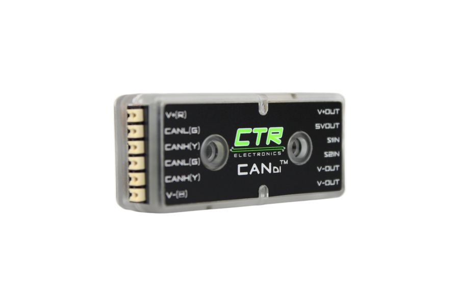
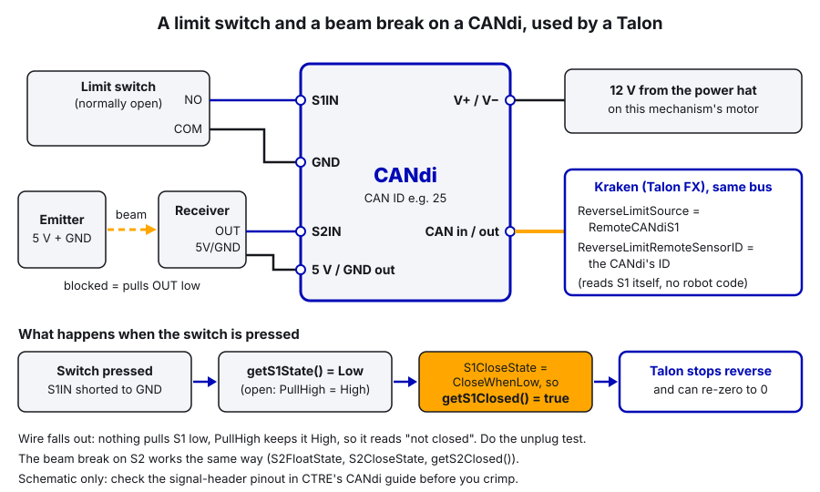

# 21. Sensors and Homing

> **Who it's for:** anyone adding a sensor to a mechanism, or making a mechanism know where it is.
> **Read first:** [04 Command-based](04-command-based-basics.md), [05 Motors in Phoenix 6](05-motors-in-phoenix-6.md),
> [02 Tuner X and CAN](02-phoenix-tuner-x-and-can.md). Helpful: [11 Intakes](11-intakes-and-rollers.md),
> [15 Elevators](15-elevators.md).
> **Time:** about 1.5 hours, plus time at the robot wiring and checking a sensor.

## What you'll learn

- The sensors we use and what each is good for: limit switches and beam breaks on a CTRE CANdi, CTRE CANrange, CANcoder,
  Pigeon 2, Redux Canandcolor, and the motor itself (current and velocity)
- How to set up a CANcoder's magnet offset and discontinuity point, and check a Pigeon is alive
- Four ways to **zero** (home) a mechanism, and when to use each
- How our 2026 intake homes against a hard stop, and why it never homes during a real match
- How to make a CANdi input a Talon's hardware limit switch, and how to **debounce** a noisy signal
- Example code for a CANdi beam-break "has game piece" trigger and a hard-stop homing command

---

## The idea: a robot only knows what its sensors tell it

A motor's built-in encoder counts how far the rotor has turned **since power-on**. It does not know where the
mechanism actually is. If the intake was pushed out by hand while the robot was off, the encoder still boots up
reading 0, and the code believes the intake is in. Sensors and homing fix that.

Two different jobs:
- **Detecting things:** "is there a game piece?", "did the elevator reach the bottom?". Usually a yes/no sensor.
- **Knowing position:** "what angle is the arm at, right now, in the real world?". An absolute sensor, or a known
  starting point plus the motor encoder.

**Words used here:**
- **CANdi:** a CTRE CAN device with two digital inputs (S1, S2) that puts on/off sensors (limit switches, beam
  breaks) on the CAN bus. Our standard for every switch and beam break.
- **Zeroing / homing:** telling the encoder "you are at position X now" at a moment when you *know* the mechanism is
  at X. In Phoenix 6 that's `motor.setPosition(x)`.
- **Hard stop:** the physical end of travel (a bolt, a plate, the end of a rack).
- **Debounce:** ignore a signal until it has stayed the same for a short time, so flicker doesn't count.

---

## The sensors

| Sensor | Connects to | Gives you | Good for | We used it on |
|---|---|---|---|---|
| Limit switch | CTRE CANdi (S1/S2) | Pressed / not pressed | End of travel, homing, "piece fully in" | 2024 Thunderstrike intake (on DIO then) |
| Beam break / laser detector | CTRE CANdi (S1/S2) | Beam blocked / clear | "Did a piece pass this point?", counting pieces | Wrapper in every repo (on DIO then) |
| CTRE CANrange | CAN | Distance (m), "detected" yes/no, signal strength | Piece detection without a separate emitter, distance to a wall/game piece, remote limit switch | (new for us) |
| CTRE CANcoder | CAN | Absolute angle within one rotation | Swerve steering, arm/turret/hood absolute angle | All four swerve modules |
| CTRE Pigeon 2 | CAN | Yaw, pitch, roll, turn rate | Robot heading for swerve and field-relative aiming | Every swerve robot |
| Redux Canandcolor | CAN (2.0 only) | Proximity (0–1), color | Telling pieces apart by color | 2025 Stingray shooter |
| The motor itself | (built in) | Velocity, stator current | Stall detection, hard-stop homing, "something jammed" | 2026 intake homing |

   

> **2027: SystemCore (our plan, check against the 2027 manual).** SystemCore has five CAN buses, `can_s0` to `can_s4`,
> running classic CAN at 1 Mbps for now. Our plan gives each part of the robot its own bus (drivetrain, intake,
> indexer, upper chassis, PDH). Michel's rule: every CAN sensor we buy must support **CAN FD**; the Canandcolor is the
> one CAN 2.0 exception we still use. Sensors (CANdi, CANrange, CANcoder) get 12 V from the **power hat** on their
> mechanism's motor; the Pigeon 2 has its own fused slot. Details in guide 30.

### Limit switches and beam breaks on a CANdi

**Every limit switch and beam break on our robots goes through a CTRE CANdi**, not the roboRIO's DIO ports. A CANdi is
a small CAN box with two digital inputs, **S1** and **S2**. It reads each input as **Low**, **High** or **Floating**
(nothing driving it) and sends that over CAN. Why we do it this way:
- A Talon can use a CANdi input as a **hardware limit switch** by itself, with no robot code in the loop (a Kraken has
  no limit-switch port of its own).
- It's on CAN, so it shows up in Tuner X and in the CTRE `.hoot` logs with everything else, and there's no long signal
  wire back to the controller.



Two settings per input decide what the CANdi reports (in `CANdiConfiguration.DigitalInputs`, Phoenix 6 v26 names):

| Setting | What it means | Our usual value |
|---|---|---|
| `S1FloatState` | What the input does when nothing drives it: `PullHigh`, `PullLow`, `FloatDetect`, `BusKeeper` | `PullHigh` |
| `S1CloseState` | Which state counts as **closed** ("active"): `CloseWhenLow`, `CloseWhenHigh`, `CloseWhenNotLow`, `CloseWhenNotHigh`, `CloseWhenFloating`, `CloseWhenNotFloating` | `CloseWhenLow` |

(`S2FloatState` and `S2CloseState` are the same for S2.) In code you read `getS1Closed()` (true/false, after the close
state is applied) or `getS1State()` (the raw `Low` / `High` / `Floating`, useful when checking wiring).

How we wire them (from our electrical binder):
- **Limit switch:** COM to the CANdi's ground, NO (normally open) to S1. Pressed = S1 shorted to ground = **Low**.
- **Beam break:** the emitter on the CANdi's 5 V and ground; the receiver on 5 V and ground with its output to S2. Most
  beam breaks pull the output **Low when blocked**.
- The CANdi gets 12 V from the **power hat** on the mechanism's motor, plus CAN in and out like any other device.

With `PullHigh` + `CloseWhenLow`, "pressed" or "blocked" reads closed, and a wire that falls out floats, gets pulled
High, and reads **not closed**. For a beam break that's the safe answer ("no piece").



**Always check the real direction at the robot:** put `getS1State()` and `getS1Closed()` on the dashboard (or watch
them in Tuner X), press the switch or block the beam by hand, and watch them flip. Sensors and wiring vary; if it's
backwards, change the **close state**, not the code that uses it.

#### Example: a beam-break "has game piece" trigger

New example code. A **Trigger** (see [04 Command-based](04-command-based-basics.md)) is like a button that the robot
presses itself, so you can bind commands to "a piece arrived" the same way you bind them to a controller button.

```java
/** Feeder rollers with a beam break (on a CANdi's S2 input) that sees when a game piece is inside. */
public class Feeder extends SubsystemBase {
    /** The beam must stay blocked this long to count as "has a piece" (ignores flicker as a piece tumbles in) */
    private static final double kPieceDebounceSeconds = 0.06;
    private static final double kIntakeSpeedRps = 30.0;

    private final CANdi m_feederInputs;
    private final StatusSignal<Boolean> m_beamBlockedSignal;
    private final TalonFX m_motor;
    private final VelocityVoltage m_velocityRequest = new VelocityVoltage(0).withEnableFOC(true);
    private final VoltageOut m_stopRequest = new VoltageOut(0).withEnableFOC(true);

    /** True once a piece has blocked the beam for kPieceDebounceSeconds. Bind commands to it. */
    public final Trigger hasGamePiece =
        new Trigger(this::isBeamBlocked).debounce(kPieceDebounceSeconds, DebounceType.kRising);

    public Feeder(int motorId, int candiId, CANBus canBus) {
        m_feederInputs = new CANdi(candiId, canBus);
        CANdiConfiguration candiConfig = new CANdiConfiguration();
        candiConfig.DigitalInputs.S2FloatState = S2FloatStateValue.PullHigh;     // unplugged = High = "no piece"
        candiConfig.DigitalInputs.S2CloseState = S2CloseStateValue.CloseWhenLow; // our beam breaks pull LOW when blocked
        m_feederInputs.getConfigurator().apply(candiConfig);
        m_beamBlockedSignal = m_feederInputs.getS2Closed();

        m_motor = new TalonFX(motorId, canBus);
        TalonFXConfiguration config = new TalonFXConfiguration();
        config.MotorOutput.NeutralMode = NeutralModeValue.Brake;   // stop the piece where the sensor saw it
        config.CurrentLimits.StatorCurrentLimit = 40;
        config.CurrentLimits.StatorCurrentLimitEnable = true;
        config.CurrentLimits.SupplyCurrentLimit = 30;
        config.CurrentLimits.SupplyCurrentLimitEnable = true;
        config.Slot0.kP = 0.3;
        config.Slot0.kV = 0.12;
        m_motor.getConfigurator().apply(config);
    }

    /** True while the beam is blocked (the CANdi applies the close state for us). */
    private boolean isBeamBlocked() {
        return m_beamBlockedSignal.refresh().getValue();
    }

    /** Runs the rollers until a piece is in, then stops. */
    public Command intakeUntilPiece() {
        return startEnd(
                () -> m_motor.setControl(m_velocityRequest.withVelocity(kIntakeSpeedRps)),
                () -> m_motor.setControl(m_stopRequest))
            .until(hasGamePiece)
            .withName("Feeder intake until piece");
    }

    @Override
    public void periodic() {
        SmartDashboard.putBoolean("Feeder/Beam blocked (raw)", isBeamBlocked());
        SmartDashboard.putBoolean("Feeder/Has piece", hasGamePiece.getAsBoolean());
        SmartDashboard.putBoolean("Feeder/CANdi connected", m_feederInputs.isConnected());
    }
}
```

Imports: `com.ctre.phoenix6.CANBus`, `com.ctre.phoenix6.StatusSignal`, `...configs.CANdiConfiguration`,
`...configs.TalonFXConfiguration`, `...controls.VelocityVoltage`, `...controls.VoltageOut`, `...hardware.CANdi`,
`...hardware.TalonFX`, `...signals.NeutralModeValue`, `...signals.S2CloseStateValue`, `...signals.S2FloatStateValue`,
`edu.wpi.first.math.filter.Debouncer.DebounceType`, `edu.wpi.first.wpilibj.smartdashboard.SmartDashboard`,
`edu.wpi.first.wpilibj2.command.Command`, `...SubsystemBase`, `...button.Trigger`.

Using it in `RobotContainer`:

```java
// Hold LB to intake; it stops by itself when the piece is in
joystick.leftBumper().whileTrue(feeder.intakeUntilPiece());
// Short buzz so the driver knows without looking
feeder.hasGamePiece.onTrue(Commands.runEnd(
        () -> joystick.getHID().setRumble(RumbleType.kBothRumble, 0.5),
        () -> joystick.getHID().setRumble(RumbleType.kBothRumble, 0.0))
    .withTimeout(0.3));
```

**Notice:** the dashboard shows both the **raw** beam and the **debounced** result, so you can see the debounce
working, plus whether the CANdi is on the bus at all. And the motor is in brake mode so the piece stops near the sensor
instead of rolling past it. To make the feeder stop in hardware, the instant the beam breaks, use the CANdi as the
Talon's forward limit instead (see "Limit switches as Talon hardware limits" below, and guide 28). And for a plain
"do we have a piece?" a CANrange (next section) is often simpler: one box, no emitter and receiver to line up.

#### Legacy: what the 2026 code did (roboRIO DIO)

Our 2026 robot and the template still wire sensors to the roboRIO's **DIO** (digital input/output) ports, wrapped in
[wrappers/LaserDetector.java](https://github.com/TorqueNados-FRC5090/Robot-Template/blob/b8dddd0e338841e867c0cc260162e6097adecd7b/src/main/java/frc/robot/wrappers/LaserDetector.java)
and [wrappers/LimitSwitch.java](https://github.com/TorqueNados-FRC5090/Robot-Template/blob/b8dddd0e338841e867c0cc260162e6097adecd7b/src/main/java/frc/robot/wrappers/LimitSwitch.java),
with port numbers in `Constants.DIOPorts`
([Constants.java, lines 75–83](https://github.com/TorqueNados-FRC5090/Robot-Template/blob/b8dddd0e338841e867c0cc260162e6097adecd7b/src/main/java/frc/robot/Constants.java#L75-L83)).
A DIO port is pulled up, so it reads `true` until a sensor pulls it to ground: **false means active**. `LaserDetector`
flips that for you (`isBlocked()`); `LimitSwitch` does not, which is why the 2024 intake calls `setInverted(true)`
([Thunderstrike Intake.java, lines 43–55](https://github.com/TorqueNados-FRC5090/Thunderstrike-2024/blob/876b8c14682ccf57ec0ab2767ee2da54c34cee6e/src/main/java/frc/robot/subsystems/Intake.java#L43-L55)).
It's the same "which way is active?" question the CANdi's close state answers. You'll see these wrappers in old code;
don't use DIO for new mechanisms (a Talon can't see a DIO port).

### CTRE CANrange (distance / time of flight)

A CANrange sends out infrared light and times how long it takes to bounce back (**time of flight**, ToF). It
reports a distance in meters, a signal strength, and an `IsDetected` flag that turns true when something is closer
than a threshold you choose. It's on CAN, so no DIO wiring, and it can act as a **remote limit switch** for a Talon
(below).

```java
CANrange feederRange = new CANrange(CANIds.kFeederRange, canBus);
CANrangeConfiguration rangeConfig = new CANrangeConfiguration();
rangeConfig.ToFParams.UpdateMode = UpdateModeValue.ShortRange100Hz;   // short range, 100 times a second
rangeConfig.ProximityParams.ProximityThreshold = 0.10;               // meters: closer than 10 cm = "detected"
rangeConfig.ProximityParams.ProximityHysteresis = 0.01;              // must move 1 cm past it to flip back
feederRange.getConfigurator().apply(rangeConfig);

boolean pieceInFeeder = feederRange.getIsDetected().getValue();
double distanceMeters = feederRange.getDistance().getValueAsDouble();
```

(`CANIds.kFeederRange` is a placeholder: give it a free ID in our 10–29 mechanism range and add it to Constants.)

Tips: graph `getDistance()` and `getSignalStrength()` while you put a game piece in and take it out, then choose the
threshold halfway between "empty" and "piece". Shiny or very dark game pieces give weaker signals. There's also a
`MinSignalStrengthForValidMeasurement` setting in `ProximityParams`; leave the default until you have a reason. The
`FovParams` let you narrow the field of view if it sees the robot's own frame.

### CTRE CANcoder (absolute position)

A CANcoder reads a magnet on a shaft and knows the shaft's angle **as soon as it powers on**, no homing needed. The
catch: it's absolute only **within one rotation of the shaft it's on**. Put it on a shaft that turns less than one
full rotation over the mechanism's whole travel (often the output shaft, 1:1 with the arm or turret).

Three settings, all in `MagnetSensor` (Phoenix 6 v26 names):

| Setting | What it means |
|---|---|
| `SensorDirection` | Which way is positive: `CounterClockwise_Positive` or `Clockwise_Positive` (looking at the LED side). Match the motor. |
| `MagnetOffset` | Rotations added to the raw reading so your chosen "zero" reads 0. |
| `AbsoluteSensorDiscontinuityPoint` | Where the reading wraps around. `0.5` → reads −0.5 to +0.5. `1.0` → 0 to 1. `0.0` → −1 to 0. Put the wrap in the part of the circle the mechanism **never** reaches. |

```java
CANcoder pivotEncoder = new CANcoder(CANIds.kPivotEncoder, canBus);
CANcoderConfiguration encoderConfig = new CANcoderConfiguration();
encoderConfig.MagnetSensor.SensorDirection = SensorDirectionValue.CounterClockwise_Positive;
encoderConfig.MagnetSensor.MagnetOffset = -0.3125;                    // rotations, measured (see steps)
encoderConfig.MagnetSensor.AbsoluteSensorDiscontinuityPoint = 0.5;    // reads -0.5 to +0.5 rotations
pivotEncoder.getConfigurator().apply(encoderConfig);

double pivotRotations = pivotEncoder.getAbsolutePosition().getValueAsDouble();
boolean magnetOk = pivotEncoder.getMagnetHealth().getValue() == MagnetHealthValue.Magnet_Green;
```

**Measuring the offset:**
1. Set `MagnetOffset` to 0 and deploy (or set it in Tuner X).
2. Put the mechanism exactly at the position you want to call 0 (for an arm: level, checked with a level).
3. Read `getAbsolutePosition()` (or the value in Tuner X). Say it reads 0.3125.
4. `MagnetOffset = -0.3125`. Deploy, and it now reads 0 at that position.
5. Move it through its whole travel. The reading must never jump (wrap). If it does, move the discontinuity point.

To let the motor use the CANcoder for closed-loop control, set the Talon's `Feedback.FeedbackSensorSource` to
`FeedbackSensorSourceValue.RemoteCANcoder` (or `FusedCANcoder`, a Phoenix Pro feature that blends it with the
rotor for smoother control) and `Feedback.FeedbackRemoteSensorID` to the CANcoder's ID. The swerve modules already
do this.

**In our code:** the swerve CANcoders (IDs 50–53) have their offsets in
[TunerConstants.java, e.g. line 152](https://github.com/TorqueNados-FRC5090/Hephaestus/blob/c2f0cee6f61db3f26f911d3f5623ed7fa27a5b03/src/main/java/frc/robot/generated/TunerConstants.java#L152)
(`kFrontLeftEncoderOffset = Rotations.of(-0.155029296875)`). The Tuner X Swerve Project Generator measured them;
the swerve code applies them at boot. If a module points the wrong way after a CANcoder or magnet is replaced, redo
that offset with the generator rather than guessing.

### CTRE Pigeon 2 (robot heading)

The Pigeon 2 is the gyro. It gives **yaw** (heading, degrees, counter-clockwise positive, keeps counting past 360),
pitch, roll, and turn rate. On our robots the swerve code owns it (`drivetrain.getPigeon2()`); you don't create a
second one.

The single most useful check is "is it there at all":

```java
SmartDashboard.putBoolean("Gyro/Connected", pigeon.isConnected());
SmartDashboard.putNumber("Gyro/Yaw (deg)", pigeon.getYaw().getValueAsDouble());
SmartDashboard.putNumber("Gyro/Turn rate (deg per s)", pigeon.getAngularVelocityZWorld().getValueAsDouble());
```

The template does the first two in
[CommandSwerveDrivetrain.java, lines 264–268](https://github.com/TorqueNados-FRC5090/Robot-Template/blob/b8dddd0e338841e867c0cc260162e6097adecd7b/src/main/java/frc/robot/subsystems/CommandSwerveDrivetrain.java#L264-L268)
and logs `CAN DISCONNECTED: Pigeon` if it drops off. That's there because of a real bug: our code said Pigeon ID 24,
the real device was ID 0, and the robot had no heading at all
([TunerConstants.java, lines 107–110](https://github.com/TorqueNados-FRC5090/Hephaestus/blob/c2f0cee6f61db3f26f911d3f5623ed7fa27a5b03/src/main/java/frc/robot/generated/TunerConstants.java#L107-L110)).
For field-relative things (aiming, autos), use the **pose's** heading (`drivetrain.getState().Pose.getRotation()`),
not raw yaw: the pose heading is the one that gets reset and corrected by vision.

If the Pigeon isn't mounted flat or facing forward, set its mount orientation (`Pigeon2Configuration.MountPose`, or
the mount calibration in Tuner X) so yaw still means robot heading.

### Redux Canandcolor (2025 Stingray)

The Canandcolor is a CAN proximity and color sensor from Redux Robotics. It needs the **ReduxLib** vendordep
(Stingray had it; the 2026 robot doesn't). It talks **CAN 2.0 only**, so it must go on the roboRIO's own bus, never a
CANivore (see [30](30-sensor-and-device-catalog.md)). That also breaks our CAN FD rule for sensors (2027 box above); we keep it
because we use it for color, and our electrical binder flags it to check against the 2027 manual. For a plain "is a
piece here?", use a CANrange. Its `getProximity()` goes from 0 to 1 and gets **bigger as things move
away**, so a small number means "something is right in front of me".

[Stingray Shooter.java, lines 36–46 and 73–76](https://github.com/TorqueNados-FRC5090/Stingray-2025/blob/97c843705075c729538ad0b3925f67a35e3bf791/src/main/java/frc/robot/subsystems/Shooter.java#L36-L76):

```java
entrySensor = new Canandcolor(SHOOTER_ENTRY_SENSOR_ID);
entrySensor.resetFactoryDefaults();
exitSensor = new Canandcolor(SHOOTER_EXIT_SENSOR_ID);
exitSensor.resetFactoryDefaults();

CanandcolorSettings settings = new CanandcolorSettings();
settings.setLampLEDBrightness(0);
entrySensor.setSettings(settings);
exitSensor.setSettings(settings);
// ...
public boolean isEntrySensorBlocked() { return entrySensor.getProximity() <= .05; }
```

**Notice:** two sensors, one where the coral enters the shooter and one where it leaves, so the code knows "piece
in", "piece ready", and "piece gone". The settings are reset and applied in code at every boot, so a swapped sensor
just works. The `.05` threshold would be better as a named constant (`kProximityBlockedThreshold`).

### The motor as a sensor

Every Talon already measures its own **velocity** and **stator current** (the current through the motor windings,
which tracks how hard it's pushing). That makes the motor a free sensor:

| You see | It means |
|---|---|
| Commanded to move, velocity ≈ 0 for a while | It's **stalled**: against a hard stop, or jammed |
| Stator current jumps on a roller | Something is in it (a piece, or a jam) |
| Current climbs slowly over a match on one motor | Friction or binding getting worse; check the mechanism |

**Watch out with current limits:** if a motor has a 20 A stator limit, a stall shows up as current sitting *at*
20 A, which can look the same as hard work. Velocity near zero is the clearer stall signal. That's why our intake
homing uses velocity, not current.

---

## Zeroing and homing: four strategies

| Strategy | How | Good | Watch out |
|---|---|---|---|
| **1. Known start position** | Assume the mechanism is at a known spot at power-on. `setPosition(x)` in the constructor. | Free, instant, no hardware | Wrong if someone moved it while off. Must be true every boot |
| **2. Absolute encoder** | CANcoder (or similar) reads the real angle at boot | Always right, no movement needed | Only within one sensor rotation; needs an offset; one more device |
| **3. Limit switch homing** | Drive slowly toward a switch; when it trips, `setPosition(x)` (or let the Talon do it automatically) | Exact and repeatable | Switch and wire can break; needs a mount |
| **4. Hard-stop / current homing** | Drive slowly into the hard stop; when it stalls, `setPosition(x)` | No extra hardware | Takes time; must be gentle; mechanism needs a solid stop |

### Strategy 1 in our code

Most of the 2026 mechanisms use a known start position:
- The turret zeroes at power-on and must boot facing straight back
  ([Turret.java, lines 158–164](https://github.com/TorqueNados-FRC5090/Hephaestus/blob/c2f0cee6f61db3f26f911d3f5623ed7fa27a5b03/src/main/java/frc/robot/subsystems/Turret.java#L158-L164)).
- The hood "zeroes wherever the hood is at power-on, so always boot with it at rest"
  ([Hood.java, lines 22–24](https://github.com/TorqueNados-FRC5090/Hephaestus/blob/c2f0cee6f61db3f26f911d3f5623ed7fa27a5b03/src/main/java/frc/robot/subsystems/Hood.java#L22-L24)).
- The intake assumes it's fully in (0") at power-on
  ([EvilIntake.java, lines 176–178](https://github.com/TorqueNados-FRC5090/Hephaestus/blob/c2f0cee6f61db3f26f911d3f5623ed7fa27a5b03/src/main/java/frc/robot/subsystems/EvilIntake.java#L176-L178)).

In a real match that's always true: the robot must start inside its frame perimeter, so the intake *is* in. In the
shop it often isn't. That's why the intake adds strategy 4 on top.

### Strategy 4 in our code: the intake's hard-stop homing

The intake is a rack and pinion with a hard stop at 16" out. Homing pushes it out gently and waits for it to stop.

[EvilIntake.java, lines 72–82 (homing constants)](https://github.com/TorqueNados-FRC5090/Hephaestus/blob/c2f0cee6f61db3f26f911d3f5623ed7fa27a5b03/src/main/java/frc/robot/subsystems/EvilIntake.java#L72-L82)
and [lines 349–374 (runHoming)](https://github.com/TorqueNados-FRC5090/Hephaestus/blob/c2f0cee6f61db3f26f911d3f5623ed7fa27a5b03/src/main/java/frc/robot/subsystems/EvilIntake.java#L349-L374):

```java
private void runHoming(double velocityRps) {
    intakeMotor.setControl(m_homingRequest.withOutput(kHomingVolts));
    boolean moving = Math.abs(velocityRps) > kHomingStallRps;
    if (moving || m_homingTimer.get() < kHomingIgnoreSeconds) {
        m_stallTimer.restart();
    }
    if (m_stallTimer.get() >= kHomingStallSeconds) {
        // Stopped against the extension stop: that is 16"
        double stopRotations = kExtendStopInches * kMotorRotationsPerInch;
        intakeMotor.setPosition(stopRotations);
        intakeMotorTwo.setPosition(-stopRotations);
        // ... state = READY, "Intake homed in X s" event
    } else if (m_homingTimer.get() > kHomingTimeoutSeconds) {
        // Don't lock the intake up for the rest of the match: keep the zero we had and carry on
        // ... state = READY, zero source = "power-on (HOMING FAILED ...)", event
    }
}
```

The numbers, and why each one is there:

| Constant | Value | Why |
|---|---|---|
| `kHomingVolts` | 0.8 V | About 14 in/s: slow enough to stop on the hard stop without slamming it |
| `kHomingIgnoreSeconds` | 0.3 s | At the very start the motor isn't moving yet, which looks exactly like a stall. Ignore that. |
| `kHomingStallRps` | 0.5 rps | Below this (motor rotations per second), count it as stopped |
| `kHomingStallSeconds` | 0.2 s | Must stay stopped this long, so a brief snag isn't mistaken for the stop |
| `kHomingTimeoutSeconds` | 4 s | If it never stalls, something's wrong. Give up and **fall back** to the power-on zero so the intake still works |

The 20 A stator limit on the rack motors also caps how hard homing can push on the stop.


One thing to improve next time: the code comment says the timeout catches "a jam or an unplugged motor". A timeout
really catches a mechanism that **keeps moving** and never stops (a broken chain, a missing stop). A jam *is* a stall,
and an unplugged motor reports 0 velocity, which also looks like a stall, so both would "home" in the wrong place.
The example below adds an `isConnected()` check for the unplugged case. A jam can't be told apart from the stop by
velocity alone; that's what the dashboard `Intake/Position (in)` check after homing is for.

### Don't spend auto time homing

[EvilIntake.java, lines 294–304](https://github.com/TorqueNados-FRC5090/Hephaestus/blob/c2f0cee6f61db3f26f911d3f5623ed7fa27a5b03/src/main/java/frc/robot/subsystems/EvilIntake.java#L294-L304):

```java
case NOT_HOMED -> {
    if (DriverStation.isFMSAttached() && !m_homeRequested) {
        // Real match: the robot started inside its frame, so the intake was at the 0" stop at
        // power-on and that zero is correct. Don't spend auto time homing.
        m_state = State.READY;
        m_syncTimer.restart();
        RobotLog.event("Intake: match start, using the power-on zero (no homing)");
    } else {
        startHoming();
    }
}
```

**Notice:** connected to a real field (FMS attached), it trusts the power-on zero. Homing would cost about a second
of a 15-second auto (up to 16" of travel at about 14 in/s plus the stall check, or the full 4 s timeout if it fails), and push the intake out of the frame perimeter at the start. Off the field it homes on the first
enable. The driver can still ask for a re-home in a match (D-pad up, `requestHome()`), which is what
`m_homeRequested` is for.

### Example: a hard-stop homing command

New example code: the same method as the intake, written as a **command** for a one-motor elevator homing down onto
its bottom stop. A command is easy to bind to a button, shows up in the `Commands` log, and gets interrupted
cleanly if something else needs the subsystem.

```java
public class Elevator extends SubsystemBase {
    // ================= HARD-STOP HOMING =================
    /** Volts pushing DOWN while homing: enough to move, gentle enough to stop on the bottom stop without damage */
    private static final double kHomingVolts = -1.0;
    /** Below this speed (motor rotations per second) the elevator counts as stopped */
    private static final double kHomingStallRps = 0.5;
    /** Must stay stopped this long to count as "on the stop" */
    private static final double kHomingStallSeconds = 0.20;
    /** Ignore the first part, while the motor is still getting moving (it reads 0 speed at the start too) */
    private static final double kHomingIgnoreSeconds = 0.30;
    /** Give up after this long (jammed, or a motor unplugged) */
    private static final double kHomingTimeoutSeconds = 4.0;
    /** Motor position at the bottom hard stop, in rotations */
    private static final double kBottomStopRotations = 0.0;
    /** Stator limit. Also caps the push on the stop while homing (a stalled Kraken at 1 V would draw ~30 A) */
    private static final double kStatorLimitAmps = 40.0;

    private final TalonFX m_motor;
    private final VoltageOut m_homingRequest = new VoltageOut(0).withEnableFOC(true);
    private final NeutralOut m_stopRequest = new NeutralOut();
    private final Timer m_homingTimer = new Timer();
    private final Timer m_stallTimer = new Timer();
    private boolean m_onStop = false;
    private boolean m_motorLost = false;
    private boolean m_isHomed = false;

    public Elevator(int motorId, CANBus canBus) {
        m_motor = new TalonFX(motorId, canBus);
        TalonFXConfiguration config = new TalonFXConfiguration();
        config.MotorOutput.NeutralMode = NeutralModeValue.Brake;
        config.CurrentLimits.StatorCurrentLimit = kStatorLimitAmps;
        config.CurrentLimits.StatorCurrentLimitEnable = true;
        config.CurrentLimits.SupplyCurrentLimit = 30;
        config.CurrentLimits.SupplyCurrentLimitEnable = true;
        m_motor.getConfigurator().apply(config);
        // Until homed, assume the elevator powered on at the bottom (true in a match)
        m_motor.setPosition(kBottomStopRotations);
    }

    public boolean isHomed() {
        return m_isHomed;
    }

    /** Drives slowly down into the bottom hard stop, detects the stall, and calls that position zero. */
    public Command homeAgainstBottomStop() {
        return startRun(
                () -> {
                    m_homingTimer.restart();
                    m_stallTimer.restart();
                    m_onStop = false;
                    m_motorLost = false;
                    RobotLog.event("Elevator homing: pushing down to the bottom stop");
                },
                () -> {
                    m_motor.setControl(m_homingRequest.withOutput(kHomingVolts));
                    boolean moving = Math.abs(m_motor.getVelocity().getValueAsDouble()) > kHomingStallRps;
                    if (moving || m_homingTimer.get() < kHomingIgnoreSeconds) {
                        m_stallTimer.restart();   // still moving (or just started): not on the stop yet
                    }
                    // An unplugged motor reads 0 velocity, which would look like a stall: check it's really there
                    m_motorLost = !m_motor.isConnected();
                    m_onStop = !m_motorLost && m_stallTimer.get() >= kHomingStallSeconds;
                })
            .until(() -> m_onStop || m_motorLost || m_homingTimer.get() > kHomingTimeoutSeconds)
            .finallyDo(interrupted -> {
                m_motor.setControl(m_stopRequest);
                if (m_onStop) {
                    m_motor.setPosition(kBottomStopRotations);
                    m_isHomed = true;
                    RobotLog.event(String.format("Elevator homed in %.2f s", m_homingTimer.get()));
                } else {
                    // Keep the power-on zero so the elevator still works; say so loudly
                    String why = m_motorLost ? "motor not connected"
                        : interrupted ? "interrupted" : "no stall in " + kHomingTimeoutSeconds + " s";
                    RobotLog.event("Elevator homing FAILED (" + why + "): kept the power-on zero");
                }
                SmartDashboard.putBoolean("Elevator/Homed", m_isHomed);
            })
            .withName("Elevator home");
    }
}
```

Imports: `com.ctre.phoenix6.CANBus`, `...configs.TalonFXConfiguration`, `...controls.NeutralOut`,
`...controls.VoltageOut`, `...hardware.TalonFX`, `...signals.NeutralModeValue`, `edu.wpi.first.wpilibj.Timer`,
`...smartdashboard.SmartDashboard`, `edu.wpi.first.wpilibj2.command.Command`, `...SubsystemBase`, `frc.robot.RobotLog`.

Binding it so it homes in the shop but never during a real match, plus a manual button:

```java
// Off the field: home on the first teleop enable. On the field: trust the power-on zero.
RobotModeTriggers.teleop()
    .and(() -> !DriverStation.isFMSAttached())
    .and(() -> !elevator.isHomed())
    .onTrue(elevator.homeAgainstBottomStop());
// Any time: re-home on request
joystick.povUp().onTrue(elevator.homeAgainstBottomStop());
```

**Before trusting it:** test it on blocks with a hand near the disable key. Graph velocity, stator current, and
position in AdvantageScope during a homing run. You should see: velocity rises, drops to ~0 at the stop, and 0.2 s
later the position snaps to the stop value. Then test the failure paths: unplug the motor's CAN and run it (it should
say `FAILED (motor not connected)` right away), and press a button that interrupts it (it should say `interrupted`
and keep the old zero).

---

## Limit switches as Talon hardware limits (CANdi first)

A Talon can read a limit switch itself and **stop the motor in hardware**, faster than any roboRIO code, and
optionally **reset its position automatically** when the switch closes. That's strategy 3 for free: every time the
elevator touches bottom, it re-zeroes.

**How we do it:** the switch is wired to a **CANdi** (above), and the Talon uses the CANdi input as a **remote**
limit source over CAN. The Kraken X60's built-in Talon FX has **no** limit-switch connector, so remote is the only way
for a Kraken anyway. The CANdi and the Talon must be on the **same CAN bus**: the Talon reads the CANdi's frames
directly. (Other remote sources exist: a CANrange, a CANcoder, another Talon; guide 28 lists them all. The Talon FXS
also has limit pins on its data port, `LimitSwitchPin`, but we standardize on the CANdi.)

The config (Phoenix 6 v26 names, in `HardwareLimitSwitch`):

```java
// 1. The CANdi: bottom limit switch on S1 (COM to ground, NO to S1), so pressed = Low = "closed"
CANdi elevatorInputs = new CANdi(kElevatorCandiId, canBus);
CANdiConfiguration candiConfig = new CANdiConfiguration();
candiConfig.DigitalInputs.S1FloatState = S1FloatStateValue.PullHigh;
candiConfig.DigitalInputs.S1CloseState = S1CloseStateValue.CloseWhenLow;
elevatorInputs.getConfigurator().apply(candiConfig);

// 2. The Kraken: use CANdi S1 as its reverse (bottom) limit, on the same bus
TalonFXConfiguration config = new TalonFXConfiguration();
// ... current limits, gains ...
config.HardwareLimitSwitch.ReverseLimitSource = ReverseLimitSourceValue.RemoteCANdiS1; // the CANdi's S1 input
config.HardwareLimitSwitch.ReverseLimitRemoteSensorID = kElevatorCandiId;             // the CANdi's CAN ID
config.HardwareLimitSwitch.ReverseLimitEnable = true;                                 // stop reverse motion at the switch
config.HardwareLimitSwitch.ReverseLimitAutosetPositionEnable = true;                  // re-zero every time it's pressed
config.HardwareLimitSwitch.ReverseLimitAutosetPositionValue = 0.0;                    // rotations
elevatorMotor.getConfigurator().apply(config);

boolean atBottom = elevatorMotor.getReverseLimit().getValue() == ReverseLimitValue.ClosedToGround;
```

(`kElevatorCandiId` is a placeholder: give the CANdi a free ID in the mechanism's range and add it to Constants.)
"What counts as pressed" is set on the **CANdi** (`S1CloseState`); the Talon just asks "is S1 closed?". The second
input (S2) can be the top switch: `ForwardLimitSource = ForwardLimitSourceValue.RemoteCANdiS2`.

For a remote CANrange instead: `ReverseLimitSource = ReverseLimitSourceValue.RemoteCANrange` and
`ReverseLimitRemoteSensorID = <the CANrange's ID>` (the CANrange's proximity "detected" acts as the switch). The
`Forward...` settings are the same for the other end.

**Notice:** "forward" and "reverse" follow the motor's positive direction after `Inverted` is applied. If you flip
`Inverted`, the limits swap ends. Check at the robot: press the switch by hand and confirm the motor refuses to drive
toward it, but still drives away.

**Hardware limits vs software limits:** software limits (`SoftwareLimitSwitch.ForwardSoftLimitThreshold`, used on our
hood in [Hood.java, lines 59–62](https://github.com/TorqueNados-FRC5090/Hephaestus/blob/c2f0cee6f61db3f26f911d3f5623ed7fa27a5b03/src/main/java/frc/robot/subsystems/Hood.java#L59-L62))
stop at an encoder position, so they're only as good as your zero. A hardware switch is a real-world reference, which
is why the auto-set position option is so useful.

---

## Debouncing

Real signals flicker. A game piece tumbling through a beam break blocks it, unblocks it, and blocks it again in a few
milliseconds. A limit switch contact bounces when it closes. A "ready" check flips on and off as a flywheel speed
wobbles around its tolerance. **Debouncing** means "only believe a change once it has lasted a little while".

WPILib's `Debouncer` has three types:

| Type | Turns true... | Turns false... | Use for |
|---|---|---|---|
| `kRising` | only after the input has been true for the debounce time | immediately | "Has a piece": don't believe a flicker |
| `kFalling` | immediately | only after the input has been false for the debounce time | "Keep feeding": don't stop on a brief dip |
| `kBoth` | after the time | after the time | Noisy signals in both directions |

Two ways to use it:

```java
// 1. On a Trigger (simplest, for binding commands)
Trigger hasPiece = new Trigger(this::isBeamBlocked).debounce(0.06, DebounceType.kRising);

// 2. A Debouncer object, called every loop with the raw value
private final Debouncer m_pieceDebouncer = new Debouncer(0.06, DebounceType.kRising);
boolean hasPiece = m_pieceDebouncer.calculate(isBeamBlocked());
```

Call `calculate()` **every loop**. It measures time between calls, so calling it only sometimes gives strange results.

**In our code:** the shooter's "ready" check uses a **falling** debounce
([RobotContainer.java, lines 100–102](https://github.com/TorqueNados-FRC5090/Hephaestus/blob/c2f0cee6f61db3f26f911d3f5623ed7fa27a5b03/src/main/java/frc/robot/RobotContainer.java#L100-L102)
and [lines 311–317](https://github.com/TorqueNados-FRC5090/Hephaestus/blob/c2f0cee6f61db3f26f911d3f5623ed7fa27a5b03/src/main/java/frc/robot/RobotContainer.java#L311-L317)):

```java
// Each ball pulls the flywheel down, and with 2 brass flywheels removed it drops further.
// Keep feeding for a moment after "ready" goes false so the rollers don't stutter between balls.
private final Debouncer m_readyDebouncer = new Debouncer(0.15, DebounceType.kFalling);
```

**Notice:** the debounce type matches the problem. Each ball briefly drags the flywheel below tolerance; without the
debounce, the feeder stopped and started for every ball. `kFalling` lets "ready" drop out only if it stays out for
0.15 s. The intake homing's stall timer is the same idea written by hand: "stopped" must last 0.2 s.

Keep debounce times short (20–150 ms). Too long and the robot feels laggy, or misses a fast piece entirely.

---

## Common mistakes

- **Sensor logic backwards.** A switch or beam break wired to ground reads **Low** when active, so the CANdi needs
  `CloseWhenLow`. (The old DIO `LimitSwitch` wrapper needed `setInverted(true)` for the same reason.) Always check
  `getS1State()` on the dashboard by hand.
- **CANdi on a different CAN bus than the Talon using it.** The remote limit never trips. Put them on the same bus.
- **Wrong CAN ID.** The Pigeon was 24 in code and 0 on the robot: no heading, and the turret only aimed right when it
  saw a tag. Check every ID against Tuner X.
- **Booting with the mechanism in the wrong place.** Our hood and turret zero wherever they are at power-on. Boot with
  the turret facing back and the hood at rest, every time, or they'll aim wrong all match.
- **Homing detects the start as a stall.** At the start of homing the velocity is 0. Without the 0.3 s ignore
  window, it "homes" instantly in the wrong spot.
- **Homing too hard.** Full power into a hard stop bends things or skips chain. Use low volts and a stator limit.
- **No timeout / no fallback.** If homing waits forever for a stall that never comes, the mechanism is dead for the
  match. Time out, fall back to the old zero, and log it loudly.
- **Homing during auto.** It costs time and can push a mechanism out of the frame at the start. Check
  `DriverStation.isFMSAttached()`.
- **CANcoder wraps in the middle of travel.** The arm reads +0.49 then −0.49 and the PID spins the wrong way. Move
  the discontinuity point.
- **Debounce on the wrong edge, or too long.** A rising debounce on "ready" would delay every shot.
- **Using stator current alone to detect a stall when a current limit is set.** It sits at the limit either way;
  use velocity.

## Checklist

- [ ] Every sensor's ID is in `Constants` with a name that says what it is
- [ ] Every limit switch and beam break is on a CANdi (not DIO), with `S1/S2FloatState` and `CloseState` set in code
- [ ] Raw sensor value on the dashboard; flipped by hand at the robot and the direction confirmed
- [ ] Unplug test: with the sensor unplugged, the robot does the *safe* thing
- [ ] CANcoder: offset measured, direction matches the motor, no wrap across the travel, magnet health green
- [ ] `Gyro/Connected` true, and `Gyro/Yaw (deg)` changes the right way when you rotate the robot by hand
- [ ] Homing: tested on blocks, both the success path and the timeout/fallback path; events show in the log
- [ ] Homing never runs automatically when FMS is attached
- [ ] Hardware limits: switch pressed by hand blocks motion toward it and still allows motion away
- [ ] Debounce type and time chosen on purpose and written in a comment

## Practice

1. **Beam break in sim.** Add the `Feeder` example to a sim project. Use the CANdi's sim state
   (`m_feederInputs.getSimState().setS2State(S2StateValue.Low)` from a dashboard button or a timer, and `High` to
   clear it) to "block" the beam. Watch `Feeder/Has piece` turn true
   60 ms after `Feeder/Beam blocked (raw)`.
2. **Bounce test.** In sim, toggle the fake beam on and off every 20 ms for half a second, then leave it blocked.
   With the debounce, `Has piece` should stay false through the flicker. Try `kFalling` and `kBoth` and explain the
   difference.
3. **Read the homing in a log.** Find a 2026 log from the shop with an `Intake homed in ... s` event. Graph
   `Intake/Velocity (in per s)` and `Intake/Leader current (A)` around it. Where does the stall start? Does the
   timing match the constants?
4. **CANcoder offset (robot, on blocks).** On any mechanism with a CANcoder, set the offset to 0, measure the real
   zero, apply the offset, and prove it: power-cycle with the mechanism at three different angles and check the
   reading each time.

## Go further

- CTRE CANdi: https://v6.docs.ctr-electronics.com/en/stable/docs/hardware-reference/candi/index.html
- WPILib Debouncer: https://docs.wpilib.org/en/stable/docs/software/advanced-controls/filters/debouncer.html
- CTRE CANcoder: https://v6.docs.ctr-electronics.com/en/stable/docs/hardware-reference/cancoder/index.html
- CTRE CANrange: https://v6.docs.ctr-electronics.com/en/stable/docs/hardware-reference/canrange/index.html
- CTRE Pigeon 2: https://v6.docs.ctr-electronics.com/en/stable/docs/hardware-reference/pigeon2/index.html
- CTRE Talon FX (incl. which models have limit inputs): https://v6.docs.ctr-electronics.com/en/stable/docs/hardware-reference/talonfx/index.html
- CTRE actuator limits (hardware and software limits): https://v6.docs.ctr-electronics.com/en/stable/docs/api-reference/api-usage/actuator-limits.html
- Redux Canandcolor: https://docs.reduxrobotics.com/canandcolor/
