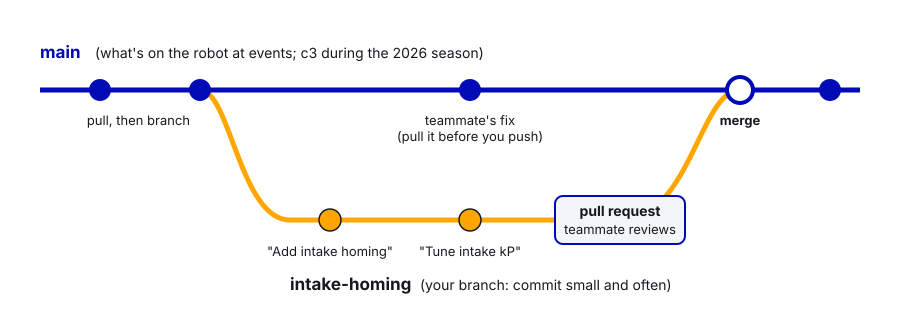
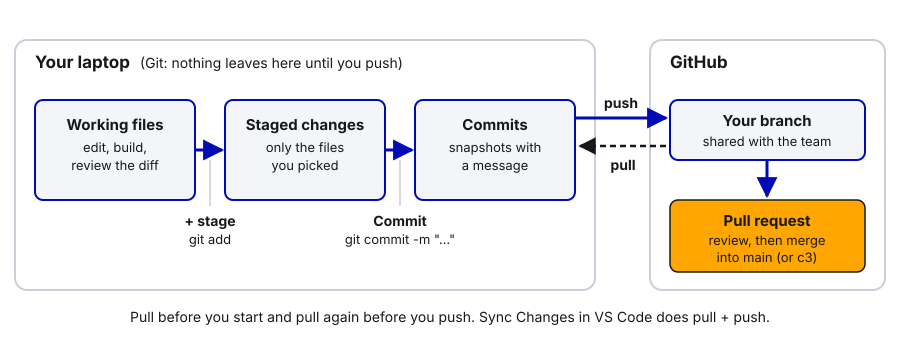
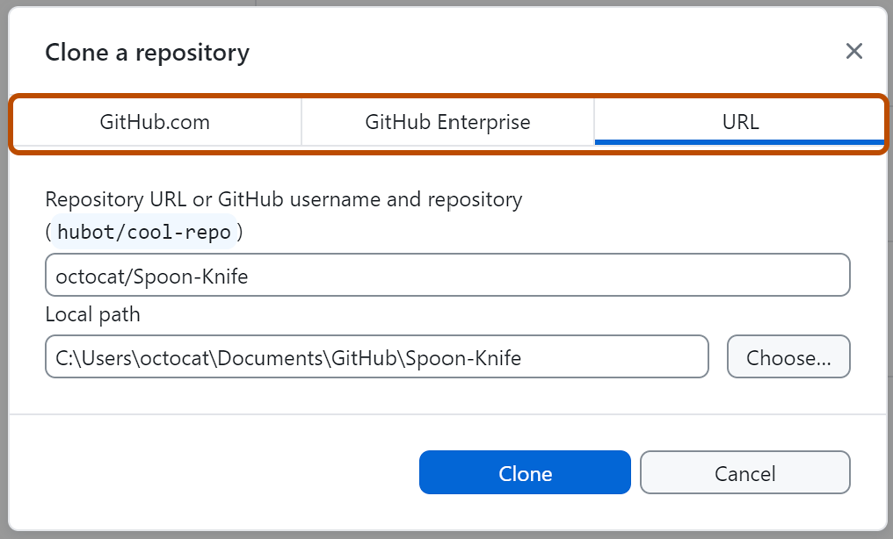
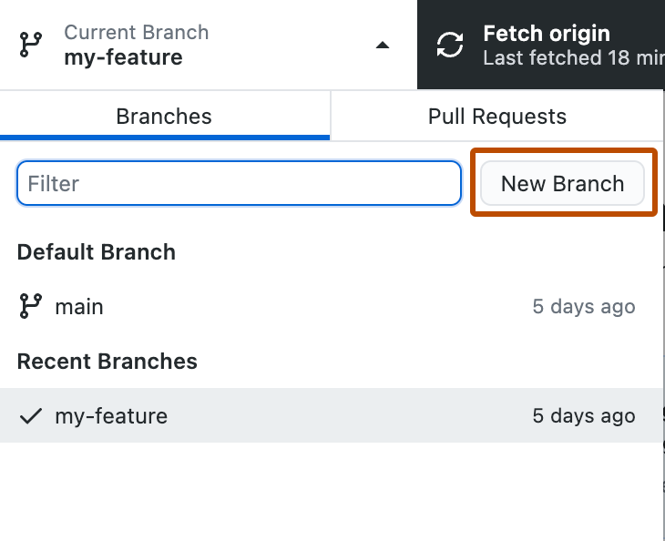
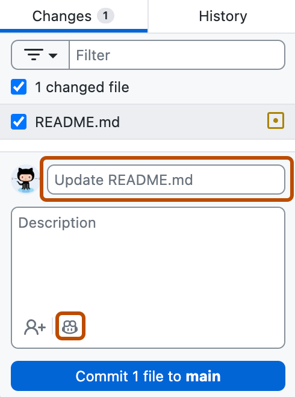
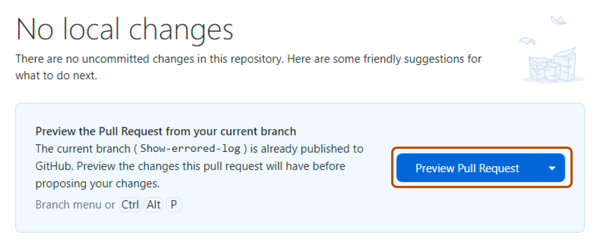

# 22. Git, GitHub and Code Standards

> **Who it's for:** every programmer, before your first commit to a team repo.
> **Read first:** the Robot-Template
> [STUDENT-GUIDE](https://github.com/TorqueNados-FRC5090/Robot-Template/blob/b8dddd0e338841e867c0cc260162e6097adecd7b/STUDENT-GUIDE.md)
> sections 2 (project map), 8 (naming) and 9 (team rules). Install WPILib 2026 (it includes WPILib VS Code), plus Git (git-scm.com) for the terminal and/or GitHub Desktop (desktop.github.com). See [23 Setting Up Laptops](23-setting-up-a-programming-laptop.md).
> **Time:** 45 minutes, plus 20 minutes for the practice.

## What you'll learn

- The everyday Git loop: clone, branch, commit, pull, push, pull request.
- How to do every step two ways: typing `git` commands in VS Code's terminal, or clicking buttons in GitHub Desktop.
- How to fix a simple merge conflict (with VS Code's merge editor), and the one thing you never do (force-push `main`).
- What a good commit message, branch name and code review look like on our team.
- Where code goes in our projects, how to manage vendordeps, and which files you don't edit.

---

## 1. The idea

**Git** keeps the full history of the code on your laptop. **GitHub** is the shared copy everyone pushes to. Our
repos live in the [TorqueNados-FRC5090](https://github.com/TorqueNados-FRC5090) organization:

| Repo | Branch to use | What it is |
|---|---|---|
| [Hephaestus](https://github.com/TorqueNados-FRC5090/Hephaestus) | `c3` | 2026 robot code (robot rebuilt as Theseus, repo kept the old name) |
| [Robot-Template](https://github.com/TorqueNados-FRC5090/Robot-Template) | `2026` | Clean starting point for a new robot |

Words you need:

| Word | Meaning |
|---|---|
| **Repository (repo)** | The project folder plus its whole history. |
| **Clone** | Download a repo from GitHub to your laptop (once). |
| **Commit** | A saved snapshot of your changes, with a message. Commits stay on your laptop until you push. |
| **Branch** | A separate line of work. You change things on your branch without touching `main`. |
| **Pull** | Download other people's new commits on your branch and merge them into yours. |
| **Push** | Upload your commits to GitHub. |
| **Pull request (PR)** | A request on GitHub to merge your branch into another one, where others review it first. |
| **Merge conflict** | Two people changed the same lines; Git can't decide, so you choose. |



**Teammates push to the same branches you do.** On build nights, three people may be committing to `c3` at once. If
you don't pull first, your push is rejected, or you end up merging by accident. Rule: **pull before you start, pull
before you push.**

---

## 2. Two ways to drive Git: the terminal or GitHub Desktop

You can do every step of the everyday loop in **one of two ways**. Both do exactly the same thing to the repo, so
pick the one you like, and switch whenever you want (you can even mix them on the same day).

| | **Command line in VS Code's terminal** | **GitHub Desktop** |
|---|---|---|
| What it is | Typing `git` commands in the terminal built into WPILib VS Code | A free app from GitHub with buttons for each Git step |
| Good for | Seeing exactly what happens; works the same on every laptop and in every guide online | Seeing your changes and branches at a glance; fewer things to remember |
| Install | **Git** from git-scm.com (WPILib does not include it), then restart VS Code | **GitHub Desktop** from desktop.github.com → **Download for Windows** (it brings its own Git) |
| Open it | In WPILib VS Code press **Ctrl+`** (the backtick key, left of `1`), or menu **Terminal → New Terminal** | Start menu → GitHub Desktop |

**The terminal.** It opens at the bottom of VS Code, already inside the folder you have open (the prompt shows the
path, e.g. `PS C:\Users\you\Documents\Robot\Hephaestus>`). On Windows it's PowerShell; every `git` command below works
there. If it says `git: The term 'git' is not recognized`, Git isn't installed, or VS Code was open while you installed
it: close VS Code completely and open it again.

**GitHub Desktop.** The top bar has three buttons you'll use all the time: **Current Repository**, **Current Branch**,
and a third button that changes with the situation (**Fetch origin**, **Pull origin**, **Push origin** or **Publish
branch**). The left side has two tabs: **Changes** (what you changed and haven't committed) and **History** (the
commits). You still **edit and build code in WPILib VS Code**: GitHub Desktop only does the Git part. Set it to open
VS Code for you: **File → Options → Integrations → External Editor**.

> **Tip:** pick **Configure Custom Editor** there and point it at WPILib's copy,
> `C:\Users\Public\wpilib\2026\vscode\Code.exe`. If you pick plain "Visual Studio Code", Desktop opens a regular VS Code
> (if one is installed), which has no WPILib commands. Always build and deploy from **WPILib VS Code 2026** (see
> [23 Setting Up Laptops](23-setting-up-a-programming-laptop.md)).

VS Code also has a built-in **Source Control panel** (the branch icon on the left, `Ctrl+Shift+G`) with buttons for
stage, commit and sync. It's handy for a quick look at your diff, but on our team we teach the terminal and GitHub
Desktop, so that's what's below.

---

## 3. Step by step: the everyday loop



Each step shows both ways side by side. Do the left column **or** the right column, not both.

### First time on a laptop

| Step | Command line (VS Code terminal) | GitHub Desktop |
|---|---|---|
| **0. Get access** | Ask a mentor to add your GitHub account to the TorqueNados-FRC5090 organization. | Same. |
| **1. Say who you are** (once per laptop) | `git config --global user.name "Your Name"`<br>`git config --global user.email "you@example.com"`<br>(the email on your GitHub account) | **File → Options → Accounts → Sign Into GitHub.com** → **Continue With Browser**, log in to GitHub in the browser. Then **File → Options → Git** and check name and email. |
| **2. Clone** (once per repo) | `cd ~\Documents\Robot`<br>`git clone https://github.com/TorqueNados-FRC5090/Hephaestus.git`<br>Then in WPILib VS Code: **File → Open Folder** → `Hephaestus`. | **File → Clone repository...** → **URL** tab → paste `TorqueNados-FRC5090/Hephaestus` → **Local path: Choose...** → **Clone**. Then **Repository → Open in Visual Studio Code**, or open the folder from WPILib VS Code. |



### Every session

| Step | Command line (VS Code terminal) | GitHub Desktop |
|---|---|---|
| **3. Switch to the right branch** | `git switch c3`<br>(older Git: `git checkout c3`) | **Current Branch** → pick `c3` from the list. |
| **4. Pull first** | `git pull` | **Fetch origin** (checks GitHub). If teammates pushed, the button becomes **Pull origin**: click it. |
| **5. New work? Make a branch** | `git switch -c intake-homing`<br>(older Git: `git checkout -b intake-homing`) | **Current Branch** → **New Branch** → name `intake-homing` → based on the branch you're on → **Create Branch**. |
| **6. Change code and build** | In WPILib VS Code: `Ctrl+Shift+P` → **WPILib: Build Robot Code**. Don't commit code that doesn't build. | Same: edit and build in WPILib VS Code. GitHub Desktop sees each saved file right away. |
| **7. See what you changed** | `git status` (which files)<br>`git diff` (the exact lines) | **Changes** tab: click each file to see its diff (red = removed, green = added). |
| **8. Pick files and commit** | `git add src/main/java/frc/robot/subsystems/Intake.java`<br>(or `git add .` for everything, after checking `git status`)<br>`git commit -m "Add intake homing with stall detection"` | In **Changes**, tick only the files you want. Type the message in **Summary** (and more detail in **Description** if needed) → **Commit to intake-homing**. |
| **9. Pull again, then push** | `git pull`<br>`git push -u origin intake-homing` the first time;<br>after that just `git push` | First push of a new branch: **Publish branch**. After that: **Push origin**. If GitHub has newer commits, Desktop asks you to **Fetch** first: do it. |
| **10. Check the history** | `git log --oneline` (one line per commit, newest first; press `q` to quit) | **History** tab. |
| **11. Open a pull request** | On github.com: after a push, GitHub shows a yellow **Compare & pull request** banner on the repo page. | **Preview Pull Request** (on the "No local changes" screen) → check the **base:** branch → **Create Pull Request** (opens github.com). |

Step 8 in a bit more detail: **only commit what you meant to change.** Look at `git status` or the Changes list for
stray files (a `simgui.json` from the sim, a debug print you forgot). Untick them in Desktop, or leave them out of
`git add`.




**The pull request** (step 11) is the same on GitHub either way. Base = the branch you're merging **into** (usually
`main`, or `c3` during the 2026 season). Write what changed, why, and how you tested it. Ask someone to review.



Commit **small and often**: one idea per commit. "Add intake homing" and "Tune intake kP" are two commits, not one.

### Quick reference: the terminal commands

| Command | What it does |
|---|---|
| `git clone <url>` | Download a repo (once). |
| `git switch <branch>` / `git checkout <branch>` | Go to an existing branch. |
| `git switch -c <name>` / `git checkout -b <name>` | Make a new branch from where you are and go to it. |
| `git status` | Which branch you're on, which files changed, what's staged. Run it often. |
| `git diff` / `git diff --staged` | The exact lines changed (not staged / staged). |
| `git add <file>` | Stage a file for the next commit. |
| `git commit -m "message"` | Save the staged changes as a commit. |
| `git pull` | Download teammates' commits on this branch and merge them in. |
| `git push -u origin <branch>` | First push of a new branch (sets up tracking). Later: `git push`. |
| `git log --oneline` | Short history, one commit per line. |
| `git merge --abort` | Back out of a merge that went wrong. |

---

## 4. Merge conflicts (the basics)

A conflict happens when you and a teammate changed the same lines. Git stops and marks the file:

```java
<<<<<<< HEAD (your change)
    public static final double kIntakeStatorLimitAmps = 25;
=======
    public static final double kIntakeStatorLimitAmps = 20;
>>>>>>> origin/c3 (their change)
```

Don't panic, nothing is lost. Either way, you fix the file in VS Code; only the start and the end are different.

| Step | Command line (VS Code terminal) | GitHub Desktop |
|---|---|---|
| **You see it** | `git pull` prints `CONFLICT (content): Merge conflict in ...Constants.java` and `Automatic merge failed`. `git status` lists it under **both modified**. | After **Pull origin**, a **Resolve conflicts before merging** window lists the conflicted files. |
| **Open the file** | Open it in WPILib VS Code (it's red, marked **!** in the Explorer). | Next to the file: **Open in Visual Studio Code** (or open it from WPILib VS Code yourself). |
| **Fix it** | Same for both, in VS Code (see below). | |
| **Finish** | `git add <file>` then `git commit` (Git fills in a "Merge ..." message; save and close it), build, `git push`. | Back in Desktop the file shows **No conflicts remaining** → **Continue merge** (older versions: **Commit merge**), build, **Push origin**. |
| **Back out** | `git merge --abort` | **Abort merge** |

**Fixing it in VS Code.** Above each conflict VS Code shows small links: **Accept Current Change** (yours),
**Accept Incoming Change** (theirs), **Accept Both Changes**, **Compare Changes**. For anything more than a line or
two, click **Resolve in Merge Editor** (bottom right of the file): it shows *Incoming* and *Current* side by side on
top and the **Result** below. Tick the change(s) you want to keep, check the Result reads right, then click
**Complete Merge**.

1. Pick the right one. If you're not sure which is right, **ask the person who made the other change.** Don't just
   click "Accept Current" to make it go away; that silently throws away their work.
2. Make sure no `<<<<<<<`, `=======` or `>>>>>>>` lines are left. **Build the code** before you finish the merge.
3. If it's a mess, back out (`git merge --abort` or **Abort merge**) and ask a mentor.

**Never force-push to `main`** (or to any shared branch like `c3`). `git push --force` (in Desktop: **Force push
origin**) replaces GitHub's history with yours and deletes your teammates' commits for everyone. If your push is
rejected, the answer is always **pull, fix conflicts, push**, never force.

---

## 5. Commit messages and branch names

A commit message is a note to the person who reads the history at 11 pm at an event, trying to work out what broke.
Write it in the imperative ("Fix", "Add", "Lower"), say **what** changed and, if it isn't obvious, **why**. Real
examples from Hephaestus:

| Good (from our history) | Why it's good |
|---|---|
| `Fix the swerve gyro ID: Pigeon is CAN ID 0, not 24` | Says exactly what and the real value. |
| `Turret jerk 200 -> 1500 so it keeps up when the robot rotates` | Old value, new value, reason. |
| `Intake: no automatic homing in real matches, so auto is untouched` | Subsystem first, behavior, why. |
| `Dashboard "Feeder/Waiting on": one line saying what a shot waits for` | You can find it by searching the key. |

| Not useful (also from our history) | Problem |
|---|---|
| `updated intake code` | Which part? Why? |
| `yeah` / `yeah ok` | Nothing. |
| `yeah so maybe it shoots idk yet lol!` | Unprofessional, and doesn't say what changed. Judges and other teams read our public repos. |
| `gooonette stuffs` | Inside joke; useless in a month. |

If a change needs explaining, add a blank line after the first line and write more:

```
Lower drive kSlipCurrent from 120 A to 60 A

CTRE uses kSlipCurrent as the drive motors' stator limit, overriding the
config. At 120 A the drive could pull twice the intended current and brown out.
```

> **AI can help:** paste your diff (`git diff --staged` in the terminal, or the file diffs from GitHub Desktop's Changes tab) into an AI and ask it to draft a commit message in our style: imperative, subsystem first, old value -> new value, and why. Then check it yourself: every claim must be true and match the diff, the "why" has to be the real reason (the AI can only guess it), and it should name one idea. If it describes changes you didn't make or can't explain, rewrite it. The commit is yours: don't add AI co-author lines.

**Branch names:** lowercase, dashes, say what the work is: `intake-homing`, `shooter-tuning`, `auto-left-double`,
`fix-pigeon-id`. Not `my-branch`, `test`, or joke names. Some of our old branches (`genuinely-incomprehensible`,
`goonettes`) are examples of what not to do; `Shoot-on-the-move` and `intake` are fine (lowercase is better).

Hephaestus also has several merge commits like "Merge branch 'goonettes' of github.com:... into goonettes". Those come from
committing without pulling first, then pulling. They're harmless but noisy. Pulling **before** you start avoids most of them.

---

## 6. Code review checklist

Before you ask for review (and when you review someone else's PR), check:

- [ ] It **builds**, and it was tested: in simulation, then on blocks, then on the floor, as far as the change needs.
      The PR says how.
- [ ] **Names** pass the "would a judge understand this?" test (STUDENT-GUIDE section 8). Classes are nouns
      (`Shooter`), methods are verbs (`feedWhenReady()`), constants are `k` + name + units (`kIntakeStatorLimitAmps`).
- [ ] **No magic numbers**: every number is a named constant in `Constants.java` with units and a comment.
- [ ] Comments explain **why**, not what. Any changed tuning value says the old value and the reason.
- [ ] **Current limits** on every new motor, `.withEnableFOC(true)` on control requests.
- [ ] **CAN IDs** match Tuner X and the team scheme.
- [ ] Commands that use a subsystem **require** it; commands used in autos **end** ([04 Command-based](04-command-based-basics.md)).
- [ ] Dashboard keys look like `Subsystem/Thing (units)`.
- [ ] No leftover debug prints, commented-out blocks, or unused files and imports.
- [ ] Generated/vendor files untouched (section 8), or the edit is commented.
- [ ] The diff only contains what the PR says (no accidental changes to `simgui.json`, `networktables.json`, etc.).

Reviewing is not about being nice or mean; it's about catching the bug before the robot does. Ask questions in the PR
comments ("What happens if the beam break is unplugged?").

---

## 7. Team rules and naming (summary)

The full rules are in STUDENT-GUIDE
[section 8 (naming)](https://github.com/TorqueNados-FRC5090/Robot-Template/blob/b8dddd0e338841e867c0cc260162e6097adecd7b/STUDENT-GUIDE.md#8-naming-keep-it-professional)
and [section 9 (team rules)](https://github.com/TorqueNados-FRC5090/Robot-Template/blob/b8dddd0e338841e867c0cc260162e6097adecd7b/STUDENT-GUIDE.md#9-team-rules-for-code).
The short version:

1. Work on a branch. Pull before you start, push when done.
2. No magic numbers. Constants go in `Constants.java` with units.
3. Comment the why.
4. Check CAN IDs in Tuner X before blaming the code.
5. Test in simulation → on blocks → on the floor.
6. Something weird happened? Read the log before changing code ([19 Logging and debugging](19-logging-and-debugging.md)).
7. Professional, descriptive names only. Our 2026 code has some joke names (`EvilIntake`, `evilyummy()`, `theYappy`).
   They work, but in new code they'd be `IntakeRack`, `setRackPosition()`, `FeedWhenReady`.
8. Don't edit generated or vendor files (`TunerConstants.java`, `LimelightHelpers.java`) unless you must; if you do,
   comment why.

---

## 8. Where things live

```
src/main/java/frc/robot/
├── Robot.java              Main loop. Keep it almost empty (it calls the scheduler; we also do vision here in 2026).
├── RobotContainer.java     Makes subsystems, binds buttons, default commands, auto chooser.
├── Constants.java          Every number: CAN IDs, speeds, gains, limits, with units.
├── subsystems/             One class per mechanism. Owns motors/sensors, has small methods + command factories.
├── commands/               Command classes that need their own state, plus AutonContainer (PathPlanner setup).
├── generated/
│   └── TunerConstants.java Swerve settings, generated by Tuner X. Regenerate, don't rewrite.
└── LimelightHelpers.java   Limelight's official library. Never edit.
src/main/deploy/pathplanner/  Paths and autos from the PathPlanner app.
vendordeps/                 Library version files (Phoenix 6, PathPlannerLib, ...). Committed to the repo.
tuner-project.json          Saved Tuner X swerve project, so the drivetrain can be regenerated.
```

Rules of thumb:
- "What does button X do?" → `RobotContainer.configureBindings()`.
- "Where's that number?" → `Constants.java` (or `TunerConstants.java` for the swerve).
- A command that's one line of `run`/`runOnce`/`startEnd` → a factory method in the subsystem. A command with a timer,
  phases, or several subsystems → its own class in `commands/`, or a factory in `RobotContainer` that composes others.

### Keep generated and vendor files clean

- **`TunerConstants.java`**: Tuner X writes it. If you have to hand-edit (we do: `kSlipCurrent`, `kSpeedAt12Volts`),
  leave a comment with the old value and the reason, so the next person who regenerates puts it back. See
  [16 Swerve](16-swerve-drive-ctre.md).
- **`LimelightHelpers.java`**: copy the official file from Limelight's GitHub and never change it, so updating is a
  simple file swap. Hephaestus shows why: it has **two** renamed, older copies (`Limelighthelpers.java`, v1.10, and
  `wrappers/Limelight.java`, v1.11) instead of one clean `LimelightHelpers.java`. Robot-Template has the clean v1.14.

### Vendordeps (libraries)

Vendordeps are JSON files in `vendordeps/` that tell Gradle which library versions to download. 2026 versions:
**Phoenix 6 26.3.0**, **PathPlannerLib 2026.1.2** (plus WPILib's built-in `WPILibNewCommands`).

- Manage them from the **WPILib icon in the left bar → Dependency Manager**: **Install** to add, **Update** to
  upgrade, trash icon to remove. (The `WPILib: Manage Vendor Libraries` command does the same.)
- The Phoenix 6 vendordep's major version must match the **device firmware** (26.x with 26.x). Update firmware in
  Tuner X when you update the vendordep.
- **Don't update libraries the night before an event.** Update between events, test on the robot, and commit the
  vendordep change on its own: `Update Phoenix 6 vendordep 26.1.0 -> 26.3.0`.
- Remove vendordeps you don't use. Hephaestus still has `REVLib.json`; only the unused `wrappers/GenericPID.java`
  needs it (our Vortex motors run on Talon FXS, not REV controllers). Unused libraries slow builds and confuse people.

---

## 9. In our code

- **Version stamp on the dashboard.** Both repos write the branch and commit into `version.txt` at build time, shown
  as "Code Version" on the dashboard (with "+uncommitted changes" if you deployed code you hadn't committed):
  [build.gradle, lines 107–122](https://github.com/TorqueNados-FRC5090/Hephaestus/blob/c2f0cee6f61db3f26f911d3f5623ed7fa27a5b03/build.gradle#L107-L122)

  ```groovy
  // Writes the git branch + commit into the deploy folder at build time, so the dashboard's
  // "Code Version" shows exactly which code is on the robot.
  tasks.register('writeVersionFile') {
      ...
          def changes = run('git status --porcelain') ? ' +uncommitted changes' : ''
          new File(deployDir, 'version.txt').text =
              "${run('git rev-parse --abbrev-ref HEAD')} ${run('git rev-parse --short HEAD')}${changes} (built ...)"
  ```

  Notice: this is why committing before deploying matters at events. If the robot does something odd, "Code Version"
  plus the commit history tells you exactly what code was on it.
- **Constants with units and comments:** Robot-Template's
  [Constants.java, lines 52–73 (CAN ID scheme)](https://github.com/TorqueNados-FRC5090/Robot-Template/blob/b8dddd0e338841e867c0cc260162e6097adecd7b/src/main/java/frc/robot/Constants.java#L52-L73)
  and [lines 87–100 (OperatorConstants)](https://github.com/TorqueNados-FRC5090/Robot-Template/blob/b8dddd0e338841e867c0cc260162e6097adecd7b/src/main/java/frc/robot/Constants.java#L87-L100).
  Every value says what it is and its units.
- **A hand edit done right:** [TunerConstants.java, lines 88–93 (kSpeedAt12Volts)](https://github.com/TorqueNados-FRC5090/Hephaestus/blob/c2f0cee6f61db3f26f911d3f5623ed7fa27a5b03/src/main/java/frc/robot/generated/TunerConstants.java#L88-L93)
  has the formula, the old value and what went wrong.
- **A copy-me subsystem:** [ExampleRoller.java](https://github.com/TorqueNados-FRC5090/Robot-Template/blob/b8dddd0e338841e867c0cc260162e6097adecd7b/src/main/java/frc/robot/subsystems/ExampleRoller.java)
  shows the naming, structure and comments we want in every subsystem.

---

## 10. Common mistakes

1. **Not pulling first.** Your push is rejected, or you make a surprise merge. Pull before you start and before you push.
2. **Force-pushing to fix a rejected push.** It deletes teammates' work on GitHub. Never on `main` or a shared branch.
3. **Deploying uncommitted code at an event.** Nobody can tell later what was on the robot. "Code Version" will say
   "+uncommitted changes": commit, then deploy.
4. **One giant commit at the end of the night** called "updated robot". Impossible to review or undo one part of.
5. **Accepting "Current Change" on every conflict** to make it go away, throwing out a teammate's fix.
6. **Committing generated junk** (`simgui.json`, `networktables.json`, `build/`, logs, `.hoot` files). Our
   `.gitignore` covers most of these; look at the diff before committing anyway.
7. **Committing in the wrong place.** You meant to commit on `intake-homing` but you're still on `c3`. Check the branch
   (`git status` or **Current Branch**) before every commit. Not committed yet? `git switch -c intake-homing` (or
   GitHub Desktop's **New Branch**, then choose to bring your changes) takes your changes with you.
8. **Building in the wrong VS Code.** GitHub Desktop's "Open in Visual Studio Code" can open a regular VS Code
   with no WPILib commands. Point its external editor at WPILib VS Code (section 2).
9. **Editing a vendor file** (`LimelightHelpers.java`) or regenerating `TunerConstants.java` without re-applying the
   commented hand edits. Regenerating without them would bring back the 120 A slip current and the wrong top speed
   from 2026.

---

## 11. Checklist

- [ ] On the right branch (`git status`, or GitHub Desktop's **Current Branch**) and pulled.
- [ ] Code builds; tested as far as the change needs.
- [ ] Diff reviewed: only intended changes.
- [ ] Commit message says what and why.
- [ ] Pulled again, then pushed (no force).
- [ ] PR opened with what/why/how-tested, reviewer asked.
- [ ] Before an event: everything committed and pushed, "Code Version" on the dashboard shows a clean commit.

---

## 12. Practice

1. **Your first PR.** Clone Robot-Template, make a branch `practice-yourname`, change the comment on
   `kSlowModeMultiplier` in `Constants.java`, commit with a good message, push, and open a PR (don't merge it).
   Ask a teammate to review it.
2. **Make a conflict on purpose.** With a partner, both start from the same commit on a practice branch. Both change
   `kDeadband` to different values and commit. One pushes; the other pulls, resolves the conflict in VS Code's merge editor, builds,
   and pushes. Then swap: whoever used the terminal the first time uses GitHub Desktop, and the other way round.
3. **Read history.** In the Hephaestus repo on GitHub, open the commit "Fix the swerve gyro ID: Pigeon is CAN ID 0,
   not 24". Find the line that changed. Then find three commit messages in the history you'd rewrite, and rewrite them.

---

## 13. Go further

- WPILib, Git basics for FRC: https://docs.wpilib.org/en/stable/docs/software/basic-programming/git-getting-started.html
- VS Code terminal: https://code.visualstudio.com/docs/terminal/basics
- VS Code, resolving merge conflicts (merge editor): https://code.visualstudio.com/docs/sourcecontrol/merge-conflicts
- GitHub Desktop docs (install, clone, branch, commit, push, pull request): https://docs.github.com/en/desktop
- GitHub Desktop download: https://desktop.github.com/
- GitHub, set up Git: https://docs.github.com/en/get-started/git-basics/set-up-git
- GitHub, resolving a merge conflict: https://docs.github.com/en/pull-requests/collaborating-with-pull-requests/addressing-merge-conflicts/resolving-a-merge-conflict-using-the-command-line
- WPILib, vendor libraries (Dependency Manager): https://docs.wpilib.org/en/stable/docs/software/vscode-overview/3rd-party-libraries.html
- WPILib, organizing a command-based project: https://docs.wpilib.org/en/stable/docs/software/commandbased/organizing-command-based.html
