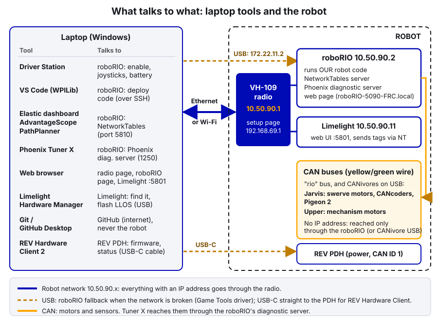
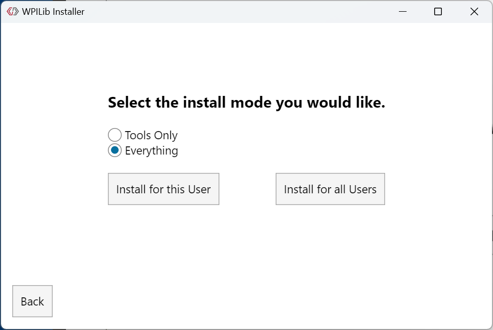
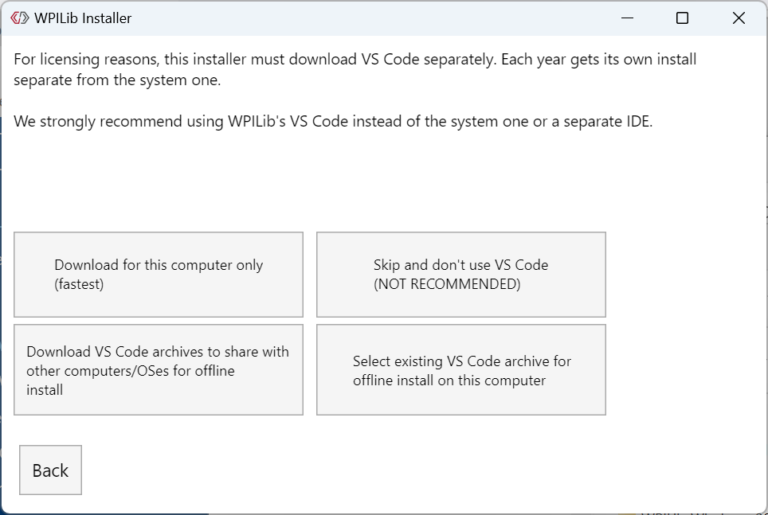
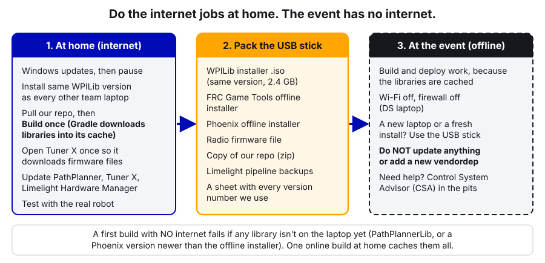

# 23. Setting Up Laptops

> **Who it's for:** anyone setting up a new team laptop, reinstalling one, or getting their own laptop ready to program the robot. Also the person in charge of the Driver Station (DS) laptop.
> **What you need first:** nothing. It helps to have read [01 The Robot Radio and the Robot Network](01-radio-and-robot-network.md) so the addresses below make sense. You need a Windows 10/11 laptop (64-bit Intel or AMD), an admin password, and **internet** for most of the steps.
> **Time:** about 2–3 hours for a fresh laptop (most of it is downloads). 15 minutes to check an existing one against the checklist.

**What you'll learn**
- The difference between a **programming laptop** and the **Driver Station laptop**, and why we keep them separate.
- How to prepare Windows: admin account, updates, power settings, laptop name, network settings, firewall.
- What to install (WPILib with **WPILib VS Code** and **AdvantageScope**, FRC Game Tools, Phoenix Tuner X, **REV Hardware Client 2**, PathPlanner, Limelight Hardware Manager, Git and GitHub Desktop) and where each one comes from.
- Why you must **build our code once at home with internet**, and what goes on the offline USB stick for events.
- How to keep every team laptop on the **same versions**, and how to record it in the laptop inventory.

---

## 1. Two kinds of team laptop

| | **Driver Station (DS) laptop** | **Programming laptop** |
|---|---|---|
| Job | Drive the robot in matches. Nothing else. | Write code, build, deploy, tune, look at logs |
| Software | FRC Game Tools (Driver Station), the dashboard (Elastic), AdvantageScope for a quick log look | Everything: WPILib (WPILib VS Code, AdvantageScope), Game Tools, Tuner X, REV Hardware Client 2, PathPlanner, Limelight Hardware Manager, Git, GitHub Desktop |
| Who uses it | The drive team | Programmers |
| Rule | **Clean.** No games, no school work, no extra programs, no programming | Can be messy, but keep the robot tools on the team versions |
| Name it | `5090-DS-1` | `5090-PROG-1`, `5090-PROG-2`, ... |

WPILib's own Driver Station best-practices page says the same thing: dedicate one laptop to driving, with nothing on it except the Driver Station and dashboard. Fewer programs means fewer things that can steal the CPU, pop up an update, or change a network setting in the middle of a match.

A good DS laptop (also from that page): a durable business-class laptop (used is fine), 8 GB of RAM or more, an SSD, a **built-in full-size Ethernet port**, at least 2 USB ports, a real keyboard, and an **Intel or AMD** processor. The Driver Station does **not** run on ARM laptops (for example Snapdragon "Copilot+" laptops). WPILib also doesn't support ARM Windows.

> **Watch out:** Windows 10 support from Microsoft ended in October 2025. WPILib supports Windows 10 through the 2026 season but says it may drop it in 2027. Any laptop we buy or set up from now on should run **Windows 11**.

### What talks to what

Every tool on the laptop talks to something different on the robot. Knowing which is which saves a lot of time when one tool connects and another doesn't.



So if Elastic shows data but Tuner X sees no devices, the network is fine and the problem is on the CAN side or the diagnostic server (see [02 Phoenix Tuner X and the CAN Bus](02-phoenix-tuner-x-and-can.md)). If nothing connects at all, start with the network (see [01](01-radio-and-robot-network.md)).

---

## 2. Step by step: prepare Windows

Do this on **every** team laptop. Steps marked **(DS)** are a must for the DS laptop and a good idea for the rest.

1. **Start clean.** If the laptop is used or donated, reinstall Windows first. Avoid school-managed laptops: WPILib warns that school IT setups often come with software that interferes with the robot (blocked installs, forced updates, network filters).
2. **One admin account.** Make one local account that is used both to install software and to drive. It must be in the **Administrators** group. Many installers (FRC Game Tools, "Install for all Users" in WPILib, firewall changes) need admin rights. Write the password in the team's password list, not on a sticky note on the laptop.
3. **English.** If Windows is set to another language, switch the user to English before installing anything. The Driver Station expects it.
4. **Rename the laptop.** Settings → System → About → **Rename this PC**. Use `5090-DS-1` or `5090-PROG-1`. Now the laptop name shows in Windows, in the network list, and in our inventory table. "DESKTOP-7Q2X9LA" tells nobody anything.
5. **Windows Update.** Settings → Windows Update. Install everything, reboot, check again. Repeat until nothing is pending. Then test with the robot, because an update can change drivers.
6. **Power settings** (Settings → System → Power & battery), for both *plugged in* and *on battery*:
   - "Make my device sleep after" → **Never**.
   - **Energy Saver** → off.
   - Power mode → **Best Performance**.
7. **Lid close (DS).** Control Panel → Hardware and Sound → Power Options → **Choose what closing the lid does** → set both columns to **Do nothing**. A DS laptop that sleeps when someone bumps the lid shut in the queue is a robot that doesn't move in auto.
8. **Battery check (DS).** With the settings above, the battery must last at least an hour. That covers queueing without a plug.
9. **Antivirus.** Remove any third-party antivirus (the "free trial" that came with the laptop). Use the built-in Windows Defender. That's WPILib's recommendation too.
10. **Remove junk.** Uninstall the preinstalled games and trial software, especially on the DS laptop.

> **Tip:** Do steps 1–10 on the DS laptop **before** the season. A DS laptop that's being set up the night before the event always has a surprise in it.

---

## 3. Step by step: install the software

Install in this order. The order doesn't matter much for Java teams, but this one means you only reboot once or twice.

| # | Software | What it's for | Where it comes from | DS laptop | Programming laptop |
|---|---|---|---|---|---|
| 1 | **WPILib 2026** (Java JDK, Gradle, Elastic, Glass, SysId, Data Log Tool, roboRIO Team Number Setter, ...) | Building robot code, and the WPILib tools | GitHub release page `wpilibsuite/allwpilib`, linked from docs.wpilib.org | "Tools Only" | **"Everything"** |
| 1a | **WPILib VS Code 2026** | Where we write, build, deploy and simulate robot code | Installed **by the WPILib installer** (step 1). A separate copy from any normal VS Code. | No | **Yes** |
| 1b | **AdvantageScope** | Viewing logs (`.wpilog`, `.hoot`) and live robot data, 2D/3D field view | **Bundled with WPILib** (step 1). Standalone: GitHub releases `Mechanical-Advantage/AdvantageScope` | Yes (WPILib Tools Only) | Yes |
| 2 | **FRC Game Tools 2026** (Driver Station, roboRIO Imaging Tool and images) | Driving the robot; imaging the roboRIO | NI's FRC Game Tools page (needs a free NI account) | Yes | Yes |
| 3 | **Phoenix Tuner X** | CTRE devices: IDs, firmware, configs, plots | Microsoft Store ("Phoenix Tuner X") | Optional | Yes |
| 4 | **REV Hardware Client 2** | REV devices: **REV PDH** firmware updates and live status (channel currents, voltage), any other REV device | rhc2.revrobotics.com (linked from docs.revrobotics.com → REV Hardware Client 2) | No | Yes |
| 5 | **PathPlanner** | Drawing paths and autos | Microsoft Store ("FRC PathPlanner"), or GitHub releases | No | Yes |
| 6 | **Limelight Hardware Manager** | Finding Limelights, flashing LLOS | docs.limelightvision.io → Downloads | No | Yes |
| 7 | **Git** and **GitHub Desktop** | Getting and sharing code (guide 22) | git-scm.com and desktop.github.com | No | Yes (both) |
| 8 | **Bonjour** (only if needed) | `.local` names | docs.limelightvision.io → Downloads → Legacy Tools | Only if `.local` names fail | Only if `.local` names fail |

### 3.1 WPILib

1. Download the **Windows .iso** for the team's WPILib version (2026.2.1 this season). It's about 2.4 GB, and this one file is also the **offline installer**: keep it.
2. Right-click the .iso → **Mount**, then run `WPILibInstaller.exe`.
3. Pick **Everything** on a programming laptop (**Tools Only** on the DS laptop is enough for Elastic and AdvantageScope).
4. Pick **Install for all Users** if you have admin rights (every account on the laptop gets the tools). **Install for this User** works without admin.



5. VS Code: on a laptop with internet, choose **Download for this computer only**. To set up several laptops, choose **Download VS Code archives to share with other computers/OSes for offline install** once, save the archive on the USB stick, then use **Select existing VS Code archive for offline install on this computer** on the others.



6. Wait for it to finish. On Windows everything lands in `C:\Users\Public\wpilib\2026`. Each year gets its own folder, so the 2025 install can stay next to it.

Open **WPILib VS Code 2026** from the desktop (not a regular VS Code). To start the other tools: in VS Code press `Ctrl+Shift+P` → **WPILib: Start Tool**, or use the desktop shortcuts.

### 3.2 WPILib VS Code (comes with WPILib)

**What it's for:** writing, building, deploying and simulating robot code. Every `WPILib:` command (Build Robot Code, Deploy Robot Code, Simulate Robot Code, Dependency Manager, Start Tool) lives here.

**Where it comes from:** you don't download it separately. The WPILib installer (step 5 above) installs **its own copy** of VS Code into `C:\Users\Public\wpilib\2026\vscode`, with the Java extension, the WPILib extension and the right Java (JDK) already set up. It puts a shortcut on the desktop and in the Start menu, named **2026 WPILib VS Code** (this guide calls it "WPILib VS Code 2026").

**It is not the same as a normal VS Code.** If you already use VS Code for school or other projects, that one stays as it is, and both can be installed side by side. The normal one doesn't have the WPILib extension or WPILib's Java, so robot builds fail or the WPILib commands are simply missing. Rule: **robot code is always opened from the WPILib VS Code 2026 shortcut.** Next year's WPILib brings a new copy (2027) next to this one.

To check you're in the right one: press `Ctrl+Shift+P` and type `WPILib`. If you see the WPILib commands, you're fine. GitHub Desktop can open the right copy for you (guide 22, section 2).

### 3.3 AdvantageScope (comes with WPILib)

**What it's for:** looking at logs after a match or test (our `.wpilog` files and CTRE `.hoot` files) and at live robot data: graphs, the 2D/3D field, swerve module states, joysticks. It's the tool from [19 Logging and Debugging](19-logging-and-debugging.md).

**Where it comes from:** **bundled with WPILib**: both **Everything** and **Tools Only** install it. Start it from the desktop shortcut or from WPILib VS Code (`Ctrl+Shift+P` → **WPILib: Start Tool** → AdvantageScope). That's the copy we use on team laptops, so everyone has the same version.

**Standalone:** AdvantageScope can also be installed on its own from its GitHub releases page (`Mechanical-Advantage/AdvantageScope`; Windows, Mac and Linux). Use that on a laptop that doesn't need WPILib (for example a mentor's Mac to review logs at home). Docs: docs.advantagescope.org.

On the DS laptop it's fine for a quick look at the last match. Do the real log digging on a programming laptop.

### 3.4 FRC Game Tools

1. Log in on NI's FRC Game Tools page. Choose **Download** (online installer) or **Install Offline** (a big file to keep on the USB stick).
2. New season? First uninstall last year's: Start → Add or Remove Programs → **NI Software** → Uninstall, select every entry. (Not needed for an update within the same year.)
3. Run the installer, accept the licenses. It may ask to install .NET Framework 4.6.2 first: do that, reboot, and start the installer again.
4. On the **Disable Windows Fast Startup** screen, leave it as it is and click Next. Fast Startup causes problems with the NI drivers used to image the roboRIO.
5. Reboot when asked.

The Game Tools also install two things you don't see: the **roboRIO USB driver** (so a USB cable to the roboRIO works at `172.22.11.2`) and the **NI mDNS Responder** (so names like `roboRIO-5090-FRC.local` work).

**About serial numbers and licenses.** In older seasons the Game Tools asked for a serial number from the Kit of Parts. The 2026 WPILib instructions don't have an activation step: you log in with an NI account and accept the license agreements. If an installer *does* ask you for a serial number or activation, stop and ask a mentor. Don't type in a number from an old season or from the internet.

Then open the Driver Station once, go to the **Setup** tab, and set **Team Number** to `5090` (see [03](03-driver-station-and-match-checklist.md)).

### 3.5 Phoenix Tuner X

Install **Phoenix Tuner X** from the Microsoft Store. The Store keeps it up to date. Its year must match our Phoenix 6 code (2026 Tuner X for vendordep 26.3.0). Open it once **with internet**, so it downloads the firmware files it needs for device updates (see [02](02-phoenix-tuner-x-and-can.md)). The **Phoenix offline installer** (CTRE's GitHub releases page) is the backup for a laptop with no internet, and it also puts the Phoenix libraries on disk for offline builds.

### 3.6 REV Hardware Client 2

**What it's for:** REV devices. On our robot that's mainly the **REV PDH** (Power Distribution Hub, CAN ID 1, the board every motor's breaker plugs into, see [06 Current Limits and Brownouts](06-current-limits-and-brownouts.md)). With it you can:
- **update the PDH firmware** (do this before the season and whenever REVLib's year changes),
- see the PDH's **live status**: battery voltage, current on each channel, faults, and its CAN ID,
- update and configure any other REV device we use.

Our CTRE devices (Talon FX, CANcoder, Pigeon 2, ...) are **not** in here; they use Tuner X (section 3.5).

**Where it comes from:** REV's download page, **rhc2.revrobotics.com** (docs: docs.revrobotics.com → REV Hardware Client 2). Download the Windows installer, run it, and start it from the Start menu. It's not in the Microsoft Store. Open it once **with internet** so it can download the latest firmware files.

**Which version:** use **REV Hardware Client 2**. REV says anyone on **REVLib 2026 or newer must use REV Hardware Client 2** for ION products like the PDH; the older "REV Hardware Client" is for earlier seasons. REV Hardware Client 2 only talks to devices on **2026 firmware (26.x) or newer**. A PDH still on 2025 firmware first has to be updated through **Recovery Mode** (see REV's docs, or ask a mentor).

**How to connect:** plug a **USB-C cable** from the laptop straight into the PDH, with the robot powered on. The PDH shows up under the **Hardware** tab; click it, and the **Update** tab offers the newest PDH firmware: **Download**, then **Update**, and wait for "Update Completed". (The PDH can also act as a USB-to-CAN bridge to reach other REV devices on its CAN bus.)

### 3.7 PathPlanner

Install **FRC PathPlanner** from the Microsoft Store (it auto-updates), or download it from the PathPlanner GitHub releases page. The app's year must match PathPlannerLib in our code (2026.1.2). See [18 PathPlanner Autos](18-pathplanner-autos.md).

### 3.8 Limelight Hardware Manager

Download it from the Limelight docs' Downloads page. It finds Limelights on the network and flashes Limelight OS (LLOS) over USB. See [17 Limelight and Vision](17-limelight-and-vision.md).

### 3.9 Git

WPILib does **not** install Git. Install it from git-scm.com (the default options are fine). Then set your name and email once, so your commits say who made them:

```
git config --global user.name "Your Name"
git config --global user.email "you@example.com"
```

Also install **GitHub Desktop** from desktop.github.com (**Download for Windows**, run it, then **File → Options → Accounts → Sign Into GitHub.com**). Guide [22 Git, GitHub and Code Standards](22-git-and-code-standards.md) shows every step both ways, typed in WPILib VS Code's terminal or clicked in GitHub Desktop, so every programming laptop has both. In GitHub Desktop, set **File → Options → Integrations → External Editor** to WPILib's VS Code (`C:\Users\Public\wpilib\2026\vscode\Code.exe`, via **Configure Custom Editor**) so "Open in Visual Studio Code" opens the right copy.

### 3.10 Bonjour (only if needed)

Windows finds `.local` names (like `limelight.local` or `roboRIO-5090-FRC.local`) through an **mDNS** service. The Game Tools install one. If `http://10.50.90.11:5801` opens the Limelight page but `http://limelight.local:5801` doesn't, install **Bonjour** from the Limelight Downloads page (under Legacy Tools). Don't install it "just in case".

---

## 4. Step by step: network, firewall and antivirus

### Network adapter: always automatic (DHCP)

The robot radio and the field hand out addresses automatically (**DHCP**, see [01](01-radio-and-robot-network.md)). The laptop must ask for one:

1. Settings → Network & internet → **Ethernet** (and Wi-Fi).
2. **IP assignment** → Edit → **Automatic (DHCP)**.

Someone once set a static address to test something? Then the laptop works at home and fails on the field. Check it on every laptop.

At an event, the DS laptop also gets:
- **Wi-Fi off** (hardware switch or Quick Settings). A Wi-Fi connection can grab traffic meant for the field cable.
- **Unplug other networks.** VPN adapters, phone tethering and virtual network adapters can confuse the DS and mDNS. Disable the ones you don't need (Control Panel → Network and Sharing Center → Change adapter settings).

### Windows Firewall

The firewall can block the Driver Station, the dashboard, and mDNS. WPILib gives two options:

1. **At competition, on the DS laptop: turn the firewall off.** Windows Security → Firewall & network protection → turn off each network type. This is WPILib's recommendation for the DS laptop at an event, where it's not on the internet. Turn it back **on** when you get home.
2. **On programming laptops (or at home): allow the apps instead.** Windows Security → Firewall & network protection → **Allow an app through firewall** → Change settings. Make sure the Driver Station, Elastic, AdvantageScope, Tuner X, REV Hardware Client 2, PathPlanner and the WPILib Java/VS Code tools are listed and ticked in all columns. mDNS uses UDP port 5353; the NI mDNS Responder lives in `C:\Program Files\National Instruments\Shared\mDNS Responder\`.

The first time a tool opens a network connection, Windows asks "Allow access?". Click **Allow**, and tick both private and public networks. Clicking "Cancel" by mistake is a common reason a dashboard never connects.

### Antivirus exclusions: only if needed

Windows Defender normally leaves our tools alone. Add an exclusion only if you see a real problem, like Defender quarantining a WPILib or Tuner X file, or builds that are extremely slow on one laptop. Then exclude only what's needed (for example `C:\Users\Public\wpilib\2026` and the folder with our repos), and write it in the inventory. Never turn Defender off on a laptop that browses the internet.

---

## 5. Bookmarks for every laptop

Make a browser folder called **5090 Robot** with these. Most of them only work while connected to the robot.

| Bookmark | Address | What for |
|---|---|---|
| Radio setup page | `http://radio.local/` or `http://192.168.69.1/` | Configure/flash the VH-109 (guide 01) |
| roboRIO web page | `http://roboRIO-5090-FRC.local/` or `http://10.50.90.2/` | roboRIO info, IP settings |
| Limelight | `http://limelight.local:5801` or `http://10.50.90.11:5801` | Camera setup and pipelines (guide 17) |
| WPILib docs | `https://docs.wpilib.org/` | Everything WPILib |
| CTRE Phoenix 6 docs | `https://v6.docs.ctr-electronics.com/` | Motors, Tuner X, swerve |
| Limelight docs | `https://docs.limelightvision.io/` | Camera docs, downloads |
| PathPlanner docs | `https://pathplanner.dev/` | Autos |
| Our GitHub | `https://github.com/TorqueNados-FRC5090` | Our repos |

If we add more Limelights, add their addresses (`limelight-front`, `.12`, ...) when they're set up.

---

## 6. Step by step: clone our code and build it ONLINE

This is the step people skip, and then it bites at an event.

**Why:** when you build, **Gradle** (the build tool inside WPILib) needs every library the project uses. WPILib's own libraries and Gradle itself are installed on disk by the WPILib installer. But **vendor libraries** (PathPlannerLib, Phoenix 6, REVLib, ...) are listed in the project's `vendordeps/` JSON files and **downloaded from the internet the first time you build**. After that they're cached on the laptop. Events have no internet. A laptop that has never built our robot code can't build it at the event.

1. **At home, with internet**, open WPILib VS Code.
2. Clone the repo (`Ctrl+Shift+P` → **Git: Clone**, paste `https://github.com/TorqueNados-FRC5090/Hephaestus.git`, pick a folder like `Documents\Robot`). Switch to the branch we're using (see [22](22-git-and-code-standards.md)).
3. Open the folder. If VS Code asks to trust the authors, say yes. Wait for the Java extension to finish loading (bottom status bar).
4. `Ctrl+Shift+P` → **WPILib: Build Robot Code**. The first build takes several minutes because it downloads everything. It ends with **BUILD SUCCESSFUL**.
5. Do the same for every repo you might need at the event (the robot code, plus the template or a practice repo if we use them).
6. Run **WPILib: Simulate Robot Code** once too. It uses a few extra desktop libraries.
7. Turn off the Wi-Fi and build again. If it still says BUILD SUCCESSFUL, the laptop is ready to work offline.

**Every time someone adds or updates a vendordep**, every programming laptop must pull and build online again before the next event.

> **AI can help:** a first build often fails with a long Gradle error. Paste the **whole** error into an AI tool and ask "what does this Gradle error mean, and what should I check first?" It's good at spotting the important line (for example "Could not resolve com.ctre.phoenix6..." means a library couldn't be downloaded, which means no internet or a wrong vendordep URL). Then you check it yourself: look at the `vendordeps/` file it names, check your internet, and build again. Don't let it "fix" `build.gradle` for you without understanding why.

---

## 7. Keep every laptop on the SAME versions

If laptop A has WPILib 2026.2.1 and laptop B has 2026.1.1, VS Code on one of them will keep asking to "upgrade" the project, and whoever clicks yes changes the GradleRIO version for everyone. Vendordeps are the same story. Mixed versions cause builds that work on one laptop and fail on another, or tools that can't talk to the robot.

**Rules:**
1. A mentor or the programming lead picks the versions at the start of the season (and after kickoff updates).
2. Write them on the version sheet below and tape a copy inside the programming tote.
3. Nobody updates WPILib, a vendordep, Tuner X firmware year, or LLOS without telling the team. Update all laptops together.
4. **No updates at an event**, unless a Control System Advisor (CSA) or FIRST tells you to.

| Thing | 2026 season version | How to check it |
|---|---|---|
| WPILib / GradleRIO | 2026.2.1 | `build.gradle` line 3; the installer's file name |
| Phoenix 6 vendordep | 26.3.0 | `vendordeps/Phoenix6-26.3.0.json` |
| PathPlannerLib | 2026.1.2 | `vendordeps/PathplannerLib-2026.1.2.json` |
| LimelightHelpers | 1.14 | Line 1 of `LimelightHelpers.java` |
| REVLib (Hephaestus only) | 2026.0.5 | `vendordeps/REVLib.json` |
| FRC Game Tools / Driver Station | 2026 | Driver Station title bar / Add or Remove Programs |
| Phoenix Tuner X | 2026 | Tuner X's settings/about screen |
| WPILib VS Code | comes with WPILib 2026.2.1 | The shortcut name says the year; **Help → About** |
| AdvantageScope | the version bundled with WPILib 2026.2.1 | AdvantageScope **Help → About** |
| REV Hardware Client 2 | (write it here) | REV Hardware Client 2's settings/about screen |
| REV PDH firmware | 26.x (write the exact one here) | REV Hardware Client 2 → PDH → Update tab |
| PathPlanner app | 2026.x | PathPlanner's settings/about screen |
| Limelight OS | 2026.x | Limelight web page |
| Radio firmware | (write it here) | Radio setup page (guide 01) |

---

## 8. The event USB stick

Bring one labeled USB stick ("5090 OFFLINE INSTALLERS") in the programming tote. With it, you can rebuild a laptop that died, without internet.



Put on it:
- The WPILib .iso (same version as the team), and the shared VS Code archive if you made one.
- The FRC Game Tools offline installer.
- The Phoenix offline installer (same Phoenix 6 version as our vendordep, or newer within the same year).
- The REV Hardware Client 2 installer, and the PDH firmware file if you downloaded it.
- (AdvantageScope and WPILib VS Code are inside the WPILib .iso, so they don't need their own installers.)
- The radio firmware file (guide 01) and the latest Limelight pipeline backups (the template repo's `limelight/` folder is where they belong; the 2026 robot repo doesn't have one yet).
- A zip of each robot repo, freshly pulled. (Vendordep JSON files are already in each repo's `vendordeps/` folder.)
- A text file with the version sheet from section 7.

Remember the limit: the vendordep JSON files only say **what** to download. A laptop that never built online still doesn't have PathPlannerLib or REVLib. That's why every laptop builds at home (section 6), and the USB stick is the backup, not the plan.

---

## 9. A note on 2027 (SystemCore)

In 2027 the **SystemCore** controller replaces the roboRIO. Expect changes to the Game Tools, the Driver Station, imaging and parts of networking. This guide is written for the 2026 tools. Before setting up laptops for 2027, read the current **Zero to Robot → Step 2: Installing Software** pages on docs.wpilib.org and update this guide where it differs.

---

## In our code

**The project knows where WPILib lives.** [settings.gradle, lines 7–25](https://github.com/TorqueNados-FRC5090/Robot-Template/blob/b8dddd0e338841e867c0cc260162e6097adecd7b/settings.gradle#L7-L25) (template):

```java
        String frcYear = '2026'
        File frcHome
        if (OperatingSystem.current().isWindows()) {
            String publicFolder = System.getenv('PUBLIC')
            if (publicFolder == null) {
                publicFolder = "C:\\Users\\Public"
            }
            def homeRoot = new File(publicFolder, "wpilib")
            frcHome = new File(homeRoot, frcYear)
        ...
        def frcHomeMaven = new File(frcHome, 'maven')
```

Notice: Gradle looks for libraries in `C:\Users\Public\wpilib\2026\maven` first. That's the folder the WPILib installer (and the Phoenix offline installer) fill, and it's why WPILib's own libraries work without internet. A 2026 project on a laptop with only WPILib 2025 installed can't find this folder, so install the right year.

**The team number and year are in the project.** [.wpilib/wpilib_preferences.json, lines 1–6](https://github.com/TorqueNados-FRC5090/Robot-Template/blob/b8dddd0e338841e867c0cc260162e6097adecd7b/.wpilib/wpilib_preferences.json#L1-L6):

```json
{
    "enableCppIntellisense": false,
    "currentLanguage": "java",
    "projectYear": "2026",
    "teamNumber": 5090
}
```

Deploy uses `teamNumber` to find the robot (`roboRIO-5090-FRC.local`). It's in the repo, so every laptop gets it. You don't set it per laptop.

**The WPILib version is one line.** [build.gradle, lines 1–4](https://github.com/TorqueNados-FRC5090/Hephaestus/blob/c2f0cee6f61db3f26f911d3f5623ed7fa27a5b03/build.gradle#L1-L4) (2026 robot):

```java
plugins {
    id "java"
    id "edu.wpi.first.GradleRIO" version "2026.2.1"
}
```

If VS Code offers to change this number, stop and ask. Changing it on one laptop changes it for everyone after you push.

**Which laptop deployed this?** [build.gradle, lines 107–122](https://github.com/TorqueNados-FRC5090/Robot-Template/blob/b8dddd0e338841e867c0cc260162e6097adecd7b/build.gradle#L107-L122) (template) writes the branch, commit and build time into the deploy folder, and the dashboard shows it as `Code Version`:

```java
        def changes = run('git status --porcelain') ? ' +uncommitted changes' : ''
        new File(deployDir, 'version.txt').text =
            "${run('git rev-parse --abbrev-ref HEAD')} ${run('git rev-parse --short HEAD')}${changes} (built ${new Date().format('MM/dd HH:mm')})"
```

Notice it needs **Git installed** on the laptop. Without Git, `Code Version` says `unknown`. If it says `+uncommitted changes`, someone deployed code that isn't saved in Git. Commit it before the next match.

**Different repos need different downloads.** The 2026 robot's `vendordeps/` folder has `REVLib.json` (2026.0.5) on top of Phoenix 6 and PathPlannerLib. The template doesn't. So a laptop that has only built the template still can't build Hephaestus offline. Build **each** repo you'll need.

---

## Common mistakes

These are the classic FRC laptop problems. Every one of them has happened to teams at real events.

- **Never building online.** First build at the event → "Could not resolve ..." → no code changes all weekend. Build every repo at home.
- **Someone "upgraded" the project.** A newer WPILib on one laptop offers to update the project. They click yes, push, and now the other laptops can't build. Same versions on every laptop.
- **DS laptop went to sleep in the queue,** or when the lid was closed. Power settings and lid action, section 2.
- **Windows Update at the worst time.** A restart in the pits, or a driver change the night before. Update at home, then pause updates for the event.
- **Static IP left on the Ethernet adapter.** Works at home, can't see the field. Always Automatic (DHCP).
- **Firewall "Cancel".** Someone clicked Cancel on the "Allow access?" box and the dashboard never connects. Fix it in "Allow an app through firewall".
- **Using the regular VS Code** instead of WPILib VS Code 2026. The WPILib commands are missing, or the wrong Java gets used. Same trap when GitHub Desktop opens "Visual Studio Code": point it at WPILib's copy.
- **The old REV Hardware Client.** It doesn't support REVLib 2026 devices properly. Use **REV Hardware Client 2**, and update the PDH to 2026 firmware before the season.
- **A school-managed laptop** that blocks installers or the firewall settings. Use team laptops.
- **An ARM laptop** as the DS. The Driver Station doesn't run on ARM.
- **No Git on the laptop**, so `Code Version` says `unknown` and nobody knows what's on the robot.
- **Nobody on the drive team knows the DS laptop password.** Make sure they all do.

---

## Checklist

**Every team laptop**
- [ ] Windows 11 (or 10 for 2026 only), 64-bit Intel/AMD, English, fully updated
- [ ] Renamed (`5090-DS-1`, `5090-PROG-1`, ...), and listed in the inventory below
- [ ] One admin account, password in the team password list
- [ ] Sleep: Never. Energy Saver off. Best Performance. (DS: lid close = Do nothing)
- [ ] No third-party antivirus; Windows Defender on
- [ ] Ethernet and Wi-Fi set to Automatic (DHCP); no leftover VPN adapters
- [ ] FRC Game Tools 2026 installed, DS team number 5090
- [ ] AdvantageScope (WPILib "Tools Only" on the DS laptop, "Everything" on programming laptops)
- [ ] Bookmarks folder "5090 Robot"

**Programming laptops, also**
- [ ] WPILib 2026.2.1 "Everything"
- [ ] **WPILib VS Code 2026** shortcut on the desktop; robot code opened with it (not a normal VS Code)
- [ ] **AdvantageScope** (from WPILib) opens a log
- [ ] Tuner X 2026 (opened once online), PathPlanner 2026, Limelight Hardware Manager
- [ ] **REV Hardware Client 2** installed and opened once online; sees the PDH over USB-C
- [ ] Git installed, `user.name` and `user.email` set
- [ ] GitHub Desktop installed and signed in; external editor = WPILib VS Code
- [ ] Every repo cloned and **built online**; builds again with Wi-Fi off
- [ ] Simulation runs once
- [ ] Versions match the version sheet

**DS laptop at the event**
- [ ] Charged; charger packed
- [ ] Wi-Fi off; firewall off (back on at home)
- [ ] Windows updates paused for the event
- [ ] Ethernet port saver and a trusted Ethernet + USB cable in the tote

---

## Laptop inventory (print this, keep it in the programming tote)

Write the version of each tool (or a tick if it matches the version sheet). Short names: AScope = AdvantageScope, REV HC2 = REV Hardware Client 2, PathPl. = PathPlanner, GHD = GitHub Desktop. Role is DS or PROG.

| Laptop | Model | Role | Windows | WPILib + VS Code | AScope | Game Tools | Tuner X | REV HC2 | PathPl. | Git + GHD | Built online | Set up by | Notes |
|---|---|---|---|---|---|---|---|---|---|---|---|---|---|
| 5090-DS-1 | | DS | | | | | | – | – | – | | | |
| 5090-PROG-1 | | PROG | | | | | | | | | | | |
| 5090-PROG-2 | | PROG | | | | | | | | | | | |
| | | | | | | | | | | | | | |
| | | | | | | | | | | | | | |
| | | | | | | | | | | | | | |

---

## Practice

1. **Audit a laptop.** Take one team laptop and go through the checklist. Fill in its row in the inventory. Fix one thing that's wrong (or note it for a mentor if it needs admin rights).
2. **Offline build test.** On your programming laptop, clone Hephaestus and build it with internet. Then turn off Wi-Fi, delete nothing, and build again. Now try the template on a laptop that has never built it, with Wi-Fi off, and read the error. Which library does it say it can't find?
3. **Find the version numbers.** Without asking anyone, fill in the version sheet in section 7 from the files in the repo and the "About" screens of the tools. Compare with a teammate's laptop.
4. **Tool map quiz.** Without looking at the diagram: Elastic connects but Tuner X shows no devices. Is the problem the radio, NetworkTables, or the CAN side? What about when nothing connects, but the USB cable works?

---

## Go further

- WPILib installation guide: https://docs.wpilib.org/en/stable/docs/zero-to-robot/step-2/wpilib-setup.html
- Installing the FRC Game Tools: https://docs.wpilib.org/en/stable/docs/zero-to-robot/step-2/frc-game-tools.html
- Offline installation preparation: https://docs.wpilib.org/en/stable/docs/zero-to-robot/step-2/offline-installation-preparations.html
- Driver Station best practices (DS laptop setup): https://docs.wpilib.org/en/stable/docs/software/driverstation/driver-station-best-practices.html
- Windows Firewall configuration: https://docs.wpilib.org/en/stable/docs/networking/networking-introduction/windows-firewall-configuration.html
- Networking basics (mDNS, DHCP): https://docs.wpilib.org/en/stable/docs/networking/networking-introduction/networking-basics.html
- IP configurations: https://docs.wpilib.org/en/stable/docs/networking/networking-introduction/ip-configurations.html
- roboRIO network troubleshooting: https://docs.wpilib.org/en/stable/docs/networking/networking-introduction/roborio-network-troubleshooting.html
- WPILib releases: https://github.com/wpilibsuite/allwpilib/releases
- FRC Game Tools download (NI): https://www.ni.com/en/support/downloads/drivers/download.frc-game-tools.html
- Phoenix 6 installation (vendordep, offline installer): https://v6.docs.ctr-electronics.com/en/stable/docs/installation/installation-frc.html
- Phoenix Tuner X: https://v6.docs.ctr-electronics.com/en/stable/docs/tuner/index.html
- REV Hardware Client 2 (overview, install): https://docs.revrobotics.com/rev-hardware-client-2
- REV Hardware Client 2 download: https://rhc2.revrobotics.com
- REV PDH overview: https://docs.revrobotics.com/ion-control-system/pdh/overview
- AdvantageScope docs: https://docs.advantagescope.org
- AdvantageScope standalone download: https://github.com/Mechanical-Advantage/AdvantageScope/releases
- PathPlanner install: https://pathplanner.dev/home.html
- Limelight downloads (Hardware Manager, Bonjour, LLOS): https://docs.limelightvision.io/docs/resources/downloads
- Git: https://git-scm.com/
- GitHub Desktop: https://desktop.github.com/ (docs: https://docs.github.com/en/desktop)
