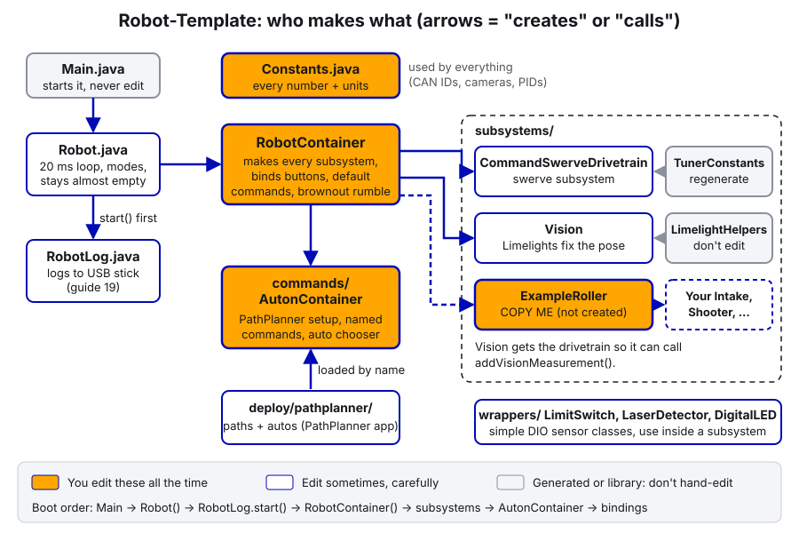
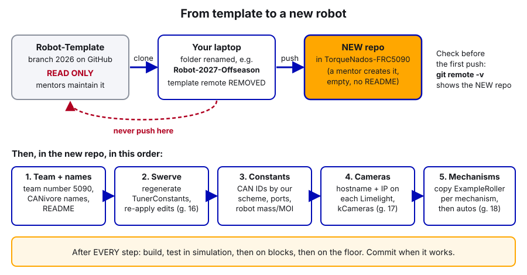

# 24. Using Our Robot Template

> **Who it's for:** whoever starts the code for a new robot (a new season, an offseason robot, or a devbot like Kachow), and anyone who wants to understand how our projects are laid out.
> **What you need first:** a laptop set up per [23 Setting Up Laptops](23-setting-up-a-programming-laptop.md), basic Git from [22 Git, GitHub and Code Standards](22-git-and-code-standards.md), and the ideas in [04 Command-Based Basics](04-command-based-basics.md). Read the template's `STUDENT-GUIDE.md` once, top to bottom.
> **Time:** 1 hour to read and copy the template. The first real robot bring-up (swerve, IDs, one mechanism) takes a few build sessions.

**What you'll learn**
- What is in our Robot-Template, what is deliberately **not** in it, and why.
- How to copy it into a **new** repo for a new robot, without ever changing the template itself.
- The order to bring a new robot up: team number, swerve, Constants, cameras, mechanisms, autos.
- How to add a mechanism by copying `ExampleRoller.java`, line by line.
- Two known issues in the template, and how to deal with them.

---

## 1. What the template is

The **Robot-Template** repo (branch `2026`) is a clean starting point for a robot: **CTRE swerve + PathPlanner + Limelight vision + logging**, with nothing game-specific. It was built from our 2026 robot's drivetrain and vision code, with the game mechanisms (shooter, turret, hood, intake) taken out.

The point: on kickoff day you shouldn't spend a week getting a robot to drive. With the template, a correctly wired swerve robot can drive, see AprilTags, run a simple auto, and log everything on day one. Then the team spends its time on the game.



### What's in it

| Part | Files | What you get |
|---|---|---|
| Swerve drive | `generated/TunerConstants.java`, `subsystems/CommandSwerveDrivetrain.java` | CTRE Phoenix 6 swerve, field-centric driving, slow mode, X-lock, odometry. Currently set up for Hephaestus's drivetrain (SDS MK5n R3, CANivore "Jarvis", Pigeon ID 0) |
| Vision | `subsystems/Vision.java`, `LimelightHelpers.java` (v1.14) | Any number of Limelights. MegaTag2 while enabled, MegaTag1 (2+ tags) while disabled to fix the starting heading |
| Autos | `commands/AutonContainer.java`, `src/main/deploy/pathplanner/` | PathPlanner hooked to the drivetrain, a "Drive Forward" example auto, named commands, the dashboard chooser |
| Logging | `RobotLog.java`, `LOGGING.md` | Everything to a USB stick: dashboard values, joysticks, commands, power, CAN, CTRE devices (see [19 Logging and Debugging](19-logging-and-debugging.md)) |
| Constants | `Constants.java` | Every number in one place, with our CAN ID scheme |
| Example mechanism | `subsystems/ExampleRoller.java` | A commented one-motor subsystem to **copy**. Not turned on |
| Sensor wrappers | `wrappers/` | `LimitSwitch`, `LaserDetector`, `DigitalLED` for DIO ports. Legacy: new limit switches and beam breaks go on a CTRE CANdi (see [21 Sensors and Homing](21-sensors-and-homing.md)) |
| Extras | `build.gradle`, `RobotContainer.java` | `Code Version` on the dashboard (branch + commit, from `build.gradle`); brownout rumble on the controller (`RobotContainer.updateBrownoutRumble()`) |

### What's deliberately NOT in it

| Not included | Why |
|---|---|
| **AdvantageKit** | It's a powerful logging and replay framework, but it changes how every subsystem is written (IO layers). Too much for new programmers right now. Our `RobotLog` + AdvantageScope covers what we need. Guide 34 explains what AdvantageKit is, for later |
| **REV, NavX, Phoenix 5** | We're a CTRE team: Kraken/Talon FX, Talon FXS, CANcoder, Pigeon 2, all on Phoenix 6. Fewer libraries means fewer version problems and faster builds. If a robot really needs a REV part, add that vendordep in that robot's repo, not the template |
| **Game mechanisms** | Every game is different. Copy `ExampleRoller` and build what this year's robot needs |
| **Fancy auto-align, shooting math, superstructure** | Those live in the robot repos (Hephaestus, the auto-align repo). Copy ideas from there when you need them |

---

## 2. Step by step: copy the template for a new robot

> **Watch out:** the template is **read-only for students**. Never push to Robot-Template, never open a pull request into it, never change its branches. Mentors update it at the end of a season. Your new robot gets its **own** repo.



1. **Ask a mentor to create the new repo** in the TorqueNados-FRC5090 GitHub organization. Give it a clear name (`Robot-2027`, `Kachow`, ...). It must be **empty** (no README, no .gitignore), so your first push has no conflicts.
2. **Clone the template's `2026` branch** into a folder with the new robot's name. In a terminal (VS Code: Terminal → New Terminal):

   ```
   git clone --branch 2026 https://github.com/TorqueNados-FRC5090/Robot-Template.git Robot-2027
   cd Robot-2027
   ```

3. **Cut the link to the template** and point at the new repo:

   ```
   git remote remove origin
   git remote add origin https://github.com/TorqueNados-FRC5090/Robot-2027.git
   git branch -m main
   git remote -v
   ```

   `git remote -v` must show **only the new repo**. If it still shows `Robot-Template`, stop and fix it.
4. **Push** to the new repo: `git push -u origin main`. The new repo now has the template's history (nice for credit: you can see where each line came from), and nothing you do from here touches the template.
5. **Open the folder** in WPILib VS Code. The project name is just the folder name (our `settings.gradle` doesn't set one), so there's nothing to rename in Gradle.
6. **Check the team number and year** in `.wpilib/wpilib_preferences.json`: `"teamNumber": 5090` and the right `"projectYear"`. Deploy uses this to find the robot.
7. **Build** (`Ctrl+Shift+P` → **WPILib: Build Robot Code**) with internet, so the vendor libraries download (see [23](23-setting-up-a-programming-laptop.md)).
8. **Update the README** so it describes the new robot, not "Robot Template". Keep the "Setting up a new robot" list until you've done every step.

**New season (a new year of WPILib)?** Don't just change version numbers by hand. Install the new WPILib, use its **import** for last year's project (WPILib's docs say the import makes automatic fixes for breaking changes), then update every vendordep to the new year with **WPILib: Manage Vendor Libraries**. For 2027, SystemCore replaces the roboRIO, so expect bigger changes than usual: read the current WPILib and CTRE docs first, and expect the template itself to get a 2027 branch from the mentors.

---

## 3. Step by step: bring the new robot up

Do these in order. After **each** step: build, test in simulation, then on blocks, then on the floor, and commit when it works.

### Step 1: Swerve (regenerate it)

`TunerConstants.java` describes **Hephaestus's** drivetrain. A new robot has different module offsets, maybe different gear ratios, different IDs. Don't hand-edit it. Regenerate it:

1. Set every swerve device's ID in Tuner X by our scheme (Pigeon 0, steer 30–33, drive 40–43, CANcoders 50–53, FL/FR/BL/BR). See [02](02-phoenix-tuner-x-and-can.md).
2. Run the Tuner X **Swerve Project Generator** and choose **Generate only TunerConstants**. Full steps in [16 Swerve Drive (CTRE)](16-swerve-drive-ctre.md).
3. **Re-apply the hand edits** that regenerating wipes out: `kSlipCurrent` at **60 A** (not CTRE's 120 A), `kSpeedAt12Volts` computed from the real gearing, the supply current limits, and the explaining comments.
4. Save the Tuner X project as `tuner-project.json` in the repo root and commit it.
5. Keep **our** `CommandSwerveDrivetrain.java`. It has our additions (`getPose`, `getChassisSpeeds`, `driveRobotRelative` for PathPlanner, dashboard values, disconnect events). Only replace `TunerConstants.java`.

If the CANivore has a new name, the name in `TunerConstants.kCANBus` must match Tuner X exactly. `Constants.CANBuses.kCanivore` reads it from there, so there's only one place to change.

### Step 2: Constants

Open `Constants.java` and go section by section:
- `CANIds`: one named constant per mechanism motor, in the **10–29** range (see the scheme below).
- `DIOPorts`: limit switches, beam breaks (legacy; new ones go on a CANdi with a CAN ID instead, guide 21).
- `AutoConstants`: robot mass with bumpers and battery, moment of inertia. Keep them in sync with the PathPlanner app's **Robot Config** (and `deploy/pathplanner/settings.json`, which `AutonContainer` loads first).
- `VisionConstants.kCameras`: next step.

### Step 3: Cameras

For each Limelight, on its web page: a unique hostname starting with `limelight-` and a static IP (`10.50.90.11`, `.12`, ...). Then measure its mount position from the robot center on the floor and add one `Camera.configuredInCode(...)` line to `kCameras`. Remove the `configuredOnLimelight("limelight")` line that belongs to Hephaestus. Full steps in [17 Limelight and Vision](17-limelight-and-vision.md) and the template's STUDENT-GUIDE ("Add another Limelight").

### Step 4: Mechanisms

Copy `ExampleRoller.java` once per mechanism (section 4 below). Pick the right control mode from the mechanism guides: [10 Flywheels](10-flywheels-and-shooters.md), [11 Intakes](11-intakes-and-rollers.md), [09 Motion Magic](09-motion-magic-and-position-control.md) for anything that goes to a position.

### Step 5: Autos

Draw paths in the PathPlanner app (open the project folder), register the robot actions autos need as **named commands**, and add each auto to the chooser. See section 5 and [18 PathPlanner Autos](18-pathplanner-autos.md).

### Logging comes for free

`Robot()` calls `RobotLog.start(...)` before anything else, and `robotPeriodic()` calls `RobotLog.periodic()`. Everything you put on the dashboard is logged automatically. Your only job is the game-specific part (LOGGING.md group 6). See [19](19-logging-and-debugging.md).

---

## In our code: the template, file by file

**The CAN ID scheme lives in Constants.** [Constants.java, lines 59–73](https://github.com/TorqueNados-FRC5090/Robot-Template/blob/b8dddd0e338841e867c0cc260162e6097adecd7b/src/main/java/frc/robot/Constants.java#L59-L73):

```java
     * Team numbering scheme:
     * <pre>
     *   0       Pigeon 2 gyro
     *   1       PDH (power distribution hub)
     *   10-29   mechanisms (intake, shooter, arm, ...)
     *   30-33   swerve STEER motors  (FL, FR, BL, BR)
     *   40-43   swerve DRIVE motors  (FL, FR, BL, BR)
     *   50-53   swerve CANcoders     (FL, FR, BL, BR)
     * </pre>
     * The swerve IDs (0, 30s, 40s, 50s) are set in {@code generated/TunerConstants.java}, not here.
     */
    public static final class CANIds {
        /** Example mechanism motor (see subsystems/ExampleRoller.java). Change to your real ID. */
        public static final int kExampleRollerMotor = 20;
    }
```

Notice: mechanism IDs go here, swerve IDs go in `TunerConstants`. Every ID has a name.

**Subsystems are made once, in RobotContainer.** [RobotContainer.java, lines 44–46](https://github.com/TorqueNados-FRC5090/Robot-Template/blob/b8dddd0e338841e867c0cc260162e6097adecd7b/src/main/java/frc/robot/RobotContainer.java#L44-L46):

```java
    // --- SUBSYSTEMS ---
    public final CommandSwerveDrivetrain drivetrain = TunerConstants.createDrivetrain();
    public final Vision vision = new Vision(drivetrain);
```

Your new mechanisms go right under these lines. And `AutonContainer` is created **after** them ([lines 59–62](https://github.com/TorqueNados-FRC5090/Robot-Template/blob/b8dddd0e338841e867c0cc260162e6097adecd7b/src/main/java/frc/robot/RobotContainer.java#L59-L62)), because it hands the subsystems to PathPlanner. Put new subsystems **above** the auton lines, or the named commands will see `null`.

**Logging starts first.** [Robot.java, lines 42–47](https://github.com/TorqueNados-FRC5090/Robot-Template/blob/b8dddd0e338841e867c0cc260162e6097adecd7b/src/main/java/frc/robot/Robot.java#L42-L47):

```java
    public Robot() {
        // DataLog + CTRE SignalLogger + power/CAN/command/event logs (USB stick in the RIO). Must be first.
        RobotLog.start(Constants.CANBuses.kCanivore);
        m_robotContainer = new RobotContainer();
        SmartDashboard.putString("Code Version", readCodeVersion());
    }
```

If your robot has a second CANivore (ours had "Upper" for mechanisms), pass it too: `RobotLog.start(Constants.CANBuses.kCanivore, "Upper")`. `start` takes any number of names, and then the logs show both buses' utilization.

---

## 4. Step by step: add a mechanism by copying ExampleRoller

`ExampleRoller.java` is one roller on one Kraken, held at a speed. We'll turn it into an intake roller called `IntakeRollers` on motor ID 12 on the "Upper" CANivore, like the 2026 robot's intake wheels.

### Read the original first

[ExampleRoller.java, lines 34–43](https://github.com/TorqueNados-FRC5090/Robot-Template/blob/b8dddd0e338841e867c0cc260162e6097adecd7b/src/main/java/frc/robot/subsystems/ExampleRoller.java#L34-L43) (fields):

```java
public class ExampleRoller extends SubsystemBase {
    private final TalonFX m_motor = new TalonFX(CANIds.kExampleRollerMotor, new CANBus(kCANBus));

    // Velocity control: the motor holds a speed (rotations per second) using PID + feedforward.
    // FOC = "field oriented control", a smoother, stronger way to drive the motor. Needs Phoenix Pro (we have it).
    private final VelocityVoltage m_velocityRequest = new VelocityVoltage(0).withSlot(0).withEnableFOC(true);
    // Neutral = stop driving the motor (it brakes or coasts depending on NeutralMode)
    private final NeutralOut m_stopRequest = new NeutralOut();

    private double m_targetRps = 0;
```

- **Line 34:** `extends SubsystemBase`. That makes it a subsystem: the scheduler calls its `periodic()` and commands can require it.
- **Line 35:** the motor. The ID comes from `CANIds` and the bus name from this mechanism's constants (`kCANBus`, from the static import on line 3). No bare numbers.
- **Line 39:** the control request, made **once** and reused. `VelocityVoltage` holds a speed in rotations per second (RPS) using slot 0 gains. `.withEnableFOC(true)` because we have Phoenix Pro.
- **Line 41:** `NeutralOut` stops driving the motor. Whether it then brakes or coasts depends on `NeutralMode` (line 53).
- **Line 43:** remembers the target, so `atSpeed()` and the dashboard can use it.

[ExampleRoller.java, lines 45–64](https://github.com/TorqueNados-FRC5090/Robot-Template/blob/b8dddd0e338841e867c0cc260162e6097adecd7b/src/main/java/frc/robot/subsystems/ExampleRoller.java#L45-L64) (constructor = the motor config):

```java
    public ExampleRoller() {
        TalonFXConfiguration config = new TalonFXConfiguration();
        // Current limits protect the motor, the mechanism and the battery. ALWAYS set them.
        config.CurrentLimits.StatorCurrentLimit = kStatorCurrentLimit;
        config.CurrentLimits.StatorCurrentLimitEnable = true;
        config.CurrentLimits.SupplyCurrentLimit = kSupplyCurrentLimit;
        config.CurrentLimits.SupplyCurrentLimitEnable = true;
        // Coast = spins freely when stopped. Use Brake for arms/elevators that must hold still.
        config.MotorOutput.NeutralMode = NeutralModeValue.Coast;
        // Flip this if positive speed spins the wrong way
        config.MotorOutput.Inverted = InvertedValue.CounterClockwise_Positive;
        // Slot 0 gains, used by m_velocityRequest (.withSlot(0))
        config.Slot0.kP = kP;
        config.Slot0.kV = kV;
        // apply() sends the config to the motor. It returns an error code if the motor isn't found.
        var status = m_motor.getConfigurator().apply(config);
        if (!status.isOK()) {
            System.err.println("ExampleRoller: motor config failed: " + status);
        }
    }
```

- **Lines 48–51:** stator and supply current limits, always both (see [06 Current Limits and Brownouts](06-current-limits-and-brownouts.md)).
- **Line 53:** Coast for rollers and flywheels, Brake for arms and elevators.
- **Line 55:** direction. If "intake" spins the wrong way, flip this to `Clockwise_Positive` instead of putting a minus sign on every speed.
- **Lines 57–58:** `kV` does most of the work (volts per RPS, about 0.12 for a Kraken X60), `kP` fixes what's left. Remember our 2026 rollers: with only kP they never reached their target speed.
- **Line 60:** **one** `apply()` with the whole config. (Our 2026 shooter applied slot 0 twice, and the second apply silently won. One config, one apply.)
- **Lines 61–63:** if the motor isn't on the bus, you get a message instead of silence.

[ExampleRoller.java, lines 66–91](https://github.com/TorqueNados-FRC5090/Robot-Template/blob/b8dddd0e338841e867c0cc260162e6097adecd7b/src/main/java/frc/robot/subsystems/ExampleRoller.java#L66-L91) (small methods, then the command):

```java
    /** Spin at a speed, in motor rotations per second */
    public void setSpeed(double rps) {
        m_targetRps = rps;
        m_motor.setControl(m_velocityRequest.withVelocity(rps));
    }
    ...
    /** A command that spins the roller while it runs and stops it when it ends (e.g. button released) */
    public Command runCommand(double rps) {
        return startEnd(() -> setSpeed(rps), this::stop).withName("ExampleRoller run " + rps);
    }
```

- `setSpeed`, `stop`, `getSpeed`, `atSpeed` each do **one** thing.
- `runCommand` uses `startEnd`: set the speed when the command starts, stop when it ends **for any reason** (button released, interrupted, disabled). That's the spring-back idea from [12](12-spring-back-and-auto-retract.md).
- `.withName(...)` makes the command readable in the logs (`Commands` entry).

[ExampleRoller.java, lines 93–99](https://github.com/TorqueNados-FRC5090/Robot-Template/blob/b8dddd0e338841e867c0cc260162e6097adecd7b/src/main/java/frc/robot/subsystems/ExampleRoller.java#L93-L99) puts target, actual and "at speed" on the dashboard every loop, with keys like `ExampleRoller/Actual RPS`. They're logged automatically.

### Now copy it

1. **Copy the file:** right-click `ExampleRoller.java` → Copy, paste in `subsystems/`, rename to `IntakeRollers.java`. Rename the class and constructor inside to `IntakeRollers`.
2. **Add the bus name** in `Constants.CANBuses` (once per robot), if the mechanism is on a second CANivore:

   ```java
   /** The CANivore the mechanisms are on. Must match the name in Tuner X exactly. */
   public static final String kMechanismCanivore = "Upper";
   ```

3. **Add the ID** in `Constants.CANIds`, from the 10–29 range, matching Tuner X:

   ```java
   /** Intake roller wheels, Kraken X60 on the mechanism CANivore */
   public static final int kIntakeRollerMotor = 12;
   ```

4. **Copy the constants section.** Copy `ExampleRollerConstants` to a new `IntakeRollerConstants` and set real values:

   ```java
   /** Settings for subsystems/IntakeRollers.java */
   public static final class IntakeRollerConstants {
       /** Which CAN bus the motor is wired to */
       public static final String kCANBus = CANBuses.kMechanismCanivore;
       /** Intake speed, MOTOR rotations per second (not roller) */
       public static final double kIntakeRps = 40;
       /** Eject (spit a game piece back out) speed, motor RPS */
       public static final double kEjectRps = -30;
       /** Stator current limit, amps. Limits torque and heat */
       public static final double kStatorCurrentLimit = 40;
       /** Supply current limit, amps. Limits battery draw */
       public static final double kSupplyCurrentLimit = 30;
       /** kV = volts per RPS (~0.12 for a Kraken X60). kP = extra volts per RPS of error */
       public static final double kP = 0.1;
       public static final double kV = 0.12;
       /** "At speed" if within this many RPS of the target */
       public static final double kToleranceRps = 2;
   }
   ```

5. **Fix the references** in `IntakeRollers.java`: the static import becomes `import static frc.robot.Constants.IntakeRollerConstants.*;`, the motor uses `CANIds.kIntakeRollerMotor`, the error message says `IntakeRollers`, the command name says `"IntakeRollers run "`, and the dashboard keys start with `IntakeRollers/`.
6. **Search for "Example"** in the new file (`Ctrl+F`). There should be zero hits left.
7. **Create it** in `RobotContainer`, under the drivetrain and vision, above the auton lines:

   ```java
   public final IntakeRollers intakeRollers = new IntakeRollers();
   ```

8. **Bind it** in `configureBindings()`:

   ```java
   // Left bumper: run the intake while held, stops on release
   driver.leftBumper().whileTrue(intakeRollers.runCommand(IntakeRollerConstants.kIntakeRps));
   // Left trigger: eject while held
   driver.leftTrigger().whileTrue(intakeRollers.runCommand(IntakeRollerConstants.kEjectRps));
   ```

9. **Test:** build → simulate (the dashboard shows `IntakeRollers/Target RPS` change when you press the button) → robot on blocks → check direction and that it stops on release → real game pieces.

> **AI can help:** after you've copied and renamed the file, paste it into an AI tool and ask: "This is a WPILib 2026 / Phoenix 6 subsystem I copied from a template. Are there any leftover names from the original, unit mistakes, or missing current limits?" It's good at spotting the `ExampleRoller/` dashboard key you forgot. You still check every suggestion against this guide and the CTRE docs, and the robot on blocks is the real test. Don't ask it to write the subsystem for you: you learn the pattern by doing the copy yourself.

---

## 5. Autos: named commands and the chooser

[AutonContainer.java, lines 71–80](https://github.com/TorqueNados-FRC5090/Robot-Template/blob/b8dddd0e338841e867c0cc260162e6097adecd7b/src/main/java/frc/robot/commands/AutonContainer.java#L71-L80):

```java
    private void registerNamedCommands() {
        register("Do Nothing", doNothing());
        // Lock the wheels in an X at the end of an auto so we don't get pushed
        register("X Brake", drivetrain.applyRequest(() -> new SwerveRequest.SwerveDriveBrake()).withTimeout(AutoConstants.kXBrakeSeconds));
    }

    /** Registers a named command and logs an event each time an auto runs it */
    private void register(String name, Command command) {
        NamedCommands.registerCommand(name, command.beforeStarting(() -> RobotLog.event("AUTO named command: " + name)));
    }
```

Add your mechanism's actions here with `register(...)` (not `NamedCommands.registerCommand` directly, so each one is logged). The name must match the PathPlanner app **exactly**. Our `runCommand` never ends by itself, so in an auto either give it a `.withTimeout(...)` or put it in a deadline group in PathPlanner (see [18](18-pathplanner-autos.md)). To make the subsystem reachable here, use `robotContainer.intakeRollers` (the constructor already keeps `robotContainer`).

Then add each auto to the chooser, [lines 82–88](https://github.com/TorqueNados-FRC5090/Robot-Template/blob/b8dddd0e338841e867c0cc260162e6097adecd7b/src/main/java/frc/robot/commands/AutonContainer.java#L82-L88): one `chooser.addOption("Name", AutoBuilder.buildAuto("Name"))` line per `.auto` file.

---

## 6. Known issues in the template

Two things in the template are wrong or out of date. Don't "fix" them in the template (it's read-only). Fix them in **your** copy, and tell a mentor so the template gets updated.

**1. `tuner-project.json` is stale.** It's from the very first commit. It still describes an **SDS MK4i L2** drivetrain (drive ratio 6.75:1, steer 21.43:1) with every device on the **"rio"** bus. The real code (`TunerConstants.java`) is MK5n R3 (5.273:1) on the "Jarvis" CANivore. So don't import that file into the Swerve Project Generator and trust it. **Regenerate** from the real robot, then save a fresh `tuner-project.json` over the old one. ([tuner-project.json, lines 217–223](https://github.com/TorqueNados-FRC5090/Robot-Template/blob/b8dddd0e338841e867c0cc260162e6097adecd7b/tuner-project.json#L217-L223).)

**2. STUDENT-GUIDE section 3 lists the scheduler order wrong.** [STUDENT-GUIDE.md, lines 66–69](https://github.com/TorqueNados-FRC5090/Robot-Template/blob/b8dddd0e338841e867c0cc260162e6097adecd7b/STUDENT-GUIDE.md#L66-L69) says: check triggers, run commands, then call `periodic()`. The real order (WPILib docs and the code) is: **subsystem `periodic()` first**, then triggers, then commands, then default commands. It matters when a command sets a target and you wonder why `periodic()` only sees it on the next loop. The full, correct loop is in [04 Command-Based Basics](04-command-based-basics.md).

---

## Common mistakes

- **Pushing to the template** by forgetting to change `origin`. Always run `git remote -v` before the first push.
- **Keeping Hephaestus's `TunerConstants`** on a new drivetrain. The offsets are wrong, so the wheels point in random directions. Regenerate.
- **Regenerating and losing the hand edits.** CTRE's default `kSlipCurrent` is 120 A, and on our 2026 robot that caused brownouts and stutter. Put 60 A back, and recompute `kSpeedAt12Volts` (ours was once 2x too high, so autos drove at half speed).
- **Replacing `CommandSwerveDrivetrain.java` too** with the generated one. PathPlanner then can't find `getPose`/`driveRobotRelative`, and the dashboard values disappear. Only replace `TunerConstants.java`.
- **A wrong ID in Constants.** The 2026 Pigeon was 24 in code and 0 on the robot: heading frozen for a week. Check every ID in Tuner X.
- **Forgetting the Hephaestus camera line.** `configuredOnLimelight("limelight")` stays in `kCameras` and the robot looks for a camera that doesn't exist.
- **Creating a subsystem below the AutonContainer line**, so named commands get a `null` subsystem and crash at boot.
- **Leftover "Example" names** in a copied file (`ExampleRoller/Actual RPS` on the dashboard for an intake). Search for "Example" after every copy.
- **Hand-editing version numbers for a new year** instead of using WPILib's import and Manage Vendor Libraries.

---

## Checklist: first day with the template

- [ ] Mentor created an empty new repo for the robot
- [ ] Cloned `Robot-Template` branch `2026`, removed the template remote, pushed to the new repo (`git remote -v` checked)
- [ ] `wpilib_preferences.json` says team 5090 and the right year
- [ ] README updated with the robot's name
- [ ] Builds with internet; Code Version shows the new repo's branch on the dashboard
- [ ] Swerve IDs set in Tuner X; `TunerConstants` regenerated; `kSlipCurrent` 60 A and `kSpeedAt12Volts` re-applied; `tuner-project.json` saved
- [ ] CANivore name in code matches Tuner X
- [ ] `Gyro/Connected` is true and yaw changes when the robot turns
- [ ] Drives on blocks correctly (all wheels forward on forward stick), then on the floor
- [ ] Each Limelight has a unique hostname + IP, and a measured line in `kCameras`; Hephaestus's camera line removed
- [ ] PathPlanner Robot Config (mass, MOI, modules) matches the new robot
- [ ] First mechanism copied from `ExampleRoller`, no "Example" left, current limits set
- [ ] USB stick in the roboRIO, `Logging/USB stick` is true

---

## Practice

1. **Dry run.** On your laptop, copy the template to a folder called `Template-Practice` with the remote removed (don't create a GitHub repo, just skip the push). Build it and run it in simulation. Drive around the sim field with a controller.
2. **Copy a mechanism.** In that practice copy, turn `ExampleRoller` into `IntakeRollers` following section 4. Bind it, build, simulate, and watch `IntakeRollers/Target RPS` change on the dashboard when you press the bumper. Then search for "Example": how many did you miss?
3. **Add a named command.** Register `"Run Intake"` with a 2-second timeout. Open the practice project in the PathPlanner app, add it to the "Drive Forward" auto, and run the auto in simulation. Find the `AUTO named command: Run Intake` line in the log afterwards (AdvantageScope, `Events`).
4. **Find the stale file.** Open `tuner-project.json` and `TunerConstants.java` side by side. List three things that disagree.

---

## Go further

- Robot-Template repo: https://github.com/TorqueNados-FRC5090/Robot-Template (read STUDENT-GUIDE.md, README.md, LOGGING.md)
- WPILib, creating and importing projects: https://docs.wpilib.org/en/stable/docs/software/vscode-overview/importing-gradle-project.html
- WPILib, third-party libraries (vendordeps): https://docs.wpilib.org/en/stable/docs/software/vscode-overview/3rd-party-libraries.html
- WPILib command-based (scheduler order): https://docs.wpilib.org/en/stable/docs/software/commandbased/command-scheduler.html
- CTRE Swerve Project Generator: https://v6.docs.ctr-electronics.com/en/stable/docs/tuner/tuner-swerve/index.html
- CTRE TalonFX configuration and control requests: https://v6.docs.ctr-electronics.com/en/stable/docs/api-reference/device-specific/talonfx/index.html
- PathPlanner named commands: https://pathplanner.dev/pplib-named-commands.html
- Limelight robot localization (MegaTag): https://docs.limelightvision.io/docs/docs-limelight/pipeline-apriltag/apriltag-robot-localization
