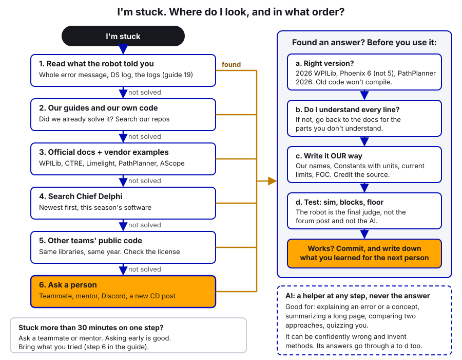
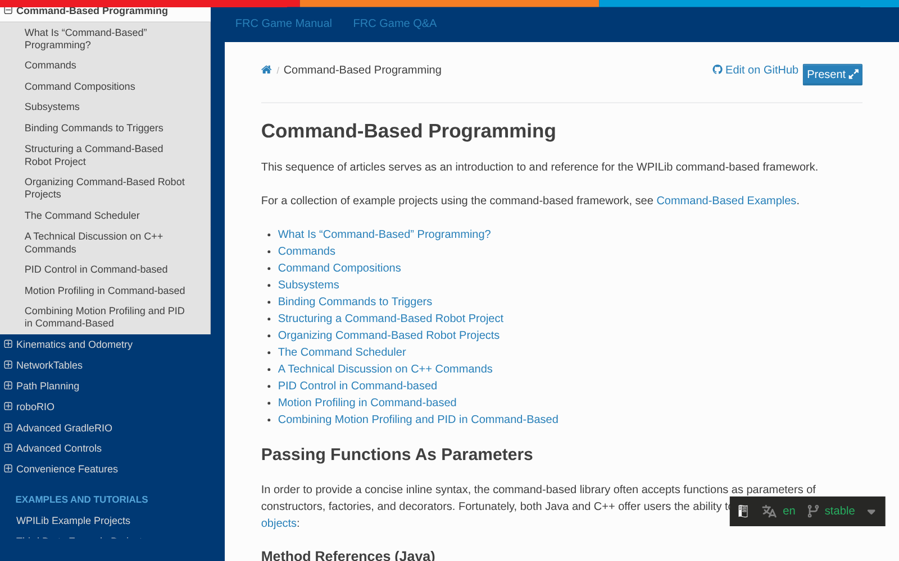
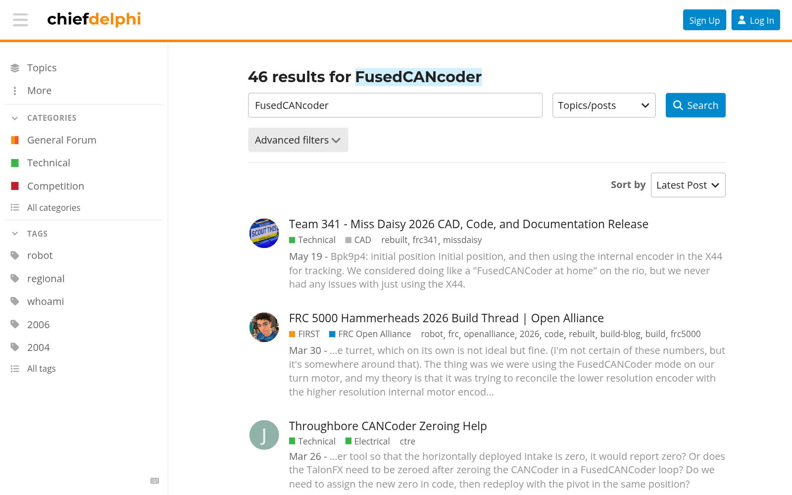
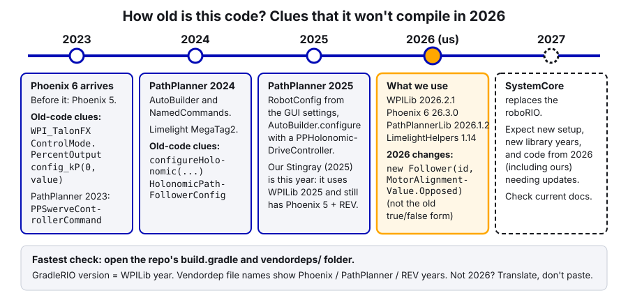

# 25. How to Research

> **Who it's for:** every programmer, from your first week on. Being good at robot code is mostly being good at finding things out.
> **What you need first:** nothing. It helps to know how to open our repos ([22 Git, GitHub and Code Standards](22-git-and-code-standards.md)) and read a log ([19 Logging and Debugging](19-logging-and-debugging.md)).
> **Time:** 45 minutes to read, 30 minutes for the practice.

**What you'll learn**
- Where to look when you're stuck, and in **what order**.
- How to search Chief Delphi well, read a thread, and judge whether a post is trustworthy.
- How to use other teams' public code without getting burned (versions, licenses, understanding, credit).
- How to ask a good question that gets a good answer.
- How to use AI as a research helper, and the rules that keep it from hurting you.

---

## 1. The idea: look in the right order

Nobody knows all of WPILib, Phoenix 6, PathPlanner and Limelight by heart. Good programmers aren't the ones who know everything. They're the ones who find the right answer **fast** and **check it** before it goes on the robot.

The order matters. Sources near the top are closest to **our** robot and **this year's** software. Sources further down are bigger, but more likely to be old, for a different setup, or just wrong.



| Step | Where | Why it's at this spot |
|---|---|---|
| 1 | **What the robot told you**: the full error, the Driver Station messages, the logs | The answer is often already on the screen. Read the whole stack trace, not just the red first line |
| 2 | **Our guides and our code** | We may have solved it already, for our exact hardware and versions |
| 3 | **Official docs and vendor examples** | Written by the people who made the library, for the current version |
| 4 | **Chief Delphi** | Thousands of teams have hit the same problem. Quality varies |
| 5 | **Other teams' public code** | Real, working examples, but for their robot, their versions, their structure |
| 6 | **Ask a person** | A teammate, a mentor, Discord, or a new Chief Delphi post. Do this sooner rather than later if you're stuck |

**The 30-minute rule:** if you've been stuck on one step for about 30 minutes without progress, ask someone. That's not giving up. A mentor might know the answer in 30 seconds, and you'll learn where they would have looked.

---

## 2. Step by step: steps 1 to 3 (start close to home)

### Step 1: read what the robot told you

- **Read the whole error.** A Java stack trace lists where the error happened, starting with the most specific line. Look for the first line that mentions **our** code (`frc.robot...`) and its line number. WPILib has a page on reading stack traces (Go further).
- **Driver Station messages** (the gear tab, and the DS log viewer) show CAN errors, brownouts and "device not found" messages. See [03 Driver Station](03-driver-station-and-match-checklist.md).
- **The logs** (AdvantageScope) show what actually happened: commands starting and stopping, currents, setpoints. See [19](19-logging-and-debugging.md).

### Step 2: our guides and our own code

- Look in these guides' **"I need to..."** table (README).
- **Search our repos.** In VS Code, `Ctrl+Shift+F` searches every file in the open project. On GitHub, the search box at the top of a repo searches its code. Search for the class or method name you're stuck on (`MotionMagicVoltage`, `addVisionMeasurement`).
- Our repos are on the same CTRE + WPILib + PathPlanner stack you are, so what you find there usually compiles.

### Step 3: official docs and vendor examples

These are the **source of truth** for how a library works in the version we use.

| Library | Docs | Examples / API reference |
|---|---|---|
| WPILib (commands, controllers, math, sim) | docs.wpilib.org | WPILib example projects (VS Code → Create a new project → Example), WPILib Java API docs |
| CTRE Phoenix 6 (Talon FX/FXS, CANcoder, Pigeon, swerve, Tuner X) | v6.docs.ctr-electronics.com | **CrossTheRoadElec/Phoenix6-Examples** on GitHub; Phoenix 6 Java API docs |
| Limelight | docs.limelightvision.io | The examples in the docs, `LimelightHelpers` comments |
| PathPlanner | pathplanner.dev | The examples folder in the PathPlanner GitHub repo |
| AdvantageScope | docs.advantagescope.org | Built-in help in the app |

**Check the version on every docs page.** Most docs sites have a version picker. WPILib's is in the bottom corner ("stable" = the current season). CTRE's URLs show it (`/en/stable/` or `/en/2025/`). A 2024 page describes 2024 code.



**Vendor examples are gold.** CTRE's `Phoenix6-Examples` repo has a small, complete robot project for almost every feature (`FusedCANcoder`, `MotionMagic`, `CurrentLimits`, `SwerveWithPathPlanner`, ...). They're kept up to date with the library, they're short, and they compile.

> **Tip:** the **yearly changelog** pages ("New for 2025", "New for 2026") on CTRE's and WPILib's docs list everything that changed and got renamed. When old code doesn't compile, look there first.

---

## 3. Step 4: Chief Delphi

**Chief Delphi** (chiefdelphi.com, "CD") is the main FRC forum. Almost every problem you'll hit has a thread. You can read and search without an account.

### Searching well

1. **Use the exact name** of the thing: the class, method, error text, or part (`FusedCANcoder`, `"Could not find device"`, `MotionMagicExpo`). Exact names beat descriptions ("my arm is bouncy").
2. **Sort by newest.** Use the search page's **Sort by: Latest Post**, or add `order:latest` to the search. Old answers are often for old software.
3. **Limit the date** with `after:2026-01-01` (or this season's kickoff date).
4. **Limit the category** with the search page's **Advanced filters**. Useful categories under **Technical**: **Programming**, **Java**, **Control System**, **CAN**, **Sensors**, **Motors**. Under FIRST: **FRC Open Alliance**. Under Other: **Robot in 3 Days (RI3D)**.
5. **Search the title only** with `in:title` when a word is too common.



### Kinds of threads worth reading

- **Build threads / Open Alliance.** Open Alliance teams post their whole season publicly: design, code, what broke. Pick the FRC Open Alliance category in the Advanced filters, or browse it directly. They often explain **why** they did something, which is what you really want.
- **Code and CAD releases.** After a season, many teams post "202X code release" threads with links to their repos (the 341 result in the screenshot is one).
- **Vendor announcements.** CTRE, WCP, REV and others post release notes and known issues.
- **Technical binders.** Many top teams publish a "tech binder" PDF describing their robot and software. Team 4414 HighTide and 1690 Orbit are known for detailed ones.

> **How to read a Chief Delphi thread**
>
> 1. **Check the date and season** of the first post and of every answer you plan to use. A 2022 answer about swerve is from before Phoenix 6 existed.
> 2. **Read the whole thread, not the first reply.** The fix is often further down ("Update: the real problem was a loose CAN wire").
> 3. **Look for a marked solution** or the original poster saying "that fixed it".
> 4. **Who posted?** A vendor employee, a WPILib developer, a long-time mentor, or a team that clearly runs the same hardware is more reliable than an anonymous guess. Check the profile for a team number and role.
> 5. **Tested or guessed?** "We run this on our robot" with code or a video beats "I think you could try...".
> 6. **Same setup?** Same motor controllers, same library, same language, same year. A fix for REV or Phoenix 5 often doesn't apply to us.
> 7. **Does it agree with the official docs?** If a post contradicts the docs, the docs usually win (or the post explains a real bug, with proof).

### Asking a good question

If you can't find it, post (or ask on Discord, or ask a mentor) in a way that makes it easy to help you:

- **Title:** the specific thing. "Talon FXS Motion Magic overshoots on turret, kS + kV set" beats "HELP turret broken".
- **What you're trying to do**, in one or two sentences.
- **What happens instead**, with the exact error text or a plot/log screenshot.
- **What you already tried**, and what happened each time.
- **Code:** a link to the exact commit on GitHub (the file and line numbers), not a photo of the screen.
- **Versions:** WPILib, Phoenix 6, PathPlannerLib, firmware year, robot controller.
- **Hardware:** motor, controller, gearing, sensors.

Post from the team account or with a mentor's OK, and **come back and post what fixed it**. The next team that searches will thank you.

---

## 4. Step 5: other teams' public code

Many great teams publish their code on GitHub. Reading it is one of the best ways to learn.

| Team | Where | What to know |
|---|---|---|
| 254 The Cheesy Poofs | github.com/Team254 (`FRC-2025-Public`, ...) | Very polished. Public repos appear after the season |
| 1678 Citrus Circuits | github.com/frc1678 (`C2026-Public`, ...) | Detailed, well documented |
| 6328 Mechanical Advantage | github.com/Mechanical-Advantage (`RobotCode2026Public`) | Excellent, and they wrote AdvantageScope. Their code uses **AdvantageKit**, so every subsystem is split into IO layers. Take the ideas, not the structure (we don't use AdvantageKit) |
| 971 Spartan Robotics | github.com/frc971 | World-class controls, but **C++** with their own build system. Read it for ideas, don't copy it |
| 2910 Jack in the Bot | github.com/FRCTeam2910 (`2026CompetitionRobot-Public`) | Swerve experts |
| 3015 Ranger Robotics | github.com/3015RangerRobotics | PathPlanner was created by a 3015 member (repo: mjansen4857/pathplanner) |
| 4414 HighTide, 1690 Orbit | Chief Delphi posts and tech binders | Read their write-ups for how they think about software |

**Rules for using someone else's code:**
1. **Check the version.** Open their `build.gradle` (GradleRIO version = WPILib year) and `vendordeps/` folder. If it's not 2026 WPILib and Phoenix 6 26.x, expect to translate it.
2. **Check the license.** Most FRC repos have a `LICENSE` file (MIT is common: you can reuse with credit). No license means you don't automatically have permission to copy it. Read it for ideas and write your own.
3. **Understand it before you copy it.** If you can't explain what each line does, you can't debug it at 9 a.m. on a Saturday at an event.
4. **Write it our way:** our names, constants in `Constants.java` with units, current limits, `.withEnableFOC(true)`.
5. **Credit them** in a comment, like we did with 6328's field measurements (In our code, below).



---

## 5. Step 6 and other places: people, video, and the rules

- **Discord.** The **Unofficial FRC Discord** (discord.gg/frc) has programming channels with fast answers. Same rules as Chief Delphi: give versions, code and what you tried. Don't share team secrets or personal info.
- **YouTube.**
  - **"0 to Autonomous"** (Team 6814 Ellipse): a step-by-step series from driving to swerve autos. Great for concepts, but the code is from a few seasons ago (around 2021), before Phoenix 6 and today's PathPlanner. Learn the ideas, not the exact code.
  - **Behind the Bumpers**: teams walk through their robots, and sometimes their software.
  - **Robot in 3 Days (Ri3D)**: teams build a robot in the three days after kickoff and publish videos and often code. Good for early ideas on a new game.
  - **Vendor videos** (CTRE, WCP, Limelight) for setup walk-throughs.
  - **Team reveal and tech videos**: what top robots do, and sometimes how.
- **The Game Manual and the official Q&A.** For **rules** questions ("Can the robot extend past the frame here?"), the only real answers are the Game Manual and the official Q&A. Not Chief Delphi, not Discord, not AI. Q&A questions go through the team's official account, so take rules questions to a mentor.

---

## 6. Worked example: "How do I fuse a CANcoder with a Kraken?"

**The situation:** a mechanism (say a pivoting hood or an arm) has a CANcoder on its output shaft. We want the motor's closed loop to know the **absolute** angle at boot (no homing), while still getting the motor's own fast, high-resolution sensor. That's what "fusing" means. (Homing and absolute sensors in general are in [21 Sensors and Homing](21-sensors-and-homing.md).)

**1. Our guides and code.** Search our repos for `FusedCANcoder`. Hits: only `TunerConstants.java`, where swerve steering uses `SteerFeedbackType.FusedCANcoder`. Useful facts: it works with our hardware and license, and it's a Phoenix Pro feature. But no mechanism of ours uses it yet, so keep looking.

**2. Official docs.** In the CTRE docs, search "FusedCANcoder". It's on the Talon FX **Remote Sensors** page. What we learn:
- Set `FeedbackSensorSource = FusedCANcoder` and `FeedbackRemoteSensorID` = the CANcoder's ID.
- Two ratios: `RotorToSensorRatio` (motor rotations per CANcoder rotation) and `SensorToMechanismRatio` (CANcoder rotations per mechanism rotation, often 1.0 if the CANcoder is on the output).
- It needs **Pro**. Unlicensed, the Talon quietly falls back to RemoteCANcoder and sets a fault. Good to know when debugging.

**3. Vendor example.** CTRE's `Phoenix6-Examples/java/FusedCANcoder` shows a complete project. It also configures the CANcoder: `MagnetOffset`, `SensorDirection`, and `AbsoluteSensorDiscontinuityPoint`.

**4. Chief Delphi.** Search `FusedCANcoder order:latest` (the screenshot above). Recent threads show real teams' problems: one asks whether the Talon needs re-zeroing after the CANcoder is zeroed (read the answers, then check them against the CTRE docs), and one team's build thread describes trouble they suspected came from fusing a lower-resolution encoder with the motor's sensor. Now you know what to test for.

**5. Version check.** An older post uses `cc_cfg.MagnetSensor.AbsoluteSensorRange = AbsoluteSensorRangeValue.Signed_PlusMinusHalf`. That **doesn't compile** on Phoenix 6 2025 or later: CTRE's "New for 2025" changelog says it was replaced by `AbsoluteSensorDiscontinuityPoint` (0.5 gives the old "plus/minus half" behavior). Found by checking the changelog, not by guessing.

**6. Write it our way.** A pivot motor with a 50:1 reduction and the CANcoder on the pivot shaft:

```java
// Constants (in PivotConstants): IDs, ratios, offset, limits, all with units
public static final int kPivotMotorId = 18;
public static final int kPivotCANcoderId = 19;
/** Motor rotations per CANcoder (= pivot) rotation */
public static final double kRotorToSensorRatio = 50.0;
/** Added to the raw CANcoder reading so the pivot reads 0 at its zero position, rotations.
 *  = minus the raw reading with the pivot at zero (measure it in Tuner X). */
public static final double kMagnetOffsetRotations = -0.137;

// In the Pivot subsystem constructor
CANcoderConfiguration encoderConfig = new CANcoderConfiguration();
encoderConfig.MagnetSensor.SensorDirection = SensorDirectionValue.CounterClockwise_Positive;
encoderConfig.MagnetSensor.withMagnetOffset(Rotations.of(kMagnetOffsetRotations));
// Wrap at +0.5: the pivot boots reading -0.5 to +0.5 rotations, never jumping inside its range of motion
encoderConfig.MagnetSensor.withAbsoluteSensorDiscontinuityPoint(Rotations.of(0.5));
m_pivotEncoder.getConfigurator().apply(encoderConfig);

TalonFXConfiguration motorConfig = new TalonFXConfiguration();
motorConfig.Feedback.FeedbackRemoteSensorID = m_pivotEncoder.getDeviceID();
motorConfig.Feedback.FeedbackSensorSource = FeedbackSensorSourceValue.FusedCANcoder; // needs Phoenix Pro
motorConfig.Feedback.RotorToSensorRatio = kRotorToSensorRatio;
motorConfig.Feedback.SensorToMechanismRatio = 1.0;   // CANcoder is on the pivot itself
motorConfig.CurrentLimits.StatorCurrentLimit = 40;
motorConfig.CurrentLimits.StatorCurrentLimitEnable = true;
motorConfig.CurrentLimits.SupplyCurrentLimit = 30;
motorConfig.CurrentLimits.SupplyCurrentLimitEnable = true;
motorConfig.MotorOutput.NeutralMode = NeutralModeValue.Brake;
m_pivotMotor.getConfigurator().apply(motorConfig);
```

(Imports: `com.ctre.phoenix6.configs.*`, `com.ctre.phoenix6.signals.*`, and `static edu.wpi.first.units.Units.Rotations`. Requests on this motor use `.withEnableFOC(true)` like everywhere else.)

**7. Test.** Deploy with the robot on blocks. In Tuner X, plot the Talon's `Position` and the CANcoder's `AbsolutePosition` while you move the pivot by hand: they should agree. Power-cycle with the pivot in a different spot: the position at boot should still be right. Check Self Test for an "unlicensed" fault. Only then hook it to a Motion Magic request (see [09](09-motion-magic-and-position-control.md)).

Notice what happened: docs gave the rules, the example gave working code, Chief Delphi gave real-world gotchas, the changelog caught a version trap, and the robot had the final word.

---

## In our code

**Credit where it's due.** [FieldZones.java, line 7](https://github.com/TorqueNados-FRC5090/Hephaestus/blob/c2f0cee6f61db3f26f911d3f5623ed7fa27a5b03/src/main/java/frc/robot/FieldZones.java#L7) (2026 robot):

```java
/** Where the trenches are (2026 REBUILT, blue-origin meters, from team 6328's public field constants). */
```

Our trench zones came from 6328's published field measurements, and the comment says so. The auto-align repo does the same in [Constants.java, lines 244–248](https://github.com/HALFxAxHEART/frc-auto-align/blob/c95ddf4a2ee25c406ea6e2ed04e232b17b39b8f7/src/main/java/frc/robot/Constants.java#L244-L248). One line, and anyone reading knows where the numbers came from and where to check them.

**Leave the doc link in the code.** [TunerConstants.java, lines 19–24](https://github.com/TorqueNados-FRC5090/Robot-Template/blob/b8dddd0e338841e867c0cc260162e6097adecd7b/src/main/java/frc/robot/generated/TunerConstants.java#L19-L24) (template) points at the CTRE Swerve Project Generator docs. When you build something from a doc page or a CD thread, paste its address in a comment. Future-you will need it.

**A version trap in our own code.** [GenericPID.java, lines 11 and 29](https://github.com/TorqueNados-FRC5090/Hephaestus/blob/c2f0cee6f61db3f26f911d3f5623ed7fa27a5b03/src/main/java/frc/robot/wrappers/GenericPID.java#L11-L29) (2026 robot):

```java
/** Wraps over {@link SparkPIDController} for ease of use */
...
    /** {@link CANSparkMax.ControlType How} the motor should be controlled */
```

The **code** in this file was updated to REV's newer API (`SparkBase`, `SparkClosedLoopController`, `SparkMaxConfig`), but the **comments** still name the old classes `SparkPIDController` and `CANSparkMax`, which REV renamed. If you searched for `CANSparkMax` because of this comment, you'd find old forum posts and code that won't compile. Comments age too. (We're a CTRE team now; this file is left over from older REV robots.)

**Old robot, old versions.** Our 2025 robot Stingray uses GradleRIO 2025.2.1 ([build.gradle, line 3](https://github.com/TorqueNados-FRC5090/Stingray-2025/blob/97c843705075c729538ad0b3925f67a35e3bf791/build.gradle#L3)) with Phoenix 5, Phoenix 6 25.3.0, PathPlannerLib 2025.2.3 and REVLib in `vendordeps/`. Great for ideas (its elevator and pivot sequencing), but copying code from it into a 2026 project means checking every API.

---

## 7. Using AI as a research helper

AI chat tools can speed up research a lot. They can also waste a day by being **confidently wrong**. Use them like a fast, well-read teammate who has never seen our robot and sometimes makes things up.

### Good uses

1. **Explain an error message.** Paste the full stack trace and ask "Explain this error in plain words. Which line of *my* code is involved, and what are the usual causes?" Then go look at that line yourself.

   > **AI can help:** "Here's a Java stack trace from WPILib 2026 robot code: [paste]. Explain what a NullPointerException in `RobotContainer.<init>` usually means, and what I should check first." A typical good answer: a subsystem was used before it was created (field order). You check the field order in `RobotContainer` and confirm it.

2. **Explain a concept at your level.** "Explain feedforward kS, kV and kA to a high-school student who knows algebra. Use a flywheel as the example." Then read the CTRE page on it and see if the explanation matches.
3. **Summarize a long page, then read the part that matters.** Paste a long doc page or CD thread and ask "Summarize this in 5 bullets and tell me which section talks about X." Then **read that section yourself**. The summary is a map, not the territory.
4. **Compare two approaches.** "For an arm on a Kraken, compare MotionMagicVoltage and PositionVoltage with a ProfiledPIDController: pros, cons, when to use each." Use the answer to decide what to read next in the docs ([09](09-motion-magic-and-position-control.md), [14](14-arms-single-and-double-jointed.md)).
5. **Quiz yourself.** "Ask me 5 questions, one at a time, to check I understand current limits (stator vs supply). Don't give the answers until I've tried." Great before you explain something to a mentor.

### The rules

- **It can be confidently wrong and invent API methods.** AI tools mix up library versions (Phoenix 5 vs 6, PathPlanner 2023 vs 2026) and make up methods that sound right. Every class and method it gives you gets checked in the **official docs or the API reference** before you use it. If you can't find it there, it doesn't exist.
- **Tell it the versions,** like you would on Chief Delphi: "WPILib 2026, Phoenix 6 26.3.0, Java, command-based." It still won't always get it right.
- **Never paste team secrets:** passwords, license keys, API keys, tokens, the DS laptop password, students' personal information. Our public code is fine to paste; anything private isn't.
- **You must understand every line you commit.** If AI wrote a line and you can't explain it, it doesn't go in. Reviewers will ask, and so will judges.
- **It doesn't write the subsystem for you.** Use it to understand, to check, and to quiz. The writing is how you learn.
- **The robot is the final judge.** Not the AI, not the forum post, not this guide. Sim, then blocks, then floor.

---

## Common mistakes

- **Copying the first answer** on a 2021 Chief Delphi thread. It's for Phoenix 5 and doesn't compile, and an hour goes into "fixing" imports. Check the date first.
- **Reading only the first reply.** The real fix was in post 14.
- **Pasting code you don't understand** from another team's repo. It works until it doesn't, and then nobody can debug it.
- **Searching for a description** ("arm bouncy") instead of the exact name or error text.
- **Asking "it doesn't work, help"** with no code, no versions and no error. Nobody can help, so nobody answers.
- **Trusting an AI's method name** without checking the API docs. (Classic: a method from Phoenix 5 or an older PathPlanner that no longer exists.)
- **Asking rules questions** on Discord or to an AI instead of reading the Game Manual and going through a mentor for the Q&A.
- **Not writing down what you found,** so the next person on the team researches the same thing from scratch.

---

## Checklist

- [ ] I read the whole error / the logs before searching
- [ ] I searched our guides and our repos
- [ ] I read the official docs page for **our** version, and looked for a vendor example
- [ ] Any Chief Delphi answer I use: date checked, whole thread read, same setup, agrees with the docs
- [ ] Any other team's code I use: version checked, license checked, understood, rewritten our way, credited in a comment
- [ ] Anything from AI: every class/method checked in the official docs, no secrets pasted, I can explain every line
- [ ] Tested in sim, then on blocks, then on the floor
- [ ] I wrote down what I learned (commit message, comment with the source link, or a note for the team)

---

## Practice

1. **Docs hunt.** Find the CTRE docs page that explains `StaticFeedforwardSignValue.UseClosedLoopSign` (used by our turret and swerve steering). Write two sentences in your own words on what it does and why our turret uses it. Then find where it's used in our code.
2. **Chief Delphi search.** Search Chief Delphi for `MotionMagicExpo`, sorted by latest, limited to this season. Pick one thread and judge it with the "How to read a Chief Delphi thread" box: date, who posted, tested or guessed, same setup? Report back in 3 sentences.
3. **Version detective.** Open Team 254's `FRC-2025-Public` or 6328's `RobotCode2026Public` on GitHub. What WPILib year is it? Which vendordeps does it use? Name one thing you'd have to change to use an idea from it in our code.
4. **Catch the AI.** Ask an AI tool: "Show me Phoenix 6 Java code to make a Talon FX follow another Talon FX, inverted." Compare its answer with our 2026 shooter or CTRE's docs. Is the `Follower` constructor right for 2026 (`MotorAlignmentValue.Opposed`), or did it give the old `true/false` form? Write down what you checked and where.

---

## Go further

- WPILib docs: https://docs.wpilib.org/
- Reading stack traces (WPILib): https://docs.wpilib.org/en/stable/docs/software/basic-programming/reading-stacktraces.html
- WPILib Java API: https://github.wpilib.org/allwpilib/docs/release/java/index.html
- CTRE Phoenix 6 docs: https://v6.docs.ctr-electronics.com/
- CTRE yearly changes ("New for 2026" / "New for 2025"): https://v6.docs.ctr-electronics.com/en/stable/docs/yearly-changes/yearly-changelog.html and https://v6.docs.ctr-electronics.com/en/2025/docs/yearly-changes/yearly-changelog.html
- CTRE Talon FX remote sensors (FusedCANcoder): https://v6.docs.ctr-electronics.com/en/stable/docs/api-reference/device-specific/talonfx/remote-sensors.html
- Phoenix 6 Java API: https://api.ctr-electronics.com/phoenix6/stable/java/
- CTRE Phoenix 6 examples: https://github.com/CrossTheRoadElec/Phoenix6-Examples
- Limelight docs: https://docs.limelightvision.io/
- PathPlanner docs: https://pathplanner.dev/ (repo and examples: https://github.com/mjansen4857/pathplanner)
- AdvantageScope docs: https://docs.advantagescope.org/
- Chief Delphi: https://www.chiefdelphi.com/ (Programming: https://www.chiefdelphi.com/c/technical/programming, FRC Open Alliance: https://www.chiefdelphi.com/c/first/open-alliance)
- Unofficial FRC Discord: https://discord.gg/frc
- 0 to Autonomous source code (Team 6814): https://github.com/SeanSun6814/FRC0ToAutonomous
- Team repos: https://github.com/Team254, https://github.com/frc1678, https://github.com/Mechanical-Advantage, https://github.com/frc971, https://github.com/FRCTeam2910, https://github.com/3015RangerRobotics
- FRC season materials (Game Manual, Q&A link): https://www.firstinspires.org/resources/library/frc/season-materials
