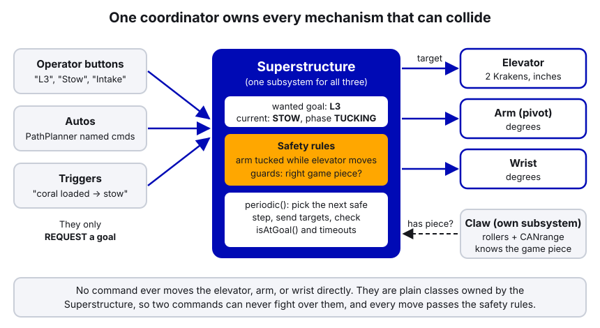
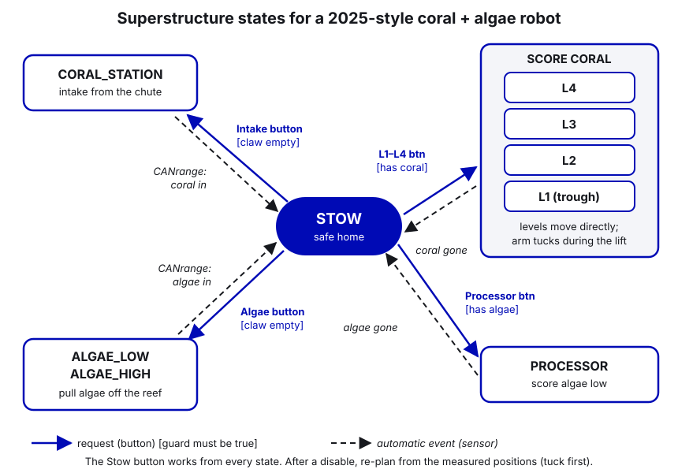
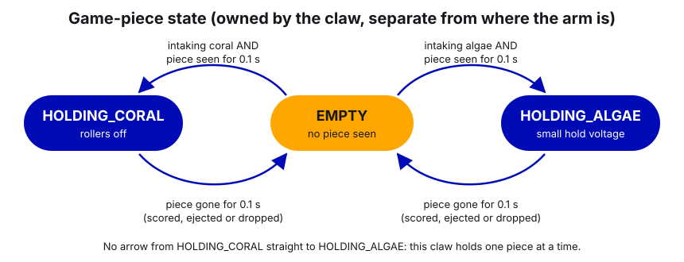
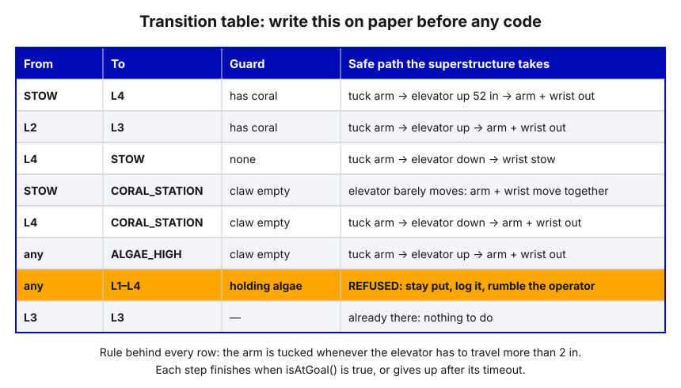
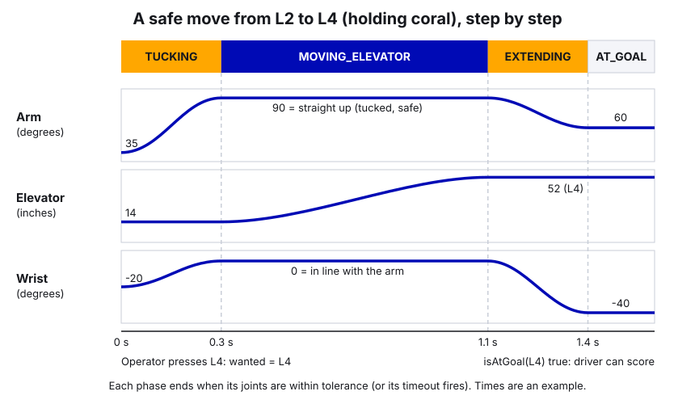

# 26. State Machines for Pick-and-Place Robots

> **Who it's for:** programmers who will write the code for a robot with an elevator, arm, wrist and claw, and
> anyone who has ever wondered "why did the arm hit the bumper?". We expect 2027 to be a pick-and-place game, like
> 2023 Charged Up and 2025 Reefscape, so this is the guide to read before kickoff.
> **You need first:** [04 Command-based](04-command-based-basics.md) (commands, triggers, the
> "periodic() drives the motor" pattern), [09 Motion Magic](09-motion-magic-and-position-control.md). The mechanism
> details are in [14 Arms](14-arms-single-and-double-jointed.md) and [15 Elevators](15-elevators.md). This guide
> doesn't repeat them; it's about making several mechanisms work together.
> **Time:** about 1.5 hours to read, plus an afternoon for the simulation practice.

## What you'll learn

- What a state machine is: states, transitions, events, and guards, in plain words.
- Why a pick-and-place robot needs one: several mechanisms that must move in a safe order, plus "what am I holding?".
- The **superstructure** idea: one coordinator owns the elevator, arm and wrist and only allows safe moves.
- How to design it on paper first (a state diagram and a transition table) before writing any code.
- Three ways to build it in WPILib Java, and one complete example you can copy as a starting point.
- The mistakes that cause crashes into the robot frame, and how we got close to them on Petrichor (2023) and Stingray (2025).

---

## 1. What a state machine is

A **state machine** is a way of describing something that can be in exactly one of a few named situations at a time,
and the rules for moving between them. You already know one: a traffic light. It's always RED, GREEN or YELLOW,
never two at once, and it only changes in a fixed order.

Four words to know:

| Word | Meaning | Robot example |
|---|---|---|
| **State** | A named situation the system is in. Only one at a time. | `STOW`, `L4`, `HOLDING_CORAL` |
| **Transition** | A move from one state to another. | `STOW` → `L4` |
| **Event** (or condition) | The thing that triggers a transition. | Operator presses Y; the CANrange sees a coral; a timer runs out |
| **Guard** | An extra condition that must be true, or the transition is refused. | "Only go to L4 **if** we are holding a coral" |

Written as a tiny table, a traffic light is:

| From | Event | To |
|---|---|---|
| RED | timer 30 s | GREEN |
| GREEN | timer 25 s | YELLOW |
| YELLOW | timer 4 s | RED |

That's the whole idea. Everything else in this guide is about choosing good states for a robot and writing the rules
so the robot can't do something dangerous.

### You've already used one

Our 2026 intake has a real, working state machine. `EvilIntake` is always in one of four states:

[EvilIntake.java, lines 131–132 (the states)](https://github.com/TorqueNados-FRC5090/Hephaestus/blob/c2f0cee6f61db3f26f911d3f5623ed7fa27a5b03/src/main/java/frc/robot/subsystems/EvilIntake.java#L131-L132)

```java
private enum State { NOT_HOMED, HOMING, READY, SIDES_OUT_OF_SYNC }
private State m_state = State.NOT_HOMED;
```

and `periodic()` decides what to do based on that state, every 20 ms:

[EvilIntake.java, lines 288–314 (the switch)](https://github.com/TorqueNados-FRC5090/Hephaestus/blob/c2f0cee6f61db3f26f911d3f5623ed7fa27a5b03/src/main/java/frc/robot/subsystems/EvilIntake.java#L288-L314)

```java
if (DriverStation.isDisabled() && m_state == State.HOMING) {
    m_state = State.NOT_HOMED;   // disabled mid-homing: start over on the next enable
}

if (DriverStation.isEnabled()) {
    switch (m_state) {
        case NOT_HOMED -> {
            if (DriverStation.isFMSAttached() && !m_homeRequested) {
                ...
                m_state = State.READY;
                ...
            } else {
                startHoming();
            }
        }
        case HOMING -> runHoming(velocityRps);
        case READY -> {
            checkSync(leaderInches, followerInches);
            if (m_state == State.READY) {
                driveToTarget();
            }
        }
        // Out of sync: hold still until someone re-homes (D-pad up or dashboard)
        case SIDES_OUT_OF_SYNC -> intakeMotor.setControl(m_stopRequest);
    }
}
```

What to notice, because every good state machine has these:

- **One variable holds the state.** Not three booleans that can disagree.
- **Each state has its own behavior.** In `HOMING` the rack pushes against the hard stop; in `SIDES_OUT_OF_SYNC` it
  holds still. No command can drive the rack in the wrong state, because commands only set a target.
- **It handles disable.** If you disable mid-homing, it goes back to `NOT_HOMED` and starts over on the next enable,
  instead of resuming a half-finished homing with stale timers.
- **Every state has a way out.** Homing has a timeout ([lines 365–373](https://github.com/TorqueNados-FRC5090/Hephaestus/blob/c2f0cee6f61db3f26f911d3f5623ed7fa27a5b03/src/main/java/frc/robot/subsystems/EvilIntake.java#L365-L373)):
  if no stall is seen, it keeps the power-on zero and carries on, so the intake never locks up for the rest of a match.
  `SIDES_OUT_OF_SYNC` exits when the driver asks for a re-home.
- **It shows its state.** `Intake/Status` goes on the dashboard, so you can see what it thinks is going on.

---

## 2. Why pick-and-place robots need one

A shooter robot (like our 2026 robot) mostly has mechanisms that can move independently: the hood can't hit the
turret, the intake can't hit the shooter. A pick-and-place robot is different. It usually has a stack of mechanisms
riding on each other:

```
            wrist + claw (holds the game piece)
                 |
            arm / pivot
                 |
         elevator carriage
                 |
         robot frame and bumpers
```

Three things make this hard:

1. **Mechanisms can hit each other and the robot.** If the arm is swung out over the bumper while the elevator comes
   down, the claw hits the bumper. If the wrist is tilted while the elevator goes up past a crossbar, the wrist hits
   the crossbar. Every move has to happen in a **safe order**.
2. **The robot has a game-piece state too.** Empty, holding a coral, or holding an algae (in 2025 terms). It changes
   what is allowed (you can't score a coral you don't have) and what is safe (an algae sticks out further than a
   coral, so the arm may need more room).
3. **There are many goals.** In 2025: coral station, L1, L2, L3, L4, low algae, high algae, processor, barge, climb.
   Every pair is a possible move. With 9 goals that's 72 possible transitions. You can't hand-write and test 72
   separate command sequences, so you need **rules** that make any move safe.

### Our history

We've built two robots like this, and both show the problem:

- **Petrichor (2023)** had a pivot, a telescope and a slider. It had a safe pose called `INTERMEDIATE`, but the
  *operator* had to remember to press it between other presets (see "In our code" below).
- **Stingray (2025)** had a pivot riding on an elevator. Every move was "pivot to zero, move the elevator, then pivot
  to the target", built as a command sequence. Safe, but the safety lived only in that one command.

Both robots worked. The idea in this guide is the next step: put the safety rules in **one place** that every
request has to go through.

---

## 3. The superstructure idea

The **superstructure** is everything above the drivetrain that moves together: elevator, arm, wrist. (It's a common
FRC word; 254, 1678 and 6328 all have a `superstructure` folder in their code.) The idea:

- One class, `Superstructure`, **owns** the elevator, arm and wrist. They are plain helper classes, not subsystems,
  so no other command can move them.
- Buttons, autos and triggers only **request a goal**: "go to L3". They never move a motor directly.
- The superstructure compares where it is with where it's asked to go, and walks there **one safe step at a time**.
- The claw (rollers + a CANrange piece sensor) is a separate subsystem. It owns the **game-piece state** and the superstructure
  reads it for its guards.



Why this is worth the extra structure:

- **Safety in one place.** The "tuck the arm before the elevator moves" rule is written once. A new auto, a new
  button, or a new student can't skip it.
- **No fighting.** Only one class sends targets to the three mechanisms, so two commands can never pull the arm in
  different directions (a classic bug; see guide 04).
- **Easy to see.** One dashboard string, `Superstructure/Phase`, tells you exactly what it's doing.

### Wanted state vs. current state

The most useful idea in this whole guide: keep **two** variables.

| Variable | Meaning | Changes when |
|---|---|---|
| **wanted goal** | Where we've been asked to go | A button, auto or trigger makes a request |
| **current goal + phase** | Where we really are, and which step of the move we're on | The mechanisms actually arrive (`isAtGoal()`) |

The operator presses L4: the wanted goal becomes L4 **immediately**. The current goal stays at, say, L2 until the
elevator, arm and wrist have all actually arrived at L4. Mixing these two up is the root of many bugs. Petrichor's
`Arm` had a field called `currentState` that was set the moment a preset was requested
([Arm.java, lines 87–88](https://github.com/TorqueNados-FRC5090/Petrichor-2023/blob/f8931338bb4aa79e3dd94a0dab2027ead4281bdb/src/main/java/frc/robot/subsystems/Arm.java#L87-L88)),
so "current" really meant "wanted". Any code that asked "are we at DROPOFF_HIGH yet?" would get "yes" before the arm
had moved at all.

---

## 4. Design it on paper first

Before you write any code for a new robot, sit down with the build team and the CAD and draw two things. It takes an
hour and saves a broken mechanism.

### Step 1: list the goals

For each job the robot does, write down the elevator height, arm angle and wrist angle. Get them from CAD first, then
correct them on the real robot. For a 2025-style robot:

| Goal | Elevator (in) | Arm (deg) | Wrist (deg) | Needs |
|---|---|---|---|---|
| STOW | 0 | 90 | 0 | anything |
| CORAL_STATION | 1 | 110 | -30 | claw empty |
| L1 | 4 | 30 | 0 | coral |
| L2 | 14 | 35 | -20 | coral |
| L3 | 29 | 35 | -20 | coral |
| L4 | 52 | 60 | -40 | coral |
| ALGAE_LOW | 18 | 20 | 0 | claw empty |
| ALGAE_HIGH | 34 | 20 | 0 | claw empty |
| PROCESSOR | 1.5 | 0 | 0 | algae |

These numbers are made up for the example. Angle conventions matter: here the arm is 0° horizontal forward and 90°
straight up (that's what CTRE's `Arm_Cosine` gravity feedforward expects, see guide 14), and the wrist is measured
relative to the arm, 0° = in line with it.

### Step 2: find the danger and write ONE rule

Look at the CAD and ask: "what can hit what?" On most elevator + arm robots the answer is: **the arm or wrist can hit
the frame or the elevator crossbars while the elevator moves**. So the rule is:

> The arm must be **tucked** (straight up, wrist in line) whenever the elevator has to travel more than 2 inches.

That one rule turns every move into the same three steps: **tuck, move the elevator, extend**. You don't need 72
special cases.

### Step 3: draw the state diagram

Circles for states, arrows for transitions, events and guards on the arrows.



The diagram shows the main flow. Because the tuck rule makes every move safe, the superstructure can actually go from
any goal straight to any other (L2 → L4, L4 → CORAL_STATION) as long as the guard is met.

The game piece gets its **own** small state machine, owned by the claw:



Keep these two separate. "Where is the arm?" and "what am I holding?" change for different reasons. If you combine
them into one enum you get states like `L4_HOLDING_CORAL`, `L4_EMPTY`, `L4_HOLDING_ALGAE`... and the list explodes.

### Step 4: the transition table

The table is where you catch mistakes. Go through the interesting rows with the build team: "from L4 to the coral
station, what moves first?".



Note the orange row: a request that fails its guard is **refused** and nothing moves. That's much better than moving
to L4 with an algae in the claw and finding out the hard way that it doesn't fit.

### Step 5: picture a move over time

Here's what "tuck, move, extend" looks like for L2 → L4:



---

## 5. Three ways to build it in WPILib

### (a) Enum + switch in `periodic()`

This is the `EvilIntake` pattern: an enum for the state, a `switch` in `periodic()`, commands only set the wanted
goal. It's the easiest to read and debug, because all the rules are in one method and the state is one variable you
can put on the dashboard. **This is the approach we recommend, and the full example in section 6 uses it.**

### (b) Command-based: each transition is a command sequence

This is the Stingray pattern: a move is a `Commands.sequence(...)` of steps, each ending when its mechanism arrives.
WPILib has tools to choose between sequences:

```java
// Pick one of several commands when the command STARTS, using a key
Command scoreAtSelectedLevel = Commands.select(
    Map.of(
        ScoringLevel.L2, moveToScoringPose(ScoringPose.L2),
        ScoringLevel.L3, moveToScoringPose(ScoringPose.L3),
        ScoringLevel.L4, moveToScoringPose(ScoringPose.L4)),
    () -> m_selectedLevel);                       // read when the command is scheduled

// Pick one of two commands based on a condition
Command smartEject = Commands.either(
    claw.ejectCoralCommand(),                      // if true
    claw.ejectAlgaeCommand(),                      // if false
    claw::isHoldingCoral);

// Build the command at the moment it starts, from the robot's real state
Command goToSelected = Commands.defer(
    () -> moveToScoringPose(m_selectedPose), Set.of(elevator, arm));
```

`Commands.select(map, selector)` is the same as `new SelectCommand<>(map, selector)`. One catch with `select`: every
command in the map is built at startup, so they all exist (and require their subsystems) even if only one runs.

The weakness of pure command sequences is the one we saw on Stingray: the safety lives in the command, not in the
mechanism. A different command that moves the arm directly skips it.

### Trigger-based transitions

Some transitions should happen **automatically** when something becomes true. That's exactly what a `Trigger` is:

```java
// Coral picked up -> go to the safe stow pose by itself
new Trigger(claw::hasPiece).onTrue(superstructure.requestCommand(SuperstructureGoal.STOW));
```

Triggers are the "events" from section 1. They work with either style above, and they're how the dashed arrows on the
state diagram become code.

### Which one?

| | Enum + switch (a) | Command sequences (b) |
|---|---|---|
| Where the rules live | One `periodic()` method | Spread across commands |
| Can another command skip the safety? | No, it can only request | Yes, if it moves a mechanism directly |
| Easy to see on a dashboard | Yes, one state string | Harder; look at the scheduler |
| Good for | Several mechanisms that can collide | Simple one-mechanism sequences, autos |

Use both: the superstructure is an enum machine, and the commands that **use** it (autos, scoring sequences) are
normal command compositions built on top.

---

## 6. A complete example: a coral/algae superstructure

This is new example code for a 2025-style robot: an elevator (two Krakens), an arm (one Kraken with a CANcoder), a
wrist (one Kraken), and a claw with a CTRE CANrange to see the game piece. It's written for WPILib 2026 and Phoenix 6 26.3.0. It is a
**starting point**: the gains and positions are placeholders, and the arm needs an absolute encoder and the elevator
needs homing (guides 14, 15 and 21). Read it in this order: goals, joint helper, claw, superstructure, bindings.

### The goals and the game piece

```java
package frc.robot.subsystems.superstructure;

/** What the claw is holding. Owned by the Claw subsystem. */
public enum GamePiece { NONE, CORAL, ALGAE }
```

```java
package frc.robot.subsystems.superstructure;

/** Where the elevator, arm and wrist should be for one job, and what the claw must hold to go there. */
public enum SuperstructureGoal {
    //             elevator in, arm deg, wrist deg, guard
    STOW(            0.0,  90.0,   0.0, PieceRequirement.ANY),
    CORAL_STATION(   1.0, 110.0, -30.0, PieceRequirement.EMPTY),
    L1(              4.0,  30.0,   0.0, PieceRequirement.CORAL),
    L2(             14.0,  35.0, -20.0, PieceRequirement.CORAL),
    L3(             29.0,  35.0, -20.0, PieceRequirement.CORAL),
    L4(             52.0,  60.0, -40.0, PieceRequirement.CORAL),
    ALGAE_LOW(      18.0,  20.0,   0.0, PieceRequirement.EMPTY),
    ALGAE_HIGH(     34.0,  20.0,   0.0, PieceRequirement.EMPTY),
    PROCESSOR(       1.5,   0.0,   0.0, PieceRequirement.ALGAE);

    /** The guard: what the claw must be holding before we're allowed to go to this goal */
    public enum PieceRequirement {
        ANY, EMPTY, CORAL, ALGAE;

        public boolean isMetBy(GamePiece held) {
            return switch (this) {
                case ANY -> true;
                case EMPTY -> held == GamePiece.NONE;
                case CORAL -> held == GamePiece.CORAL;
                case ALGAE -> held == GamePiece.ALGAE;
            };
        }
    }

    public final double elevatorInches;
    public final double armDegrees;
    public final double wristDegrees;
    public final PieceRequirement requirement;

    SuperstructureGoal(double elevatorInches, double armDegrees, double wristDegrees, PieceRequirement requirement) {
        this.elevatorInches = elevatorInches;
        this.armDegrees = armDegrees;
        this.wristDegrees = wristDegrees;
        this.requirement = requirement;
    }
}
```

Compare this with Stingray's `UpperChassisPose` (section 8): same idea, one enum value holds every joint's target,
but with units in the names and the guard attached.

### A small helper for one Motion Magic joint

The elevator, arm and wrist all do the same thing: go to a position with Motion Magic and say when they're there. One
helper class avoids writing that three times. It is **not** a subsystem, so only its owner can use it.

```java
package frc.robot.subsystems.superstructure;

import com.ctre.phoenix6.configs.TalonFXConfiguration;
import com.ctre.phoenix6.controls.MotionMagicVoltage;
import com.ctre.phoenix6.hardware.TalonFX;
import edu.wpi.first.math.MathUtil;
import edu.wpi.first.wpilibj.smartdashboard.SmartDashboard;

/** One Motion Magic joint (elevator, arm or wrist). Positions are in "units": inches or degrees. */
public class MotionMagicJoint {
    private final String m_name;
    private final TalonFX m_motor;
    /** Mechanism rotations per unit: 1/360 for degrees, 1/(inches per drum rotation) for an elevator */
    private final double m_rotationsPerUnit;
    private final double m_toleranceUnits;
    private final double m_minUnits;
    private final double m_maxUnits;
    private final MotionMagicVoltage m_positionRequest = new MotionMagicVoltage(0).withEnableFOC(true);
    private double m_targetUnits;

    public MotionMagicJoint(String name, TalonFX motor, TalonFXConfiguration config, double rotationsPerUnit,
                            double toleranceUnits, double minUnits, double maxUnits) {
        m_name = name;
        m_motor = motor;
        m_rotationsPerUnit = rotationsPerUnit;
        m_toleranceUnits = toleranceUnits;
        m_minUnits = minUnits;
        m_maxUnits = maxUnits;
        m_motor.getConfigurator().apply(config);
        m_targetUnits = getPosition();
    }

    /** Measured position in units (the config's SensorToMechanismRatio makes getPosition() mechanism rotations) */
    public double getPosition() {
        return m_motor.getPosition().getValueAsDouble() / m_rotationsPerUnit;
    }

    /** Send a target. Clamped to the joint's safe range so a typo can't drive it into a hard stop. */
    public void setTarget(double units) {
        m_targetUnits = MathUtil.clamp(units, m_minUnits, m_maxUnits);
        m_motor.setControl(m_positionRequest.withPosition(m_targetUnits * m_rotationsPerUnit));
    }

    public boolean isNear(double units) {
        return Math.abs(getPosition() - units) <= m_toleranceUnits;
    }

    public void publish() {
        SmartDashboard.putNumber("Superstructure/" + m_name + " position", getPosition());
        SmartDashboard.putNumber("Superstructure/" + m_name + " target", m_targetUnits);
    }

    public TalonFX getMotor() {
        return m_motor;
    }
}
```

### The claw: game-piece state from a CANrange

```java
package frc.robot.subsystems.superstructure;

import com.ctre.phoenix6.CANBus;
import com.ctre.phoenix6.StatusSignal;
import com.ctre.phoenix6.configs.CANrangeConfiguration;
import com.ctre.phoenix6.configs.TalonFXConfiguration;
import com.ctre.phoenix6.controls.VoltageOut;
import com.ctre.phoenix6.hardware.CANrange;
import com.ctre.phoenix6.hardware.TalonFX;
import com.ctre.phoenix6.signals.NeutralModeValue;
import com.ctre.phoenix6.signals.UpdateModeValue;
import edu.wpi.first.math.filter.Debouncer;
import edu.wpi.first.wpilibj.smartdashboard.SmartDashboard;
import edu.wpi.first.wpilibj2.command.Command;
import edu.wpi.first.wpilibj2.command.SubsystemBase;

/** Claw rollers + a CANrange piece sensor. Owns the game-piece state (NONE / CORAL / ALGAE). */
public class Claw extends SubsystemBase {
    private static final int kRollerMotorId = 23;
    private static final int kPieceSensorId = 26;           // CANrange, on the same bus as the roller
    /** Closer than this = a piece is in the claw. Measure with real pieces (guide 21) */
    private static final double kPieceDetectMeters = 0.08;
    private static final double kIntakeVolts = 6.0;
    private static final double kEjectVolts = -8.0;
    private static final double kAlgaeHoldVolts = 1.0;      // a little squeeze so the algae doesn't roll out

    private final CANBus m_upperBus = new CANBus("Upper");
    private final TalonFX m_rollerMotor = new TalonFX(kRollerMotorId, m_upperBus);
    private final VoltageOut m_voltageRequest = new VoltageOut(0).withEnableFOC(true);
    private final CANrange m_pieceSensor = new CANrange(kPieceSensorId, m_upperBus);
    private final StatusSignal<Boolean> m_pieceDetected = m_pieceSensor.getIsDetected();
    /** The piece must be seen (or gone) for 0.1 s before we believe it: ignores flicker as a piece slides in */
    private final Debouncer m_pieceDebouncer = new Debouncer(0.1, Debouncer.DebounceType.kBoth);

    private GamePiece m_heldPiece = GamePiece.NONE;
    /** What we're trying to pick up right now (NONE when not intaking) */
    private GamePiece m_intakingPiece = GamePiece.NONE;

    public Claw() {
        TalonFXConfiguration config = new TalonFXConfiguration();
        config.CurrentLimits.StatorCurrentLimit = 40;            // amps
        config.CurrentLimits.StatorCurrentLimitEnable = true;
        config.CurrentLimits.SupplyCurrentLimit = 30;            // amps
        config.CurrentLimits.SupplyCurrentLimitEnable = true;
        config.MotorOutput.NeutralMode = NeutralModeValue.Brake; // a stopped claw grips the piece
        m_rollerMotor.getConfigurator().apply(config);

        CANrangeConfiguration rangeConfig = new CANrangeConfiguration();
        rangeConfig.ToFParams.UpdateMode = UpdateModeValue.ShortRange100Hz;
        rangeConfig.ProximityParams.ProximityThreshold = kPieceDetectMeters;
        rangeConfig.ProximityParams.ProximityHysteresis = 0.01;  // meters
        m_pieceSensor.getConfigurator().apply(rangeConfig);
    }

    public GamePiece getHeldPiece() {
        return m_heldPiece;
    }

    public boolean hasPiece() {
        return m_heldPiece != GamePiece.NONE;
    }

    /** Run the rollers in until a piece is detected. Hold the button; it also ends by itself on pickup. */
    public Command intakeCommand(GamePiece piece) {
        return startEnd(
                () -> { m_intakingPiece = piece; setVolts(kIntakeVolts); },
                () -> { m_intakingPiece = GamePiece.NONE; setVolts(holdVolts()); })
            .until(this::hasPiece)
            .withName("Claw intake " + piece);
    }

    /** Spit the piece out while held */
    public Command ejectCommand() {
        return startEnd(() -> setVolts(kEjectVolts), () -> setVolts(holdVolts())).withName("Claw eject");
    }

    private double holdVolts() {
        return m_heldPiece == GamePiece.ALGAE ? kAlgaeHoldVolts : 0.0;
    }

    private void setVolts(double volts) {
        m_rollerMotor.setControl(m_voltageRequest.withOutput(volts));
    }

    @Override
    public void periodic() {
        // Check the threshold with real pieces using the dashboard value below
        boolean pieceSeen = m_pieceDebouncer.calculate(m_pieceDetected.refresh().getValue());

        // The game-piece state machine (see the diagram): EMPTY <-> HOLDING_CORAL / HOLDING_ALGAE
        if (m_heldPiece == GamePiece.NONE && pieceSeen && m_intakingPiece != GamePiece.NONE) {
            m_heldPiece = m_intakingPiece;
        } else if (m_heldPiece != GamePiece.NONE && !pieceSeen) {
            m_heldPiece = GamePiece.NONE;            // scored, ejected, or dropped
        }

        SmartDashboard.putString("Claw/Held piece", m_heldPiece.toString());
        SmartDashboard.putBoolean("Claw/Piece seen", pieceSeen);
        SmartDashboard.putNumber("Claw/Sensor distance (m)", m_pieceSensor.getDistance().getValueAsDouble());
    }
}
```

Notice that the claw decides *which* piece it has from *what it was trying to intake*. One distance sensor can't tell a
coral from an algae; the context can. If your claw has separate paths for each piece, use two sensors instead. (Algae
intakes are often detected by a current spike instead of a sensor: the roller current jumps when the ball stops
it. That works too; debounce it the same way.)

### The superstructure

```java
package frc.robot.subsystems.superstructure;

import java.util.function.Supplier;

import com.ctre.phoenix6.CANBus;
import com.ctre.phoenix6.configs.Slot0Configs;
import com.ctre.phoenix6.configs.TalonFXConfiguration;
import com.ctre.phoenix6.controls.Follower;
import com.ctre.phoenix6.hardware.TalonFX;
import com.ctre.phoenix6.signals.GravityTypeValue;
import com.ctre.phoenix6.signals.MotorAlignmentValue;
import com.ctre.phoenix6.signals.NeutralModeValue;
import edu.wpi.first.wpilibj.DriverStation;
import edu.wpi.first.wpilibj.Timer;
import edu.wpi.first.wpilibj.smartdashboard.SmartDashboard;
import edu.wpi.first.wpilibj2.command.Command;
import edu.wpi.first.wpilibj2.command.Commands;
import edu.wpi.first.wpilibj2.command.SubsystemBase;

/**
 * Owns the elevator, arm and wrist and only ever moves them in a safe order.
 * Safety rule: the arm and wrist are TUCKED whenever the elevator travels more than kElevatorFreeTravelInches.
 * Everyone else only requests a goal; periodic() is the one place that sends targets to the three joints.
 */
public class Superstructure extends SubsystemBase {
    // ---- Constants (move these to Constants.java on the real robot) ----
    private static final CANBus kMechanismBus = new CANBus("Upper");
    private static final int kElevatorLeaderId = 17;
    private static final int kElevatorFollowerId = 18;
    private static final int kArmMotorId = 19;
    private static final int kWristMotorId = 24;

    /** Elevator drum: 1.75" pitch diameter sprocket -> inches of carriage travel per drum rotation */
    private static final double kElevatorInchesPerRotation = Math.PI * 1.75;
    private static final double kElevatorGearRatio = 9.0;      // motor rotations per drum rotation
    private static final double kArmGearRatio = 60.0;          // motor rotations per arm rotation
    private static final double kWristGearRatio = 30.0;

    /** Arm and wrist angles that are safe for ANY elevator height */
    private static final double kTuckedArmDegrees = 90.0;
    private static final double kTuckedWristDegrees = 0.0;
    /** The elevator may move this far without tucking first (small moves near the bottom) */
    private static final double kElevatorFreeTravelInches = 2.0;

    /** If a phase takes longer than this, something is jammed: stop and say so */
    private static final double kTuckTimeoutSeconds = 1.0;
    private static final double kElevatorTimeoutSeconds = 2.5;
    private static final double kExtendTimeoutSeconds = 1.0;

    /** The steps of one move. AT_GOAL = arrived. STUCK = a step timed out; waits for a new request. */
    public enum Phase { AT_GOAL, TUCKING, MOVING_ELEVATOR, EXTENDING, STUCK }

    private final MotionMagicJoint m_elevator;
    private final MotionMagicJoint m_arm;
    private final MotionMagicJoint m_wrist;
    private final Supplier<GamePiece> m_heldPiece;

    private SuperstructureGoal m_wantedGoal = SuperstructureGoal.STOW;
    private SuperstructureGoal m_currentGoal = SuperstructureGoal.STOW;
    private Phase m_phase = Phase.TUCKING;   // at power-on, don't trust anything: do a full safe move to STOW
    private final Timer m_phaseTimer = new Timer();
    private double m_elevatorHoldInches;
    private boolean m_wasDisabled = true;

    public Superstructure(Supplier<GamePiece> heldPiece) {
        m_heldPiece = heldPiece;

        TalonFX elevatorLeader = new TalonFX(kElevatorLeaderId, kMechanismBus);
        TalonFX elevatorFollower = new TalonFX(kElevatorFollowerId, kMechanismBus);
        TalonFXConfiguration elevatorConfig = jointConfig(kElevatorGearRatio, 60,
            new Slot0Configs().withKS(0.15).withKV(1.1).withKP(8.0).withKG(0.35)
                .withGravityType(GravityTypeValue.Elevator_Static),
            4.0, 8.0);                                   // cruise / accel in drum rotations per second (and /s)
        elevatorFollower.getConfigurator().apply(elevatorConfig);
        elevatorFollower.setControl(new Follower(kElevatorLeaderId, MotorAlignmentValue.Opposed));
        m_elevator = new MotionMagicJoint("Elevator (in)", elevatorLeader, elevatorConfig,
            1.0 / kElevatorInchesPerRotation, 0.5, 0.0, 54.0);

        m_arm = new MotionMagicJoint("Arm (deg)", new TalonFX(kArmMotorId, kMechanismBus),
            jointConfig(kArmGearRatio, 40,
                new Slot0Configs().withKS(0.2).withKV(7.0).withKP(40.0).withKG(0.3)
                    .withGravityType(GravityTypeValue.Arm_Cosine),   // needs 0 = horizontal (guide 14)
                1.0, 3.0),
            1.0 / 360.0, 3.0, -10.0, 120.0);

        // Wrist gravity depends on the ARM angle too, so kG is left at 0 here (add it in code later if needed)
        m_wrist = new MotionMagicJoint("Wrist (deg)", new TalonFX(kWristMotorId, kMechanismBus),
            jointConfig(kWristGearRatio, 30,
                new Slot0Configs().withKS(0.1).withKV(3.5).withKP(30.0),
                2.0, 6.0),
            1.0 / 360.0, 4.0, -60.0, 30.0);

        m_elevatorHoldInches = m_elevator.getPosition();
    }

    /** Shared motor config: ratio, gains, Motion Magic, brake, current limits */
    private static TalonFXConfiguration jointConfig(double sensorToMechanismRatio, double statorLimitAmps,
                                                    Slot0Configs gains, double cruiseRps, double accelRpsPerSec) {
        TalonFXConfiguration config = new TalonFXConfiguration();
        config.Feedback.SensorToMechanismRatio = sensorToMechanismRatio;
        config.Slot0 = gains;
        config.MotionMagic.MotionMagicCruiseVelocity = cruiseRps;        // mechanism rotations per second
        config.MotionMagic.MotionMagicAcceleration = accelRpsPerSec;     // mechanism rotations per second^2
        config.MotorOutput.NeutralMode = NeutralModeValue.Brake;         // never let the arm fall when disabled
        config.CurrentLimits.StatorCurrentLimit = statorLimitAmps;
        config.CurrentLimits.StatorCurrentLimitEnable = true;
        config.CurrentLimits.SupplyCurrentLimit = 40;                    // amps
        config.CurrentLimits.SupplyCurrentLimitEnable = true;
        return config;
    }

    // ===================== Requests (the only way in) =====================

    /** Ask for a goal. Returns false (and nothing moves) if the guard fails. */
    public boolean requestGoal(SuperstructureGoal goal) {
        if (!goal.requirement.isMetBy(m_heldPiece.get())) {
            DriverStation.reportWarning("Superstructure: refused " + goal + " while holding "
                + m_heldPiece.get(), false);
            return false;
        }
        if (goal == m_wantedGoal && m_phase != Phase.STUCK) {
            return true;                         // already going there (or there): don't restart the move
        }
        m_wantedGoal = goal;
        startMove();
        return true;
    }

    /** True only when every joint has really arrived at this goal */
    public boolean isAtGoal(SuperstructureGoal goal) {
        return m_phase == Phase.AT_GOAL && m_currentGoal == goal;
    }

    /** Request a goal and finish immediately. For buttons. */
    public Command requestCommand(SuperstructureGoal goal) {
        return runOnce(() -> requestGoal(goal)).withName("Request " + goal);
    }

    /** Request a goal and wait until we're there. For autos. Ends early if refused, replaced, or stuck. */
    public Command goToCommand(SuperstructureGoal goal) {
        return runOnce(() -> requestGoal(goal))
            .andThen(Commands.waitUntil(
                () -> isAtGoal(goal) || m_wantedGoal != goal || m_phase == Phase.STUCK))
            .withTimeout(kTuckTimeoutSeconds + kElevatorTimeoutSeconds + kExtendTimeoutSeconds)
            .withName("Go to " + goal);
    }

    // ===================== The state machine =====================

    /** Plan the move to m_wantedGoal from where the joints REALLY are right now */
    private void startMove() {
        m_elevatorHoldInches = m_elevator.getPosition();
        boolean bigElevatorMove =
            Math.abs(m_wantedGoal.elevatorInches - m_elevatorHoldInches) > kElevatorFreeTravelInches;
        enterPhase(bigElevatorMove ? Phase.TUCKING : Phase.EXTENDING);
    }

    private void enterPhase(Phase phase) {
        m_phase = phase;
        m_phaseTimer.restart();
    }

    @Override
    public void periodic() {
        if (DriverStation.isDisabled()) {
            // Motors are off. Remember it, so on enable we re-plan from wherever the joints ended up.
            m_wasDisabled = true;
            publish();
            return;
        }
        if (m_wasDisabled) {
            m_wasDisabled = false;
            startMove();                         // never resume a half-finished move with stale timers
        }

        SuperstructureGoal goal = m_wantedGoal;
        switch (m_phase) {
            case TUCKING -> {
                m_elevator.setTarget(m_elevatorHoldInches);            // elevator waits where it is
                m_arm.setTarget(kTuckedArmDegrees);
                m_wrist.setTarget(kTuckedWristDegrees);
                if (m_arm.isNear(kTuckedArmDegrees) && m_wrist.isNear(kTuckedWristDegrees)) {
                    enterPhase(Phase.MOVING_ELEVATOR);
                } else if (m_phaseTimer.hasElapsed(kTuckTimeoutSeconds)) {
                    becomeStuck("arm/wrist never tucked");
                }
            }
            case MOVING_ELEVATOR -> {
                m_elevator.setTarget(goal.elevatorInches);
                m_arm.setTarget(kTuckedArmDegrees);                    // stay tucked the whole way
                m_wrist.setTarget(kTuckedWristDegrees);
                if (m_elevator.isNear(goal.elevatorInches)) {
                    enterPhase(Phase.EXTENDING);
                } else if (m_phaseTimer.hasElapsed(kElevatorTimeoutSeconds)) {
                    becomeStuck("elevator never reached " + goal.elevatorInches + " in");
                }
            }
            case EXTENDING -> {
                sendGoalTargets(goal);
                if (allJointsAt(goal)) {
                    m_currentGoal = goal;
                    enterPhase(Phase.AT_GOAL);
                } else if (m_phaseTimer.hasElapsed(kExtendTimeoutSeconds)) {
                    becomeStuck("arm/wrist never reached " + goal);
                }
            }
            case AT_GOAL -> sendGoalTargets(goal);                     // keep holding the goal
            case STUCK -> { }                                          // hold the targets set in becomeStuck()
        }
        publish();
    }

    private void sendGoalTargets(SuperstructureGoal goal) {
        m_elevator.setTarget(goal.elevatorInches);
        m_arm.setTarget(goal.armDegrees);
        m_wrist.setTarget(goal.wristDegrees);
    }

    private boolean allJointsAt(SuperstructureGoal goal) {
        return m_elevator.isNear(goal.elevatorInches)              // check EVERY joint, not just one
            && m_arm.isNear(goal.armDegrees)
            && m_wrist.isNear(goal.wristDegrees);
    }

    /** A step timed out (jam, unplugged motor, game piece in the way). Hold still and wait for a new request. */
    private void becomeStuck(String reason) {
        m_elevator.setTarget(m_elevator.getPosition());
        m_arm.setTarget(m_arm.getPosition());
        m_wrist.setTarget(m_wrist.getPosition());
        m_phase = Phase.STUCK;
        DriverStation.reportError("Superstructure STUCK going to " + m_wantedGoal + ": " + reason, false);
    }

    private void publish() {
        SmartDashboard.putString("Superstructure/Wanted", m_wantedGoal.toString());
        SmartDashboard.putString("Superstructure/Current", m_currentGoal.toString());
        SmartDashboard.putString("Superstructure/Phase", m_phase.toString());
        m_elevator.publish();
        m_arm.publish();
        m_wrist.publish();
    }
}
```

What to notice:

- **Wanted vs. current.** `m_wantedGoal` changes the instant a request is accepted. `m_currentGoal` only changes when
  `allJointsAt(goal)` is true. `isAtGoal()` checks both, so an auto can't start scoring early.
- **The rule is in one place.** The `TUCKING` and `MOVING_ELEVATOR` cases are the safety rule. Every move goes through
  `startMove()`, which decides whether a tuck is needed from the **measured** elevator position.
- **The guard is in `requestGoal()`.** A refused request changes nothing and prints a warning.
- **Requests can change mid-move.** Press L4, then L2 while it's still tucking: `startMove()` re-plans from where the
  joints really are. No half-finished sequence is left running.
- **Every phase has a timeout** and goes to `STUCK` instead of waiting forever. `STUCK` holds still; any new request
  (Stow, usually) restarts a safe move. That's the "every state has a way out" rule.
- **Disable is handled.** On enable after a disable, it re-plans from the measured positions. Someone may have pushed
  the arm by hand while the robot was disabled.
- **It shows itself.** Wanted, Current, Phase and each joint's position and target are on the dashboard.

### Operator buttons and triggers

In `RobotContainer`:

```java
private final Claw claw = new Claw();
private final Superstructure superstructure = new Superstructure(claw::getHeldPiece);

private void configureOperatorBindings() {
    // Scoring levels: the superstructure decides the safe way to get there
    operator.a().onTrue(superstructure.requestCommand(SuperstructureGoal.L1));
    operator.b().onTrue(superstructure.requestCommand(SuperstructureGoal.L2));
    operator.x().onTrue(superstructure.requestCommand(SuperstructureGoal.L3));
    operator.y().onTrue(superstructure.requestCommand(SuperstructureGoal.L4));
    operator.rightBumper().onTrue(superstructure.requestCommand(SuperstructureGoal.STOW));

    // Intake coral: go to the station and run the rollers while held
    operator.leftBumper().whileTrue(
        superstructure.requestCommand(SuperstructureGoal.CORAL_STATION)
            .andThen(claw.intakeCommand(GamePiece.CORAL)));

    // Score: only spit when we've actually arrived somewhere
    operator.rightTrigger().whileTrue(
        claw.ejectCommand().onlyIf(() -> superstructure.isAtGoal(SuperstructureGoal.L1)
            || superstructure.isAtGoal(SuperstructureGoal.L2)
            || superstructure.isAtGoal(SuperstructureGoal.L3)
            || superstructure.isAtGoal(SuperstructureGoal.L4)
            || superstructure.isAtGoal(SuperstructureGoal.PROCESSOR)));

    // Automatic transitions (the dashed arrows): picked something up -> stow; it's gone -> stow
    new Trigger(claw::hasPiece).onTrue(superstructure.requestCommand(SuperstructureGoal.STOW));
    new Trigger(claw::hasPiece).onFalse(
        Commands.waitSeconds(0.3).andThen(superstructure.requestCommand(SuperstructureGoal.STOW)));
}
```

Follow one press. The robot is at STOW holding a coral, and the operator presses **X** (L3):

1. `requestGoal(L3)`: the guard needs CORAL, the claw says CORAL, accepted. Wanted = L3.
2. `startMove()`: the elevator is at 0 in, L3 needs 29 in, more than 2 in, so phase = `TUCKING`.
3. The arm is already at 90°, so next loop phase = `MOVING_ELEVATOR`. The elevator rises with the arm tucked.
4. Elevator within 0.5 in of 29: phase = `EXTENDING`. Arm goes to 35°, wrist to -20°.
5. All three within tolerance: current = L3, phase = `AT_GOAL`. Now the score button works.
6. The operator scores. The CANrange sees nothing for 0.1 s, the claw says NONE, and 0.3 s later the trigger requests STOW.
   The superstructure tucks, lowers the elevator, and the robot is ready to drive.

The 0.3 s wait in the last trigger gives the coral time to fall clear of the claw before the arm moves.

> **Tip:** on the driver station side, put `Superstructure/Phase` and `Claw/Held piece` big on the Elastic dashboard.
> When the robot "won't score", one glance says whether it's still `MOVING_ELEVATOR`, `STUCK`, or the claw thinks it's
> empty.

---

## 7. Step by step: build a superstructure for a new robot

1. **Goal table.** With the build team and CAD, list every goal with elevator height, arm angle, wrist angle, and the
   game piece it needs. Put the numbers in `Constants.java` with units in the names.
2. **The safety rule.** Find what can hit what. Write the rule in one sentence (for example "tucked while the elevator
   travels"). If you need more than one rule, write them all down before coding.
3. **Diagram and table** (section 4). Check the interesting transitions against CAD.
4. **Bring up each joint alone first**, with the superstructure not yet created: direction, soft limits, homing (guide
   15/21), absolute encoder (guide 14), gains (guide 08/09). A state machine can't fix a joint that doesn't track.
5. **Write the superstructure** using section 6 as the template. Start with only STOW and one scoring goal.
6. **Simulate it** with a Mechanism2d drawing (Practice 1) and click through every button. Watch `Superstructure/Phase`.
7. **On the robot, slow**: lower Motion Magic cruise and acceleration to about a third, robot on blocks, someone on the
   disable button. Try every transition in your table, including the refused ones.
8. **Speed it up** one joint at a time, then add the other goals.
9. **Use `goToCommand()` in autos** and register it as a PathPlanner named command (guide 18).

> **Watch out:** the first time a new superstructure moves on the real robot, keep hands and heads out of the
> elevator's path, and have a second person ready on the disable button (Enter on the Driver Station keyboard is
> disable; space bar is e-stop). A wrong sign on one joint can send it the wrong way at full speed.

---

## 8. In our code

### Stingray (2025): one enum for the whole upper robot

[Constants.java, lines 125–145 (UpperChassisPose)](https://github.com/TorqueNados-FRC5090/Stingray-2025/blob/97c843705075c729538ad0b3925f67a35e3bf791/src/main/java/frc/robot/Constants.java#L125-L145)

```java
public enum UpperChassisPose {
    ZERO(0, 0),
    TROUGH(3, 0),
    L2(9.4, 20),
    L3(25.1, 20),
    L4( 55.4, 75);
    ...
}
```

[SetUpperChassisPose.java, lines 16–22 (pivot → elevator → pivot)](https://github.com/TorqueNados-FRC5090/Stingray-2025/blob/97c843705075c729538ad0b3925f67a35e3bf791/src/main/java/frc/robot/commands/SetUpperChassisPose.java#L16-L22)

```java
public SetUpperChassisPose(Elevator elevator, Pivot pivot, UpperChassisPose pose) {
    addCommands(
        new SetPivotPose(pivot, UpperChassisPose.ZERO),
        new SetElevatorPose(elevator, pose),
        new SetPivotPose(pivot, pose)
    );
}
```

What to notice:

- This is approach (b): each move is a command sequence. "Pivot to ZERO, elevator, pivot" is the same tuck, move,
  extend rule as section 6, written as a sequence instead of phases.
- The enum is a goal table: L4 = elevator 55.4, pivot 75 (pivot motor rotations, not degrees; guide 15 covers that).
- It was bound with `onTrue(... L4)` and `onFalse(... ZERO)` in
  [RobotContainer.java, lines 116–123](https://github.com/TorqueNados-FRC5090/Stingray-2025/blob/97c843705075c729538ad0b3925f67a35e3bf791/src/main/java/frc/robot/RobotContainer.java#L116-L123).
  Releasing the button interrupts whatever step is running and starts the ZERO sequence, which tucks first. That
  worked because the new sequence always starts with the tuck.
- No timeouts and no guards: if the pivot never reached its tolerance, the elevator never moved. Guide 15 section 6
  shows how to add `.withTimeout(...)`.

### Stingray (2025): a game-piece state machine

Stingray also had a small state machine for the coral, using two Redux Canandcolor proximity sensors (an entry and an
exit sensor) instead of beam breaks:

[AutoIntake.java, lines 78–97 (runStateMachine)](https://github.com/TorqueNados-FRC5090/Stingray-2025/blob/97c843705075c729538ad0b3925f67a35e3bf791/src/main/java/frc/robot/commands/AutoIntake.java#L78-L97)

```java
private void runStateMachine() {
    switch (state) {
        case WAITING:
            if(entry) { enterState(IntakeState.INDEXING); }
            if(exit && !entry) { enterState(IntakeState.HOLDING); }
            break;

        case INDEXING: // Once the piece is beyond the sensor, just hold it still
            if(!entry) { enterState(IntakeState.HOLDING); }
            break;

        case HOLDING: // If there is not a piece in the intake, go back to waiting
            if(!entry && !exit) { enterState(IntakeState.WAITING); }
            else if(reverseTimer.hasElapsed(.6)) { shooter.stop(); }
            break;
    ...
```

What to notice:

- Real events (sensor edges) cause real transitions. This is the same shape as the claw example in section 6.
- `enterState()` ([lines 99–106](https://github.com/TorqueNados-FRC5090/Stingray-2025/blob/97c843705075c729538ad0b3925f67a35e3bf791/src/main/java/frc/robot/commands/AutoIntake.java#L99-L106))
  does the "on entry" work (set roller speed, start a timer) in one place. Good pattern.
- It runs as the shooter's **default command** ([RobotContainer.java, line 72](https://github.com/TorqueNados-FRC5090/Stingray-2025/blob/97c843705075c729538ad0b3925f67a35e3bf791/src/main/java/frc/robot/RobotContainer.java#L72)).
  When the shoot button takes the subsystem, the state machine is interrupted, and when it restarts, `initialize()`
  re-reads the sensors to decide its starting state. That's the "re-plan from measured state" idea again.

### Petrichor (2023): presets, and the operator as the state machine

Petrichor's arm had presets in an enum
([Constants.java, lines 71–79](https://github.com/TorqueNados-FRC5090/Petrichor-2023/blob/f8931338bb4aa79e3dd94a0dab2027ead4281bdb/src/main/java/frc/robot/Constants.java#L71-L79)),
including a safe waypoint, `INTERMEDIATE`
([Arm.java, lines 129–136](https://github.com/TorqueNados-FRC5090/Petrichor-2023/blob/f8931338bb4aa79e3dd94a0dab2027ead4281bdb/src/main/java/frc/robot/subsystems/Arm.java#L129-L136)).
The teleop buttons jumped straight to any preset:

[Robot.java, lines 109–119 (teleop buttons)](https://github.com/TorqueNados-FRC5090/Petrichor-2023/blob/f8931338bb4aa79e3dd94a0dab2027ead4281bdb/src/main/java/frc/robot/Robot.java#L109-L119)

```java
// Pressing Right bumper makes the arm go to the preset of the drop of high position
if (operatorController.getRawButtonPressed(5))
    arm.setTarget(ArmState.DROPOFF_HIGH);

// Pressing Y makes the arm go to the preset of the drop of medium position
if (operatorController.getRawButtonPressed(7))
    arm.setTarget(ArmState.DROPOFF_MED);

// Pressing Left trigger makes the arm go to the preset of the floor pickup position
if (operatorController.getRawButtonPressed(3))
    arm.setTarget(ArmState.INTERMEDIATE);
```

What to notice:

- There's no rule in the code about *when* `INTERMEDIATE` is needed. The **operator** was the state machine: they had
  to remember to press button 3 between certain presets. The autos did the same by listing it in their sequences.
  One missed press and the arm takes the straight path through the bumper.
- `setTarget()` sets `currentState` immediately (section 3): the "current" state is really the wanted one.
- The better design moves the waypoint decision into the code, which is what guide 14's two-joint skeleton and
  section 6 here both do.

### Other teams

These teams publish their code. They're far more complex than ours, but worth a look once you understand section 6:

- **6328 (2025)** builds a graph of superstructure states and finds the path between them with a breadth-first search:
  https://github.com/Mechanical-Advantage/RobotCode2025Public/tree/main/src/main/java/org/littletonrobotics/frc2025/subsystems/superstructure
  (look at `Superstructure.java` and `SuperstructureState.java`).
- **254 (2025)** has a `SuperstructureStateMachine` and an A* search for transitions:
  https://github.com/Team254/FRC-2025-Public/tree/main/src/main/java/com/team254/frc2025/subsystems/superstructure
- **1678 (2025)** writes its superstructure as many small command factories (`tuck()`, `coralIntakeToHold()`...),
  closer to approach (b):
  https://github.com/frc1678/C2025-Public/tree/main/src/main/java/frc/robot/subsystems/superstructure

Note that 6328's code is built on AdvantageKit (see [34 AdvantageKit and AdvantageScope](34-advantagekit-and-advantagescope.md)),
so each mechanism is split into several files. The state machine ideas are the same.

---

## Common mistakes

- **A transition that skips the safe state.** Petrichor's operator going straight from one preset to another without
  `INTERMEDIATE`. Fix: the code decides when to tuck, from the measured position, every time.
- **A state that never exits.** Stingray's sequence waited forever if the pivot never reached tolerance. Every phase
  needs a timeout and somewhere to go (our `STUCK`, the intake's "homing failed, keep the power-on zero").
- **Two commands fighting over the same mechanism.** A button that moves the arm directly while the superstructure is
  also sending arm targets. Fix: mechanisms are owned by the superstructure and nothing else can reach them.
- **No timeout on `goToCommand` in auto.** One jammed piece and the rest of the auto never runs. Add `.withTimeout()`
  and let the auto carry on (or stow).
- **Forgetting disable/enable.** Resuming a half-finished move with old timers, or assuming the arm is where it was.
  Fix: on enable, re-plan from measured positions (like `EvilIntake` restarting homing).
- **Mixing game-piece state and mechanism state** in one enum (`L4_WITH_CORAL`, `L4_EMPTY`...). Keep two machines.
- **"Current" set at request time.** Then `isAtGoal()` lies (Petrichor's `currentState`). Current changes only when
  the joints actually arrive.
- **Checking only one joint.** Petrichor's `GoToArmPreset` ended when only the rotation was on target (guide 14).
  `allJointsAt()` checks all three.
- **Restarting the move on every loop.** If a button uses `whileTrue(requestCommand(...))` with something that keeps
  re-requesting, a move that restarts its phase every 20 ms never finishes. `requestGoal()` ignores a request for the
  goal it's already going to.
- **Sensor flicker.** A coral sliding past the sensor blinks it on and off, and the robot stows halfway through
  intaking. Debounce it.

## Checklist

- [ ] Goal table agreed with the build team, numbers in `Constants.java` with units in the names.
- [ ] Safety rule written in one sentence; transition table checked against CAD.
- [ ] Every joint brought up alone first: direction, soft limits, homing or absolute encoder, current limits, brake mode.
- [ ] Only the superstructure sends targets to the elevator, arm and wrist.
- [ ] Guards refuse bad requests (and say so on the Driver Station).
- [ ] Every phase has a timeout; `STUCK` exits on a new request.
- [ ] Disable/enable re-plans from measured positions.
- [ ] `isAtGoal()` checks every joint and only turns true after arriving.
- [ ] Piece sensor debounced and its threshold checked on the dashboard with real pieces.
- [ ] Wanted, Current, Phase and held piece visible on the dashboard and in the log.
- [ ] Every transition tested in sim, then slow on blocks, then at full speed.

## Practice

**1. Draw it in simulation.** Add a `Mechanism2d` to the example superstructure so you can watch it move (guide 20
covers Mechanism2d and running the simulator):

```java
private final Mechanism2d m_drawing = new Mechanism2d(1.2, 2.2);   // meters
private final MechanismLigament2d m_elevatorLine = m_drawing.getRoot("base", 0.6, 0.1)
    .append(new MechanismLigament2d("elevator", 0.4, 90, 10, new Color8Bit(Color.kGray)));
private final MechanismLigament2d m_armLine = m_elevatorLine
    .append(new MechanismLigament2d("arm", 0.5, 0, 6, new Color8Bit(Color.kBlue)));
private final MechanismLigament2d m_wristLine = m_armLine
    .append(new MechanismLigament2d("wrist", 0.15, 0, 4, new Color8Bit(Color.kOrange)));

// in publish():
m_elevatorLine.setLength(0.4 + Units.inchesToMeters(m_elevator.getPosition()));
m_armLine.setAngle(m_arm.getPosition() - 90);      // ligament angles are relative to the parent (the elevator is at 90)
m_wristLine.setAngle(m_wrist.getPosition());
SmartDashboard.putData("Superstructure/Drawing", m_drawing);
```

The joints won't move in sim unless something moves the simulated motors. The quick way is a "perfect mechanism":
in `simulationPeriodic()`, for each joint's Talon, set the sim supply voltage and copy the Motion Magic profile
position into the rotor position:

```java
TalonFXSimState sim = motor.getSimState();
sim.setSupplyVoltage(RobotController.getBatteryVoltage());
double profileMechanismRotations = motor.getClosedLoopReference().getValueAsDouble();
sim.setRawRotorPosition(profileMechanismRotations * gearRatio);   // rotor = mechanism x ratio
```

Only do this while enabled (the reference isn't meaningful when disabled), and remember that if a motor is
inverted, its sim state's `Orientation` must match. It's not physics, but it's enough to test the state machine.
Open the drawing in AdvantageScope's Mechanism tab or Elastic, enable Teleop, and press L4. You should see the arm
tuck, the elevator rise, then the arm swing out.

2. **Try to break it.** In sim: press L4, then STOW halfway through the elevator move. Press L4 while "holding" algae
   (fake it with a dashboard boolean). Disable in the middle of a move and enable again. Write down what
   `Superstructure/Phase` does each time, and compare with your transition table.
3. **Make it stuck.** Set the elevator's `kElevatorTimeoutSeconds` to 0.2 so it can't make it in time. Check that the
   superstructure goes to `STUCK`, prints an error, holds still, and recovers when you press STOW.
4. **Add a goal.** Add `BARGE` (elevator at the top, arm straight up, wrist tilted back) with the guard "holding algae".
   Add a row to the transition table first, then the enum value and a button. Does the tuck rule still make it safe?

> **AI can help:** once your superstructure runs in sim, paste `periodic()` into an AI assistant and ask it to find
> a sequence of button presses or sensor changes that could leave the robot stuck in a phase forever, or move the
> elevator while the arm is out. Then try each one it suggests in simulation yourself. Some suggestions will be wrong;
> testing them is how you find out which.

## Go further

- WPILib, Command compositions (`select`, `either`, `defer`, sequences): https://docs.wpilib.org/en/stable/docs/software/commandbased/command-compositions.html
- WPILib, Binding commands to triggers: https://docs.wpilib.org/en/stable/docs/software/commandbased/binding-commands-to-triggers.html
- WPILib, Mechanism2d: https://docs.wpilib.org/en/stable/docs/software/dashboards/glass/mech2d-widget.html
- CTRE, Motion Magic: https://v6.docs.ctr-electronics.com/en/stable/docs/api-reference/device-specific/talonfx/motion-magic.html
- CTRE, Simulation: https://v6.docs.ctr-electronics.com/en/stable/docs/api-reference/simulation/simulation-intro.html
- 6328 superstructure (2025): https://github.com/Mechanical-Advantage/RobotCode2025Public
- 254 superstructure (2025): https://github.com/Team254/FRC-2025-Public
- 1678 superstructure (2025): https://github.com/frc1678/C2025-Public
