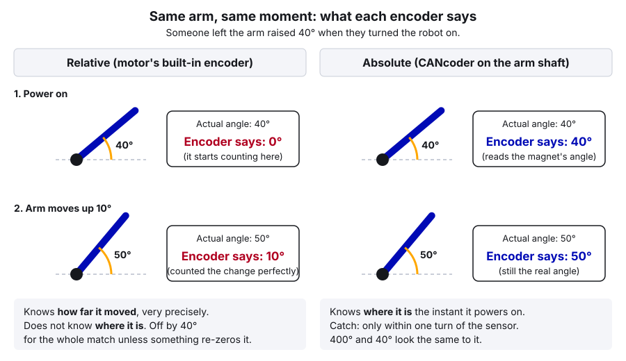
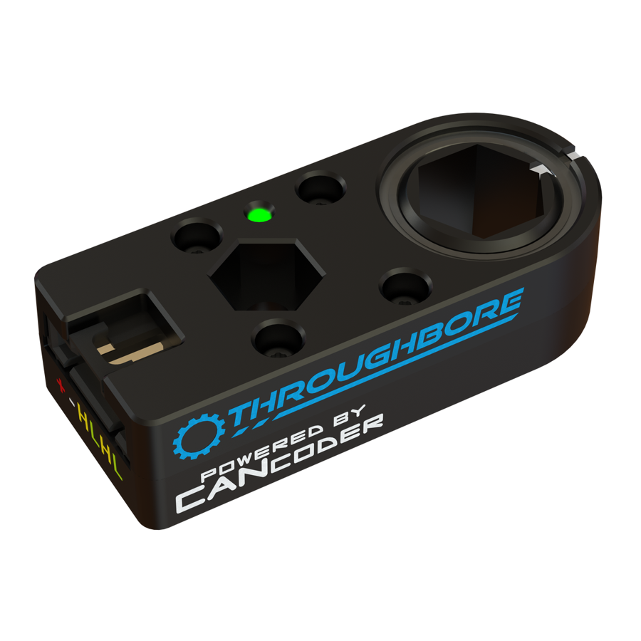
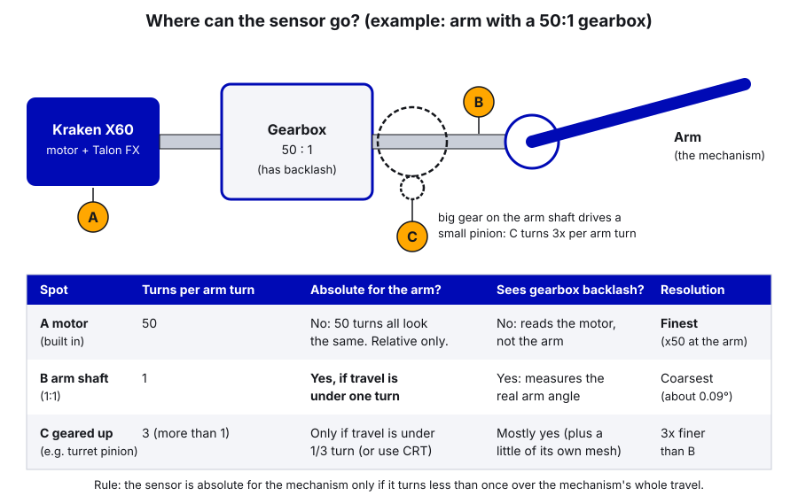

# 27. Relative vs Absolute Encoders

> **Who it's for:** anyone choosing a sensor for a mechanism, or trying to understand why a mechanism "forgets" where
> it is when the robot turns on. **Read first:** [05 Motors in Phoenix 6](05-motors-in-phoenix-6.md) and
> [09 Motion Magic and Position Control](09-motion-magic-and-position-control.md). Helpful:
> [13 Turrets](13-turrets.md), [21 Sensors and Homing](21-sensors-and-homing.md).
> **Next:** [28 Fusing Sensors to a Motor](28-fusing-sensors-to-a-motor.md) (how the Talon uses an external encoder)
> and [29 The Chinese Remainder Theorem for Turrets](29-chinese-remainder-theorem-turrets.md).
> **Time:** about 1 hour, plus 20 minutes at the robot.

## What you'll learn

- The difference between a **relative** encoder (counts how far it moved) and an **absolute** encoder (knows where it
  is), and why the Kraken's built-in encoder counts as relative for a mechanism
- How the encoders we use work at a high level: Kraken built-in, CTRE CANcoder, WCP ThroughBore Powered by
  CANcoder
- Single-turn vs multi-turn, resolution, backlash, magnet offset, and the discontinuity point
- Where to mount an encoder (motor shaft vs mechanism shaft) and the one rule that decides if it stays absolute
- Which sensor to use for a flywheel, swerve steering, an arm, a turret, a hood, and an elevator
- What our 2026 robot does (CANcoders on the swerve, power-on zero everywhere else) and the risks that brings

---

## 1. Two different questions

An **encoder** is a sensor that measures rotation. There are two very different questions it can answer:

1. **"How far have I turned since I started counting?"** That's a **relative** encoder (also called incremental). It is
   excellent at measuring *changes*. It has no idea where it started.
2. **"What angle am I at right now?"** That's an **absolute** encoder. It reads a real, physical angle the moment it
   powers on, with no counting history needed.



Why it matters: a position-controlled mechanism (arm, hood, turret, elevator, intake rack) needs to know **where it
is**, not just how far it moved. If the code thinks "0" is somewhere it isn't, every setpoint is off by that amount,
and worse, the soft limits are off too. That's how a mechanism drives itself into a hard stop or wraps its wires.

A robot can get "where am I" in two ways:
- An **absolute** encoder on the mechanism, or
- A **relative** encoder plus a known starting point (a power-on rule, a limit switch, or a hard-stop homing run;
  guide 21 covers all four zeroing strategies).

---

## 2. How each kind works (just enough to make good choices)

### Relative: counting

A relative encoder produces pulses as the shaft turns. Count the pulses and you know how far it went. The classic
version is **quadrature**: two signals (A and B) that are a quarter-step apart, so the order they change in tells
you the direction.

**The Kraken X60's built-in encoder.** The Talon FX inside a Kraken has to know the rotor's angle all the time,
because it needs that to switch the motor's coils at the right moment (that's called **commutation**). Phoenix 6
turns that into a position in **rotor rotations**, very precisely and with no CAN delay. Technically the Talon FX
boots to the rotor's absolute angle *within one motor rotation*, but that only tells you where the rotor is inside
one turn. After a gearbox, one motor turn is a tiny slice of the mechanism's travel, so for the mechanism it's
**relative**: it can't tell motor turn 3 from motor turn 30.

> **Tip:** that's why our code does `setPosition(0)` at power-on: it turns "somewhere within one rotor turn" into an
> exact, known 0. More on that in section 8.

### Absolute: reading a magnet

Most FRC absolute encoders are **magnetic**. A small **diametric** magnet (north on one side of its face, south on the
other) spins with the shaft. Under it, a Hall-effect chip measures which direction the magnetic field points. The
field direction *is* the shaft angle, so the chip knows the angle instantly at power-on, every time.

- **On-axis:** the magnet sits in the end of the shaft and the chip faces it (CANcoder with its magnet kit).
- **Through-bore:** the sensor wraps around a hex shaft and the magnet is in a ring that turns with the shaft, so you
  can put it in the middle of a shaft (WCP ThroughBore Powered by CANcoder).

Some industrial encoders are **optical** (a glass disc with a pattern of slots read by light). The idea is the same:
the pattern at each angle is unique. You'll rarely see them in FRC.

### Single-turn vs multi-turn

Almost every FRC absolute encoder is **single-turn**: it knows its angle within *one rotation of itself*. Turn it 400°
and it reads 40°, because 400° and 40° put the magnet in the same direction. A **multi-turn absolute** encoder would
also remember *how many* turns, across power-off. Those exist in industry but are rare in FRC.

Some single-turn sensors also keep a multi-turn count **while powered**: a CANcoder's `getPosition()` starts at the
absolute angle at boot and then keeps counting past 1.0. It doesn't remember the turn count after power-off.

---

## 3. The encoders we use

 

| Sensor | How it reads | Connects to | Absolute? | Steps per turn | Talon can use it directly? |
|---|---|---|---|---|---|
| **Kraken X60 built-in** (Talon FX) | Rotor angle used for commutation | Built in | Within one *motor* turn only, so relative for a mechanism | Fine; and multiplied by the gear ratio at the mechanism | Yes, it's the default (`RotorSensor`) |
| **CTRE CANcoder** | On-axis magnet + Hall chip | CAN (FD on a CANivore) | Yes, single-turn | 4096 (about 0.09°) | Yes (`RemoteCANcoder`, `FusedCANcoder`, `SyncCANcoder`) |
| **WCP ThroughBore Powered by CANcoder** | Off-axis magnet around a ½" hex bore | CAN, same software as a CANcoder | Yes, single-turn | Same as CANcoder | Yes, exactly like a CANcoder |

Notes on the table:
- The WCP ThroughBore shows up in Tuner X and in code as a CANcoder (`new CANcoder(id, canBus)`), so everything in
  guides 21 and 28 about CANcoders applies to it. Its hex bore and mounting holes are designed to drop onto a ½" hex
  shaft in a WCP-style gearbox, which makes it much easier to mount than a bare CANcoder.
- We don't use the REV Through Bore Encoder or the Redux Canandmag (other teams' code is full of them); for an absolute
  angle on a hex shaft we use the WCP ThroughBore, which is a CANcoder. Every CAN sensor we buy must support CAN FD
  (our electrical binder's rule), and the CTRE encoders do.

---

## 4. Words you need

**Resolution.** The smallest change the sensor can see. A CANcoder has 4096 steps per rotation, about 0.09°. Gearing
helps: a sensor that turns 10 times per mechanism turn gives 10 times finer resolution *at the mechanism*. That's why
the motor's built-in encoder, behind a 50:1 gearbox, is extremely fine at the mechanism.

**Backlash.** The little bit of slop between gear teeth (and chain links). When the motor reverses, it turns a tiny bit
before the mechanism moves. A sensor on the **motor** can't see backlash: the motor "thinks" the arm moved when it
didn't. A sensor on the **mechanism** measures the real position, slop included.

**Magnet offset.** The magnet is never glued in at exactly "0". The offset is a number (in rotations) added to the raw
reading so that the position you choose reads 0. On a CANcoder it's `MagnetSensor.MagnetOffset`; how to measure it is
in guide 21. Change the magnet or remount the sensor, and you must measure it again.

**Discontinuity point.** A single-turn sensor has to jump somewhere: 0.999 → 0.000, or +0.5 → −0.5. Where that jump
happens is the **discontinuity point** (`AbsoluteSensorDiscontinuityPoint`, default 0.5, which gives −0.5 to +0.5).
Put it in the part of the circle the mechanism **never** reaches. CTRE's rule of thumb: for a mechanism that moves
from `lower` to `upper` (in rotations, less than one full turn), use `(lower + upper) / 2 + 0.5`, then add or
subtract 1 to keep it between 0 and 1. Example: an arm that moves from −0.2 to +0.6 rotations gets
`(−0.2 + 0.6) / 2 + 0.5 = 0.7`, so it reads from −0.3 to +0.7 and the jump sits in the gap it never visits.

---

## 5. Where to mount it

This is the most important design decision, and it's made with the mechanical team, before anything is built.



**The rule:** an encoder is absolute for the mechanism only if it turns **less than one full rotation over the
mechanism's whole travel**.

```
sensor turns over the travel = (sensor turns per mechanism turn) x (mechanism travel in turns)
must be < 1.0, with some margin
```

Worked examples:

| Mechanism | Sensor location | Sensor turns per mechanism turn | Travel | Sensor turns over travel | Absolute? |
|---|---|---|---|---|---|
| Arm, 50:1 gearbox | Motor (built in) | 50 | 0.3 turn (108°) | 15 | No |
| Arm, 50:1 gearbox | CANcoder on the arm shaft | 1 | 0.3 turn | 0.3 | Yes |
| Arm, CANcoder on a pinion that turns 3x | Pinion | 3 | 0.3 turn | 0.9 | Yes, but barely. Little margin |
| Our turret | 16T pinion on the 200T ring | 12.5 | 0.6 turn (±108°) | 7.5 | No |
| Our turret | A sensor geared 1:1 with the ring | 1 | 0.6 turn | 0.6 | Yes |
| Swerve steering | CANcoder on the module's steering shaft | 1 | Spins forever | — | Yes for the wheel angle (it only needs "which way does it point", which repeats every turn anyway) |

The trade-off when you put the sensor closer to the mechanism:
- **Good:** you get the real position after backlash, and it can be absolute.
- **Cost:** less resolution, a sensor that has to be physically mounted on the mechanism, and a CAN wire that has
  to reach it.

That's why the best setups use **both**: the absolute sensor on the mechanism for "where am I", and the motor's
built-in encoder for smooth, fine, instant motion. The Talon can blend the two by itself (`FusedCANcoder`), which is
exactly what our swerve steering does. Guide 28 is all about that.

**What if the mechanism turns more than once, or there's no shaft to put a sensor on?** A turret ring is hollow (wires
and game pieces go through the middle), so you can't put a magnet on its center. A sensor on a small pinion turns many
times. The trick for that case is two absolute encoders on pinions with different tooth counts, which is guide 29.

---

## 6. What happens at power-on

| Sensor | At power-on it reads | So you need... |
|---|---|---|
| Kraken built-in | Somewhere within one motor rotation (or exactly what you `setPosition` it to) | A zeroing strategy (guide 21) |
| CANcoder / WCP ThroughBore | The real angle within one sensor turn, with your magnet offset applied. `getPosition()` starts there too | Nothing, if it turns less than once over the travel |

The CANcoder needs a moment after boot before its readings are valid. Phoenix's status signals tell you when a value
is good (`getStatus().isOK()`), and `BaseStatusSignal.waitForAll(timeoutSeconds, signals...)` waits for fresh data.
Use that if you read a CANcoder in a constructor.

---

## 7. When to use which

| Mechanism | Use | Why |
|---|---|---|
| **Flywheel / shooter** | Built-in encoder only | You only care about **speed**. Speed doesn't need a starting point. |
| **Rollers, belts, feeders** | Built-in encoder only | Same: speed, or "run until a sensor sees a piece". |
| **Swerve steering** | **CANcoder** on the module, fused with the steer motor | The wheel angle must be right the instant you enable, and the wheel spins forever, so homing isn't an option. |
| **Arm / pivot** | **Absolute** encoder on the arm shaft (1:1), fused | Gravity feedforward (`Arm_Cosine`) needs the true angle from the start. An arm can't safely home by driving into a stop. |
| **Turret** | **Absolute** encoder geared 1:1 with the ring if you can, or two encoders + CRT (guide 29), or a homing switch | It can't drive into a hard stop to home (wires), and booting off-center shifts the travel limits. |
| **Hood** | Absolute on the hood pivot if there's room; otherwise power-on zero at a hard stop it rests on | Short travel, often rests on a stop by gravity, so a power-on zero can work if the rule is followed. |
| **Elevator** | Built-in encoder + homing (bottom limit switch with auto-set, or hard-stop homing) | It travels many motor turns; gravity pulls it to the bottom when off, so "bottom = 0" is usually true at boot. |
| **Intake rack (ours)** | Built-in + power-on zero, plus hard-stop homing off the field | It starts inside the frame in a match, against the 0" stop. |

---

## 8. In our code

### Swerve: CANcoders 50–53, fused with the steer motors

The steer side of each module uses an absolute CANcoder, fused into the steer Talon:
[TunerConstants.java, line 50 (steer feedback type)](https://github.com/TorqueNados-FRC5090/Hephaestus/blob/c2f0cee6f61db3f26f911d3f5623ed7fa27a5b03/src/main/java/frc/robot/generated/TunerConstants.java#L50)
and [lines 148–154 (front-left module)](https://github.com/TorqueNados-FRC5090/Hephaestus/blob/c2f0cee6f61db3f26f911d3f5623ed7fa27a5b03/src/main/java/frc/robot/generated/TunerConstants.java#L148-L154):

```java
private static final SteerFeedbackType kSteerFeedbackType = SteerFeedbackType.FusedCANcoder;
// ...
// Front Left
private static final int kFrontLeftDriveMotorId = 40;
private static final int kFrontLeftSteerMotorId = 30;
private static final int kFrontLeftEncoderId = 50;
private static final Angle kFrontLeftEncoderOffset = Rotations.of(-0.155029296875);
private static final boolean kFrontLeftSteerMotorInverted = false;
private static final boolean kFrontLeftEncoderInverted = false;
```

What to notice:
- The CANcoder is on the module's steering shaft, 1:1 with the wheel's direction, so it's absolute for "which way
  does the wheel point". The steer motor is 26.09:1 behind it
  ([line 101](https://github.com/TorqueNados-FRC5090/Hephaestus/blob/c2f0cee6f61db3f26f911d3f5623ed7fa27a5b03/src/main/java/frc/robot/generated/TunerConstants.java#L101)).
- `kFrontLeftEncoderOffset` is the **magnet offset** in rotations. The generator measured it with the wheels pointed
  straight. The other three modules are the same pattern (IDs 51, 52, 53).
- This is the "both sensors" setup from section 5: CANcoder for where, motor for smooth. Guide 28 shows what the
  generated code turns this into.

### Turret, hood, intake: relative only, zeroed at power-on

Everything on the "Upper" CANivore uses only the motor's built-in encoder:

**Turret** ([Turret.java, lines 103–106](https://github.com/TorqueNados-FRC5090/Hephaestus/blob/c2f0cee6f61db3f26f911d3f5623ed7fa27a5b03/src/main/java/frc/robot/subsystems/Turret.java#L103-L106)
and [lines 158–160](https://github.com/TorqueNados-FRC5090/Hephaestus/blob/c2f0cee6f61db3f26f911d3f5623ed7fa27a5b03/src/main/java/frc/robot/subsystems/Turret.java#L158-L160)):

```java
private final double kTurretRingTeeth = 200.0;
private final double kEncoderGearTeeth = 16.0;
private final double kTurretGearRatio = kTurretRingTeeth / kEncoderGearTeeth;
private final double kMaxTurretRotations = 0.30; //0.48
// ...
m_turretMotor.getConfigurator().apply(config);
m_turretMotor.setPosition(0);
```

Notice the name `kEncoderGearTeeth`: it's really the **motor's pinion** (16T), and the "encoder" is the motor's
built-in one. A clearer name would be `kMotorPinionTeeth`. The motor turns 12.5 times per turret turn, so over the
±0.30-turn travel it turns 7.5 times: relative, not absolute. Whatever angle the turret is at when the robot turns
on becomes "straight back".

The other two:

- **Hood** ([Hood.java, lines 21–24](https://github.com/TorqueNados-FRC5090/Hephaestus/blob/c2f0cee6f61db3f26f911d3f5623ed7fa27a5b03/src/main/java/frc/robot/subsystems/Hood.java#L21-L24)):
  the comment says "The hood encoder zeroes wherever the hood is at power-on, so always boot with it at rest."
- **Intake rack** ([EvilIntake.java, lines 176–178](https://github.com/TorqueNados-FRC5090/Hephaestus/blob/c2f0cee6f61db3f26f911d3f5623ed7fa27a5b03/src/main/java/frc/robot/subsystems/EvilIntake.java#L176-L178)):
  `setPosition(0)` assuming fully in, then a hard-stop homing run on the first enable off the field (guide 21).

**The risks this brings:**

| Mechanism | If someone powers on with it in the wrong place... | How bad |
|---|---|---|
| Turret | Every aim is off by that angle, *and* the ±108° travel limit is shifted. Booted 40° to one side, it will drive 148° the other way and can pull the wires (guide 13, section 2). | High: can damage wiring |
| Hood | Every shot angle is off, and the soft limits (which are in motor rotations) protect the wrong range | Medium |
| Intake | Corrected by homing in the shop; trusted as-is on the field (where it really does start inside the frame) | Low |

A detail worth checking on the hood: unlike the turret and intake, the hood constructor never calls `setPosition(0)`
([Hood.java, lines 45–68](https://github.com/TorqueNados-FRC5090/Hephaestus/blob/c2f0cee6f61db3f26f911d3f5623ed7fa27a5b03/src/main/java/frc/robot/subsystems/Hood.java#L45-L68)).
CTRE documents that a Talon FX boots to the rotor's absolute angle *within one rotor turn*, so the hood may start a
fraction of a motor rotation away from 0 rather than exactly 0. The hood's whole travel is under 3 motor rotations, so
that matters. Check it at the robot (Practice 1) and, if it isn't 0, add `hood.setPosition(0)` after the config is
applied, like the turret does.

**What we could do better next time:** give the turret an absolute sensor. Because our turret only travels 0.6 turn,
any absolute encoder that turns *once or less* per turret turn would work, if mechanical can fit one (for example a
gear or belt driven 1:1 or slower from the ring). If only small pinions fit, use two encoders and the CRT method in
guide 29. Until then: the pre-match checklist must include "turret pointing straight back, hood resting down,
intake fully in" before power-on.

---

## 9. Step by step: adding an absolute encoder to a mechanism

1. **Agree on the location with mechanical.** Use the rule from section 5: sensor turns over the full travel must be
   under 1, with margin (aim for under 0.8 so a little coast past the soft limits can't wrap it).
2. **Pick the sensor.** On a ½" hex shaft in a WCP-style gearbox, a WCP ThroughBore Powered by CANcoder is the easiest
   CTRE option. On the end of a shaft, a CANcoder and magnet. Keep it on the **same CAN bus** as the motor that will use
   it (guide 28 explains why).
3. **Give it a CAN ID** in Tuner X from the mechanism range (10–29), and add it to `Constants` with a clear name, e.g.
   `kHoodEncoderId`. The 50s are the swerve CANcoders.
4. **Check the magnet.** In Tuner X, the CANcoder's magnet health should be green. Orange works with reduced
   accuracy; red means the magnet is too far, too close, or off-center.
5. **Set the direction** (`SensorDirection`) so it counts up when the mechanism moves in its positive direction.
   Check by hand with the dashboard.
6. **Measure the offset** with the mechanism at your chosen 0 (guide 21 has the steps), and set the discontinuity
   point in the gap the mechanism never reaches (section 4).
7. **Move it through the whole travel by hand** (robot disabled). The reading must change smoothly and never jump.
8. **Power-cycle at three different positions** and check the reading matches reality each time. This is the test
   that proves it's absolute.
9. **Use it:** either fuse it into the Talon (guide 28), or read it once at boot and **seed** the motor's built-in
   encoder (below).

### Seeding: the simple way to use an absolute encoder

You don't have to fuse. You can read the absolute encoder once at boot, while the mechanism is still, and tell the
motor's relative encoder where it is with `setPosition`. From then on, the motor's encoder does the work. This works
without Phoenix Pro, and it's the same pattern guide 29 uses for a CRT turret.

New example code: a pivot with a 60:1 gearbox and a CANcoder on the pivot shaft.

```java
public class Pivot extends SubsystemBase {
    /** Motor rotations per pivot rotation (gearbox between the motor and the pivot shaft) */
    private static final double kMotorRotationsPerPivotRotation = 60.0;
    /** How long to wait for the CANcoder's first good reading at boot */
    private static final double kEncoderBootTimeoutSeconds = 0.5;

    private final TalonFX m_pivotMotor;
    private final CANcoder m_pivotEncoder;
    private boolean m_seededFromEncoder = false;

    public Pivot(int motorId, int encoderId, CANBus canBus) {
        m_pivotMotor = new TalonFX(motorId, canBus);
        m_pivotEncoder = new CANcoder(encoderId, canBus);

        CANcoderConfiguration encoderConfig = new CANcoderConfiguration();
        encoderConfig.MagnetSensor.SensorDirection = SensorDirectionValue.CounterClockwise_Positive;
        encoderConfig.MagnetSensor.MagnetOffset = -0.3125;                  // rotations, measured at "level"
        encoderConfig.MagnetSensor.AbsoluteSensorDiscontinuityPoint = 0.7;  // pivot moves -0.2 .. +0.6
        m_pivotEncoder.getConfigurator().apply(encoderConfig);

        TalonFXConfiguration motorConfig = new TalonFXConfiguration();
        motorConfig.MotorOutput.NeutralMode = NeutralModeValue.Brake;
        motorConfig.CurrentLimits.StatorCurrentLimit = 40;
        motorConfig.CurrentLimits.StatorCurrentLimitEnable = true;
        motorConfig.CurrentLimits.SupplyCurrentLimit = 30;
        motorConfig.CurrentLimits.SupplyCurrentLimitEnable = true;
        motorConfig.Feedback.SensorToMechanismRatio = kMotorRotationsPerPivotRotation;  // getPosition() = pivot rotations
        m_pivotMotor.getConfigurator().apply(motorConfig);

        seedFromAbsoluteEncoder();
    }

    /** Reads the CANcoder once and tells the motor's built-in encoder where the pivot really is. */
    private void seedFromAbsoluteEncoder() {
        StatusSignal<Angle> absolute = m_pivotEncoder.getAbsolutePosition();
        BaseStatusSignal.waitForAll(kEncoderBootTimeoutSeconds, absolute);
        if (absolute.getStatus().isOK()) {
            // With SensorToMechanismRatio set, setPosition takes PIVOT rotations
            m_pivotMotor.setPosition(absolute.getValueAsDouble());
            m_seededFromEncoder = true;
        } else {
            // Don't guess silently: say so, and fall back to "it booted level"
            m_pivotMotor.setPosition(0.0);
            RobotLog.event("Pivot: CANcoder not ready at boot (" + absolute.getStatus() + "), assumed level");
        }
        SmartDashboard.putBoolean("Pivot/Seeded from encoder", m_seededFromEncoder);
    }
}
```

Imports: `com.ctre.phoenix6.BaseStatusSignal`, `com.ctre.phoenix6.CANBus`, `com.ctre.phoenix6.StatusSignal`,
`...configs.CANcoderConfiguration`, `...configs.TalonFXConfiguration`, `...hardware.CANcoder`, `...hardware.TalonFX`,
`...signals.NeutralModeValue`, `...signals.SensorDirectionValue`, `edu.wpi.first.units.measure.Angle`,
`edu.wpi.first.wpilibj.smartdashboard.SmartDashboard`, `edu.wpi.first.wpilibj2.command.SubsystemBase`,
`frc.robot.RobotLog`.

**Seeding vs fusing:** seeding is simple and works without Pro, but after boot it never looks at the CANcoder again,
so if a gear skips a tooth mid-match the motor's count is wrong until the next boot. Fusing (guide 28) keeps checking
against the CANcoder the whole match. On a Pro-licensed robot like ours, fusing is usually the better choice for an
arm or hood; seeding is the right choice when the absolute answer is only trustworthy while still (the CRT turret in
guide 29).

---

## Common mistakes

- **Booting with the mechanism in the wrong place.** Our turret and hood zero wherever they are at power-on. The
  turret booted off-center aims wrong all match and has its travel limit shifted toward the wires.
- **Reading `getPosition()` and expecting it to stay inside one turn.** On a CANcoder, `getAbsolutePosition()` is the
  single-turn angle; `getPosition()` starts there and keeps counting past 1.0 while powered.
- **Putting the absolute sensor on a shaft that turns more than once over the travel.** It reads correctly at the
  bench, then the mechanism goes past one sensor turn and the code jumps to a completely different angle.
- **Discontinuity point inside the travel.** The arm reads +0.49 then −0.49 and the PID drives the long way around.
- **Forgetting to re-measure the offset** after a magnet falls out, a sensor is swapped, or a module is rebuilt. For
  swerve, redo it with the generator (guide 16), don't guess.
- **Trusting a CANcoder before it has reported.** Reading it in a constructor right at boot can give a default 0. Wait
  for a good status (section 9 example).
- **Assuming the built-in encoder sees backlash.** It doesn't. If the arm wobbles a degree at the target but the motor
  says it's perfect, the slop is between the motor and the arm. A mechanism-side sensor (fused) catches it.
- **Wrong CAN ID.** Same lesson as the Pigeon (24 in code, 0 on the robot). Check every ID in Tuner X.

## Checklist

- [ ] For every position mechanism, written down: which sensor, where it's mounted, and how it knows where it is at boot
- [ ] Sensor turns over the full travel calculated and under 1 (aim for under 0.8)
- [ ] Magnet health green in Tuner X
- [ ] Direction checked by hand: counts up when the mechanism moves positive
- [ ] Offset measured at the real zero; discontinuity point in the unused gap
- [ ] Moved through the whole travel by hand: no jump in the reading
- [ ] Power-cycled at three positions: the reading matches reality every time
- [ ] Mechanisms with power-on zero (turret, hood, intake) are on the pre-match checklist

## Practice

1. **Is the hood really 0 at boot?** (Robot, safe on blocks.) Rest the hood fully down, power on, and read `Hood
   Angle` on the dashboard before enabling. Is it exactly 0.0? Power-cycle five times and write down the readings.
   If they aren't all 0, you've confirmed the boot behavior from section 8. Propose the one-line fix.
2. **Wrong boot on purpose.** (Robot, on blocks, hand near the disable key.) With the turret turned about 20° to one
   side, power on. Use the shop test pose (View button) and enable. Watch where the turret aims compared with straight
   back. Explain what you saw using the table in section 8. Then power off, center it, and power on again.
3. **Absolute or not?** For each, compute sensor turns over the travel and say if it stays absolute:
   (a) a CANcoder on a 20T sprocket driving a 60T sprocket on an arm that swings 200°;
   (b) a WCP ThroughBore on the output of a 25:1 gearbox driving an elevator spool, elevator travel = 4.5 spool turns;
   (c) a CANcoder on a hood pivot (1:1), hood travel 40°.
4. **Seed in simulation.** In a template sim project, add the `Pivot` example and make `seedFromAbsoluteEncoder()`
   public. Call `m_pivotEncoder.getSimState().setRawPosition(0.25)`, wait a loop, call the seed again, and check the
   motor's `getPosition()`. It should read 0.25 + (−0.3125) = −0.0625 pivot rotations. Why minus?

## Go further

- CTRE CANcoder hardware reference: https://v6.docs.ctr-electronics.com/en/stable/docs/hardware-reference/cancoder/index.html
- CTRE remote sensors (RemoteCANcoder, FusedCANcoder, SyncCANcoder): https://v6.docs.ctr-electronics.com/en/stable/docs/api-reference/device-specific/talonfx/remote-sensors.html
- CTRE CANcoder API (getPosition vs getAbsolutePosition): https://api.ctr-electronics.com/phoenix6/stable/java/com/ctre/phoenix6/hardware/core/CoreCANcoder.html
- WCP ThroughBore Powered by CANcoder: https://docs.wcproducts.com/welcome/electronics/wcp-throughbore-by-cancoder-1-2-hex
- WPILib encoders overview: https://docs.wpilib.org/en/stable/docs/software/hardware-apis/sensors/encoders-software.html
- Related team guides: [09 Motion Magic](09-motion-magic-and-position-control.md), [13 Turrets](13-turrets.md),
  [14 Arms](14-arms-single-and-double-jointed.md), [16 Swerve](16-swerve-drive-ctre.md),
  [21 Sensors and Homing](21-sensors-and-homing.md), [28 Fusing Sensors](28-fusing-sensors-to-a-motor.md),
  [29 CRT for Turrets](29-chinese-remainder-theorem-turrets.md).
