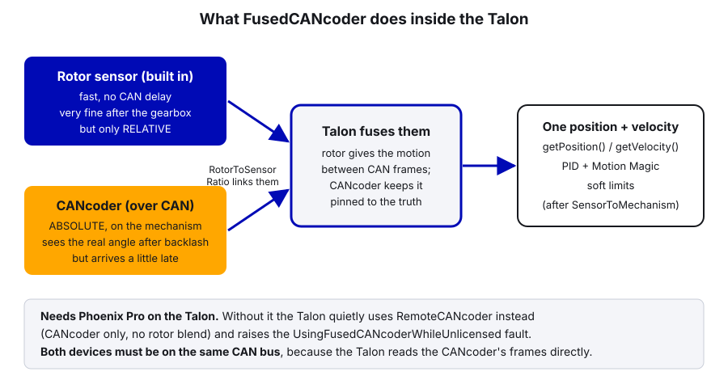
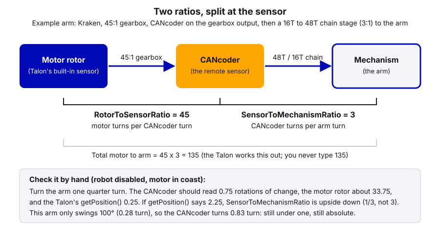

# 28. Fusing Encoders and Sensors to a Motor

> **Who it's for:** programmers who want a Talon to close its loop on something other than its own rotor: a CANcoder,
> a through-bore encoder, a gyro, or a remote limit switch. **Read first:**
> [27 Relative vs Absolute Encoders](27-relative-vs-absolute-encoders.md) and
> [09 Motion Magic and Position Control](09-motion-magic-and-position-control.md). Helpful:
> [21 Sensors and Homing](21-sensors-and-homing.md) (CANcoder offsets, hardware limit basics),
> [16 Swerve Drive](16-swerve-drive-ctre.md). **Time:** about 1.5 hours, plus time at the robot to verify.

## What you'll learn

- Every Phoenix 6 `FeedbackSensorSource` option (checked against the 26.3.0 library) and what each one does
- What **fusing** means, and the difference between `RemoteCANcoder`, `FusedCANcoder` and `SyncCANcoder`
- `RotorToSensorRatio` vs `SensorToMechanismRatio`, with a worked example you can check by hand
- How our swerve steering already does all of this, and what the generated code turns into
- Using a CTRE **CANdi** to bring a limit switch or a beam break onto CAN for a Talon, and remote limit
  switches from a CANrange, CANcoder or CANdi
- A checklist for "which sensor is the closed loop actually using?", and the mistakes that cause runaways

---

## 1. The idea

A Talon runs its PID, feedforward and Motion Magic **inside the motor controller**, about 1000 times a second. It
needs a position and velocity to do that. That number is called the **feedback sensor**. By default it's the motor's
own rotor sensor. But you can tell the Talon to use a different sensor instead, or to blend two.

**Remote sensor** means a sensor on the CAN bus that the Talon reads by itself, straight off the wires. The roboRIO is
not involved, so there's no 20 ms robot-loop delay. That's why it must be on the **same CAN bus** as the Talon: the
Talon can only hear frames on its own bus.

Why bother:
- **Absolute position** at power-on (guide 27): the mechanism knows where it is without homing.
- **The real position** after gear backlash and chain stretch, not what the motor thinks.
- **Hardware limits** that stop the motor in microseconds when a switch, beam break or distance sensor trips.

Everything the Talon reports and uses changes with this setting: `getPosition()`, `getVelocity()`, closed-loop
targets, soft limits, and the auto-set position on a limit switch.

---

## 2. The options (Talon FX, Phoenix 6 v26)

`config.Feedback.FeedbackSensorSource = FeedbackSensorSourceValue.<one of these>`. This is the complete list in the
26.3.0 library we use:

| Option | What the Talon uses | Pro needed? |
|---|---|---|
| `RotorSensor` | Its own rotor sensor (the default) | No |
| `RemoteCANcoder` | A CANcoder's position and velocity, updated each time the CANcoder sends a frame. Rotor not used. | No |
| `FusedCANcoder` | The CANcoder **blended** with the rotor (section 3) | **Yes** |
| `SyncCANcoder` | The rotor, **synced** to the CANcoder, with a warning if they disagree (section 3) | **Yes** |
| `RemotePigeon2Yaw`, `RemotePigeon2Pitch`, `RemotePigeon2Roll` | One axis of a Pigeon 2, in **rotations** (not degrees) | No |
| `RemoteCANdiPWM1`, `RemoteCANdiPWM2` | A PWM (pulse-width) absolute encoder wired to a CANdi's input 1 or 2 | No |
| `RemoteCANdiQuadrature` | A quadrature encoder wired to both CANdi inputs | No |
| `FusedCANdiPWM1`, `FusedCANdiPWM2`, `FusedCANdiQuadrature` | That CANdi sensor blended with the rotor | **Yes** |
| `SyncCANdiPWM1`, `SyncCANdiPWM2` | The rotor synced to that CANdi PWM sensor | **Yes** |

Every option except `RotorSensor` also needs `config.Feedback.FeedbackRemoteSensorID` = the CAN ID of the CANcoder,
Pigeon or CANdi. There is no `SyncCANdiQuadrature`, which makes sense: syncing is about an absolute reference, and
quadrature is relative.

**Talon FXS is different.** Our turret is a Minion on a Talon FXS. The FXS has a **data port** that sensors can plug
straight into, so its setting lives in `config.ExternalFeedback.ExternalFeedbackSensorSource` and adds three options:
`Commutation` (the default: the motor's own hall sensor), `Quadrature` and `PulseWidth` (an encoder plugged into the
data port), on top of the same Remote/Fused/Sync CANcoder, Pigeon and CANdi options. We use the CAN options (a CANcoder
or WCP ThroughBore), so the turret's FXS doesn't use its data port.

> **Tip:** Pro features are licensed **per year**. A 2026 license enables Pro with 26.x firmware and the 26.x API.
> When we move to 2027 firmware (and SystemCore), check the licenses in Tuner X again. An unlicensed Talon does not
> refuse to run: it silently falls back (section 3).

---

## 3. Remote vs Fused vs Sync



| | `RemoteCANcoder` | `FusedCANcoder` | `SyncCANcoder` |
|---|---|---|---|
| Position comes from | CANcoder only | CANcoder + rotor, blended | Rotor, synced to the CANcoder |
| Smoothness between CAN frames | Steps each frame (100 Hz by default) | Smooth (rotor fills the gaps) | Smooth |
| Sees backlash / chain stretch | Yes | Yes (CTRE calls this backlash compensation) | **No**, after the sync it trusts the rotor |
| If the CANcoder drops off the bus | Its only position source is gone; raises a remote-sensor fault | Raises a remote-sensor fault. CTRE doesn't document exactly what it falls back to, so treat it as broken | Keeps controlling on the rotor (it always does) and reports the CANcoder is missing |
| If the sensor **mount breaks** but the CANcoder still reports "good" data | Follows the broken reading | Follows the broken reading | Keeps working, warns that they disagree |
| License | Free | Pro | Pro |
| Without Pro | — | Falls back to `RemoteCANcoder`, raises `UsingFusedCANcoderWhileUnlicensed` | Same fallback and fault |

**When to use which:**
- **`FusedCANcoder`**: the default choice on a Pro robot for swerve steering, arms, hoods, turrets with a 1:1 sensor.
  It's what CTRE designed it for ("swerve azimuth") and what our swerve uses.
- **`SyncCANcoder`**: when the sensor mount is the weak point (a CANcoder on a flimsy bracket that could get knocked
  loose). You lose backlash compensation but a broken mount can't drive the mechanism somewhere crazy.
- **`RemoteCANcoder`**: no Pro license, or you want the simplest possible setup. Works fine; slightly less smooth.

One more CTRE note: after switching to a Fused or Sync source, the Talon needs a short moment (set by how often the
remote sensor sends its position) to fuse before closed loop and soft limits are trusted. Apply configs at boot, not
in the middle of a match.

---

## 4. The two ratios

With a remote sensor there are three things turning: the motor rotor, the sensor, and the mechanism. So there are two
ratios, split at the sensor:



- **`RotorToSensorRatio`** = motor rotor turns per one sensor turn. Only the Fused and Sync modes use it (they need to
  know how to line the rotor up with the sensor). Set it correctly anyway.
- **`SensorToMechanismRatio`** = sensor turns per one mechanism turn. 1.0 when the sensor is on the mechanism's shaft.
- Both follow CTRE's rule: **a reduction is a number bigger than 1**. If you get one upside down (1/3 instead of 3),
  the mechanism moves 9 times too far or too little.

With plain `RotorSensor` there's no separate sensor, so only `SensorToMechanismRatio` matters and it equals the whole
gear ratio (motor turns per mechanism turn), as in guide 09.

**What `getPosition()` means afterwards:** mechanism rotations. A target of 0.25 means a quarter turn of the arm. Your
gains are now in volts per *mechanism* rotation, so if you add or change a ratio, retune kP, kV, kS (guide 08).

**Worked example (the diagram):** an arm driven by a Kraken through a 45:1 gearbox; a CANcoder on the gearbox output;
then a 16T sprocket chained to a 48T sprocket on the arm.

```
RotorToSensorRatio     = 45          (gearbox: motor turns per CANcoder turn)
SensorToMechanismRatio = 48 / 16 = 3 (chain: CANcoder turns per arm turn)
Arm travel = 100 deg = 0.278 turn  ->  CANcoder turns 0.278 * 3 = 0.83 turn  (< 1, so still absolute: guide 27)
```

CTRE recommends against using `SensorToMechanismRatio` to convert to linear units like inches (do that conversion in
your code). Rotations of the mechanism shaft is the clean choice.

---

## 5. In our code: swerve steering is already fused

The swerve generator wrote this for us:
[TunerConstants.java, lines 48–50](https://github.com/TorqueNados-FRC5090/Hephaestus/blob/c2f0cee6f61db3f26f911d3f5623ed7fa27a5b03/src/main/java/frc/robot/generated/TunerConstants.java#L48-L50)
and [lines 84–86](https://github.com/TorqueNados-FRC5090/Hephaestus/blob/c2f0cee6f61db3f26f911d3f5623ed7fa27a5b03/src/main/java/frc/robot/generated/TunerConstants.java#L84-L86):

```java
// The remote sensor feedback type to use for the steer motors;
// When not Pro-licensed, Fused*/Sync* automatically fall back to Remote*
private static final SteerFeedbackType kSteerFeedbackType = SteerFeedbackType.FusedCANcoder;
// ...
// CAN bus that the devices are located on;
// All swerve devices must share the same CAN bus
public static final CANBus kCANBus = new CANBus("Jarvis", "./logs/example.hoot");
```

The steer ratio is `kSteerGearRatio = 26.09090909090909`
([line 101](https://github.com/TorqueNados-FRC5090/Hephaestus/blob/c2f0cee6f61db3f26f911d3f5623ed7fa27a5b03/src/main/java/frc/robot/generated/TunerConstants.java#L101)),
and each module has a CANcoder ID (50–53), offset and inversion
([lines 148–154 for front-left](https://github.com/TorqueNados-FRC5090/Hephaestus/blob/c2f0cee6f61db3f26f911d3f5623ed7fa27a5b03/src/main/java/frc/robot/generated/TunerConstants.java#L148-L154)).

You never see a `FeedbackSensorSource` line in our code, because CTRE's `SwerveModule` class builds the steer config
from these constants. Reading the Phoenix 6 v26 library, it does the equivalent of this for each module (written out
by hand here so you can see it, not something to add to the robot):

```java
// What the swerve library configures for the front-left steer motor (ID 30) and its CANcoder (ID 50)
CANcoderConfiguration steerEncoderConfig = new CANcoderConfiguration();
steerEncoderConfig.MagnetSensor.MagnetOffset = -0.155029296875;          // kFrontLeftEncoderOffset
steerEncoderConfig.MagnetSensor.SensorDirection =
    SensorDirectionValue.CounterClockwise_Positive;                      // kFrontLeftEncoderInverted = false

TalonFXConfiguration steerMotorConfig = new TalonFXConfiguration();     // starts from steerInitialConfigs
steerMotorConfig.Feedback.FeedbackSensorSource = FeedbackSensorSourceValue.FusedCANcoder;
steerMotorConfig.Feedback.FeedbackRemoteSensorID = 50;                  // kFrontLeftEncoderId
steerMotorConfig.Feedback.RotorToSensorRatio = 26.09090909090909;       // kSteerGearRatio
steerMotorConfig.Feedback.SensorToMechanismRatio = 1.0;                 // CANcoder turns 1:1 with the wheel's direction
```

What to notice:
- `SteerFeedbackType` (in `SwerveModuleConstants`) has its own list in v26: `FusedCANcoder`, `SyncCANcoder`,
  `RemoteCANcoder`, `FusedCANdiPWM1/2`, `SyncCANdiPWM1/2`, `RemoteCANdiPWM1/2`, and `TalonFXS_PulseWidth`. Same ideas
  as section 2, for swerve modules.
- The comment "When not Pro-licensed, Fused\*/Sync\* automatically fall back to Remote\*" is the silent fallback from
  section 3. The swerve would still drive, just a bit less smoothly, and nobody would notice unless they checked the
  fault.
- "All swerve devices must share the same CAN bus": the steer Talon reads the CANcoder directly, so they must both be
  on Jarvis.
- **Our mechanisms (turret, hood, intake) don't use any remote sensor.** They're all `RotorSensor` with a power-on zero
  (guide 27, section 8). This guide is how you'd change that.

---

## 6. Example: an arm with a fused CANcoder

New example code, using the numbers from section 4. Arm on a Kraken, 45:1 gearbox, CANcoder on the gearbox output,
3:1 chain to the arm. Zero = arm level.

```java
public class Arm extends SubsystemBase {
    // ================= HARDWARE =================
    /** Motor turns per CANcoder turn (the gearbox) */
    private static final double kMotorRotationsPerEncoderRotation = 45.0;
    /** CANcoder turns per arm turn (16T sprocket on the gearbox, 48T on the arm) */
    private static final double kEncoderRotationsPerArmRotation = 48.0 / 16.0;
    /** Measured with the arm level (guide 21: read the raw value, use its negative) */
    private static final double kEncoderMagnetOffsetRotations = -0.2185;
    /** Arm travels -0.05 .. +0.23 arm turns = -0.15 .. +0.69 CANcoder turns. Gap center: 0.27 + 0.5 = 0.77 */
    private static final double kEncoderDiscontinuityPoint = 0.77;

    // ================= LIMITS (arm rotations) =================
    private static final double kArmMinRotations = -0.05;
    private static final double kArmMaxRotations = 0.23;

    private final TalonFX m_armMotor;
    private final CANcoder m_armEncoder;
    private final MotionMagicVoltage m_positionRequest = new MotionMagicVoltage(0).withEnableFOC(true);

    public Arm(int motorId, int encoderId, CANBus canBus) {
        // Same CANBus object for both: remote sensors must be on the Talon's bus
        m_armMotor = new TalonFX(motorId, canBus);
        m_armEncoder = new CANcoder(encoderId, canBus);

        // --- CANcoder: absolute angle, counting UP when the arm moves up ---
        CANcoderConfiguration encoderConfig = new CANcoderConfiguration();
        encoderConfig.MagnetSensor.SensorDirection = SensorDirectionValue.CounterClockwise_Positive;
        encoderConfig.MagnetSensor.MagnetOffset = kEncoderMagnetOffsetRotations;
        encoderConfig.MagnetSensor.AbsoluteSensorDiscontinuityPoint = kEncoderDiscontinuityPoint;
        m_armEncoder.getConfigurator().apply(encoderConfig);

        // --- Talon: fused feedback, everything in ARM rotations ---
        TalonFXConfiguration motorConfig = new TalonFXConfiguration();
        motorConfig.MotorOutput.NeutralMode = NeutralModeValue.Brake;
        motorConfig.MotorOutput.Inverted = InvertedValue.CounterClockwise_Positive;   // positive = arm up (check!)
        motorConfig.CurrentLimits.StatorCurrentLimit = 50;
        motorConfig.CurrentLimits.StatorCurrentLimitEnable = true;
        motorConfig.CurrentLimits.SupplyCurrentLimit = 35;
        motorConfig.CurrentLimits.SupplyCurrentLimitEnable = true;

        motorConfig.Feedback.FeedbackSensorSource = FeedbackSensorSourceValue.FusedCANcoder;
        motorConfig.Feedback.FeedbackRemoteSensorID = encoderId;
        motorConfig.Feedback.RotorToSensorRatio = kMotorRotationsPerEncoderRotation;
        motorConfig.Feedback.SensorToMechanismRatio = kEncoderRotationsPerArmRotation;

        // Soft limits are in arm rotations too, and they're right from the first loop because the CANcoder is absolute
        motorConfig.SoftwareLimitSwitch.ForwardSoftLimitThreshold = kArmMaxRotations;
        motorConfig.SoftwareLimitSwitch.ForwardSoftLimitEnable = true;
        motorConfig.SoftwareLimitSwitch.ReverseSoftLimitThreshold = kArmMinRotations;
        motorConfig.SoftwareLimitSwitch.ReverseSoftLimitEnable = true;

        // Gains are per ARM rotation. Starting points only: tune them (guide 08)
        motorConfig.Slot0.GravityType = GravityTypeValue.Arm_Cosine;   // needs 0 = level (guide 14)
        motorConfig.Slot0.kG = 0.35;
        motorConfig.Slot0.kS = 0.15;
        motorConfig.Slot0.kV = 15.0;
        motorConfig.Slot0.kP = 40.0;
        motorConfig.MotionMagic.MotionMagicCruiseVelocity = 0.5;   // arm rotations per second
        motorConfig.MotionMagic.MotionMagicAcceleration = 1.5;     // arm rotations per second^2
        m_armMotor.getConfigurator().apply(motorConfig);
    }

    /** Moves the arm to an angle in arm rotations (0 = level), clamped to the safe range. */
    public Command goToRotations(double targetArmRotations) {
        double safeTarget = MathUtil.clamp(targetArmRotations, kArmMinRotations, kArmMaxRotations);
        return run(() -> m_armMotor.setControl(m_positionRequest.withPosition(safeTarget)))
            .withName("Arm to " + safeTarget);
    }

    @Override
    public void periodic() {
        SmartDashboard.putNumber("Arm/Position (deg)", m_armMotor.getPosition().getValueAsDouble() * 360.0);
        SmartDashboard.putNumber("Arm/Encoder absolute (rot)", m_armEncoder.getAbsolutePosition().getValueAsDouble());
        SmartDashboard.putBoolean("Arm/Fused (licensed)",
            !m_armMotor.getFault_UsingFusedCANcoderWhileUnlicensed().getValue());
        SmartDashboard.putBoolean("Arm/Remote sensor OK",
            !m_armMotor.getFault_RemoteSensorDataInvalid().getValue());
    }
}
```

Imports: `com.ctre.phoenix6.CANBus`, `...configs.CANcoderConfiguration`, `...configs.TalonFXConfiguration`,
`...controls.MotionMagicVoltage`, `...hardware.CANcoder`, `...hardware.TalonFX`,
`...signals.FeedbackSensorSourceValue`, `...signals.GravityTypeValue`, `...signals.InvertedValue`,
`...signals.NeutralModeValue`, `...signals.SensorDirectionValue`, `edu.wpi.first.math.MathUtil`,
`edu.wpi.first.wpilibj.smartdashboard.SmartDashboard`, `edu.wpi.first.wpilibj2.command.Command`, `...SubsystemBase`.

What to notice:
- **One `apply` with everything in it.** Our shooter applies slot 0 twice and the second one silently wins (guide 10).
  The same trap exists here: applying a fresh `FeedbackConfigs` later would reset the ratios and the sensor source to
  defaults. Build one `TalonFXConfiguration` and apply it once.
- **No `setPosition` in the constructor.** With a fused absolute sensor the Talon's position is already the real arm
  angle. Calling `setPosition` here would fight the CANcoder.
- **Discontinuity point** comes from guide 27's formula, in *CANcoder* turns (the CANcoder turns 3 times per arm turn).
- The two fault booleans on the dashboard are how you catch a missing license or a CANcoder that dropped off the bus.

---

## 7. Limit switches and beam breaks via a CANdi

A **CANdi** is a small CTRE box that turns two wired signals (inputs S1 and S2) into CAN data. **Every limit switch and
beam break on our robots goes through a CANdi**, not a roboRIO DIO port: on CAN, a Kraken (which has no data port) can
use the signal as a hardware limit, and it shows up in Tuner X and the CTRE logs with everything else. Guide 21 has the
full CANdi setup; this section is about letting a Talon use it.


Wiring (check the CANdi and sensor manuals before you crimp anything): a normally open limit switch between ground
(COM) and S1IN (NO), so pressed = LOW. A beam-break emitter on the CANdi's 5 V and ground; the receiver on 5 V and
ground with its signal to S2IN. The CANdi itself gets 12 V from the mechanism motor's power hat (our electrical binder).

New example code: one CANdi (ID 25) used by two motors. The hood has a **bottom limit switch** on S1: the Talon stops
driving down when it's pressed and re-zeroes itself there every time. A feeder uses the **beam break** on S2 as a
**forward hardware limit**, so it stops the instant a ball reaches the sensor, faster than any robot code could.

```java
// ---------- CANdi: S1 = hood bottom limit switch, S2 = feeder beam break ----------
CANdi sensorHub = new CANdi(kCanIdSensorHub, upperCanBus);
CANdiConfiguration candiConfig = new CANdiConfiguration();
candiConfig.DigitalInputs.S1FloatState = S1FloatStateValue.PullHigh;    // switch open = pulled high...
candiConfig.DigitalInputs.S1CloseState = S1CloseStateValue.CloseWhenLow; // ...pressed = shorted to ground = "closed"
candiConfig.DigitalInputs.S2FloatState = S2FloatStateValue.PullHigh;    // beam break pulls the signal LOW...
candiConfig.DigitalInputs.S2CloseState = S2CloseStateValue.CloseWhenLow; // ...so LOW = "closed" = ball present
sensorHub.getConfigurator().apply(candiConfig);

// ---------- Hood: stop and re-zero at the bottom switch ----------
TalonFXConfiguration hoodConfig = new TalonFXConfiguration();
hoodConfig.MotorOutput.NeutralMode = NeutralModeValue.Brake;
hoodConfig.CurrentLimits.StatorCurrentLimit = 30;
hoodConfig.CurrentLimits.StatorCurrentLimitEnable = true;
hoodConfig.CurrentLimits.SupplyCurrentLimit = 20;
hoodConfig.CurrentLimits.SupplyCurrentLimitEnable = true;
hoodConfig.Feedback.SensorToMechanismRatio = kHoodMotorRotationsPerHoodRotation;  // e.g. 36.0
hoodConfig.HardwareLimitSwitch.ReverseLimitSource = ReverseLimitSourceValue.RemoteCANdiS1;
hoodConfig.HardwareLimitSwitch.ReverseLimitRemoteSensorID = kCanIdSensorHub;
hoodConfig.HardwareLimitSwitch.ReverseLimitEnable = true;
hoodConfig.HardwareLimitSwitch.ReverseLimitAutosetPositionEnable = true;   // pressed = we know exactly where it is
hoodConfig.HardwareLimitSwitch.ReverseLimitAutosetPositionValue = 0.0;     // hood rotations at the switch
hoodMotor.getConfigurator().apply(hoodConfig);

// ---------- Feeder: hardware stop when the beam break sees a ball ----------
TalonFXConfiguration feederConfig = new TalonFXConfiguration();
feederConfig.MotorOutput.NeutralMode = NeutralModeValue.Brake;
feederConfig.CurrentLimits.StatorCurrentLimit = 40;
feederConfig.CurrentLimits.StatorCurrentLimitEnable = true;
feederConfig.CurrentLimits.SupplyCurrentLimit = 30;
feederConfig.CurrentLimits.SupplyCurrentLimitEnable = true;
feederConfig.HardwareLimitSwitch.ForwardLimitSource = ForwardLimitSourceValue.RemoteCANdiS2;
feederConfig.HardwareLimitSwitch.ForwardLimitRemoteSensorID = kCanIdSensorHub;
feederConfig.HardwareLimitSwitch.ForwardLimitEnable = true;
feederMotor.getConfigurator().apply(feederConfig);

// Intake a ball: forward motion stops by itself at the sensor
VoltageOut feederIntake = new VoltageOut(4.0).withEnableFOC(true);
// Feed it into the shooter: the ball is still in the beam, so ignore the limit on purpose
VoltageOut feederShoot = new VoltageOut(8.0).withEnableFOC(true).withIgnoreHardwareLimits(true);
boolean ballStaged = sensorHub.getS2Closed().getValue();
boolean hoodAtBottom = hoodMotor.getReverseLimit().getValue() == ReverseLimitValue.ClosedToGround;
```

Imports: `com.ctre.phoenix6.configs.CANdiConfiguration`, `...configs.TalonFXConfiguration`,
`...controls.VoltageOut`, `...hardware.CANdi`, `...signals.ForwardLimitSourceValue`,
`...signals.NeutralModeValue`, `...signals.ReverseLimitSourceValue`, `...signals.ReverseLimitValue`,
`...signals.S1CloseStateValue`, `...signals.S1FloatStateValue`, `...signals.S2CloseStateValue`,
`...signals.S2FloatStateValue`. (`kCanIdSensorHub`, `upperCanBus`, `hoodMotor`, `feederMotor` and the ratio are
placeholders for your subsystem's fields and Constants.)

What to notice:
- **The CANdi decides what "closed" means** (`S1CloseState`), and the Talon just asks "is S1 closed?". If the limit
  trips at the wrong time, fix the CANdi's close state, not the Talon.
- The CANdi and both Talons must be on the **same CAN bus**, because the Talons read the CANdi's frames directly.
- The feeder's "forward" is the motor's positive direction after `Inverted`. Check by hand that blocking the beam stops
  intake but still lets the feeder run backward.
- `withIgnoreHardwareLimits(true)` is how you deliberately push past the beam break when shooting. Forget it and the
  feeder will refuse to feed.
- The CANdi can also read a PWM or quadrature encoder (`RemoteCANdiPWM1`, `FusedCANdiPWM1`, in the table in
  section 2). We don't: for an absolute angle we use a CANcoder or the WCP ThroughBore (which is a CANcoder) and fuse
  it exactly like section 6. We don't use the REV Through Bore Encoder.

---

## 8. Remote limit switches

Guide 21 covers hardware limits on a Talon FXS's own pins and the basic config. Here are all the **remote** sources in
v26 (`ForwardLimitSource`, and the matching `ReverseLimitSource`), each needing `ForwardLimitRemoteSensorID`:

| `ForwardLimitSourceValue` | The limit is "pressed" when... |
|---|---|
| `LimitSwitchPin` | The switch on this Talon's own limit pin (Talon FXS data port) |
| `RemoteTalonFX` | Another Talon FX's limit switch input is pressed |
| `RemoteCANifier` | A (older) CANifier's limit input is pressed |
| `RemoteCANcoder` | A CANcoder's **magnet** goes from bad (red) to adequate (orange) or good (green). So a magnet on a moving part that swings over a fixed CANcoder works like a contactless switch. |
| `RemoteCANrange` | A CANrange's proximity "detected" trips (guide 21) |
| `RemoteCANdiS1`, `RemoteCANdiS2` | A CANdi input matches its configured closed state (section 7) |
| `Disabled` | Never |

Two useful extras from guide 21: `ForwardLimitAutosetPositionEnable` / `...Value` re-zero the position every time the
limit trips (great for an elevator's bottom switch), and the `Forward`/`Reverse` ends follow the motor's direction
after `Inverted`.

### The Pigeon 2 as a remote sensor (rare)

`RemotePigeon2Yaw`, `RemotePigeon2Pitch` and `RemotePigeon2Roll` are real options: the Talon's position becomes the
gyro angle in **rotations**. Uses are niche, for example a mechanism that holds itself level as the robot tilts. We have
never used it, and the swerve code already owns our Pigeon for heading; don't point a mechanism at it without a good
reason.

---

## 9. Checklist: which sensor is the closed loop actually using?

When a mechanism behaves strangely, go down this list in order. Most "the PID is broken" problems are one of these.

1. **Which source did you ask for?** Read the config you applied (or Tuner X → the device → Configs → Feedback).
   Remember a later `apply` of a fresh config group overwrites it.
2. **Is the remote ID right?** `FeedbackRemoteSensorID` defaults to 0. On our robot, ID 0 is the Pigeon, not a CANcoder.
   Check the ID in Tuner X.
3. **Same CAN bus?** The CANcoder/CANdi must be on the same bus as the Talon ("Jarvis" for swerve, "Upper" for
   mechanisms). A device on the other CANivore, or on the roboRIO bus, is invisible to it.
4. **Licensed?** For Fused/Sync: is `Fault_UsingFusedCANcoderWhileUnlicensed` false? Tuner X shows the license on the
   device page. If not licensed, you're really running `RemoteCANcoder`.
5. **Remote sensor healthy?** `Fault_RemoteSensorDataInvalid` false, CANcoder magnet green, CANcoder present in Tuner X.
6. **Directions agree?** Drive the motor slowly positive (on blocks). The remote sensor must count **up** too. For Fused
   and Sync, a mismatch can also show up as `Fault_FusedSensorOutOfSync`.
7. **Ratios right?** Move the mechanism a known amount (a quarter turn) and check `getPosition()` changes by exactly that
   (diagram in section 4).
8. **Gains retuned for the new units?** Switching from rotor rotations to mechanism rotations changes what kP means.

> **AI can help:** Tuner X's Self-Test Snapshot lists a device's faults, config and signals as text. Paste it into an AI
> assistant and ask it to explain each fault and which item on this checklist it points to. You still confirm the
> cause at the robot (unplug, move by hand, re-plot) before you change any code.

---

## 10. Step by step: fusing a CANcoder to a mechanism

1. Mount the CANcoder where guide 27's rule says it stays absolute. Same CAN bus as the motor. Give it an ID in the
   10–29 range and add it to `Constants`.
2. In Tuner X: magnet health green; set direction so it counts up when the mechanism moves positive.
3. Measure the magnet offset at your zero and pick the discontinuity point (guides 21 and 27).
4. Write down both ratios with the gear counts next to them, as comments in `Constants`.
5. Write the config as in section 6: sensor source, remote ID, both ratios, soft limits, current limits, gains, all in
   one `apply`.
6. Deploy with the robot **on blocks**. Before enabling: check the faults (section 9 items 4–6) on the dashboard.
7. Move the mechanism by hand a quarter turn: `getPosition()` should change by 0.25.
8. Power-cycle with the mechanism in three positions. `getPosition()` must match reality each time with no homing.
9. Enable with a small, slow Motion Magic move and a hand near the disable key. Then tune (guide 08).

---

## Common mistakes

- **Ratio upside down.** CTRE's ratios are "reduction > 1". `SensorToMechanismRatio = 1.0 / 3` instead of `3` makes
  the arm move 9x too far (or a ninth as far). The quarter-turn hand check catches it in 30 seconds.
- **Sensor direction doesn't match the motor → runaway.** With `RemoteCANcoder`, if the motor drives positive but the
  CANcoder counts negative, the PID pushes *harder* the further it gets from the target. The mechanism slams into its
  stop at full current. Always check direction by hand before the first enable, on blocks.
- **No license → silent fallback.** The Talon doesn't refuse; it quietly uses `RemoteCANcoder` and sets a fault. Causes:
  a replaced device that was never licensed, a license from last year after a firmware update, or a Season Pass
  license on a roboRIO that isn't set to team 5090 (CTRE ties Season Pass licenses to the team number).
- **CANcoder on a different bus than the Talon.** Remote sensors are read straight off the bus, so the Talon can't see
  it. Our swerve devices all live on Jarvis for this reason; a mechanism sensor would go on Upper with its motor.
- **Forgetting `FeedbackRemoteSensorID`.** It defaults to 0, which on our robot is the Pigeon's ID.
- **Applying config groups separately.** A later `apply(new FeedbackConfigs())` (or a second full config) resets the
  sensor source and ratios. Same lesson as the shooter's slot 0 being applied twice.
- **Calling `setPosition` on a fused mechanism.** It fights the absolute sensor. With an absolute sensor fused in, you
  don't zero in code; you fix the magnet offset.
- **Forgetting the gains changed units.** After switching to mechanism rotations, the old kP is wrong by the whole gear
  ratio. Start low and retune.
- **Using `SensorToMechanismRatio` for inches.** CTRE recommends doing linear-unit conversion in your code instead.

## Checklist

- [ ] Sensor source, remote ID, both ratios written in one config, with the gear counts in a comment
- [ ] Sensor and Talon on the same CAN bus (checked in Tuner X)
- [ ] For Fused/Sync: Talon shows Pro licensed for this year's firmware; unlicensed fault is false
- [ ] Remote sensor direction matches the motor's positive direction (checked by hand, on blocks)
- [ ] Quarter-turn hand check: `getPosition()` changes by 0.25 mechanism rotations
- [ ] Power-cycle test at three positions: position correct with no homing
- [ ] Faults (`UsingFusedCANcoderWhileUnlicensed`, `RemoteSensorDataInvalid`, `FusedSensorOutOfSync`) on the dashboard
- [ ] Hardware limits: pressing/blocking the sensor stops motion toward it, still allows motion away

## Practice

1. **Read the swerve config.** Open Tuner X with the robot on, select steer motor 30, and look at its Feedback configs.
   Find the sensor source, remote ID, and both ratios. Do they match the hand-written block in section 5?
2. **Ratio math.** An elevator pivot has a Kraken → 25:1 gearbox → CANcoder → 18T sprocket chained to a 54T sprocket on
   the pivot. Write both ratios. The pivot moves 90°. Does the CANcoder stay absolute?
3. **Fallback detective (sim or robot).** In simulation Pro features work without a license, so on the real robot add
   the `Arm/Fused (licensed)` boolean from section 6 to a steer motor (use `drivetrain.getModule(0).getSteerMotor()`).
   Is it true on our robot? What would you check if it were false?
4. **Beam-break hard stop (robot, on blocks).** If the team has a CANdi, wire a beam break to S2 and configure a roller
   with `RemoteCANdiS2` as its forward limit. Run it forward and block the beam by hand. Measure how far the roller
   coasts after the beam trips, with brake mode on and off.

## Go further

- CTRE remote sensors (RemoteCANcoder, FusedCANcoder, SyncCANcoder): https://v6.docs.ctr-electronics.com/en/stable/docs/api-reference/device-specific/talonfx/remote-sensors.html
- CTRE `FeedbackSensorSourceValue` (every option, with descriptions): https://api.ctr-electronics.com/phoenix6/stable/java/com/ctre/phoenix6/signals/FeedbackSensorSourceValue.html
- CTRE `FeedbackConfigs` (ratio definitions): https://api.ctr-electronics.com/phoenix6/stable/java/com/ctre/phoenix6/configs/FeedbackConfigs.html
- CTRE `ExternalFeedbackConfigs` (Talon FXS): https://api.ctr-electronics.com/phoenix6/stable/java/com/ctre/phoenix6/configs/ExternalFeedbackConfigs.html
- CTRE `ForwardLimitSourceValue` (remote limit sources): https://api.ctr-electronics.com/phoenix6/stable/java/com/ctre/phoenix6/signals/ForwardLimitSourceValue.html
- CTRE CANdi: https://v6.docs.ctr-electronics.com/en/stable/docs/hardware-reference/candi/index.html
- CTRE actuator limits: https://v6.docs.ctr-electronics.com/en/stable/docs/api-reference/api-usage/actuator-limits.html
- CTRE licensing: https://v6.docs.ctr-electronics.com/en/stable/docs/licensing/what-is-licensing.html
- Related team guides: [09 Motion Magic](09-motion-magic-and-position-control.md), [14 Arms](14-arms-single-and-double-jointed.md),
  [16 Swerve](16-swerve-drive-ctre.md), [21 Sensors and Homing](21-sensors-and-homing.md),
  [27 Relative vs Absolute](27-relative-vs-absolute-encoders.md), [29 CRT for Turrets](29-chinese-remainder-theorem-turrets.md).
