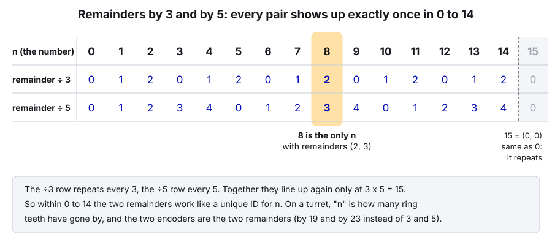
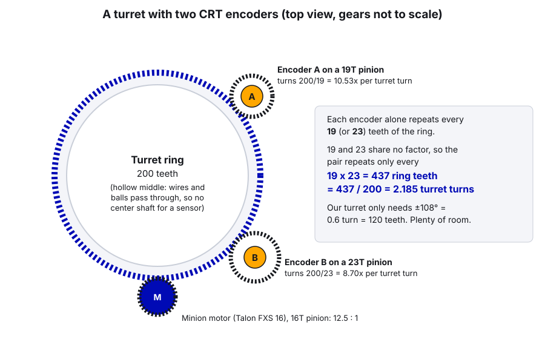

# 29. The Chinese Remainder Theorem for Turrets

> **Who it's for:** programmers (and curious mechanical students) who want a turret, or any mechanism that turns more
> than its sensor can track, to know its real angle the moment the robot turns on. **Read first:**
> [27 Relative vs Absolute Encoders](27-relative-vs-absolute-encoders.md) and [13 Turrets](13-turrets.md). Helpful:
> [28 Fusing Sensors to a Motor](28-fusing-sensors-to-a-motor.md), [20 Simulation and Testing](20-simulation-and-testing.md)
> (testing before the robot; this guide's unit test is self-contained). **Time:** about 1.5 hours. Do the math sections with a pencil.

## What you'll learn

- What the Chinese Remainder Theorem (CRT) says, in plain language, with a clock example and a puzzle worked by hand
- Why the two numbers must be **coprime**, and how far the pair can count before it repeats
- How two absolute encoders on pinions with different tooth counts give a turret's absolute angle, with real numbers
  for a 200-tooth ring like ours
- What breaks it: backlash, noise, and reading the two encoders at different moments (so: only trust it while still)
- How to install the YAMS vendordep and use **EasyCRT** (API checked against the real 2026 library), and how it would
  seed our turret's motor at boot
- A tiny brute-force solver you can run in jshell or a unit test

---

## 1. The problem

Guide 27's rule: an absolute encoder is only absolute for a mechanism if it turns **less than once** over the
mechanism's whole travel. A turret breaks that rule easily:

- The ring is **hollow**. Wires and game pieces go through the middle, so there's no center shaft to put a magnet on.
- So sensors go on small **pinions** that mesh with the ring. A 19-tooth pinion on our 200-tooth ring turns
  200 / 19 = 10.5 times per turret turn. Over our ±108° travel that's 6.3 pinion turns. A single encoder there can't
  tell turn 2 from turn 5.

Our 2026 turret skips the problem by zeroing at power-on (guide 13, section 2): whatever angle it boots at becomes
"straight back". This guide shows a way to know the real angle instead, using two encoders and a piece of
2000-year-old math.

---

## 2. The Chinese Remainder Theorem, in plain language

### Two clocks

Imagine two odd clocks. One has **3** hours on its face (0, 1, 2), the other has **5** (0, 1, 2, 3, 4). Both start at 0
and tick once per hour. After 7 hours, the 3-clock shows 1 (7 = 3 + 3 + 1) and the 5-clock shows 2 (7 = 5 + 2).

Each clock alone forgets how many times it went around. But look at **both**: the pair of readings is different for
every hour from 0 to 14. Only at hour 15 do both clocks show 0 again at the same time. So if someone tells you "the
3-clock says 2 and the 5-clock says 3", you can work out exactly how many hours have passed, as long as it's fewer
than 15.

That's the whole theorem, in words: **if you know a number's remainders when divided by a few numbers that share no
common factor, you know the number itself, up to the product of those numbers.** It's called the Chinese Remainder
Theorem because the earliest known version is in a Chinese math book from around the 3rd to 5th century.

A **remainder** is what's left over after dividing: 17 ÷ 5 = 3, remainder 2. In Java that's `17 % 5`, which is 2.

### The classic puzzle, worked by hand

> Find a number that leaves remainder **2** when divided by **3**, and remainder **3** when divided by **5**.

**Step 1.** List numbers with remainder 3 when divided by 5. Start at 3 and keep adding 5:
`3, 8, 13, 18, 23, ...`

**Step 2.** Check each one's remainder when divided by 3:

| Candidate | ÷ 3 remainder | Matches 2? |
|---|---|---|
| 3 | 0 | no |
| 8 | 2 | **yes** |
| 13 | 1 | no |

**Answer: 8.** Check: 8 = 3 + 3 + 2 (remainder 2) and 8 = 5 + 3 (remainder 3).

**Step 3.** Are there others? Yes, but they're spaced exactly 3 × 5 = 15 apart: 8, 23, 38, ... So between 0 and 14,
8 is the only answer.



This "list the candidates from one remainder, check them against the other" method is exactly what the turret code
does. It's brute force, and for numbers this small, brute force is perfect.

### Why the numbers must be coprime

**Coprime** means two numbers share no common factor except 1. 3 and 5 are coprime. 19 and 23 are coprime (both are
prime). 19 and 21 are coprime too (21 = 3 × 7, and 19 has neither). But 4 and 6 are **not**: both are divisible by 2.

Try clocks with 4 and 6 hours. They both show 0 again at hour **12**, not 24. Half the possible pairs never happen.
For example "4-clock shows 1, 6-clock shows 0" is impossible: the first says the hour is odd, the second says it's
even. You've thrown away half your counting range.

The general rule: the pair repeats after the **least common multiple** (lcm) of the two numbers. For coprime numbers
that's simply their product, the biggest it can be.

| Pair | Coprime? | Repeats after |
|---|---|---|
| 3, 5 | yes | 15 |
| 4, 6 | no (both even) | 12, not 24 |
| 19, 23 | yes | 437 |
| 19, 21 | yes | 399 |
| 20, 30 | no (share 10) | 60, not 600 |

---

## 3. From clocks to a turret

Here's the trick that connects them. Count how many **ring teeth** have gone past since the turret was at zero. Call
it `n`.

- Every full turn of encoder A's 19-tooth pinion, exactly 19 ring teeth go by. So encoder A's reading, times 19, is
  `n` **mod 19** (the remainder after dividing by 19). Encoder A is a 19-hour clock counting ring teeth.
- Encoder B on a 23-tooth pinion is a 23-hour clock: its reading × 23 is `n` mod 23.
- 19 and 23 are coprime, so the pair of readings is unique for 19 × 23 = **437 ring teeth** = 437 / 200 =
  **2.185 turret turns**.



Our turret only travels ±108° = 0.6 turn = 120 teeth, so 437 teeth is far more than enough. Unlike the clock puzzle,
`n` doesn't have to be a whole number: the turret can stop between teeth, and the encoders read fractions of a turn.
The method still works, because the *fractional part* is the same in both readings.

### Worked example with real numbers

Say the turret is at **+75°** (we don't know that yet; it's what we're trying to find).

```
turret             = 75 / 360           = 0.20833 turret turns
ring teeth passed  = 0.20833 * 200      = 41.667 teeth
encoder A (19T)    = 41.667 / 19 = 2.19298 turns  -> reads 0.19298 (69.47 deg)
encoder B (23T)    = 41.667 / 23 = 1.81159 turns  -> reads 0.81159 (292.17 deg)
```

The encoders only report the fractions: **A = 0.19298** and **B = 0.81159**. Now solve it like the puzzle.

**Step 1: what does A say?** Teeth passed mod 19 = 0.19298 × 19 = **3.667**. So `n` is one of
3.667 + 19k for some whole number k: ..., −15.333, 3.667, 22.667, 41.667, 60.667, ...

**Step 2: what does B say?** Teeth passed mod 23 = 0.81159 × 23 = **18.667**.

**Step 3: check every candidate from A against B:**

| k | Candidate n (teeth) | Turret angle | n mod 23 (B predicted) | Miss vs 18.667 | Inside ±108°? |
|---|---|---|---|---|---|
| −4 | −72.333 | −130.2° | 19.667 | 1 tooth | no |
| −3 | −53.333 | −96.0° | 15.667 | 3 teeth | yes |
| −2 | −34.333 | −61.8° | 11.667 | 7 teeth | yes |
| −1 | −15.333 | −27.6° | 7.667 | 11 teeth | yes |
| 0 | 3.667 | 6.6° | 3.667 | 8 teeth | yes |
| 1 | 22.667 | 40.8° | 22.667 | 4 teeth | yes |
| **2** | **41.667** | **75.0°** | **18.667** | **0** | **yes** |
| 3 | 60.667 | 109.2° | 14.667 | 4 teeth | no (just past) |

**Answer: 75.0°.** Notice the pattern in the "miss" column: every wrong candidate misses by a **whole number of teeth**
(1, 3, 4, 7, ...), and the right one misses by 0. That's the coprime property doing its job, and it's what makes the
method usable on a real robot: the code can accept anything within a quarter of a tooth and reject anything further.

> **AI can help:** CRT arithmetic is easy to fumble (a wrong mod, a sign error on negative numbers). Ask an AI assistant
> to rebuild the candidate table above for a different angle, say −50°, and show its steps. Then check it two ways:
> run the brute-force solver from section 7 on the same readings, and redo one row yourself with a calculator. If they
> disagree, find out who's wrong before you trust any of them.

---

## 4. What breaks it on a real robot

### Backlash and noise: the quarter-tooth budget

The wrong candidates miss by at least one tooth, so the two encoders must agree to well within **half** a tooth or the
wrong one could win. EasyCRT (section 5) accepts a match only if it's within **a quarter** of the gap, and refuses to
answer otherwise. For our numbers:

```
1/4 ring tooth  = 0.25 / 200 turret turns = 0.45 degrees of turret
                = 0.25 / 23 of encoder B   = 3.9 degrees of encoder B
```

So everything that makes the two encoders disagree has to add up to less than about **half a degree of turret**:
- **Backlash** between each pinion and the ring (the biggest one). Mount the CRT pinions with tight, adjustable mesh.
  Some teams spring-load the pinion into the ring.
- **Sensor noise and resolution.** A CANcoder's 4096 steps = 0.09° of *encoder*, which is a tiny 0.008° of turret
  through a 19T pinion. Not the problem.
- **A loose magnet or a pinion slipping on its shaft.** Then nothing works. Check that both are solid.

What happens when the budget is blown? It depends on how far:

| Encoders disagree by | Result |
|---|---|
| Under 1/4 tooth | Correct angle |
| 1/4 to about 3/4 tooth | **Empty**: "the readings don't agree". Safe. |
| About 1 tooth or more | Possibly a **wrong** angle: the neighbor candidate fits instead (here, −130.2°) |

We checked this with EasyCRT itself: shifting encoder B by 1.15 teeth in the worked example returns −130.2° when the
search range is ±0.4 turn, but returns empty when the search range is the real travel ±0.32 turn, because −130.2° is
outside it. **Lesson: always give the solver the tightest real range**, so impossible answers are thrown out.

### Reading the two encoders at different moments

The two CANcoders each send their own CAN frames; the robot code reads the latest one from each. If the turret is
moving, the two readings come from slightly different turret angles, which looks exactly like backlash.

```
turret spinning at 180 deg/s, readings 10 ms apart  ->  1.8 deg apart = 1 full ring tooth  ->  wrong or empty
to stay under 0.45 deg at 180 deg/s, the readings would need to be < 2.5 ms apart
```

So the rule from every CRT source (the YAMS docs, the Chief Delphi thread, Team 4967's paper) is the same: **only
solve while the turret is still.** In practice that means **once, at boot**, while the robot is disabled. Then copy the
answer into the motor's built-in encoder with `setPosition` (this is called **seeding**, guide 27) and let the motor's
encoder do the work for the rest of the match. **Never** use the CRT result as live closed-loop feedback.

### Going past the unique range

Past 2.185 turret turns, the pairs repeat and the answer silently jumps to the other end. Our turret can't physically
get anywhere near that (wires), but it's why you pick pinions whose range is comfortably bigger than the travel *plus*
any coast past the soft limits.

---

## 5. EasyCRT: the FRC library that does it for you

**YAMS** (Yet Another Mechanism System) is a free FRC library from the same Yet Another Software Suite group that makes
YAGSL. It includes **EasyCRT**, a CRT solver created by **team 6911**. We only need EasyCRT; you don't have to adopt
the rest of YAMS (its motor-wrapper system is a different style from our plain Phoenix 6 code). EasyCRT itself only
uses WPILib's units and `MathUtil`.

### Install the vendordep

1. In VS Code: `Ctrl+Shift+P` → **WPILib: Manage Vendor Libraries** → **Install new library (online)**.
2. Paste: `https://yet-another-software-suite.github.io/YAMS/yams.json`
3. Build once with internet so Gradle downloads it.

As of October 2026 that URL gives **YAMS 2026.10.13**, built for WPILib 2026.2.1 (our version). The class is
`yams.units.EasyCRT`. YAMS's 2027 versions (for SystemCore) move it to `yams.core.units.EasyCRT`, so when we upgrade,
expect the import to change and re-check the docs.

### The whole API

Checked by opening the 2026.10.13 jar, not guessed:

| Java | What it does |
|---|---|
| `new EasyCRT(int sharedGearTeeth, int encoderATeeth, int encoderBTeeth)` | Tooth counts: the gear both pinions mesh with (our ring: 200), pinion A, pinion B |
| `Optional<Angle> solve(Angle encoderA, Angle encoderB)` | Angle of the shared gear, for travel centered on zero (± half the unique range) |
| `Optional<Angle> solve(Angle encoderA, Angle encoderB, Angle minAngle, Angle maxAngle)` | Same, searching only from `minAngle` to `maxAngle`. Throws `IllegalArgumentException` if that range is longer than the unique range |
| `Angle getUniqueRange()` | How far the shared gear can turn before the pair repeats (`lcm(A, B) / shared` turns) |

`Angle` is WPILib's units type (`edu.wpi.first.units.measure.Angle`), which is exactly what a CANcoder's
`getAbsolutePosition().getValue()` returns. An empty `Optional` means "the two readings don't agree on one answer".

**How it solves:** the same way as our table in section 3. It lists every shared-gear angle that fits encoder A inside
the range, predicts encoder B for each, and picks the closest. It accepts the best one only if it's within a quarter of
the gap between candidates **and** no second candidate is also that close. Its own docs say: "This is not a textbook
Chinese Remainder Theorem solve. It is the same idea done as a search, which keeps working with backlash and sensor
noise."

**Its setup rules** (from the EasyCRT guide):
1. **Both encoders must read zero with the mechanism at zero.** Set each CANcoder's magnet offset with the turret at
   its zero (for us: pointing straight back).
2. **Both must count up when the mechanism moves positive.** A pinion turns the opposite way to the ring it meshes
   with, so you usually invert both compared with what you'd use on the ring itself.
3. **Read while the mechanism is still; solve once at startup; seed the motor.**

### Checking our numbers with it

You can run EasyCRT in jshell with the YAMS and WPILib jars on the class path. We did, for the 200-tooth ring:

| Pinions | `getUniqueRange()` | Fine for our ±0.3-turn turret? |
|---|---|---|
| 19 and 23 | 2.185 turret turns | Yes, lots of room |
| 19 and 21 | 1.995 | Yes |
| 13 and 15 | 0.975 | Yes, but small pinions are hard to mount and have more backlash per degree |
| 20 and 30 | 0.3 | **No**: they share a factor of 10, so the range collapses below our 0.6-turn travel |

And `solve` on the worked example (A = 0.19298, B = 0.81159) returned exactly 75.0°.

---

## 6. How it would work on a 5090-style turret

Our turret: 200T ring, Minion on Talon FXS ID 16 driving a 16T pinion (12.5:1), travel ±0.30 turret turns, zero =
pointing straight back, and `Turret.java` works in **motor rotations**
([Turret.java, lines 103–106](https://github.com/TorqueNados-FRC5090/Hephaestus/blob/c2f0cee6f61db3f26f911d3f5623ed7fa27a5b03/src/main/java/frc/robot/subsystems/Turret.java#L103-L106)).
Today it does this at boot
([lines 158–160](https://github.com/TorqueNados-FRC5090/Hephaestus/blob/c2f0cee6f61db3f26f911d3f5623ed7fa27a5b03/src/main/java/frc/robot/subsystems/Turret.java#L158-L160)):

```java
m_turretMotor.getConfigurator().apply(config);
m_turretMotor.setPosition(0);
```

The plan: mechanical adds two pinions, 19T and 23T, meshing with the ring, each with a CANcoder (or a WCP ThroughBore
if they're on ½" hex) on the **Upper** CANivore. IDs 17 and 18 are free in our mechanism range. Then:

New example code: a small class that owns the two encoders and returns the boot angle.

```java
/**
 * Two CANcoders on 19T and 23T pinions that mesh with the 200T turret ring. Together they tell the turret's
 * real angle at boot (Chinese Remainder Theorem, solved by YAMS EasyCRT). Read ONLY while the turret is still.
 */
public class TurretCrtSensor {
    private static final int kRingTeeth = 200;
    private static final int kPinionATeeth = 19;
    private static final int kPinionBTeeth = 23;
    /** Real travel is +/-0.30 turret rotations. Search a little past it (coast), but no further */
    private static final double kSearchLimitTurretRotations = 0.32;
    private static final double kBootReadTimeoutSeconds = 0.5;
    /** Measured with the turret pointing straight back (see the steps below) */
    private static final double kEncoderAMagnetOffset = 0.0;
    private static final double kEncoderBMagnetOffset = 0.0;

    private final CANcoder m_encoderA;
    private final CANcoder m_encoderB;
    private final EasyCRT m_crt = new EasyCRT(kRingTeeth, kPinionATeeth, kPinionBTeeth);

    public TurretCrtSensor(int encoderAId, int encoderBId, CANBus canBus) {
        m_encoderA = new CANcoder(encoderAId, canBus);
        m_encoderB = new CANcoder(encoderBId, canBus);
        // A pinion turns the OPPOSITE way to the ring. Both must count UP when the turret turns positive (CCW
        // from above), so check the direction by hand on the dashboard and flip it if needed.
        m_encoderA.getConfigurator().apply(encoderConfig(kEncoderAMagnetOffset));
        m_encoderB.getConfigurator().apply(encoderConfig(kEncoderBMagnetOffset));
    }

    private static CANcoderConfiguration encoderConfig(double magnetOffsetRotations) {
        CANcoderConfiguration config = new CANcoderConfiguration();
        config.MagnetSensor.SensorDirection = SensorDirectionValue.Clockwise_Positive;
        config.MagnetSensor.MagnetOffset = magnetOffsetRotations;
        return config;
    }

    /** @return the turret angle in turret rotations, or empty if the two encoders don't agree on one answer */
    public Optional<Double> readTurretRotations() {
        StatusSignal<Angle> encoderA = m_encoderA.getAbsolutePosition();
        StatusSignal<Angle> encoderB = m_encoderB.getAbsolutePosition();
        // Wait for a fresh frame from both, so the two readings are as close together in time as possible
        StatusCode status = BaseStatusSignal.waitForAll(kBootReadTimeoutSeconds, encoderA, encoderB);
        if (!status.isOK()) {
            RobotLog.event("Turret CRT: encoders not ready (" + status + ")");
            return Optional.empty();
        }
        Optional<Angle> turretAngle = m_crt.solve(encoderA.getValue(), encoderB.getValue(),
            Rotations.of(-kSearchLimitTurretRotations), Rotations.of(kSearchLimitTurretRotations));
        if (turretAngle.isEmpty()) {
            RobotLog.event(String.format("Turret CRT: no single answer (A=%.4f, B=%.4f rot)",
                encoderA.getValueAsDouble(), encoderB.getValueAsDouble()));
        }
        return turretAngle.map(angle -> angle.in(Rotations));
    }
}
```

Imports: `static edu.wpi.first.units.Units.Rotations`, `java.util.Optional`, `com.ctre.phoenix6.BaseStatusSignal`,
`com.ctre.phoenix6.CANBus`, `com.ctre.phoenix6.StatusCode`, `com.ctre.phoenix6.StatusSignal`,
`...configs.CANcoderConfiguration`, `...hardware.CANcoder`, `...signals.SensorDirectionValue`,
`edu.wpi.first.units.measure.Angle`, `frc.robot.RobotLog`, `yams.units.EasyCRT`. (This compiles against Phoenix 6
26.3.0, WPILib 2026.2.1 and YAMS 2026.10.13.)

And in the `Turret` constructor, replacing `setPosition(0)`:

```java
m_turretMotor.getConfigurator().apply(config);
Optional<Double> bootTurretRotations = m_crtSensor.readTurretRotations();
if (bootTurretRotations.isPresent()) {
    // Turret.java works in MOTOR rotations, so convert turret rotations with the 12.5:1 ratio
    m_turretMotor.setPosition(bootTurretRotations.get() * kTurretGearRatio);
    m_isZeroed = true;
    RobotLog.event(String.format("Turret zeroed by CRT at %.1f deg", bootTurretRotations.get() * 360.0));
} else {
    // Don't guess: a wrong zero can drive the turret into its wires. Hold still until someone fixes it.
    m_isZeroed = false;
}
SmartDashboard.putBoolean("Turret/Zeroed", m_isZeroed);
```

`m_crtSensor` is a new field (`new TurretCrtSensor(17, 18, canbus)`, with the IDs moved into `Constants`), and
`m_isZeroed` is a new boolean that the aiming command checks: if it's false, the turret holds still and the dashboard
says why. The existing (currently unused) `zeroTurret()` method
([lines 163–165](https://github.com/TorqueNados-FRC5090/Hephaestus/blob/c2f0cee6f61db3f26f911d3f5623ed7fa27a5b03/src/main/java/frc/robot/subsystems/Turret.java#L163-L165))
could become the manual fallback: a pit button that says "I've lined the turret up by hand, call this zero".

> **Watch out:** if the CRT can't give an answer, never fall back to "assume it's at zero and start aiming". That's the
> exact failure that can wrap the turret's wires (guide 13). Hold still, show it on the dashboard, and let a person fix
> it.

### Setting the offsets (at the robot)

1. Robot on, disabled. Put both CANcoders' `MagnetOffset` to 0 and deploy.
2. Point the turret exactly straight back (the zero used by `kTurretZeroOffset`).
3. Read each CANcoder's absolute position in Tuner X. Put the **negatives** into `kEncoderAMagnetOffset` and
   `kEncoderBMagnetOffset`. Deploy. Both should now read about 0.
4. Turn the turret slowly by hand in the positive direction (CCW from above). Both readings must go **up**. If one goes
   down, flip its `SensorDirection` and redo steps 1–3 for it.
5. Power-cycle with the turret at −90°, 0° and +90° (marked on the robot). Each time, check `Turret/Zeroed` is true and
   the log line shows the right angle within a degree.
6. Now nudge it to the ends of travel and power-cycle again. Then deliberately loosen one pinion's mesh and confirm it
   reports **no answer** rather than a wrong one (then tighten it back).

---

## 7. A brute-force solver you can run yourself

You don't need any library to understand or test CRT. This is the method from section 3 in plain Java, no WPILib, so
it runs in **jshell** (the Java "type a line, see the answer" tool that comes with the WPILib JDK, for example
`C:\Users\Public\wpilib\2026\jdk\bin\jshell.exe` on Windows) or in a unit test.

First, the puzzle from section 2. Paste into jshell:

```java
for (int n = 0; n < 3 * 5; n++) {
    if (n % 3 == 2 && n % 5 == 3) {
        System.out.println("answer: " + n);
    }
}
```

It prints `answer: 8`.

Now the turret version. Save this as `TurretCrtSolver.java` (in a robot project put it in `frc.robot.util` with a
`package frc.robot.util;` line at the top; jshell's `/open` needs the file **without** the package line):

```java
/**
 * Brute-force Chinese Remainder Theorem solver for a ring gear read by two absolute encoders on pinions.
 * Pure Java, no WPILib, so it runs in jshell and in a unit test.
 */
public final class TurretCrtSolver {
    /** The two encoders must agree to within this many ring teeth (wrong guesses miss by 1 tooth or more) */
    private static final double kToleranceTeeth = 0.25;

    private TurretCrtSolver() {}

    /**
     * @param ringTeeth   teeth on the ring (turret) gear
     * @param teethA      teeth on encoder A's pinion
     * @param teethB      teeth on encoder B's pinion
     * @param readingA    encoder A, in rotations, already offset so it reads 0 with the turret at 0
     * @param readingB    encoder B, same rules
     * @param minTurretRotations lowest turret angle to consider (rotations)
     * @param maxTurretRotations highest turret angle to consider (rotations)
     * @return turret angle in rotations, or NaN if no single answer fits both encoders
     */
    public static double solve(int ringTeeth, int teethA, int teethB, double readingA, double readingB,
                               double minTurretRotations, double maxTurretRotations) {
        double fractionA = wrap01(readingA);
        double teethPassedB = wrap01(readingB) * teethB;      // where B is, in teeth of B (0 to teethB)
        double bestErrorTeeth = Double.MAX_VALUE;
        double bestTurretRotations = Double.NaN;
        int candidatesThatFit = 0;

        // Encoder A says: ring teeth passed = teethA * (fractionA + k), for some whole number of A turns k.
        int maxATurns = (int) Math.ceil(Math.max(Math.abs(minTurretRotations), Math.abs(maxTurretRotations))
            * ringTeeth / teethA) + 1;
        for (int k = -maxATurns; k <= maxATurns; k++) {
            double ringTeethPassed = teethA * (fractionA + k);
            double turretRotations = ringTeethPassed / ringTeeth;
            if (turretRotations < minTurretRotations || turretRotations > maxTurretRotations) {
                continue;
            }
            // If this guess were right, where would encoder B be?
            double predictedB = Math.floorMod((long) Math.floor(ringTeethPassed), (long) teethB)
                + (ringTeethPassed - Math.floor(ringTeethPassed));
            double errorTeeth = Math.abs(predictedB - teethPassedB);
            errorTeeth = Math.min(errorTeeth, teethB - errorTeeth);   // 22.9 and 0.1 are only 0.2 apart on a circle
            if (errorTeeth <= kToleranceTeeth) {
                candidatesThatFit++;
            }
            if (errorTeeth < bestErrorTeeth) {
                bestErrorTeeth = errorTeeth;
                bestTurretRotations = turretRotations;
            }
        }
        return candidatesThatFit == 1 ? bestTurretRotations : Double.NaN;
    }

    /** Wraps any rotation reading into 0 (inclusive) to 1 (exclusive) */
    private static double wrap01(double rotations) {
        return rotations - Math.floor(rotations);
    }
}
```

In jshell:

```java
/open TurretCrtSolver.java
TurretCrtSolver.solve(200, 19, 23, 0.19298, 0.81159, -0.32, 0.32) * 360   // about 75.0
TurretCrtSolver.solve(200, 19, 23, 0.19298, 0.83333, -0.32, 0.32)         // B off by half a tooth: NaN
```

(`Math.floorMod` is used instead of `%` because Java's `%` keeps the sign: `-15 % 23` is −15, but the remainder we
want is 8. Negative turret angles need this.)

As a **unit test** in `src/test/java/frc/robot/util/TurretCrtSolverTest.java` (our robot projects already include
JUnit 5; run it with **WPILib: Test Robot Code** or `./gradlew test`):

```java
class TurretCrtSolverTest {
    private static final int kRingTeeth = 200;
    private static final int kPinionATeeth = 19;
    private static final int kPinionBTeeth = 23;

    /** What each encoder would read with the turret at this angle (perfect sensors) */
    private static double encoderReading(double turretRotations, int pinionTeeth) {
        double pinionRotations = turretRotations * kRingTeeth / pinionTeeth;
        return pinionRotations - Math.floor(pinionRotations);
    }

    @Test
    void findsEveryAngleAcrossTheTravel() {
        for (double degrees = -108; degrees <= 108; degrees += 0.5) {
            double turret = degrees / 360.0;
            double solved = TurretCrtSolver.solve(kRingTeeth, kPinionATeeth, kPinionBTeeth,
                encoderReading(turret, kPinionATeeth), encoderReading(turret, kPinionBTeeth), -0.4, 0.4);
            assertEquals(degrees, solved * 360.0, 1e-6, "at " + degrees + " deg");
        }
    }

    @Test
    void refusesWhenTheEncodersDisagree() {
        double turret = 75.0 / 360.0;
        double badB = encoderReading(turret, kPinionBTeeth) + 0.5 / kPinionBTeeth;   // B off by half a tooth
        double solved = TurretCrtSolver.solve(kRingTeeth, kPinionATeeth, kPinionBTeeth,
            encoderReading(turret, kPinionATeeth), badB, -0.4, 0.4);
        assertTrue(Double.isNaN(solved));
    }
}
```

Imports: `static org.junit.jupiter.api.Assertions.assertEquals`, `static org.junit.jupiter.api.Assertions.assertTrue`,
`org.junit.jupiter.api.Test`. Both tests pass (we ran them). On the robot you'd use EasyCRT; this solver is for
learning, for checking EasyCRT's answers, and for trying out pinion choices before mechanical cuts any metal.

---

## Common mistakes

- **Pinions that share a factor.** 20T and 30T only cover 60 teeth (0.3 turn on our ring), less than our travel. Pick
  two primes, or check with `getUniqueRange()`.
- **One encoder counting the wrong way.** A pinion turns opposite to the ring. If one counts down, EasyCRT returns
  empty every time (its guide's top troubleshooting item).
- **Offsets not measured at the same turret zero.** Both must read 0 at the turret's zero. A wrong offset on A shifts
  the answer by a fixed angle; a wrong offset on B makes it jump by whole pinion turns or fail.
- **Solving while moving.** A tooth of motion between the two reads gives empty or a wrong answer. Solve once at boot.
- **Using the CRT answer as live feedback.** It's for seeding. The motor's encoder (or a fused 1:1 sensor) does the
  control.
- **Search range too wide.** Use the real travel plus a small margin, not the whole unique range, so a near-miss can't
  pick an impossible angle.
- **Treating "no answer" as zero.** Hold still and alert. Guessing is how turrets wrap their wires.
- **Using `%` on negative numbers.** Java's `%` returns −15 for `-15 % 23`. Use `Math.floorMod` (integers) or wrap
  with `x - Math.floor(x)` (fractions).

## Checklist

- [ ] Pinion tooth counts coprime; unique range (product / ring teeth) well over the full travel plus coast
- [ ] Both pinions mesh tightly with the ring; magnets and pinions secure on their shafts
- [ ] Both CANcoders on the same bus, IDs in `Constants`, magnet health green
- [ ] Both offsets measured with the turret at its zero; both read ~0 there
- [ ] Both count **up** when the turret turns positive (checked by hand)
- [ ] Solve called once at boot, while disabled, with the real travel as the search range
- [ ] Empty result handled: turret holds still and the dashboard/log says so
- [ ] Power-cycle test at −90°, 0°, +90° and near both ends: correct every time
- [ ] Loosened-mesh test: reports no answer instead of a wrong one

## Practice

1. **By hand.** Find the number from 0 to 34 that leaves remainder 3 when divided by 5 and remainder 2 when divided by 7.
   Then check it with the jshell loop. Why does the answer have to be under 35?
2. **Your own candidate table.** The turret is at −50°. Compute what encoders A (19T) and B (23T) read, then build the
   candidate table like section 3 and find the answer. Check with `TurretCrtSolver.solve`.
3. **Pick pinions.** Mechanical says the pinions must be between 14 and 24 teeth. Find the pair that gives the biggest
   unique range on a 200T ring, and a pair that looks fine but fails because of a common factor. Use jshell to check.
4. **Break it on purpose.** In the unit test, add a test that shifts encoder B by 1.15 teeth and solves with the range
   ±0.4 turn. What angle comes out? Now use ±0.32. Explain the difference using section 4.

## Go further

- YAMS EasyCRT documentation: https://yagsl.gitbook.io/yams/documentation/details/easycrt
- YAMS on GitHub (source, EasyCRT guide with animations): https://github.com/Yet-Another-Software-Suite/YAMS
- YAMS vendordep URL: https://yet-another-software-suite.github.io/YAMS/yams.json
- Chief Delphi, "HOW TO: Chinese Remainder Theorem for gears/turrets": https://www.chiefdelphi.com/t/how-to-chinese-remainder-theorem-for-gears-turrets/512876
  (the replies are worth reading: they cover read latency and simpler alternatives)
- Team 4967's whitepaper, "Chinese Remainder Theorem (for Gears)", linked from that thread and from the YAMS docs:
  https://www.chiefdelphi.com/uploads/short-url/zWj1mUZqH1yy9jRzrMOm7Z8xVD3.pdf
- WPILib unit testing: https://docs.wpilib.org/en/stable/docs/software/wpilib-tools/robot-simulation/unit-testing.html
- CTRE CANcoder: https://v6.docs.ctr-electronics.com/en/stable/docs/hardware-reference/cancoder/index.html
- Related team guides: [13 Turrets](13-turrets.md), [20 Simulation and Testing](20-simulation-and-testing.md),
  [27 Relative vs Absolute](27-relative-vs-absolute-encoders.md), [28 Fusing Sensors](28-fusing-sensors-to-a-motor.md).
