# 30. Sensor and Device Catalog

> **Who it's for:** every programmer, especially new ones who keep hearing "put it on the CANivore" or "is that a CANcoder?" and want to know what each part on the robot actually is. No code experience needed to read it; the snippets help once you're writing subsystems.
> **What you need first:** [02 Phoenix Tuner X and the CAN Bus](02-phoenix-tuner-x-and-can.md) (IDs, buses, firmware) and [05 Motors in Phoenix 6](05-motors-in-phoenix-6.md) (configs and control requests). Helpful: [21 Sensors and Homing](21-sensors-and-homing.md).
> **Time:** about 45 minutes to read. Keep it as a reference: look up one device when it shows up on your robot.

**What you'll learn**
- What every motor controller and sensor our programmers meet looks like, what it measures or does, and how it connects.
- Which Java class to use for each one (Phoenix 6 v26 or ReduxLib 2026), with a short, correct snippet.
- Which CAN bus each device belongs on, and why some devices can't go on a CANivore at all.
- Which features need our Phoenix Pro license (details in [31 Phoenix Pro Features](31-phoenix-pro-features.md)).
- How the REV PDH lets you log the current of every motor, and what changes on the 2027 SystemCore controller.
- The gotchas for each device, most of them learned the hard way.

---

## How to use this catalog

Each device gets about half a page: a photo, what it is, how it connects, the class, a snippet, what we use it for, and the gotchas. Start with the comparison table, find your device, then go to its section.

Words you'll see a lot (all explained in [02](02-phoenix-tuner-x-and-can.md)):
- **CAN 2.0** is the classic CAN bus, the one built into the roboRIO (the "rio" bus).
- **CAN FD** is the newer, faster CAN that a **CANivore** adds. A device on a CANivore bus **must support CAN FD**.
- **Phoenix 6** is CTRE's free library. **Phoenix Pro** is the paid add-on that unlocks extra features (FOC, fused sensors, and more). See guide 31.
- **ReduxLib** is Redux Robotics' library for their sensors. It's a separate vendordep (a library you add to the robot project).

> **Tip:** Every snippet below uses Phoenix 6 v26 (vendordep 26.3.0) or ReduxLib 2026.1.2 names. We checked each class and method against the real 2026 jars. If your IDE says a name doesn't exist, check your vendordep version before changing the code.

---

## The comparison table

| Device | Measures / does | Bus | Java class | License needed? |
|---|---|---|---|---|
| Kraken X60 / X44 | Brushless motor with a Talon FX built in | CAN FD or 2.0 | `TalonFX` | No. Pro adds FOC and torque control |
| Talon FXS | Separate controller for Minion, NEO, Vortex, brushed motors | CAN FD or 2.0 | `TalonFXS` | No. Pro adds Advanced Hall Support. **No FOC at all** |
| Minion | Small brushless motor (needs a Talon FXS) | (through the FXS) | `TalonFXS` | No |
| CANcoder | Absolute angle of a shaft (magnet on the shaft end) | CAN FD or 2.0 | `CANcoder` | No. Pro adds `FusedCANcoder` |
| WCP ThroughBore powered by CANcoder | Absolute angle, shaft passes through it | CAN FD or 2.0 | `CANcoder` | No. Pro adds `FusedCANcoder` |
| Pigeon 2 | Robot heading (yaw), pitch, roll, turn rate | CAN FD or 2.0 | `Pigeon2` | No. Pro adds time sync |
| CANrange | Distance (time of flight), "something is there" | CAN FD or 2.0 | `CANrange` | No |
| CANdi | Puts our limit switches and beam breaks (and PWM encoders) on CAN | CAN FD or 2.0 | `CANdi` | No. Pro adds fused CANdi encoders |
| CANdle | Drives LED strips, 8 LEDs on board | CAN FD or 2.0 | `CANdle` (Phoenix 6, new in 2026) | No |
| CANivore | Adds a CAN FD bus over USB | (is the bus) | `CANBus` | No. A CANivore license makes every device on it Pro |
| Redux Canandcolor | Proximity (unitless 0–1) + color | **CAN 2.0 only** (rio bus) | `Canandcolor` (ReduxLib) | No |
| REV PDH | Power distribution: current on every channel, total current, battery voltage | **CAN 2.0 only** (rio bus) | `PowerDistribution` (WPILib) | No |
| Limelight | Camera: AprilTags, targets, game pieces | Ethernet (not CAN) | `LimelightHelpers` | No |

"License needed?" means: does the device work at all without Pro? For everything here the answer is yes, it works. Pro only adds features. The one trap is code that **uses** a Pro-only feature on an unlicensed device: some of those stop the motor completely. Guide 31 has the full list.

---

## Where everything goes: our CAN layout

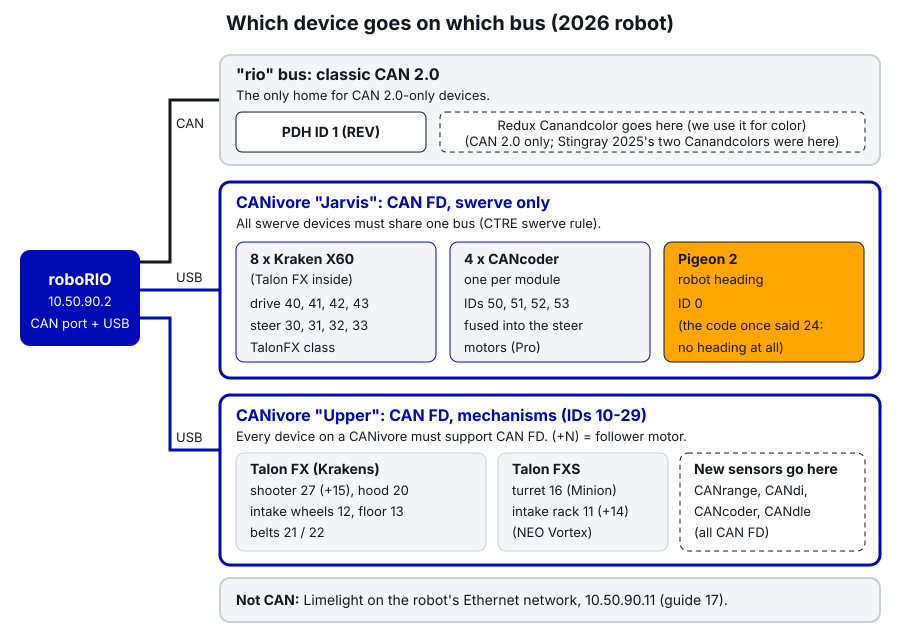

Three rules decide where a new device goes:

1. **Swerve devices all go on one bus.** CTRE's swerve code requires the 8 motors, 4 CANcoders and the Pigeon on the same bus. Ours is "Jarvis".
2. **A CANivore bus is CAN FD.** Every device on it must support CAN FD. All the CTRE devices in this catalog do. The Redux Canandcolor and the REV PDH don't, so they go on the rio bus.
3. **Mechanisms go on "Upper"**, with IDs 10–29 from our scheme ([02](02-phoenix-tuner-x-and-can.md)). A new CANrange or CANdi for a mechanism goes there too.

Our electrical binder adds a buying rule for 2027 (Michel's rule): every CAN sensor we buy must support CAN FD. That's why the CTRE sensors are our default. The one CAN 2.0-only sensor we still use is the Redux Canandcolor, for color; the binder flags it (and the REV PDH) as "check against the 2027 manual".

> **2027: SystemCore (our plan from the electrical binder, not a 2026 fact; check it against the 2027 manual).** The SystemCore controller replaces the roboRIO in 2027.
>
> - **Five CAN buses built in, `can_s0` to `can_s4`.** Our plan: `can_s0` drivetrain (swerve motors, CANcoders, Pigeon 2), `can_s1` intake, `can_s2` indexer and outside-the-robot rollers, `can_s3` upper chassis (shooter, turret, hood), `can_s4` the REV PDH by itself. A loose connector on the intake bus can't stop the drivetrain.
> - **Classic CAN at 1 Mbps for now.** The buses can do CAN FD, but FD isn't switched on yet, so today every device works on any bus.
> - **Michel's CAN FD rule:** every CAN sensor we buy must support CAN FD, so nothing has to be replaced when a bus moves to FD. The Canandcolor and the REV PDH are CAN 2.0 only; if FD is ever turned on, they stay on a classic bus.
> - **Sensor power:** a sensor gets its 12 V from the **power hat** (a fused tap) on the motor of the mechanism it's on. The Pigeon 2 is the exception: it has its own fused PDH slot.
> - **Cameras aren't on CAN:** Limelights go through the Ethernet switch (Brainboxes SW-005 on the radio), and Thriftiest Cams plug into SystemCore's USB ports, one per port, no hub.
> - **In code:** always name the bus. CTRE says the `new Device(id, String)` constructors are deprecated in 2026 and an explicit `CANBus` is required in 2027, so always pass a `CANBus` object.

---

## Motors and motor controllers

### Kraken X60 and Kraken X44 (Talon FX inside)

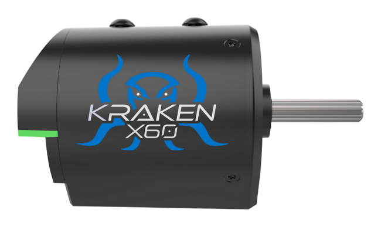 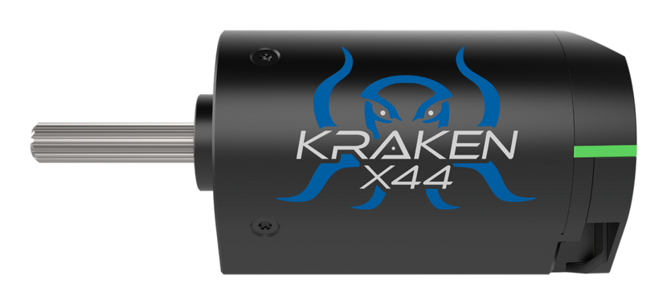

**What it is.** A brushless motor made by WestCoast Products with a CTRE **Talon FX** motor controller built into the back. The X60 is our main motor. The X44 is shorter and lighter, with less torque and more speed.

**What it does.** Spins, and measures its own position, velocity, current and temperature. It runs PID and Motion Magic on board, 1000 times a second.

**Connects.** Two thick power wires to the PDH, and CAN (yellow/green) daisy-chained. There's no limit-switch connector on the Talon FX built into these motors. For a limit switch or beam break, use a CANdi (our standard) or a CANrange (see [21](21-sensors-and-homing.md)).

**Numbers (from WCP's motor tables).**

| | Free speed | Stall torque | Peak power |
|---|---|---|---|
| Kraken X60, trapezoidal | 6,000 RPM | 7.09 N·m | 1,108 W |
| Kraken X60, FOC (Pro) | 5,800 RPM | 9.37 N·m | 1,405 W |
| Kraken X44, trapezoidal | 7,758 RPM | 4.11 N·m | 835 W |
| Kraken X44, FOC (Pro) | 7,368 RPM | 5.01 N·m | 966 W |

That gap between the rows is what our Pro license buys on every Kraken. 6,000 RPM is 100 rotations per second (RPS), which is why our code comments say "Krakens top out around 100 RPS".

**Class.** `TalonFX`, configured with `TalonFXConfiguration`. Full walkthrough in [05](05-motors-in-phoenix-6.md).

```java
TalonFX shooterLeader = new TalonFX(27, upperBus);
TalonFXConfiguration config = new TalonFXConfiguration();
config.CurrentLimits.StatorCurrentLimit = 60;
config.CurrentLimits.StatorCurrentLimitEnable = true;
config.CurrentLimits.SupplyCurrentLimit = 40;
config.CurrentLimits.SupplyCurrentLimitEnable = true;
shooterLeader.getConfigurator().apply(config);
shooterLeader.setControl(new VelocityVoltage(0).withVelocity(80).withEnableFOC(true));
```

(In a real subsystem, make the request a field once and reuse it; see [05](05-motors-in-phoenix-6.md).)

**On our robots.** All swerve drive and steer motors, shooter, hood, rollers, intake wheels.

**Gotchas.**
- The Falcon 500 is also a Talon FX (same class). You'll see it on older robots like Thunderstrike.
- A stalled Kraken at full voltage can pull hundreds of amps (366 A stall current, per WCP). Always set current limits ([06](06-current-limits-and-brownouts.md)).
- Inverts are judged looking at the **face** of the motor (the shaft end).

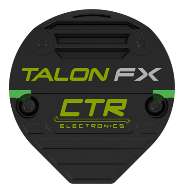

### Talon FXS

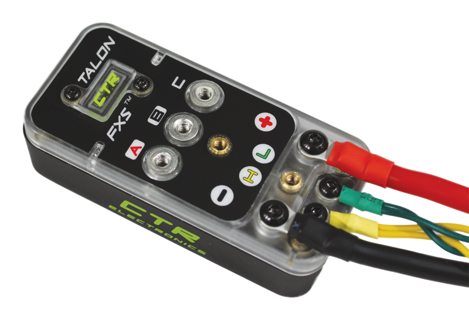

**What it is.** A separate CTRE motor controller (a box) for motors that don't have a Talon built in: the CTRE **Minion**, REV **NEO**, **NEO 550**, **NEO Vortex** (through REV's Vortex Solo Adapter), and most **brushed** motors.

**Connects.** Power in from the PDH, three motor phase wires out, a JST sensor cable from the motor, CAN. It also has a **data port** for limit switches and external encoders (quadrature or PWM), which the Kraken's Talon FX doesn't have.

**Class.** `TalonFXS` with `TalonFXSConfiguration`. You **must** tell it which motor is attached with `Commutation.MotorArrangement` (`MotorArrangementValue`): `Minion_JST`, `NEO_JST`, `NEO550_JST`, `VORTEX_JST`, `Brushed_DC`, `CustomBrushless`, or `Disabled` (the default).

```java
TalonFXS turretMotor = new TalonFXS(16, upperBus);
TalonFXSConfiguration config = new TalonFXSConfiguration();
config.Commutation.MotorArrangement = MotorArrangementValue.Minion_JST;
config.CurrentLimits.StatorCurrentLimit = 30;
config.CurrentLimits.StatorCurrentLimitEnable = true;
config.CurrentLimits.SupplyCurrentLimit = 20;
config.CurrentLimits.SupplyCurrentLimitEnable = true;
turretMotor.getConfigurator().apply(config);
```

For a brushed motor, use `Brushed_DC` and also set `Commutation.BrushedMotorWiring` to match which two leads you wired.

**On our robots.** 2026 turret (Minion, ID 16) and the intake rack (two NEO Vortex, IDs 11 and 14). See [Turret.java, lines 129–136 (Talon FXS + Minion)](https://github.com/TorqueNados-FRC5090/Hephaestus/blob/c2f0cee6f61db3f26f911d3f5623ed7fa27a5b03/src/main/java/frc/robot/subsystems/Turret.java#L129-L136) and [EvilIntake.java, lines 154–158 (Vortex + Advanced Hall Support)](https://github.com/TorqueNados-FRC5090/Hephaestus/blob/c2f0cee6f61db3f26f911d3f5623ed7fa27a5b03/src/main/java/frc/robot/subsystems/EvilIntake.java#L154-L158).

**Gotchas.**
- **No MotorArrangement = no motion.** The LEDs blink alternating orange/green. Set it in code so a replacement FXS works right away.
- **The Talon FXS does not do FOC** (CTRE's docs: "the Talon FXS does not support FOC at this time"). `TorqueCurrentFOC` doesn't exist for it, and `.withEnableFOC(true)` on an FXS request does nothing. Our turret and intake requests have it anyway; it's harmless.
- **Advanced Hall Support** (`Commutation.AdvancedHallSupport`) is the FXS's Pro feature: CTRE says up to about 2 percentage points more peak efficiency and less noisy velocity on hall-sensor motors like the Vortex. Our intake turns it on. Details in [31](31-phoenix-pro-features.md).

### Minion

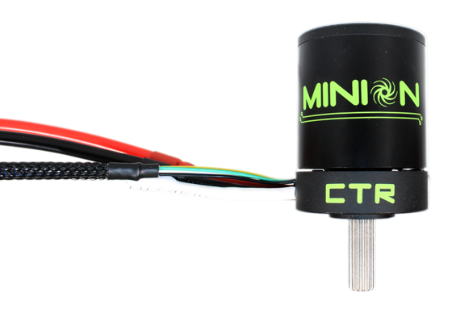

**What it is.** A small CTRE brushless motor (about 1.5" across). It has no controller inside, so it always runs from a **Talon FXS**. CTRE lists it at 610 W peak power and 3.1 N·m stall torque.

**Connects.** Phase wires and a 6-pin JST sensor cable to the Talon FXS.

**Class.** `TalonFXS` with `MotorArrangementValue.Minion_JST` (snippet above).

**On our robots.** The 2026 turret.

**Gotchas.** Because it runs on a Talon FXS, it gets no FOC. If you need more power in the same space, compare it with a Kraken X44, which has the Talon FX built in.

---

## Position sensors (encoders)

Guide [27 Relative vs Absolute Encoders](27-relative-vs-absolute-encoders.md) explains when you need an absolute encoder at all. Guide [28 Fusing Sensors to a Motor](28-fusing-sensors-to-a-motor.md) shows how to make a Talon use one.

### CTRE CANcoder

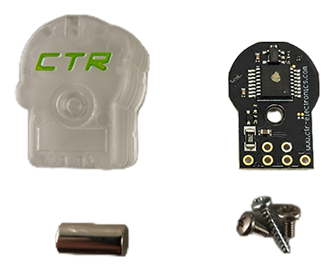

**What it is.** A magnetic absolute encoder. A small magnet on the end of a shaft spins over it; the CANcoder knows the shaft's angle the moment it powers on.

**Measures.** Absolute position within one rotation (0 to 1 or −0.5 to +0.5 rotations), plus a multi-turn position and velocity. Magnet health (green/orange/red).

**Connects.** CAN and power. CAN FD capable, so it can go on a CANivore.

**Class.** `CANcoder` with `CANcoderConfiguration` (`MagnetSensor.MagnetOffset`, `SensorDirection`, `AbsoluteSensorDiscontinuityPoint`).

```java
CANcoder pivotEncoder = new CANcoder(CANIds.kPivotEncoder, upperBus);
CANcoderConfiguration encoderConfig = new CANcoderConfiguration();
encoderConfig.MagnetSensor.MagnetOffset = -0.3125;                 // rotations, measured on the robot
encoderConfig.MagnetSensor.AbsoluteSensorDiscontinuityPoint = 0.5; // reads -0.5 to +0.5
pivotEncoder.getConfigurator().apply(encoderConfig);
double pivotRotations = pivotEncoder.getAbsolutePosition().getValueAsDouble();
```

(`CANIds.kPivotEncoder` is a placeholder: add a real ID to `Constants`.)

**On our robots.** All four swerve modules (IDs 50–53 on Jarvis), fused into the steer motors with `FusedCANcoder` (a Pro feature). See [TunerConstants.java, lines 48–50](https://github.com/TorqueNados-FRC5090/Hephaestus/blob/c2f0cee6f61db3f26f911d3f5623ed7fa27a5b03/src/main/java/frc/robot/generated/TunerConstants.java#L48-L50).

**Gotchas.**
- Absolute only within **one rotation of the shaft it's on**. Put it where the mechanism turns less than one full turn.
- Measuring the offset and choosing the discontinuity point is step by step in [21](21-sensors-and-homing.md).
- If the magnet falls out or sits too far away, `getMagnetHealth()` goes red. Put it on the dashboard.

### WCP ThroughBore Powered by CANcoder

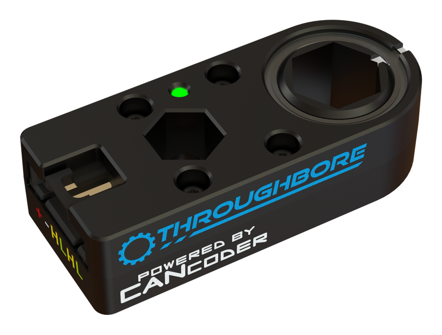

**What it is.** A CANcoder built into a housing with a **1/2" hex bore**, made by WCP with CTRE. The shaft passes right through it, so you don't need a magnet on the end of a shaft. It's handy on the middle of a shaft or a pivot.

**In software it IS a CANcoder.** Tuner X shows it as a CANcoder and you program it with the `CANcoder` class, the same snippet as above. Fused and Sync CANcoder modes work with it too.

**Connects.** CAN in/out and power through one 6-pin latching connector (Molex SL), so it daisy-chains. CAN FD on a CANivore.

**On our robots.** Not used yet. A good choice for a future arm pivot or turret where there's no free shaft end.

**Gotchas.** Same as the CANcoder: it's absolute only within one rotation of the hex shaft it's on. And it still needs a unique CANcoder ID (the 50s are taken by swerve).

We don't use the REV Through Bore Encoder or the Redux Canandmag (the first isn't on CAN at all, the second is CAN 2.0 only); when you need an absolute angle on a hex shaft, we use the WCP ThroughBore, which is a CANcoder.

---

## Heading sensors (gyros)

### CTRE Pigeon 2

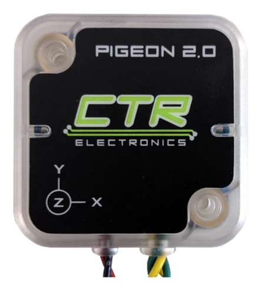 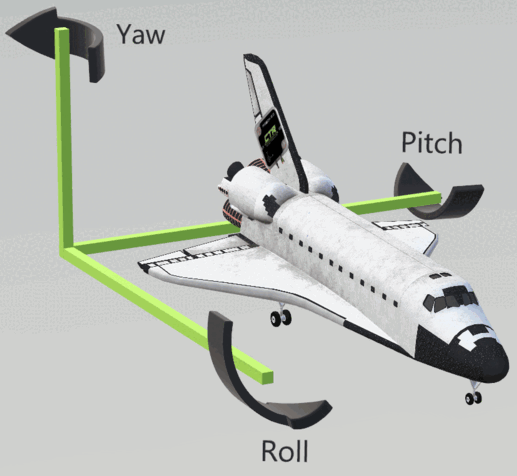

**What it is.** CTRE's IMU (inertial measurement unit): a gyro plus accelerometer that tracks which way the robot faces.

**Measures.** **Yaw** (heading, in degrees, counter-clockwise positive, keeps counting past 360), pitch, roll, angular velocity.

**Connects.** CAN and power. CAN FD capable.

**Class.** `Pigeon2`. On our robots the swerve code creates it; get it with `drivetrain.getPigeon2()` instead of making a second one.

```java
Pigeon2 pigeon = drivetrain.getPigeon2();
double yawDegrees = pigeon.getYaw().getValueAsDouble();
double turnRateDegPerSec = pigeon.getAngularVelocityZWorld().getValueAsDouble();
boolean gyroAlive = pigeon.isConnected();
```

**On our robots.** Every swerve robot. ID **0** on Jarvis.

**Gotchas.**
- **The ID 24 bug.** Our 2026 code said Pigeon ID 24; the real device was 0. The robot had no heading, the field map never rotated, and the turret only aimed right when it saw a tag. See [TunerConstants.java, lines 107–110](https://github.com/TorqueNados-FRC5090/Hephaestus/blob/c2f0cee6f61db3f26f911d3f5623ed7fa27a5b03/src/main/java/frc/robot/generated/TunerConstants.java#L107-L110). Put `Gyro/Connected` on the dashboard.
- Mounted at an angle? Set `Pigeon2Configuration.MountPose` (yaw/pitch/roll) or run the mount calibration in Tuner X.
- For aiming and autos, use the **pose** heading (`drivetrain.getState().Pose.getRotation()`), which vision corrects, not raw yaw.
- We don't use the Redux Canandgyro: it's CAN 2.0 only and CTRE's swerve code expects a Pigeon 2.

---

## Detection sensors

### CTRE CANrange

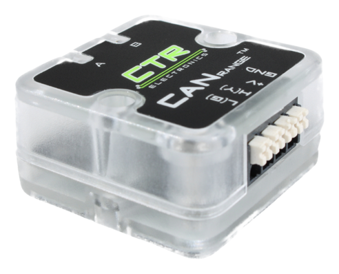

**What it is.** A **time-of-flight** (ToF) distance sensor: it sends out infrared laser light and times the bounce.

**Measures.** Distance in meters (about 1 cm to 3 m depending on mode), signal strength, and `IsDetected`, a true/false that turns on when something is closer than a threshold you pick. Short-range mode samples at 100 Hz.

**Connects.** CAN and power. No DIO wiring. It can also be a **remote limit switch** for a Talon (`ReverseLimitSourceValue.RemoteCANrange`).

**Class.** `CANrange` with `CANrangeConfiguration` (`ToFParams`, `ProximityParams`, `FovParams`).

```java
CANrange feederRange = new CANrange(CANIds.kFeederRange, upperBus);
CANrangeConfiguration rangeConfig = new CANrangeConfiguration();
rangeConfig.ToFParams.UpdateMode = UpdateModeValue.ShortRange100Hz;
rangeConfig.ProximityParams.ProximityThreshold = 0.10;   // meters: closer than 10 cm = detected
feederRange.getConfigurator().apply(rangeConfig);
boolean pieceInFeeder = feederRange.getIsDetected().getValue();
```

**Typical uses.** Game-piece detection in a feeder or intake (no separate emitter and receiver like a beam break), distance to a wall or reef, "is the elevator at the bottom".

**On our robots.** New for us. A strong pick for 2027 game-piece detection. Full setup in [21](21-sensors-and-homing.md).

**Gotchas.** Shiny or very dark game pieces return weaker signals. Graph `getDistance()` and `getSignalStrength()` with and without a piece before choosing the threshold. Narrow the field of view (`FovParams`) if it sees the robot's own frame.

### Redux Canandcolor

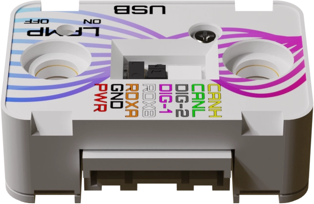

**What it is.** A proximity sensor plus color sensor in one small board, with a bright LED to light the target.

**Measures.** **Proximity** as a unitless number from 0 to 1. Redux's docs say it **decreases as an object approaches** (it depends on how much IR the object reflects, so it isn't a distance). Color as red/green/blue and HSV (hue, saturation, value). Two digital outputs that can trip on proximity or color thresholds.

**Connects.** CAN 2.0B only, so **rio bus only** on a roboRIO robot, never a CANivore. Our Stingray Canandcolors were created with just an ID, which means the rio bus. It breaks Michel's CAN FD rule, so it's the one exception we keep (for color); our electrical binder flags it to check against the 2027 manual. On SystemCore it works on any bus while the buses run classic CAN.

**Class.** `Canandcolor` from the **ReduxLib** vendordep (`https://frcsdk.reduxrobotics.com/ReduxLib_2026.json`).

```java
Canandcolor entrySensor = new Canandcolor(CANIds.kShooterEntrySensor);
CanandcolorSettings settings = new CanandcolorSettings();
settings.setLampLEDBrightness(0);              // lamp LED off, like Stingray did
entrySensor.setSettings(settings);
boolean pieceAtEntry = entrySensor.getProximity() <= kProximityBlockedThreshold;  // measured on the robot
double hue = entrySensor.getHSVHue();
```

**On our robots.** 2025 Stingray shooter: one sensor where the coral enters, one where it leaves. [Stingray Shooter.java, lines 36–46 (setup)](https://github.com/TorqueNados-FRC5090/Stingray-2025/blob/97c843705075c729538ad0b3925f67a35e3bf791/src/main/java/frc/robot/subsystems/Shooter.java#L36-L46) and [lines 73–76 (blocked checks)](https://github.com/TorqueNados-FRC5090/Stingray-2025/blob/97c843705075c729538ad0b3925f67a35e3bf791/src/main/java/frc/robot/subsystems/Shooter.java#L73-L76):

```java
entrySensor = new Canandcolor(SHOOTER_ENTRY_SENSOR_ID);
entrySensor.resetFactoryDefaults();
...
CanandcolorSettings settings = new CanandcolorSettings();
settings.setLampLEDBrightness(0);
entrySensor.setSettings(settings);
...
public boolean isEntrySensorBlocked() { return entrySensor.getProximity() <= .05; }
```

Notice: settings are reset and applied in code at every boot, so a swapped sensor just works. The `.05` should be a named constant.

**Gotchas.**
- **Measure the threshold** with the real game piece, empty and blocked, in the real lighting. Material changes the number a lot.
- Use HSV, not raw RGB, to tell pieces apart by color; Redux recommends it because HSV changes less with lighting.
- CAN 2.0 only. Use it when you need **color**; for a plain "is a piece here?" use a CANrange (CAN FD).

### CTRE CANdi

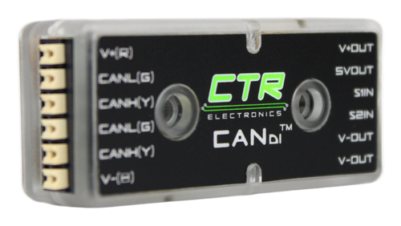

**What it is.** A small CAN device that reads **digital signals** and sends them over CAN. Two inputs, **S1** and **S2**. Each can be a plain digital input (beam break, limit switch), or a **PWM** encoder input; together they can read a **quadrature** encoder.

**Connects.** CAN and power, plus sensor wires to S1/S2. It supplies 5 V and battery voltage to power the sensors (300 mA total). Reads 3.3 V to 24 V logic, and can tell "floating" (nothing connected) apart from high and low. A limit switch goes COM to ground and NO to S1; a beam-break receiver's output goes to S2.

**Class.** `CANdi` with `CANdiConfiguration` (`DigitalInputs`, `PWM1`, `PWM2`, `Quadrature`).

```java
CANdi feederInputs = new CANdi(CANIds.kFeederCandi, upperBus);
CANdiConfiguration candiConfig = new CANdiConfiguration();
candiConfig.DigitalInputs.S1FloatState = S1FloatStateValue.PullHigh;       // nothing pulling = high
candiConfig.DigitalInputs.S1CloseState = S1CloseStateValue.CloseWhenLow;   // beam break pulls low when blocked
feederInputs.getConfigurator().apply(candiConfig);
boolean beamBlocked = feederInputs.getS1Closed().getValue();
```

A Talon can use a CANdi input directly, with no roboRIO code in the loop:
- As a **limit switch**: `HardwareLimitSwitch.ReverseLimitSource = ReverseLimitSourceValue.RemoteCANdiS1` and `ReverseLimitRemoteSensorID = <CANdi ID>`.
- As an **encoder**: `Feedback.FeedbackSensorSource = FeedbackSensorSourceValue.RemoteCANdiPWM1` (free) or `FusedCANdiPWM1` (Pro), with a PWM absolute encoder plugged into S1. We use CANcoders for angles, so this is rare for us.

**Typical uses.** Every limit switch and beam break on our robots goes through a CANdi, not roboRIO DIO. That puts them on CAN for a Kraken (which has no limit-switch port) and in the CTRE logs with everything else.

**On our robots.** Not on the 2026 robot (it used DIO wrappers); it's our standard from 2027. Full how-to in [21](21-sensors-and-homing.md).

**Gotchas.** Check what "closed" means with the sensor in your hand: watch `getS1State()` (Low / High / Floating) on the dashboard while you block and unblock it, then set `S1CloseState` to match.

---

## Lights

### CTRE CANdle

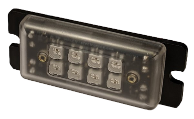 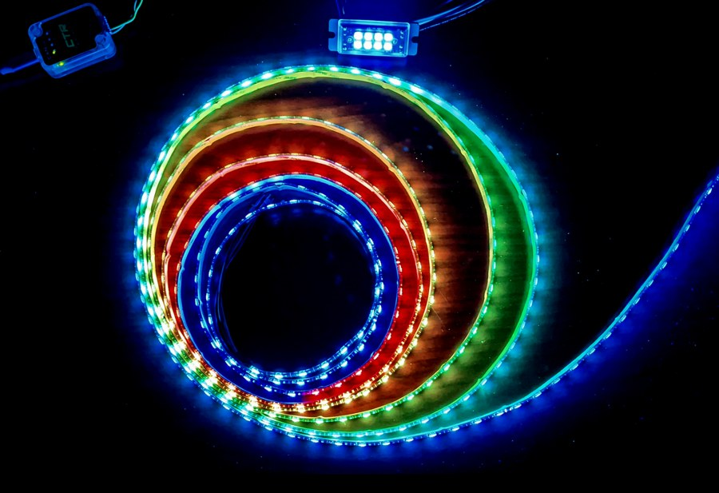

**What it is.** An LED controller on CAN. It has **8 RGB LEDs on board** and drives an addressable (WS2812B-type) LED strip, up to 6 A total, with a built-in 5 V regulator.

**Does.** Solid colors on any range of LEDs, and built-in animations (rainbow, strobe, fire, larson, twinkle and more) that run on the CANdle itself, so they don't load the CAN bus.

**Connects.** CAN and 12 V power in; strip power and data out.

**Phoenix 6 or Phoenix 5?** For **2026 the CANdle is in Phoenix 6**: `com.ctre.phoenix6.hardware.CANdle`, with control requests like `SolidColor` and `RainbowAnimation`. We confirmed the class is in the 26.3.0 jar. Older code (including Stingray 2025) uses the Phoenix 5 class `com.ctre.phoenix.led.CANdle` with `setLEDs(r, g, b)`. That's a different library and different firmware. Don't mix them: new code uses Phoenix 6, on 2026 CANdle firmware.

**Class.** `CANdle` with `CANdleConfiguration` (`LED.StripType`, `LED.BrightnessScalar`, `CANdleFeatures`).

```java
CANdle statusLights = new CANdle(CANIds.kStatusLights, upperBus);
CANdleConfiguration lightsConfig = new CANdleConfiguration();
lightsConfig.LED.StripType = StripTypeValue.GRB;     // most WS2812B strips are GRB
lightsConfig.LED.BrightnessScalar = 0.5;
statusLights.getConfigurator().apply(lightsConfig);
statusLights.setControl(new SolidColor(0, 67).withColor(new RGBWColor(0, 255, 0)));  // LEDs 0-67 green
```

(LED indexes 0–7 are the CANdle's own 8 LEDs; the strip starts at 8. Stingray's constants use exactly that layout.)

Animations use **slots** (0–7): `new RainbowAnimation(8, 67).withSlot(0)`. An animation keeps running in its slot until you replace it, send `new EmptyAnimation(slot)`, or call `clearAllAnimations()`.

**Typical uses.** Driver feedback: "have a game piece" (orange), "shooter ready" (green), "auto-align locked", "brownout warning". Lights are the fastest way to tell the drive team something without them looking down.

**On our robots.** 2025 Stingray and 2024 Thunderstrike, both with Phoenix 5. [Stingray Candle.java, lines 18–28](https://github.com/TorqueNados-FRC5090/Stingray-2025/blob/97c843705075c729538ad0b3925f67a35e3bf791/src/main/java/frc/robot/subsystems/Candle.java#L18-L28):

```java
public Candle(){
    candle = new CANdle(CANDLE_ID, "Default Name");
    candle.setStatusFramePeriod(CANdleStatusFrame.CANdleStatusFrame_Status_1_General, 500);
}

/** Sets the LEDs to the selected color */
public void setAll(LEDColor color) {
    candle.setLEDs(color.getRed(), color.getGreen(), color.getBlue());
}
```

Notice the bus name "Default Name": that CANivore was never renamed. And look at the command that drives it, [LEDControl.java, lines 30–37](https://github.com/TorqueNados-FRC5090/Stingray-2025/blob/97c843705075c729538ad0b3925f67a35e3bf791/src/main/java/frc/robot/commands/LEDControl.java#L30-L37): the second `if` (green) can never run, because the first `if` already catches every case where the exit sensor is blocked. A good exercise (Practice 3).

**Gotchas.**
- Strip type wrong = wrong colors (red shows as green). Try `GRB` first, then `RGB`.
- A long strip at full white pulls a lot of current. Keep `BrightnessScalar` below 1.
- Tuner X 2026 has a CANdle animations tab that previews your LEDs live and can even generate a subsystem. Useful for picking colors.

---

## The CAN bus itself

### CANivore

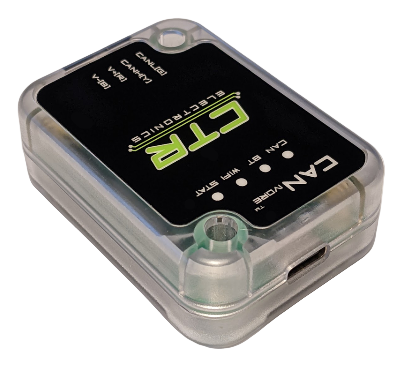

**What it is.** A USB-to-**CAN FD** adapter. Plug it into the roboRIO's USB and you get a whole extra CAN bus, with much more room for data than the rio bus.

**Why swerve goes on it.** (Full story in [02](02-phoenix-tuner-x-and-can.md).) CTRE's swerve code needs all swerve devices on one bus; swerve odometry reads every module many times a second, which would fill a classic CAN bus; on a CAN FD bus the swerve odometry thread runs at **250 Hz** by default (100 Hz on CAN 2.0), per the comment in [CommandSwerveDrivetrain.java, lines 150–152](https://github.com/TorqueNados-FRC5090/Hephaestus/blob/c2f0cee6f61db3f26f911d3f5623ed7fa27a5b03/src/main/java/frc/robot/subsystems/CommandSwerveDrivetrain.java#L150-L152); and a fault on the mechanism bus can't take out the drivetrain.

**Naming.** You name each CANivore in Tuner X (CANivores page). Ours are **"Jarvis"** (swerve) and **"Upper"** (mechanisms). The code must use the exact same name, capitals included:

```java
CANBus upperBus = new CANBus("Upper");
TalonFX hoodMotor = new TalonFX(20, upperBus);
// Health check for the dashboard: how busy is the bus?
double upperBusUtilization = upperBus.getStatus().BusUtilization;   // 0.0 to 1.0
```

See [TunerConstants.java, lines 84–86 ("Jarvis")](https://github.com/TorqueNados-FRC5090/Hephaestus/blob/c2f0cee6f61db3f26f911d3f5623ed7fa27a5b03/src/main/java/frc/robot/generated/TunerConstants.java#L84-L86) and [RobotContainer.java, line 48 ("Upper")](https://github.com/TorqueNados-FRC5090/Hephaestus/blob/c2f0cee6f61db3f26f911d3f5623ed7fa27a5b03/src/main/java/frc/robot/RobotContainer.java#L48).

**Licensing.** A **CANivore license** makes every device on that bus Pro. Our Season Pass licenses devices one by one instead. Which one we actually have is something to check in Tuner X ([31](31-phoenix-pro-features.md)).

**Gotchas.**
- Rename it in Tuner X and forget the code: every device on it is "not found".
- Its built-in 120 Ω terminator is switched on/off in Tuner X. Meter test: about 60 Ω between CAN High and Low.
- Light codes: red double-blink = no USB; red fast strobe = USB plugged in but not talking (wait for the roboRIO to boot, then try another cable).
- You can plug a CANivore into a laptop and set up motors on the bench with no robot ([02](02-phoenix-tuner-x-and-can.md)).

---

## Power

### REV Power Distribution Hub (PDH)

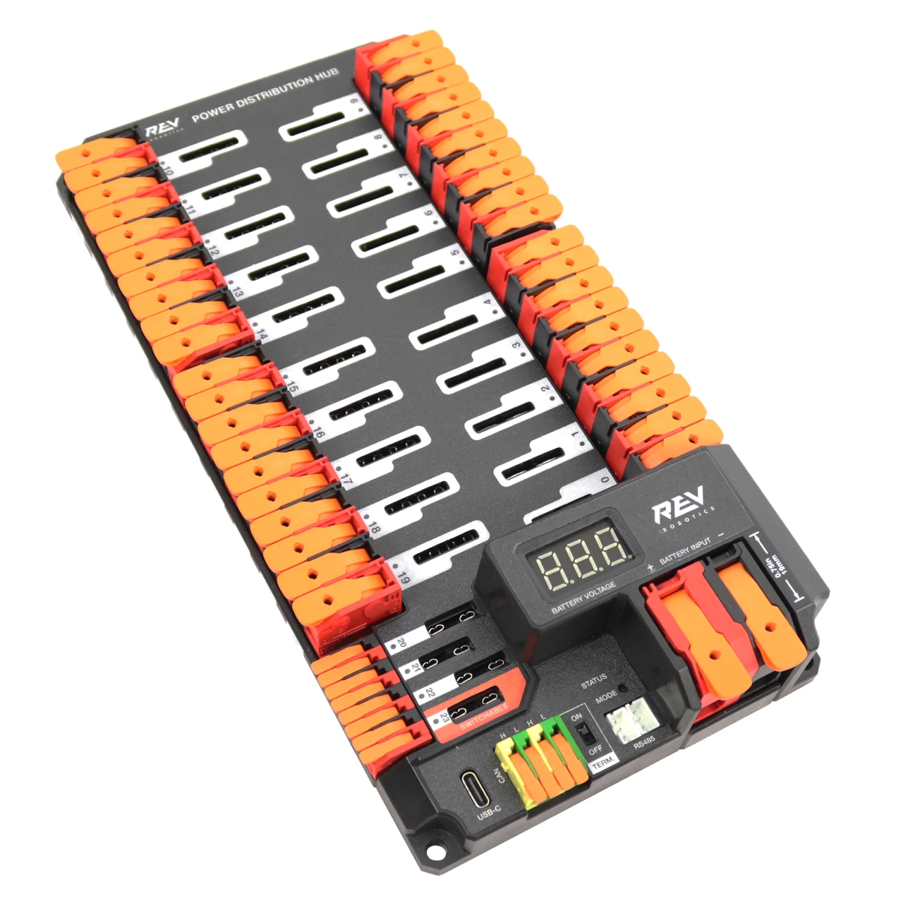

**What it is.** The board every motor and device gets its power from. The battery goes through the 120 A main breaker into the PDH, and the PDH splits it into channels, each with its own breaker or fuse: **20 high-current channels (0–19, up to 40 A)**, **3 low-current fused channels (20–22)** and **1 switchable channel (23)**.

**Measures.** The current on **every channel**, the total current, the battery voltage, and its temperature. It sends all of that over CAN, which is why we use it as our **power logger**: when the robot browns out, the PDH log tells you which channel (which motor) was pulling the current.

**Connects.** Battery power in; CAN 2.0 on its CAN terminals (with a termination switch); USB-C for the **REV Hardware Client** on a laptop. **CAN 2.0 only**: rio bus on our 2026 robot, CAN ID **1** from our scheme ([02](02-phoenix-tuner-x-and-can.md)). In the 2027 plan it gets bus `can_s4` to itself.

**Class.** WPILib's `PowerDistribution` (no vendordep needed):

```java
// CAN ID 1, REV PDH (kCTRE would be the old CTRE PDP)
PowerDistribution pdh = new PowerDistribution(1, ModuleType.kRev);
double batteryVolts = pdh.getVoltage();
double totalAmps = pdh.getTotalCurrent();
double shooterAmps = pdh.getCurrent(kShooterLeaderPdhChannel);   // channel number from our wiring map
SmartDashboard.putData("Power/PDH", pdh);                          // every channel, total and voltage, logged
```

(`ModuleType` is `PowerDistribution.ModuleType`. `kShooterLeaderPdhChannel` is a placeholder for a channel constant you add to `Constants`.)

**On our robots.** Every robot has one. Our template's `RobotLog` creates it and publishes every channel at startup, so all of it lands in the log: [RobotLog.java, lines 86–92](https://github.com/TorqueNados-FRC5090/Robot-Template/blob/b8dddd0e338841e867c0cc260162e6097adecd7b/src/main/java/frc/robot/RobotLog.java#L86-L92). Reading those logs is in [19 Logging and Debugging](19-logging-and-debugging.md).

**Gotchas.**
- **The log only helps with a channel map.** "Channel 7: 95 A" means nothing until you know channel 7 is the left shooter motor. Write the map down when you wire it (our electrical binder has a fill-in table) and put it in `Constants` as named channel numbers.
- **Firmware and status come from the REV Hardware Client** (a desktop app, not Tuner X): plug a USB-C cable into the PDH, select it, and update the firmware there. Tuner X doesn't show REV devices.
- `new PowerDistribution()` with no arguments auto-detects the PDH (that's what our template does). Passing `1, ModuleType.kRev` is explicit and fails loudly if the ID is wrong.

---

## Cameras

### Limelight

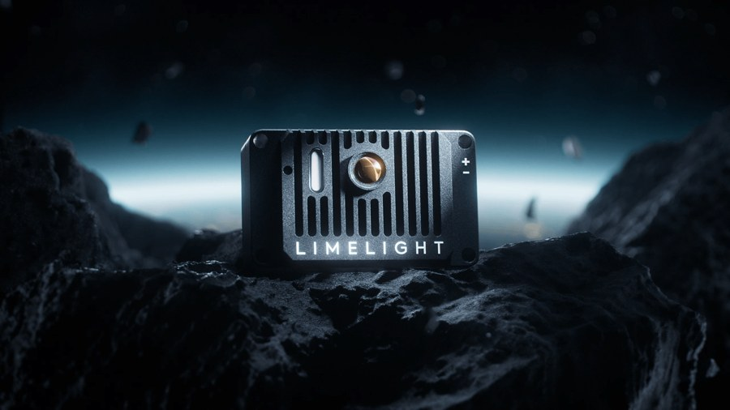

A smart camera on **Ethernet** (not CAN) at 10.50.90.11 that finds AprilTags, targets and game pieces; everything about it is in [17 Limelight and Vision](17-limelight-and-vision.md) and [32 Object Detection](32-limelight-object-detection.md).

---

## Step by step: adding a new device to the robot

1. **Find it in this catalog.** Check the bus column. CAN 2.0-only devices (the Canandcolor, the PDH) go on the rio bus; everything else for a mechanism goes on "Upper".
2. **Pick an ID** from our scheme ([02](02-phoenix-tuner-x-and-can.md)): 10–29 for mechanism devices. Check nothing on that bus already uses it for that model.
3. **Wire it in** (power, CAN in and out). Don't Y-split CAN.
4. **Set the ID, name and firmware in Tuner X** (Redux devices: use Redux's Alchemist tool or ReduxLib's web page at port 7244 on the roboRIO). Label the device with ID and bus.
5. **Add the vendordep if needed.** CTRE devices need Phoenix 6 (already in our projects). Redux devices need ReduxLib.
6. **Add a named constant** in `Constants.java` (e.g. `kFeederRange = 23`) with a comment saying what it is and which bus.
7. **Create it in the subsystem** with the right class and the `CANBus` object, apply a full configuration in the constructor, and check the `StatusCode`.
8. **Put the raw reading on the dashboard** (`Feeder/Range distance (m)`, `Feeder/Range detected`) and test it by hand before any code depends on it.
9. **Unplug test:** with it unplugged, does the robot do the safe thing?

---

## In our code (summary)

| Device | Where to look | What to notice |
|---|---|---|
| Kraken X60 swerve + CANcoders + Pigeon | [TunerConstants.java, lines 84–110](https://github.com/TorqueNados-FRC5090/Hephaestus/blob/c2f0cee6f61db3f26f911d3f5623ed7fa27a5b03/src/main/java/frc/robot/generated/TunerConstants.java#L84-L110) | Bus "Jarvis", Pigeon ID 0 with the "was 24" comment (`FusedCANcoder` is set earlier, at [lines 48–50](https://github.com/TorqueNados-FRC5090/Hephaestus/blob/c2f0cee6f61db3f26f911d3f5623ed7fa27a5b03/src/main/java/frc/robot/generated/TunerConstants.java#L48-L50)) |
| Talon FXS + Minion | [Turret.java, lines 129–136](https://github.com/TorqueNados-FRC5090/Hephaestus/blob/c2f0cee6f61db3f26f911d3f5623ed7fa27a5b03/src/main/java/frc/robot/subsystems/Turret.java#L129-L136) | `Minion_JST`, current limits right below |
| Talon FXS + Vortex | [EvilIntake.java, lines 154–158](https://github.com/TorqueNados-FRC5090/Hephaestus/blob/c2f0cee6f61db3f26f911d3f5623ed7fa27a5b03/src/main/java/frc/robot/subsystems/EvilIntake.java#L154-L158) | `VORTEX_JST`, `AdvancedHallSupport` (Pro) |
| Canandcolor | [Stingray Shooter.java, lines 36–76](https://github.com/TorqueNados-FRC5090/Stingray-2025/blob/97c843705075c729538ad0b3925f67a35e3bf791/src/main/java/frc/robot/subsystems/Shooter.java#L36-L76) | Two sensors, settings applied every boot, magic `.05` |
| REV PDH | [RobotLog.java, lines 86–92](https://github.com/TorqueNados-FRC5090/Robot-Template/blob/b8dddd0e338841e867c0cc260162e6097adecd7b/src/main/java/frc/robot/RobotLog.java#L86-L92) (template) | `PowerDistribution` published with `putData`, so every channel is logged |
| CANdle (Phoenix 5) | [Stingray Candle.java, lines 18–28](https://github.com/TorqueNados-FRC5090/Stingray-2025/blob/97c843705075c729538ad0b3925f67a35e3bf791/src/main/java/frc/robot/subsystems/Candle.java#L18-L28) | Old API; CANivore still named "Default Name" |

---

## Common mistakes

- **Wrong ID in code.** The Pigeon was 24 in code and 0 on the robot: no heading all season until we found it. Compare every ID with Tuner X.
- **Putting a CAN 2.0-only device on a CANivore.** The Canandcolor (and the PDH) can't live on a CAN FD bus. Check the bus column before wiring.
- **Talon FXS with no MotorArrangement.** It won't drive. Orange/green blink.
- **Expecting FOC on a Talon FXS.** It doesn't have it; only Talon FX motors (Krakens, Falcons) do.
- **Copying Phoenix 5 CANdle code into a 2026 project.** `com.ctre.phoenix.led.CANdle` and `setLEDs()` are Phoenix 5. Use the Phoenix 6 `CANdle` with `SolidColor` and animations.
- **Treating Canandcolor proximity as a distance.** It's unitless and depends on the material. Measure with the real game piece.
- **A CANcoder on a shaft that turns more than once over the travel.** It's only absolute within one rotation.
- **A limit switch or beam break on roboRIO DIO, expecting the Talon to stop on it.** The Talon can't see roboRIO DIO. Wire it to a CANdi.
- **No PDH channel map.** The log shows "channel 7 hit 90 A", and nobody knows which motor that is. Write the map down when you wire it.
- **Renaming a CANivore in Tuner X but not in code** (or getting a capital letter wrong).

---

## Checklist

- [ ] Every device is in `Constants.java` with an ID from our scheme and a comment naming the bus
- [ ] Every device on a CANivore supports CAN FD; the Canandcolor and the PDH are on the rio bus
- [ ] Every limit switch and beam break goes through a CANdi
- [ ] PDH channel map written down and kept with the robot
- [ ] Swerve motors, CANcoders and Pigeon all on one bus ("Jarvis")
- [ ] Talon FXS devices have `MotorArrangement` set in code
- [ ] Each sensor's raw reading is on the dashboard with units in the key, and was checked by hand
- [ ] CANcoders: offset measured, no wrap inside the travel, magnet health green
- [ ] `Gyro/Connected` is true and yaw changes the right way when you turn the robot
- [ ] CANdle code uses Phoenix 6 classes; CANdle firmware is the 2026 version
- [ ] Unplug test done for every sensor

---

## Practice

1. **Device hunt.** Walk around the 2026 robot with this guide. For every CAN device you can find, write down: model, ID (from the label or Tuner X), bus, and the Java class that controls it. Compare with the layout diagram above. Report anything that doesn't match.
2. **Pick the sensor.** For each job, pick a device from the catalog and say why: (a) know when a game piece reaches the shooter; (b) know a turret's angle at power-on; (c) tell a red piece from a blue piece; (d) a limit switch at the bottom of an elevator driven by a Kraken. Then compare answers with a teammate.
3. **Fix the LED logic.** Open Stingray's `LEDControl.java` (lines 30–37). Explain why green can never show. Rewrite the `if` chain so it does what the author meant. Then rewrite `Candle.java` for Phoenix 6 using `CANdle`, `CANdleConfiguration` and `SolidColor` (you can build it against our 2026 template to check it compiles).
4. **CANrange threshold (robot or bench).** Wire a CANrange to a CANivore, plot distance and signal strength in Tuner X with and without a game piece in front, and choose `ProximityThreshold` and `ProximityHysteresis`. Write down the numbers and why.

---

## Go further

- CTRE hardware reference (every CTRE device, light codes): https://v6.docs.ctr-electronics.com/en/stable/docs/hardware-reference/index.html
- Talon FX / Kraken: https://v6.docs.ctr-electronics.com/en/stable/docs/hardware-reference/talonfx/index.html
- Talon FXS: https://v6.docs.ctr-electronics.com/en/stable/docs/hardware-reference/talonfxs/index.html
- CANcoder: https://v6.docs.ctr-electronics.com/en/stable/docs/hardware-reference/cancoder/index.html
- CANrange: https://v6.docs.ctr-electronics.com/en/stable/docs/hardware-reference/canrange/index.html
- CANdi: https://v6.docs.ctr-electronics.com/en/stable/docs/hardware-reference/candi/index.html
- CANdle: https://v6.docs.ctr-electronics.com/en/stable/docs/hardware-reference/candle/index.html
- Pigeon 2: https://v6.docs.ctr-electronics.com/en/stable/docs/hardware-reference/pigeon2/index.html
- CANivore: https://v6.docs.ctr-electronics.com/en/stable/docs/canivore/canivore-intro.html
- Remote sensors (RemoteCANcoder, FusedCANcoder, CANdi): https://v6.docs.ctr-electronics.com/en/stable/docs/api-reference/device-specific/talonfx/remote-sensors.html
- Phoenix 6 Java API docs: https://api.ctr-electronics.com/phoenix6/stable/java/
- WCP Kraken and ThroughBore docs: https://docs.wcproducts.com/
- Redux docs (Canandcolor, ReduxLib): https://docs.reduxrobotics.com/
- REV PDH: https://docs.revrobotics.com/ion-control/pdh
- REV Hardware Client: https://docs.revrobotics.com/rev-hardware-client
- WPILib PowerDistribution: https://docs.wpilib.org/en/stable/docs/software/can-devices/power-distribution-module.html
