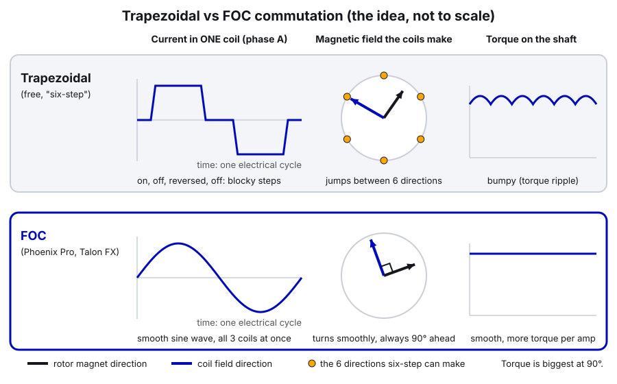
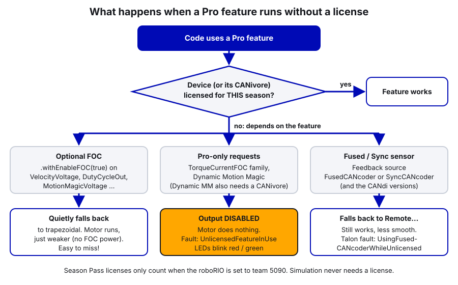

# 31. Phoenix Pro: FOC and the Paid Features

> **Who it's for:** programmers who write motor code and want to know what our Phoenix Pro license actually does, and what breaks if it's missing. Also whoever renews the license each season.
> **What you need first:** [02 Phoenix Tuner X and the CAN Bus](02-phoenix-tuner-x-and-can.md) (licensing basics, CANivores), [05 Motors in Phoenix 6](05-motors-in-phoenix-6.md) (control requests). Helpful: [09 Motion Magic](09-motion-magic-and-position-control.md), [10 Flywheels](10-flywheels-and-shooters.md), [30 Device Catalog](30-sensor-and-device-catalog.md).
> **Time:** about 1 hour to read, plus a shop session for the practice.

**What you'll learn**
- What Phoenix Pro is, the three kinds of license, and how to check which one we have and whether each device is licensed.
- What FOC is, why it gives our Krakens more power, and why we write `.withEnableFOC(true)` everywhere.
- What torque-current control (`TorqueCurrentFOC` and friends) is and when it beats voltage control.
- The other Pro features: fused CANcoders, time-synced signals, Dynamic Motion Magic, full signal-log export, Advanced Hall Support, and what's new for 2026.
- Exactly what happens when a Pro feature runs on an unlicensed device, and how our dashboard catches it.

---

## 1. What Phoenix Pro is

**Phoenix 6** is CTRE's library for its motors and sensors. It's free, and it does a lot: configs, control requests, Motion Magic, swerve, simulation, Tuner X.

**Phoenix Pro** is a paid license that unlocks extra features in the **same** Phoenix 6 library. You don't install anything different. The code is the same; the device just does more when it's licensed.

CTRE's own summary of what Pro adds: Field Oriented Control (FOC), time base synchronization on a CANivore, fused CANcoder, full signal logger export, and hoot log replay, plus a few control modes that need Pro on a CANivore.

### The three kinds of license

From CTRE's licensing pages:

| License | What it covers | Good for |
|---|---|---|
| **Season Pass** (FRC teams only) | One purchase, **100 device licenses**, tied to a team number | A whole robot (or two) |
| **Single device** | Exactly one device | One or two devices, bench projects |
| **CANivore bus** | Installed on a CANivore; **every device on that bus** gets Pro | Lots of devices; replacements are Pro automatically |

Rules worth knowing:
- **Licenses are per season.** CTRE: "Licenses will enable Phoenix Pro features on hardware when the device firmware and API versions match the license year." A 2026 license works with 26.x firmware and the 26.x API. When we move to the 2027 software, we need 2027 licenses. Budget for it every year.
- **A Season Pass only works when the roboRIO is set to the same team number** (5090). A roboRIO imaged with the wrong team number makes every device look unlicensed. Attaching the team number to the pass is **permanent**.
- **A Season Pass works on the rio bus and on CANivores.**
- **Activating a license on a device is permanent.** Don't use them up on loaner or test devices.
- **Simulation never needs a license.** CTRE: "Using Phoenix 6 simulation with Pro features does not require licensing." So you can try every feature in this guide in sim.

### Which license do we have?

We have Pro. **Which kind** (Season Pass licensing devices one by one, or a CANivore bus license on Jarvis/Upper) should be checked in Tuner X, not assumed:

1. Connect Tuner X to the robot ([02](02-phoenix-tuner-x-and-can.md)).
2. **Profile** page: lists the licenses on our CTRE account and which team a Season Pass is assigned to.
3. **Devices** page: the icon at the bottom right of each card shows Licensed / Not Licensed / Licensing Error. Self Test shows it too.
4. **CANivores** page: shows whether a CANivore itself carries a bus license.

From code, every Pro-capable device has an `IsProLicensed` signal:

```java
SmartDashboard.putBoolean("Pro/Shooter licensed", shooterLeader.getIsProLicensed().getValue());
```

---

## 2. Free vs Pro at a glance

This is CTRE's feature breakdown, trimmed to what matters to us. "rio" = the roboRIO's CAN bus; "CANivore" = a CANivore bus.

| Feature | Free (rio) | Free (CANivore) | Pro (rio) | Pro (CANivore) |
|---|---|---|---|---|
| Configs, control requests, units, Kalman velocity | yes | yes | yes | yes |
| Motion Magic, Motion Magic Velocity, **Motion Magic Expo** | yes | yes | yes | yes |
| Continuous wrap (swerve steering) | yes | yes | yes | yes |
| Simple differential control | yes | yes | yes | yes |
| Signal logging, **limited** export | yes | yes | yes | yes |
| CAN FD, CANivore timestamps | | yes | | yes |
| **FOC** (and `TorqueCurrentFOC` family) | | | yes | yes |
| **FusedCANcoder / SyncCANcoder** | | | yes | yes |
| **Full** signal logger export, hoot replay | | | yes | yes |
| **Time-synced signals**, device timestamps | | | | yes |
| **Dynamic Motion Magic** | | | | yes |
| Full differential control | | | | yes |
| Swerve API | good | better | better | best |

Two surprises in that table:
- **Motion Magic Expo is free.** Only the *Dynamic* versions need Pro.
- **250 Hz swerve odometry is not a Pro feature.** It comes from CAN FD (the CANivore). Pro adds time sync on top (section 6).

---

## 3. FOC: more power from the same motor

### What commutation is

A brushless motor has three sets of coils around a spinning magnet (the rotor). To make it turn, the controller switches current through the coils in a pattern that keeps pulling the magnet around. That switching is called **commutation**.

**Trapezoidal commutation** (the free mode, also called "six-step") turns coils fully on, off or reversed. The coils' magnetic field can only point in **six directions**, so it jumps 60° at a time. Between jumps the angle between the coil field and the rotor magnet drifts away from the ideal 90°, so the torque has small bumps (torque ripple).

**FOC** (field oriented control) measures the rotor angle constantly and drives smooth, sine-shaped currents in all three coils at once, so the coil field turns smoothly and stays **90° ahead of the rotor magnet**, where it makes the most torque per amp.



### What it gives us

CTRE says FOC gives about a **15% increase in peak power**, more torque (faster acceleration and higher speed under load) and better efficiency (less current for the same output power). WCP's Kraken X60 tables show it clearly:

| Kraken X60 | Stall torque | Peak power |
|---|---|---|
| Trapezoidal | 7.09 N·m | 1,108 W |
| FOC | 9.37 N·m | 1,405 W |

Free speed drops slightly (6,000 → 5,800 RPM), but under load (which is when it matters) FOC wins. For our robot that means faster shooter spin-up and recovery between shots, harder-pushing swerve, quicker arms.

### Using it

Every request that supports it has an `EnableFOC` field. In Phoenix 6 it **already defaults to true**; we write it anyway so it's obvious (team rule):

```java
private final VelocityVoltage m_flywheelRequest = new VelocityVoltage(0).withSlot(0).withEnableFOC(true);
...
m_flywheelMotor.setControl(m_flywheelRequest.withVelocity(targetRps));
```

**When it matters:** always on Krakens. There's no downside when licensed.

**Pro-only?** Yes. And **Talon FX only**: CTRE's docs say "the Talon FXS does not support FOC at this time". On our turret (Minion) and intake rack (Vortex), both Talon FXS, the `.withEnableFOC(true)` does nothing. It's harmless, but don't expect FOC power from them.

### In our code

FOC is requested on every motor:
- [Shooter.java, line 108 (shooter VelocityVoltage)](https://github.com/TorqueNados-FRC5090/Hephaestus/blob/c2f0cee6f61db3f26f911d3f5623ed7fa27a5b03/src/main/java/frc/robot/subsystems/Shooter.java#L108)
- [RollerSystem.java, lines 23–25 (floor, belts, stop)](https://github.com/TorqueNados-FRC5090/Hephaestus/blob/c2f0cee6f61db3f26f911d3f5623ed7fa27a5b03/src/main/java/frc/robot/subsystems/RollerSystem.java#L23-L25)
- [Hood.java, line 43](https://github.com/TorqueNados-FRC5090/Hephaestus/blob/c2f0cee6f61db3f26f911d3f5623ed7fa27a5b03/src/main/java/frc/robot/subsystems/Hood.java#L43)
- [Turret.java, line 130](https://github.com/TorqueNados-FRC5090/Hephaestus/blob/c2f0cee6f61db3f26f911d3f5623ed7fa27a5b03/src/main/java/frc/robot/subsystems/Turret.java#L130) (Talon FXS: no effect)
- [EvilIntake.java, lines 125–128](https://github.com/TorqueNados-FRC5090/Hephaestus/blob/c2f0cee6f61db3f26f911d3f5623ed7fa27a5b03/src/main/java/frc/robot/subsystems/EvilIntake.java#L125-L128) (rack requests are Talon FXS: no effect; the wheel `DutyCycleOut` is a Talon FX: FOC works)

```java
private final VelocityVoltage m_floorRequest = new VelocityVoltage(0).withSlot(0).withEnableFOC(true);
private final VelocityVoltage m_beltRequest = new VelocityVoltage(0).withSlot(0).withEnableFOC(true);
private final VoltageOut m_stopRequest = new VoltageOut(0).withEnableFOC(true);
```

Notice the requests are fields, made once, all with FOC written out. That's the pattern.

---

## 4. Torque-current control: commanding force instead of voltage

### The idea

With `VoltageOut` or `VelocityVoltage`, you command **volts**. Volts mostly decide **speed**: a motor at a fixed voltage settles at a fixed speed. To hold a speed you need kV, and when the battery sags or the load changes, the controller has to notice the error and correct.

With **torque-current control**, you command **amps of torque current** (for a motor, torque current is the same size as stator current). Amps decide **torque**, and torque decides **acceleration**. CTRE's docs list the advantages:
- 0 A means "keep the current speed" (no outside forces). kV is often small or zero.
- The gains are in real-world units (amps), so kA can be tuned on its own.
- It's not affected by battery voltage (until the motor runs out of voltage at high speed).

The requests (all Pro-only, all Talon FX only):

| Request | You command | Gains are in |
|---|---|---|
| `TorqueCurrentFOC` | Amps directly | (open loop) |
| `VelocityTorqueCurrentFOC` | Velocity (RPS) | A per RPS (kP), A (kS), A per RPS (kV) |
| `PositionTorqueCurrentFOC` | Position (rotations) | A per rotation (kP), A per RPS (kD) |
| `MotionMagicTorqueCurrentFOC` | Position, profiled | same as position |
| `MotionMagicVelocityTorqueCurrentFOC`, `MotionMagicExpoTorqueCurrentFOC` | Profiled velocity / Expo profile | same idea |

### Why it's great for flywheels and arms

- **Flywheel:** every shot pulls energy out of the wheel. With voltage control, the PID has to see the speed drop first. With torque control, the feedforward is in amps and doesn't care about battery voltage, so recovery is more repeatable over a match. CTRE's tuning page walks through a flywheel in torque mode and ends with kS = 2.6 A, kV = 0.15 A/RPS, kP = 16 A/RPS for their example wheel.
- **Arm:** gravity is a torque. With torque control, kG is "amps to hold the arm level", which stays true as the battery drains.
- **Position mechanisms need kD.** CTRE warns that in torque mode the natural damping of voltage control is gone, so a position loop needs kD to stop in a reasonable time.

### A flywheel example (new code)

```java
// Flywheel on a Kraken X60 using torque-current velocity control (Phoenix Pro required)
private final VelocityTorqueCurrentFOC m_flywheelTorqueRequest = new VelocityTorqueCurrentFOC(0).withSlot(0);

TalonFXConfiguration config = new TalonFXConfiguration();
config.MotorOutput.NeutralMode = NeutralModeValue.Coast;
config.CurrentLimits.StatorCurrentLimit = 80;          // also limits torque current
config.CurrentLimits.StatorCurrentLimitEnable = true;
config.CurrentLimits.SupplyCurrentLimit = 50;
config.CurrentLimits.SupplyCurrentLimitEnable = true;
config.TorqueCurrent.PeakForwardTorqueCurrent = 80;    // amps
config.TorqueCurrent.PeakReverseTorqueCurrent = -80;
config.Slot0.kS = 2.5;    // amps to overcome friction (start here, tune on the robot)
config.Slot0.kV = 0.15;   // amps per RPS (drag)
config.Slot0.kP = 5.0;    // amps per RPS of error
m_flywheelMotor.getConfigurator().apply(config);

m_flywheelMotor.setControl(m_flywheelTorqueRequest.withVelocity(targetRps));
```

The starting gains are guesses based on CTRE's example; tune them with their steps (kS at a low speed, kV at a high speed, repeat, then raise kP until it oscillates and back off). CTRE notes current limits still apply in torque mode, and the most restrictive of the stator limit and the peak torque currents wins.

### When it matters for us, honestly

- **We don't use torque control yet.** Guide 05's table says "not used yet", and that's still true.
- **Best candidate: the shooter** (two Krakens). Worth a test in the off-season against our current `VelocityVoltage` (see Practice 2).
- **Not possible on the turret or intake rack** as built: they're Talon FXS, which has no FOC and no torque-current modes.
- **Without a license, a torque request disables the motor.** That's the big difference from optional FOC (section 10). If you use it, add the license check to the dashboard.

---

## 5. Fused and Sync CANcoder

**What it gives us.** A Talon's built-in rotor sensor is fast and smooth but only relative. A CANcoder is absolute but slower over CAN and sits after the gear backlash. **FusedCANcoder** blends the two: the CANcoder keeps the position correct, the rotor sensor fills in between updates. CTRE: "Fuse a CANcoder with the motor's internal rotor, getting absolute data all the time while using the fast internal sensor for closed looping." **SyncCANcoder** only syncs the rotor to the CANcoder and keeps using the rotor, which CTRE suggests when a broken sensor mount could feed the loop "good-looking" wrong data.

**When it matters.** Swerve steering (every robot), and any arm or turret with a CANcoder.

**Pro-only?** Yes. Without a license the Talon falls back to `RemoteCANcoder` and sets the `UsingFusedCANcoderWhileUnlicensed` fault. The CANdi has the same modes (`FusedCANdiPWM1`, `SyncCANdiPWM1`...).

```java
config.Feedback.FeedbackRemoteSensorID = CANIds.kArmEncoder;
config.Feedback.FeedbackSensorSource = FeedbackSensorSourceValue.FusedCANcoder;
config.Feedback.RotorToSensorRatio = 48.0;      // motor rotations per CANcoder rotation
config.Feedback.SensorToMechanismRatio = 1.0;   // CANcoder is 1:1 with the arm
```

The full how-to, with offsets and ratios, is in [28 Fusing Sensors to a Motor](28-fusing-sensors-to-a-motor.md).

**In our code.** The swerve steer motors, set by the generator in [TunerConstants.java, lines 48–50](https://github.com/TorqueNados-FRC5090/Hephaestus/blob/c2f0cee6f61db3f26f911d3f5623ed7fa27a5b03/src/main/java/frc/robot/generated/TunerConstants.java#L48-L50):

```java
// The remote sensor feedback type to use for the steer motors;
// When not Pro-licensed, Fused*/Sync* automatically fall back to Remote*
private static final SteerFeedbackType kSteerFeedbackType = SteerFeedbackType.FusedCANcoder;
```

---

## 6. CANivore time sync, and 250 Hz odometry

**What it gives us.** With Pro on a CANivore, all devices on that bus **synchronize their clocks**. Their signals are sampled and sent **at the same instant**, with a device timestamp of when each was measured. Code can then wait for a whole set of signals to arrive together with `BaseStatusSignal.waitForAll()`. CTRE: "This is particularly useful for multi-device mechanisms, such as swerve odometry."

**What it doesn't give us.** The 250 Hz odometry rate. That's from CAN FD. The comment in [CommandSwerveDrivetrain.java, lines 150–152](https://github.com/TorqueNados-FRC5090/Hephaestus/blob/c2f0cee6f61db3f26f911d3f5623ed7fa27a5b03/src/main/java/frc/robot/subsystems/CommandSwerveDrivetrain.java#L150-L152) says it: if unspecified, "this is 250 Hz on CAN FD, and 100 Hz on CAN 2.0". Our `createDrivetrain()` doesn't pass a frequency, so we get 250 Hz on Jarvis. Pro makes those 250 samples line up in time, which CTRE's odometry tests show reduces error. (CTRE's swerve page rates the Swerve API "good" free on the rio, "better" on a CANivore, "best" with Pro on a CANivore.)

**Pro-only?** Time sync: yes, and only on a CANivore. `waitForAll()` itself is free; without time sync the signals just aren't sampled together.

```java
// Read three devices' signals sampled at the same moment (Pro + CANivore), wait up to 20 ms
var steerPosition = m_steerMotor.getPosition(false);
var encoderPosition = m_steerEncoder.getPosition(false);
var gyroYaw = m_pigeon.getYaw(false);
BaseStatusSignal.waitForAll(0.020, steerPosition, encoderPosition, gyroYaw);
```

(The `false` means "don't refresh now", because `waitForAll` does it.)

**In our code.** The CTRE swerve code does this for us in its odometry thread. You'll only write it yourself for a multi-motor mechanism that needs perfectly matched readings. Control requests also have a `UseTimesync` field (apply the request on a time-sync boundary, Pro + CANivore); we don't use it.

---

## 7. Dynamic Motion Magic

**What it gives us.** Normal Motion Magic reads cruise velocity, acceleration and jerk from the **config**, which is slow to change. **Dynamic** Motion Magic puts them **in the request**, so you can change them every loop: a gentle profile for one move and a fast one for another, or slower deceleration than acceleration. See [09](09-motion-magic-and-position-control.md) for Motion Magic itself.

**Pro-only?** Yes, **and it needs a CANivore**. CTRE: "When unlicensed, the TalonFX will disable control output and trip the UnlicensedFeatureInUse fault." So this is one of the features that **stops the motor** without a license. The new-for-2026 `DynamicMotionMagicExpoVoltage` has the same rule ("Requires Phoenix Pro and CANivore", per the API docs).

**In our code.** The intake rack, a Talon FXS on "Upper": [EvilIntake.java, line 125 (request)](https://github.com/TorqueNados-FRC5090/Hephaestus/blob/c2f0cee6f61db3f26f911d3f5623ed7fa27a5b03/src/main/java/frc/robot/subsystems/EvilIntake.java#L125) and [lines 332–340 (driveToTarget)](https://github.com/TorqueNados-FRC5090/Hephaestus/blob/c2f0cee6f61db3f26f911d3f5623ed7fa27a5b03/src/main/java/frc/robot/subsystems/EvilIntake.java#L332-L340):

```java
private void driveToTarget() {
    double cruise = m_slowProfile ? m_agitateCruiseInPerSec : m_moveCruiseInPerSec;
    double accel = m_slowProfile ? m_agitateAccelInPerSec2 : m_moveAccelInPerSec2;
    intakeMotor.setControl(m_moveRequest
        .withPosition(m_targetInches * kMotorRotationsPerInch)
        .withVelocity(cruise * kMotorRotationsPerInch)
        .withAcceleration(accel * kMotorRotationsPerInch)
        .withJerk(accel * kMotorRotationsPerInch * 10));   // soft start/stop, ~0.1 s to full accel
}
```

Notice why it's Dynamic: the intake switches between a normal move and a slow "agitate" profile on the fly, and the dashboard tuning can change the speeds live. Notice the risk too: **if the rack motors ever lose their license (new season, wrong team number on a new roboRIO, a replacement motor that wasn't activated), the intake rack won't move at all.** That's a match-losing failure that our current dashboard check wouldn't show (section 10).

---

## 8. Signal logging: full export

**What it gives us.** CTRE's `SignalLogger` records every status signal from every CTRE device to `.hoot` files, at full rate, with CAN timestamps. AdvantageScope opens them directly; Tuner X can also convert them to `.wpilog` (or MCAP) for other tools ([19 Logging and Debugging](19-logging-and-debugging.md)).

**Pro vs free.** Logging is free for everyone. **Export** is the difference. CTRE: "Any log that contains a pro-licensed device will export all signals. Otherwise, the following status signals and all custom signals can be exported for free" (a short list: versions, supply voltage, some faults, and the basics; for a Talon that includes stator and supply current, motor voltage, position and velocity). Guide 19 explains the same rule. **Hoot replay** (re-running robot code in sim against a log) is also Pro.

```java
// RobotLog.start(): CTRE logs to the USB stick if present
if (new File("/u").canWrite()) {
    SignalLogger.setPath("/u/ctre-logs/");
}
SignalLogger.start();
```

**In our code.** [RobotLog.java, lines 50–54](https://github.com/TorqueNados-FRC5090/Hephaestus/blob/c2f0cee6f61db3f26f911d3f5623ed7fa27a5b03/src/main/java/frc/robot/RobotLog.java#L50-L54) (above). Notice it writes to the USB stick so logs survive and don't fill the roboRIO.

**When it matters.** Every time you debug from a log. Without Pro, the closed-loop signals (reference, error, output) you need for tuning would be missing from the export; current, voltage, position and velocity are in the free list.

---

## 9. Talon FXS Advanced Hall Support

**What it gives us.** Motors like the NEO and Vortex report position with **hall sensors**, which are coarse and noisy. The Talon FXS already filters them. CTRE: "Phoenix Pro users also benefit with 'Advanced Hall Support' which can increase motor peak efficiency as high as an additional 2% percentage points and further reduce velocity measurement noise, making it ideal for velocity closed loop modes."

**Pro-only?** Yes. It's a config, not a request:

```java
TalonFXSConfiguration rackConfig = new TalonFXSConfiguration();
rackConfig.Commutation.MotorArrangement = MotorArrangementValue.VORTEX_JST;
rackConfig.Commutation.AdvancedHallSupport = AdvancedHallSupportValue.Enabled;   // Pro
```

**In our code.** [EvilIntake.java, lines 154–158](https://github.com/TorqueNados-FRC5090/Hephaestus/blob/c2f0cee6f61db3f26f911d3f5623ed7fa27a5b03/src/main/java/frc/robot/subsystems/EvilIntake.java#L154-L158) turns it on for the two Vortex rack motors. The turret (Minion) doesn't set it.

**Unverified:** we haven't found CTRE documentation saying exactly what an **unlicensed** FXS does with this setting enabled (most likely it's ignored and a fault is set). Check the Self Test of a rack motor if you ever run unlicensed.

---

## 10. What happens without a license



The rules, from CTRE's docs:

| You use | Unlicensed result | Fault | Robot impact |
|---|---|---|---|
| `.withEnableFOC(true)` on a normal request | Falls back to trapezoidal | (see below) | Works, ~15% less peak power |
| `TorqueCurrentFOC` family | **Output disabled**, LEDs blink red/green | `UnlicensedFeatureInUse` | Motor does nothing |
| `DynamicMotionMagic...` | **Output disabled** | `UnlicensedFeatureInUse` | Motor does nothing (our intake rack!) |
| `FusedCANcoder` / `SyncCANcoder` | Falls back to `RemoteCANcoder` | `UsingFusedCANcoderWhileUnlicensed` | Works, a bit less smooth |
| Full log export | Only the free signals export | | Debugging gets harder |

### Our dashboard check

[Shooter.java, lines 140–142](https://github.com/TorqueNados-FRC5090/Hephaestus/blob/c2f0cee6f61db3f26f911d3f5623ed7fa27a5b03/src/main/java/frc/robot/subsystems/Shooter.java#L140-L142):

```java
// CTRE motor commands ask for FOC by default; it only runs if the device/CANivore has a Phoenix Pro
// license. Without one the motor quietly uses normal commutation and sets this fault.
SmartDashboard.putBoolean("FOC Unlicensed", leadShoot.getStickyFault_UnlicensedFeatureInUse().getValue());
```

What to notice:
- It only watches **one** motor, the shooter leader.
- It relies on the sticky `UnlicensedFeatureInUse` fault being set when FOC quietly falls back. **CTRE's docs only promise that fault for Pro-only requests** (torque current, Dynamic Motion Magic). For the quiet FOC fallback they just say the device "will automatically fall back to non-FOC commutation". We haven't confirmed on our robot whether the fault also sets in that case, so treat a `false` light as "probably fine", not proof.
- A more direct check is the `IsProLicensed` signal. A better version would show it for one device per bus, including the intake rack (because the rack stops completely without a license):

```java
// Each line goes in its own subsystem's periodic()
SmartDashboard.putBoolean("Pro/Shooter licensed", leadShoot.getIsProLicensed().getValue());
SmartDashboard.putBoolean("Pro/Intake rack licensed", intakeMotor.getIsProLicensed().getValue());
SmartDashboard.putBoolean("Pro/Swerve FL steer licensed",
        drivetrain.getModule(0).getSteerMotor().getIsProLicensed().getValue());
```

(Reading these every loop is cheap; they're normal status signals.)

> **AI can help:** paste a device's Tuner X Self Test snapshot (the "Copy Self Test" button) into an AI assistant and ask it to explain each fault and license line in plain words, and what you should check first. Then confirm each explanation in CTRE's device faults page before you act on it. It's a fast way to learn the fault names, but you're the one who decides what's actually wrong with the robot.

---

## 11. Anything new for 2026?

From CTRE's "New for 2026" changelog, the parts that touch Pro:
- **Dynamic Motion Magic Expo** requests were added (Pro + CANivore, like Dynamic Motion Magic).
- **Hoot replay** got easier (`HootAutoReplay` for custom inputs, joysticks and timestamps). Replay is a Pro feature.
- The **free signal list** can now be exported to MCAP as well as WPILOG.
- **Kraken X44**: "Improvements to FOC have been made to improve peak performance."
- Signal logging now auto-starts on a roboRIO 1 only when a USB stick is present (on by default on a roboRIO 2). Our `RobotLog` starts it explicitly anyway.

We found no brand-new Pro-only feature for 2026 beyond those. Check the changelog again when the 2027 software comes out; licenses and features change with the season.

---

## Step by step: making sure Pro is working before an event

1. **Team number.** Driver Station and roboRIO set to **5090** (the Season Pass depends on it).
2. **Firmware.** Every device on 26.x firmware for our 26.x code ([02](02-phoenix-tuner-x-and-can.md)). Mismatched years look unlicensed.
3. **Tuner X Devices page.** Every motor and CANcoder shows **Licensed**. If not, select the devices and batch-activate (only on devices that stay on the robot).
4. **Swapped a motor?** A spare that was never activated is unlicensed, unless the bus has a CANivore license. Activate it, or the intake rack (Dynamic Motion Magic) won't move.
5. **Self Test** one shooter motor and one rack motor: no `UnlicensedFeatureInUse` fault. Clear old sticky faults, enable, run the mechanism, check again.
6. **Dashboard.** `FOC Unlicensed` false (and the `Pro/...` checks true if you've added them).
7. **Logs.** After a practice match, export a `.hoot` file in Tuner X and check the motor currents are in it.

---

## Common mistakes

- **New season, old license.** Updating to new firmware and API without new licenses turns off FOC, fused CANcoders and (worst) Dynamic Motion Magic and torque control. Renew before updating.
- **Wrong team number on a freshly imaged roboRIO.** Every Season Pass device shows unlicensed.
- **Expecting FOC on a Talon FXS.** The turret and intake rack never had it. If you need FOC power there, the motor has to be a Kraken.
- **Assuming 250 Hz odometry comes from Pro.** It comes from the CANivore (CAN FD). Pro adds time sync.
- **Assuming Motion Magic Expo needs Pro.** It's free. Only the Dynamic versions need Pro + CANivore.
- **Using `DynamicMotionMagicVoltage` or a torque request on the rio bus.** Dynamic Motion Magic needs a CANivore even when licensed.
- **Trusting one dashboard light for the whole robot.** Our "FOC Unlicensed" check watches only the shooter leader, and may not catch a quiet fallback. Check `IsProLicensed` per bus.
- **Activating licenses on test or loaner devices.** Activation is permanent; those licenses are gone for the season.

---

## Checklist

- [ ] License type confirmed in Tuner X Profile page and written in the team notes (Season Pass vs CANivore license)
- [ ] roboRIO and DS set to team 5090
- [ ] Every device on current-season firmware, card shows **Licensed**
- [ ] Every Kraken request has `.withEnableFOC(true)` (and nobody expects FOC from a Talon FXS)
- [ ] Mechanisms using Dynamic Motion Magic or torque control are on a CANivore and licensed
- [ ] Dashboard shows a license check for at least one device per bus, including the intake rack
- [ ] A `.hoot` export after practice contains the full signals
- [ ] Renewal for next season budgeted

---

## Practice

1. **License audit (robot).** In Tuner X, record for every device: licensed or not, firmware version, and bus. On the Profile and CANivores pages, find out which license type we have. Write it on the team's notes page so the next person doesn't have to guess.
2. **FOC A/B test (robot on blocks, shooter).** On a branch, log shooter velocity and stator current while firing (or loading the wheel by hand with a glove) five times with FOC on. Then temporarily set `.withEnableFOC(false)` and repeat. Compare spin-up time and recovery time in AdvantageScope. Put FOC back and write up what you measured.
3. **Torque-current flywheel in sim.** Pro works in simulation without a license. Build the `VelocityTorqueCurrentFOC` flywheel example in a sim project with a `DCMotorSim` (see [20](20-simulation-and-testing.md)), then tune kS, kV and kP using CTRE's order (kS at 10% speed, kV at 80% speed, repeat, then raise kP). Compare with a `VelocityVoltage` version.
4. **Better license check (code).** On a branch, add `Pro/... licensed` booleans for the shooter leader, one rack motor and one swerve steer motor. Deploy and confirm they show true. Bonus: make one combined `Pro/All licensed` light for the drive team.

> **AI can help:** for Practice 2, ask an AI assistant to draft a short test plan: what to log, how many trials, how to measure recovery time from the velocity plot. Edit it so it fits our robot and safety rules, run it yourself, and draw your own conclusions from the data.

---

## Go further

- What is licensing (license types, season rule): https://v6.docs.ctr-electronics.com/en/stable/docs/licensing/what-is-licensing.html
- Season Pass licensing: https://v6.docs.ctr-electronics.com/en/stable/docs/licensing/team-licensing.html
- Phoenix 6 vs Pro feature breakdown: https://v6.docs.ctr-electronics.com/en/stable/docs/migration/new-to-phoenix.html
- Control types, FOC, unlicensed behavior: https://v6.docs.ctr-electronics.com/en/stable/docs/api-reference/device-specific/talonfx/talonfx-control-intro.html
- Tuning with TorqueCurrentFOC (flywheel and turret examples): https://v6.docs.ctr-electronics.com/en/stable/docs/api-reference/device-specific/talonfx/manual-pid-tuning.html
- Motion Magic, Expo and Dynamic Motion Magic: https://v6.docs.ctr-electronics.com/en/stable/docs/api-reference/device-specific/talonfx/motion-magic.html
- Remote sensors (FusedCANcoder, SyncCANcoder): https://v6.docs.ctr-electronics.com/en/stable/docs/api-reference/device-specific/talonfx/remote-sensors.html
- Status signals and CANivore timesync: https://v6.docs.ctr-electronics.com/en/stable/docs/api-reference/api-usage/status-signals.html
- Signal logging (free signals list): https://v6.docs.ctr-electronics.com/en/stable/docs/api-reference/api-usage/signal-logging.html
- Factors that impact odometry (CTRE devblog): https://v6.docs.ctr-electronics.com/en/stable/docs/application-notes/update-frequency-impact.html
- Current limits (incl. torque mode): https://v6.docs.ctr-electronics.com/en/stable/docs/hardware-reference/talonfx/improving-performance-with-current-limits.html
- Talon FXS (Advanced Hall Support): https://v6.docs.ctr-electronics.com/en/stable/docs/hardware-reference/talonfxs/index.html
- New for 2026 changelog: https://v6.docs.ctr-electronics.com/en/stable/docs/yearly-changes/yearly-changelog.html
- WCP Kraken X60 motor data: https://docs.wcproducts.com/
