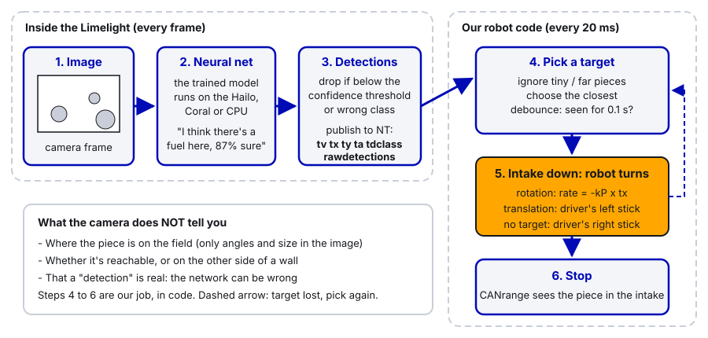
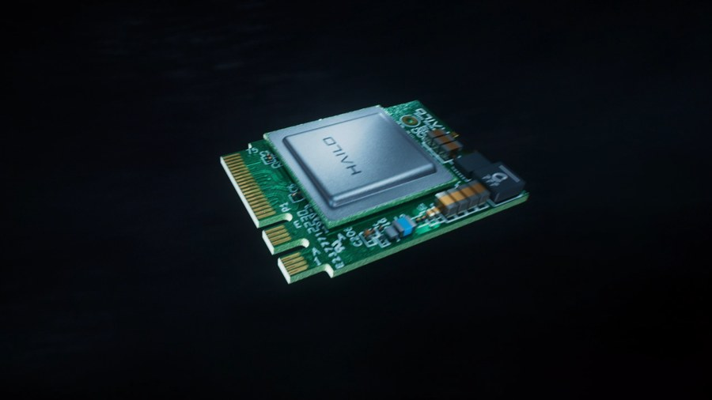
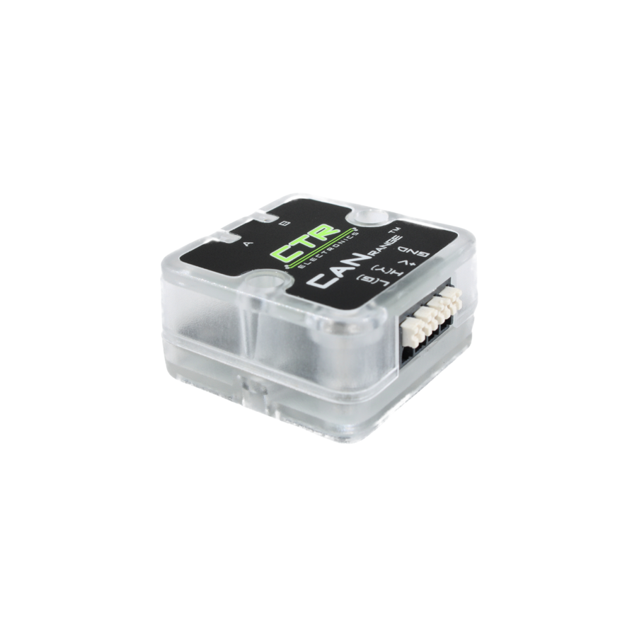
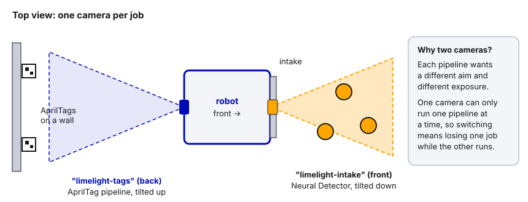

# 32. Limelight Object Detection

> **Who it's for:** programmers who want the robot to find game pieces on the floor and drive to them, and anyone
> deciding whether we should buy an accelerator for it. **Read first:** [17 Limelight and vision](17-limelight-and-vision.md)
> (setup, `tx`/`ty`/`ta`/`tv`, aiming with P-control), [04 Command-based](04-command-based-basics.md),
> [07 What is PID](07-what-is-pid.md), [11 Intakes and rollers](11-intakes-and-rollers.md),
> [21 Sensors and homing](21-sensors-and-homing.md), [30 Sensor and device catalog](30-sensor-and-device-catalog.md) (CANrange).
> **Time:** about 1.5 hours to read; an afternoon to
> get a detector running and the robot turning toward pieces on blocks; a few practice sessions to trust it on the floor.

**What you'll learn**
- What a neural network detector is, in plain words, and what it can and can't tell you
- Which Limelight hardware can run one (Limelight 4 + Hailo, Limelight 3 + Google Coral, CPU-only) and what that costs in speed
- How to set up a Neural Detector pipeline: model, labels, confidence, class filter, crop, resolution vs FPS
- How to read detections in code with LimelightHelpers v1.14, and pick the best piece
- Our behavior (like 2024's Thunderstrike): when the intake is **down**, the robot turns toward the piece while the
  driver keeps driving, and a **CTRE CANrange** in the intake says "got it"
- How to drive to a piece fully automatically (for autos), using `ty` for distance
- What it takes to train your own model, at a high level

---

## 1. The idea

Guide 17 used the Limelight to find **AprilTags**. Tags are easy for a computer: black-and-white squares with a
known pattern. Game pieces are harder. A ball can be in shadow, half hidden behind a robot, blurred, or sitting next to
a bumper of the same color. Old-style "color pipelines" (find all the orange pixels) break as soon as the lighting or
background changes.

A **neural network detector** solves this by learning from examples instead of rules. Someone took thousands of
photos of the game piece, drew a box around every piece in every photo, and let a computer adjust millions of
numbers inside the network until it could draw the same boxes by itself. That process is called **training**, and
the result is a **model** file. Running the model on a new image is called **inference**.

For each camera frame, the detector gives back a list of **detections**. Each one has:

| Field | Meaning | Example |
|---|---|---|
| class | What it thinks the object is (a name from the labels file) | `fuel` |
| confidence | How sure it is, 0 to 1 | 0.87 |
| box | Where the object is in the image | `tx` = 4.2 deg, `ty` = -11.0 deg, `ta` = size |

Notice what's missing: the detector doesn't know where the piece is **on the field**. It only knows angles and size
in the picture. Turning that into "the piece is 0.8 m ahead and a bit to the right" is our job, with a bit of
geometry (section 5b).

Limelight also has a **Neural Classifier** pipeline. A classifier doesn't draw boxes; it answers one question about
the whole image ("is there a piece in the hopper: yes/no/two?"). This guide is about the **detector**.



> **Honest note:** our team has **not** shipped a neural detector yet. The closest we got was 2024's Thunderstrike,
> which turned toward notes with an intake camera (section 6). Treat the code in this guide as a well-reasoned
> starting point to test on blocks, not a proven recipe.

---

## 2. Hardware: what can run a detector

Running a neural network is a lot of math. Limelight runs it either on its own processor (the **CPU**, slow) or on an
**accelerator**, a chip built only for neural network math.

| Camera | Accelerator option | What Limelight says about speed | Notes |
|---|---|---|---|
| **Limelight 4** | **Hailo-8** or **Hailo-8L** M.2 card, fits inside the camera | "80 FPS YoloV8" with Hailo-8; about 20 FPS MobileNet on CPU | Does **not** support Google Coral. Hailo needs robot (12 V) power; it won't run on USB power |
| **Limelight 3G** | None | About 20 FPS MobileNet on CPU (older notes say about 10 FPS) | Does **not** support Coral (no USB host port) |
| **Limelight 3** (original) | **Google Coral** USB accelerator in its USB-A port | Faster than CPU | The setup Limelight's older neural docs describe |
| Limelight 3A | None (CPU only) | Slow | An FTC camera, USB-powered; not for us |

*Sources: Limelight's Limelight 4 product page and quick start, the Limelight 3G product page ("LL3G does not support
Google Coral"), and the neural network trainer page. Check the current pages before buying; these change.*

The Hailo upgrade kit comes in two versions. The **Hailo-8** is the faster one (Limelight lists 26 TOPS, "trillions of
operations per second"); the **Hailo-8L** is a cheaper, roughly half-speed version. In fall 2026 Limelight listed them
at about $135 and $95 for FIRST teams. Either one beats CPU by a wide margin.

 

**Which one matters for the model you can use.** Limelight publishes an official model for each game, but not always
for every accelerator. On the downloads page:

| Season | Official models |
|---|---|
| 2026 REBUILT ("Fuel") | **Hailo-8L, Hailo-8L "fast", Hailo-8 only** (`.hef` files) |
| 2025 REEFSCAPE (coral, algae) | CPU, Google Coral (`.tflite`) and Hailo (`.hef`) |
| 2024, 2023 | `.tflite` models (Coral) |

So for 2026, a Limelight 3G without an accelerator had **no official Fuel model**. You would have had to train your
own CPU model (section 7). If we want object detection in 2027, the realistic setup is a **Limelight 4 with a Hailo
card**. Check what's actually in the cabinet before planning: model, and whether a Hailo is installed (the top-right
corner of the Limelight web page shows a detected Hailo module on LLOS 2026.1).

> **Watch out: a mentor installs the Hailo card, not students.** Installing it means opening the Limelight 4, and
> static discharge or a misplaced thermal pad can kill a camera that costs hundreds of dollars. Students don't open the
> Limelight. If the web page doesn't show a Hailo and you think it should have one, tell a mentor. (For the mentor:
> unplug power, attach the included thermal pad to the Hailo chip, follow Limelight's Limelight 4 quick start, section
> "Hailo AI Accelerator Module Installation", then update LLOS.)

---

## 3. Step by step: set up a Neural Detector pipeline

Do this with the robot on blocks and the camera on the robot, pointing where it will point in a match.

1. **Update LLOS** to the current version (guide 17, section 3a). Hailo models made with Limelight's new trainer need
   LLOS 2026.0 or later, and 2026.1 fixed several Hailo issues.
2. **Pick a free pipeline slot.** If the same camera also does AprilTags, use a different index, e.g. pipeline 0 =
   AprilTags, pipeline 1 = detector. (Better: a second camera, section 5c.)
3. **Pipeline type:** set it to **Neural Detector**. It starts running Limelight's built-in test model right away,
   which is a quick way to check the accelerator works.
4. **Choose the runtime / accelerator** to match your hardware (Hailo, Coral or CPU). The model file must match it:
   `.hef` for Hailo, `.tflite` for Coral or CPU. A mismatch prints "CHECK MODEL" (or "CHECK CORAL") on the image.
5. **Upload the model and the labels file.** Download this season's model and labels from the Limelight downloads
   page (for 2026: e.g. "Fuel B1 Model - HAILO 8 MONOCHROME" plus "Fuel Labels"). The **labels file** is a plain text
   file with one class name per line. The line number, starting at 0, is the **class ID**. `fuel_labels.txt`
   has one line, `fuel`, so Fuel is class 0. The 2025 file was `algae` (0) then `coral` (1).
6. **Confidence threshold.** Detections below this are thrown away on the camera. Start around 0.5. Raise it if the
   robot chases things that aren't pieces (bumpers, shoes, the hub); lower it if real pieces flicker in and out.
7. **Class filter.** If the model knows more than one class, list only the ones you want (e.g. only `coral`).
8. **Crop** the image to ignore areas where a "piece" can't be useful: the top of the frame (pieces in other robots,
   the stands) or your own bumper at the bottom.
9. **Cluster strength** (LLOS 2026.1). In a game with piles of pieces, raising it groups nearby detections into one
   bigger target, so the robot drives at a pile instead of twitching between single balls.
10. **Resolution and FPS.** Watch the FPS readout on the web page. More frames per second = fresher data and less lag
    when turning. Start with the default resolution and only change it if detection range is too short.
11. **Aim the camera.** A detector camera usually tilts **down** toward the floor in front of the intake, so pieces
    stay in view until they're almost in the intake. Mount it rigidly; your distance math depends on that angle.
12. **Back it up.** Export the pipeline as `limelight/<hostname>-pipeline<N>.vpr` and commit it, just like guide 17
    says for AprilTag pipelines. Also commit the model and labels files you used, so a reflashed camera comes back
    exactly the same.

> **Tip:** the Limelight 4 sensor is **monochrome** (black and white). That's why the official 2025 and 2026 models
> say "MONOCHROME": they were trained on gray images. A model trained on color photos may do worse on a Limelight 4.

---

## 4. Reading detections in code

Our template's `LimelightHelpers.java` is v1.14 (it says "REQUIRES LLOS 2026.0 OR LATER" at the top). These are the
calls that matter for a detector pipeline. All take the camera's hostname, e.g. `"limelight-intake"`.

| Call | Returns | Notes |
|---|---|---|
| `getTV(name)` | `true` if there's at least one detection | Always check this first; no target reads as `tx = 0` |
| `getTX(name)` / `getTY(name)` | Degrees from the crosshair to the **primary** detection | `tx` + = right. `ty` + = up (check it, see below) |
| `getTA(name)` | Size of the primary detection, % of the image | Bigger = closer |
| `getDetectorClass(name)` | Class name of the primary detection, e.g. `"fuel"` | Reads the `tdclass` key |
| `getDetectorClassIndex(name)` | Class ID of the primary detection | From the `t2d` array |
| `getTargetCount(name)` | How many targets the camera has | From the `t2d` array |
| `getRawDetections(name)` | `RawDetection[]`, **every** detection this frame | Each has `classId`, `txnc`, `tync`, `ta` and four corners |
| `getLatestResults(name)` | Full JSON results, including `targets_Detector` with `confidence` | Slower (parses JSON); the raw array has **no** confidence field |

`txnc` and `tync` are "no crosshair" angles: measured from the camera's true optical center instead of the
adjustable crosshair. They're the right ones for geometry.

**Simplest version: just use the primary target.** If you only need "turn toward a piece", the primary target is
enough, and it's exactly the `tx` aiming from guide 17:

```java
if (LimelightHelpers.getTV(kGamePieceCamera) && LimelightHelpers.getDetectorClassIndex(kGamePieceCamera) == kFuelClassId) {
    double txDegrees = LimelightHelpers.getTX(kGamePieceCamera);
    // ...turn toward it
}
```

**Better version: choose the piece yourself.** The camera's primary target isn't necessarily the one you want. With
`getRawDetections` you can throw out pieces that are too small or too far and pick the **closest** one. That's what
the `GamePieceDetector` below does.

> **Watch out: check the signs on your camera.** Limelight's docs describe `ty` as up-positive in NetworkTables, but
> the JSON detector results describe `ty` as "positive-down". Before you trust any distance math, hold a piece
> **above** the crosshair and see whether `ty` (and `tync` from the raw array) goes positive. If it goes negative,
> flip the sign in one place in code and write a comment saying you tested it.

---

## 5. Turning detections into robot behavior

### The detector helper

One small subsystem reads the camera, filters detections, converts `ty` to distance, and debounces. Commands only
**read** from it, so they don't need to require it. Constants first (they go in `Constants.java` with units, team
style):

```java
public static final class GamePieceConstants {
    public static final String kCamera = "limelight-intake";
    /** Line number in the labels file, starting at 0. fuel_labels.txt: fuel = 0 */
    public static final int kGamePieceClassId = 0;
    /** Lens height above the carpet, meters (measure it) */
    public static final double kCameraHeightMeters = 0.50;
    /** Camera tilt, degrees. NEGATIVE = tilted down toward the floor */
    public static final double kCameraPitchDegrees = -25.0;
    /** Height of the piece's center, meters (a ball's radius) */
    public static final double kPieceCenterHeightMeters = 0.075;
    /** Ignore detections smaller than this. Read real values off the dashboard first, then set it. */
    public static final double kMinArea = 0.05;
    /** Don't chase pieces further than this, meters */
    public static final double kMaxChaseDistanceMeters = 3.0;
    /** A piece must be seen this long before we act on it, seconds */
    public static final double kSeenDebounceSeconds = 0.1;
}
```

```java
/** Finds game pieces with a Limelight running a Neural Detector pipeline, and picks the closest one. */
public class GamePieceDetector extends SubsystemBase {
    /** One usable detection: angles from the camera's center, and floor distance from the lens */
    public record GamePiece(double txDegrees, double tyDegrees, double distanceMeters) {}

    private final Debouncer m_seenDebouncer = new Debouncer(kSeenDebounceSeconds, DebounceType.kRising);
    private Optional<GamePiece> m_closest = Optional.empty();
    private boolean m_seenSteadily = false;

    @Override
    public void periodic() {
        m_closest = findClosest();
        // Rising debounce: a one-frame false detection never starts a chase, but losing it stops right away
        m_seenSteadily = m_seenDebouncer.calculate(m_closest.isPresent());
        SmartDashboard.putBoolean("GamePiece/Has target", m_seenSteadily);
        SmartDashboard.putNumber("GamePiece/Distance (m)", m_closest.map(GamePiece::distanceMeters).orElse(-1.0));
        SmartDashboard.putNumber("GamePiece/tx (deg)", m_closest.map(GamePiece::txDegrees).orElse(0.0));
    }

    private Optional<GamePiece> findClosest() {
        GamePiece closest = null;
        for (RawDetection detection : LimelightHelpers.getRawDetections(kCamera)) {
            if (detection.classId != kGamePieceClassId) continue;   // wrong kind of object
            if (detection.ta < kMinArea) continue;                     // tiny: far away or noise
            double distanceMeters = distanceFromTy(detection.tync);
            if (distanceMeters > kMaxChaseDistanceMeters) continue;    // not worth chasing
            if (closest == null || distanceMeters < closest.distanceMeters()) {
                closest = new GamePiece(detection.txnc, detection.tync, distanceMeters);
            }
        }
        return Optional.ofNullable(closest);
    }

    /** Floor distance from the lens to a piece, meters. See the side-view diagram in guide 32. */
    public static double distanceFromTy(double tyDegrees) {
        double angleBelowLevelDegrees = -(kCameraPitchDegrees + tyDegrees);
        if (angleBelowLevelDegrees < 1.0) {
            return Double.POSITIVE_INFINITY;   // at or above the horizon: can't be a piece on the floor
        }
        return (kCameraHeightMeters - kPieceCenterHeightMeters) / Math.tan(Math.toRadians(angleBelowLevelDegrees));
    }

    /** @return The closest piece, only if pieces have been seen steadily */
    public Optional<GamePiece> getClosestPiece() {
        return m_seenSteadily ? m_closest : Optional.empty();
    }

    /** @return true while a usable piece has been seen steadily (handy for a Trigger) */
    public boolean hasTarget() {
        return m_seenSteadily;
    }
}
```

Imports you'll need: `edu.wpi.first.math.filter.Debouncer` (and `Debouncer.DebounceType`), `java.util.Optional`,
`frc.robot.LimelightHelpers` and `frc.robot.LimelightHelpers.RawDetection`.

### 5a. Our behavior: intake down = the robot aims, the driver drives

This is how our 2024 robot, Thunderstrike, picked up notes, and it's what we want again (section 6 shows the 2024
code). The rule is simple enough to explain to a drive team in one sentence:

> **When the intake is down and the camera sees a piece, the robot turns its intake toward the piece. The driver
> keeps the left stick (where the robot goes). When the CANrange says the piece is in, the driver gets rotation back.**

| | Who controls it while the intake is down |
|---|---|
| **Translation** (left stick X/Y: forward/back, left/right) | Always the **driver** |
| **Rotation** with a piece in view | The **robot**: P-control on `tx` turns the intake toward the piece |
| **Rotation** with no piece in view (or it flickers out) | The **driver** (right stick), exactly like normal |
| When it ends | Intake comes back up, or the **CANrange** sees the piece |

Why only rotation? The driver is better than the code at the hard part: avoiding robots, deciding which pile is worth
it, and not driving into a wall. Lining the intake up with a ball while moving is the fiddly part, and that's where a
camera wins. The driver also never "loses" the robot, because the left stick always does what it always does.

#### Step 1: the "got a piece" sensor is a CANrange

A **CTRE CANrange** is a small time-of-flight distance sensor on the CAN bus (guide 30 has the full page). Mount it in
the intake looking across the path the piece takes. It measures how far away the nearest thing is, and its built-in
**proximity detection** turns that into a true/false, `IsDetected`: true when something is closer than a threshold
you choose. No DIO wiring, no separate emitter and receiver to line up, and it logs with all our other CTRE devices.



Add it to the intake from guide 11 (`DeployableIntake` already has a CANrange called `m_pieceSensor`). The full config
for a piece sensor, checked against Phoenix 6 26.3.0:

```java
// In IntakeConstants
public static final int kPieceSensorId = 19;                 // on the "Upper" CANivore, mechanism ID range
/** Something closer than this, meters, counts as "piece in the intake" */
public static final double kPieceDetectMeters = 0.10;
/** Distance must move this far past the threshold to flip, meters (stops chattering right at 10 cm) */
public static final double kPieceDetectHysteresisMeters = 0.02;
/** Ignore weak readings (dark or shiny pieces, nothing in view). 2500 is CTRE's default; check in Tuner X. */
public static final double kMinSignalStrength = 2500;
/** "Got a piece" must stay true this long before we believe it, seconds */
public static final double kPieceDebounceSeconds = 0.04;
/** Pivot below this (pivot rotations, 0 = horizontal) counts as "intake down". 0.05 rot = 18 degrees */
public static final double kPivotDownThresholdRotations = 0.05;
```

```java
// In the DeployableIntake constructor (replaces guide 11's one-line sensor config)
CANrangeConfiguration sensorConfig = new CANrangeConfiguration();
sensorConfig.ToFParams.UpdateMode = UpdateModeValue.ShortRange100Hz;   // short range, 100 samples per second
sensorConfig.ProximityParams.ProximityThreshold = kPieceDetectMeters;
sensorConfig.ProximityParams.ProximityHysteresis = kPieceDetectHysteresisMeters;
sensorConfig.ProximityParams.MinSignalStrengthForValidMeasurement = kMinSignalStrength;
reportIfFailed(m_pieceSensor.getConfigurator().apply(sensorConfig), "piece sensor");

m_pieceDetected = m_pieceSensor.getIsDetected();   // StatusSignal<Boolean>, refreshed in periodic()
```

```java
// New method in DeployableIntake: is the intake actually down? Uses the real pivot position, not the target.
public boolean isDeployed() {
    return m_pivotPosition.getValueAsDouble() < kPivotDownThresholdRotations;
}
```

`hasGamePiece()` already exists in guide 11 (`return m_pieceDetected.getValue();`). New imports:
`com.ctre.phoenix6.signals.UpdateModeValue` (the CANrange classes are already imported there).

> **Tip:** pick the threshold from real numbers, not a guess. In Tuner X, plot the CANrange's Distance and Signal
> Strength with no piece, then with a piece sitting where it stops in the intake. Set the threshold about halfway
> between, and the minimum signal strength a bit below what a real piece gives.

#### Step 2: the command

One command, `AimIntakeAtGamePiece`. It takes the driver's translation and rotation as suppliers, and only replaces
rotation when the detector has a piece.

**FieldCentric or RobotCentric?** We use `SwerveRequest.FieldCentric`, the same request as our 2026 default drive
command. The rotational rate means the same thing in both requests, so the aim works either way. The difference is the
driver's left stick: in field-centric, "stick up" always means "away from me", no matter which way the robot faces. If
we switched to robot-centric when the intake goes down, "stick up" would suddenly mean "wherever the robot's front
points", and that direction changes **while the code is turning the robot**. The driver would feel the controls swim
under their thumbs. Field-centric keeps the sticks feeling exactly the same as normal driving.

```java
/**
 * While the intake is down: turns the robot so the intake faces the closest game piece. The driver keeps
 * translation. With no piece in view, the driver's own rotation is used, so it feels like normal driving.
 */
public class AimIntakeAtGamePiece extends Command {
    private final CommandSwerveDrivetrain m_drivetrain;
    private final GamePieceDetector m_detector;
    private final DoubleSupplier m_driverVelocityXMetersPerSec;
    private final DoubleSupplier m_driverVelocityYMetersPerSec;
    private final DoubleSupplier m_driverTurnRadPerSec;
    /** Input: tx in degrees. Output: turn rate in rad/s. Setpoint 0 = piece centered in the image. */
    private final PIDController m_aimController = new PIDController(kAimP, 0.0, 0.0);
    private final SwerveRequest.FieldCentric m_driveRequest = new SwerveRequest.FieldCentric()
        .withDriveRequestType(DriveRequestType.OpenLoopVoltage);

    public AimIntakeAtGamePiece(CommandSwerveDrivetrain drivetrain, GamePieceDetector detector,
                                DoubleSupplier driverVelocityXMetersPerSec, DoubleSupplier driverVelocityYMetersPerSec,
                                DoubleSupplier driverTurnRadPerSec) {
        m_drivetrain = drivetrain;
        m_detector = detector;
        m_driverVelocityXMetersPerSec = driverVelocityXMetersPerSec;
        m_driverVelocityYMetersPerSec = driverVelocityYMetersPerSec;
        m_driverTurnRadPerSec = driverTurnRadPerSec;
        addRequirements(drivetrain);   // we command the wheels; the detector is only read
    }

    @Override
    public void initialize() {
        m_aimController.reset();
    }

    @Override
    public void execute() {
        // Default: the driver's own rotation (no piece in view, or it just flickered out)
        double turnRateRadPerSec = m_driverTurnRadPerSec.getAsDouble();
        Optional<GamePiece> piece = m_detector.getClosestPiece();
        if (piece.isPresent()) {
            // calculate(measurement, setpoint) = kP x (0 - tx). Piece to the right (+tx) gives a negative
            // (clockwise) turn, toward it. A camera facing backward would flip this sign.
            turnRateRadPerSec = MathUtil.clamp(m_aimController.calculate(piece.get().txDegrees(), 0.0),
                                               -kMaxAimRateRadPerSec, kMaxAimRateRadPerSec);
        }
        // Translation always comes straight from the driver
        m_drivetrain.setControl(m_driveRequest.withVelocityX(m_driverVelocityXMetersPerSec.getAsDouble())
                                              .withVelocityY(m_driverVelocityYMetersPerSec.getAsDouble())
                                              .withRotationalRate(turnRateRadPerSec));
    }
    // No isFinished(): the binding decides when it ends (intake up, or piece in)
}
```

`kAimP` (start around 0.05, which is (rad/s) per degree of `tx`) and `kMaxAimRateRadPerSec` (e.g. 3.0) go in
`GamePieceConstants`. Tune `kAimP` like guide 08 says: start small, raise it until the robot snaps onto the piece,
back off if it wobbles. Imports: `edu.wpi.first.math.controller.PIDController`, `edu.wpi.first.math.MathUtil`,
`com.ctre.phoenix6.swerve.SwerveRequest`, `com.ctre.phoenix6.swerve.SwerveModule.DriveRequestType`,
`java.util.function.DoubleSupplier`, `java.util.Optional`.

#### Step 3: the binding, with Triggers

A **Trigger** (guide 04) turns any true/false into something you can bind a command to, just like a button. We make
three of them and combine them with `and`, `or` and `negate`:

```java
// RobotContainer. Same stick math as our default drive command, so the sticks feel identical.
DoubleSupplier driverVelocityX = () -> -joystick.getLeftY() * MaxSpeed;
DoubleSupplier driverVelocityY = () -> -joystick.getLeftX() * MaxSpeed;
DoubleSupplier driverTurnRate = () -> -joystick.getRightX() * MaxAngularRate;

Trigger intakeDown = new Trigger(intake::isDeployed);
Trigger seesGamePiece = new Trigger(gamePieceDetector::hasTarget);
// The CANrange must say "piece" for 40 ms in a row before we believe it (one noisy sample doesn't count)
Trigger hasGamePiece = new Trigger(intake::hasGamePiece).debounce(kPieceDebounceSeconds);

// HOLD LB: intake down and rollers on (stops the rollers by itself once a piece is in, see guide 11)
joystick.leftBumper().whileTrue(intake.intakeCommand());

// Intake down + piece in view + no piece yet: the robot takes over rotation until the intake comes up or the piece is in
intakeDown.and(seesGamePiece).and(hasGamePiece.negate()).onTrue(
    new AimIntakeAtGamePiece(drivetrain, gamePieceDetector, driverVelocityX, driverVelocityY, driverTurnRate)
        .until(intakeDown.negate().or(hasGamePiece)));
```

Notice:
- **`onTrue` plus `until`, not `whileTrue`.** A piece about to go under the bumper drops out of the camera's view for
  a moment. With `whileTrue(... seesGamePiece ...)` that would cancel and restart the command over and over. Instead
  it **starts** when all three conditions are true and keeps running, using the driver's rotation whenever the piece
  isn't in view, until the intake comes up or the CANrange trips.
- When the command ends, the drivetrain's **default command** (normal driving) takes over again by itself. Nothing
  else to write.
- `until` accepts a Trigger because a Trigger is a `BooleanSupplier`.
- `intakeDown` reads the **real** pivot position, so the aim starts only once the intake is actually down, not the
  instant the button is pressed.
- The driver can always cancel: let go of LB, the intake stows, `intakeDown` goes false, the command ends.
- In 2026 our Pigeon ID mistake froze the heading (guide 16). Field-centric translation needs a working gyro, so if
  the left stick suddenly feels "rotated", check the Pigeon before blaming this command.

### 5b. Optional: drive to the piece by itself (autos), using ty for distance

In teleop the driver drives (5a). In **autonomous** there's no driver, so if a piece isn't where the path expected it,
the robot has to drive to it on its own. To drive **to** a piece, the robot needs to know how far away it is. A camera at a fixed height and tilt can work
that out from `ty` alone, because a piece on the floor can only be at one spot along the line the camera sees it on.


The formula, from Limelight's "Estimating Distance" page, adapted for a camera looking down at the floor:

```
angle below level = -(camera pitch + ty)        (both in degrees, down = negative)
distance = (camera height - piece center height) / tan(angle below level)
```

Check with the numbers in the diagram: angle = -(-25 + -10) = 35 degrees; distance = (0.50 - 0.075) / tan(35 deg) =
0.425 / 0.700 = **0.61 m**. That's exactly `distanceFromTy` above.

Two honest limits:
- It only works for pieces **on the floor**. A piece in another robot or bouncing in the air gives a wrong distance.
- Small angle errors matter more far away. At 3 m a 1-degree error in camera pitch moves the answer by tens of
  centimeters. Measure the pitch carefully, then **check it**: put a piece at a taped distance and compare. If it's off,
  solve the same formula for the pitch (Limelight's page suggests exactly this).

```java
/** Drives robot-relative to the closest game piece, slowing down as it gets close. Ends if pieces stay lost. */
public class DriveToGamePiece extends Command {
    private final CommandSwerveDrivetrain m_drivetrain;
    private final GamePieceDetector m_detector;
    private final SwerveRequest.RobotCentric m_robotCentric = new SwerveRequest.RobotCentric()
        .withDriveRequestType(DriveRequestType.OpenLoopVoltage);
    private final Timer m_sinceLastSeen = new Timer();
    private double m_lastDistanceMeters = Double.POSITIVE_INFINITY;

    public DriveToGamePiece(CommandSwerveDrivetrain drivetrain, GamePieceDetector detector) {
        m_drivetrain = drivetrain;
        m_detector = detector;
        addRequirements(drivetrain);
    }

    @Override
    public void initialize() {
        m_sinceLastSeen.restart();
        m_lastDistanceMeters = Double.POSITIVE_INFINITY;
    }

    @Override
    public void execute() {
        Optional<GamePiece> piece = m_detector.getClosestPiece();
        double forwardMetersPerSec = 0.0;
        double turnRateRadPerSec = 0.0;
        if (piece.isPresent()) {
            m_sinceLastSeen.restart();
            m_lastDistanceMeters = piece.get().distanceMeters();
            // P-control on distance: fast when far, slow near the piece, never slower than the creep speed
            forwardMetersPerSec = MathUtil.clamp(kApproachP * m_lastDistanceMeters,
                                                 kCreepSpeedMetersPerSec, kMaxApproachSpeedMetersPerSec);
            turnRateRadPerSec = MathUtil.clamp(-kAimP * piece.get().txDegrees(),
                                               -kMaxTurnRateRadPerSec, kMaxTurnRateRadPerSec);
        } else if (m_lastDistanceMeters < kBlindFinishDistanceMeters) {
            // A close piece disappears under the bumper just before the intake grabs it: keep creeping forward
            forwardMetersPerSec = kCreepSpeedMetersPerSec;
        }
        // +X in a robot-centric request = toward the robot's front. If the intake is on the back, use negative X.
        m_drivetrain.setControl(m_robotCentric.withVelocityX(forwardMetersPerSec)
                                              .withVelocityY(0.0)
                                              .withRotationalRate(turnRateRadPerSec));
    }

    @Override
    public boolean isFinished() {
        // The happy ending (piece in the intake) comes from the CANrange in the binding below
        return m_sinceLastSeen.hasElapsed(kGiveUpSeconds);
    }

    @Override
    public void end(boolean interrupted) {
        m_drivetrain.setControl(m_robotCentric.withVelocityX(0.0).withVelocityY(0.0).withRotationalRate(0.0));
    }
}
```

Starting values (untested on our robot, so begin on blocks and slow): `kApproachP` 1.0 (m/s) per meter,
`kCreepSpeedMetersPerSec` 0.4, `kMaxApproachSpeedMetersPerSec` 1.5, `kBlindFinishDistanceMeters` 0.5,
`kGiveUpSeconds` 0.75.

**Stop on the CANrange.** The camera can tell you a piece is close; only a sensor in the intake can tell you it's
**in**. That's the same CANrange from 5a. As a PathPlanner named command (guide 18):

```java
// Drive to the closest piece with the intake down and rollers on. Ends when the CANrange sees a piece,
// when pieces stay lost, or after 3 s, so an auto can never get stuck here.
NamedCommands.registerCommand("DriveToGamePiece",
    new DriveToGamePiece(drivetrain, gamePieceDetector)
        .deadlineFor(intake.intakeCommand())
        .until(hasGamePiece)
        .withTimeout(3.0));
```

`deadlineFor` runs the intake for exactly as long as the drive command runs, and `until(hasGamePiece)` (the debounced
CANrange Trigger from 5a) ends both as soon as the piece is in. When `intakeCommand()` ends, it stows the intake.

> **Watch out:** a robot that drives (or turns) itself toward "a piece" will happily go after a shoe or a person in
> the shop if the model thinks it's a piece. Test on blocks first, then on the floor at low max speed with the area clear,
> and keep a hand on the disable key (Enter on the Driver Station; space bar is the emergency stop, see guide 03).

### 5c. One camera for pieces, another for AprilTags

A Limelight runs **one pipeline at a time**. If one camera does both jobs, every moment it spends on the detector
pipeline is a moment the pose estimator gets no tag updates, and the two jobs want opposite things anyway: tags want
the camera tilted **up** with very short exposure; pieces want it tilted **down** at the floor.



With two cameras:
- Give the detector camera its own hostname and IP (`limelight-intake`, `10.50.90.12`), set up one at a time
  (guide 17, section 3c).
- **Don't** list the detector camera in `VisionConstants.kCameras`. That list is for AprilTag localization; a
  detector camera there would publish no tags and just show `Connected`.
- If you really have only one camera, switch with `LimelightHelpers.setPipelineIndex(name, index)` and accept that
  localization pauses while you hunt for pieces. Expect a short delay after switching before results are valid.

### Filtering: what real code needs

| Problem | Fix | In the helper above |
|---|---|---|
| One-frame false detection starts a chase | Debounce: must be seen for 0.1 s | `Debouncer(..., kRising)` |
| Robot chases a piece across the field | Ignore pieces further than a set distance | `kMaxChaseDistanceMeters` |
| Tiny detections from noise or far pieces | Minimum area | `kMinArea` |
| Wrong object class | Check the class ID | `kGamePieceClassId` |
| Low-confidence guesses | Confidence threshold on the camera (the raw array has no confidence) | Pipeline setting |
| Twitching between two pieces | Pick the closest every frame; or cluster on the camera | `findClosest()`, cluster strength |
| Piece vanishes right before pickup | Keep the aim command running; fall back to the driver's rotation | `onTrue` + `until` in 5a; blind finish in `DriveToGamePiece` |
| "Got it" flickers on a noisy reading | Hysteresis on the CANrange, plus a short debounce | `ProximityHysteresis`, `Trigger.debounce(0.04)` |

> **AI can help:** paste your `distanceFromTy` method and three real measurements (taped distance, the `ty` you saw)
> into an AI assistant and ask it to work out what camera pitch would make the formula match, and to explain each
> step. Then do the math once yourself on paper, set the new pitch, and re-measure with a tape. The AI checks your
> arithmetic; the tape measure checks the AI.

---

## 6. In our code

**No neural detector yet.** None of our robot repos (2023–2026) or the template read `getRawDetections` or
`getDetectorClass`. The template's `Vision.java` is AprilTag localization only. Here's the closest work we have.

### Thunderstrike (2024): how we did it in 2024

Section 5a is the 2024 behavior, cleaned up. On Thunderstrike, holding the left trigger dropped the intake, ran it,
and turned the robot toward whatever the `limelight-intake` camera saw, while the driver kept driving with the left
stick. It stopped when the intake's sensor said the note was in:
[RobotContainer.java, lines 85–91 (auto pickup binding)](https://github.com/TorqueNados-FRC5090/Thunderstrike-2024/blob/876b8c14682ccf57ec0ab2767ee2da54c34cee6e/src/main/java/frc/robot/RobotContainer.java#L85-L91)

```java
        // HOLD LT -> Activate the automatic intake
        driverController.leftTrigger().whileTrue(new IntakeAutoPickup(intake)
            .alongWith(new DriveWithLimelightTarget(drivetrain, intakeLimelight,
                () -> driverController.getLeftX(), () -> driverController.getLeftY(), () -> driverController.getRightX()).repeatedly())
                .until(() -> intake.holdingPiece())
            .alongWith(deflector.deflectorOutFor(.15))
            .onlyIf(() -> shooter.getPosition() >= ShooterPosition.POINT_BLANK.getAngle()-1));
```

The aiming itself is in
[DriveWithLimelightTarget.java, lines 48–65 (execute)](https://github.com/TorqueNados-FRC5090/Thunderstrike-2024/blob/876b8c14682ccf57ec0ab2767ee2da54c34cee6e/src/main/java/frc/robot/commands/drive_commands/DriveWithLimelightTarget.java#L48-L65):

```java
    public void execute() {
        // Get the x and y values to drive with
        double x = inputX.getAsDouble();
        double y = inputY.getAsDouble();
        double rotation = inputRot.getAsDouble();

        // Calculate the rotation instruction if limelight has a target
        if (limelight.hasValidTarget()) {
            x = drivetrain.preprocessX(x);
            y = drivetrain.preprocessY(y);
            rotation = headingController.calculate(limelight.getTargetX(), 0);

            drivetrain.sendDrive(x, y, rotation, true);
        }
        else {
            drivetrain.drive(x, y, rotation);
        }
    }
```

What to notice:
- **Same idea as 5a:** the driver's X/Y always pass through; rotation comes from a `PIDController` on `tx`
  (`calculate(tx, 0)`, the same form and sign as our `m_aimController`) when there's a target, and from the driver's
  right stick when there isn't.
- **The intake going down** came from `IntakeAutoPickup`, which sends the intake to its pickup position when it
  starts, unless a piece is already held
  ([IntakeAutoPickup.java, lines 17–21](https://github.com/TorqueNados-FRC5090/Thunderstrike-2024/blob/876b8c14682ccf57ec0ab2767ee2da54c34cee6e/src/main/java/frc/robot/commands/intake_commands/IntakeAutoPickup.java#L17-L21)).
  In 5a we tie the aim to the intake's **real** position with a Trigger instead of to one button, so any command that
  lowers the intake gets the aim for free.
- **Stop on the sensor:** `.until(() -> intake.holdingPiece())`. In 2024 `holdingPiece()` read a **limit switch** on
  a roboRIO DIO port ([Intake.java, lines 83–86](https://github.com/TorqueNados-FRC5090/Thunderstrike-2024/blob/876b8c14682ccf57ec0ab2767ee2da54c34cee6e/src/main/java/frc/robot/subsystems/Intake.java#L83-L86)). For 2027 we use a
  **CANrange** instead: no mechanical lever for the note to push, an adjustable distance, and it's on CAN with
  everything else.
- **Why `.repeatedly()`:** `DriveWithLimelightTarget` finishes once the heading is within 1 degree
  ([lines 67–71](https://github.com/TorqueNados-FRC5090/Thunderstrike-2024/blob/876b8c14682ccf57ec0ab2767ee2da54c34cee6e/src/main/java/frc/robot/commands/drive_commands/DriveWithLimelightTarget.java#L67-L71)), so the binding restarts it
  over and over. `AimIntakeAtGamePiece` has no `isFinished()` and lets the binding decide, which is cleaner.
- **Field- vs robot-centric:** `sendDrive` and `drive` used whatever mode the drivetrain was in, which was field-centric
  unless the driver held the right trigger. 5a makes field-centric explicit.
- We don't know if that camera ran a neural or a color pipeline: its pipeline file was never saved. Another reason
  to commit `.vpr` files.
- The same folder also has
  [LimeDrive.java, lines 68–98](https://github.com/TorqueNados-FRC5090/Thunderstrike-2024/blob/876b8c14682ccf57ec0ab2767ee2da54c34cee6e/src/main/java/frc/robot/commands/drive_commands/LimeDrive.java#L68-L98), a fully automatic version that
  drives robot-centric to a target using three PID controllers (sideways, distance, heading) and the camera's 3D
  `targetpose`. It isn't bound to any button in the final code; it's the 2024 ancestor of `DriveToGamePiece` (5b).

### Stingray (2025): `AutoIntake` is a sensor state machine, not vision

The name sounds like auto-pickup, but
[AutoIntake.java](https://github.com/TorqueNados-FRC5090/Stingray-2025/blob/97c843705075c729538ad0b3925f67a35e3bf791/src/main/java/frc/robot/commands/AutoIntake.java)
doesn't use a camera at all. It's the **default command** of the coral end effector (the subsystem is called
`Shooter`), and it indexes a coral using two Redux Canandcolor proximity sensors, one at the entry and one at the exit:
[AutoIntake.java, lines 78–97 (state machine)](https://github.com/TorqueNados-FRC5090/Stingray-2025/blob/97c843705075c729538ad0b3925f67a35e3bf791/src/main/java/frc/robot/commands/AutoIntake.java#L78-L97)

```java
    private void runStateMachine() {
        switch (state) {
            case WAITING:
                if(entry) { enterState(IntakeState.INDEXING); }
                if(exit && !entry) { enterState(IntakeState.HOLDING); }
                break;

            case INDEXING: // Once the piece is beyond the sensor, just hold it still
                if(!entry) { enterState(IntakeState.HOLDING); }
                break;

            case HOLDING: // If there is not a piece in the intake, go back to waiting
                if(!entry && !exit) { enterState(IntakeState.WAITING); }
                else if(reverseTimer.hasElapsed(.6)) { shooter.stop(); }
                break;
```

What to notice:
- **WAITING** spins at 0.5 duty cycle to grab a piece, **INDEXING** slows to 0.3 once the entry sensor sees it, and
  **HOLDING** runs backward at -0.1 for 0.6 s to settle it, then stops
  ([lines 17–23](https://github.com/TorqueNados-FRC5090/Stingray-2025/blob/97c843705075c729538ad0b3925f67a35e3bf791/src/main/java/frc/robot/commands/AutoIntake.java#L17-L23)).
- The sensors are "blocked" when proximity is at or below 0.05
  ([Shooter.java, lines 74–76](https://github.com/TorqueNados-FRC5090/Stingray-2025/blob/97c843705075c729538ad0b3925f67a35e3bf791/src/main/java/frc/robot/subsystems/Shooter.java#L74-L76)).
- This is exactly the "what happens **after** the piece reaches the intake" half of an auto-intake. A detector gets
  the piece to the intake; a state machine like this one finishes the job. In 2025 coral came from the human player
  station, so there was no floor piece to chase.

### Hephaestus (2026): a DIO beam-break wrapper (legacy)

[wrappers/LaserDetector.java](https://github.com/TorqueNados-FRC5090/Hephaestus/blob/c2f0cee6f61db3f26f911d3f5623ed7fa27a5b03/src/main/java/frc/robot/wrappers/LaserDetector.java#L1-L21)
wraps a beam break on a roboRIO DIO port with `isBlocked()` / `isOpen()`. Nothing in the 2026 code uses it (Fuel goes
into a hopper, so there was no single "piece is in" moment). Treat it as legacy: for "piece is in the intake" we now
use a **CANrange**, and any limit switch or beam break we do use goes through a **CTRE CANdi** on CAN, not a DIO port
(guide 21).

---

## 7. Training your own model (high level)

Most seasons, Limelight publishes an official model for the game piece within the first weeks, and it's better than
anything we'd train in a hurry. Train your own only if there's no official model for your hardware (like a
Limelight 3G in 2026), or you need to detect something the official model doesn't (e.g. robots, a specific field
element).

Limelight's current recommended path (their "Training a Custom Detector Model" page, and the 2026.0 release notes):

1. **Collect images.** Lots of them, from the camera's real point of view: different distances, angles, lighting,
   partly hidden pieces, pieces next to bumpers, empty floor with no pieces. Images from your own Limelight are best
   (`LimelightHelpers.triggerSnapshot(name)` saves one; Limelight 4 gray images if that's what will run the model).
   Limelight's advice: your dataset should be **more varied** than what the robot will see.
2. **Label (annotate).** Draw a box around every piece in every image, in **Roboflow**'s web tool. Use one rule
   consistently (e.g. a half-hidden piece gets a box around only the visible part). Class names all lowercase, as few
   classes as possible. You can also start from a public dataset on Roboflow Universe.
3. **Augment carefully.** Roboflow can add flipped, rotated, brightened copies. Don't use changes that destroy what
   matters (if color tells red from blue pieces, don't shift the hue).
4. **Export** the dataset as a TensorFlow **TFRecord**, upload it to Google Drive, and share it "anyone with the link".
5. **Train** with Limelight's free **Neural Network Trainer** at tools.limelightvision.io. Paste the link, pick the
   target (Limelight CPU, Google Coral, Hailo-8 or Hailo-8L), and start. Limelight suggests 4000 steps for a quick
   test, 20000 for accuracy; it can take hours.
6. **Upload** the downloaded model file plus `labels.txt` to the Neural Detector pipeline, and test it in the shop and
   on the practice field before trusting it.

> **AI can help:** ask an AI assistant to quiz you on the difference between training and inference, confidence and
> class, or detector and classifier, until you can explain them to a new member. You can also ask it to draft a
> shot list for collecting training images ("near/far, left/center/right, under the bumper, in shadow..."). Then go
> take the photos and label them yourselves: the labeling rules are a team decision.

---

## 8. Common mistakes

- **Buying the wrong accelerator.** A Google Coral does nothing for a Limelight 4 or 3G. Limelight 4 needs a Hailo
  card; check the product page before ordering.
- **Model and runtime don't match.** A `.tflite` on a Hailo runtime, or a classifier model in a detector pipeline,
  shows "CHECK MODEL" on the image instead of detections.
- **Wrong class ID.** Class IDs come from the labels file line order, starting at 0. If the code filters for 1 and
  the file only has `fuel` (0), the robot never sees anything.
- **Reading `tx` without `tv`.** No target reads as `tx = 0`: "perfectly lined up". Same lesson as guide 17.
- **Distance math with the wrong sign or pitch.** Camera pitch must be negative for a downward tilt in our formula, and
  `ty` must be tested (section 4). One flipped sign and the robot thinks every piece is 10 m away.
- **Using pieces that aren't on the floor.** A piece in another robot or on top of a field element gives a nonsense
  distance. Crop the top of the image and cap the chase distance.
- **One camera doing everything.** Switching one camera between tags and pieces costs localization at the worst time.
- **No escape hatch.** Every vision command must stop when the driver lets go (or the intake comes up), and every
  auto-drive command must give up when it loses the piece.
- **Taking over translation too.** If the code also drives the robot forward in teleop, the driver can't dodge
  defense or stop short of a wall. In teleop the code only turns; the driver drives (5a).
- **Switching to robot-centric when the intake drops.** The left stick suddenly changes meaning while the robot is
  turning. Keep the request field-centric.
- **`whileTrue` on "camera sees a piece".** The piece drops out of view right before pickup, the command cancels and
  restarts, and the robot jerks. Start with `onTrue`, end with `until` (5a).
- **CANrange threshold guessed instead of measured.** Too far and it "detects" the intake's own frame or bumper, so the
  aim never starts; too close and a dark piece never trips it. Measure in Tuner X first.
- **Pipeline and model not backed up.** Same as 2024 and 2026: nobody could tell later what the camera was running.

---

## 9. Checklist

- [ ] Hardware matches the model: Limelight 4 + Hailo (`.hef`), Limelight 3 + Coral (`.tflite`), or CPU (`.tflite`)
- [ ] LLOS up to date; Hailo shows as detected in the web page header (Limelight 4)
- [ ] Neural Detector pipeline with this season's model **and** labels file uploaded
- [ ] Confidence threshold, class filter and crop set; FPS checked on the web page
- [ ] `ty`/`tync` sign tested by holding a piece above the crosshair
- [ ] Camera height and pitch measured; `distanceFromTy` checked against a taped distance at 3 spots
- [ ] Detector camera has its own hostname/IP and is **not** in `VisionConstants.kCameras`
- [ ] CANrange ID and CAN bus set in Tuner X (mechanism range on "Upper"); threshold picked from real distance and
      signal-strength plots; `Intake/Has game piece` goes true only when a piece is in
- [ ] `isDeployed()` true when the intake is really down, false when stowed (watch it on the dashboard)
- [ ] Aim sign checked on blocks: piece on the right, robot turns right; no piece, right stick turns as normal
- [ ] Tested on blocks, then on the floor at low speed with the area clear; driver release stops everything
- [ ] Pipeline `.vpr`, model and labels committed to `limelight/`

---

## 10. Practice

1. **Watch the detections.** With a detector pipeline running, open AdvantageScope or the dashboard and find the
   camera's `tv`, `tx`, `ty`, `ta`, `tdclass` and `rawdetections` keys. Put two pieces in view. How many groups of 12
   numbers are in `rawdetections`? Which piece is the "primary" target?
2. **Prove the distance formula.** Tape marks on the floor at 0.5 m, 1.0 m and 2.0 m from the camera lens. Put a piece
   on each and write down `ty` and what `distanceFromTy` says. Is the error bigger far away? Adjust
   `kCameraPitchDegrees` until all three are within about 5 cm.
3. **Aim on blocks.** Robot on blocks, add the 5a bindings, hold LB so the intake drops, and move a piece left and
   right in front of the camera. The wheels should steer toward it; take the piece away and the right stick should
   turn the robot again. Tune `kAimP`. Then point the camera backward (or pretend it is) and explain which sign you'd
   change.
4. **CANrange threshold.** With the robot disabled, plot the CANrange's Distance and Signal Strength in Tuner X with
   no piece, then with a piece held where it stops in the intake. Pick `kPieceDetectMeters`,
   `kPieceDetectHysteresisMeters` and `kMinSignalStrength` and write one sentence for each saying why.
5. **Paper exercise: the closest piece.** Two raw detections: A has `tync` = -5 deg, B has `tync` = -15 deg. Camera
   0.50 m up, pitch -25 deg, piece center 0.075 m. Work out both distances by hand. Which one does `findClosest()`
   pick? (Answers: A is about 0.74 m, B about 0.51 m, so B.)

---

## Go further

- Limelight neural networks overview: https://docs.limelightvision.io/docs/docs-limelight/pipeline-neural/getting-started-with-neural-networks
- Training a custom detector: https://docs.limelightvision.io/docs/docs-limelight/pipeline-neural/training-your-own-detector
- Limelight Neural Network Trainer: https://tools.limelightvision.io/neural-network-trainer
- Downloads (models, labels, LLOS): https://docs.limelightvision.io/docs/resources/downloads
- Limelight 4 quick start (Hailo install): https://docs.limelightvision.io/docs/docs-limelight/getting-started/limelight-4
- Hardware comparison: https://docs.limelightvision.io/docs/docs-limelight/getting-started/hardware-comparison
- Estimating distance from ty: https://docs.limelightvision.io/docs/docs-limelight/tutorials/tutorial-estimating-distance
- NetworkTables keys (`tdclass`, `rawdetections`, `t2d`): https://docs.limelightvision.io/docs/docs-limelight/apis/complete-networktables-api
- JSON results (detector `conf`, `class`): https://docs.limelightvision.io/docs/docs-limelight/apis/json-results-specification
- Limelight software change log (what changed in each LLOS): https://docs.limelightvision.io/docs/docs-limelight/software-change-log
- Hailo upgrade kit: https://limelightvision.io/products/hailo-8-upgrade-kit-for-limelight-4
- Roboflow (labeling): https://roboflow.com
- WPILib Debouncer: https://docs.wpilib.org/en/stable/docs/software/advanced-controls/filters/debouncer.html
- CTRE CANrange: https://v6.docs.ctr-electronics.com/en/stable/docs/hardware-reference/canrange/index.html
- CTRE swerve requests (FieldCentric, RobotCentric): https://v6.docs.ctr-electronics.com/en/stable/docs/api-reference/mechanisms/swerve/swerve-requests.html
