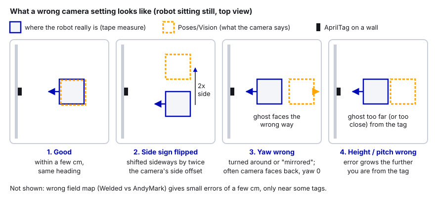
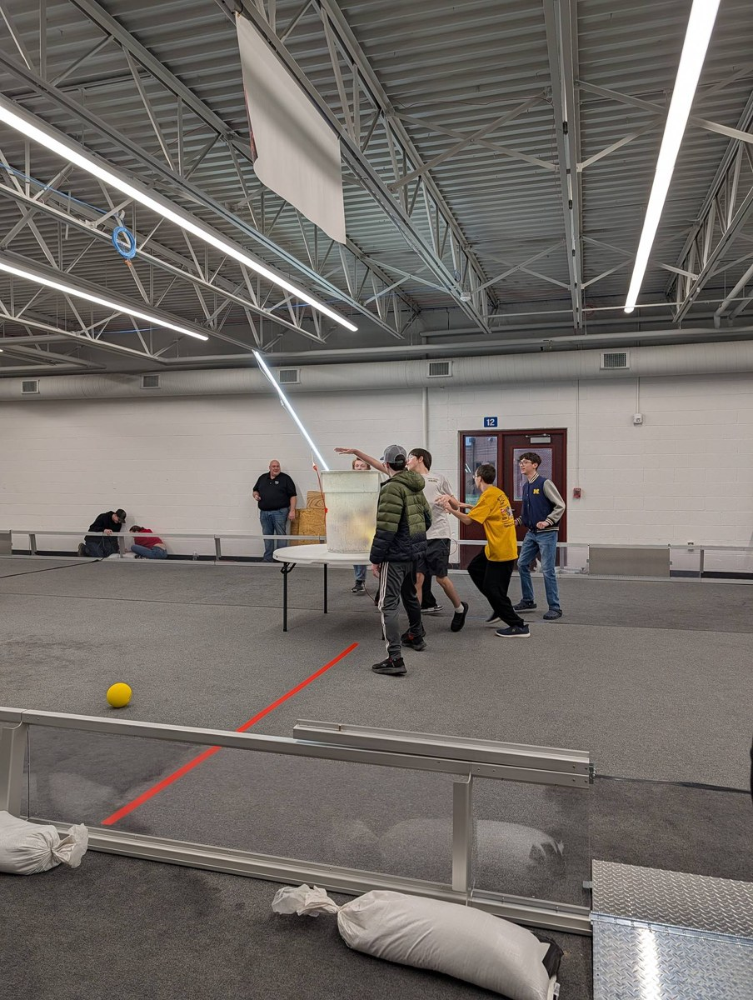

# 33. Calibrating Limelights at Events

> **Who it's for:** the programmers and pit crew who check the cameras at a competition, and whoever carries the
> robot onto the field before quals. **Read first:** [17 Limelight and vision](17-limelight-and-vision.md) (MegaTag,
> camera pose, the `Vision/...` dashboard keys), [03 Driver Station and match checklist](03-driver-station-and-match-checklist.md),
> [19 Logging and debugging](19-logging-and-debugging.md) (AdvantageScope). **Time:** 30 minutes to read; plan
> 20–30 minutes on the field at the event, and 15 minutes in the pits before it.

**What you'll learn**
- What field calibration time is at an FRC event, and why our robot stays **powered on but disabled** the whole time
- What to bring, and what to check in the pits before you walk out
- A step-by-step plan: measured spots, exposure for arena lighting, mount-pose sign checks, glare, range, both alliances
- How to read the errors you wrote down and tell a camera problem from a field problem
- What **not** to change at an event without testing
- A printable calibration sheet and a quick pre-match vision check

---

## 1. The idea

Our shop is not the competition field. The arena has different lights, real field elements and walls,
polycarbonate everywhere, and AprilTags that were mounted by a field crew (close to the drawings, but never perfect).
A camera that gave a perfect pose in the shop can be a few centimeters off, see tags from less far away, or pick up
glare at the event.

So every event gives teams time on the real field before matches start. The game manual (2026, section 10.3
"Measurement") says the arena will be open for **at least 30 minutes before the start of Qualification matches**, so
teams can "survey and/or measure the ARENA and bring ROBOTS on the FIELD to perform sensor calibration". Events may
schedule more times, and announce them at the event. On schedules it shows up under names like "Field Open for
Calibration", "Field Measurement & Robot Sensor Calibration", or "Robot Sensor Calibration and Connection Test".
This guide calls it **field calibration time**.

The rules for that time (2026 rule **T301**, "Measurement, not practice") forbid driving, extending anything outside
the frame perimeter, and practicing with game pieces. Breaking it is a verbal warning, then a yellow card. Rules
change every year: read that season's section 10.3 and T301, and ask the **FTA** (Field Technical Advisor, the person
in charge of the field) if anything is unclear.

**Our team rule is simpler and stricter: you cannot enable the robot on the field during calibration.** The robot is
**powered on and DISABLED** from the moment it goes onto the carpet until it comes off. People **carry** it from
measured spot to measured spot (or push it gently by the frame if the wheels roll freely when disabled). Nobody
touches the Enable button, and the Driver Station stays on "Disabled" the whole time.

| Do | Don't |
|---|---|
| Bring the robot onto the field, **powered on, disabled** | **Enable** the robot, even "just for a second" |
| Carry or push it between measured spots | Drive it, or let anything move on its own |
| Measure the field with a tape measure | Extend anything outside the frame perimeter |
| Read the dashboard, AdvantageScope and the Limelight web page | Score, push, pick up or practice with game pieces |

**Why everything still works disabled.** "Disabled" only stops the motors. The roboRIO is still running our code
every 20 ms: `robotPeriodic()` keeps reading the Pigeon and the cameras. Our 2026 code (section 6) has a special
**disabled branch**: while disabled, it takes the camera's **MegaTag1** pose whenever it sees **two or more tags** and
feeds it into the drivetrain's pose estimator (`addVisionMeasurement`). So, with the robot disabled:

- `Poses/Vision` (the camera's own answer) updates every time 2+ tags are in view, and that's the number you write on
  the sheet.
- `Poses/Robot` and the dashboard field widget move to where the cameras say the robot is, because MegaTag1 is pulling
  the pose estimator, including the **heading**. That's exactly how the heading gets seeded for MegaTag2 before a match.
- `Vision/Tags seen`, `Vision/Tag IDs`, `Vision/Tag distances (m)`, `Vision/Correction (m)` and
  `Vision/Heading disagreement (deg)` all update.

The one thing you lose is single-tag spots: with only one tag in view, the disabled branch ignores the camera (one-tag
MegaTag1 headings jump around). For those, read the pose on the Limelight web page instead (step 2).

> **Watch out:** "disabled" is a Driver Station state, not a promise nothing can hurt you. The robot is powered, so
> keep fingers out of pinch points, carry it by the frame with two people, and check the Driver Station still says
> **Disabled** before anyone picks it up. If someone asks "can we just enable it to check X?", the answer is no.

---

## 2. When it happens, and who does what

| When | What you do |
|---|---|
| Night before / load-in | Pit checks (section 3). Ask at the pit admin desk or the FTA table when the field opens for calibration |
| Calibration time (often the practice-day morning, and/or 30 min before quals) | The on-field plan (section 4) |
| Practice matches | Watch vision in a real match; save a log (and a Limelight Rewind on a Limelight 4) after each one |
| Before every qualification match | The pre-match vision check (section 9) |

A team of four works best:

- **Carrier(s):** two people move the robot safely and set it square on each spot.
- **Measurer:** places the robot with the tape measure and reads the expected position.
- **Laptop:** reads the dashboard / Limelight web page and calls out the numbers.
- **Recorder:** writes everything on the calibration sheet (section 8). Paper beats memory.

---

## 3. In the pits, before you go

### What to bring

- [ ] Laptop, charged, with the Limelight web page bookmarked (`http://10.50.90.11:5801`, plus `.12`, `.13` for other cameras)
- [ ] **Ethernet cable** long enough to tether the laptop to the robot (the robot's Wi-Fi is off at events, so you
      reach it through the field network or a tether; ask the FTA which one they want during calibration time)
- [ ] Elastic (or Shuffleboard) layout with the `Vision/...` keys, and AdvantageScope
- [ ] Tape measure (5 m or longer, metric is easiest), a phone angle app, painter's tape and a marker
- [ ] This guide's **calibration sheet**, printed, and a clipboard
- [ ] Pipeline backups: the repo's `limelight/*.vpr` files on the laptop (so you can restore a camera in two minutes)
- [ ] The season's field drawings and AprilTag layout (tag IDs and positions), and the PathPlanner start poses for our autos
- [ ] USB stick in the robot for the log (guide 19)

### Pit checks (15 minutes)

1. **Every camera answers.** Dashboard: `Vision/<camera>/Connected` is true (template). Open each camera's web page.
2. **LLOS version** matches what we tested in the shop. Don't update at the event unless something is broken (section 7).
3. **Pipeline loaded and right.** The AprilTag pipeline is the active index, 36h11, tag size 165.1 mm. Compare with
   the `.vpr` in git if you're unsure.
4. **The right field map.** Some seasons have more than one tag layout. 2026 had **Welded** and **AndyMark** maps,
   and Limelight's downloads page had a table of which field type each district used (for 2026 it listed FIRST in
   Michigan as Welded). Ask the event if in doubt. The map on the Limelight and the `AprilTagFields` layout in code (for
   example `kFieldLayout` in auto-align) **must match**.
5. **Mount pose.** Nobody has bumped the camera. If the camera is `configuredInCode`, the numbers in `Constants.java`
   are what the camera uses. If not (the 2026 robot), screenshot the "Robot Space Pose" values on the web page now.
6. **Logging on.** Confirm the robot is writing a `.wpilog` to the USB stick.

---

## 4. On the field: step by step


**Get the expected positions ready.** For every spot, you need the true field position: x and y in meters and the
heading in degrees, in WPILib "blue origin" coordinates (guide 17; the template STUDENT-GUIDE section 4). (0, 0) is
the corner of the blue alliance wall to the blue drivers' right, +x points toward the red wall, +y to the blue drivers'
left, and heading 0 means the robot faces the red wall.

- **Auto start poses** (spots A and E) are the easiest: they're already in PathPlanner, and you line the robot up with
  the field markings the same way you would before a match.
- For **tag spots** (B, C, F), look up the tag's position in the season's AprilTag layout, then measure straight out
  from the tag with the tape. Measure to the robot's **center**, not its bumper.
- On the **red half**, x = field length − distance from the red wall (2026: 16.541 m long, 8.069 m wide; check the
  current year's layout).

### Step 1: Seed the heading

MegaTag2 (what our code uses while enabled) is only as good as the heading we give it. Put the robot where the camera
sees **two or more tags** for a few seconds (still disabled, as always). Our disabled branch feeds MegaTag1 into the
pose estimator and corrects the heading (guide 17, section 5). Check `Heading disagreement (deg)` goes to a few degrees or less. If it doesn't, stop and fix
that first (Pigeon, camera yaw).

### Step 2: Measured spots

At each spot:

1. Carry the robot to the spot and square it up. Measure twice.
2. Wait two seconds without touching it.
3. Read the vision pose. The robot is disabled, so our code uses MegaTag1 with **2+ tags**: read `Poses/Vision` in
   AdvantageScope (or the dashboard field widget, which follows it closely). Pick spots that see two tags whenever
   you can. At a single-tag spot `Poses/Vision` won't update (check `Vision/Seconds since last tag`), so read the
   robot pose on the Limelight web page instead (the 3D field view, or the live data view under the video stream on
   LLOS 2026.0 and later).
4. Write down: vision x, y, heading, `Tags seen`, which tag IDs, the distance to the tag (`Vision/Tag distances (m)`
   on the 2026 robot), and `Correction (m)`.
5. Compute the error: distance between expected and vision (x and y), and the heading difference.

Good enough: a few centimeters near tags and within about 10 cm at 3–4 m, with heading within a couple of degrees.
Bigger, or always in the same direction, means something is set wrong. Section 5 tells you what.

### Step 3: Exposure and gain for the arena lights

Arena lighting is different from our shop: often bright LED stage lights, sometimes dimmer, sometimes flickering
at a rate you can't see. Look at the camera stream on the web page while someone walks the robot slowly (carried)
past a tag.

- **Exposure** is how long each picture collects light. Short exposure = less motion blur when the robot moves, but a
  darker image. Limelight's advice: keep reducing exposure until tag tracking gets less reliable, then stop. You may
  need **more** exposure at a dim event.
- **Gain** brightens the image without longer exposure, but adds noise (3D gets jumpier). Limelight's quick start
  suggests black level 0 and gain about 15 as a start.
- **Black level profile** (LLOS 2026.1): switching from "Dark" to "Medium" or "Light" restores detail in dark areas
  and can increase tag range, which lets you lower exposure and gain further.
- **Flicker:** if the image "breathes" (brightness pulses), the lights are flickering. A lower capture frame rate
  (Limelight 4 and 3G offer 1280x800 at 60, 55, 45 and 30 FPS) allows a longer exposure that averages it out.

Change **one** setting at a time, note old and new values on the sheet, re-check one measured spot, then export the
pipeline as a new `.vpr` and commit it that evening.

### Step 4: Mount pose sign check

Look at the robot and the vision ghost side by side in AdvantageScope (2D Field tab). These pictures are the usual
suspects:



Don't fix a sign on the field by guessing. Write down the symptom, check it at a second spot, and make the change in
the pits (section 7).

### Step 5: Glare and reflections

Walk around and look at the camera stream from each spot:

- **Polycarbonate** (driver station walls, guardrails, field element panels) reflects lights and sometimes tags.
  A reflection of a tag can show up as a second, mirrored tag.
- Shiny metal (diamond plate, aluminum extrusions) and the stage lights themselves can wash out part of the image.
- Watch for **flicker in `Tags seen`** or a tag ID that appears where no tag is. Note the spot and the tag ID.

If one tag gives a bad pose from everywhere (bent mount, reflection), the fix is to **ignore that tag**, e.g. with
`LimelightHelpers.SetFiducialIDFiltersOverride` (Limelight's MegaTag2 docs suggest this for misplaced tags) or the
pipeline's ID filter. Test that change in the pits; don't do it in the queue.



### Step 6: Range: where tags stop being detected

From spot D, have the carriers step back with the robot 0.5 m at a time, facing the same tag, until `Tags seen`
starts flickering, then until it drops to 0. Write both distances down for each camera. Now the drive team knows how
far out the pose can be refreshed, and you know which camera needs work (exposure, resolution, black level).

### Step 7: Both alliances

Do at least two spots on the **red half** (E, F). Our code always uses wpiBlue coordinates, so on the red side x should
be large (near the red wall, close to the field length) and a robot facing the blue wall should read about 180
degrees. This catches mistakes in alliance flipping (PathPlanner flips paths for red) and checks tags you'd never see
from the blue side.

### Step 8: Record

- Keep the robot logging the whole time (`.wpilog` on the USB stick). Later, in AdvantageScope, put `Poses/Robot`
  (2026 robot; `DriveState/Pose` in the template) and `Poses/Vision` (or `Poses/Vision/<camera>`) on the same 2D field.
- On a **Limelight 4** (LLOS 2026.0 or later), **Rewind** saves the camera's video with its targeting data. After the
  calibration walk or a practice match, use the Rewind button on the web page (for example "Record last 2m 50s"), or
  call `LimelightHelpers.triggerRewindCapture(name, seconds)` from code. You can scrub it later to see exactly when
  and why tags were lost (glare, zip ties, game pieces).
- Take a photo of each camera's settings page after you're done.

> **AI can help:** after the event day, type your filled-in calibration table into an AI assistant and ask: "Do these
> errors have a pattern? All in one direction? Growing with distance? Only near certain tag IDs?" It's good at
> spotting patterns in a table of numbers. Then check its idea against section 5 and the symptom pictures, and prove
> it by re-testing one spot. Don't change a camera setting because a chatbot said so.

---

## 5. Reading the results

| What you see on the sheet | Most likely cause | What to do |
|---|---|---|
| Every spot off by about the same amount in the same robot direction | Camera forward/side offset wrong (or side sign flipped: off by twice the offset) | Re-measure the mount; fix in `Constants.java`; re-test 2 spots |
| Error grows with distance from the tag | Camera height or pitch wrong; or wrong tag size | Re-measure height and pitch; tag size 165.1 mm |
| Vision heading wrong, or pose lands in a mirrored spot | Camera yaw wrong (0 front, 180 back) | Fix yaw; check side sign too |
| A few cm off, only near some tags | Wrong field map (Welded vs AndyMark), or that tag is mounted off | Confirm the map with the event; filter a bad tag if it's only one |
| Fine at calibration (disabled), wrong in practice matches (enabled) | MegaTag2 got a wrong heading (Pigeon, or heading never seeded) | Check `Heading disagreement (deg)`, the Pigeon, and step 1 |
| Tags only seen up close | Exposure too low for this venue, or image too dark | Raise exposure/gain a little or use the Medium/Light black level profile |
| Tags flicker in and out at one spot | Glare or reflections | Note it; ID filter or crop; tell the drive team |
| `Correction (m)` big while driving in practice matches, but vision spots are good | Odometry drifts (wheel radius, slipping), not the camera | Check drivetrain settings (guide 16) |

---

## 6. In our code

### Where the vision numbers come from (2026 robot)

[Robot.java, lines 101–130 (updateVision)](https://github.com/TorqueNados-FRC5090/Hephaestus/blob/c2f0cee6f61db3f26f911d3f5623ed7fa27a5b03/src/main/java/frc/robot/Robot.java#L101-L130)
is called every loop for each camera name
([lines 77–80](https://github.com/TorqueNados-FRC5090/Hephaestus/blob/c2f0cee6f61db3f26f911d3f5623ed7fa27a5b03/src/main/java/frc/robot/Robot.java#L77-L80)).
Disabled: MegaTag1 with 2 or more tags only, fed into the pose estimator with standard deviations of 0.5 for x, y
**and** heading
([lines 116–121](https://github.com/TorqueNados-FRC5090/Hephaestus/blob/c2f0cee6f61db3f26f911d3f5623ed7fa27a5b03/src/main/java/frc/robot/Robot.java#L116-L121)).
Enabled: MegaTag2 with any number of tags. This disabled branch is what makes calibration possible without ever
enabling the robot, and it's why step 2 reads single-tag spots from the Limelight web page.

```java
      if (DriverStation.isDisabled()) {
        var mt1 = Limelighthelpers.getBotPoseEstimate_wpiBlue(limelightName);
        if (mt1 != null && mt1.tagCount >= 2) {
          recordVisionCorrection(driveState.Pose, mt1.pose, mt1.tagCount, mt1.rawFiducials);
          drivetrain.addVisionMeasurement(mt1.pose, mt1.timestampSeconds, VecBuilder.fill(0.5, 0.5, 0.5));
        }
```

One side effect to know about: because MegaTag1 keeps pulling `Poses/Robot` toward the camera while you stand still,
`Vision/Correction (m)` and `Vision/Heading disagreement (deg)` shrink toward zero after a few seconds at a spot.
That's the estimator doing its job. For the sheet, compare `Poses/Vision` with the **tape-measured** position, not with
`Poses/Robot`.

[Robot.java, lines 136–157 (recordVisionCorrection)](https://github.com/TorqueNados-FRC5090/Hephaestus/blob/c2f0cee6f61db3f26f911d3f5623ed7fa27a5b03/src/main/java/frc/robot/Robot.java#L136-L157)
publishes everything you need on the sheet:

```java
      RobotLog.pose("Vision", visionPose);   // compare against Poses/Robot to see odometry drift
      SmartDashboard.putNumber("Vision/Tags seen", tagCount);
      SmartDashboard.putNumber("Vision/Correction (m)", odometryPose.getTranslation().getDistance(visionPose.getTranslation()));
      SmartDashboard.putNumber("Vision/Heading disagreement (deg)", odometryPose.getRotation().minus(visionPose.getRotation()).getDegrees());
```

Notice:
- These keys only update **when the camera produced a pose we used**. If no tags are seen, they keep their old
  values. Always look at `Vision/Seconds since last tag`
  ([line 86](https://github.com/TorqueNados-FRC5090/Hephaestus/blob/c2f0cee6f61db3f26f911d3f5623ed7fa27a5b03/src/main/java/frc/robot/Robot.java#L86))
  first: if it's large, the other numbers are stale.
- `Vision/Tag IDs`, `Vision/Tag distances (m)` and `Vision/Worst tag ambiguity` (lines 149–151) fill in the "tags
  seen" and "distance" columns.
- The 2026 robot's camera mount pose was never put in code (guide 17). At the event, the web page values are the
  truth; photograph them.

### The template: the same numbers, per camera

[Vision.java, lines 142–151 (recordCorrection)](https://github.com/TorqueNados-FRC5090/Robot-Template/blob/b8dddd0e338841e867c0cc260162e6097adecd7b/src/main/java/frc/robot/subsystems/Vision.java#L142-L151)
publishes `Vision/<camera>/Tags seen`, `Vision/<camera>/Correction (m)` and
`Vision/<camera>/Heading disagreement (deg)`, and logs `Poses/Vision/<camera>`. With two cameras you check each one
separately; one bad camera can hide behind a good one. `Vision/Seconds since last tag` is one number for all cameras
([Vision.java, line 73](https://github.com/TorqueNados-FRC5090/Robot-Template/blob/b8dddd0e338841e867c0cc260162e6097adecd7b/src/main/java/frc/robot/subsystems/Vision.java#L73)),
and `Vision/<camera>/Connected` comes from the heartbeat check (lines 91–103, see guide 17).

The camera mount poses live in
[Constants.java, lines 193–200 (kCameras)](https://github.com/TorqueNados-FRC5090/Robot-Template/blob/b8dddd0e338841e867c0cc260162e6097adecd7b/src/main/java/frc/robot/Constants.java#L193-L200).
If calibration shows a mount number is wrong, this is the one place to fix it, and git shows exactly what changed.

### The field layout in code must match the camera's map

[Constants.java, lines 170–174 (kFieldLayout, auto-align)](https://github.com/HALFxAxHEART/frc-auto-align/blob/c95ddf4a2ee25c406ea6e2ed04e232b17b39b8f7/src/main/java/frc/robot/Constants.java#L170-L174):

```java
        /**
         * Which field's AprilTag positions to use. MUST match the field map loaded on the Limelight's web page.
         * 2026 has two versions (welded steel field and AndyMark field); ask the event which one they have.
         */
        public static final AprilTagFields kFieldLayout = AprilTagFields.k2026RebuiltWelded;
```

If the event uses the other field type, both this line and the `.fmap` on every camera change, together, and you
re-check a measured spot afterward.

---

## 7. What NOT to change at the event without testing

The pressure at an event pushes people to "just try something". Most vision disasters at events come from an
untested change made in the queue. Rules of thumb:

| Don't change in the queue | Why | If you must |
|---|---|---|
| LLOS version (reflashing) | Must match our `LimelightHelpers`; resets settings; takes time | Only if a camera is broken; restore the `.vpr` after, re-check a spot |
| Camera mount numbers | One wrong sign moves every pose | Change in the pits, re-test at 2 measured spots on the field or practice field |
| Standard deviations, spin limit, MT1/MT2 logic | Changes how hard vision pulls the pose; effects show up mid-match | Leave for after the event unless it's clearly broken |
| Pipeline type, resolution, tag family/size | Changes everything downstream | Don't |
| The camera itself (re-mounting, re-aiming) | Invalidates every measurement | Only after damage; re-measure fully |

What's fine to change, carefully: exposure/gain/black level (one at a time, written down, re-checked), the field
map (when the event's field type is confirmed), and an ID filter for a single bad tag (tested in the pits first).
Every change gets exported to a `.vpr` and committed that evening, with a commit message saying why.

> **Tip:** keep a "known good" `.vpr` from the shop and a "this event" `.vpr`. If an event tweak makes things worse,
> you can be back to known good in two minutes.

---

## 8. Calibration sheet (print this page)

**Event:** ______________________ **Date:** ________ **Field type:** Welded / AndyMark / other: ________

**LLOS version:** ________ **Pipeline file:** ______________________ **Field map file:** ______________________

**Camera(s):** ______________________ **Robot code commit:** ________ **People:** ______________________

| Spot | Expected x, y (m), heading (deg) | Vision x, y (m), heading (deg) | Error (cm / deg) | Tag IDs seen | Dist. to tag (m) | Notes |
|---|---|---|---|---|---|---|
| A (blue auto start) | ____ , ____ , ____ | ____ , ____ , ____ | ____ / ____ | | | |
| B (1.5 m from tag ___) | ____ , ____ , ____ | ____ , ____ , ____ | ____ / ____ | | | |
| C (3 m, angled, tag ___) | ____ , ____ , ____ | ____ , ____ , ____ | ____ / ____ | | | |
| D (far, tag ___) | ____ , ____ , ____ | ____ , ____ , ____ | ____ / ____ | | | |
| E (red auto start) | ____ , ____ , ____ | ____ , ____ , ____ | ____ / ____ | | | |
| F (1.5 m from tag ___) | ____ , ____ , ____ | ____ , ____ , ____ | ____ / ____ | | | |
| | ____ , ____ , ____ | ____ , ____ , ____ | ____ / ____ | | | |
| | ____ , ____ , ____ | ____ , ____ , ____ | ____ / ____ | | | |

**Heading seed (step 1):** Heading disagreement before ______ after ______ deg

**Exposure / gain changes (step 3):**

| Setting | Shop value | Event value | Re-checked at spot | Result |
|---|---|---|---|---|
| Exposure | ____ | ____ | ____ | |
| Sensor gain | ____ | ____ | ____ | |
| Black level / profile | ____ | ____ | ____ | |
| Capture resolution / FPS | ____ | ____ | ____ | |

**Range (step 6):**

| Camera | Tag ID | Flickers at (m) | Lost at (m) | Notes |
|---|---|---|---|---|
| ________ | ____ | ____ | ____ | |
| ________ | ____ | ____ | ____ | |
| ________ | ____ | ____ | ____ | |

**Glare / reflections seen (step 5):** ____________________________________________________________

**Mount pose symptoms (step 4):** none / sideways jump / wrong heading / grows with distance: ________________

**Decisions (what we changed, and what we deliberately did NOT change):** ______________________________

---

## 9. Pre-match vision check (in the queue, 1 minute)

Robot on the field at its start position, disabled, connected to the FMS:

- [ ] `Vision/<camera>/Connected` true for every camera (template) / camera stream visible
- [ ] `Vision/Seconds since last tag` small (the robot sees tags from its start spot)
- [ ] `Tags seen` is 1 or more; 2 or more if this start spot allows it (so MegaTag1 seeds the heading)
- [ ] `Heading disagreement (deg)` within a few degrees
- [ ] The robot on the dashboard field widget sits where the robot really is, on the correct alliance
- [ ] `Vision/Use camera` is true (someone may have switched it off while debugging)
- [ ] Nothing in front of the lenses: tape, zip ties, cables, a game piece

If any box fails and there's no time to fix it, tell the drive coach so the drivers know auto-aim may be off this
match. Then fix it in the pits, not in the queue.

---

## 10. Common mistakes

- **Enabling the robot on the field.** Our rule: never during calibration. Everything in section 4 works disabled,
  because our code feeds MegaTag1 into the pose estimator while disabled. Carry the robot.
- **Treating calibration time as practice.** Driving or shooting during measurement time is a warning, then a yellow
  card (2026 T301).
- **Using single-tag spots and wondering why nothing updates.** Disabled, our code needs 2+ tags. Pick spots that see
  two tags, or read single-tag spots from the Limelight web page.
- **Comparing `Poses/Vision` with `Poses/Robot` instead of the tape.** While disabled, the robot pose is pulled toward
  the camera, so they agree even when both are wrong. The tape measure is the truth.
- **Measuring to the bumper instead of the robot center.** Off by half a robot, every spot. The pose is the center.
- **Trusting stale numbers.** The `Vision/...` keys keep their last value when no tag is seen. Check
  `Seconds since last tag` first.
- **Only checking the blue side.** Alliance-flip and red-side tag problems stay hidden until a red match.
- **Changing two settings at once.** Then you can't tell which one helped or hurt.
- **Not saving the change.** An event exposure tweak that never got exported is gone after the next reflash.
- **Wrong field map.** Welded vs AndyMark is a few centimeters. Small, but enough to miss a shot from far away.
- **Pigeon heading wrong, blamed on the camera.** On the 2026 robot the Pigeon ID was wrong in code (24 vs 0) and the
  heading froze. MegaTag2 trusted it. Check `Heading disagreement` before blaming the Limelight.

---

## 11. Checklist

- [ ] Know when the field opens for calibration (ask at load-in)
- [ ] Packing list from section 3 ready; sheet printed
- [ ] Pit checks done: Connected, LLOS, pipeline, field map matches code, mount pose noted, logging on
- [ ] Robot powered on and **disabled** the whole time on the field (nobody enables it)
- [ ] Heading seeded with 2+ tags
- [ ] At least 4 measured spots, including 2 on the red half
- [ ] Exposure/gain checked under arena lights; changes written down
- [ ] Glare and range noted per camera
- [ ] Log (and Rewind on Limelight 4) saved; settings photographed
- [ ] Any change exported to `.vpr` and committed that evening
- [ ] Pre-match vision check before every qualification match

---

## 12. Practice

1. **Dry run in the shop.** Put two AprilTags on the shop wall at measured spots, make a small custom field map with
   Limelight's Map Builder, and run the whole section 4 plan with the sheet. Time it: can your team do 6 spots in
   20 minutes?
2. **Make a deliberate mistake.** In the shop, flip the sign of the camera's side offset (or change yaw by 180) and
   look at the robot and ghost in AdvantageScope. Match what you see to the symptom diagram, then put it back.
3. **Red-side math.** The field is 16.541 m long. The robot is 2.0 m from the red alliance wall, 3.0 m from the side
   wall at y = 0, facing the blue wall. Write its expected x, y and heading. (Answer: x = 14.541, y = 3.0, heading
   180 degrees.)
4. **Read a log.** Open a `.wpilog` from a practice match in AdvantageScope. Find a moment when `Poses/Vision` jumps
   away from `Poses/Robot`. What was the robot doing (spinning, far from tags, near polycarbonate)?

---

## Go further

- 2026 game manual (section 10.3 Measurement, rule T301): https://firstfrc.blob.core.windows.net/frc2026/Manual/HTML/2026GameManual.htm
- Limelight AprilTag pipeline settings (exposure, gain, downscale): https://docs.limelightvision.io/docs/docs-limelight/pipeline-apriltag/apriltags
- MegaTag2 (heading, ID filters for misplaced tags): https://docs.limelightvision.io/docs/docs-limelight/pipeline-apriltag/apriltag-robot-localization-megatag2
- Downloads: field maps and the Welded/AndyMark table: https://docs.limelightvision.io/docs/resources/downloads
- Map Builder (custom maps for shop practice): https://tools.limelightvision.io/map-builder
- Limelight software change log (Rewind, black level profiles, capture rates): https://docs.limelightvision.io/docs/docs-limelight/software-change-log
- Camera intrinsics calibration (ChArUco, done in the shop, not at events): https://docs.limelightvision.io/docs/docs-limelight/getting-started/performing-charuco-camera-calibration
- WPILib coordinate system: https://docs.wpilib.org/en/stable/docs/software/basic-programming/coordinate-system.html
- AdvantageScope docs: https://docs.advantagescope.org
