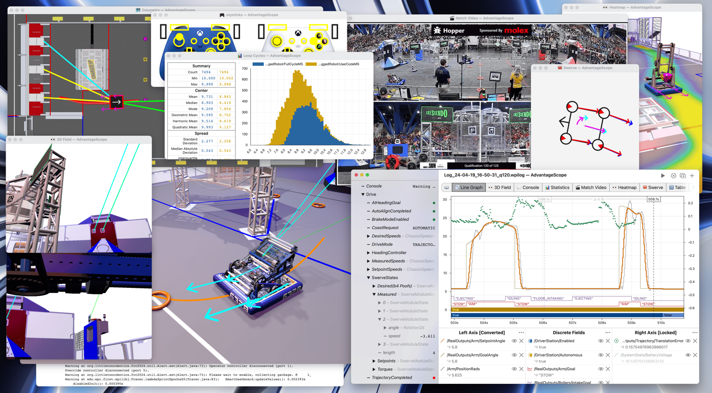
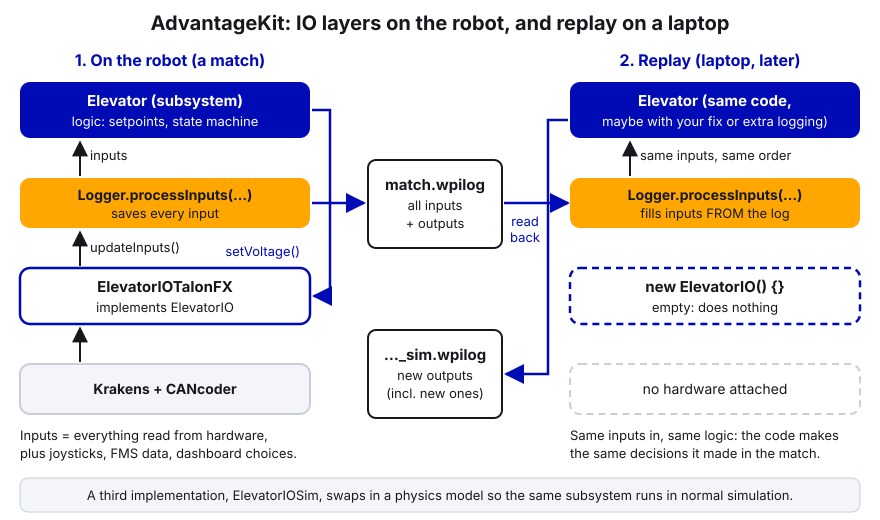
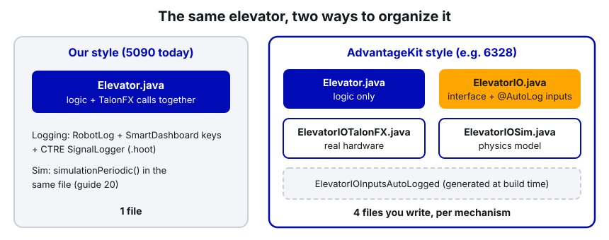

# 34. AdvantageKit and AdvantageScope

> **Who it's for:** any programmer who has opened a log in AdvantageScope, read another team's code, and wondered
> why their subsystems are split into `ElevatorIO`, `ElevatorIOTalonFX` and `ElevatorIOSim`.
> **You need first:** [19 Logging and debugging](19-logging-and-debugging.md) (how we log and open logs) and
> [04 Command-based](04-command-based-basics.md). [20 Simulation](20-simulation-and-testing.md) helps.
> **Time:** about 30 minutes to read; an hour if you try the template in simulation.

The names sound alike and come from the same people (FRC team 6328, Mechanical Advantage, under the name Littleton
Robotics), so they get mixed up all the time. They are two different things:

| | **AdvantageScope** | **AdvantageKit** |
|---|---|---|
| What it is | A program on your laptop that **views** logs and live data | A **logging framework** that goes inside the robot code |
| Do we use it? | Yes, every time we look at a log | No, not in our template (this guide explains why) |
| Needs the other? | No. Opens our `.wpilog` and CTRE `.hoot` files directly | Uses AdvantageScope as its viewer |

## What you'll learn

- What AdvantageScope can show you, and which of our files it opens.
- What AdvantageKit is: the IO layer, `@AutoLog`, and deterministic log replay.
- How to recognize AdvantageKit code in other teams' repos, side by side with our style.
- Why 5090 isn't putting AdvantageKit in our main template right now, and when it could make sense later.

---

## 1. AdvantageScope: the viewer we already use

**AdvantageScope** is a free program for looking at robot data, either from a log file after a match or live from a
running robot or simulator. The WPILib installer includes a copy, so it's already on the programming laptops (the
installer's copy can be a version or two behind the latest download from the AdvantageScope website).



The views ("tabs") we use most:

| Tab | What it's for on our robot |
|---|---|
| **Line Graph** | Target vs. actual for any mechanism, battery voltage, motor current. The one you'll use 90% of the time. |
| **2D Field / 3D Field** | Where the robot thought it was (odometry, vision pose, PathPlanner target). |
| **Swerve** | The four module arrows: wanted vs. measured speed and angle. |
| **Joysticks** | What the driver was pressing at each moment. |
| **Video** | A match video synced to the log, so you can see what the robot did while reading what the code did. |
| **Mechanism** | Draws a `Mechanism2d` (arm, elevator) from the log or sim. |
| **Table / Console / Statistics** | Raw values, printed messages, and loop-time histograms. |

Files and sources it understands:

- **`.wpilog`**: what our `RobotLog` writes through WPILib's `DataLogManager` (guide 19).
- **`.hoot`**: CTRE's signal logs from `SignalLogger`. The first time you open one, AdvantageScope asks you to accept
  CTRE's license agreement. Open the `.wpilog` and the `.hoot` files together and AdvantageScope lines up their
  timestamps automatically.
- **Driver Station logs** (`.dslog`), plus a few other formats (REV, CSV, others).
- **Live**: connect to the robot or the simulator over NetworkTables (File → Connect to Robot / Connect to Simulator).

The video tab is worth knowing about for competitions. You can load a local video file, a YouTube link, or (with an
API key) the match video from The Blue Alliance. AdvantageScope usually syncs it to the log by itself once the
autonomous frames load. If not, you line up a known moment (the start of auto) and lock it.

> **Tip:** AdvantageScope doesn't care what wrote the log. It works just as well with our plain WPILib logging as
> with AdvantageKit. You get every view in the table above without changing any robot code.

---

## 2. AdvantageKit: what it is

**AdvantageKit** is a logging framework for Java robot code. Its big idea: **log every input** the robot code
receives, every loop, so the whole match can be **replayed** later.

An **input** is anything that comes from outside the code: encoder positions, motor currents, the gyro, the
Limelight, joystick buttons, the FMS (match time, alliance), dashboard choices. Everything else (targets, decisions,
motor voltages) is calculated from those inputs by your code.

If you record every input, you can feed them back into the same code on a laptop and it will make **exactly the same
decisions** it made in the match, loop by loop. That's called **deterministic replay**. AdvantageKit's docs describe
it as the code's internal logic being "replayed exactly".

Why that's powerful:

- **Log things after the fact.** After a match you wish you'd logged some value inside the turret code. With replay,
  add the log line, replay the match, and the value is there, as if you'd logged it all along.
- **Test a fix against a real match.** Change the code, replay the match, and see what the new code *would have*
  done with the same sensor data.
- **Nothing is missing.** Normal logging only has what someone remembered to log. AdvantageKit has every input.

### How it works: the IO layer

For replay to work, the code has to read hardware in exactly one place per subsystem, so AdvantageKit can record it
on the robot and substitute logged values in replay. That's what the **IO layer** is:

1. **An IO interface**, for example `ElevatorIO`. It declares an inputs class (positions, velocities, currents...),
   a method `updateInputs(inputs)` that fills it in, and methods to send outputs, like `setVoltage(volts)`.
2. **IO implementations.** `ElevatorIOTalonFX` talks to the real Krakens. `ElevatorIOSim` uses a WPILib physics model.
   In replay, an empty implementation that does nothing is used.
3. **The subsystem** (`Elevator`) only talks to the interface. Every loop it calls `io.updateInputs(inputs)` and then
   `Logger.processInputs("Elevator", inputs)`.

`Logger.processInputs` is the trick. On the robot it **saves** the inputs to the log. In replay it **overwrites**
them with the values from the log. The subsystem can't tell the difference.



### `@AutoLog`

Writing the code to save and load every field of an inputs class by hand would be tedious, so AdvantageKit has an
annotation. Put `@AutoLog` on the inputs class `ElevatorIOInputs` and, when you build, it generates a class called
`ElevatorIOInputsAutoLogged` that does the saving and loading for you. That's why you'll see
`new ElevatorIOInputsAutoLogged()` in other teams' subsystems: it's generated code, not a file in their repo.

Values that aren't inputs (targets, poses, states) are logged as **outputs** with
`Logger.recordOutput("Elevator/Target", target)`. Outputs are recalculated during replay, which is why adding a new
`recordOutput` line and replaying works.

### Setup and templates

To use it, the `Robot` class must extend AdvantageKit's `LoggedRobot` instead of `TimedRobot`, you add a vendordep
and an annotation processor in `build.gradle`, and you start the logger at the top of the `Robot` constructor.
Dashboard inputs need AdvantageKit's versions too (for example `LoggedDashboardChooser` instead of `SendableChooser`),
because a plain `SmartDashboard` read wouldn't be in the log.

AdvantageKit offers template projects, including a **TalonFX(S) swerve template**. It uses the constants file from
CTRE's Tuner X swerve generator (`TunerConstants.java`, the same file we generate), but it does **not** use CTRE's
`SwerveDrivetrain` class like our `CommandSwerveDrivetrain` does. It has its own module code, built in IO layers, so
you can see and change every layer. Other templates: a skeleton project, a vision template, a Spark swerve template,
differential drive, and a KitBot template.

---

## 3. Recognize it: a normal subsystem vs. an AdvantageKit subsystem

Here is one simple roller in both styles, so you can read other teams' code. (Example code, not from any robot.)

**Our style**, one file:

```java
public class Roller extends SubsystemBase {
    private final TalonFX m_motor = new TalonFX(RollerConstants.kMotorId, new CANBus("Upper"));
    private final VoltageOut m_voltageRequest = new VoltageOut(0).withEnableFOC(true);

    public Roller() {
        TalonFXConfiguration config = new TalonFXConfiguration();
        config.CurrentLimits.StatorCurrentLimit = 40;          // amps
        config.CurrentLimits.StatorCurrentLimitEnable = true;
        m_motor.getConfigurator().apply(config);
    }

    public void setVolts(double volts) {
        m_motor.setControl(m_voltageRequest.withOutput(volts));
    }

    @Override
    public void periodic() {
        SmartDashboard.putNumber("Roller/Velocity (RPS)", m_motor.getVelocity().getValueAsDouble());
    }
}
```

**AdvantageKit style**, three files you write (plus a generated one):

```java
// RollerIO.java: what the roller can read and do, with no hardware in it
public interface RollerIO {
    @AutoLog
    public static class RollerIOInputs {
        public double velocityRotationsPerSecond = 0.0;
        public double appliedVolts = 0.0;
        public double statorCurrentAmps = 0.0;
    }

    public default void updateInputs(RollerIOInputs inputs) {}

    public default void setVolts(double volts) {}
}
```

```java
// RollerIOTalonFX.java: the only file that touches the real motor
public class RollerIOTalonFX implements RollerIO {
    private final TalonFX m_motor = new TalonFX(RollerConstants.kMotorId, new CANBus("Upper"));
    private final VoltageOut m_voltageRequest = new VoltageOut(0).withEnableFOC(true);

    public RollerIOTalonFX() {
        TalonFXConfiguration config = new TalonFXConfiguration();
        config.CurrentLimits.StatorCurrentLimit = 40;          // amps
        config.CurrentLimits.StatorCurrentLimitEnable = true;
        m_motor.getConfigurator().apply(config);
    }

    @Override
    public void updateInputs(RollerIOInputs inputs) {
        inputs.velocityRotationsPerSecond = m_motor.getVelocity().getValueAsDouble();
        inputs.appliedVolts = m_motor.getMotorVoltage().getValueAsDouble();
        inputs.statorCurrentAmps = m_motor.getStatorCurrent().getValueAsDouble();
    }

    @Override
    public void setVolts(double volts) {
        m_motor.setControl(m_voltageRequest.withOutput(volts));
    }
}
```

```java
// Roller.java: the logic. It never sees a TalonFX.
public class Roller extends SubsystemBase {
    private final RollerIO m_io;
    private final RollerIOInputsAutoLogged m_inputs = new RollerIOInputsAutoLogged();   // generated by @AutoLog

    public Roller(RollerIO io) {
        m_io = io;
    }

    public void setVolts(double volts) {
        m_io.setVolts(volts);
    }

    @Override
    public void periodic() {
        m_io.updateInputs(m_inputs);
        Logger.processInputs("Roller", m_inputs);   // robot: save to log. replay: load from log.
    }
}
```

And in `RobotContainer`, the implementation is picked by mode (AdvantageKit's templates use a `Constants.currentMode`
of `REAL`, `SIM` or `REPLAY`):

```java
roller = switch (Constants.currentMode) {
    case REAL -> new Roller(new RollerIOTalonFX());
    case SIM -> new Roller(new RollerIOSim());
    default -> new Roller(new RollerIO() {});      // replay: no hardware, inputs come from the log
};
```

How to spot it in someone's repo: folders full of `XxxIO.java`, `XxxIOTalonFX.java`, `XxxIOSim.java`; imports from
`org.littletonrobotics.junction`; `Robot extends LoggedRobot`. 6328's 2025 elevator is a real example: four files
(`Elevator.java`, `ElevatorIO.java`, `ElevatorIOTalonFX.java`, `ElevatorIOSim.java`) in
https://github.com/Mechanical-Advantage/RobotCode2025Public/tree/main/src/main/java/org/littletonrobotics/frc2025/subsystems/superstructure/elevator



---

## 4. Why 5090 isn't using it in our template (for now)

AdvantageKit is good software, and many strong teams use it. The reasons we're not adopting it are about **our team
right now**, not about the tool.

1. **It restructures every subsystem.** Every mechanism becomes a subsystem, an IO interface with an inputs class,
   a real implementation and a sim implementation. That's three or four files instead of one, and the swerve code
   would move from CTRE's generated `CommandSwerveDrivetrain` to AdvantageKit's own module code.
2. **More concepts to learn and maintain.** New programmers already have Java, command-based, Phoenix 6, PID, and
   PathPlanner to learn. Interfaces, IO layers, annotation processing and replay mode add a lot on top, and the code
   only stays replayable if **everyone** follows the rules (no hardware reads outside the IO layer, no plain
   `SmartDashboard` inputs). One shortcut breaks replay quietly.
3. **What we have already covers most of our needs.** `RobotLog` writes a `.wpilog` with our dashboard values,
   commands and events; `SignalLogger` writes every CTRE device's signals to `.hoot` files; AdvantageScope shows both,
   synced, with video. Most of the problems in our history (wrong Pigeon ID, slip current, kSpeedAt12Volts, slot 0
   applied twice) were found by looking at logs like these. None of them needed replay.
4. **Switching mid-season is risky.** Rewriting working subsystems during build or competition season is a good way to
   add bugs to code that worked.

If we ever want some replay without restructuring everything, there's a smaller step: CTRE's **Hoot Replay**. It plays
a `.hoot` log back into the robot program in simulation and replays CTRE device signals automatically, without code
changes to those devices. It needs Phoenix Pro (which we have), only replays one hoot log at a time, and custom values
still need code changes. Our 2026 `Robot.java` already has the CTRE-generated `HootAutoReplay` for timestamps and
joysticks ([Robot.java, lines 33–36](https://github.com/TorqueNados-FRC5090/Hephaestus/blob/c2f0cee6f61db3f26f911d3f5623ed7fa27a5b03/src/main/java/frc/robot/Robot.java#L33-L36)),
but we haven't actually tried replaying a match with it.

### When it could make sense later

- **A mentor-led off-season project on a separate branch** (or a separate repo): port one robot, for example the 2026
  robot or Kachow, to the AdvantageKit TalonFX swerve template, and replay a few real logs. Decide afterward, with
  real experience, whether it's worth it.
- **When the team has several experienced programmers** who are comfortable with interfaces and can review every pull
  request for "no hardware outside the IO layer".
- **Not** in the middle of a season, and not as a surprise change to the main template.

Note that in 2027 the team moves to SystemCore, and every library (WPILib, Phoenix 6, AdvantageKit) is changing for
it. That's another reason to wait until the new setup is stable before adding a framework on top.

---

## 5. In our code: what we use instead

Our logging, covered fully in guide 19, starts in the template's `RobotLog`:

[RobotLog.java, lines 62–75 (start: DataLog + SignalLogger)](https://github.com/TorqueNados-FRC5090/Robot-Template/blob/b8dddd0e338841e867c0cc260162e6097adecd7b/src/main/java/frc/robot/RobotLog.java#L62-L75)

```java
public static void start(String... canivoreNames) {
    DataLogManager.start();   // picks the USB stick (/u) automatically when one is plugged in
    DataLogManager.logNetworkTables(true);
    DriverStation.startDataLog(DataLogManager.getLog());

    // CTRE logs: USB stick if present, otherwise CTRE's default location on the RIO
    boolean usbStick = new File("/u").canWrite();
    if (usbStick) {
        SignalLogger.setPath("/u/ctre-logs/");
    } else if (RobotBase.isReal()) {
        DriverStation.reportWarning("No USB stick in the roboRIO: logs are going to the RIO's small internal storage", false);
    }
    SmartDashboard.putBoolean("Logging/USB stick", usbStick);
    SignalLogger.start();
```

What to notice: `logNetworkTables(true)` means every dashboard value we publish (all those `Subsystem/Thing (units)`
keys) also lands in the `.wpilog`, and `startDataLog` adds the joysticks and robot mode. One call at startup gives us a `.wpilog` and `.hoot` files on the USB stick, and both open in
AdvantageScope. Our code reads hardware wherever it needs to (inside each subsystem), which is simpler but is exactly
what makes AdvantageKit-style replay impossible. That's the trade-off we chose.

---

## Step by step: look at an AdvantageKit project (optional, in simulation)

1. Read the template list at docs.advantagekit.org (Getting Started → Template Projects) and download the TalonFX(S)
   swerve template **into a new folder**, not into our robot code.
2. Open it in WPILib VS Code. Find `Robot.java` (`extends LoggedRobot`), `Constants.java` (the mode), and one
   subsystem's `IO`, `IOTalonFX` and `IOSim` files.
3. Run it in simulation, open AdvantageScope, connect to the simulator, and drive it on the 2D field.
4. Compare its drive subsystem with our `CommandSwerveDrivetrain`. Write down what's the same and what's different.
5. Delete the folder or keep it on your own machine. Don't commit it to our repos.

## Common mistakes

- **Thinking AdvantageScope needs AdvantageKit.** It doesn't. It opens our logs as they are.
- **Mixing up the two names** when asking for help online. Say "AdvantageScope" for the viewer, "AdvantageKit" for
  the framework.
- **Copying one AdvantageKit file into our code.** An `ElevatorIOTalonFX` alone won't compile without the interface,
  the generated `AutoLogged` class, the vendordep and `LoggedRobot`. Learn the idea from it; don't paste it.
- **Reading hardware outside the IO layer** in an AdvantageKit project. Replay still runs but gives wrong answers,
  and nothing warns you.
- **Forgetting to open the `.hoot` files** with the `.wpilog`. Half the data (motor currents, temperatures) is in the
  hoot files.

## Checklist

- [ ] I can open a `.wpilog` and its `.hoot` files together in AdvantageScope.
- [ ] I can graph a target against its measured value, and sync a match video.
- [ ] I can explain the difference between AdvantageScope and AdvantageKit in one sentence each.
- [ ] I can find the IO interface, real implementation and sim implementation in another team's subsystem.
- [ ] I know AdvantageKit experiments go on a separate branch or repo, with a mentor, not in the main template.

## Practice

1. **Video sync.** Open a 2026 match log in AdvantageScope with its `.hoot` files, add the match video in the Video
   tab, and sync it. Find one moment where the shooter's measured speed dropped during a shot and see it on video.
2. **Read 6328's elevator.** Open the four elevator files from 6328's 2025 repo (link above). Draw the data flow on
   paper: where the encoder position is read, where it's logged, where the logic uses it, and where the voltage goes.
3. **Convert on paper.** Take our template's `ExampleRoller` and write (on paper or in a scratch folder) what its
   `IO` interface and inputs class would look like. Which values are inputs? Which are outputs?
4. **Find the inputs we don't log.** Pick one 2026 subsystem and list every hardware value it reads. Check which ones
   end up in the `.wpilog` or `.hoot` files. This is the gap AdvantageKit closes, and it's useful to know even without it.

## Go further

- AdvantageScope documentation: https://docs.advantagescope.org/
- AdvantageScope, log files (formats, hoot, multiple logs): https://docs.advantagescope.org/overview/log-files
- AdvantageScope, video tab: https://docs.advantagescope.org/tab-reference/video
- AdvantageKit documentation: https://docs.advantagekit.org/
- AdvantageKit, what it is: https://docs.advantagekit.org/getting-started/what-is-advantagekit
- AdvantageKit, IO interfaces: https://docs.advantagekit.org/data-flow/recording-inputs/io-interfaces
- AdvantageKit, TalonFX(S) swerve template: https://docs.advantagekit.org/getting-started/template-projects/talonfx-swerve-template
- CTRE, Hoot Replay: https://v6.docs.ctr-electronics.com/en/stable/docs/api-reference/api-usage/hoot-replay.html
