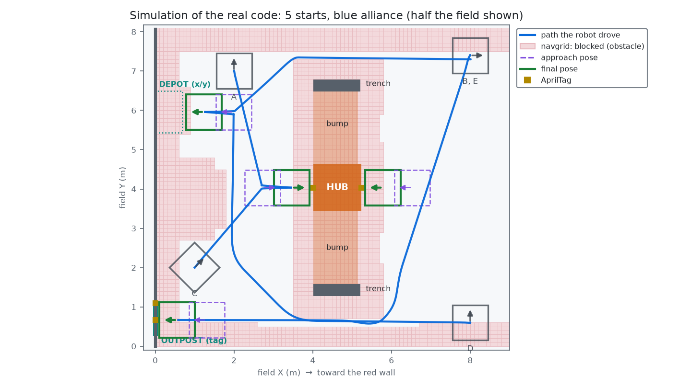
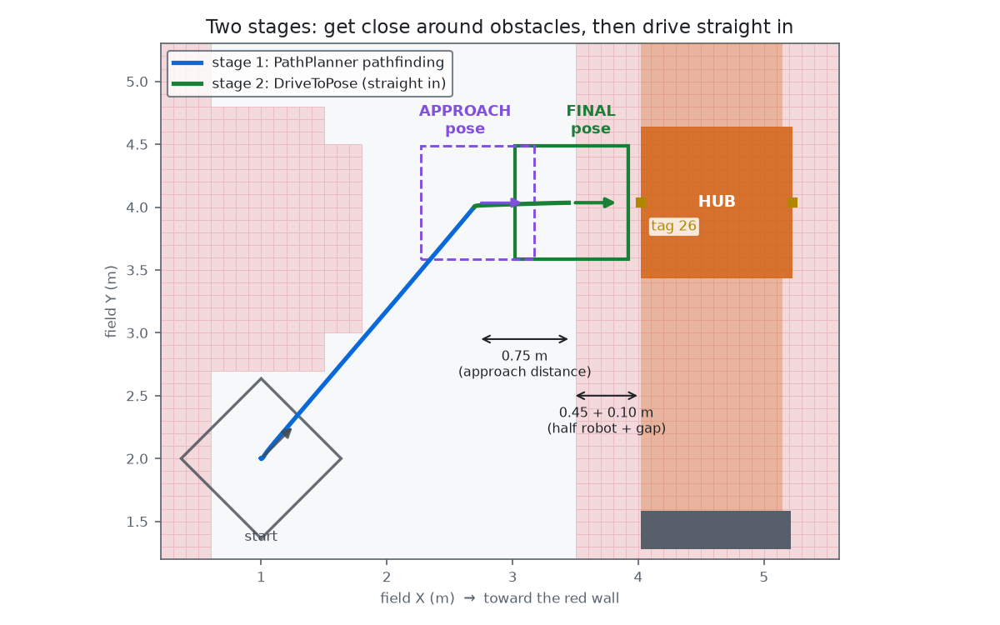
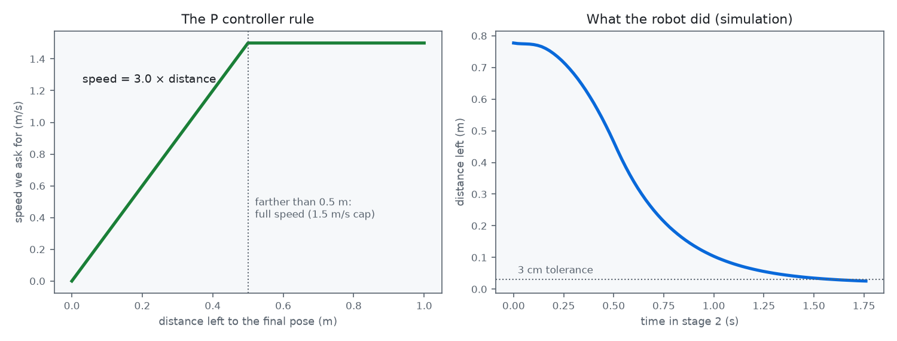
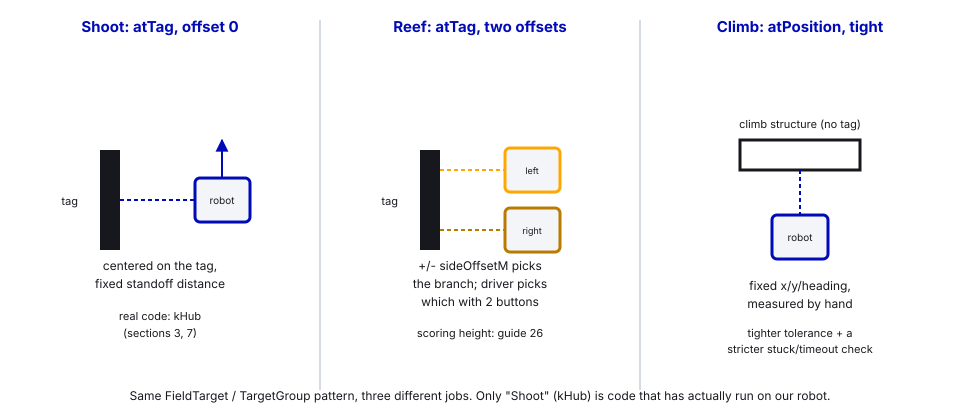

# 35. Teleop Auto-Align: Pathfind, Dodge Obstacles, Line Up with Vision

> **Who it's for:** anyone wiring up a "hold a button, the robot drives itself there" feature — lining up to shoot,
> climb, or score, in **teleop**, not in an auto.
> **You need first:** [13 Turrets](13-turrets.md) section 11 (the pose-only aiming idea this whole guide is built on),
> [16 Swerve](16-swerve-drive-ctre.md), [17 Limelight and Vision](17-limelight-and-vision.md), and
> [18 PathPlanner Autos](18-pathplanner-autos.md) section 7 (the navgrid and on-the-fly pathfinding basics — this
> guide builds on that instead of repeating it).
> **Time:** about 90 minutes to read. A weekend to get a real auto-align working and trustworthy on the floor.

In 2025 (Reefscape), the best teams had a button that drove the robot onto a reef branch by itself. Lining up by
hand is the slowest, most error-prone part of a scoring game: the driver has to get within a couple of centimeters
while being pushed around, looking across the field. A computer does it better, and the same way every time. This
guide is the pattern for building that: **hold a button in teleop, and the robot pathfinds around whatever's in the
way, then drives the last bit in with pinpoint accuracy.**

We built exactly this on our half field, in the teaching repo
[frc-auto-align](https://github.com/HALFxAxHEART/frc-auto-align). It drives to our 2026 hub and outpost. Every
example and permalink below is real, working code from that repo — not pseudocode. It has never run on a
competition robot; only ours, on blocks and on our half field, in 2026.

## What you'll learn

- The two-stage pattern — PathPlanner pathfinding for the long, obstacle-filled part, then a simple P-controller for
  the short, exact part — and why neither stage alone is good enough.
- How the robot's **pose** (not a live camera frame) is what makes "drive to the hub" possible, the same pose-only
  idea from [13 Turrets](13-turrets.md), now applied to the whole drivetrain instead of one mechanism.
- How to describe a target: from an AprilTag with a sideways offset (how 2025 teams picked a reef branch), or from
  plain field coordinates.
- How obstacle avoidance plugs into a **button press**, not just a pre-drawn auto.
- The safety layers: what makes an auto-align refuse to start, give up partway, or hand control straight back.
- Three worked examples: lining up to **shoot**, lining up to **score on a reef-style structure** (left or right
  branch), and lining up to **climb**.

---

## 1. The idea, in one picture



Three questions, in order:

1. **Where am I?** The robot's pose: X, Y and heading on the field.
2. **Where do I want to be?** A target pose, worked out from an AprilTag or given as X/Y coordinates.
3. **How do I get there without hitting anything?** Two stages: PathPlanner for the long, twisty part around
   obstacles; a simple controller for the short, exact part at the end.

Everything below is one section per question, then three worked examples applying the whole pattern.

---

## 2. Where am I? The pose, not the pixel

This is the same lesson as [13 Turrets, section 11](13-turrets.md): you can aim a mechanism (or a whole robot) two
ways — chase what a camera sees *right now*, or compute the answer from the robot's known position on the field.
Auto-align only works the second way. The drivetrain's pose estimator blends:

- **Odometry.** Wheel encoders and the gyro say how far and which way we've moved. Fast and smooth, but it slowly
  drifts — wheels slip, robots push us.
- **Vision.** The Limelight sees AprilTags, whose exact field positions FIRST publishes, and corrects the drift
  (MegaTag2; see [17 Limelight and Vision](17-limelight-and-vision.md)).

> **Rule #1 of auto-align: it can only drive to the right place if it knows where it is.** Auto-align refuses to
> even start if the pose hasn't been corrected by a tag recently — a stale, drifted pose means the robot confidently
> drives to the *wrong* place, which is worse than not moving at all.

---

## 3. Where do I want to be? A target, from a tag or from coordinates

A target spot is a `FieldTarget`: a name, and either an AprilTag with a sideways offset, or plain field coordinates.


### By AprilTag (best choice when there's a tag on the thing)

[Constants.java, lines 188–199 (`FieldTarget.atTag`)](https://github.com/HALFxAxHEART/frc-auto-align/blob/c95ddf4a2ee25c406ea6e2ed04e232b17b39b8f7/src/main/java/frc/robot/Constants.java#L188-L199):

```java
/**
 * @param sideOffsetM Meters to slide sideways along the tag's face, as seen by someone standing in front of
 *                    the tag LOOKING AT it: + = to their left, - = to their right. 0 = centered on the tag.
 *                    (In 2025 this is how teams picked the left or right reef pole.)
 */
public static FieldTarget atTag(String name, int tagId, double sideOffsetM) {
    return new FieldTarget(name, tagId, sideOffsetM, null);
}
```

The final pose is built with one `transformBy` call, starting from the tag's own pose
([`AutoAlign.targetPose`, lines 216–231](https://github.com/HALFxAxHEART/frc-auto-align/blob/c95ddf4a2ee25c406ea6e2ed04e232b17b39b8f7/src/main/java/frc/robot/commands/AutoAlign.java#L216-L231)):

```java
double outM = kRobotHalfLengthM + kBumperGapM + extraOutM;
Rotation2d facing = kFaceTargetWithFront ? Rotation2d.k180deg : Rotation2d.kZero;
return Optional.of(tag.get().toPose2d().transformBy(new Transform2d(outM, -target.sideOffsetM(), facing)));
```

`transformBy` means "starting from this pose, move this far in *its own* directions" — that's the whole trick:
one line works for a tag facing any way, on either alliance, with no if-statements for which side of the field
you're on.

### By coordinates (when there's no tag on it)

[Constants.java, lines 201–210](https://github.com/HALFxAxHEART/frc-auto-align/blob/c95ddf4a2ee25c406ea6e2ed04e232b17b39b8f7/src/main/java/frc/robot/Constants.java#L201-L210):

```java
/**
 * @param xM         Where the robot's CENTER ends up: meters from the blue wall
 * @param yM         Meters from the right-hand side wall (as seen from the blue driver station)
 * @param headingDeg Which way the robot's FRONT points: 0 = toward the red wall, 90 = left, 180 = toward blue
 */
public static FieldTarget atPosition(String name, double xM, double yM, double headingDeg) {
    return new FieldTarget(name, -1, 0.0, new Pose2d(xM, yM, Rotation2d.fromDegrees(headingDeg)));
}
```

A coordinate spot doesn't move with anything, so measure it from the field drawings and double-check it by hand. The
**red version** doesn't need re-measuring: our 2026 field is the same for red, turned 180° around the center, so
`onRedSide(...)` works it out (`x → length − x`, `y → width − y`, `heading + 180°`) — see
[lines 217–225](https://github.com/HALFxAxHEART/frc-auto-align/blob/c95ddf4a2ee25c406ea6e2ed04e232b17b39b8f7/src/main/java/frc/robot/Constants.java#L217-L225). If a future field is a *mirror* image across the middle line
instead (like 2024's was), that math changes — check which kind of symmetry the current game's field has before
copying it blindly.

### Groups: one button, several spots, "closest wins"

A button binds to a **group** of spots, listed separately per alliance
([`TargetGroup`, lines 228–251](https://github.com/HALFxAxHEART/frc-auto-align/blob/c95ddf4a2ee25c406ea6e2ed04e232b17b39b8f7/src/main/java/frc/robot/Constants.java#L228-L251)). When the button is pressed, the code reads the Driver
Station's alliance color, takes that alliance's list, and drives to whichever spot is **closest right now**. Our hub
group has two reachable faces (the other two are blocked by field bumps); this is how 2025 teams picked the nearest
reachable reef face without the driver choosing anything.

---

## 4. How do I get there? Two stages



### Stage 1: PathPlanner pathfinding — the long, twisty, obstacle-avoiding part

```java
Command pathfind = AutoBuilder.pathfindToPose(approachPose, constraints, 0.0);   // 0.0 = arrive stopped
```

This is [18 PathPlanner, section 7](18-pathplanner-autos.md)'s pathfinding, used from a **teleop button** instead of
an auto: PathPlanner plans a route live, from wherever the robot happens to be, around whatever's marked blocked in
`deploy/pathplanner/navgrid.json`. That guide covers drawing and editing the navgrid in the app — read it if you
haven't; this guide assumes it.

It stops at an **approach pose**, not the final spot. Two reasons: the final spot is deliberately *inside* the
blocked area right next to the target (we want to be right up against it), which the pathfinder won't enter; and
arriving at an angle could clip a corner of the target. So stage 1 only gets you to a safe spot straight out in
front, lined up.

**Turn first.** Before moving, the robot turns in place to its final heading
([`buildAlign`, lines 173–179](https://github.com/HALFxAxHEART/frc-auto-align/blob/c95ddf4a2ee25c406ea6e2ed04e232b17b39b8f7/src/main/java/frc/robot/commands/AutoAlign.java#L173-L179)), instead of letting PathPlanner turn it gradually
over the whole path. A square robot that's half-turned is wider corner to corner than head-on — our 0.9 m square
robot swings out to 1.27 m diagonally — and a half-turned robot clipped a trench frame in simulation before this was
added. Turned first, it stays square the whole way.

If you're already close and lined up straight in front, stage 1 is skipped entirely
([lines 167–171](https://github.com/HALFxAxHEART/frc-auto-align/blob/c95ddf4a2ee25c406ea6e2ed04e232b17b39b8f7/src/main/java/frc/robot/commands/AutoAlign.java#L167-L171) and
[`isLinedUpInFront`, lines 233–241](https://github.com/HALFxAxHEART/frc-auto-align/blob/c95ddf4a2ee25c406ea6e2ed04e232b17b39b8f7/src/main/java/frc/robot/commands/AutoAlign.java#L233-L241)) — there's nothing to path around, so go
straight to stage 2.

### Stage 2: `DriveToPose` — the short, exact part



From the approach pose, a small command drives **straight in**, no pathfinding, just a P controller (the P in PID;
see [07 What is PID](07-what-is-pid.md)):

[DriveToPose.java, lines 72–107 (`execute`)](https://github.com/HALFxAxHEART/frc-auto-align/blob/c95ddf4a2ee25c406ea6e2ed04e232b17b39b8f7/src/main/java/frc/robot/commands/DriveToPose.java#L72-L107):

```java
Translation2d error = m_goal.getTranslation().minus(pose.getTranslation());
double distance = error.getNorm();
double speed = Math.min(kFinalTranslationP * distance, kFinalMaxSpeed);
if (distance > kPositionToleranceM) {
    speed = Math.max(speed, kFinalMinSpeed);     // a floor, so friction can't stop it short of the goal
}
speed = Math.min(speed, m_lastSpeed + kFinalMaxAccel * 0.020);   // acceleration limit
double vx = error.getX() / distance * speed;
double vy = error.getY() / distance * speed;
```

Far away → fast (capped at `kFinalMaxSpeed`, 1.5 m/s). Close → slow. Arrived → stopped. Turning uses the identical
idea on the heading error. Two details that make it actually work on a real robot instead of just in theory:

- **A minimum speed.** Right near the goal, `kP × distance` shrinks to almost nothing, and on carpet that's too
  little to beat static friction — the robot sits there forever 2° short. A small floor speed, held until it's
  inside tolerance, fixes it.
- **An acceleration limit**, so the wheels don't break loose the instant the command starts (which would hurt the
  pose, not just look bad).

It's "arrived" once it's been within 3 cm and 2° for 0.15 s in a row — a short settle time so a quick swing-through
doesn't count.

### Why two stages and not one

A pathfinder alone can't park you to the centimeter (it's tuned for speed through open space, not a 3 cm
tolerance) and won't enter the tight space right next to a target. A P controller alone can't go around anything —
it drives dead straight at the error, which is exactly what you don't want with a reef pole or a hub corner between
you and the goal. Each stage does the one thing the other can't.

---

## 5. Safety: the driver is always the backup

Because this can't see game pieces or other robots (section 6 below), it leans hard on the driver and a few checks
([`shouldStopEarly`, lines 252–269](https://github.com/HALFxAxHEART/frc-auto-align/blob/c95ddf4a2ee25c406ea6e2ed04e232b17b39b8f7/src/main/java/frc/robot/commands/AutoAlign.java#L252-L269)):

| Layer | What it does |
|---|---|
| **Hold to run** | Bound with `whileTrue`. Let go, and it stops immediately. |
| **Stick override** | Move a drive stick past 20%, and it cancels, handing control straight back — the driver always wins. |
| **Position trust check** | Won't even start without an AprilTag seen in the last 2 seconds. No trustworthy pose, no drive. |
| **Stuck check** | Wheels told to move at speed but not actually moving (hit something) for 0.5 s straight: give up, long buzz. |
| **Timeout** | Final approach taking longer than 3 s: give up, long buzz. Probably something's in the way. |
| **Startup check** | PathPlanner needs a one-time warmup after boot ([18, section 7](18-pathplanner-autos.md)); pressing during it gets a "try again" buzz instead of a stuck robot. |

**What it can't see at all:** loose game pieces on the floor, and other robots. PathPlanner *can* avoid moving
obstacles if you feed it their positions (`Pathfinding.setDynamicObstacles`), but that needs a camera that detects
robots — a real project of its own, not something this pattern gives you for free. Until you build that, treat
auto-align as "the driver points the robot roughly the right way and holds a button"; the computer handles the last
meter of precision, not collision avoidance against a moving field.

---

## 6. In our code: the whole flow

[AutoAlign.java](https://github.com/HALFxAxHEART/frc-auto-align/blob/c95ddf4a2ee25c406ea6e2ed04e232b17b39b8f7/src/main/java/frc/robot/commands/AutoAlign.java) is the command you bind to a button; `DriveToPose.java` is its stage-2
helper (section 4 above). One button, one call:

[RobotContainer.java, lines 68–70](https://github.com/HALFxAxHEART/frc-auto-align/blob/c95ddf4a2ee25c406ea6e2ed04e232b17b39b8f7/src/main/java/frc/robot/RobotContainer.java#L68-L70)
and
[lines 110–119](https://github.com/HALFxAxHEART/frc-auto-align/blob/c95ddf4a2ee25c406ea6e2ed04e232b17b39b8f7/src/main/java/frc/robot/RobotContainer.java#L110-L119). The 2026 robot (Hephaestus) doesn't have auto-align built in — it uses a turret
instead (guide 13) — so this whole pattern lives only in the teaching repo:

```java
private final AutoAlign autoAlign = new AutoAlign(
    drivetrain, vision, this::onRedAlliance, this::driverIsDriving, this::rumbleDriver);
...
driver.leftStick().whileTrue(autoAlign.alignTo(AlignConstants.kOutpost));
driver.rightStick().whileTrue(autoAlign.alignTo(AlignConstants.kHub));
driver.a().whileTrue(autoAlign.alignTo(AlignConstants.kDepot));
CommandScheduler.getInstance().schedule(autoAlign.warmup());   // practice pathfind at boot
```

`alignTo` wraps the real work in `Commands.defer`
([lines 111–119](https://github.com/HALFxAxHEART/frc-auto-align/blob/c95ddf4a2ee25c406ea6e2ed04e232b17b39b8f7/src/main/java/frc/robot/commands/AutoAlign.java#L111-L119)):

```java
public Command alignTo(TargetGroup group) {
    return Commands.defer(() -> buildAlign(group), Set.of(m_drivetrain)).withName("Align to " + group.name());
}
```

**Why `defer` and not just building the command once?** Without it, the whole sequence — which spot is closest,
what the goal pose is — would be decided **once, at robot boot**, before the robot had moved an inch. `defer` builds
it fresh every time the button is actually pressed, using wherever the robot really is at that instant. This is the
same idea as [04 Command-based, section 7](04-command-based-basics.md)'s "commands set a target, periodic() reads
live state" — here the live state is read once per press instead of every loop, because the plan only needs to be
made once.

`buildAlign` ([lines 121–201](https://github.com/HALFxAxHEART/frc-auto-align/blob/c95ddf4a2ee25c406ea6e2ed04e232b17b39b8f7/src/main/java/frc/robot/commands/AutoAlign.java#L121-L201)) is the whole pattern from sections 2–4 in one
method, in order: trust check → pick the closest spot → compute the final and approach poses → turn first →
pathfind → drive in → report what happened. It ends with:

```java
return Commands.sequence(start, turnFirst, pathfind, finalApproach)
    .until(this::shouldStopEarly)              // the safety layers, checked every loop
    .finallyDo(interrupted -> finish(targetName, interrupted));
```

`finish` ([lines 287–304](https://github.com/HALFxAxHEART/frc-auto-align/blob/c95ddf4a2ee25c406ea6e2ed04e232b17b39b8f7/src/main/java/frc/robot/commands/AutoAlign.java#L287-L304)) is where the controller buzz and the
`Align/State` dashboard string come from — one short buzz for arrived, one long buzz for gave-up, nothing for a
plain button release. Everything it decides also goes to the log (`RobotLog.event`, `RobotLog.pose` for
`Align/Goal` and `Align/Approach`), so a bad align shows up on the field in AdvantageScope afterward exactly like a
turret aim error does (see [19 Logging and debugging](19-logging-and-debugging.md)).

---

## 7. Three worked examples

The pattern above doesn't care *what* the target is. Here's the same `FieldTarget` machinery pointed at three
different jobs. Only the first (shooting, via the real `kHub` group) is code that has actually run on our robot; the
reef and climb examples are new, written in the same style, to show how you'd set them up.



### Shoot: known distance, known angle, every time

```java
public static final TargetGroup kHub = new TargetGroup("Hub",
    new FieldTarget[] { FieldTarget.atTag("Blue hub, wall side", 26, 0.0), FieldTarget.atTag("Blue hub, middle side", 20, 0.0) },
    new FieldTarget[] { FieldTarget.atTag("Red hub, wall side", 10, 0.0), FieldTarget.atTag("Red hub, middle side", 4, 0.0) });
```

This is real code, unchanged. Hold the paddle and the robot parks at a fixed, known distance and heading in front of
whichever hub face is closer. The payoff: once you're parked at a known distance, the distance-based shooter and
hood tables from [10 Flywheels and Shooters](10-flywheels-and-shooters.md) and the turret math from
[13 Turrets](13-turrets.md) have one fixed number to work with instead of a moving target — a shot from an
auto-aligned spot is exactly as repeatable as the mechanism tuning underneath it. (On a robot with no turret at
all, [16 Swerve, section 5](16-swerve-drive-ctre.md) is the lighter-weight version of this idea: rotate-only,
no pathfinding, for when you just need the right *heading*, not an exact X/Y too.)

### Score on a reef-style structure: pick a branch with the side offset

Reefscape's reef had six faces, each with a tag, and two scoring branches (poles) per face, a fixed distance apart.
`sideOffsetM` was built for exactly this — the code comment in `FieldTarget.atTag` says so directly: *"In 2025 this
is how teams picked the left or right reef pole."* A reef-style target group would look like:

```java
// Made-up example: a reef face's tag, two branches 0.33 m apart (half the branch spacing each way)
public static final TargetGroup kReefFaceA = new TargetGroup("Reef face A",
    new FieldTarget[] {
        FieldTarget.atTag("Reef A, left branch",  18, +0.165),
        FieldTarget.atTag("Reef A, right branch", 18, -0.165),
    },
    new FieldTarget[] { /* ... red side tag + mirrored offsets ... */ });
```

Two buttons (left branch / right branch) instead of one "closest" group, since the driver — not distance — is the
one who knows which branch has room. **Scoring height is a separate decision.** Auto-align only answers "where does
the drivetrain stop and which way does it face"; it says nothing about the elevator or arm. That's
[26 State Machines for Pick-and-Place](26-state-machines-for-pick-and-place.md)'s job: the operator independently
requests L1–L4 on the superstructure, which can start moving the moment the align begins (or even before — nothing
stops the elevator going up while the drivetrain is still pathfinding over). Watch `Align/State` on the dashboard
to know when it's safe to score; don't wire scoring directly to "the align command ended", since it can end by
giving up just as easily as by arriving.

### Climb: a tight, repeatable fixed spot

A climb structure usually has no tag of its own, and the margin for error is small — a cage or rung is often barely
wider than the robot. That makes it a strong candidate for `atPosition` instead of `atTag`, and for a tighter
approach:

```java
// Made-up example: a fixed climb spot, measured from the field drawings, like kDepot
public static final FieldTarget kBlueClimb = FieldTarget.atPosition("Blue climb", 7.20, 4.03, 0.0);
public static final TargetGroup kClimb = new TargetGroup("Climb",
    new FieldTarget[] { kBlueClimb }, new FieldTarget[] { kBlueClimb.onRedSide("Red climb") });
```

Two things worth changing from the hub/reef defaults for a climb: a **smaller `kPositionToleranceM`** (the default
3 cm is already tight, but a narrow cage may want tighter still, traded against how long "settling" takes), and
treating `kFinalApproachTimeoutSeconds` and the stuck check as genuinely safety-critical — getting stuck half
inside a climb structure at the end of a match is a worse failure than giving up early and letting the driver
finish it by hand. Once `DriveToPose` reports arrived, the climb mechanism itself (winch, hooks, elevator) takes
over — that's ordinary [12 Spring-Back](12-spring-back-and-auto-retract.md) or [15 Elevators](15-elevators.md)
territory, not auto-align's job.

---

## Common mistakes

- **No `defer`.** Building the align command once at boot "decides" the closest target before the robot has moved,
  and it's wrong for the rest of the match.
- **Trusting a pose that was never corrected.** Skipping the "seen a tag recently" check means a drifted odometry
  pose gets treated as ground truth, and the robot confidently drives to the wrong spot. Refuse to start instead.
- **Pathfinding all the way to the final pose.** The final pose is deliberately inside the blocked zone right next
  to the target; the pathfinder won't go there, and even if it would, arriving on an unpredictable final heading can
  clip a corner. Stop at an approach pose and switch to a P controller for the last bit.
- **No minimum speed in the P controller.** Near the goal, `kP × error` shrinks to nothing, and the robot sits a
  few degrees short forever, held by friction.
- **Turning gradually over the whole pathfind instead of turning first.** A square robot that's half-turned is
  wider corner to corner than head-on, and can clip something a head-on robot would clear.
- **Binding scoring/climbing directly to "the align command finished".** It finishes on *both* arriving and giving
  up. Check `Align/State` (or a dedicated "arrived" flag), not just "the command ended."
- **Forgetting the warmup, or not refusing while it's running.** The very first pathfind after boot is slow because
  the JVM hasn't optimized that code path yet; pressing during it can leave the robot stuck in "Pathfinding" with
  no error.
- **Assuming it avoids other robots or game pieces.** It only avoids what's in the navgrid — field elements that
  never move. Nothing in this pattern looks for a robot or a dropped game piece in the way.

## Checklist

- [ ] Pose is corrected by vision regularly (check `Vision/.../Correction (m)`, [17](17-limelight-and-vision.md)),
      not just trusted blind.
- [ ] Every `FieldTarget` has a real, measured basis — a tag ID checked against the official field layout, or
      coordinates checked against the field drawings by hand.
- [ ] Alliance mirroring (`onRedSide`, or separate blue/red tag IDs) tested on **both** alliances in sim.
- [ ] Navgrid matches the real field (trenches/lanes open, solid obstacles blocked) — see
      [18, section 7](18-pathplanner-autos.md).
- [ ] Warmup is scheduled at boot, and a press during warmup is refused instead of getting stuck.
- [ ] Stuck check and timeout values make sense for the robot's real top speed and the tightest gap it drives
      through.
- [ ] Stick-override threshold tested: a stick bumped by accident shouldn't cancel; a stick genuinely pushed should.
- [ ] Tested in simulation first (both alliances, every target), then on blocks, then on the floor at low stakes
      before trusting it in a match.

## Practice

1. **Trace a path by hand.** Pick a `FieldTarget`, place the robot pose somewhere with an obstacle between it and
   the target, and sketch on paper where you'd expect the approach-pose pathfind to go. Then run it in simulation
   and compare.
2. **Break the trust check.** In simulation, disable vision corrections (or just don't let it see a tag) and press
   align. Confirm it refuses instead of driving somewhere.
3. **Add a target.** Using the coordinate pattern from the climb example, add one real `FieldTarget.atPosition` for
   a spot on your own practice field, wire it to a spare button, and test it on blocks.
4. **Two branches, one face.** Build the reef-style `TargetGroup` from section 7 for a real tag on your field (even
   a piece of tape with a printed tag works for a bench test), bind left/right to two buttons, and confirm the
   offsets land where you expect using a tape measure.
5. **Tighten the climb tolerance.** Starting from the default `kPositionToleranceM`, cut it in half and retest the
   final approach's settle time. At what point does `kSettleSeconds` need to go up too, so a close pass doesn't get
   called "arrived" early?

## Go further

- frc-auto-align, [AUTO-ALIGN-GUIDE.md](https://github.com/HALFxAxHEART/frc-auto-align/blob/c95ddf4a2ee25c406ea6e2ed04e232b17b39b8f7/AUTO-ALIGN-GUIDE.md) — the full write-up this guide is built from, with more pictures
  and a step-by-step PathPlanner/navgrid walkthrough.
- frc-auto-align, [MENTOR-NOTES.md](https://github.com/HALFxAxHEART/frc-auto-align/blob/c95ddf4a2ee25c406ea6e2ed04e232b17b39b8f7/MENTOR-NOTES.md) — a session plan and the bugs found while building it, all
  caught in simulation before the robot ever moved.
- PathPlanner, pathfinding: https://pathplanner.dev/pathplanner-pathfinding.html
- PathPlanner, dynamic obstacle avoidance (other robots, if you build the detection for it):
  https://pathplanner.dev/robot-config.html
- WPILib, `Commands.defer`: https://docs.wpilib.org/en/stable/docs/software/commandbased/command-compositions.html
- WPILib, `Transform2d` and `relativeTo`: https://docs.wpilib.org/en/stable/docs/software/basic-programming/geometry.html
